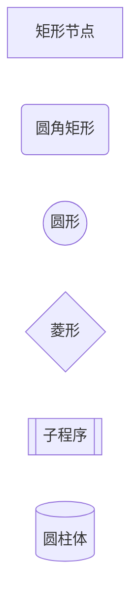
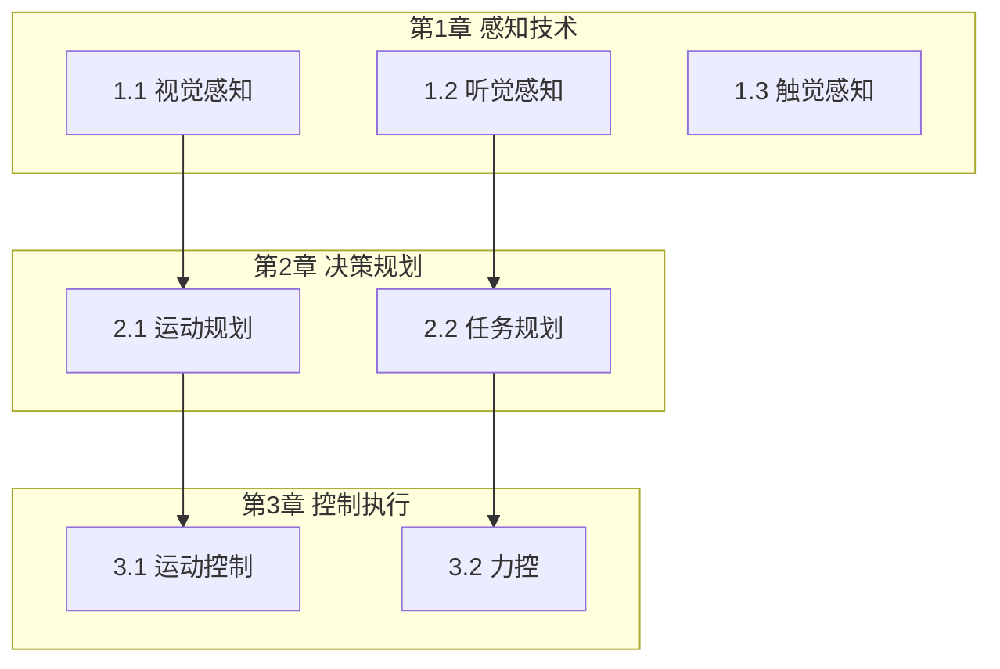
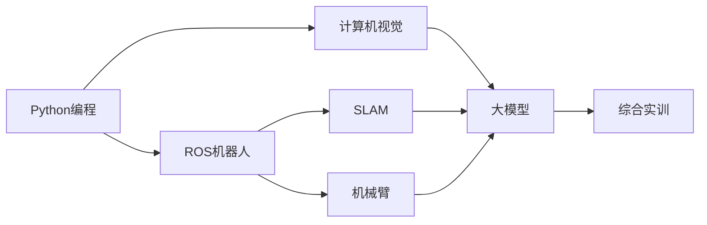
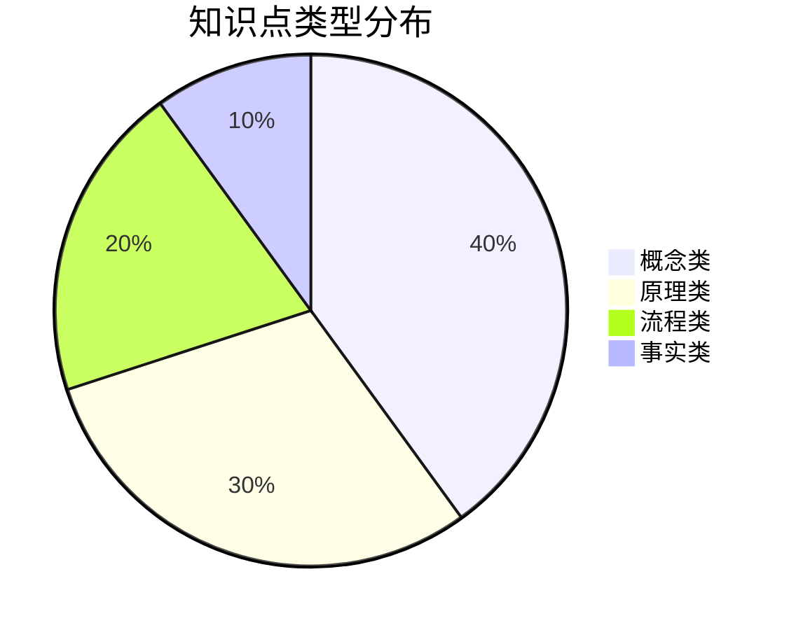
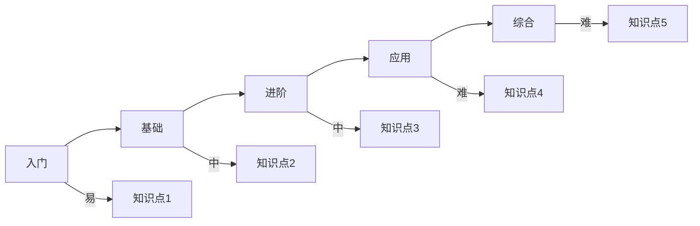

# 知识图谱绘制技能

本技能提供知识图谱的可视化绘制方法，用于生成知识结构图形。

---

## 一、Mermaid语法基础

### 1.1 图形类型
| 类型 | 语法 | 用途 |
|-----|-----|-----|
| flowchart | `graph LR/TB` | 流程图 |
| sequenceDiagram | `sequenceDiagram` | 时序图 |
| classDiagram | `classDiagram` | 类图 |
| stateDiagram | `stateDiagram` | 状态图 |

### 1.2 节点形状


### 1.3 连线样式
```mermaid
graph LR
    A --> B        <!-- 箭头线 -->
    C --> D        <!-- 实线 -->
    E -.-> F       <!-- 虚线 -->
    G ==> H        <!-- 加粗线 -->
    I --- J        <!-- 无箭头 -->
```

---

## 二、知识图谱图形模板

### 2.1 三级结构图


### 2.2 知识点依赖图


### 2.3 课程依赖图


---

## 三、样式设置

### 3.1 节点样式


### 3.2 颜色语义
| 颜色 | 语义 | 适用场景 |
|-----|------|---------|
| #e1f5fe | 浅蓝 | 基础层级 |
| #b3e5fc | 中蓝 | 中间层级 |
| #81d4fa | 深蓝 | 核心层级 |
| #03a9f4 | 主蓝 | 重点内容 |
| #ffecb3 | 浅黄 | 注意提醒 |
| #ffcdd2 | 浅红 | 难点警示 |

### 3.3 布局方向
| 方向 | 说明 |
|-----|------|
| TB | 从上到下 |
| TD | 从上到下（等同于TB） |
| BT | 从下到上 |
| LR | 从左到右 |
| RL | 从右到左 |

---

## 四、导出选项

### 4.1 Mermaid源码
直接输出Mermaid语法代码，便于嵌入Markdown。

### 4.2 HTML渲染
```html
<script src="https://cdn.jsdelivr.net/npm/mermaid@10/dist/mermaid.min.js"></script>
<div class="mermaid">
graph TB
    A[知识图谱]
</div>
```

---

## 五、实用模板

### 5.1 知识点类型分布图


### 5.2 学习路径图


---

## 六、使用场景

### 6.1 知识图谱文档
在知识图谱Markdown文档末尾添加可视化图形。

### 6.2 教学大纲
在学时分配表格后添加知识依赖图。

### 6.3 实验指导书
在实验项目列表后添加技能递进图。

---

## 七、更新日志
| 日期 | 更新内容 |
|------|---------|
| 2026-06-11 | 初始版本 |
