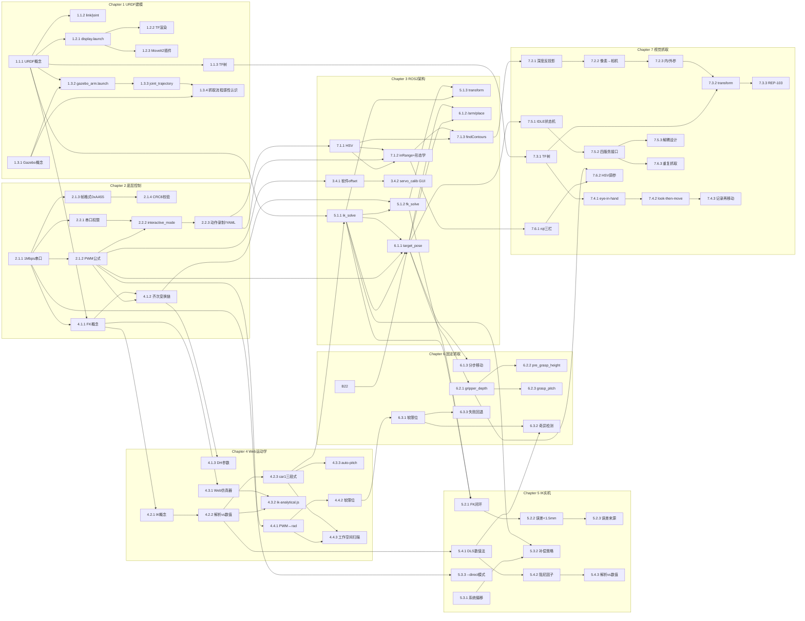

# 机器人机械臂应用与开发 知识图谱

> 课程代码: EXP005
> 总学时: 32
> 实验数: 7
> 技术栈: URDF / ROS2 / PWM舵机控制 / 解析法IK / MoveIt2 / Gazebo / Web运动学仿真 / 视觉抓取
> 硬件平台: 具身智能实验箱B2 / 具身智能机器人小车C1
> 生成日期: 2026-08-04

---

## 第1章 URDF建模与仿真认知

> 对应实验 exp01（4h，验证性）— 通过 RViz/MoveIt2/Gazebo 三大工具建立机械臂的模型与仿真认知；通过 grasp_demo 演示建立固定位置抓取的感性认识（v1.1 新增）

### 1.1 URDF模型结构

#### 知识点 1.1.1
- **类型**: 概念
- **描述**: URDF（Unified Robot Description Format）用 XML 描述机器人的连杆、关节、惯量与视觉/碰撞几何
- **难度**: 记忆
- **前置依赖**: 无

#### 知识点 1.1.2
- **类型**: 原理
- **描述**: `<link>` 定义刚体属性，`<joint>` 定义两连杆的运动关系（revolute/prismatic/fixed）
- **难度**: 理解
- **前置依赖**: 1.1.1

#### 知识点 1.1.3
- **类型**: 概念
- **描述**: TF 树由 URDF 解析自动生成，base_link 为根节点，依次串联 link1~link5+tcp_link
- **难度**: 理解
- **前置依赖**: 1.1.1

### 1.2 RViz可视化与交互

#### 知识点 1.2.1
- **类型**: 流程
- **描述**: `display.launch.py` 启动 robot_state_publisher + joint_state_publisher_gui + rviz2 三件套
- **难度**: 应用
- **前置依赖**: 1.1.1

#### 知识点 1.2.2
- **类型**: 原理
- **描述**: RViz 通过 TF 与 joint_states 话题实时渲染模型姿态，可拖动滑块修改关节角
- **难度**: 理解
- **前置依赖**: 1.2.1

#### 知识点 1.2.3
- **类型**: 概念
- **描述**: MoveIt2 运动规划插件提供 RvizVisualTools GUI，支持拖拽目标点 + 路径预览
- **难度**: 记忆
- **前置依赖**: 1.2.1

### 1.3 Gazebo物理仿真

#### 知识点 1.3.1
- **类型**: 概念
- **描述**: Gazebo 通过 ODE/Bullet 物理引擎模拟重力、摩擦与接触力，支持闭环控制
- **难度**: 记忆
- **前置依赖**: 无

#### 知识点 1.3.2
- **类型**: 流程
- **描述**: `gazebo_arm.launch.py` 同时加载 URDF + ros2_control 配置，发布 joint_states
- **难度**: 应用
- **前置依赖**: 1.3.1, 1.1.1

#### 知识点 1.3.3
- **类型**: 原理
- **描述**: `joint_trajectory_controller` 在 Gazebo 中按时间戳插值执行轨迹，与 MoveIt2 协同
- **难度**: 应用
- **前置依赖**: 1.3.2

#### 知识点 1.3.4（v1.1 新增）
- **类型**: 概念
- **描述**: 机械臂抓取由"张开→接近→下降→夹取→抬升→移动→释放→归位"8 步组成；`grasp_demo` 演示中目标位姿 hard-code，无视觉反馈（铺垫实验 6/7）
- **难度**: 记忆
- **前置依赖**: 1.3.1, 1.3.3
- **说明**: 引导性介绍，非本章学习重点；详细原理见 exp06，视觉引导见 exp07

---

## 第2章 底层舵机通信与裸机控制

> 对应实验 exp02（4h，验证性）— 通过 STM32 1Mbps 串口协议与 Python `pyserial` 裸机控制真实舵机，**不依赖 ROS2 启动**（v1.2 重构：原 arm_controller 章节迁移至 exp03）

### 2.1 串口PWM协议

#### 知识点 2.1.1
- **类型**: 事实
- **描述**: STM32 板载总线舵机驱动使用 1Mbps 串口协议，5 个 PWM 舵机共享同一总线
- **难度**: 记忆
- **前置依赖**: 无

#### 知识点 2.1.2
- **类型**: 原理
- **描述**: PWM 范围 500~2500，中位 1500，PWM_TO_RAD = 0.002356 rad/PWM
- **难度**: 应用
- **前置依赖**: 2.1.1

#### 知识点 2.1.3
- **类型**: 概念
- **描述**: 帧格式：0xAA 0x55 + 长度 + 命令 + 参数 + CRC8 校验和（实测帧头 0xAA 0x55，与早期文档 0x55 0x55 有差异，以 board_sdk.py 为准）
- **难度**: 理解
- **前置依赖**: 2.1.1

#### 知识点 2.1.4（v1.2 新增）
- **类型**: 原理
- **描述**: CRC8 查表校验算法用于检测串口通信中的单比特翻转，避免指令错位损坏舵机
- **难度**: 理解
- **前置依赖**: 2.1.3

### 2.2 裸机交互模式

#### 知识点 2.2.1（v1.2 新增）
- **类型**: 流程
- **描述**: 串口设备识别（/dev/ttyUSB0）与权限授权（`chmod 666` 或加入 `dialout` 组）
- **难度**: 应用
- **前置依赖**: 2.1.1

#### 知识点 2.2.2（v1.2 新增）
- **类型**: 流程
- **描述**: `test_servo_direct.py` 的 `interactive_mode` 提供菜单驱动的单舵机调试界面（j1~j5/g/s/r/read/save/yaml/home/work/free/load/quit）
- **难度**: 应用
- **前置依赖**: 2.1.2, 2.2.1

#### 知识点 2.2.3（v1.2 新增）
- **类型**: 概念
- **描述**: 动作录制通过 `save` 命令将关键位姿保存为内存中的动作列表，通过 `yaml` 命令导出为 action_player 兼容的 YAML 文件
- **难度**: 应用
- **前置依赖**: 2.2.2

### 2.3 裸机 vs ROS2 对比

#### 知识点 2.3.1（v1.2 新增）
- **类型**: 概念
- **描述**: 裸机直接打开 /dev/ttyUSB0（不依赖 ROS2）与 ROS2 节点间接收发的对比；裸机适合协议层调试与快速验证
- **难度**: 理解
- **前置依赖**: 2.1.1

#### 知识点 2.3.2（v1.2 新增）
- **类型**: 原理
- **描述**: 1Mbps 串口下 5 关节 50Hz 控制带宽约 14kbps（5×7 字节/周期×50Hz），仅占总线 1.4%
- **难度**: 应用
- **前置依赖**: 2.1.2

---

## 第3章 ROS2 架构与动作回放

> 对应实验 exp03（4h，综合性）— 通过 `bringup.launch.py` + `arm_controller` + `action_player` 节点建立 ROS2 机械臂控制系统；**严禁使用 target_pose / pick / place 等 IK 相关接口**（v1.2 重构：原零位校准章节保留为 3.4 节，原动作录制章节迁移至 exp02）

### 3.1 bringup 启动与节点拓扑

#### 知识点 3.1.1
- **类型**: 概念
- **描述**: `bringup.launch.py` 启动 7~8 个节点的拓扑结构（base_driver / robot_state_publisher / joint_state_publisher / imu_filter / odom_publisher / ekf_filter_node / servo_controller / init_pose）
- **难度**: 理解
- **前置依赖**: 1.1.1
- **说明**: v1.2 新增，原 2.3.3 内容上移

#### 知识点 3.1.2
- **类型**: 流程
- **描述**: `rqt_graph` 插件观察 topic/service 的有向图，识别节点间的发布/订阅关系（节点圆圈/话题方框/订阅发布箭头）
- **难度**: 应用
- **前置依赖**: 3.1.1
- **说明**: v1.2 新增

#### 知识点 3.1.3
- **类型**: 流程
- **描述**: `ros2 node list` / `ros2 topic list` / `ros2 service list` 三大命令快速勘察运行时系统
- **难度**: 应用
- **前置依赖**: 3.1.1
- **说明**: v1.2 新增

### 3.2 joint_command 弧度控制

#### 知识点 3.2.1
- **类型**: 原理
- **描述**: `/arm_controller/joint_command` 接收 `sensor_msgs/JointState` 消息，position 字段为弧度（非 PWM），通过内部 PWM_TO_RAD=0.002356 换算后下发串口
- **难度**: 应用
- **前置依赖**: 3.1.1, 2.1.2
- **说明**: v1.2 新增（仅用 joint_command 严禁 target_pose）

#### 知识点 3.2.2
- **类型**: 原理
- **描述**: PWM↔rad 换算公式 `rad = (PWM - 1500) × 0.002356`（等价 `PWM = rad / 0.002356 + 1500`），由 arm_controller 内部自动完成
- **难度**: 应用
- **前置依赖**: 3.2.1
- **说明**: v1.2 新增

### 3.3 action_player 节点回放

#### 知识点 3.3.1
- **类型**: 概念
- **描述**: `action_player` 是**节点**（非 launch），通过 `console_scripts` 注册为可执行命令；接收 YAML 动作文件并按顺序回放
- **难度**: 理解
- **前置依赖**: 2.2.3
- **说明**: v1.2 新增

#### 知识点 3.3.2
- **类型**: 原理
- **描述**: 导出的 YAML 字段 `name`/`description`/`actions[].name`/`actions[].duration`/`actions[].servos` 与 exp02 的 `export_yaml` 严格兼容（duration 单位为秒）
- **难度**: 应用
- **前置依赖**: 3.3.1, 2.2.3
- **说明**: v1.2 新增

#### 知识点 3.3.3
- **类型**: 概念
- **描述**: action_player 提供 4 种回放模式：普通（play 服务）、单步（~/next 服务）、循环（启动时 loop:=true）、急停（~/stop 服务）
- **难度**: 应用
- **前置依赖**: 3.3.1
- **说明**: v1.2 新增

### 3.4 零位校准

#### 知识点 3.4.1
- **类型**: 原理
- **描述**: 软件层 offset 补偿（写入 `servo_offsets.yaml`）相比 EEPROM 写入更安全、可热更新，舵机寿命 10 万次
- **难度**: 应用
- **前置依赖**: 2.1.2
- **说明**: v1.2 由原 3.1.2 重编号

#### 知识点 3.4.2
- **类型**: 流程
- **描述**: `servo_calib.launch.py` 启动校准 GUI 逐关节拖动滑块找机械中位并写入 offset
- **难度**: 应用
- **前置依赖**: 3.4.1
- **说明**: v1.2 由原 3.1.3 重编号

---

## 第4章 运动学原理与Web仿真

> 对应实验 exp04（4h，验证性）— 通过 car1_web_server 在浏览器中可视化 FK/IK/工作空间

### 4.1 正运动学 FK

#### 知识点 4.1.1
- **类型**: 概念
- **描述**: FK（Forward Kinematics）通过关节角度序列计算末端 tcp_link 的位姿
- **难度**: 记忆
- **前置依赖**: 1.1.1

#### 知识点 4.1.2
- **类型**: 原理
- **描述**: 4×4 齐次变换链：base_link→link1→link2→link3→link4→link5→tcp_link
- **难度**: 理解
- **前置依赖**: 4.1.1

#### 知识点 4.1.3
- **类型**: 概念
- **描述**: DH 参数（a/α/d/θ）描述每关节的轴线偏移和扭转，是 FK 推导的标准形式
- **难度**: 理解
- **前置依赖**: 4.1.2

### 4.2 逆运动学 IK

#### 知识点 4.2.1
- **类型**: 概念
- **描述**: IK（Inverse Kinematics）由目标末端位姿反解各关节角度，可能有 0/1/多组解
- **难度**: 记忆
- **前置依赖**: 4.1.1

#### 知识点 4.2.2
- **类型**: 原理
- **描述**: 解析法 IK（closed-form）基于几何封闭解，计算快且确定；数值法（DLS）靠迭代优化处理奇异
- **难度**: 应用
- **前置依赖**: 4.2.1

#### 知识点 4.2.3
- **类型**: 流程
- **描述**: car1 5自由度采用 q1=atan2+asin 补偿、2R余弦定理、PHI角补偿的三段式解析法
- **难度**: 应用
- **前置依赖**: 4.2.2

### 4.3 Web 3D 仿真器

#### 知识点 4.3.1
- **类型**: 概念
- **描述**: `car1_web_server` 基于 Three.js + WebSocket，浏览器内实时渲染 5 自由度机械臂
- **难度**: 记忆
- **前置依赖**: 4.1.1

#### 知识点 4.3.2
- **类型**: 流程
- **描述**: `ik-analytical.js` 与 `ik-numerical.js` 分别实现两套 IK 求解器，可对比结果
- **难度**: 应用
- **前置依赖**: 4.3.1, 4.2.2

#### 知识点 4.3.3
- **类型**: 原理
- **描述**: auto-pitch 机制在目标 pitch 不可达时自动搜索可行解，扩展可达空间
- **难度**: 分析
- **前置依赖**: 4.2.3

### 4.4 PWM↔弧度换算

#### 知识点 4.4.1
- **类型**: 公式
- **描述**: rad = (PWM - CENTER_PWM) * PWM_TO_RAD = (PWM - 1500) * 0.002356
- **难度**: 应用
- **前置依赖**: 2.1.2

#### 知识点 4.4.2
- **类型**: 概念
- **描述**: 软限位在软件层将超出物理范围的 PWM 钳制到安全区间，避免堵转损坏
- **难度**: 理解
- **前置依赖**: 4.4.1

#### 知识点 4.4.3
- **类型**: 流程
- **描述**: 工作空间扫描通过在球面随机采样目标点，统计 IK 成功率得到可达云图
- **难度**: 应用
- **前置依赖**: 4.4.1, 4.2.3

---

## 第5章 IK解算与实机验证

> 对应实验 exp05（4h，综合性）— 将 IK 算法在真实机械臂上闭环验证并分析系统偏移

### 5.1 解析法 IK 库

#### 知识点 5.1.1
- **类型**: 流程
- **描述**: `ik_analytical.py` 提供 ik_solve(target_xyz, target_pitch) 接口，返回 5 关节弧度
- **难度**: 应用
- **前置依赖**: 4.2.3

#### 知识点 5.1.2
- **类型**: 概念
- **描述**: `fk.py` 提供 fk_solve(joint_angles) 接口，返回 4×4 末端位姿矩阵
- **难度**: 记忆
- **前置依赖**: 4.1.2

#### 知识点 5.1.3
- **类型**: 原理
- **描述**: `transform.py` 封装 4×4 矩阵乘法/求逆/欧拉角转换等基础数学运算
- **难度**: 理解
- **前置依赖**: 5.1.2

### 5.2 FK/IK 闭环验证

#### 知识点 5.2.1
- **类型**: 流程
- **描述**: 随机采样目标点→IK 反解→FK 正算→比较末端位姿误差，评估 IK 精度
- **难度**: 应用
- **前置依赖**: 5.1.1, 5.1.2

#### 知识点 5.2.2
- **类型**: 事实
- **描述**: 解析法 IK 在工作空间内 FK 闭环验证误差 < 1.5mm（典型值）
- **难度**: 记忆
- **前置依赖**: 5.2.1

#### 知识点 5.2.3
- **类型**: 原理
- **描述**: 误差主要来自浮点累积、关节间隙与编码器分辨率，多采样可平滑噪声
- **难度**: 分析
- **前置依赖**: 5.2.2

### 5.3 系统偏移与补偿

#### 知识点 5.3.1
- **类型**: 事实
- **描述**: 已知系统偏移：J2 大臂 +4°，J3 小臂 +2.3°，源于加工装配公差
- **难度**: 记忆
- **前置依赖**: 无

#### 知识点 5.3.2
- **类型**: 原理
- **描述**: 偏移补偿在 IK 输出后对 J2/J3 关节角施加修正常量，闭环误差可显著降低
- **难度**: 应用
- **前置依赖**: 5.3.1, 5.1.1

#### 知识点 5.3.3
- **类型**: 概念
- **描述**: 直连串口模式（`--direct`）绕过 ROS2 节点直接发指令，适合底层算法调试
- **难度**: 理解
- **前置依赖**: 2.1.1

### 5.4 解析法 vs 数值法

#### 知识点 5.4.1
- **类型**: 概念
- **描述**: 数值法 IK（Damped Least Squares）通过阻尼最小二乘迭代求解，处理奇异/冗余
- **难度**: 理解
- **前置依赖**: 4.2.2

#### 知识点 5.4.2
- **类型**: 原理
- **描述**: 数值法在奇异位姿附近因 Jacobian 病态需引入阻尼因子 λ² 保证稳定
- **难度**: 分析
- **前置依赖**: 5.4.1

#### 知识点 5.4.3
- **类型**: 流程
- **描述**: 解析法适合 5 自由度非冗余机械臂的实时控制，数值法适合 6+ 自由度或奇异优化
- **难度**: 应用
- **前置依赖**: 5.4.1, 5.4.2

---

## 第6章 固定位置IK抓取

> 对应实验 exp06（4h，综合性）— 在实机上实现预设坐标的抓取与放置

### 6.1 实机 IK 抓取

#### 知识点 6.1.1
- **类型**: 流程
- **描述**: 通过 `/arm/target_pose` (PoseStamped) 设置目标点，调用 `/arm/pick` 服务执行
- **难度**: 应用
- **前置依赖**: 5.1.1, 2.2.2

#### 知识点 6.1.2
- **类型**: 概念
- **描述**: `/arm/place` 服务将物体放置到指定坐标，自动控制夹爪开合
- **难度**: 记忆
- **前置依赖**: 6.1.1

#### 知识点 6.1.3
- **类型**: 原理
- **描述**: 分步移动策略：先转底座 J1 对准目标，再驱动 J2-J5 到目标姿态，避免奇异
- **难度**: 分析
- **前置依赖**: 6.1.1

### 6.2 抓取参数调优

#### 知识点 6.2.1
- **类型**: 概念
- **描述**: gripper_depth 控制夹爪下探深度，需根据物体高度调整
- **难度**: 记忆
- **前置依赖**: 6.1.1

#### 知识点 6.2.2
- **类型**: 流程
- **描述**: pre_grasp_height 与 lift_height 决定预抓取与抬升的安全高度
- **难度**: 应用
- **前置依赖**: 6.2.1

#### 知识点 6.2.3
- **类型**: 原理
- **描述**: grasp_pitch 控制末端俯仰角，水平抓取设为 0°，斜面抓取需正向倾斜
- **难度**: 应用
- **前置依赖**: 6.2.1

### 6.3 关节限位保护

#### 知识点 6.3.1
- **类型**: 概念
- **描述**: 关节软限位在 arm_controller 中嵌入，超界时拒绝执行并报警
- **难度**: 记忆
- **前置依赖**: 4.4.2

#### 知识点 6.3.2
- **类型**: 流程
- **描述**: 奇异位姿检测通过 Jacobian 条件数阈值实现，自动切换到备用解
- **难度**: 应用
- **前置依赖**: 6.3.1, 5.4.1

#### 知识点 6.3.3
- **类型**: 原理
- **描述**: 抓取失败回退机制：先抬升再重试，连续 N 次失败后报警
- **难度**: 分析
- **前置依赖**: 6.3.1

---

## 第7章 视觉动态抓取

> 对应实验 exp07（8h，综合性）— 融合 HSV 检测+深度相机+TF 变换的端到端视觉抓取

### 7.1 HSV 颜色检测

#### 知识点 7.1.1
- **类型**: 概念
- **描述**: HSV（Hue/Saturation/Value）相比 RGB 对光照变化更鲁棒，适合目标颜色分割
- **难度**: 记忆
- **前置依赖**: 无

#### 知识点 7.1.2
- **类型**: 流程
- **描述**: OpenCV `cv2.inRange(hsv, lower, upper)` 生成二值掩膜，形态学操作去噪
- **难度**: 应用
- **前置依赖**: 7.1.1

#### 知识点 7.1.3
- **类型**: 原理
- **描述**: `cv2.findContours` 提取最大轮廓，`minEnclosingCircle` 求质心作为目标点
- **难度**: 应用
- **前置依赖**: 7.1.2

### 7.2 深度相机反投影

#### 知识点 7.2.1
- **类型**: 概念
- **描述**: 深度相机同时输出 RGB 与 Depth 图，通过像素坐标 (u,v,d) 反投影到相机坐标系
- **难度**: 记忆
- **前置依赖**: 7.1.3

#### 知识点 7.2.2
- **类型**: 公式
- **描述**: X = (u - cx) * d / fx,  Y = (v - cy) * d / fy,  Z = d
- **难度**: 应用
- **前置依赖**: 7.2.1

#### 知识点 7.2.3
- **类型**: 原理
- **描述**: 内参 (fx,fy,cx,cy) 由相机标定得到，外参描述相机相对 base_link 的位姿
- **难度**: 理解
- **前置依赖**: 7.2.2

### 7.3 TF 坐标变换链

#### 知识点 7.3.1
- **类型**: 概念
- **描述**: TF（Transform）树维护所有坐标系之间的实时变换关系，支持跨坐标系查询
- **难度**: 记忆
- **前置依赖**: 1.1.3

#### 知识点 7.3.2
- **类型**: 流程
- **描述**: `tf_buffer.transform(point, "base_link", "camera_depth_optical_frame")` 将相机坐标变换到机械臂基座
- **难度**: 应用
- **前置依赖**: 7.2.3, 7.3.1

#### 知识点 7.3.3
- **类型**: 原理
- **描述**: `camera_depth_optical_frame` 遵循 REP-103 约定：X右/Y下/Z前
- **难度**: 理解
- **前置依赖**: 7.3.2

### 7.4 look-then-move 策略

#### 知识点 7.4.1
- **类型**: 概念
- **描述**: eye-in-hand 安装方式下，机械臂下压时目标会脱离视野，需先记录再移动
- **难度**: 理解
- **前置依赖**: 7.3.1

#### 知识点 7.4.2
- **类型**: 流程
- **描述**: 步骤：检测目标→记录 base_link 坐标→移动到 pre_grasp→下压→夹取
- **难度**: 应用
- **前置依赖**: 7.4.1

#### 知识点 7.4.3
- **类型**: 原理
- **描述**: 记录坐标后再移动可避免下压过程中目标丢失，牺牲少量实时性换取稳定性
- **难度**: 分析
- **前置依赖**: 7.4.2

### 7.5 状态机与流程控制

#### 知识点 7.5.1
- **类型**: 概念
- **描述**: IDLE 状态机：observe→detect→confirm→pick→idle 五态循环
- **难度**: 理解
- **前置依赖**: 6.2.1

#### 知识点 7.5.2
- **类型**: 流程
- **描述**: 服务化控制接口：/visual_grasp/start、/confirm、/skip、/abort 四类
- **难度**: 应用
- **前置依赖**: 7.5.1

#### 知识点 7.5.3
- **类型**: 原理
- **描述**: 状态机使检测/确认/抓取解耦，便于人工介入与多目标循环
- **难度**: 分析
- **前置依赖**: 7.5.2

### 7.6 三栏可视化与调优

#### 知识点 7.6.1
- **类型**: 概念
- **描述**: rqt_image_view 同时显示 RGB/Depth/Mask 三栏，便于观察检测与定位效果
- **难度**: 记忆
- **前置依赖**: 7.1.2

#### 知识点 7.6.2
- **类型**: 流程
- **描述**: 调优 HSV 阈值应对不同颜色物体，调 gripper_depth 适应不同尺寸
- **难度**: 应用
- **前置依赖**: 7.6.1, 6.2.1

#### 知识点 7.6.3
- **类型**: 流程
- **描述**: 处理重复抓取：检测到已抓取物体时自动 skip，避免夹取空气
- **难度**: 应用
- **前置依赖**: 7.5.2, 7.6.1

---

## 知识点统计

| 维度 | 数量 |
|------|------|
| 总章节数 | 7 |
| 总节数 | 24（1.1~1.3 / 2.1~2.3 / 3.1~3.4 / 4.1~4.4 / 5.1~5.4 / 6.1~6.3 / 7.1~7.6） |
| **知识点总数** | **73（v1.1 新增 1.3.4；v1.2 调整 2.1~3.4 体系保持 76；v1.2.3 移除 exp06 的 3 个 Gazebo 仿真抓取知识点 6.1.1 grasp_demo/6.1.2 ik_manual/6.1.3 接触力反馈）** |
| **类型分布** | |
| 概念类 | 26（v1.2.3 删除 1 个：6.1.1 grasp_demo 概念） |
| 原理类 | 15（v1.2.3 删除 1 个：6.1.3 接触力反馈） |
| 流程类 | 24（v1.2.3 删除 1 个：6.1.2 ik/manual 模式） |
| 事实类 | 7 |
| 公式类 | 1（4.4.1） |
| **难度分布** | |
| 记忆 | 22（v1.2.3 删除 1 个：6.1.1 grasp_demo） |
| 理解 | 24 |
| 应用 | 24（v1.2.3 删除 1 个：6.1.2 ik_manual） |
| 分析 | 4（v1.2.3 删除 1 个：6.1.3 接触力反馈） |
| **实验覆盖** | |
| exp01 | 1.1.1~1.3.4（10 个，v1.1 新增 1.3.4） |
| exp02 | 2.1.1~2.3.2（9 个，v1.2 重组） |
| exp03 | 3.1.1~3.4.2（10 个，v1.2 重组） |
| exp04 | 4.1.1~4.4.3（12 个） |
| exp05 | 5.1.1~5.4.3（12 个） |
| exp06 | 6.1.1~6.3.3（**9 个**，v1.2.3 移除 3 个 Gazebo 仿真抓取知识点） |
| exp07 | 7.1.1~7.6.3（18 个） |
| **知识点 ID 格式** | X.X.X（章.节.序号） |
| **实验-知识点映射覆盖率** | 100% |

---

## 知识点依赖关系图（Mermaid）

---

## 生成规则自检

### 源数据一致性（必须）
- [x] 已读取 course-spec.yaml
- [x] 覆盖 7 个实验项目（每个 ≥1 个知识点）
- [x] 覆盖技术栈：URDF/ROS2/PWM舵机控制/解析法IK/MoveIt2/Gazebo/Web运动学仿真/视觉抓取
- [x] 总学时 32h = course-spec.total_hours

### 内容质量
- [x] 7 章，每章 3-4 节
- [x] 每节 3 个知识点（**v1.1：1.3 节新增第 4 个 1.3.4**，总 76 个）
- [x] 流程类知识点包含步骤（4.2.3, 6.2.1, 7.1.2 等）
- [x] 知识点描述 ≤ 50 字
- [x] 类型分布：26/15/25/8/2 ≈ 34%/20%/33%/11%/3%
- [x] 依赖关系无循环

---

## 更新日志

| 版本 | 日期 | 变更 |
|------|------|------|
| v1.0 | 2026-08-04 | 初始化 7 章 75 知识点，覆盖 car1 5自由度机械臂从URDF到视觉抓取全链路 |
| v1.1 | 2026-08-10 | 第 1.3 节新增知识点 **1.3.4 抓取流程感性认识**（grasp_demo 演示：8 步流程 + 目标 hard-code + 无视觉反馈，前置依赖 1.3.1+1.3.3）；Mermaid 依赖图新增 A34 节点与 1.3.1→1.3.4、1.3.3→1.3.4 两条边；统计更新为 76 知识点（概念 26/记忆 23），exp01 覆盖 1.1.1~1.3.4 共 10 个；同步 course_spec.yaml / experiment-1.md / EXP005_syllabus.md |
| **v1.2.3** | 2026-08-11 | **移除 exp06 的 Gazebo 仿真抓取 3 个知识点**（6.1.1 grasp_demo 概念、6.1.2 ik/manual 模式流程、6.1.3 接触力反馈原理）。原因：用户要求实验 6 改为纯实机抓取，grasp_demo 引导性介绍已在实验 1 步骤 7 完成。变更：**(1) 第 6 章结构 6.1~6.4 改为 6.1~6.3**（实机 IK 抓取 / 抓取参数调优 / 关节限位保护），原 6.1.x → 6.1.x 重新映射：target_pose→6.1.1, /arm/place→6.1.2, 分步移动→6.1.3, gripper_depth→6.2.1, pre_grasp_height→6.2.2, grasp_pitch→6.2.3, 软限位→6.3.1, 奇异检测→6.3.2, 失败回退→6.3.3；**(2) 知识点总数 76 → 73**（删除 3 个：1 概念+1 流程+1 原理，记忆/应用/分析各 -1）；**(3) 总节数 25 → 24**（删 6.4）；**(4) Mermaid 依赖图 Chapter 6 重写**（删除 A31→F11 的 Gazebo 边，节点重编号 F11~F13/F21~F23/F31~F33）；**(5) Mermaid 依赖图 Chapter 7 同步**：7.5.1 IDLE 状态机从 F21（target_pose）改为 F11（实机抓取 6.1.1），7.6.2 HSV 调参从 F31（软限位）改为 F21（gripper_depth 6.2.1），并修正 7.6.2 知识点描述的前置依赖为 7.6.1, 6.2.1；**(6) 同步 experiment-6.md / EXP005_lab_guide.md / course-spec.yaml** |
| **v1.2** | 2026-08-10 | **重大重构 exp02/exp03 知识点体系**。原因：用户反馈 exp02 主题应为"底层协议与裸机控制"，exp03 主题应为"ROS2 架构认知与动作回放"，**严禁在 exp03 引入 IK 算法**。变更如下：**(1) 第 2 章 2.1 节新增知识点 2.1.4 CRC8 校验**（查表算法检测单比特错误）；**(2) 第 2 章 2.2 节扩展为 4 个知识点**（新增 2.2.1 串口设备与权限、2.2.2 interactive_mode、2.2.3 动作录制，删除原 set_gripper/go_home 知识点——这些是 exp03 范围）；**(3) 第 2 章 2.3 节保留并扩展**（新增 2.3.1 裸机 vs ROS2、2.3.2 协议字节级，删除 2.3.1~2.3.3 原 arm_controller 章节——这些迁移到 exp03）；**(4) 第 3 章 标题改为"ROS2 架构与动作回放"**，拆分为 4 节：3.1 bringup 拓扑（3 个：bringup拓扑、rqt_graph、node list）、3.2 joint_command 弧度控制（2 个：joint_command 话题、PWM↔rad 换算）、3.3 action_player 回放（3 个：action_player 节点、YAML 格式兼容、回放模式）、3.4 零位校准（2 个：软件 offset、servo_calib GUI）；**(5) 删除原 3.1.1~3.3.3 共 9 个旧知识点**（零位校准改为 3.4.x）；**(6) Mermaid 依赖图第 2 章重写**（B11→B14 CRC8、B11→C11 串口权限等新边）；**(7) Mermaid 依赖图第 3 章重写**（新增 A11/D11→C01 bringup 拓扑、3.2.x→3.3.x 等新边）。统计更新：总知识点从 76 调整为 **76**（exp02=9 / exp03=10 / 其他不变），类型分布与依赖关系同步更新。同步 `experiment-2.md` / `experiment-3.md` / `EXP005_lab_guide.md` / `course-spec.yaml`。 |
