# 机器人大模型综合应用开发（老人跌倒监护项目） 实验指导书（合并版）

> 课程代码: EXP006a
> 总学时: 48
> 实验数: 9
> 适用对象: 人工智能/机器人工程/智能科学与技术 本科高年级
> 制定日期: 2026-08-18
> 模式: human_waiver（源码位于 ROS2 工作空间 src/，未复制到 source-codes/EXP006a/）

---

## 目录

1. [实验1：老人跌倒监护--项目需求分析](#实验1老人跌倒监护--项目需求分析4h)
2. [实验2：老人跌倒监护--系统架构设计](#实验2老人跌倒监护--系统架构设计4h)
3. [实验3：老人跌倒监护--配置与接口设计](#实验3老人跌倒监护--配置与接口设计4h)
4. [实验4：老人跌倒监护--语音交互集成测试](#实验4老人跌倒监护--语音交互集成测试6h)
5. [实验5：老人跌倒监护--视觉检测与姿态估计集成测试](#实验5老人跌倒监护--视觉检测与姿态估计集成测试8h)
6. [实验6：老人跌倒监护--跌倒判定集成测试](#实验6老人跌倒监护--跌倒判定集成测试4h)
7. [实验7：老人跌倒监护--告警与证据存档集成测试](#实验7老人跌倒监护--告警与证据存档集成测试4h)
8. [实验8：老人跌倒监护--LLM对话与VLM复核集成测试](#实验8老人跌倒监护--llm对话与vlm复核集成测试8h)
9. [实验9：老人跌倒监护--全功能快速验证](#实验9老人跌倒监护--全功能快速验证6h)

---

## 实验总览

| 编号 | 名称 | 学时 | 类型 | 难度 | 源码路径 |
|------|------|------|------|------|----------|
| exp01 | 老人跌倒监护--项目需求分析 | 4h | 验证性 | ⭐ | `ros2_ws/src/xflz_eai_car1/app/elderly_companion/` |
| exp02 | 老人跌倒监护--系统架构设计 | 4h | 设计性 | ⭐⭐ | `ros2_ws/src/xflz_eai_car1/app/elderly_companion/` |
| exp03 | 老人跌倒监护--配置与接口设计 | 4h | 设计性 | ⭐⭐ | `ros2_ws/src/xflz_eai_car1/app/elderly_companion/` |
| exp04 | 老人跌倒监护--语音交互集成测试 | 6h | 综合性 | ⭐⭐ | `ros2_ws/src/xflz_eai_car1/app/elderly_companion/` |
| exp05 | 老人跌倒监护--视觉检测与姿态估计集成测试 | 8h | 综合性 | ⭐⭐⭐ | `ros2_ws/src/xflz_eai_car1/app/elderly_companion/` |
| exp06 | 老人跌倒监护--跌倒判定集成测试 | 4h | 综合性 | ⭐⭐⭐ | `ros2_ws/src/xflz_eai_car1/app/elderly_companion/` |
| exp07 | 老人跌倒监护--告警与证据存档集成测试 | 4h | 综合性 | ⭐⭐⭐ | `ros2_ws/src/xflz_eai_car1/app/elderly_companion/` |
| exp08 | 老人跌倒监护--LLM对话与VLM复核集成测试 | 8h | 综合性 | ⭐⭐⭐ | `ros2_ws/src/xflz_eai_car1/app/elderly_companion/` |
| exp09 | 老人跌倒监护--全功能快速验证 | 6h | 综合性 | ⭐⭐⭐ | `ros2_ws/src/xflz_eai_car1/app/elderly_companion/` |

**学时合计**: 4+4+4+6+8+4+4+8+6 = **48h**

**类型分布**: 验证性 1 个 + 设计性 2 个 + 综合性 6 个

**难度分布**: ⭐ 1 个 + ⭐⭐ 3 个 + ⭐⭐⭐ 5 个

---

## 跨实验知识脉络

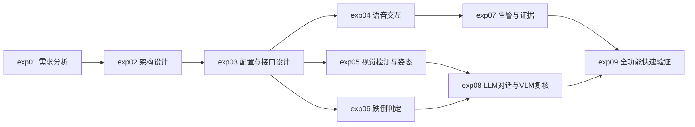
# 实验1：老人跌倒监护--项目需求分析（4h）


### 1.1 关联知识点

- 1.1.1 R1-R12 功能需求体系（前置：无；项目所有后续实验的基础）
- 1.1.2 跌倒→ASK→ALERT→取消全流程（前置：1.1.1，需先理解 R4-R8 需求条款）
- 1.1.3 语音打断/重问/超时兜底(12s)机制（前置：1.1.2，需了解 ASK 会话的触发与结束时序）

### 1.2 实验目标

1. **理解**老人跌倒监护项目 R1-R12 全部功能需求，能逐条复述每个需求的约束要点（输入源类型、检测算法、判定条件、语音交互规则、告警输出方式等）。
2. **掌握**跌倒检测→ASK 询问→ALERT 告警→取消的完整状态流转时序，能独立绘制包含唤醒、跌倒、询问、应答、告警、取消全节点的流程图。
3. **理解**语音打断（语音取消回待机）、重问机制（静默重播 ask）、超时兜底（12s ASK 会话超时、2s 快答兜底）三类时序防护的设计原理与触发条件。
4. **独立完成**一份结构化需求阅读笔记，能标注文档真实行号引用，梳理"需求编号→实现模块→关键约束"的三层映射。
5. **迁移**：把"需求总览→流程梳理→时序防护"的需求分析方法迁移到其他具身智能/老人监护场景。

### 1.3 实验环境

| 类别 | 内容 |
|------|------|
| 硬件 | 具身智能实验箱B2 / 具身智能机器人小车C1（本实验仅阅读文档，无需上电） |
| OS | Ubuntu 22.04 + ROS 2 Humble |
| Python | 3.10（本实验仅需阅读，不执行 Python） |
| 文档对象 | `ros2_ws/src/xflz_eai_car1/app/elderly_companion/docs/01_需求总览.md`、`docs/05_流程与安全.md`、`README.md` |
| 辅助工具 | 文本编辑器或笔记软件（用于撰写需求阅读笔记和流程图） |

### 1.4 实验难度

- 难度: ⭐（验证性）
- 重点：R1-R12 需求条款的逐条梳理与要点归纳；跌倒→ASK→ALERT→取消全流程的时序理解；语音打断/重问/超时兜底三类时序防护机制。
- 难点：R6 呼救直告警与 R5 ASK 询问应答的**触发路径差异**（R6 任意时刻喊救命直接 ALERT，不经过 ASK 窗口）；时序防护中"ASK 开听晚于 ask 播完"与"双次排空防回声"的设计理由。

### 1.5 实验现象

**快速验证流程**（纯文档类实验，以下为快速阅读清单）：

```bash
# 在 elderly_companion 包目录下
ls docs/
grep -n "R[0-9]" docs/01_需求总览.md          # 快速定位 R1-R12 各条款行号
grep -n "时序防护\|兜底\|重问\|打断" docs/05_流程与安全.md  # 定位时序防护章节
head -50 README.md                             # 架构速览与关键决策
```

**预期效果描述**：

- 能列出 R1-R12 每一条的一句话要点，并能说出"哪几条属于输入/检测、哪几条属于判定/交互、哪几条属于告警/证据、哪几条属于调试/运维"。
- 能画出 `唤醒 → 对话/跌倒检测 → ASK 询问 → 应答(救命→ALERT / 没事→取消) → 证据存档` 的完整时序图，并标注每个状态转换的触发条件。
- 能说出时序防护六个要点中至少三个（ASK 开听晚于 ask 播完、DIALOG 无话超时 10s、ASK 快答兜底 2s、打断丢弃 epoch+1、单次应答、重问 8s）。

### 1.6 实验步骤

#### 整体流程图

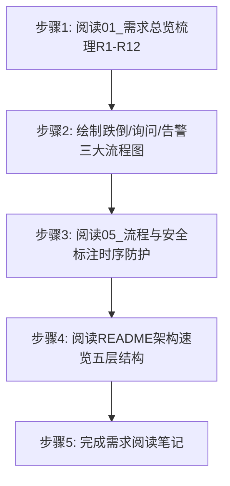

#### 步骤1：通读需求总览，梳理 R1-R12（90min）

**知识点讲解**：

**1.1.1 R1-R12 功能需求体系**

- **原理**：需求体系回答"系统要做什么、边界是什么"两个核心问题。R1-R3 定义输入层（多源统一、行人检测、姿态估计），R4 定义核心判定（跌倒的几何特征与状态机流转），R5-R6 定义语音交互层（ASK 询问应答与呼救直告警两条路径），R7-R8 定义输出层（告警输出与语音取消），R9 定义自由对话（LLM 回复），R10 定义硬件唤醒（六麦阵列 AIUI），R11 定义证据存档（截图+视频+事件日志），R12 定义调试运维（文本模式、MJPEG、环境自检）。梳理时建议按"输入→检测→判定→交互→告警→证据→调试"七个维度分组，逐条标注"可量化约束"（如躯干角>50°、宽高比<0.5、12s 超时、60s cooldown）。R12 的文本调试模式特别重要——`--text` 与音频模式走同一状态机，是后续所有实验的基础调试路径。
- **源码对应**：`docs/01_需求总览.md L1-L20（R1-R12 需求清单完整表格）、L22-L27（非目标范围边界）、L29-L31（验收路径）`

```markdown
### R1. 多源输入统一
- 静态图片 / 本地视频 / 实时摄像头（ROS 话题）三种输入源，config 或 CLI 切换，业务代码零改动
### R4. 跌倒判定
- 躯干角 >50° 或 框宽高比 <0.5 且 髋部速度尖峰 → FALLING → LYING
- 每人独立 ID + IoU 跨帧关联
### R5. 询问应答（ASK）
- 跌倒后 TTS 播"您还好吗？需要帮助吗？" → 语音应答窗口：救命/疼 → ALERT、没事/不用 → 取消
### R6. 呼救直告警
- 任意时刻喊"救命/帮帮我/摔倒了" → 直接升级 ALERT（不等待 ASK）
```

- **配图**（需求分组图）：把 R1-R12 分成"输入（R1）、检测（R2-R3）、判定（R4）、交互（R5-R6, R9, R10）、告警（R7-R8）、证据（R11）、调试（R12）"七组，并标注每组之间的依赖箭头（如 R2-R3 检测 → R4 判定 → R5/R6 交互 → R7 告警 → R11 证据）。

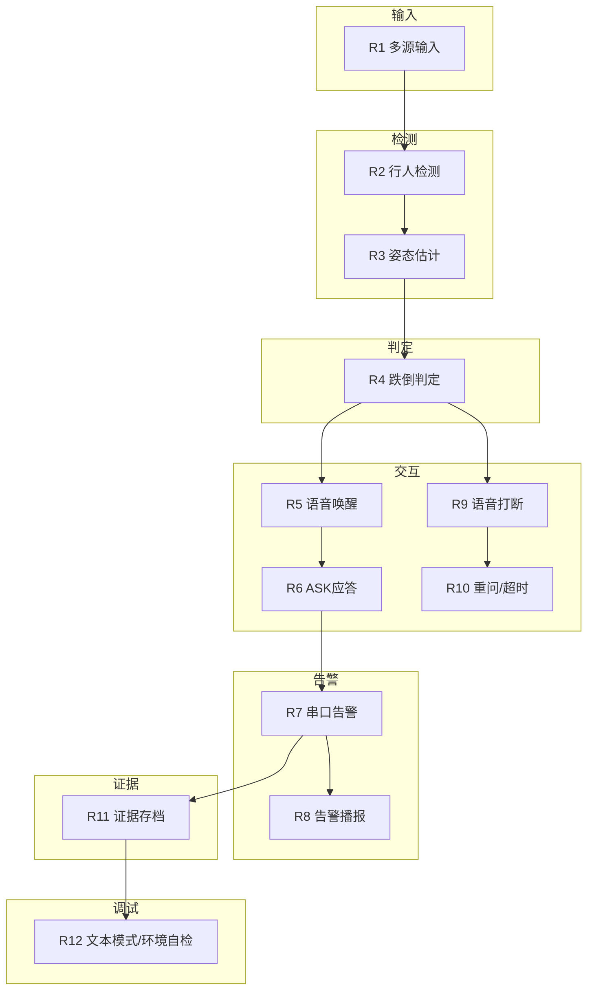

**操作步骤**：

1. 打开 `docs/01_需求总览.md`，通读全文。
2. 用表格整理 R1-R12：每条记录「需求编号 / 一句话要点 / 可量化约束 / 实现位置 / 分组归属」。
3. 特别关注 R4 的三个几何判定条件（躯干角、宽高比、髋部速度尖峰）与 R5/R6 的两条触发路径差异，单独摘抄。
4. 标注非目标范围（`docs/01_需求总览.md L22-L27`），明确"不做 ROS 业务节点、不做多人会话仲裁"。

**易错点**：

- ⚠️ 误以为 R6 呼救直告警也经过 ASK 窗口 → **解决**：对照 `docs/01_需求总览.md` R6 条目（"任意时刻喊救命→直接升级 ALERT，不等待 ASK"），R5 是"跌倒后才问"，R6 是"随时能喊"，两条独立触发路径。

#### 步骤2：绘制跌倒检测/语音询问/告警存档三大流程图（90min）

**知识点讲解**：

**1.1.2 跌倒→ASK→ALERT→取消全流程**

- **原理**：系统运行时存在三条核心时序流程，贯穿 R4-R8 需求：①跌倒检测流程——YOLOv8 行人检测 → IoU 跨帧关联 → BlazePose/RTMPose 姿态估计 → 几何特征提取（躯干角>50° 或 宽高比<0.5 且髋速尖峰）→ FALLING 状态（1.5s 确认）→ LYING 状态（3s 确认）→ 触发 ASK；②语音询问流程——monitor 触发 ask_tts 播"您还好吗？" → VoiceLoop.trigger_ask() 开听 → ASR 端点检测 → 用户应答（救命/没事）→ monitor.on_asr 判定 → ALERT 或 CANCELLED；③告警存档流程——ALERT 触发 STM32 串口告警（蜂鸣器/LED/OLED）→ TTS 循环播报 → 证据存档（FrameRing 前后帧截图/.avi 视频/events.jsonl）。三条流程共享"每人独立状态机"与"IoU 跨帧人员关联"机制，确保多人同框时互不干扰。绘制流程图时应把 FALLING→LYING 的确认时间、ASK 12s 超时、cooldown 60s 等关键时间节点显式标注。
- **源码对应**：`docs/05_流程与安全.md L1-L41（跌倒全流程时序完整时间线）、docs/01_需求总览.md L13-L19（R4-R8 需求条款）`

```markdown
### 跌倒全流程时间线（摘要）
- 唤醒前：录音线程未启动（等硬件唤醒）——XFM 监听态不持续上送音频流
- 用户说"小飞小飞" → XFM 串口唤醒事件 → 录音线程启动（ALSA 打开，~3s 就绪）
- 视频/摄像头检测到跌倒 → FALLING→LYING→ASK 判定（~3-6s）
- 用户答话："救命"→ALERT / "没事"→CANCELLED
- 会话结束 → 回 IDLE（等待下一次唤醒）
```

- **配图**（三条核心流程融合时序图）：纵轴为时间线，横轴分三列（检测/交互/告警），用颜色区分不同状态（IDLE 灰色、FALLING 橙色、ASK 蓝色、ALERT 红色、CANCELLED 绿色），标注每个状态转换的触发条件与时间阈值。

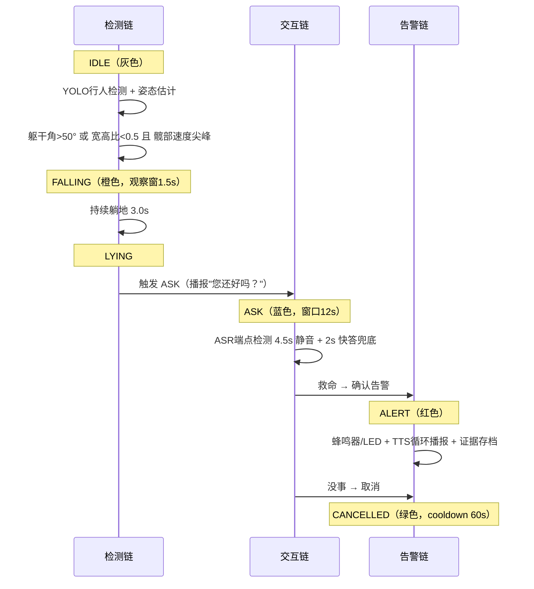

**操作步骤**：

1. 用流程图工具（draw.io / PlantUML / mermaid）绘制三大流程图。
2. 跌倒检测流程图必须包含：YOLOv8 检测 → IoU 关联 → 姿态估计 → 几何特征 → FALLING(1.5s) → LYING(3s) → ASK。
3. 语音询问流程图必须包含：ask_tts 播报 → VoiceLoop 开听 → ASR → 用户应答 → on_asr 判定 → ALERT/CANCELLED。
4. 告警存档流程图必须包含：ALERT → STM32 串口 → TTS 循环播报 → 证据存档（截图/视频/事件日志）。
5. 对比三条流程的共享点（每人独立 ID、IoU 关联、单次应答防重复）与差异点。

**易错点**：

- ⚠️ 流程图漏掉 FALLING→LYING 的确认时间（1.5s/3s）→ **解决**：对照 `docs/05_流程与安全.md L27`（FALLING→LYING 判定），这两个时间窗口是状态机防误报的关键设计，必须在流程图中标注。

#### 步骤3：阅读流程与安全文档，标注 ASK 重问/超时兜底/语音打断点（60min）

**知识点讲解**：

**1.1.3 语音打断/重问/超时兜底(12s)机制**

- **原理**：时序防护是语音交互可靠性的核心。系统设计了六类防护机制：①ASK 开听晚于 ask 播完——`trigger_ask` 等 `playback_event` set→clear（8s 未播/15s 未播完双超时兜底），防止 ASR 把 ask 播报回声当成用户应答；②DIALOG 无话超时——10s 无 partial → 关窗回 IDLE（防唤醒后无人说话一直听）；③ASK 快答兜底——partial 非空且 2s 无变化 → 强制提交（不必等 4.5s 端点静音），确保用户说"救命/没事"后快速响应；④打断丢弃——SPEAKING 中新的唤醒/跌倒 → `epoch+1` → LLM worker 完成后发现 epoch 变化即丢弃回复（防打断后迟到播报）；⑤单次应答——`on_asr` 对首个响应会话 break，多人（ASK 静默合并/ALERT 多台机器）只响应一次，防重复告警播报；⑥重问与超时归 monitor——`ask_retry_interval=8s` 静默重播 ask；ASK 超时（目标消失）→ 会话结束回 IDLE，语音层不重复实现。其中重问（静默重播）与超时（12s ASK 会话超时）是两类独立机制：重问是"没听清再问一次"，超时是"人可能不在了直接结束"。
- **源码对应**：`docs/05_流程与安全.md L44-L51（关键时序防护六要点完整列表）、docs/05_流程与安全.md L11-L41（全流程时间线含 ASK/打断/取消节点）`

```markdown
### 关键时序防护（原文摘要）
1. ASK 开听晚于 ask 播完：trigger_ask 等 playback_event set→clear
2. DIALOG 无话超时：10s 无 partial → 关窗回 IDLE
3. ASK 快答兜底：partial 非空且 2s 无变化 → 强制提交
4. 打断丢弃：epoch+1 → LLM worker 发现 epoch 变化即丢弃
5. 单次应答：on_asr 对首个响应 break
6. 重问与超时归 monitor：ask_retry_interval=8s 静默重播
```

- **配图**（ASK 会话时序防护图）：纵轴为时间线，标注 ask 播报时段→等待 playback clear→双次排空→开听→ASR 端点检测（4.5s 静音）→2s 快答兜底→8s 重问→12s 超时回 IDLE 的完整时序，突出每个防护节点的触发条件。

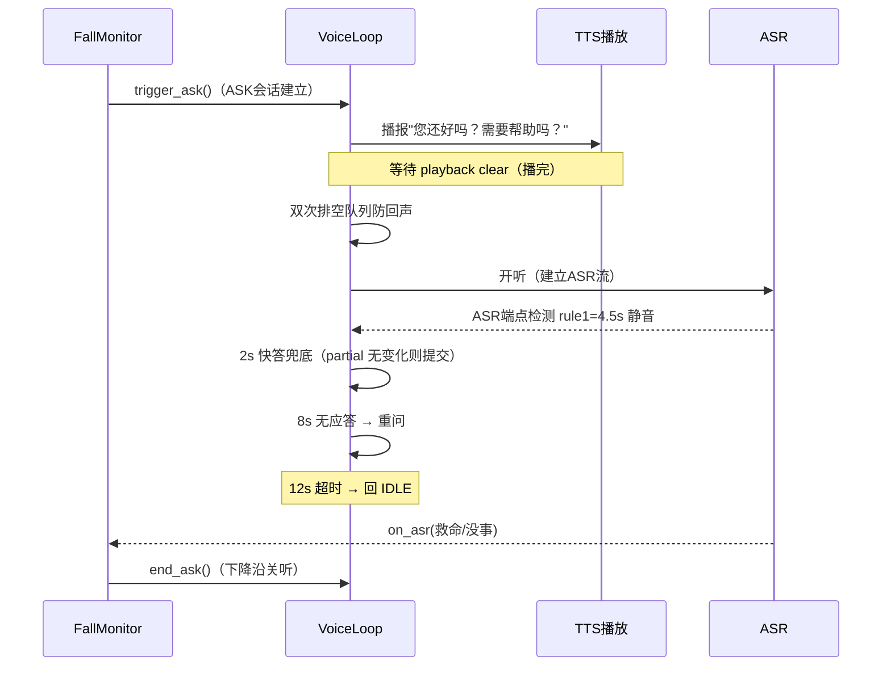

**操作步骤**：

1. 在 `docs/05_流程与安全.md` 中找到"关键时序防护"小节（`L44-L51`），逐条阅读并在需求笔记中标注行号。
2. 在"跌倒全流程（时序）"时间线（`L11-L41`）中标注三个关键打断点：①用户说"没事/不用"（语音取消，`L36`）；②ASK 超时目标消失（`L41`）；③新唤醒打断当前播报（`L32`）。
3. 用时序图画出"ASK 会话生命周期"：从 monitor 触发 ask_tts → VoiceLoop 开听 → ASR 端点检测 → 应答判定 → 会话结束的完整时间线，标注每个防护节点的超时值。
4. 对比重问（`ask_retry_interval=8s`）与超时（12s ASK 会话超时）的区别：重问是"再给一次机会"，超时是"主动结束"。

**易错点**：

- ⚠️ 混淆"语音取消"（R8）与"ASK 重问" → **解决**：语音取消是用户主动说"没事/不用"触发 CANCELLED；重问是系统静默重播 ask_tts（`ask_retry_interval=8s`），两者触发源不同、目标不同。对照 `docs/05_流程与安全.md L36`（取消）与 `L44-L51`（重问）。

#### 步骤4：阅读 README 架构速览，理解五层结构与关键决策（30min）

**知识点讲解**：

**综合（五层结构与关键决策）**

- **原理**：README 的"架构速览"把需求落地为五个模块层：common 层（输入源/配置/日志/串口）、vision 层（yolo 检测 + pose/pose_rtm 姿态估计）、fall 层（monitor 状态机 + 证据 + 告警硬件）、speech 层（voice_loop 单状态机 + KWS/ASR/TTS）、llm 层（flask 子进程 + 多轮历史）。"关键决策速览"回答"需求怎么变成设计"：跌倒 vs 语音分层（monitor 只做视觉判定，语音链路独立通过三个接口对接）、单录音线程 + 队列（消除旧架构"四门叠加"问题）、唤醒后启动录音（XFM 时序约束）、提示音防回声（双次排空）、ASK 应答窗口（播完再开听 + 2s 兜底快答）、单次应答（防重复告警）。该步骤把 R1-R12 与模块一一对应起来，为实验 2 的架构设计打基础。
- **源码对应**：`README.md L14-L34（架构速览 ASCII 图 + 跌倒判定 + 语音时序 + 应答单次化 + 文本调试）、L36-L48（关键决策速览八个要点）`

```markdown
## 架构速览
common(输入源/配置/日志/串口) → vision/yolo(检测) + vision/pose|pose_rtm(姿态)
  → fall/monitor(FallMonitor：每人独立状态机，IoU 关联，ASK 全局会话)
  → sink(OutputSink：事件/播报/证据) + alert_hw(STM32 串口告警)
语音：speech/voice_loop(VoiceLoop 单状态机) ──单录音线程→队列→主循环路由──
  IDLE(KWS 唤醒/呼救) → LISTENING(ASR 端点检测+兜底) → SPEAKING(TTS 播完回 IDLE)
```

- **配图**（需求→模块映射图）：左侧列 R1-R12，右侧列对应模块（R1→common/source.py、R2→vision/yolo/、R3→vision/pose/、R4→fall/state_machine.py、R5→fall/monitor.py+speech/voice_loop.py、R6→fall/interaction.py、R7→fall/alert_hw.py+speech/tts.py、R8→fall/state_machine.py respond、R9→llm/+speech/voice_loop.py、R10→speech/xfm_wake.py、R11→fall/evidence.py、R12→apps/fall_video_demo.py --text），连线标注关键决策。

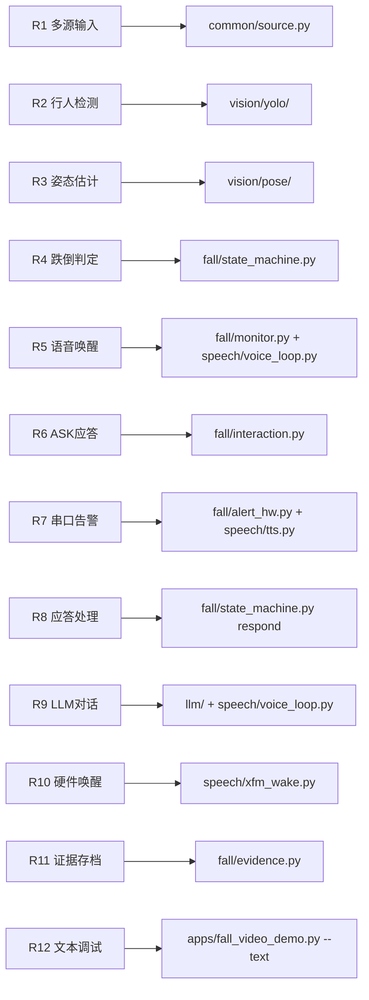

**操作步骤**：

1. 通读 `README.md` 的架构速览（`L14-L34`）与关键决策速览（`L36-L48`）两节。
2. 在笔记中绘制"需求编号 → 实现模块 → 关键决策"三层映射表。
3. 阅读 README 常用命令部分（`L50-L80`），记录核心调试命令 `python3 apps/fall_video_demo.py --video testdata/fall_slow_x264.mp4 --text`（本实验仅记录，不执行）。
4. 特别关注文本模式（`--text`）与音频模式走同一状态机的设计——这是 R12 的核心，也是后续所有实验的基础调试路径。

**易错点**：

- ⚠️ 把 speech 与 fall 误记为同一模块 → **解决**：README 架构速览图明确画出 fall 层与 speech 层是**并行**的（fall 做视觉判定，speech 做语音交互），通过 `monitor.on_kws/on_asr/has_ask_session` 三个接口对接，不是包含关系。

#### 步骤5：完成需求阅读笔记（30min）

**操作步骤**：

1. 汇总前四步产出，按"输入需求（R1-R3）/ 判定需求（R4）/ 交互需求（R5-R6, R9-R10）/ 告警需求（R7-R8）/ 证据需求（R11）/ 调试需求（R12）"六节撰写笔记。
2. 每节附上文档行号引用（`docs/01_需求总览.md` 与 `docs/05_流程与安全.md` 的真实行号区间）与关键约束摘录。
3. 自检清单：能否不看文档说清 R1-R12 要点；能否画出跌倒→ASK→ALERT→取消全流程；能否说清六类时序防护中至少三个的触发条件与设计理由。

**易错点**：

- ⚠️ 笔记只抄条款不做归纳 → **解决**：每条需求必须提炼"可量化约束"（如躯干角>50°、宽高比<0.5、10s 无话超时、2s 快答兜底、8s 重问间隔、12s ASK 超时、60s cooldown）和"设计含义"（对哪个模块、影响什么实现），才算有效笔记。

### 1.7 注意事项

- ⚠️ 本实验为**纯文档阅读，无硬件操作**，不需要给底盘/STM32 上电，也不需要启动 ROS 节点。
- ⚠️ 文档路径 `ros2_ws/src/xflz_eai_car1/app/elderly_companion/` 为板端实机路径，若在工程机以外阅读需注意路径映射。
- ⚠️ R5 与 R6 的触发路径不同（R5 需先跌倒后询问，R6 任意时刻呼救直告警），梳理时注意区分。
- ⚠️ 时序防护中的超时值（10s/2s/8s/12s）均为当前配置值，实验 3 中可调整，本实验仅需理解原理。

### 1.8 实验总结

**完成成果**: 一份 R1-R12 需求梳理表（含量化约束与实现位置映射）；跌倒检测/语音询问/告警存档三大流程图各一张（含状态转换条件与时间节点）；一份时序防护要点笔记（六类防护的触发条件与设计理由）；一份"需求→模块→关键决策"三层映射表。

**技能收获**:

- 技能1：需求文档结构化梳理方法（分组→量化约束→实现映射）
- 技能2：状态机全流程时序图绘制（显式标注触发条件与时间阈值）
- 技能3：语音交互时序防护分析（六类防护机制的触发条件与设计理由）

**常见问题与解决**:

| 问题 | 原因 | 解决方法 |
|------|------|----------|
| R5 ASK 与 R6 呼救混淆 | 两条都是"语音→告警"路径 | 按"触发时机/前置条件"区分：R5 需跌倒后才触发 ASK；R6 任意时刻喊救命直接 ALERT |
| 时序防护超时值记混 | 6 类防护各有不同超时值 | 列表整理：DIALOG 无话 10s / ASR 端点 4.5s / ASK 快答 2s / 重问 8s / ASK 超时 12s / cooldown 60s |
| 架构图把 speech 当 fall 子模块 | 两者在架构速览中并列 | 对照 README 架构速览 ASCII 图，fall 与 speech 是**并行**的，通过三个接口对接 |

### 1.9 实验报告要求

**思考题**:

1. R6 要求"任意时刻喊'救命/帮帮我'直接升级 ALERT（不等待 ASK）"，而 R5 要求"跌倒后先播'您还好吗？'再等应答"。请分析两条触发路径的设计理由：为什么不能只保留 R5？为什么不能把 R6 的呼救也放进 ASK 窗口内？
2. 时序防护中"ASK 开听晚于 ask 播完"（`trigger_ask` 等 `playback_event`）与"双次排空队列"分别解决什么问题？如果省去任一防护，会导致什么具体故障？
3. R12 的文本调试模式（`--text`）与音频模式走"完全相同的状态机与回调链"，这种设计带来什么好处？如果文本模式走独立简化状态机，会在后续集成测试中暴露什么问题？

**评分标准**:

- 需求梳理表完整准确（35 分）：R1-R12 逐条覆盖、量化约束正确、实现位置映射准确
- 三大流程图（30 分）：跌倒→ASK→ALERT→取消全流程正确、时间阈值标注齐全、三条流程差异体现
- 时序防护分析（25 分）：六类防护触发条件正确、重问与超时区别表达清楚
- 笔记规范与行号引用（10 分）：引用真实文档行号、结构完整 = 100 分。

---

---

# 实验2：老人跌倒监护--系统架构设计（4h）

### 1.1 关联知识点

- 1.2.1 五层模块划分(apps/common/vision/fall/speech/llm)[概念,dep 1.1.1]（前置：实验1已了解R1-R12功能需求）
- 1.2.2 视觉流水线(YOLO→IoU→姿态→特征→状态机)[原理,dep 1.2.1]（前置：需理解每帧处理链路的概念）
- 1.2.3 语音单状态机(IDLE/LISTENING/SPEAKING)+单录音线程+队列[概念,dep 1.2.1]（前置：了解线程与队列基本概念）
- 1.3.1 monitor↔VoiceLoop三接口(on_kws/on_asr/has_ask_session)[原理,dep 1.2.2,1.2.3]（前置：1.2.2视觉链路与1.2.3语音状态机）
- 1.3.2 多输入源抽象FrameSource(image/video/ROS)[概念,dep 1.2.1]（前置：了解OpenCV/ROS话题基础概念）
- 1.3.3 文本模式(--text)与音频模式状态机统一[原理,dep 1.2.3]（前置：理解语音状态机流程）

### 1.2 实验目标

1. **理解**老人跌倒监护项目的六层模块划分（apps/common/vision/fall/speech/llm），能说清每一层的职责与依赖方向，能独立画出分层架构图。
2. **掌握**视觉流水线"YOLO→IoU关联→姿态估计→几何特征→跌倒状态机"的数据流，能用mermaid图画出从摄像头帧到事件产出的完整链路。
3. **掌握**语音单状态机（IDLE/LISTENING/SPEAKING）的工作原理，理解"单录音线程+队列路由"替代"多线程直调"的设计理由。
4. **理解**monitor与VoiceLoop之间的三个接口（on_kws/on_asr/has_ask_session），能解释视觉判定如何与语音链路解耦。
5. **掌握**FrameSource多输入源抽象的设计，能解释image/video/camera三种模式为何可以走同一条处理链路。
6. **理解**文本模式（--text）与音频模式走同一状态机的设计：`feed_text()`直接注入状态机回调，与录音线程输出同一回调链，因此调试时无需麦克风/扬声器。

### 1.3 实验环境

| 类别 | 内容 |
|------|------|
| 硬件 | 无（纯源码阅读实验，无需上电） |
| 源码路径 | `ros2_ws/src/xflz_eai_car1/app/elderly_companion/` |
| 阅读对象 | `docs/02_架构设计.md`、`fall/monitor.py`、`speech/voice_loop.py`、`common/source.py`、`common/sink.py` |
| Python | 3.10（本实验仅阅读，无需运行环境） |
| 工具 | mermaid流程图绘制工具（draw.io / PlantUML / 在线编辑器均可） |

### 1.4 实验难度

- 难度: ⭐⭐（设计性）
- 重点：六层模块职责与依赖方向；视觉流水线五步链路；语音单状态机三态流转；monitor↔VoiceLoop三接口解耦设计。
- 难点：**解耦设计的理解**——视觉判定（process_frame）与语音交互（VoiceLoop）为何独立运行、通过三接口协作；**单录音线程+队列**替代多线程直调的原因（ALSA设备单打开、回声消除、状态机统一控制）；文本模式与音频模式的统一回调链。

### 1.5 实验现象

**快速验证流程**（纯源码阅读，以下为快速定位清单）：

```bash
# 在 elderly_companion 目录下
ls docs/02_架构设计.md fall/monitor.py speech/voice_loop.py common/source.py common/sink.py

# 快速定位关键类与方法
grep -n "class FallMonitor" fall/monitor.py
grep -n "class VoiceLoop" speech/voice_loop.py
grep -n "class FrameSource" common/source.py
grep -n "class OutputSink\|class LocalSink" common/sink.py

# 定位关键接口
grep -n "def on_kws\|def on_asr\|def has_ask_session\|def process_frame" fall/monitor.py
grep -n "def notify_wake\|def trigger_ask\|def end_ask\|def feed_text" speech/voice_loop.py
```

**预期效果描述**：

- 能画出六层架构图：`apps → fall → vision → common`（单向依赖），`speech/llm` 独立，对接点在 apps 装配层。
- 能画出视觉流水线数据流图：`FrameSource.read → YOLO检测 → IoU关联 → 姿态估计 → 几何特征 → 状态机 → 事件分发`。
- 能画出语音状态机图：`IDLE →(唤醒)→ LISTENING →(ASR结果)→ SPEAKING →(播完)→ IDLE`，标注录音线程→队列→主循环的路由。
- 能说出 monitor↔VoiceLoop 三接口各自的调用时机：on_kws=呼救词命中、on_asr=ASK窗口应答、has_ask_session=ASK会话开关。

### 1.6 实验步骤

#### 整体流程图


#### 步骤1：阅读架构设计文档，理解六层依赖关系（40min）

**知识点讲解**：

**1.2.1 五层模块划分**

- **原理**：系统采用分层+分域的混合架构。纵向依赖链为 `apps → fall → vision → common`，严格单向（上层依赖下层，下层不感知上层）。横向独立域为 `speech`（语音交互）和 `llm`（大模型推理），它们不依赖 fall/vision/common，与 fall 的对接点在 apps 装配层。这种设计的核心收益是：每个模块可独立测试（common→vision→fall 分层验证）、可独立替换（speech 的 ASR/TTS 引擎可换不影响 fall 逻辑）、IO 与业务解耦（`common/sink.py` 定义 OutputSink 协议，未来迁移 ROS 只需新增 RosSink 转发层）。common 层提供基础设施（FrameSource输入源、OutputSink输出协议、配置加载、STM32串口帧、环境自检）；vision 层是纯推理层（YOLO检测 + BlazePose/RTMPose姿态），零业务逻辑；fall 层是业务编排核心（FallMonitor 每帧调度检测→关联→更新→分发）；speech 层是语音调度（VoiceLoop 单状态机 + 录音线程 + 队列路由）；llm 层是大模型服务（RKLLM推理 + Flask HTTP + 多轮对话）。
- **源码对应**：`docs/02_架构设计.md` 分层结构图（第3-16行）、依赖方向说明（第17行）、关键模块表（第40-50行）

```text
依赖方向严格单向：common ← vision ← fall ← apps、speech/llm 独立
```

- **配图**（六层依赖架构图）：左侧纵列为 apps → fall → vision → common（单向箭头向下），右侧并列 speech 与 llm（无箭头指向 fall/vision），标注对接点在 apps 装配层。

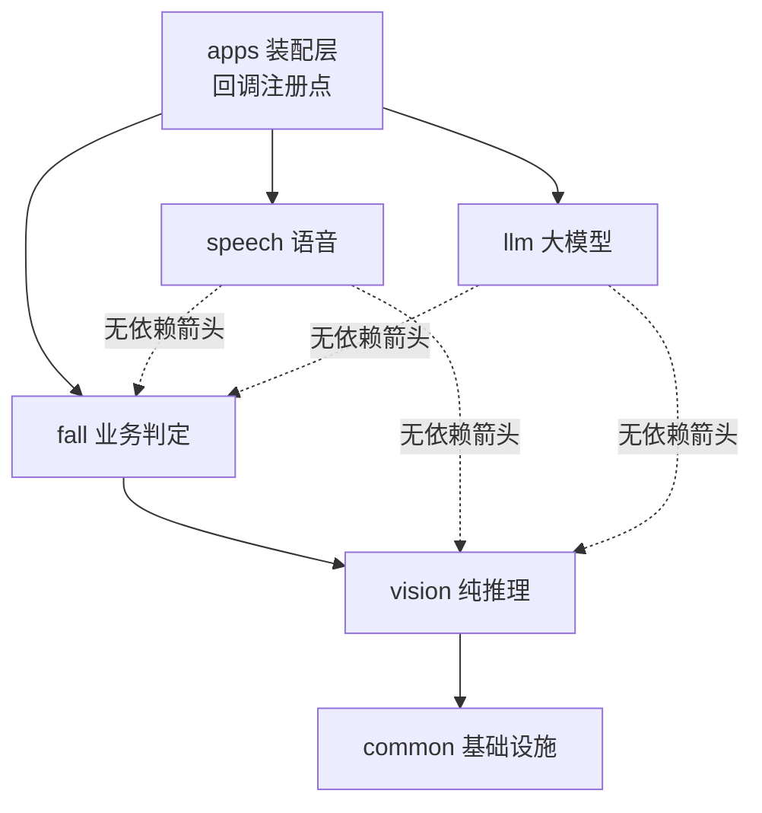

**操作步骤**：

1. 打开 `docs/02_架构设计.md`，通读"分层结构"部分。
2. 用表格记录每一层的职责（一句话）与对外暴露的关键接口。
3. 标注依赖方向：哪些层可以独立测试，哪些层必须配合。

**易错点**：

- ⚠️ 误以为 speech 依赖 fall → **解决**：对照 `docs/02_架构设计.md` 第17行"speech/llm 独立"，它们通过 apps 装配层的回调函数间接交互，不是直接 import。

#### 步骤2：阅读fall/monitor.py，理解视觉流水线与三接口（80min）

**知识点讲解**：

**1.2.2 视觉流水线（YOLO→IoU→姿态→特征→状态机）**

- **原理**：每帧处理链路（`process_frame`）是系统的核心循环：(1) YOLO检测提取 person 框，(2) IoU关联将检测框映射到持久 person_id（跨帧追踪），(3) 裁剪→姿态估计→原图坐标映射，(4) 几何特征提取（躯干角/宽高比/髋部速度），(5) 每人独立状态机 `update` 产出事件 dict（FALLING/LYING/ASK/ALERT/CANCELLED）或 None，(6) `_dispatch` 事件分发到 sink（日志+证据）和 hw_alert（STM32串口告警）。整个链路是同步单线程，每帧处理完才处理下一帧——这保证了状态机更新的时序确定性。关键设计：业务逻辑与 IO 解耦（"规则 20"），FallMonitor 通过 OutputSink 协议接收外部 IO，不直接依赖 ROS/TTS/ASR。
- **源码对应**：`fall/monitor.py` L223-322（process_frame 主链路）、L226-229（YOLO检测）、L230（IoU关联）、L245-260（_analyze_person 裁剪→姿态→特征）、L290-322（machine.update→_dispatch）、L424-480（_dispatch 事件分发）

```python
# fall/monitor.py L247-252 —— process_frame 入口
def process_frame(self, frame: np.ndarray) -> np.ndarray:
    """单帧主链路；返回标注帧"""
    now = time.time()
    with self._lock:
        self._frame_ring.push(frame, now)
    try:
        dets = self._ensure_yolo().detect(frame)
    except Exception as exc:
        self.log.error(f"检测推理失败（跳过本帧）: {exc}")
        dets = []
    persons = [item for item in self._iter_person_boxes(dets)]
    tracks = self._assoc.update([(bb, d) for d, bb in persons], now)
```

**1.3.1 monitor↔VoiceLoop三接口**

- **原理**：FallMonitor 暴露三个接口供 VoiceLoop（通过 apps 装配层）回调：(1) `on_kws(text)`——呼救词命中（KWS检测到"救命/帮帮我"等），任意态升级 ALERT；(2) `on_asr(text)`——ASK窗口语音应答（ASR识别到"没事"→CANCELLED 或"救命"→ALERT），一次应答只作用于一个会话（防多person重复触发）；(3) `has_ask_session()`——返回当前是否存在 ASK 应答会话，VoiceLoop 用上升沿触发开听、下降沿关听。这三个接口实现了视觉判定与语音链路的解耦：monitor 只负责"视觉判断是否跌倒+何时需要询问"，VoiceLoop 只负责"何时录音+何时播放"，两者通过 apps 层的回调函数连接。
- **源码对应**：`fall/monitor.py` L100-104（has_ask_session）、L115-168（on_kws 呼救词处理）、L169-220（on_asr ASK应答）、L460-480（_dispatch 中 ASK 会话管理）

```python
# fall/monitor.py L152-157 —— has_ask_session
def has_ask_session(self) -> bool:
    """当前是否存在 ASK 应答会话（app 层用它触发 VoiceLoop 应答窗口）"""
    with self._lock:
        return self._ask_session is not None
```

```python
# fall/monitor.py L168-173 —— on_kws 入口
def on_kws(self, text: str) -> None:
    """呼救词命中（KWS/ASR 呼救/文本调试）：任意态升级 ALERT。"""
    if not text:
        return
    now = time.time()
    inter = self.cfg["interaction"]
    hits = match_keywords(text, inter.get("distress_words", []))
    hits += match_keywords(text, inter.get("confirm_words", []))
```

- **配图**（monitor↔VoiceLoop 三接口协作时序图）：on_kws / on_asr / has_ask_session 的协作时序。

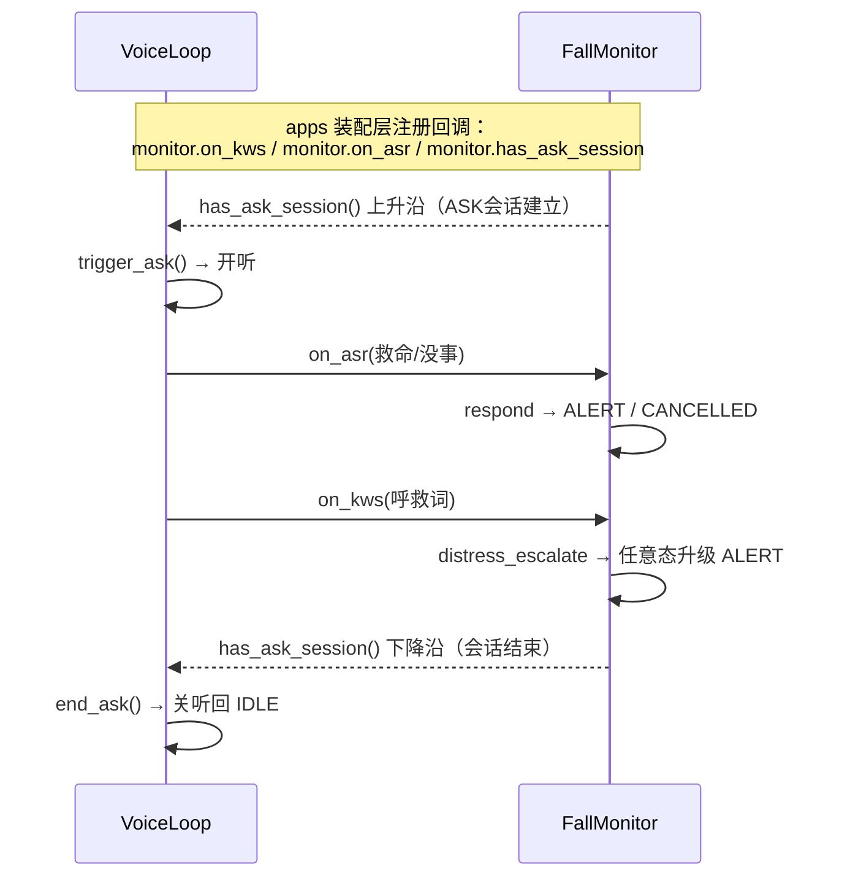

**操作步骤**：

1. 在 `fall/monitor.py` 中定位 `process_frame`（L223），逐行跟踪视觉流水线：detect→关联→_analyze_person→machine.update→_dispatch。
2. 定位 `on_kws`（L115），理解呼救词匹配逻辑（distress_words + confirm_words 任一命中即告警）。
3. 定位 `on_asr`（L169），理解 ASK 应答逻辑（cancel_words→CANCELLED / confirm_words→ALERT，一次应答只作用于一个会话）。
4. 定位 `has_ask_session`（L100），理解 ASK 会话的开关时机。
5. 在 `_dispatch`（L424）中跟踪 ASK/ALERT/CANCELLED 三种事件的分发路径。

**易错点**：

- ⚠️ 误以为 monitor 自己做 ASR 识别 → **解决**：对照 `fall/monitor.py` L1-8（docstring："业务逻辑与 IO 解耦（规则 20）"），monitor 只接收文本结果，ASR 识别由 VoiceLoop 完成。
- ⚠️ on_kws 与 on_asr 分不清 → **解决**：`on_kws` 是 KWS 检测到呼救词（任意态升级 ALERT，无需 ASK 窗口）；`on_asr` 是 ASK 窗口中的 ASR 识别结果（决定 CANCELLED 还是 ALERT）。KWS 是关键词硬匹配，ASR 是完整语句识别。

#### 步骤3：阅读speech/voice_loop.py，理解语音状态机与录音线程+队列路由（80min）

**知识点讲解**：

**1.2.3 语音单状态机 + 单录音线程 + 队列**

- **原理**：VoiceLoop 是系统唯一的语音调度器，采用"单录音线程 + 单状态机"架构。录音线程（`_capture_loop`）从 ALSA 设备读取音频帧（每帧 0.1s@16k），放入 `queue.Queue(maxsize=100)`。主循环（`run`）从队列取帧，按当前状态路由：IDLE 喂 KWS（检测唤醒词/呼救词），LISTENING 喂 ASR（带端点检测 + 静音兜底），SPEAKING 喂 KWS（检测唤醒词打断）并等 TTS 播完。这种设计替代了旧框架的"四门叠加"（set_enabled/active/playback_event互斥/wake_event门控），消除了所有门控——没有任何门，任何状态可立即开听，时序只由状态机一处控制。录音线程在硬件唤醒后才启动（XFM麦克风阵列需唤醒后 ALSA 流才可用，提前打开会导致流稀疏且唤醒后不恢复）。
- **源码对应**：`speech/voice_loop.py` L1-19（模块docstring，状态机说明）、L202-244（`_capture_loop` 录音线程）、L245-290（`run` 主循环+状态路由）、L291-310（`_handle_idle` KWS喂入）、L311-345（`_handle_listening` ASR feed+端点检测）、L346-360（`_handle_speaking` 播报+打断）

```python
# speech/voice_loop.py L1-22 —— 模块架构说明
"""单录音线程 + 单状态机语音循环（voice_interaction.py 架构移植）。

2026-08 重构核心：录音线程常开（sherpa_onnx.Alsa → audio_queue，maxsize=100），
主循环消费队列并按状态机路由每帧音频——IDLE 喂 KWS（唤醒/呼救）、
LISTENING 喂 ASR（带端点检测 + 静音兜底）、SPEAKING 喂 KWS（唤醒词打断）
并等 TTS 播完回 IDLE。
"""
```

```python
# speech/voice_loop.py L224-271 —— run 主循环状态路由
def run(self) -> None:
    # ...
    while self._running:
        # 硬件唤醒事件（不依赖队列）
        if self._hw_wake_ev.is_set():
            self._hw_wake_ev.clear()
            self._start_listening(DIALOG)
            continue
        # 跌倒 ASK / monitor 结束 ASK 会话 ...
        try:
            chunk = self._q.get(timeout=0.3)
        except queue.Empty:
            continue
        if self.state == IDLE:
            self._handle_idle(chunk)
        elif self.state == LISTENING:
            self._handle_listening(chunk)
        elif self.state == SPEAKING:
            self._handle_speaking(chunk)
```

**1.3.3 文本模式（--text）与音频模式状态机统一**

- **原理**：`feed_text(line)` 方法接收 stdin 逐行输入，直接注入与录音线程相同的回调链：唤醒词匹配→`_start_listening(DIALOG)`，LISTENING 态文本→`_invoke_dialog(text)` 或 `_invoke_ask(text)`，呼救词→`_on_help_kws(text)`。这意味着 `--text` 模式与音频模式走完全相同的状态机、相同的回调函数、相同的后续处理（LLM对话/TTS播报/告警），唯一差异是音频来源：音频模式从队列取 PCM 帧喂 KWS/ASR，文本模式从 stdin 取文本直接喂回调。设计意图：无需麦克风/扬声器即可完成全链路调试（`python3 apps/speech_text_demo.py`），开发效率大幅提升。
- **源码对应**：`speech/voice_loop.py` L141-170（feed_text 方法）

```python
# speech/voice_loop.py L154-181 —— feed_text 文本注入同一回调链
def feed_text(self, text: str) -> None:
    """文本调试：stdin 逐行喂，与音频路径同一状态机/回调链。"""
    text = text.strip()
    if not text:
        return
    if text in self.wake_words:
        self._start_listening(DIALOG)
        return
    if self.state == LISTENING:
        if self._mode == DIALOG:
            self._invoke_dialog(text)
        else:
            self._invoke_ask(text)
        return
    # IDLE：呼救词优先
    from common.keywords import match_keywords
    distress = self.cfg.get("interaction", {}).get("distress_words", [])
    if match_keywords(text, distress):
        self._on_help_kws(text)
        return
```

- **配图**（单录音线程 + 队列路由架构图）：录音线程常开，主循环按状态路由。

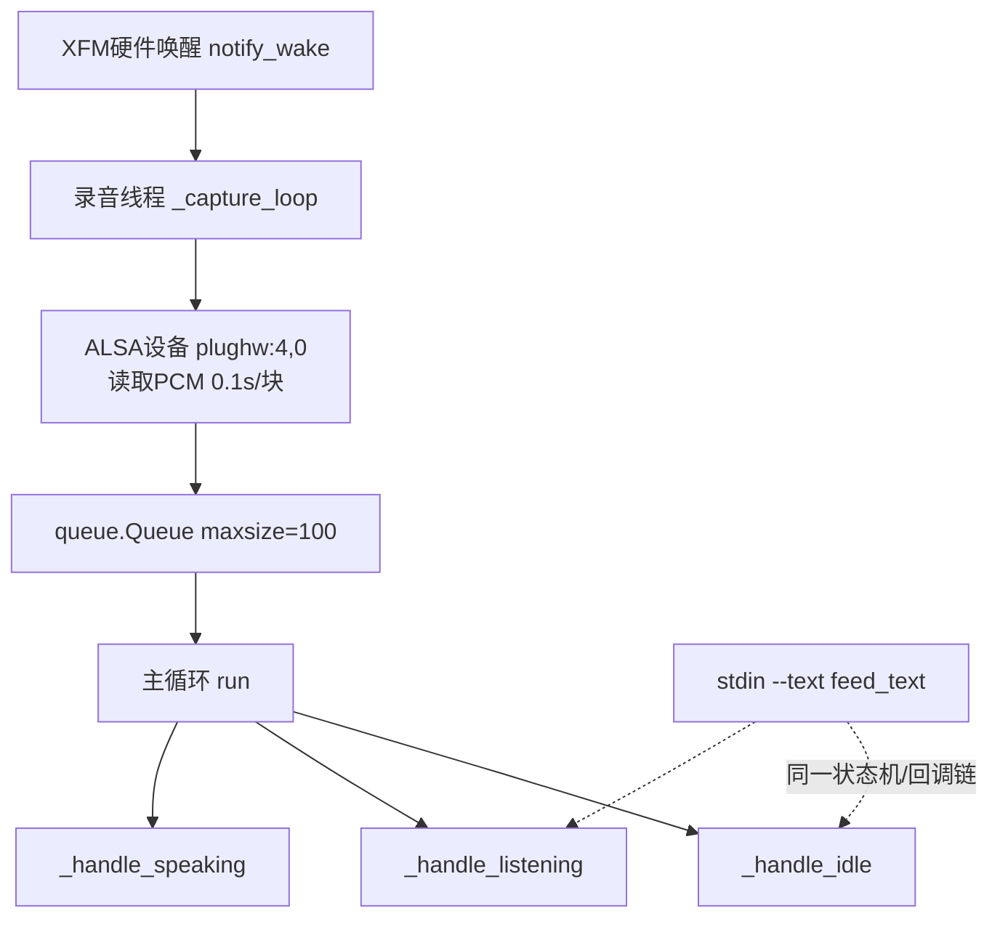

**操作步骤**：

1. 在 `speech/voice_loop.py` 中定位 `IDLE/LISTENING/SPEAKING` 三个状态常量（L27-28）。
2. 定位 `run` 主循环（L245），追踪队列取帧→状态分支→回调的完整路径。
3. 定位 `_capture_loop`（L202），理解录音线程的 ALSA 读取 + 队列写入 + 满队列丢弃策略。
4. 定位 `feed_text`（L141），理解文本输入如何注入同一状态机回调链。
5. 对比 `_handle_idle`（KWS喂入）和 `_handle_listening`（ASR feed + 端点检测 + 兜底超时）的差异。

**易错点**：

- ⚠️ 误以为 VoiceLoop 内部直接调 TTS → **解决**：对照 `speech/voice_loop.py` L362-375（`_invoke_dialog`），对话 TTS 走 apps 层回调 `_on_dialog_text`（在 worker 线程中调用 LLM+TTS），VoiceLoop 只负责状态转换（切到 SPEAKING）和 epoch 丢弃。
- ⚠️ 录音线程何时启动 → **解决**：对照 `speech/voice_loop.py` L193-197（`_ensure_capture`），有硬件唤醒时在 `notify_wake()` 后启动（XFM ALSA 需唤醒后才可用），无硬件唤醒时在 `run()` 中常开。

#### 步骤4：绘制视觉与语音双流水线数据流图（40min）

**操作步骤**：

1. 基于步骤2和步骤3的源码阅读，用 mermaid 画出**视觉流水线**：

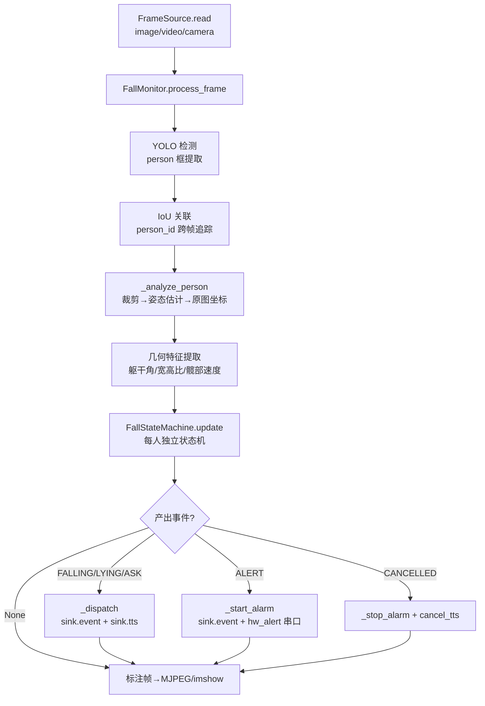

2. 画出**语音流水线**：

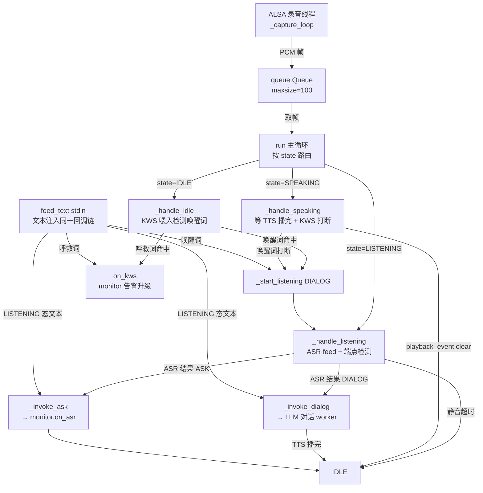

3. 画出**三接口协作时序图**：

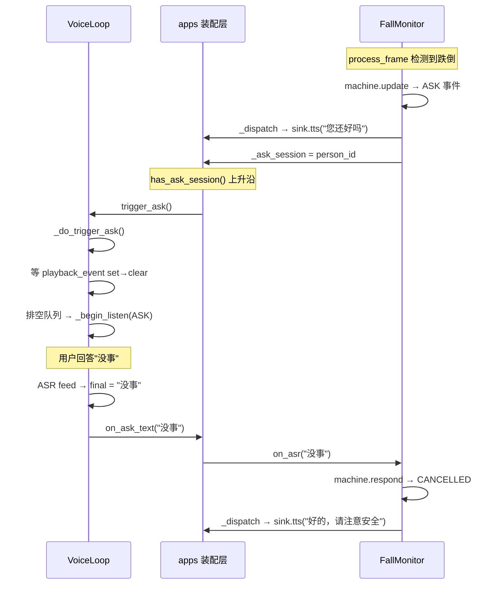

4. 检查：双流水线图是否完整覆盖了 spec 中的所有知识点（分层架构、视觉流水线五步、语音三态、单录音线程+队列、三接口、FrameSource、文本模式统一）。

**易错点**：

- ⚠️ 数据流图缺少 "sink" 层 → **解决**：对照 `common/sink.py` L11-15（OutputSink 协议），事件/播报/ASR控制走 sink 协议，与 monitor 业务解耦。
- ⚠️ 漏画 FrameSource → process_frame 的输入 → **解决**：对照 `common/source.py` L30-40（FrameSource.read），它是视觉流水线的唯一入口。

#### 步骤5：说明文本模式与音频模式状态机统一的设计（40min）

**知识点讲解**：

**1.3.3 文本模式（--text）与音频模式状态机统一**

- **原理**：`--text` 模式的核心设计是"文本直接注入音频回调链"：用户在 stdin 输入的文本（如"小飞小飞"、"救命"、"没事"）被 `feed_text()` 接收后，走与音频帧完全相同的处理路径——唤醒词→`_start_listening`，LISTENING态→`_invoke_dialog`/`_invoke_ask`，呼救词→`_on_help_kws`。唯一的差异是音频来源：音频模式从 `queue.Queue` 取 PCM 帧喂 KWS/ASR 引擎，文本模式跳过 KWS/ASR 直接喂最终文本。这意味着 `--text` 模式下：状态机流转完全一致、回调函数完全一致、后续处理（LLM对话/TTS播报/告警）完全一致。设计意图是"零硬件调试"：`python3 apps/speech_text_demo.py` 无需麦克风、扬声器、XFM六麦阵列，仅靠 stdin 即可验证全链路行为。同时，`feed_text` 中呼救词走同一 `_on_help_kws` 回调（L166），确保文本模式下呼救也能触发 ALERT 告警。
- **源码对应**：`speech/voice_loop.py` L141-170（feed_text 方法）、L362-375（_invoke_dialog worker线程）、L377-385（_invoke_ask 同步回调）

**操作步骤**：

1. 阅读 `feed_text`（L141-170），追踪每个分支对应的回调函数。
2. 对比 `_invoke_dialog`（L362）和 `_invoke_ask`（L377）：对话走 worker 线程（异步），ASK 走同步回调。
3. 构造一个文本输入序列验证：`小飞小飞`（唤醒）→`我摔倒了`（对话）→`救命`（呼救），画出状态流转图。
4. 对比音频模式的等效流程：录音线程→KWS检测"小飞小飞"→`_start_listening`→ASR识别"我摔倒了"→`_invoke_dialog`，验证两条路径的最终状态一致。
5. 在笔记中记录：文本模式为何能覆盖全链路（原因：回调链统一）。

**易错点**：

- ⚠️ 误以为文本模式跳过状态机 → **解决**：对照 `feed_text` L150（唤醒词→`_start_listening(DIALOG)`）和 L155-158（LISTENING态→`_invoke_dialog`/`_invoke_ask`），文本输入经过完全相同的状态转换和回调调用。

### 1.7 注意事项

- ⚠️ 本实验为**纯源码阅读实验，无硬件操作**，不需要给设备上电。
- ⚠️ 源码行号以实际文件为准，不同版本可能有偏移——重点关注类名和方法名定位，行号作为参考。
- ⚠️ mermaid 流程图绘制时，注意区分"数据流"（帧/PCM 从输入到输出）与"控制流"（状态机状态转换），两者不要混淆。
- ⚠️ `docs/02_架构设计.md` 中的架构图是文本格式（非 mermaid），阅读时需自行转换为结构化图表。

### 1.8 实验总结

**完成成果**:

- 一张六层架构依赖图（含依赖方向箭头与每层职责标注）。
- 一张视觉流水线数据流图（从 FrameSource.read 到事件分发，含每步源码行号引用）。
- 一张语音流水线架构图（含录音线程→队列→主循环→状态分支→回调，标注 feed_text 注入点）。
- 一张 monitor↔VoiceLoop 三接口时序图。
- 一份"文本模式与音频模式统一"的设计分析笔记。

**技能收获**:

- 技能1：分层架构阅读方法（从依赖方向入手，逐层理解职责与接口）
- 技能2：状态机数据流图绘制（区分数据流与控制流，标注关键回调）
- 技能3：IO 解耦设计理解（OutputSink 协议 + 回调注入 vs 直接耦合）

**常见问题与解决**:

| 问题 | 原因 | 解决方法 |
|------|------|----------|
| 分不清 on_kws 与 on_asr 的职责 | 两个接口都接收文本参数 | on_kws = KWS关键词硬匹配（任意态升级ALERT）；on_asr = ASK窗口ASR识别结果（决定CANCELLED/ALERT） |
| 误以为 VoiceLoop 直接调 TTS | 未追踪回调链 | `_invoke_dialog` 走 apps 层 `_on_dialog_text` worker 线程，VoiceLoop 只管状态转换 |
| 录音线程启动时机混淆 | 未理解 XFM ALSA 时序 | 有硬件唤醒时 `notify_wake()` 后启动（L193 `_ensure_capture`）；无硬件唤醒时 `run()` 中常开 |
| 文本模式为何能覆盖全链路 | 以为文本模式是独立分支 | `feed_text` 直接调用 `_start_listening`/`_invoke_dialog`/`_on_help_kws`，与音频回调链完全相同 |

### 1.9 实验报告要求

**思考题**:

1. 为什么语音链路与视觉判定解耦（通过 apps 层回调而非直接 import），而不是让 VoiceLoop 直接持有 FallMonitor 实例？请从可测试性、可替换性、依赖方向三个角度分析。
2. 为什么 VoiceLoop 采用"单录音线程 + 队列路由"而非"多线程直调"（如每个 KWS/ASR/TTS 各一个线程）？请结合 ALSA 设备特性（单打开）和状态机统一控制的时序确定性分析。
3. `has_ask_session()` 为何需要"上升沿触发开听"的设计，而非在 `_dispatch` 中直接调用 VoiceLoop？请从 monitor↔VoiceLoop 解耦的角度分析。
4. FrameSource 的三种模式（image/video/camera）为何能走同一条处理链路（`read()` 返回 `(ok, frame)`）？如果未来新增一种输入源（如 RTSP 流），需要改哪些接口？

**评分标准**:

- 六层架构依赖图（20分）：层级正确、依赖方向正确、每层职责标注清晰
- 视觉流水线数据流图（25分）：五步链路完整（YOLO→IoU→姿态→特征→状态机）、源码行号引用准确
- 语音流水线架构图（25分）：单录音线程→队列→状态机三态流转完整、feed_text 注入点标注清晰
- monitor↔VoiceLoop 三接口时序图（15分）：on_kws/on_asr/has_ask_session 调用时机正确、apps 装配层标注清晰
- 思考题回答（15分）：解耦设计理由充分、队列路由优势分析到位 = 100分。

---

---

# 实验3：老人跌倒监护--配置与接口设计（4h）

### 1.1 关联知识点

- 2.1.1 fall_config.yaml 十四段配置（model/detect/source/speech/state/interaction/alert/evidence/llm）[概念，前置：1.2.1 五层模块划分]
- 2.1.2 config_schema 强制键校验与类型检查 [原理，前置：2.1.1]
- 2.1.3 CLI 传参与配置覆盖规则（CLI > yaml > 默认）[流程，前置：2.1.1]
- 2.2.1 文本→音频→摄像头三级开发模式 [概念，前置：1.3.3 文本模式与音频模式状态机统一]
- 2.2.2 环境自检 env_check（依赖/模型/串口/ALSA）[事实，前置：2.1.1]
- 2.2.3 运行产物不入库（runs/ 证据/日志/缓存）与资源清理 [流程，前置：2.2.1]

### 1.2 实验目标

1. **掌握** fall_config.yaml 各段（model/detect/source/speech/state/interaction/alert/evidence/llm 等十四段）配置键的含义与调参方法，能独立修改模型路径、阈值、端口等关键参数。
2. **理解** config_schema.py 的 REQUIRED 嵌套 schema 校验机制，能解释"叶键 = 类型 → 必填，(类型, 默认) → 可缺省，嵌套 dict → 递归"的校验逻辑，并通过故意改错键名观察 schema 拦截报错。
3. **掌握** CLI 参数与配置文件的覆盖优先级（CLI > yaml > 代码默认值），能独立使用 `--score-thr`、`--angle-thr`、`--mjpeg`、`--text` 等参数覆盖 config 中的对应键。
4. **完成** env_check 环境自检，能读懂自检输出中的 `[env] OK` / `[env] MISSING` 标记并定位缺失资源。
5. **理解** VLM 开关（model.vlm.enabled）的内存影响与默认关闭理由，掌握按需启用的场景。
6. **迁移**：将"配置 → 校验 → 自检 → 覆盖"的配置设计方法应用到其他边缘 AI 项目。

### 1.3 实验环境

| 类别 | 内容 |
|------|------|
| 硬件 | 具身智能实验箱 B2 / 具身智能机器人小车 C1（本实验以配置阅读为主，env_check 可离线运行） |
| OS | Ubuntu 22.04（板端） |
| Python | 3.10+（env_check 依赖 PyYAML） |
| 核心库 | PyYAML（配置加载）、importlib（env_check 依赖检测） |
| 依赖 | 配置文件 `config/fall_config.yaml`；schema 校验 `config/config_schema.py`；环境自检 `common/env_check.py` |

### 1.4 实验难度

- 难度: ⭐⭐（设计性）
- 重点：fall_config.yaml 十四段配置键的含义与调参；config_schema 强制校验的拦截机制；CLI 参数覆盖优先级；env_check 自检流程。
- 难点：config_schema 嵌套递归校验的报错定位（"missing key: state.angle_thr" 需回溯到 yaml 第几层）；CLI 与 yaml 的覆盖边界区分（CLI 改的是内存值，不写回 yaml）；VLM 开关的内存权衡。

### 1.5 实验现象

**快速验证流程**（本实验以配置阅读与 schema 校验为主）：

```bash
# 进入项目目录
cd /home/iflytek/ros2_ws/src/xflz_eai_car1/app/elderly_companion/

# 1. env_check 自检
python3 common/env_check.py --config config/fall_config.yaml

# 2. 故意改错键名后运行（预期 schema 报错）
cp config/fall_config.yaml config/fall_config.yaml.bak
# 手动将 state.angle_thr 改为 state.angl_thr（少写 r）
python3 -c "from common.config import load_config; from fall.config_schema import REQUIRED; load_config('config/fall_config.yaml', REQUIRED)"
```

**预期效果描述**：

- env_check 输出以 `[env] OK` / `[env] MISSING` 开头的逐行自检清单，覆盖依赖库版本（numpy、cv2、rknnlite 等）、模型文件（yolov8n.rknn、rtmpose_s_256x192_int8.rknn）、语音模型（encoder/decoder/joiner 三件套）、TTS 模型文件、串口设备（/dev/ttyUSB0）。
- 故意改错键名后，schema 报 `config error: missing key: state.angl_thr`（报缺失而非崩溃），验证校验拦截。
- 恢复备份：`mv config/fall_config.yaml.bak config/fall_config.yaml`。

### 1.6 实验步骤

#### 整体流程图


#### 步骤1：阅读配置方案文档，记录十四段配置键（40min）

**知识点讲解**：

**2.1.1 fall_config.yaml 十四段配置**

- **原理**：fall_config.yaml 是整个老人跌倒监护系统的唯一配置入口，设计原则是"迁移机器只改本文件，代码零改动"。全文分为十四段顶层键：`paths`（模型根路径）、`model`（姿态引擎/VLM 开关）、`detect`（YOLO 检测参数）、`source`（输入源模式/相机话题）、`session`（遗留键，wake_words 仍读取）、`speech`（KWS/ASR/TTS/硬件唤醒）、`state`（跌倒判据阈值与时序）、`interaction`（语音词表与话术）、`alert`（STM32 串口告警）、`evidence`（证据存档参数）、`monitor`（无人超时）、`arm_reaction`（机械臂联动，默认关）、`server`/`display`/`save`/`log`（推流/显示/保存/日志）、`llm`（大模型对话服务）。每段的键名拼写受 config_schema 的 REQUIRED 字典强制校验，拼写错误会报 `config error`。模型路径全部使用板端绝对路径（如 `/home/iflytek/models/rkllm/…`），迁移到不同机器时只需修改 yaml 中的路径，代码无硬编码。
- **源码对应**：`docs/04_配置方案.md L1-L8（总览）、L10-L18（4.1 顶层键表）`

```yaml
# fall_config.yaml 顶层结构速览（十四段）
paths:     { models_dir: ... }
model:     { pose_type, pose_path, rtmpose: {...}, vlm: {...} }
detect:    { model_path, classes_file, num_classes, imgsz, score_thr, iou_thr, classes, crop_margin }
source:    { mode, image_path, video_path, camera: {...} }
session:   { wake_words: [...] }           # 遗留键，wake_words 仍读取
speech:    { text_mode, capture_device, kws: {...}, asr: {...}, tts: {...} }
state:     { angle_thr, aspect_thr, speed_factor, falling_window, lying_time, ask_timeout, ... }
interaction: { cancel_words, confirm_words, distress_words, ask_tts, ... }
alert:     { port, buzzer: {...}, led: {...}, oled: {...} }
evidence:  { dir, pre_seconds, post_seconds, max_files, fps }
monitor:   { no_person_timeout }
arm_reaction: { enabled, amp_rad, reps, step_sleep }
server/display/save/log: { ... }
llm:       { enabled, server: {...}, chat: {...} }
```

- **配图**（十四段配置 → 模块映射图）：左侧列 yaml 段名，右侧列对应模块（如 state → fall/state_machine.py，speech → speech/voice_loop.py，alert → fall/alert_hw.py），帮助理解"每个模块读哪个段"。

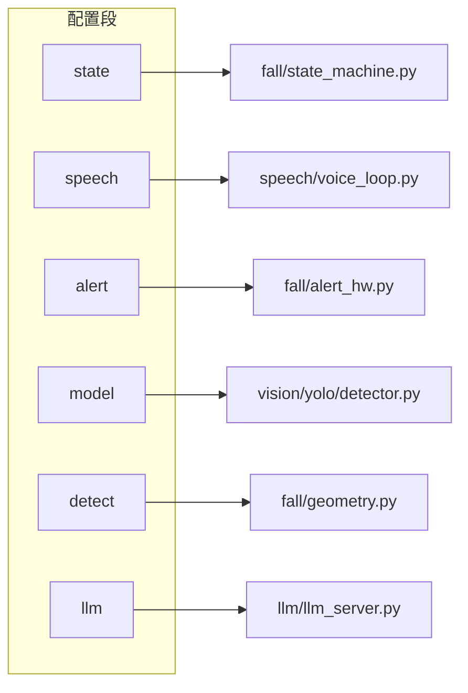

**操作步骤**：

1. 打开 `docs/04_配置方案.md`，通读 §4.1 顶层键表，记录十四段键名与对应模块。
2. 用表格整理：`| 段名 | 核心键 | 对应模块/文档章节 |`。
3. 标注"哪些段是必填的（schema 强制）、哪些键有默认值可缺省"。

**易错点**：

- ⚠️ 误以为 session.wake_words 是遗留无效键 → **解决**：`docs/04_配置方案.md L281-L283` 明确标注"session.wake_words 仍读取（VoiceLoop 用其分流 KWS 唤醒词）"，而 session 下其他键如 post_tts_close_delay 才是无效键。

#### 步骤2：对照 fall_config.yaml，逐段理解各键含义（50min）

**知识点讲解**：

**2.1.1 / 2.1.2 配置内容与 schema 校验**

- **原理**：逐段阅读 yaml 是理解系统行为的关键。核心段落包括：(1) `model` 段控制姿态引擎切换（pose_type: blazepose/rtmpose）和 VLM 开关（vlm.enabled 默认 false，开启后占约 1.5G 内存）；(2) `detect` 段定义 YOLOv8 检测参数，score_thr=0.25 和 crop_margin=1.5 是实测最优值（1.0 时躺姿检出失败）；(3) `state` 段是跌倒判据核心，angle_thr=50°、aspect_thr=0.5、lying_time=3s、ask_timeout=12s 共同决定"跌倒→观察→询问→告警"的时序；(4) `speech` 段下有 kws/asr/tts 三个子段，其中 kws 默认关闭（板端无 USB 六麦阵列时保留实现），hardware_wakeup 硬件唤醒默认开启；(5) `llm` 段控制 LLM 对话服务的端口（8080）、模型路径、多轮历史窗口（max_history=6）。这些值都通过 config_schema.py 的 REQUIRED 字典定义校验规则：叶键为 `type` 时必填，`(type, default)` 时可缺省并插入默认值，嵌套 dict 递归校验。
- **源码对应**：`config/fall_config.yaml L1-L180（全文）`；`config/config_schema.py L10-L147（REQUIRED 字典）`；`docs/04_配置方案.md L20-L180（§4.2-§4.11 各段详解）`

```yaml
# 关键配置摘录（带行号锚点）
model:
  pose_type: rtmpose              # L9: 姿态引擎选择
  vlm:
    enabled: false                # L16: VLM 默认关闭（内存考虑）
detect:
  score_thr: 0.25                 # L27: 检测置信度阈值
  crop_margin: 1.5                # L33: 裁剪框放大（1.0 躺姿失败）
state:
  angle_thr: 50.0                 # L57: 躯干角阈值
  ask_timeout: 12.0               # L62: ASK 超时（秒）
speech:
  kws:
    hardware_wakeup:
      enabled: true               # L39: XFM 硬件唤醒默认开
      port: /dev/ttyACM0          # L41: AIUI 串口
llm:
  enabled: true                   # L170: LLM 对话总开关
  server:
    port: 8080                    # L173: Flask HTTP 端口
```

- **配图**（state 段状态机图）：从 FALLING（1.5s 观察窗）→ LYING（3s 躺地）→ ASK（12s 询问窗口）→ ALERT（告警升级），每个状态旁标注对应 yaml 键名与默认值，帮助理解参数如何控制判定流程。

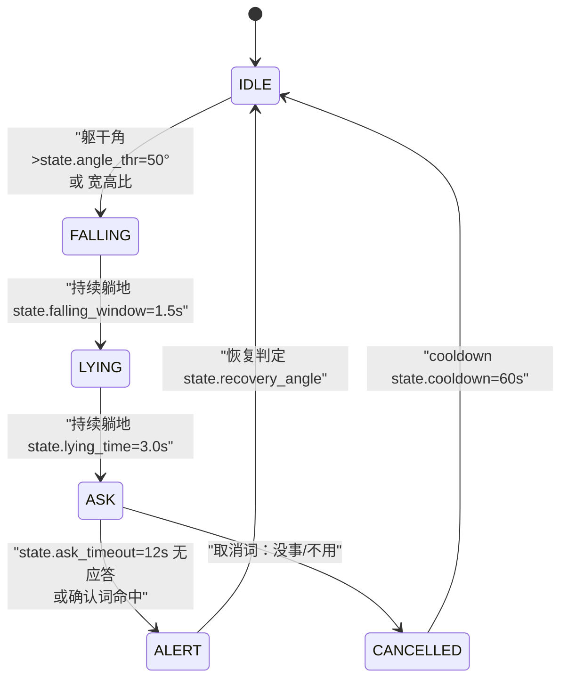

**操作步骤**：

1. 逐段阅读 `config/fall_config.yaml`，重点标注以下键：
   - `model.vlm.enabled`（L16）：VLM 开关，默认 false
   - `detect.score_thr`（L27）、`detect.crop_margin`（L33）：检测参数
   - `state.angle_thr`（L57）、`state.ask_timeout`（L62）：跌倒判据
   - `speech.kws.hardware_wakeup.port`（L41）：串口映射
   - `alert.port`（L115）：STM32 串口（USB0，非 USB1）
   - `llm.server.port`（L173）：LLM 端口（8080，与 MJPEG 8088 不冲突）
2. 对照 `docs/04_配置方案.md` 各段说明，记录每个键的"含义/默认值/调参建议"。
3. 绘制"state 段时序图"，标注各阈值与状态流转。

**易错点**：

- ⚠️ 混淆 alert.port（USB0 = STM32）与 USB1（雷达） → **解决**：`docs/04_配置方案.md L253-L255` 明确说明"USB1 是雷达，自动发现会选错，必须显式"。
- ⚠️ 误以为 llm.server.port=8080 与 server.port=8088 冲突 → **解决**：`docs/04_配置方案.md L289` 注释说明"与 llm.server.port 同号会启动报错"，8080 ≠ 8088，不冲突。

#### 步骤3：故意改错键名，验证 schema 校验拦截（30min）

**知识点讲解**：

**2.1.2 config_schema 强制键校验与类型检查**

- **原理**：config_schema.py 定义了 REQUIRED 嵌套字典，其校验逻辑由 `common/config.py` 的 `_validate()` 函数实现（L28-L56）。校验规则：(1) 叶键为 `type`（如 `str`、`float`）→ 必填，缺失报 `missing key: xxx.yyy`；(2) 叶键为 `(type, default)` → 缺失时自动插入默认值并继续；(3) 嵌套 dict → 递归校验，缺失的父键也会递归检查子键；(4) 类型不符报 `xxx: expected float, got str`。设计意图是"拼写错误在启动时就被拦截，而非运行时静默失效"。例如将 `state.angle_thr` 改为 `state.angl_thr`，启动时 schema 会报 `missing key: state.angl_thr`，直接阻止程序启动。
- **源码对应**：`common/config.py L28-L56（_validate 函数）`；`config/config_schema.py L10-L147（REQUIRED 字典）`；`docs/04_配置方案.md L6-L8（schema 校验说明）`

```python
# common/config.py L28-L56 校验核心逻辑
def _validate(node: dict, schema: dict, prefix: str) -> dict:
    for key, spec in schema.items():
        path = f"{prefix}.{key}" if prefix else key
        if isinstance(spec, dict):       # 嵌套 dict → 递归
            ...
        expected = _leaf_type(spec)
        if key not in node:
            if isinstance(spec, tuple):  # (type, default) → 缺省插入默认值
                out[key] = spec[1]
                continue
            raise ConfigError(f"missing key: {path}")  # 必填缺失 → 报错
```

- **配图**（config_schema 校验决策树）：顶层 dict 遍历 → 叶键类型判断（type vs (type, default) vs 嵌套 dict）→ 缺失/类型不匹配/递归三条分支，帮助理解校验流程。

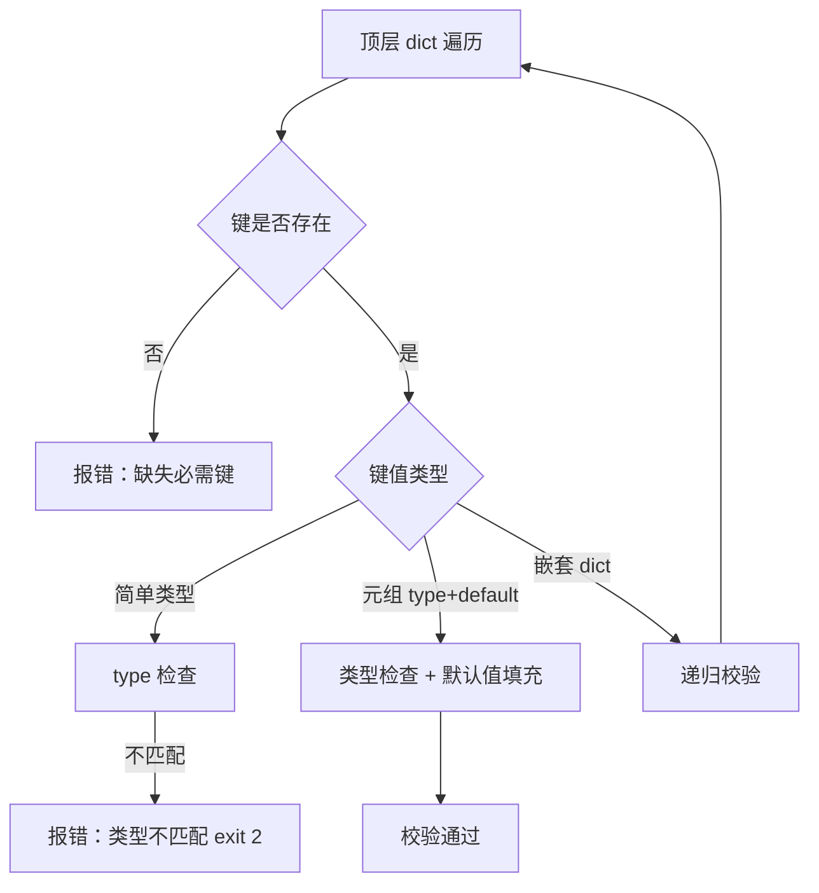

**操作步骤**：

1. 备份配置文件：`cp config/fall_config.yaml config/fall_config.yaml.bak`
2. 编辑 `config/fall_config.yaml`，将 `state.angle_thr` 改为 `state.angl_thr`（故意拼错）。
3. 运行校验（预期报错）：
   ```bash
   python3 -c "from common.config import load_config; from fall.config_schema import REQUIRED; load_config('config/fall_config.yaml', REQUIRED)"
   ```
   预期输出：`config error: missing key: state.angl_thr`（注意报的是 angl_thr 缺失，而非 angl_thr 值错误）。
4. 恢复备份：`mv config/fall_config.yaml.bak config/fall_config.yaml`
5. 再尝试改错类型（如将 `state.angle_thr: 50.0` 改为 `state.angle_thr: "五十"`），观察类型报错。
6. 观察"有默认值的键缺省时的处理"：删除 `detect.crop_margin` 行（schema 定义为 `(float, 1.5)`），运行校验 → 不报错，自动填入 1.5。

**易错点**：

- ⚠️ 误以为 schema 报错会修改 yaml 文件 → **解决**：schema 校验是只读的（`_validate` 返回新 dict 不修改原 data），报错通过异常（ConfigError）抛出，yaml 文件不被修改。
- ⚠️ 误以为所有键缺失都报错 → **解决**：`(type, default)` 形式的键（如 crop_margin、score_thr 等）缺失时自动填入默认值，只有纯 `type` 形式的键（如 detect.model_path、model.pose_path）缺失才报错。

#### 步骤4：运行 env_check 自检依赖/模型/串口完整性（30min）

**知识点讲解**：

**2.2.2 环境自检 env_check**

- **原理**：env_check 是启动前的强制自检脚本，检查两类资源：(1) 依赖库版本（`_check_imports()`，common/env_check.py L32-L41）——检查 numpy、cv2、scipy、rknnlite、sherpa_onnx、serial、yaml 七个库是否可 import 并打印版本号；(2) 模型/资源文件完整性（`_check_files()`，L47-L116）——从已加载的 cfg 中提取 detect.model_path、model.pose_path、speech.kws/asr/tts 各模型路径、alert 串口设备等，逐个检查文件存在且非空。若 vlm.enabled=true 则额外检查 VLM 模型和 librkllmrt.so。脚本绝不自动安装（板端禁装），只打印 `[env] MISSING <路径> <提示>` 由人工处理。返回 True=通过，False=有缺失（app 打印清单后 exit 2）。脚本通过 `load_config(cfg_path, REQUIRED)` 先完成 schema 校验，因此 env_check 本身就隐含了 config_schema 校验——如果 yaml 有拼错键，env_check 会先报 config error 退出。
- **源码对应**：`common/env_check.py L1-L15（导入与 docstring）`、`L32-L41（_check_imports）`、`L47-L116（_check_files）`、`L117-L135（env_check + main）`；`docs/04_配置方案.md L6-L8`

```bash
# 运行 env_check（带 config 参数）
python3 common/env_check.py --config config/fall_config.yaml

# 预期输出（部分）：
# [env] 环境自检开始 ...
# [env] OK   numpy 1.24.3
# [env] OK   cv2 4.8.1
# [env] OK   rknnlite 2.3.2
# [env] OK   /home/iflytek/ros2_ws/.../yolov8n.rknn (file 4567 KB)
# [env] MISSING /dev/ttyUSB0  提示: STM32 串口设备不存在（检查 USB 连接）
# [env] 自检通过
```

- **配图**（env_check 自检流程图）：main() → load_config（schema 校验）→ _check_imports（7 个库）→ _check_files（模型/串口/资源）→ 汇总通过/失败。

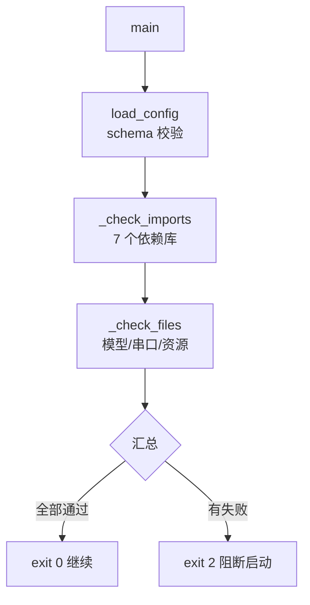

**操作步骤**：

1. 运行 `python3 common/env_check.py --config config/fall_config.yaml`。
2. 逐行阅读输出，区分 `[env] OK`（通过）和 `[env] MISSING`（缺失）。
3. 关注 MISSING 项的"提示"字段（如 "STM32 串口设备不存在"、"YOLO 检测模型"），理解每个缺失项的影响。
4. 记录 env_check 检查的完整清单（依赖库 7 个 + 模型文件 + 串口设备）。

**易错点**：

- ⚠️ 误以为 env_check 会自动修复缺失 → **解决**：env_check 绝不自动安装（规则 1），只打印清单由人工处理；这在板端是必要的安全约束。
- ⚠️ 在工程机（非板端）运行 env_check 报大量 MISSING → **解决**：这是预期行为——模型文件仅在板端存在，工程机可用于验证 env_check 逻辑本身是否正常运行。

#### 步骤5：阅读程序参数详解，掌握全部 CLI 参数与覆盖规则（40min）

**知识点讲解**：

**2.1.3 CLI 传参与配置覆盖规则**

- **原理**：所有入口脚本的 CLI 参数优先级最高：**CLI 参数 > config 文件 > 代码默认值**。核心入口 fall_app.py 支持的 CLI 参数包括：`--config`（指定配置文件路径，默认 config/fall_config.yaml）、`--mode`（camera/image/video 三选一）、`--input`（图片/视频路径）、`--text`（文本调试模式）、`--vis/--no-vis`（显示窗口）、`--save/--no-save`（保存标注）、`--mjpeg/--no-mjpeg`（推流）、`--log-level`（日志级别）、`--score-thr`（检测置信度覆盖）、`--angle-thr`（躯干角阈值覆盖）。有 `--xxx/--no-xxx` 成对的开关：CLI 显式传参即覆盖 config 中的对应键（如 `--no-mjpeg` 在 config `server.enabled: true` 时强制关推流）。CLI 覆盖的是内存中的 config dict，不写回 yaml 文件——下次启动如不传 CLI 参数，仍读 yaml 原值。覆盖的映射关系：`--score-thr` → detect.score_thr，`--angle-thr` → state.angle_thr，`--mjpeg/--no-mjpeg` → server.enabled，`--save/--no-save` → save.enabled，`--vis/--no-vis` → display.show，`--text` → speech.text_mode，`--log-level` → log.level。
- **源码对应**：`docs/10_程序参数详解.md L1-L6（优先级说明）`、`L8-L42（§10.1 fall_app.py 参数表）`、`L80-L100（§10.6 覆盖规则速查）`

```bash
# CLI 覆盖示例
python3 apps/fall_app.py --mode camera --score-thr 0.4 --log-level DEBUG
# → detect.score_thr 被 CLI 覆盖为 0.4（yaml 原值 0.25 不变）
# → log.level 被覆盖为 DEBUG
# → 其余键仍读 yaml 原值

# --no-mjpeg 强制关推流（即使 config server.enabled: true）
python3 apps/fall_video_demo.py --video testdata/fall_slow_x264.mp4 --no-mjpeg
```

- **配图**（CLI → config → 默认值三级覆盖优先级图）：最底层"代码默认值"（_validate 的 default），中间层"yaml 文件"（load_config 加载），最顶层"CLI 参数"（argparse 覆盖），箭头方向为"上层覆盖下层"。

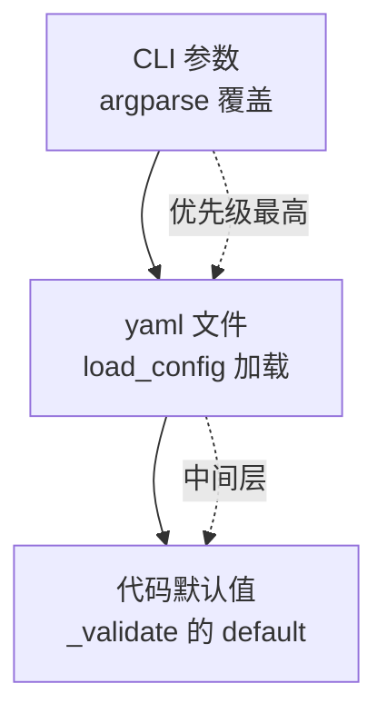

**操作步骤**：

1. 通读 `docs/10_程序参数详解.md`，整理各入口脚本的参数表。
2. 绘制"CLI → config 键映射表"：`| CLI 参数 | config 键 | 默认值 | 说明 |`。
3. 总结覆盖规则：CLI 显式传参 = 覆盖；未传 CLI = 读 yaml；yaml 缺失 = schema 默认值。
4. 标注"遗留键"（如 session.post_tts_close_delay、asr.open_delay）的无效性。

**易错点**：

- ⚠️ 误以为 CLI 覆盖会写回 yaml → **解决**：`docs/10_程序参数详解.md L1-L3` 明确说明"CLI 参数 > config 文件 > 代码默认值"，覆盖仅作用于内存 dict，yaml 文件不变。
- ⚠️ 误以为 --video 是 video 模式的默认值 → **解决**：`--video` 是 `fall_video_demo.py` 的必选参数（`required=True`），不传会 argparse 报错退出。

#### 步骤6：CLI 覆盖实践——验证优先级（30min）

**知识点讲解**：

**2.1.3 / 2.2.1 CLI 覆盖与三级开发模式**

- **原理**：本步骤将步骤1-5的知识串联：先用 env_check 确认环境可用，再通过 CLI 覆盖验证"CLI > yaml > 默认值"的优先级链。实践方法：(1) 在 yaml 中设 score_thr=0.25，不传 CLI → 观察程序使用 0.25；(2) 传 --score-thr 0.4 → 观察程序使用 0.4；(3) 删除 yaml 中 score_thr（schema 有默认值 0.25）→ 不传 CLI → 观察程序仍用 0.25（schema 默认值兜底）。三级开发模式（文本→音频→摄像头）也是通过配置控制：speech.text_mode=true 或 --text 进入文本模式，无需麦克风/扬声器即可完成全链路调试——这在板端无外设时尤为重要。
- **源码对应**：`docs/10_程序参数详解.md L80-L100（覆盖规则速查）`；`docs/04_配置方案.md L149-L152（speech.text_mode 说明）`

```bash
# 实践1：CLI 覆盖 score_thr
python3 apps/detect_demo.py --input testdata/stand_up.jpg --score-thr 0.4 --save
# → 使用 0.4 阈值（yaml 原值 0.25 被覆盖）

# 实践2：文本模式全链路（无需硬件）
python3 apps/fall_video_demo.py --video testdata/fall_slow_x264.mp4 --text
# → speech.text_mode 被 --text 覆盖为 true
# → stdin 喂词走同一状态机（验证配置驱动模式切换）
```

**操作步骤**：

1. 确认 env_check 通过后，运行 `python3 apps/detect_demo.py --input testdata/stand_up.jpg --score-thr 0.4 --save`，对比不传 `--score-thr` 时的检测框数量差异。
2. 运行文本模式：`python3 apps/fall_video_demo.py --video testdata/fall_slow_x264.mp4 --text`，输入"小飞小飞"验证唤醒，输入"救命"验证 ALERT。
3. 尝试传 `--no-mjpeg`（即使 yaml server.enabled=false），确认推流不启动。
4. 总结 CLI 覆盖的"安全边界"：哪些键可以 CLI 覆盖（score_thr/angle_thr/mjpeg/save/vis/text/log-level），哪些键只能改 yaml（模型路径、串口、词表）。

**易错点**：

- ⚠️ 误以为所有 yaml 键都有 CLI 覆盖 → **解决**：只有 docs/10_程序参数详解.md 中列出的参数（约 10 个）支持 CLI 覆盖，其余键（如 model.pose_path、speech.asr.model_dir）只能改 yaml。
- ⚠️ 误以为 --text 只影响语音模块 → **解决**：--text 是全局开关（speech.text_mode），影响录音线程是否启动、ASR/TTS 是否加载——文本模式下整个语音链路被"模拟"而非跳过。

### 1.7 注意事项

- ⚠️ 修改 fall_config.yaml 前务必备份（`cp config/fall_config.yaml config/fall_config.yaml.bak`），实验结束后恢复原文件。
- ⚠️ env_check 在工程机运行会报模型文件 MISSING（模型仅在板端存在），这是预期行为——重点是验证 env_check 逻辑和自检清单完整性。
- ⚠️ 不要在板端随意修改模型路径（如 rtmpose.model_path），错误路径会导致 RKNN 推理失败且无友好提示。
- ⚠️ `--score-thr` 和 `--angle-thr` 的覆盖仅作用于本次启动，重启后如不传 CLI 则恢复 yaml 原值——调参时注意记录"哪次用了什么值"。
- ⚠️ config_schema 的 REQUIRED 字典是"白名单"——只有 schema 中声明的键会被保留和校验，yaml 中未声明的键会被静默丢弃（不报错但也无效）。

### 1.8 实验总结

**完成成果**：

- 一份 fall_config.yaml 十四段配置键梳理表（含每段核心键、含义、默认值、对应模块）。
- 一次 schema 校验拦截实操记录（故意改错键名 → 报错 → 恢复）。
- 一份 env_check 自检输出记录（标注 OK/MISSING 项）。
- 一份 CLI 参数→config 键映射表（含覆盖优先级说明）。

**技能收获**：

- 技能1：配置文件结构化阅读方法（分段 → 键名 → 类型 → 默认值 → 调参建议）
- 技能2：schema 校验的调试方法（报错定位 → 回溯 yaml 行号 → 修复拼写/类型）
- 技能3：CLI 覆盖优先级实践（CLI > yaml > 默认值；覆盖不写回 yaml）

**常见问题与解决**：

| 问题 | 原因 | 解决方法 |
|------|------|----------|
| schema 报 `missing key: state.angl_thr` | yaml 键名拼写错误（少了 r） | 对照 REQUIRED 字典修正键名，注意大小写与下划线 |
| env_check 报 `[env] MISSING` 模型文件 | 模型文件仅在板端存在 | 在板端运行；工程机的 MISSING 可忽略（仅验证逻辑） |
| `--no-mjpeg` 不生效（推流仍启动） | yaml 中 server.enabled=false 本身就不推流 | --no-mjpeg 只在 yaml=true 时有效；确认 yaml 原值再操作 |
| CLI 覆盖后重启恢复原值 | CLI 覆盖仅作用于内存 dict | 这是设计行为——持久化改 yaml，临时调试用 CLI |

### 1.9 实验报告要求

**思考题**：

1. 为什么 fall_config.yaml 采用"叶键 = 类型 → 必填，(类型, 默认) → 可缺省"的双重 schema 设计，而不是"所有键都必填"或"所有键都有默认值"？请结合 model.pose_path（必填）和 detect.crop_margin（可缺省，默认 1.5）两个键说明设计理由。
2. env_check 为什么"绝不自动安装"缺失的依赖库？请从板端安全约束（规则 1）和生产环境一致性两个角度分析原因。如果 env_check 改为自动 pip install 会带来什么风险？
3. CLI 覆盖不写回 yaml 文件的设计有什么好处？如果改为"CLI 覆盖同时写回 yaml"，在多人协作或版本控制场景下会有什么问题？

**评分标准**：

| 评分项 | 分值 | 说明 |
|--------|------|------|
| 十四段配置键梳理表 | 30 分 | 十四段完整覆盖、核心键识别准确、含义与默认值正确 |
| schema 校验实操记录 | 25 分 | 改错操作正确、报错信息记录完整、恢复操作正确 |
| env_check 自检记录 | 20 分 | 自检命令正确、输出逐行记录、OK/MISSING 标注清晰 |
| CLI 参数映射表与覆盖规则 | 15 分 | 映射表完整、优先级规则表述正确 |
| 思考题回答质量 | 10 分 | 结合源码与设计约束、逻辑清晰 |
| **合计** | **100 分** |

---

---

# 实验4：老人跌倒监护--语音交互集成测试（6h）

### 1.1 关联知识点

- 3.1.1 XFM六麦硬件唤醒（AIUI事件/beam/angle）[事实，前置：ROS2 串口通信基础]
- 3.1.2 软件KWS关键词检出（sherpa-onnx）[概念，前置：3.1.1 理解硬件唤醒与软件KWS的分层关系]
- 3.1.3 流式ASR（zipformer增量解码+端点检测）[原理，前置：3.1.2 理解音频队列消费链路]
- 3.2.1 TTS播报与预合成缓存（零合成延迟）[概念，前置：3.1.3 理解ASR→应答→TTS的串行关系]
- 3.2.2 唤醒后启动录音（XFM时序）+双次排空防回声[原理，前置：3.1.1 理解硬件唤醒触发录音的时序约束]
- 3.2.3 ASK应答窗口与单次应答防重复[流程，前置：1.3.1 monitor↔VoiceLoop三接口 + 3.1.3 ASR端点检测]

### 1.2 实验目标

1. **掌握**语音链路唤醒→提示音→ASR识别→LLM应答→TTS播报→打断的全流程，能独立追踪每一步在代码中的状态迁移路径。
2. **理解**录音线程在硬件唤醒后才启动的原因（XFM ALSA流时序约束），以及软件KWS/文本模式下录音线程常开的设计差异。
3. **独立完成**语音模块各子系统（KWS/ASR/TTS）的单点测试与全链路集成测试，能按 docs/07_语音测试用例.md 逐条验证。
4. **掌握**ASK应答窗口的2s兜底快答机制、双次排空防回声原理、epoch单次应答防重复设计。
5. **迁移应用**：能自定义唤醒词并验证端到端流程，理解唤醒词配置对KWS/XFM双链路的影响。

### 1.3 实验环境

| 类别 | 内容 |
|------|------|
| 硬件 | 具身智能机器人小车C1（RK3576）、XFM六麦阵列（/dev/ttyACM0，VID 0x1a86 PID 0x55d4）、扬声器（plughw:3,0）；**--text模式无需任何硬件** |
| OS | Ubuntu 22.04，Python 3.10（/home/iflytek/ros2_venv） |
| 核心依赖 | sherpa-onnx（KWS/ASR/TTS推理）、ALSA（plughw:4,0 捕获）、aplay（plughw:3,0 播放）、numpy |
| 源码位置 | `ros2_ws/src/xflz_eai_car1/app/elderly_companion/` |
| 关键文件 | speech/voice_loop.py、speech/xfm_wake.py、speech/kws.py、speech/asr.py、speech/tts.py、config/kws_keywords.txt、docs/07_语音测试用例.md |

### 1.4 实验难度

- 难度: ⭐⭐（综合性）
- 重点：语音三状态机（IDLE/LISTENING/SPEAKING）的完整流转；唤醒→提示音→ASR→应答→打断闭环；ASK应答窗口与2s兜底快答。
- 难点：硬件唤醒后XFM ALSA流时序（提前打开不恢复）导致的录音线程延迟启动；双次排空防回声的队列操作原理；epoch计数器防止ASK应答重复的并发设计。

### 1.5 实验现象

**快速验证流程（文本模式，无需硬件）**：

```bash
cd /home/iflytek/ros2_ws/src/xflz_eai_car1/app/elderly_companion
# 文本模式状态机验证
python3 apps/speech_text_demo.py
# 输入: 小飞小飞 → 唤醒; 你好 → LLM对话; ask → 模拟跌倒; 救命 → 告警; exit → 退出
```

**预期效果描述**：
- 输入 `小飞小飞` → 日志输出 `[文本] 唤醒` → `开始聆听（mode=DIALOG）`
- 输入任意文本（已唤醒状态） → LLM回复（若llm.enabled=true）或 `LLM 未启用` 提示
- 输入 `ask` → 模拟跌倒 ASK 窗口 → 输入 `救命` → `>>> ASK 确认（ALERT）` → 告警日志
- 输入 `ask` → 输入 `没事` → `>>> ASK 取消（CANCELLED）`
- 输入 `救命`（任意时刻） → `[文本] 呼救` → `>>> 呼救 ALERT`

### 1.6 实验步骤

#### 整体流程图

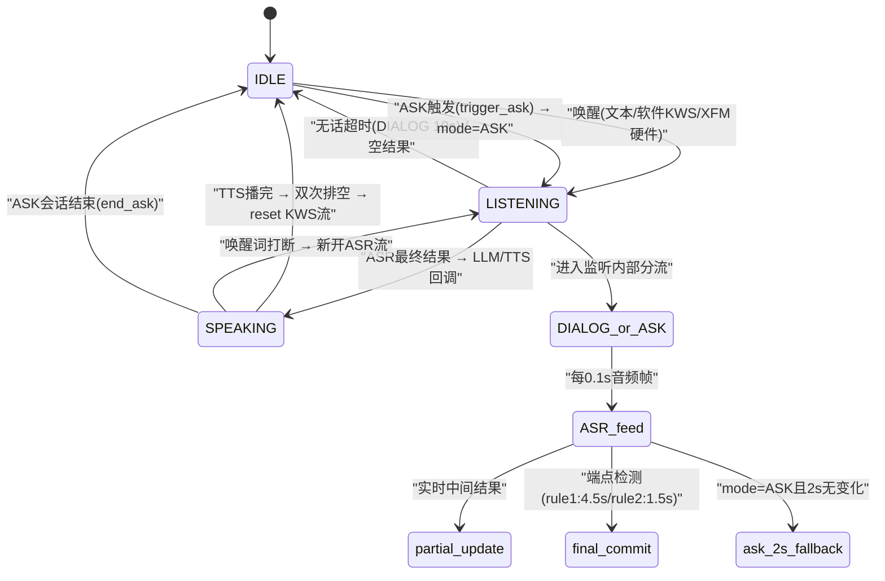

#### 步骤1：文本模式验证语音状态机（60min）

**知识点讲解**：

**3.1.3 流式ASR + 文本模式统一（知识点讲解前半部分）**

文本模式（`--text`）是整个语音系统的调试基座：所有音频组件（KWS、ASR、TTS）均被禁用，stdin逐行读入文本直接喂入同一套状态机回调链。这意味着文本模式走的代码路径与硬件模式完全一致——状态机（IDLE/LISTENING/SPEAKING）相同、回调链（`feed_text → _start_listening → _invoke_dialog/_invoke_ask`）相同、epoch打断机制相同。设计目的是让开发者在无硬件环境下完整验证交互逻辑，排查状态机bug。

**源码对应**：

```python
# speech/voice_loop.py L154-L181（feed_text 方法）
def feed_text(self, text: str) -> None:
    """文本调试：stdin 逐行喂，与音频路径同一状态机/回调链。"""
    text = text.strip()
    if not text:
        return
    if text in self.wake_words:
        log.info("[文本] 唤醒")
        self._start_listening(DIALOG)       # → 开听
        return
    if self.state == LISTENING:
        if self._mode == DIALOG:
            self._invoke_dialog(text)       # → LLM+TTS
        else:
            self._invoke_ask(text)          # → ASK应答判断
        return
```

```python
# apps/speech_text_demo.py L86-L110（主循环）
loop = VoiceLoop(cfg, speaker, asr, kws_det, llm_chat,
                 on_dialog_text=_demo_dialog,
                 on_ask_text=_demo_ask,
                 on_help_kws=_demo_help,
                 text_mode=True)
loop.start()
# ...
loop.feed_text(text)   # stdin 逐行 → 同一状态机
```

**操作步骤**：

1. 启动文本模式：`python3 apps/speech_text_demo.py`。
2. 输入 `小飞小飞` → 观察 `[文本] 唤醒` 和 `开始聆听（mode=DIALOG）`。
3. 输入任意文本（如 `你好`）→ 观察 LLM回复（需 llm.enabled=true）或 `LLM 未启用`。
4. 输入 `ask` → 模拟跌倒 ASK 窗口 → 输入 `救命` → 观察 `ASK 确认（ALERT）`。
5. 输入 `ask` → 输入 `没事` → 观察 `ASK 取消（CANCELLED）`。
6. 输入 `救命`（IDLE态）→ 观察 `呼救 ALERT` 日志。

**易错点**：
- ⚠️ 忘记设置 `llm.enabled=true` → 输入对话文本无反应 → **解决**：在 `config/fall_config.yaml` 中确认 `llm.enabled: true`，或检查 LLM 服务是否已启动。
- ⚠️ 在IDLE态输入非唤醒词文本被忽略属正常 → **解决**：对照 `speech/voice_loop.py L170-L177`，IDLE态只有呼救词才触发回调，其余忽略。

#### 步骤2：语音子系统单点验证（90min）

**知识点讲解**：

**3.1.2 软件KWS关键词检出（sherpa-onnx）**

软件KWS（Wake Word Spotting）基于sherpa-onnx的KeywordSpotter引擎，使用轻量级zipformer模型（epoch-13, chunk-16）实时检测预定义唤醒词。每个音频帧（0.1s, 16kHz）通过 `create_stream()` + `feed()` 外部驱动识别——VoiceLoop在IDLE态每帧喂KWS，命中唤醒词则切换到LISTENING。KWS模型初始化时加载 `kws_keywords.txt` 中的词表（拼音+中文对照，如 `x iǎo f ēi x iǎo f ēi @小飞小飞`），`score=1.5` 和 `threshold=0.25` 控制检出灵敏度。

**源码对应**：

```python
# speech/kws.py L33-L42（__init__，词表解析）
for line in Path(keywords_file).read_text(encoding="utf-8").splitlines():
    line = line.strip()
    if not line or "@" not in line:
        continue
    self._cn_words.append(line.split("@", 1)[1].strip())

# speech/kws.py L62-L73（feed，外部驱动检测）
def feed(self, stream, samples) -> str | None:
    stream.accept_waveform(self.sample_rate, samples)
    while self._kws.is_ready(stream):
        self._kws.decode_stream(stream)
    result = self._kws.get_result(stream)
    if result:
        kw = result.split("@")[-1].strip() if "@" in result else result.strip()
        self._kws.reset_stream(stream)
        return kw
    return None
```

```python
# config/kws_keywords.txt（完整内容）
x iǎo f ēi t óng x ué @小飞同学
n ǐ h ǎo x iǎo f ēi @你好小飞
x iǎo f ēi x iǎo f ēi @小飞小飞
j iù m ìng @救命
b āng b āng w ǒ @帮帮我
```

**3.1.3 流式ASR（zipformer增量解码+端点检测）**

ASR基于sherpa_onnx.OnlineRecognizer，使用zipformer（epoch-99, chunk-1）模型做增量解码。关键参数：`enable_endpoint_detection=True` 开启三规则端点检测——rule1=4.5s静音（长静音判终止）、rule2=1.5s短静音（短句终止）、rule3=300ms极短持续（单字终止）。VoiceLoop在LISTENING态每帧调用 `asr.feed(stream, chunk)` 返回 `(partial, final)` 元组：partial是实时中间结果（显示在日志），final在端点检测命中时非None（触发状态迁移）。

**源码对应**：

```python
# speech/asr.py L48-L62（_init，端点检测参数）
self._recognizer = sherpa_onnx.OnlineRecognizer.from_transducer(
    # ...模型文件...
    enable_endpoint_detection=True,
    rule1_min_trailing_silence=4.5,   # 长静音终止
    rule2_min_trailing_silence=1.5,   # 短静音终止
    rule3_min_utterance_length=300.0, # 极短句终止（ms）
)

# speech/asr.py L68-L76（feed，外部驱动识别）
def feed(self, stream, samples) -> tuple[str, str | None]:
    stream.accept_waveform(self.sample_rate, samples)
    self._recognizer.decode_stream(stream)
    partial = self._recognizer.get_result(stream).strip()
    # ...端点检测逻辑...
    return partial, final
```

**3.2.1 TTS播报与预合成缓存（零合成延迟）**

TTS使用Matcha-TTS（acoustic model + Vocos vocoder）+ sherpa_onnx.OfflineTts。固定提示语（如"您还好吗？需要帮助吗？"）在启动前通过 `pre_synthesize()` 预合成，运行时 `say()` 直接查 `_pcm_cache` 字典播放，省去 ~1s/句合成耗时。落盘缓存（MD5索引的.raw文件）支持跨次启动零合成。动态文本（LLM回复）实时合成。

**源码对应**：

```python
# speech/tts.py L204-L230（Speaker.pre_synthesize，预合成+磁盘缓存）
def pre_synthesize(self, texts: list[str], cache_dir: str = "") -> None:
    for t in texts:
        key = f"{t}|{self.speed}|{self.gain}|{self.sid}"
        fp = cache / f"{hashlib.md5(key.encode()).hexdigest()[:16]}.pcm" \
            if cache is not None else None
        if fp is not None and fp.exists():
            self._pcm_cache[t] = fp.read_bytes()  # 磁盘加载→零合成
            continue
        pcm = self._synth(t)
        if pcm:
            self._pcm_cache[t] = pcm              # 内存缓存
```

```python
# speech/tts.py L232-L255（Speaker.say，播放路径）
def say(self, text: str) -> None:
    if self.playback_event is not None:
        self.playback_event.set()                  # 录播互斥（合成前开始）
    pcm = self._pcm_cache.get(text.strip())        # 优先查缓存
    if pcm is None:
        pcm = self._synth(text)                    # 动态文本实时合成
    self._playback.write(pcm)                      # 入队异步播放
```

**操作步骤**：

1. 运行KWS单点测试：`python3 apps/speech_kws_test.py`（若可用），观察唤醒词检出日志。
2. 运行ASR单点测试：`python3 apps/speech_asr_test.py`，喂入音频观察partial/final输出。
3. 运行TTS单点测试：`python3 apps/speech_tts_test.py`，验证合成+播放链路。
4. 若无单点测试脚本，通过 `speech_text_demo.py` 的 `ask` 命令间接验证：输入 `ask` → 观察TTS合成日志 `[TTS 播放]` → 缓存命中日志 `预合成（磁盘加载）`。

**易错点**：
- ⚠️ TTS合成失败（模型未初始化）→ **解决**：检查 `config/fall_config.yaml` 中 `speech.tts.model_dir` 路径是否正确；首次运行需约1s合成延迟，后续走缓存。
- ⚠️ ALSA设备被占用（`aplay`残留进程）→ **解决**：`pkill -9 aplay` 清理后重试。

#### 步骤3：语音全链路集成（90min）

**知识点讲解**：

**3.2.2 唤醒后启动录音（XFM时序）+双次排空防回声**

硬件唤醒场景下，XFM六麦阵列的ALSA流只有在唤醒后才可用——如果提前打开ALSA设备，XFM会停留在监听态输出稀疏帧，唤醒后也不恢复。因此 `_ensure_capture()` 幂等方法仅在 `notify_wake()` 被调用后才真正启动录音线程（`_cap_started` 保护）。软件KWS/普通麦克风场景下，录音线程在 `run()` 中常开（`self._ensure_capture()` 直接启动）。双次排空防回声：TTS播报结束后，`_handle_speaking` 连续执行两次 `_drain_q()`（中间 sleep 0.2s），确保提示音/播报残留帧被完全清空，避免KWS将TTS回声误判为唤醒词。

**源码对应**：

```python
# speech/voice_loop.py L124-L138（_ensure_capture，XFM时序控制）
def _ensure_capture(self) -> None:
    """启动录音线程（幂等）。XFM 硬件唤醒场景：唤醒事件后才开 ALSA
    （XFM 需唤醒后 ALSA 流才可用——提前打开会让设备停在监听态稀疏流，
    唤醒后也不恢复）。"""
    if self.text_mode or self._cap_started or not self._running:
        return
    with self._cap_lock:
        if self._cap_started:
            return
        self._cap_started = True
        self._cap_thread = threading.Thread(
            target=self._capture_loop, daemon=True)
        self._cap_thread.start()

# speech/voice_loop.py L139-L144（notify_wake，硬件唤醒入口）
def notify_wake(self) -> None:
    self.wake_seen.set()
    self._hw_wake_ev.set()
    self._ensure_capture()  # 唤醒后开 ALSA：流才可用
```

```python
# speech/voice_loop.py L338-L341（双次排空防回声）
def _handle_speaking(self, chunk) -> None:
    # ...唤醒词打断逻辑...
    ev = self.speaker.playback_event
    if ev is not None and not ev.is_set():
        self._drain_q()           # 第一次排空（清残留帧）
        time.sleep(0.2)           # 等待残帧处理
        self._drain_q()           # 第二次排空（确保清空）
        if self.kws is not None:
            self.kws._kws.reset_stream(self._kws_stream)  # reset KWS流
        self.state = IDLE
```

**3.1.1 XFM六麦硬件唤醒（AIUI事件）**

XFM六麦阵列通过串口（/dev/ttyACM0）使用AIUI协议通信：`receive_loop()` 线程持续读串口 → `_process_buffer()` 按 `0xA5` 同步头拆帧 → `_handle_frame()` 解析消息。`msg_type=0x04` 的设备消息中，JSON payload含 `type=aiui_event` 且 `eventType=4` 时即为唤醒事件，提取 `ivw.beam`（声束方向）、`ivw.angle`（角度）、`ivw.keyword`（唤醒词）。3秒防抖（`last_wakeup_time`）避免重复唤醒。`HardwareWake` 封装了串口打开→唤醒词设置→回调注册的完整流程，设备无响应时降级为软件KWS。

**源码对应**：

```python
# speech/xfm_wake.py L109-L127（_handle_frame，AIUI唤醒事件解析）
if msg.get('type') == 'aiui_event':
    content = msg.get('content', {})
    if content.get('eventType') == 4:       # 唤醒事件
        info = json.loads(content.get('info', '{}'))
        ivw = info.get('ivw', {})
        beam = ivw.get('beam')
        angle = ivw.get('angle')
        keyword = ivw.get('keyword')
        if current_time - self.last_wakeup_time > 3.0:  # 3s防抖
            if self.wakeup_lock.acquire(blocking=False):
                self.wakeup_callback()      # → VoiceLoop.notify_wake()
```

```python
# speech/xfm_wake.py L244-L276（HardwareWake，封装串口+唤醒词设置）
class HardwareWake:
    def start(self) -> None:
        self._arr = XfMicArray(port=self.port, vendor_id=0x1a86,
                               product_id=0x55d4)
        self._arr.start()
        for w in self.wake_words:
            self._arr.set_wake_word(w)
        self._arr.wakeup_callback = self._on_wake_event
```

**操作步骤**：

1. 启动语音全链路（文本模式）：`python3 apps/fall_video_demo.py --video testdata/fall_slow_x264.mp4 --text`。
2. 输入 `小飞小飞` → 观察 `开始聆听（mode=DIALOG）` → 输入任意文本 → 观察LLM回复 + TTS播报日志。
3. 验证打断：LLM播报中输入 `小飞小飞` → 观察 `打断播报` → 新提示音 → 开听。
4. 验证DIALOG无话超时：唤醒后10s内不输入 → 观察 `DIALOG 无话超时 → IDLE`。
5. 若有硬件：启动音频模式 `python3 apps/fall_video_demo.py --video testdata/fall_slow_x264.mp4 --mjpeg`，说"小飞小飞"验证提示音+录音线程启动。

**易错点**：
- ⚠️ 无硬件时说唤醒词无反应属正常 → **解决**：文本模式对麦克风无反应是设计行为，必须通过stdin输入。
- ⚠️ XFM硬件唤醒后无"录音线程"日志 → **解决**：检查 `/dev/ttyACM0` 是否被 `log_server` 占用，停占用进程后重插USB。

#### 步骤4：唤醒对话闭环验证（60min）

**知识点讲解**：

**3.2.2 唤醒后启动录音（XFM时序）——闭环时序**

完整的唤醒对话闭环：硬件XFM检测到唤醒词 → `_handle_frame` 解析AIUI事件 → `wakeup_callback()` → `VoiceLoop.notify_wake()` → `wake_seen.set()` + `_ensure_capture()` 启动录音线程 → 主循环 `_hw_wake_ev` 触发 `_start_listening(DIALOG)` → 播提示音PCM（`_prompt_pcm`）→ 等待播放时长+0.8s → 双次排空 → 开ASR流 → LISTENING态等待用户语音 → ASR端点检测命中 → `_invoke_dialog` → LLM回复 → TTS播报 → `playback_event.clear()` → 双次排空 → IDLE。文本模式跳过提示音和排空，直接 `_begin_listen(mode)`。

**源码对应**：

```python
# speech/voice_loop.py L358-L375（_start_listening，完整时序）
def _start_listening(self, mode: str) -> None:
    """播提示音 → 排空回声 → 开 ASR 流"""
    if self.text_mode:
        self._begin_listen(mode)           # 文本模式：跳过提示音
        return
    if self._prompt_pcm:
        pb.write(self._prompt_pcm)         # 写提示音PCM
        time.sleep(self._prompt_dur + 0.8) # 等播放+余量
    self._drain_q()                        # 第一次排空
    time.sleep(0.2)
    self._drain_q()                        # 第二次排空
    self._begin_listen(mode)               # 开ASR流 → LISTENING
```

```python
# speech/voice_loop.py L376-L383（_begin_listen，开ASR流）
def _begin_listen(self, mode: str) -> None:
    self._asr_stream = self.asr.create_stream()
    self._last_partial = ""
    self._listen_started = time.time()
    self._mode = mode
    self.state = LISTENING
    log.info(f"开始聆听（mode={mode}）...")
```

**操作步骤**：

1. 文本模式启动全链路：`python3 apps/fall_video_demo.py --video testdata/fall_slow_x264.mp4 --text`。
2. 输入 `小飞小飞` → 验证唤醒→开听→对话完整闭环。
3. 验证打断闭环：唤醒后输入对话文本（如 `你好`），播报过程中输入 `小飞小飞` → 观察打断+新开ASR流+继续对话。
4. 验证epoch丢弃：在LLM播报中连续打断两次 → 观察第一次迟到回复被epoch丢弃（日志无第二次回复输出）。

**易错点**：
- ⚠️ 提示音后立即说话无反应 → **解决**：提示音播放需 `prompt_dur + 0.8s`，加上双次排空共约1.5s等待期，这是正常延迟。
- ⚠️ 打断后旧回复仍播完 → **解决**：检查 `Playback.interrupt()` 是否正确清队列+杀aplay+重启进程（`speech/tts.py L158-L180`）。

#### 步骤5：按docs/07逐条执行测试用例（90min）

**知识点讲解**：

**3.2.3 ASK应答窗口与单次应答防重复**

ASK应答窗口由跌倒状态机 `trigger_ask()` 触发：monitor检测到跌倒→调用 `VoiceLoop.trigger_ask()` → 主循环执行 `_do_trigger_ask()`：打断当前播报 → 等 `playback_event`（ask_tts开始播放）→ 等播放结束（`playback_event.clear()`）→ 双次排空 → `_begin_listen(ASK)` 开ASR流。ASK窗口内，2s兜底快答机制：当partial存在但2s内无新变化时，强制提交当前partial（不等4.5s端点静音）。单次应答防重复通过epoch计数器实现：每次 `_invoke_dialog` 记录 `start_epoch = self._epoch`，worker完成后检查epoch是否被更新——更新说明被打断，丢弃回复。ASK应答由 `_invoke_ask` 同步回调monitor，不走worker线程。

**源码对应**：

```python
# speech/voice_loop.py L393-L421（_do_trigger_ask，ASK窗口时序）
def _do_trigger_ask(self) -> None:
    if self.state == SPEAKING:
        self._interrupt()               # 打断当前播报
    # 阶段1：等 playback_event set（ask_tts开始播放）
    ev = self.speaker.playback_event
    while not ev.is_set() and waited < 8.0:
        time.sleep(0.05)
    # 阶段2：等播放结束（clear）
    while ev.is_set() and waited < 15.0:
        time.sleep(0.05)
    self._drain_q()                     # 第一次排空
    time.sleep(0.2)
    self._drain_q()                     # 第二次排空
    self._begin_listen(ASK)             # 开听（mode=ASK）
```

```python
# speech/voice_loop.py L307-L313（LISTENING态2s兜底快答）
# 静音兜底：ASK 快答（2s 无变化强制提交，不等 4.5s 端点静音）
if (self._mode == ASK and partial
        and now - self._listen_started > 2.0 + 120.0 / 1000.0):
    log.info(f"[ASR 结果(兜底)] {partial}")
    self._close_stream()
    self._invoke_ask(partial)
    return
```

```python
# speech/voice_loop.py L433-L442（_invoke_dialog，epoch防重复）
def _invoke_dialog(self, text: str) -> None:
    self.state = SPEAKING
    start_epoch = self._epoch           # 记录当前epoch
    def worker() -> None:
        self._on_dialog_text(text, start_epoch)  # 传epoch给回调
    threading.Thread(target=worker, daemon=True).start()
```

**操作步骤**：

1. 按 `docs/07_语音测试用例.md` 执行T7-1至T7-9。
2. **T7-1 唤醒→对话→LLM**：文本模式下输入 `小飞小飞` → `你是什么模型` → 验证LLM回复。
3. **T7-2 呼救直告警**：IDLE态输入 `救命` → 验证呼救ALERT日志。
4. **T7-3 ASK窗口应答**：输入 `ask` → `救命` → 验证单次确认（`ASK 确认 [x] ALERT` 一条）。
5. **T7-7 防回声**：播报结束后观察无误唤醒（双次排空+KWS reset生效）。
6. **T7-8 ASR模型直测**：若可用，用预合成PCM直接喂ASR验证模型链路。

**易错点**：
- ⚠️ ASK应答后出现多条 `ASR 应答` → **解决**：检查 `_invoke_ask` 是否同步调用且不走worker线程，确认没有循环break遗漏（`speech/voice_loop.py L443-L461`）。
- ⚠️ ASK窗口不答话无超时重问 → **解决**：重问由fall/interaction.py的monitor控制（12s超时），文本模式下需手动输入 `ask` 再次触发。

#### 步骤6：自定义唤醒词测试（30min）

**知识点讲解**：

**3.1.1 + 3.1.2 双链路唤醒词配置**

唤醒词配置同时作用于硬件XFM和软件KWS两条链路。修改 `config/kws_keywords.txt` 增加自定义唤醒词（格式：拼音 + `@` + 中文），KWS模型自动加载新词表。XFM硬件唤醒词通过 `xfm_wake.py` 的 `set_wake_word()` 设置（JSON格式，如 `{"type":"wakeup_keywords","content":{"keywords":"自定义词","threshold":"900"}}`），需同步修改VoiceLoop的 `wake_words` 元组（从 `config/fall_config.yaml` 的 `session.wake_words` 读取）。文本模式下仅验证KWS文本路径：`feed_text()` 对照 `self.wake_words` 判断是否为唤醒词。

**源码对应**：

```python
# speech/kws.py L33-L38（词表解析，@分隔拼音+中文）
for line in Path(keywords_file).read_text(encoding="utf-8").splitlines():
    if "@" not in line:
        continue
    self._cn_words.append(line.split("@", 1)[1].strip())

# speech/voice_loop.py L82-L84（wake_words从配置读取）
self.wake_words = tuple(cfg.get("session", {}).get(
    "wake_words", ["小飞小飞", "小飞同学", "芝麻开门"]))
```

```markdown
# config/kws_keywords.txt（添加自定义词格式）
# 拼音（空格分隔） @ 中文词
z ì dìng y ì @自定义词
```

**操作步骤**：

1. 编辑 `config/kws_keywords.txt`，添加自定义唤醒词（如 `z ì dìng y ì @自定义词`）。
2. 修改 `config/fall_config.yaml` 的 `session.wake_words` 列表，加入自定义词。
3. 重启 `python3 apps/speech_text_demo.py`，输入自定义唤醒词 → 验证唤醒。
4. 若有硬件：重启全链路程序，对XFM说自定义唤醒词 → 观察AIUI事件日志（`检测到唤醒! Keyword: 自定义词`）。

**易错点**：
- ⚠️ 自定义词在KWS文本路径无效 → **解决**：确认 `kws_keywords.txt` 格式正确（拼音@中文，行首无空格）；确认 `wake_words` 配置列表包含中文部分。
- ⚠️ 硬件XFM不识别自定义词 → **解决**：XFM固件可能限制唤醒词数量/格式，检查 `HardwareWake.start()` 的设备响应日志（`rx_bytes > 0` 表示设备存活）。

### 1.7 注意事项

- ⚠️ **文本模式无需硬件**：`--text` 模式下对麦克风说话无反应属正常，必须通过stdin输入文本。
- ⚠️ **ALSA设备清理**：每次测试前执行 `pkill -9 aplay` 清理残留播放进程，避免设备占用导致播放失败。
- ⚠️ **XFM串口占用**：`/dev/ttyACM0` 可能被 `log_server` 占用，检查 `lsof /dev/ttyACM0` 后停占用进程。
- ⚠️ **录音线程时序**：XFM硬件唤醒场景下，录音线程只在唤醒后启动——这是设计约束而非bug。
- ⚠️ **LLM服务**：对话功能需先启动LLM服务（`python3 llm/llm_server.py`），否则对话输入无回复。
- ⚠️ **运行产物清理**：测试完成后 `pkill -9 aplay` + `pkill -f llm_server` 清理残留进程。

### 1.8 实验总结

**完成成果**：一份语音全链路测试报告（含文本模式状态机验证、KWS/ASR/TTS单点验证、全链路集成验证、docs/07用例执行结果、自定义唤醒词测试结果）。

**技能收获**：
- 技能1：语音三状态机（IDLE/LISTENING/SPEAKING）的完整流转与代码追踪能力
- 技能2：XFM硬件唤醒时序（唤醒后开ALSA）与双次排空防回声原理
- 技能3：ASK应答窗口2s兜底快答与epoch单次防重复设计

**常见问题与解决**：

| 问题 | 原因 | 解决方法 |
|------|------|----------|
| 唤醒后无"录音线程"日志 | XFM未唤醒态/ALSA被占用 | 确认 `检测到唤醒` 日志；停 `log_server` 释放串口；重插USB |
| 录音X/5s中X≈10帧 | XFM监听态（未真正唤醒） | 仅测试软件KWS/文本模式；硬件唤醒需真人对麦克风说唤醒词 |
| 有录音无partial输出 | ASR模型未初始化/模型文件缺失 | 检查 `speech.asr.model_dir` 路径；跑ASR单点测试验证模型 |
| 提示音残留导致误唤醒 | 双次排空未完全清空队列 | 检查 `_handle_speaking` 的两次 `_drain_q()` 是否执行；确认 `kws._kws.reset_stream()` 被调用 |
| ASK应答后多条 `ASR 应答` | `_invoke_ask` 循环未break/worker重复提交 | 检查 `voice_loop.py` 的 ASK 路径：`_invoke_ask` 应同步调用且不走worker线程 |

### 1.9 实验报告要求

**思考题**：

1. 为什么XFM硬件唤醒场景下录音线程必须在唤醒后才启动，而软件KWS场景可以常开？请结合 `xfm_wake.py` 的AIUI事件时序和ALSA流特性分析原因。若提前打开ALSA设备会发生什么？
2. 双次排空防回声机制中，`_drain_q()` 被调用两次且中间 sleep 0.2s——如果只调用一次或去掉 sleep，会产生什么问题？请结合KWS的 `reset_stream()` 和音频帧残留分析。
3. ASK应答窗口的2s兜底快答与ASR内置的4.5s端点静音检测有什么区别？为什么ASK场景需要额外的2s兜底，而DIALOG场景不需要？
4. epoch计数器如何实现"单次应答防重复"？如果 `_invoke_dialog` 走同步调用而非worker线程，epoch机制是否还有必要？

**评分标准**：
- 文本模式状态机验证（20分）：唤醒/对话/ASK/呼救四条路径全部通过，日志正确
- 语音子系统单点验证（20分）：KWS/ASR/TTS各子系统独立验证，记录模型参数
- 全链路集成验证（25分）：唤醒→提示音→ASR→应答→打断闭环完整，双次排空/epoch机制生效
- docs/07测试用例执行（20分）：T7-1至T7-9逐条覆盖，结果记录完整
- 自定义唤醒词（10分）：双链路（KWS+XFM）配置正确，端到端验证通过
- 思考题回答深度（5分）：至少2题回答准确，有源码行号支撑

---

# 实验5：老人跌倒监护--视觉检测与姿态估计集成测试（8h）

### 1.1 关联知识点

- **4.1.1 YOLOv8行人检测(COCO person)** — 基于 COCO 数据集预训练的 YOLOv8 检测模型，仅保留 person 类（class_id=0），输入 640×640 RGB 图像，输出检测框+置信度（前置：无）
- **4.1.2 letterbox预处理与NMS后处理解码** — letterbox 等比缩放+居中补黑边→RGB NHWC 4D→RKNN 推理→DFL softmax 解码→逐类 NMS 去重（前置：4.1.1）
- **4.1.3 RKNN NPU推理与core_mask核选择** — rknnlite2.3.2 板端推理 API，core_mask 控制 NPU 核分配（AUTO=0 / CORE_0=1 / CORE_0_1=3），RK3576 双核（前置：4.1.1）
- **4.2.1 BlazePose 33关键点引擎** — mediapipe pose_landmark_full 模型，整图 256×256 输入，输出 33×4 [x,y,z,vis] 像素关键点+presence 评分（前置：4.1.1）
- **4.2.2 RTMPose 17关键点(SimCC双头解码)** — RTMPose-s 256×192 竖版输入，SimCC 双头输出 simcc_x(1,17,384)+simcc_y(1,17,512)，argmax÷split_ratio→像素坐标，vis=双头峰值均值（前置：4.1.1）
- **4.2.3 检测/姿态双后端切换与MJPEG推流** — pose_type 配置切换 blazepose/rtmpose；MjpegServer 封装 mjpeg_streamer 库实现 :8088/fall.mjpg 实时预览（前置：4.2.1, 4.2.2）

### 1.2 实验目标

1. **理解** YOLOv8 行人检测的完整推理链路：letterbox 预处理 → RGB 4D 输入 → RKNN NPU 推理 → DFL 解码 → NMS 去重 → unletterbox 映射回原图，能说出每个阶段的数据形状变化。
2. **掌握** BlazePose 与 RTMPose 两种姿态引擎的差异：33pt vs 17pt、整图 vs top-down、visibility 计算方式，能独立切换后端并对比输出。
3. **理解** letterbox 预处理对关键点坐标的影响（补边+等比缩放→坐标需逆映射），以及 NMS IoU 阈值对检测漏检/误检的权衡。
4. **独立完成** detect_demo/pose_demo/fall_video_demo 三层逐步验证，能定位检测漏检、姿态不跟帧、推流卡顿等常见问题。
5. **掌握** MJPEG 实时推流验证方法与 --text 文本叠加观察技巧，理解"视觉层可独立于语音层验证"的设计意图。
6. **迁移**：将"逐层单跑→集成联调→参数调优"的验证方法论应用到其他视觉检测场景（如工业质检、安防监控）。

### 1.3 实验环境

| 类别 | 内容 |
|------|------|
| 硬件 | 具身智能实验箱B2 / 具身智能机器人小车C1（RK3576 + 6TOPS NPU） |
| OS | Ubuntu 22.04 + Python 3.10 |
| 核心库 | rknnlite2.3.2（NPU 推理）、opencv-python（图像处理）、numpy |
| 模型文件 | yolov8n.rknn（640×640, COCO person）、blazepose pose_landmark_full.rknn（256×256）、rtmpose_s_256x192_int8.rknn（已打包至 models/rtmpose/） |
| 测试素材 | testdata/stand_up.jpg、testdata/fall_1.png、testdata/fall_slow_x264.mp4（离线可用） |
| 可选 | mjpeg_streamer（pip install，MJPEG 推流需用） |

### 1.4 实验难度

- 难度: ⭐⭐⭐（综合性）
- 重点：YOLOv8 检测链路（letterbox→RGB→RKNN→DFL→NMS→unletterbox）；BlazePose/RTMPose 双后端切换与关键点差异；--text 模式下检测框+骨架叠加观察。
- 难点：letterbox 补边对关键点坐标逆映射的影响（scale+pad 双参数恢复）；SimCC 双头 argmax÷split_ratio 解码逻辑；NMS IoU 阈值调优的漏检/误检权衡。

### 1.5 实验现象

**快速验证命令**（本实验核心入口）：

```bash
# 步骤1：行人检测单图验证
python3 apps/detect_demo.py --input testdata/stand_up.jpg --save

# 步骤2：姿态估计单图验证
python3 apps/pose_demo.py --input testdata/fall_1.png --save

# 步骤4：视频检测+姿态叠加（--text 文本模式）
python3 apps/fall_video_demo.py --video testdata/fall_slow_x264.mp4 --text
```

**预期效果描述**：

- detect_demo：终端打印 person 检测框坐标与置信度（score ≥ 0.5），--save 保存标注图到 runs/out/；无人物图返回 0 框不崩溃。
- pose_demo：终端打印关键点数量（33 或 17）与 score，--save 保存骨架标注图；无人体关键点时打印"未检测到人体关键点"不崩溃。
- fall_video_demo --text：终端逐帧输出 person_id / 检测框 / 姿态 score / 状态（IDLE/FALLING 等），检测框+骨架以文本方式叠加观察；无卡顿。

### 1.6 实验步骤

#### 整体流程图

```mermaid
graph TD
    A["步骤1: detect_demo 单图检测验证<br/>行人检测 + NMS 解码"] --> B["步骤2: pose_demo 单图姿态验证<br/>BlazePose 33pt / RTMPose 17pt"]
    B --> C["步骤3: 双后端切换对比<br/>blazepose ↔ rtmpose"]
    C --> D["步骤4: fall_video_demo --text<br/>检测框+骨架叠加观察"]
    D --> E["步骤5: docs/08 视觉测试用例<br/>逐条执行 T8-1~T8-6"]
    E --> F["步骤6: 调 confidence 阈值<br/>观察检测结果变化"]

    style A fill:#e8f5e9
    style B fill:#e8f5e9
    style C fill:#fff3e0
    style D fill:#e3f2fd
    style E fill:#f3e5f5
    style F fill:#fce4ec
```

#### 步骤1：运行 detect_demo.py 验证行人检测（90min）

**知识点讲解**：

**4.1.1 YOLOv8 行人检测(COCO person)**

- **原理**：YOLOv8 是单阶段目标检测器，采用 CSPDarknet53 骨干 + PANet FPN + 解耦头（Decoupled Head）架构。本项目使用 yolov8n（nano）版本，模型经 RKNN 工具链转换为 .rknn 格式，在 RK3576 NPU 上执行 INT8 量化推理。模型仅保留 COCO 数据集的 person 类（class_id=0），输入为 640×640 RGB 图像，输出为每层 3 组张量（box 回归 logits + 类别分数 + cls_sum），经 DFL 解码和 NMS 后得到最终检测框。选择 nano 版本是因为 RK3576 仅 6TOPS 算力，nano 模型推理延迟约 30-50ms，能满足实时性要求。
- **源码对应**：`vision/yolo/detector.py L13-27（模块文档说明标准 detect 3×nl 契约）`、`vision/yolo/detector.py L36-41（YOLODetector 类定义，接收 backend/buf_classes/imgsz/score_thr/iou_thr）`

**4.1.2 letterbox 预处理与 NMS 后处理解码**

- **原理**：预处理阶段，`letterbox()` 将原图等比缩放至 640×640 并居中补黑边（pad=0，与 rknn_model_zoo 一致），返回缩放比 scale 和补边像素 (pad_w, pad_h)。随后 `to_rgb()` 执行 BGR→RGB 转换并添加批维，生成 (1, 640, 640, 3) uint8 NHWC 张量（板端 static_shape 模型要求 4D 输入）。推理输出经 `dfl_decode()` 对 64-bin DFL logits 做 softmax 加权得到精确偏移，`box_process()` 结合网格坐标+stride 还原为 letterbox 空间的 xyxy 框。最后 `classwise_nms()` 执行逐类 NMS（IoU 阈值默认 0.45），`unletterbox()` 通过 `(xyxy - pad) / scale` 逆映射回原图空间。
- **源码对应**：`vision/yolo/preprocess.py L18-29（letterbox 等比缩放+补 0）`、`vision/yolo/preprocess.py L32-38（to_rgb BGR→RGB+批维）`、`vision/yolo/postprocess_detect.py L38-45（dfl_decode softmax@16 bins）`、`vision/yolo/postprocess_detect.py L47-61（box_process 网格+stride→xyxy）`、`vision/yolo/postprocess_detect.py L63-75（classwise_nms 逐类 NMS）`、`vision/yolo/preprocess.py L41-53（unletterbox 逆映射回原图）`

**4.1.3 RKNN NPU 推理与 core_mask 核选择**

- **原理**：rknnlite2.3.2 是 RK3576 专用的板端推理 API（区别于 x86 环境的 rknn-toolkit2）。`RKNNLiteBackend` 封装了 `load_rknn()` → `init_runtime(core_mask=...)` → `inference()` 三步流程。core_mask 控制 NPU 核分配：0=NPU_CORE_AUTO（自动，推荐）、1=CORE_0、2=CORE_1、3=CORE_0_1（双核）。RK3576 仅有 2 个 NPU 核，多核轮转意义有限，实测 core_mask=None 会报错"The core mode None is not supported"，因此默认使用 0（AUTO）。当 YOLO 和姿态模型同时推理时，两者共享 NPU，可能出现排队等待。
- **源码对应**：`vision/yolo/backend.py L19-33（RKNNLiteBackend 文档说明 core_mask 默认 0=NPU_CORE_AUTO）`、`vision/yolo/backend.py L34-45（core_mask 常量定义 + __init__）`、`vision/yolo/backend.py L47-56（load: load_rknn + init_runtime）`、`vision/yolo/backend.py L58-65（predict: inference with nhwc）`

**操作步骤**：

1. 确认 testdata 目录下有 stand_up.jpg（单人站立图）：
   ```bash
   ls testdata/stand_up.jpg
   ```
2. 运行检测 demo：
   ```bash
   cd ros2_ws/src/xflz_eai_car1/app/elderly_companion
   python3 apps/detect_demo.py --input testdata/stand_up.jpg --save
   ```
3. 观察终端输出：应打印 person 检测框坐标 (x1,y1,x2,y2)、置信度 score（≥0.5）、推理耗时（ms）。
4. 检查标注图保存：
   ```bash
   ls runs/out/   # 应有 detect_image.jpg
   ```
5. 如有多人图，换图测试多人检测，观察各 person_id 独立输出。

**易错点**：

- ⚠️ RKNN 加载失败报"load_rknn failed" → **解决**：检查 config/fall_config.yaml 中 detect.model_path 路径是否正确，运行 `python3 common/env_check.py` 自检模型完整性。
- ⚠️ 报"need 4dims input" → **解决**：确认 preprocess 输出为 4D NHWC（to_rgb 已添加批维），板端 static_shape 模型必须 4D 输入。
- ⚠️ 检测框偏移或缩放错误 → **解决**：unletterbox 需同时用 scale 和 pad 逆映射，检查 letterbox 返回的 (r, (dw, dh)) 是否正确传递。

#### 步骤2：运行 pose_demo.py 验证姿态估计（90min）

**知识点讲解**：

**4.2.1 BlazePose 33 关键点引擎**

- **原理**：BlazePose 是 mediapipe 的人体姿态估计方案，本项目使用 pose_landmark_full 模型。输入为整图 256×256 RGB（`prepare()` 执行 BGR→RGB 重塑，不手动归一化，模型转换时已配置 mean=127.5/std=128）。输出布局为 outputs[0] shape (1,195)=39×5 交错排列（33 pose + 6 附加点），每点含 [x,y,z,vis,presence]；outputs[1] 为整体 presence 评分。解码时取前 33 点的 x/y/z/vis，通过 `px = (lm - pad) / scale` 逆映射回原图像素坐标。visibility 低于阈值（VIS_THRESHOLD=0.5）的点不绘制。BlazePose 的优势在于整图推理（不需要先检测再裁剪），33 点覆盖全身，适合跌倒判定的躯干角计算。
- **源码对应**：`vision/pose/pose.py L12-27（输出布局文档：195=39×5 交错）`、`vision/pose/pose.py L42-55（resize_pad letterbox 256×256）`、`vision/pose/pose.py L58-75（decode_pose 解码+逆映射）`、`vision/pose/pose.py L77-80（prepare BGR→RGB 不手动归一化）`、`vision/pose/engine.py L20-23（PoseEngine 整图推理管线）`

**4.2.2 RTMPose 17 关键点(SimCC 双头解码)**

- **原理**：RTMPose 是基于 SimCC（Simulated Coordinate Classification）的 top-down 姿态估计方案。输入为单人裁剪图 192×256（竖版，灰边 128），经 BGR→RGB 转换后送入 RKNN。模型输出两个张量：simcc_x shape (1,17,384) 和 simcc_y shape (1,17,512)，其中 384=W(192)×2、512=H(256)×2，split_ratio=2.0。解码时对每个关键点取 x/y 头的 argmax 索引，除以 split_ratio 得到输入图像素坐标，再通过 `(xs - pad_w) / scale` 逆映射回原图。visibility 计算为双头响应峰值均值（FP32 实测有人 0.75~1.2，无人 <0.15，INT8 后量级可能漂移，需用 vis_threshold 调节）。RTMPose 的优势在于 17 点 COCO 格式兼容性好，top-down 裁剪使躺姿检测更稳定。
- **源码对应**：`vision/pose_rtm/engine.py L1-25（SimCC 输出契约文档）`、`vision/pose_rtm/simcc.py L1-12（SimCC 输出形状说明 384/512）`、`vision/pose_rtm/simcc.py L17-18（SPLIT_RATIO=2.0）`、`vision/pose_rtm/simcc.py L25-42（to_responses 输出规整）`、`vision/pose_rtm/simcc.py L45-63（simcc_decode argmax÷2→像素+逆映射）`

**操作步骤**：

1. 确认 testdata 目录下有 fall_1.png（跌倒姿态图）：
   ```bash
   ls testdata/fall_1.png
   ```
2. 运行姿态 demo（默认 blazepose）：
   ```bash
   python3 apps/pose_demo.py --input testdata/fall_1.png --save
   ```
3. 观察终端输出：应打印 keypoints 数量（33）、score 值、前 5 个关键点坐标。
4. 检查标注图：runs/out/pose_image.jpg 应有 33 点红色关键点 + 绿色骨架连线。
5. 若无人体关键点，检查图片是否有清晰人体、模型是否加载成功。

**易错点**：

- ⚠️ 报"未检测到人体关键点"但图中有人 → **解决**：检查图片是否有遮挡/模糊/角度极端；尝试换图或调低 vis_threshold。
- ⚠️ score 很低（<0.1） → **解决**：BlazePose 整图推理对小目标/遮挡敏感；尝试切换 RTMPose（top-down 更稳定）。
- ⚠️ 关键点位置偏移 → **解决**：确认 resize_pad 的 scale/pad 与 decode_pose 的逆映射参数一致（`vision/pose/pose.py L58-75`）。

#### 步骤3：切换 pose/pose_rtm 双后端对比关键点输出（60min）

**知识点讲解**：

**4.2.3 检测/姿态双后端切换**

- **原理**：项目通过 config/fall_config.yaml 的 `model.pose_type` 字段控制姿态引擎切换：`blazepose` 使用 33pt 整图引擎（`vision/pose/engine.py`），`rtmpose` 使用 17pt top-down 引擎（`vision/pose_rtm/engine.py`）。两者接口对齐——`process(frame_bgr) -> PoseResult`，PoseResult 均包含 `.landmarks (K,4)` 原图像素坐标和 `.score`。`pose_demo.py` 通过 `build_pose_engine(cfg)` 工厂函数按配置自动创建对应引擎，并使用各自的 `draw_skeleton()` 绘制不同关键点数量的骨架。切换时只需修改 YAML 配置，无需改代码。
- **源码对应**：`apps/pose_demo.py L49-52（import 双引擎 draw_skeleton）`、`apps/pose_demo.py L54-59（build_pose_engine 按 pose_type 创建引擎）`、`apps/pose_demo.py L62-66（_draw 按 pose_type 选择绘制函数）`

**操作步骤**：

1. 查看当前配置中的姿态引擎类型：
   ```bash
   grep -A2 "pose_type" config/fall_config.yaml
   ```
2. 默认应为 `blazepose`，运行检测：
   ```bash
   python3 apps/pose_demo.py --input testdata/fall_1.png --save
   ```
3. 记录输出：33 个关键点、score 值、前 5 个 landmark 坐标。
4. 修改配置切换为 rtmpose：
   ```bash
   # 编辑 config/fall_config.yaml，将 pose_type 改为 rtmpose
   # 或通过 sed 临时修改：
   sed -i 's/pose_type: blazepose/pose_type: rtmpose/' config/fall_config.yaml
   ```
5. 重新运行：
   ```bash
   python3 apps/pose_demo.py --input testdata/fall_1.png --save
   ```
6. 对比输出：应为 17 个关键点、不同 score 值、不同的关键点坐标分布。
7. **恢复配置**：改回 `pose_type: blazepose`，避免影响后续实验。

**易错点**：

- ⚠️ 切换后报模型路径错误 → **解决**：RTMPose 需要 model.rtmpose.model_path 配置项，检查 config 中路径是否指向 models/rtmpose/rtmpose_s_256x192_int8.rknn。
- ⚠️ RTMPose score 异常（INT8 量级漂移） → **解决**：INT8 后 vis 量级可能偏移，调节 config 中 model.rtmpose.vis_threshold（默认 0.3）。
- ⚠️ 切换后忘记恢复配置 → **解决**：实验结束前务必恢复 pose_type: blazepose，否则影响后续 exp06 跌倒判定。

#### 步骤4：运行 fall_video_demo.py --text 观察检测框+骨架叠加（90min）

**知识点讲解**：

**4.2.3 MJPEG 推流（基础）与 --text 文本叠加**

- **原理**：`fall_video_demo.py` 是跌倒全链路离线调试入口，`--text` 参数启用文本模式（stdin 交互，无需麦克风）。该 demo 将 YOLO 检测 → IoU 关联 → 姿态估计 → 特征提取 → 状态机判定串联为完整流水线。每帧处理后，终端以文本方式叠加输出检测框坐标、骨架关键点、person_id、状态等信息，便于离线观察。MJPEG 推流通过 `MjpegServer`（`vision/yolo/mjpeg_server.py`）封装 mjpeg_streamer 库实现，启动后在浏览器访问 `http://<板端IP>:8088/fall.mjpg` 即可实时预览。MjpegServer 使用 daemon 线程运行 aiohttp 服务，stop() 时吞掉 GracefulExit 异常避免崩溃。
- **源码对应**：`apps/fall_video_demo.py L13-16（模块文档：--text 文本模式）`、`apps/fall_video_demo.py L36-49（argparse 定义 --video/--text/--mjpeg 等参数）`、`vision/yolo/mjpeg_server.py L13-20（MjpegServer 文档：mjpeg_streamer 封装）`、`vision/yolo/mjpeg_server.py L30-37（MjpegServer.__init__: Stream+Server 初始化）`、`vision/yolo/mjpeg_server.py L39-43（start: 预检端口+启动）`

**操作步骤**：

1. 确认测试视频存在：
   ```bash
   ls testdata/fall_slow_x264.mp4
   ```
2. 运行 fall_video_demo 文本模式：
   ```bash
   python3 apps/fall_video_demo.py --video testdata/fall_slow_x264.mp4 --text
   ```
3. 观察终端逐帧输出：
   - `[frame N] person_id=1 box=(x1,y1,x2,y2) score=0.xx`
   - `pose: 33/17 keypoints, score=0.xx`
   - 状态变化：`IDLE → FALLING → LYING → ASK`
4. 视频中出现跌倒动作时，观察状态机流转日志。
5. 如需交互，在 --text 模式下输入"救命"验证 ALERT 流程，输入"没事"验证 CANCELLED 流程（此为语音交互部分，本实验可跳过）。
6. （可选）加 --mjpeg 参数启动推流：
   ```bash
   python3 apps/fall_video_demo.py --video testdata/fall_slow_x264.mp4 --text --mjpeg
   # 浏览器打开 http://<板端IP>:8088/fall.mjpg 观察实时画面
   ```

**易错点**：

- ⚠️ 帧率低/推理堆积 → **解决**：RK3576 NPU 双模型（YOLO+姿态）同时推理可能排队，关闭 LLM 等其他服务（`pkill -9 llm_server`）释放资源。
- ⚠️ --text 模式下输入无效 → **解决**：确认 stdin 可交互（非管道重定向），输入后按 Enter。
- ⚠️ MJPEG 404 → **解决**：检查端口 8088 是否被占用（`lsof -i :8088`），先关闭占用进程。

#### 步骤5：按 docs/08 视觉测试用例逐条执行（60min）

**知识点讲解**：

**4.1~4.2 综合（测试用例方法论）**

- **原理**：`docs/08_视觉测试用例.md` 定义了视觉模块的标准测试集，覆盖检测（T8-1/T8-2）、姿态（T8-3）、跌倒判定状态机（T8-4/T8-5）、输入源（T8-6）四个维度。测试用例设计遵循"单点验证→集成验证→参数调优"的递进原则：先用 detect_demo/pose_demo 单点验证检测和姿态各自正确，再用 fall_video_demo 集成验证端到端流水线，最后通过 config 参数调优验证鲁棒性。每个用例有明确的输入/命令/期望输出，便于自动化回归。
- **源码对应**：`docs/08_视觉测试用例.md L1-5（文档头：视觉模块标准测试用例）`、`docs/08_视觉测试用例.md L18-23（T8-1 单图检测）`、`docs/08_视觉测试用例.md L25-29（T8-2 视频检测连续性）`、`docs/08_视觉测试用例.md L31-35（T8-3 姿态引擎切换）`、`docs/08_视觉测试用例.md L37-43（T8-4 状态迁移）`、`docs/08_视觉测试用例.md L45-53（T8-5 判据调节）`、`docs/08_视觉测试用例.md L55-61（T8-6 输入源等价性）`

**操作步骤**：

1. 打开 `docs/08_视觉测试用例.md`，通读 T8-1 至 T8-6 全部用例。
2. **T8-1 单图检测**：运行 `python3 apps/detect_demo.py --input testdata/stand_up.jpg --save`，验证 person 框+置信度。
3. **T8-2 视频检测连续性**：运行 `python3 apps/fall_video_demo.py --video testdata/fall_slow_x264.mp4 --text`，验证帧率稳定+多人独立 ID。
4. **T8-3 姿态引擎切换**：按步骤 3 方法切换 blazepose/rtmpose，验证 33pt/17pt 输出。
5. **T8-4 状态迁移**：在 fall_video_demo 中观察 FALLING→LYING→ASK 事件序列；站立/行走视频应无误报。
6. **T8-5 判据调节**：修改 config 中 state.angle_thr/state.aspect_thr/state.speed_factor，观察误报变化（详见步骤 6）。
7. **T8-6 输入源等价性**：如有图片模式，运行 `python3 apps/fall_app.py --mode image --input testdata/fall_1.png --save` 验证标注图。

**易错点**：

- ⚠️ T8-2 帧率不稳定 → **解决**：关闭后台 LLM/语音服务，单独跑视觉链路。
- ⚠️ T8-4 多人状态机混淆 → **解决**：确认 IoU 关联正确（`fall/assoc.py`），每人独立 person_id。
- ⚠️ T8-5 调参后误报反而增加 → **解决**：angle_thr 调低更敏感（误报↑），需根据实际场景平衡灵敏度与误报率。

#### 步骤6：修改 detect.confidence 阈值观察检测结果变化（60min）

**知识点讲解**：

**4.1.2 NMS 阈值权衡（补充）**

- **原理**：config/fall_config.yaml 的 detect 段包含 score_thr（置信度阈值，默认 0.5）和 iou_thr（NMS IoU 阈值，默认 0.45）。score_thr 控制"多低的置信度算检测到"——调低则检出更多框（包括遮挡/模糊的低置信度框），调高则更保守。iou_thr 控制 NMS 去重力度——调高则保留更多重叠框（可能重复检测同一人），调低则去重更激进（可能误删相邻人员的框）。在跌倒监护场景中，漏检（没检测到跌倒的人）比误检（多报一个框）后果更严重，因此 score_thr 不宜过高；但过低会导致大量噪声框干扰姿态估计。实测建议：score_thr=0.4~0.6，iou_thr=0.4~0.5。
- **源码对应**：`vision/yolo/postprocess_detect.py L63-75（classwise_nms 使用 iou_thr 参数）`、`apps/detect_demo.py L40-42（--score-thr CLI 覆盖）`、`vision/yolo/detector.py L38-41（YOLODetector 接收 score_thr/iou_thr）`

**操作步骤**：

1. 查看当前配置：
   ```bash
   grep -A5 "detect:" config/fall_config.yaml | grep -E "score_thr|iou_thr"
   ```
2. 运行基准测试（默认 score_thr=0.5）：
   ```bash
   python3 apps/detect_demo.py --input testdata/stand_up.jpg --save
   # 记录检测框数量和 score
   ```
3. 调低阈值（CLI 覆盖，不改配置文件）：
   ```bash
   python3 apps/detect_demo.py --input testdata/stand_up.jpg --save --score-thr 0.3
   # 观察是否检出更多框
   ```
4. 调高阈值：
   ```bash
   python3 apps/detect_demo.py --input testdata/stand_up.jpg --save --score-thr 0.7
   # 观察是否漏检
   ```
5. 在多人/遮挡场景图中重复测试，记录不同阈值下的检出数和误检数。
6. 总结：跌倒监护场景应选择偏保守还是偏宽松的阈值？为什么？

**易错点**：

- ⚠️ CLI --score-thr 覆盖后重启又恢复 → **解决**：CLI 参数仅本次生效，如需持久化修改 config/fall_config.yaml。
- ⚠️ 调低阈值后噪声框过多影响姿态估计 → **解决**：姿态引擎接收的是检测框裁剪图，噪声框可能导致姿态在错误区域推理；可通过 filter_classes=person 过滤非人框。
- ⚠️ 不理解 unletterbox 逆映射与阈值的关系 → **解决**：阈值作用在 NMS 之后（vision/yolo/postprocess_detect.py L78-88），不影响预处理/解码，仅影响最终过滤。

### 1.7 注意事项

- ⚠️ **模型文件已内置**：rtmpose_s_256x192_int8.rknn 已打包至 models/rtmpose/，无需额外下载；yolov8n.rknn 和 blazepose 模型由 config 指定路径，确保 env_check 通过。
- ⚠️ **离线可用**：本实验所有测试素材（stand_up.jpg / fall_1.png / fall_slow_x264.mp4）均在 testdata/ 目录，无需网络或相机。
- ⚠️ **NPU 资源竞争**：YOLO 和姿态模型共享 NPU，双模型同时推理可能排队；如帧率不稳，关闭 LLM 等其他 NPU 消费者。
- ⚠️ **配置恢复**：步骤 3 切换 pose_type 后务必恢复，否则影响后续 exp06 跌倒判定实验。
- ⚠️ **MJPEG 端口**：如使用 --mjpeg，确保 8088 端口未被占用（`lsof -i :8088`），用完及时关闭进程。
- ⚠️ **安全提示**：本实验无硬件操作风险，仅涉及软件调试；注意 testdata 为教学素材，不涉及隐私数据。

### 1.8 实验总结

**完成成果**:

- 一份 detect_demo 检测结果记录（检测框坐标、score、推理耗时）。
- 一份 pose_demo 姿态结果记录（33pt/17pt 关键点、score、landmark 坐标示例）。
- 一份双后端对比表（blazepose vs rtmpose：关键点数、score 范围、推理耗时、躺姿稳定性）。
- 一份 fall_video_demo --text 运行日志（逐帧 person_id / 检测框 / 姿态 / 状态）。
- 一份 docs/08 测试用例执行记录（T8-1~T8-6 逐条通过/失败）。
- 一份 confidence 阈值调优记录（不同 score_thr 下的检出数/漏检数/误检数）。

**技能收获**:

- 技能1：YOLOv8 检测链路完整理解（letterbox→RGB→RKNN→DFL→NMS→unletterbox）
- 技能2：BlazePose/RTMPose 双后端切换与对比分析
- 技能3：逐层单跑→集成联调→参数调优的视觉验证方法论
- 技能4：--text 文本模式调试与 MJPEG 实时推流验证

**常见问题与解决**:

| 问题 | 原因 | 解决方法 |
|------|------|----------|
| RKNN 加载失败 | 模型路径错误或模型文件损坏 | 运行 env_check.py 自检；核对 config 中路径 |
| 检测漏检 | score_thr 过高或目标遮挡/模糊 | 调低 detect.score_thr（CLI --score-thr）；确认目标在有效范围 |
| 姿态不跟帧 | YOLO+姿态双模型抢 NPU | 关闭 LLM 等服务；只保留一种姿态引擎 |
| 推流卡顿 | 板端负载过高 | 关闭非必要服务；降输入分辨率 |
| RTMPose score 异常 | INT8 量化后 vis 量级漂移 | 调节 model.rtmpose.vis_threshold |
| 关键点位置偏移 | letterbox scale/pad 逆映射错误 | 检查 preprocess→decode 的参数传递一致性 |

### 1.9 实验报告要求

**思考题**:

1. **letterbox 预处理对关键点坐标的影响**：letterbox 将原图等比缩放+居中补黑边后送入模型，模型输出的关键点坐标位于 letterbox 空间。请解释 unletterbox 逆映射公式 `px = (lm - pad) / scale` 中 scale 和 pad 各自的作用；如果只用 scale 逆映射而忽略 pad，关键点会产生什么偏移？（知识点：4.1.2, 4.2.2）

2. **NMS IoU 阈值的权衡**：classwise_nms 使用 iou_thr 参数控制去重力度。请分析：(1) iou_thr 过高（如 0.7）会导致什么问题？(2) iou_thr 过低（如 0.2）会导致什么问题？(3) 在跌倒监护场景中，漏检和误检哪个后果更严重？应如何选择 iou_thr？（知识点：4.1.2）

3. **BlazePose vs RTMPose 的选型理由**：本项目同时支持 33pt BlazePose 和 17pt RTMPose。请从输入方式（整图 vs top-down）、关键点数量、躺姿检测稳定性、推理耗时四个维度对比两种方案，并说明为什么跌倒监护场景更倾向于 RTMPose 的 top-down 方案。（知识点：4.2.1, 4.2.2）

**评分标准**:

| 评分项 | 分值 | 说明 |
|--------|------|------|
| detect_demo 检测结果 | 15 分 | 检测框正确、score 合理、推理耗时记录完整 |
| pose_demo 姿态结果 | 15 分 | 33pt/17pt 关键点正确、score 合理、标注图保存 |
| 双后端对比分析 | 20 分 | blazepose/rtmpose 四维度对比表完整、分析有深度 |
| fall_video_demo 运行 | 15 分 | --text 模式逐帧输出正确、状态机流转可观察 |
| docs/08 测试用例执行 | 15 分 | T8-1~T8-6 逐条执行、结果记录完整 |
| confidence 阈值调优 | 10 分 | 不同阈值下检出数/漏检数/误检数记录、分析合理 |
| 思考题回答 | 10 分 | 3 题回答准确、有源码依据、分析有深度 |
| **合计** | **100 分** | |

---

# 实验6：老人跌倒监护--跌倒判定集成测试（4h）

### 1.1 关联知识点

- 5.1.1 几何特征判定（躯干角>50° / 宽高比<0.5 / 髋部速度尖峰）（前置：4.2.2 RTMPose/BlazePose 姿态估计输出原图像素坐标关键点）
- 5.1.2 六状态机（IDLE / FALLING / LYING / ASK / ALERT / CANCELLED）每人独立（前置：5.1.1，特征值驱动状态转移）
- 5.1.3 IoU 跨帧人员关联与 cooldown 60s（前置：5.1.2，多人场景下每人独立 FSM + 全局 ASK 会话合并）

### 1.2 实验目标

1. **理解**跌倒判定的三大几何特征（躯干角、检测框宽高比、髋部速度尖峰）的物理含义与阈值意义，能解释每个判据在跌倒/站立/弯腰场景下的表现差异。
2. **掌握**六状态机（IDLE→FALLING→LYING→ASK→ALERT/CANCELLED）每帧推进逻辑，能说出每个状态转移的触发条件与时间窗口。
3. **理解**IoU 跨帧关联的贪心匹配机制——同一目标在连续帧中保持相同 `person_id`——以及 `FallbackCue` 在姿态不可用时的低置信回退路径。
4. **独立完成**跌倒→询问→应答全流程（救命→ALERT / 没事→CANCELLED）的端到端验证，能观察日志中的 `EVENT` 事件序列与 TTS 播报行为。
5. **迁移**：通过调参（`state.angle_thr`、`state.speed_factor` 等）感受阈值与误报率/漏报率的权衡，掌握"调参→观察→记录"的实验方法论。

### 1.3 实验环境

| 类别 | 内容 |
|------|------|
| 硬件 | 具身智能实验箱 B2 / 机器人小车 C1（RK3576 + NPU，本实验仅需离线视频，无需上电） |
| OS | Ubuntu 22.04，Python 3.10 |
| 测试素材 | `testdata/fall_slow_x264.mp4`（慢速跌倒视频，本地已有） |
| 运行命令 | `python3 apps/fall_video_demo.py --video testdata/fall_slow_x264.mp4 --text` |
| 核心模块 | `fall/monitor.py`、`fall/state_machine.py`、`fall/geometry.py`、`fall/assoc.py`、`fall/interaction.py` |
| 配置文件 | `config/fall_config.yaml`（state/interaction 两段） |
| 辅助文档 | `docs/08_视觉测试用例.md` |

### 1.4 实验难度

- 难度: ⭐⭐⭐（综合性）
- 重点：理解"每帧流水线 YOLO→IoU→姿态→特征→状态机"的完整数据流；掌握六状态机每个状态转移的时间条件和几何判据。
- 难点：**多目标场景下 ASK 全局会话合并**（`_ask_session` 机制）的边界行为；**FallbackCue** 低置信路径的触发条件（`vis_ok=False` + `bbox_aspect < 0.45` 持续 2s）与正常路径的区别。

### 1.5 实验现象

**快速验证命令**：

```bash
cd ros2_ws/src/xflz_eai_car1/app/elderly_companion/
python3 apps/fall_video_demo.py --video testdata/fall_slow_x264.mp4 --text
```

**预期效果描述**：

- 视频播放期间，检测框上方标注 `#1 FALLING` → `#1 LYING` → `#1 ASK` 状态流转。
- 进入 ASK 时终端输出 `EVENT to=ASK`，同时 TTS 播报"您还好吗？需要帮助吗？"（text 模式下为终端打印）。
- 在 stdin 输入 `救命` → 状态跳转 `ALERT`，日志输出 `ALERT: {...}`。
- 重新运行并输入 `没事` → 状态跳转 `CANCELLED`，日志输出 `EVENT to=CANCELLED` + "好的，请注意安全"。
- 画面叠加骨架（RTMPose 17 点），标注 `ang=XX spd=X.X` 实时特征值。

### 1.6 实验步骤

#### 整体流程图

```mermaid
flowchart TD
    A["步骤1: 启动 fall_video_demo --text<br/>离线视频+文本模式"] --> B["步骤2: 观察 FALLING→LYING→ASK 流转<br/>与'您还好吗'播报"]
    B --> C["步骤3: 输入'救命'→ALERT<br/>验证告警触发"]
    C --> D["步骤4: 重新运行输入'没事'→CANCELLED<br/>验证取消流程"]
    D --> E["步骤5: 调低 state 阈值<br/>观察误报变化"]
    E --> F["步骤6: 按 docs/08 用例<br/>逐条执行跌倒判定用例"]
```

#### 步骤1：启动 fall_video_demo 离线调试（30min）

**知识点讲解**：

**1.1.1 几何特征判定**

跌倒判定的核心是三个可量化的几何信号：**躯干角**（torso_angle_deg）= 肩中点到髋中点连线与竖直方向的夹角，0° 为直立、90° 为水平躺地，>50° 判为躺倒；**检测框宽高比**（bbox_aspect）= 框高/框宽，站立时通常 >1.5，躺下后 <1.0，阈值 0.5 意味着框宽是高的两倍以上才算"躺"；**髋部速度尖峰**（hip_speed）= 髋中点帧间像素位移，跌倒瞬间急速下降产生速度尖峰，阈值为 `0.25 × bbox_h`（即框高的 25%）。三个信号中"躺姿形态"（角+宽高比）是必要条件，"速度尖峰"是触发条件——只有"看起来像躺"且"动得很快"才判定为跌倒，避免弯腰捡物等静止低姿态误报。`fallback_cue.py` 中还有一条低置信路径：当姿态不可用（`vis_ok=False`）时，仅凭宽高比 <0.45 持续 2s 触发 `FALL_CUE_LOW`，直接进入 ASK（confidence=0.6），不经过 FALLING/LYING 观察窗。

**源码对应**：

- 几何特征计算：`fall/geometry.py L45-L80`（`fall_features` 函数：从 BlazePose/COCO 关键点计算 torso_angle_deg、hip_speed、bbox_aspect、vis_ok）
- 躯干角计算原理：`fall/geometry.py L58-L60`（`np.degrees(np.arctan2(abs(dx), abs(dy)))`：dx 为肩髋水平偏移、dy 为垂直偏移）
- 判据函数：`fall/state_machine.py L111-L126`（`_is_lying`：angle>thr 或 aspect<thr 或 bbox 形态）、`L127-L138`（`_speed_ok`：hip_speed > factor × bh 或 center_y_speed > factor × bh）

```bash
cd ros2_ws/src/xflz_eai_car1/app/elderly_companion/
python3 apps/fall_video_demo.py --video testdata/fall_slow_x264.mp4 --text
```

**操作步骤**：

1. 进入 `elderly_companion/` 目录，运行上述命令。`--text` 开启文本模式——stdin 代替麦克风/扬声器，无需硬件。
2. 程序启动后，加载 YOLOv8 行人检测模型和 RTMPose 姿态模型（约 5s），终端输出 `全部设备就绪，开始推理`。
3. 视频开始播放，画面左上角显示 FPS 和 ALERT 状态，检测框标注 `#1 IDLE`（白色）。
4. 当视频中人物跌倒时，观察检测框颜色和标注变化——这是几何特征触发状态转移的可视化。

**易错点**：

- ⚠️ 程序启动卡在"预初始化设备" → **解决**：检查 `config/fall_config.yaml` 中模型路径是否正确；若无 TTS 硬件，`speech.tts.enabled` 可设为 `false` 跳过预加载。
- ⚠️ 视频播放无检测框 → **解决**：确认 YOLO 模型路径 `detect.model_path` 指向 `yolov8n.rknn`；检查 `detect.classes: [person]` 过滤是否生效。

#### 步骤2：观察 FALLING→LYING→ASK 状态流转（45min）

**知识点讲解**：

**5.1.2 六状态机**

`FallStateMachine` 是一个纯逻辑的每帧推进器（`fall/state_machine.py L34-L83`），每人一个实例，完全独立。状态转移时序如下：**IDLE→FALLING**：`_is_lying(f)` 且 `_speed_ok(f)` 同时成立（形态+速度双条件），记录 `_fall_cue_ts`。**FALLING→LYING**：持续满足 `_is_lying(f)` 超过 `falling_window`（默认 1.5s），即"确实躺了"——若 1.5s+2s 内未满足则回 IDLE（误触发）。**LYING→ASK**：持续躺地超过 `lying_time`（默认 3.0s），即"起不来"，进入 ASK 询问；cooldown 期间不触发。**ASK→ALERT**：`ask_timeout`（默认 12s）内无语音应答则自动升级；收到 `confirm_words`（救命/帮/疼/起不来）立即 ALERT；收到 `cancel_words`（没事/不用）则 CANCELLED。**ALERT→IDLE**：`_is_recovered(f)` 恢复（bbox_aspect > 1.8 或 angle < 25° 持续 2s）后解除告警。**CANCELLED→FALLING**：冷却期只挡 ASK，不挡新跌倒——若再次满足形态+速度双条件可重新进入 FALLING。

**源码对应**：

- 状态机参数：`config/fall_config.yaml L49-L70`（state 段：angle_thr=50, aspect_thr=0.5, falling_window=1.5, lying_time=3.0, ask_timeout=12, cooldown=60）
- 状态转移逻辑：`fall/state_machine.py L134-L230`（`update` 方法：每个 `if self.state is PersonState.XXX` 分支对应一个状态的转移判据）
- 事件分发：`fall/monitor.py L340-L383`（`_dispatch` 方法：ASK→播报"您还好吗"+开应答窗口；ALERT→启动告警+证据存档；CANCELLED→停告警+播报"好的请注意安全"）

```bash
# 保持步骤1运行，观察终端 EVENT 日志
# 当视频中人物跌倒时，依次看到：
# EVENT from=IDLE to=FALLING   （躯干角>50° 且髋速尖峰）
# EVENT from=FALLING to=LYING  （持续躺地 1.5s）
# EVENT from=LYING to=ASK      （躺地 3s 起不来，播报"您还好吗"）
```

**操作步骤**：

1. 视频播放时，紧盯终端日志。跌倒瞬间输出 `EVENT from=IDLE to=FALLING`。
2. 约 1.5s 后输出 `EVENT from=FALLING to=LYING`——观察窗验证。
3. 再约 3s 后输出 `EVENT from=LYING to=ASK`——"起不来"确认。
4. 同时观察画面：检测框颜色从黄色（FALLING）→ 橙色（LYING）→ 紫色（ASK），叠加显示实时 `ang=XX spd=X.X`。
5. TTS 播报"您还好吗？需要帮助吗？"（text 模式下终端打印而非语音）。

**易错点**：

- ⚠️ FALLING→LYING 未触发就回 IDLE → **解决**：检查 `falling_window`（默认 1.5s）——若视频中跌倒后迅速起身（<1.5s），观察窗超时回 IDLE 是正确行为（`fall/state_machine.py L176-L178`："观察窗超时仍未躺下 → 回 IDLE（误触发）"）。
- ⚠️ ASK 未触发 → **解决**：检查 `cooldown` 是否在冷却期——60s 内第二次跌倒不会触发 ASK（`fall/state_machine.py L189-L190`：`if now < self._cooldown_until: return None`）。

#### 步骤3：输入"救命"验证 ALERT 告警流程（30min）

**知识点讲解**：

**5.1.2 ASK→ALERT（救命=确认词）**

ASK 窗口打开后（12s 超时），系统通过 `VoiceLoop.trigger_ask()` 开启语音应答窗口。用户在 stdin 输入文本后，`VoiceLoop` 调用 `monitor.on_asr(text)`，后者遍历所有 `FallStateMachine` 实例调用 `respond(text, now)`（`fall/state_machine.py L232-L255`）。`respond` 内部调用 `classify_response`（`fall/interaction.py L12-L20`）：按顺序匹配 `confirm_words`（救命/帮/疼/摔/起不来/救）和 `cancel_words`（没事/不用/还好/不需要/没有/扶起来/拉我）。确认词命中 → `ALERT`；取消词命中 → `CANCELLED`；都不命中 → 无动作（继续等）。**关键设计：一次应答只作用于一个会话**（`fall/monitor.py L206-L208`：`break` 后不再遍历），防止多人 ASK 场景下同一个"没事"触发多次 CANCELLED。

**源码对应**：

- ASR 应答入口：`fall/monitor.py L185-L213`（`on_asr` 方法：遍历 machines → respond → break）
- 应答分类：`fall/interaction.py L12-L20`（`classify_response`：先匹配 confirm_words，再匹配 cancel_words）
- 确认词列表：`config/fall_config.yaml L77`（`confirm_words: [救命, 帮, 疼, 摔, 起不来, 救]`）

```bash
# ASK 状态下，在 stdin 输入：
救命
# 预期：EVENT from=ASK to=ALERT，日志输出 ALERT: {...}，画面 ALERT=True 红色闪烁
```

**操作步骤**：

1. 等待视频中状态流转至 ASK（紫色框 + "您还好吗"播报）。
2. 在 stdin 快速输入 `救命` 并回车。
3. 观察日志：`EVENT from=ASK to=ALERT`，`ALERT: {'person_id': 1, 'from': 'ASK', 'to': 'ALERT', ...}`。
4. 画面左上角 `ALERT: True` 变红，检测框闪烁（`_annotate` 中 ALERT 状态隔帧变色 `L463-L464`）。
5. 证据自动存档：`runs/evidence/` 下生成截图 + `.avi` 视频片段 + `events.jsonl`。

**易错点**：

- ⚠️ 输入"救命"无反应 → **解决**：确认输入时机——必须在 ASK 窗口期内（12s 超时前）；若已超时自动进入 ALERT，再输入"救命"是多余操作（`fall/state_machine.py L199-L201`：`now >= self._ask_deadline` → ALERT）。
- ⚠️ 多次输入同一词触发重复告警 → **解决**：代码已有保护——`on_asr` 中 `break` 确保一次应答只作用于一个会话（`fall/monitor.py L208`）。

#### 步骤4：重新运行输入"没事"验证 CANCELLED 取消流程（30min）

**知识点讲解**：

**5.1.2 ASK→CANCELLED（没事=取消词）**

取消流程是安全设计的关键路径：ASK 期间用户回复"没事/不用"→ 系统判定"虚惊一场"→ 进入 CANCELLED 状态 → 停止蜂鸣器/LED → 播报"好的，请注意安全"→ 冷却 60s 内不再触发 ASK。CANCELLED 还有一个特殊行为：**冷却期只挡 ASK，不挡新跌倒**——若 60s 内用户再次跌倒（形态+速度双条件满足），可重新进入 FALLING→LYING→ASK 全流程（`fall/state_machine.py L215-L220`）。此外，ALERT 态下说"没事/不用"也可取消（`fall/state_machine.py L246-L250`），防止 ALERT 无视觉起身时永久卡死。

**源码对应**：

- 取消词匹配：`fall/state_machine.py L246-L250`（`respond` 方法：ALERT 态匹配窄表"没事/不用" → CANCELLED）
- 取消后动作：`fall/monitor.py L375-L378`（`_dispatch CANCELLED`：`_stop_alarm` + `sink.tts(cancel_tts)`）
- 冷却期逻辑：`fall/state_machine.py L189-L190`（LYING→ASK 前检查 `_cooldown_until`）
- CANCELLED→FALLING 重新判定：`fall/state_machine.py L215-L220`（"冷却期只挡 ASK，不挡新的跌倒判定"）

```bash
# 重新启动（Ctrl+C 退出后重新运行）：
python3 apps/fall_video_demo.py --video testdata/fall_slow_x264.mp4 --text
# 等待 ASK 状态出现后输入：
没事
# 预期：EVENT from=ASK to=CANCELLED，播报"好的，请注意安全"
```

**操作步骤**：

1. 重新运行命令，等待 ASK 状态出现。
2. 在 stdin 输入 `没事` 并回车。
3. 观察：日志输出 `EVENT from=ASK to=CANCELLED`，TTS 播报"好的，请注意安全"。
4. 画面检测框变灰（`STATE_COLORS[CANCELLED] = (128, 128, 128)`，`fall/monitor.py L39`）。
5. 验证冷却期：60s 内视频继续播放不应再次触发 ASK——若再次跌倒进入 FALLING→LYING，到 ASK 时被 cooldown 挡住。

**易错点**：

- ⚠️ CANCELLED 后又触发了 ASK → **解决**：检查 `cooldown` 值（默认 60s）；若视频持续播放超过 60s，冷却期结束后确实可以再次触发 ASK——这是设计行为（`fall/state_machine.py L189-L190`）。
- ⚠️ "没事"在 ALERT 态下不生效 → **解决**：ALERT 态取消使用窄表仅匹配"没事/不用"（`fall/state_machine.py L248`），"还好/不需要"等不在窄表中——这是故意设计，防止闲聊误取消告警。

#### 步骤5：调低 state 阈值观察误报变化（30min）

**知识点讲解**：

**5.1.1 几何特征阈值敏感性**

阈值是误报率与漏报率的权衡杠杆。`angle_thr`（默认 50°）调低至 30° 后，弯腰捡物（躯干角约 40°-60°）也会触发 FALLING——误报率显著上升；`aspect_thr`（默认 0.5）调高至 0.8 后，蹲姿（宽高比约 0.7-0.9）也会被判为"躺"；`speed_factor`（默认 0.25）调低至 0.1 后，正常行走的帧间位移也被判为"速度尖峰"。`config/fall_config.yaml` 的 state 段提供了一张完整的调参表：每个键对应一个判据的灵敏度旋钮。调参时建议"单变量调试"——每次只改一个参数，观察误报/漏报变化，记录基线与调优后的 EVENT 序列差异。

**源码对应**：

- 配置段定义：`config/fall_config.yaml L49-L70`（state 段全部参数）
- 阈值在状态机中的使用：`fall/state_machine.py L36-L37`（`angle_thr`/`aspect_thr`）、`L38`（`speed_factor`）
- bbox 形态备选判据：`fall/state_machine.py L42-L47`（`bbox_shrink_thr`/`bbox_center_drop_thr`/`bbox_lying_aspect`）
- docs/08 调参参考：`docs/08_视觉测试用例.md T8-5`（调参效果表）

```bash
# 编辑 config/fall_config.yaml，修改 state 段：
#   angle_thr: 30.0      # 从 50 降到 30（更敏感）
#   speed_factor: 0.10   # 从 0.25 降到 0.1（更敏感）
# 重新运行：
python3 apps/fall_video_demo.py --video testdata/fall_slow_x264.mp4 --text
# 观察弯腰/蹲姿是否触发 FALLING（误报↑）
```

**操作步骤**：

1. 备份原始 `config/fall_config.yaml`。
2. 修改 `state.angle_thr` 为 30.0（降低 20°），重新运行。
3. 观察：视频中弯腰/蹲姿是否触发 `EVENT from=IDLE to=FALLING`——若触发，说明 30° 对弯腰场景过于敏感。
4. 恢复 `angle_thr` 为 50.0，改 `state.speed_factor` 为 0.10，重新运行。
5. 观察：正常行走是否误触发——因为帧间位移容易超过 0.1×bbox_h。
6. 恢复所有参数，记录调参观察笔记。

**易错点**：

- ⚠️ 改了参数没生效 → **解决**：检查修改的文件路径是否正确（`config/fall_config.yaml`，不是别的副本）；确认程序重启后加载了新配置（日志无 `config error`）。
- ⚠️ 调参后整个视频都不触发了 → **解决**：可能阈值调太高（如 `angle_thr: 80`），跌倒时躯干角不够大——检查视频中实际角度值（画面叠加的 `ang=XX`）。

#### 步骤6：按 docs/08 执行跌倒判定用例（30min）

**知识点讲解**：

**5.1.3 IoU 跨帧人员关联**

IoU 关联器（`fall/assoc.py L28-L67`）解决"同一目标在连续帧中保持相同 ID"的问题。贪心匹配算法：每帧所有检测框与已有轨迹按 IoU 降序配对，IoU ≥ 0.3（`iou_thr`）才关联；未关联的框分配新 ID；丢失超过 3s（`max_age`）的轨迹释放 ID。这保证了：(1) 同一人在多帧中保持 `person_id` 不变，每个 ID 对应独立的 `FallStateMachine`；(2) 走出画面再回来可重新获得新 ID；(3) 多人同时存在时各走各的状态机。`docs/08_视觉测试用例.md` 中 T8-4 定义了完整的状态迁移断言表——不同场景（正面跌倒/侧面跌倒/弯腰/多人/起身）的期望事件序列。

**源码对应**：

- IoU 计算：`fall/assoc.py L28-L43`（`iou` 函数：交集面积/并集面积）
- 贪心关联：`fall/assoc.py L48-L67`（`update` 方法：过期清理 → 贪心配对 → 未关联分配新 ID）
- ASK 全局会话合并：`fall/monitor.py L351-L354`（`_dispatch ASK`：已有 `_ask_session` 时静默合并，不重复播报）
- docs/08 测试用例：`docs/08_视觉测试用例.md T8-4`（状态迁移断言表）

```bash
# 按 docs/08 T8-4 执行：
# 场景1：正面跌倒 → 期望 IDLE→FALLING→LYING→ASK
# 场景2：弯腰捡物 → 期望无 FALLING（角度/速度判据不误报）
# 场景3：多人先后跌倒 → 各自独立 FSM，ASK 全局合并
# 场景4：目标走出画面 → ASK 会话结束
# 场景5：起身 → CANCELLED 或 ALERT 解除
```

**操作步骤**：

1. 按 `docs/08_视觉测试用例.md T8-4` 表格逐场景验证。
2. 正面跌倒：等待完整 IDLE→FALLING→LYING→ASK 序列，记录 EVENT 日志。
3. 弯腰/蹲姿：观察是否有误触发（期望无 FALLING 或 FALLING 后回 IDLE）。
4. 多人场景（若有）：观察多人独立 `person_id`，验证"ASK 会话已存在（person X），person Y 进入 ASK 静默合并"日志。
5. 按 `docs/08_视觉测试用例.md T8-5` 调参效果表，验证 `angle_thr`/`aspect_thr`/`speed_factor` 的调参效果。
6. 汇总所有用例结果，填写实验报告。

**易错点**：

- ⚠️ 多人场景无法复现 → **解决**：`testdata/fall_slow_x264.mp4` 可能只有单人——可从 `testdata/` 中选取含多人的视频，或理解原理即可（IoU 关联逻辑可通过阅读 `fall/assoc.py L48-L67` 验证）。
- ⚠️ "目标走出画面"用例无法执行 → **解决**：离线视频中目标通常不走出画面——该用例主要验证代码逻辑（`fall/monitor.py L391-L407`：清理过期机器 + ASK 会话迁移），理解原理即可。

### 1.7 注意事项

- ⚠️ 本实验使用 `--text` 文本模式，**无需麦克风/扬声器**，stdin 输入代替语音——方便在无硬件环境下完成。
- ⚠️ Ctrl+C 退出后，若有残留进程占用 XFM 串口或 aplay 设备，运行 `pkill -f fall_video_demo` 和 `pkill -9 aplay` 清理。
- ⚠️ 修改 `config/fall_config.yaml` 前建议备份原文件，实验结束后恢复默认值。
- ⚠️ 证据文件存放在 `runs/evidence/`（不入库），实验结束后可清理。
- ⚠️ 多次运行同一视频，cooldown 60s 会阻断重复触发 ASK——若需快速测试多次触发，可缩小 `cooldown` 值或分段截取视频。

### 1.8 实验总结

**完成成果**：

- 成功运行 `fall_video_demo.py --text` 离线调试，观察到完整的 FALLING→LYING→ASK 状态流转。
- 验证了"救命→ALERT"和"没事→CANCELLED"两条语音应答路径。
- 通过调参实验感受了阈值与误报率的权衡关系。
- 按 `docs/08` T8-4/T8-5 用例完成了跌倒判定集成测试。

**技能收获**：

- 技能1：理解每帧流水线（YOLO→IoU→姿态→特征→状态机）的数据流与各模块职责边界。
- 技能2：掌握六状态机的每帧推进逻辑，能解释每个状态转移的时间/几何条件。
- 技能3：理解 IoU 跨帧关联和 ASK 全局会话合并机制，能分析多人场景下的边界行为。
- 技能4：通过调参实验掌握了"单变量调试→记录→分析"的实验方法论。

**常见问题与解决**：

| 问题 | 原因 | 解决方法 |
|------|------|----------|
| FALLING→LYING 不触发 | 跌倒后迅速起身，<1.5s 未满足 lying 条件 | 正确行为——`falling_window` 过滤瞬时姿态异常 |
| ASK 未触发 | cooldown 60s 内第二次跌倒 | 等待冷却期结束，或临时调小 `cooldown` 值 |
| 输入"救命"无反应 | 已超过 ask_timeout 12s | 在 ASK 窗口期内（12s 内）输入 |
| "没事"在 ALERT 态不生效 | ALERT 态仅匹配窄表"没事/不用" | 输入精确匹配词"没事"或"不用" |
| 多人 ASK 重复播报 | 已有保护——`break` 确保单次应答 | 检查日志中"ASK 会话静默合并"确认保护生效 |

### 1.9 实验报告要求

**思考题**：

1. **躯干角阈值与误报率的关系**：若将 `state.angle_thr` 从 50° 调低至 30°，哪些日常动作可能被误判为跌倒？请结合 `fall/state_machine.py L111-L126`（`_is_lying` 判据）和 `fall/state_machine.py L127-L138`（`_speed_ok` 判据）分析：为什么单纯调低角度阈值还不够，还需要速度尖峰作为第二条件？如果去掉速度条件会怎样？
2. **多目标应答单次化**：`fall/monitor.py L206-L208` 中 `on_asr` 遍历所有 `FallStateMachine` 后 `break` 的设计意图是什么？假设没有这个 `break`，当两人同时处于 ASK 状态时，用户输入一个"没事"会触发什么后果？请结合 `fall/monitor.py L351-L354`（ASK 全局会话合并）说明系统如何保证"只播一次询问、只开一个应答窗口"。
3. **FallbackCue 低置信路径**：`fallback_cue.py` 中 `FALL_CUE_LOW` 路径（confidence=0.6，直接进 ASK）与正常路径（IDLE→FALLING→LYING→ASK，confidence=1.0）有什么区别？什么场景下姿态不可用（`vis_ok=False`）？为什么不给低置信路径也加一个观察窗？

**评分标准**：

- 实验操作完成度（40 分）：6 个步骤全部完成，日志截图/记录完整（FALLING→LYING→ASK 流转 + 救命→ALERT + 没事→CANCELLED）。
- 状态机理解（30 分）：能准确画出六状态机转移图，标注每个转移的时间/几何条件；能解释 `_is_lying`/`_speed_ok`/`_is_recovered` 三个判据的物理含义。
- 调参实验（20 分）：至少调一个参数观察误报变化，记录基线与调优后对比，分析阈值与误报率的权衡关系。
- 思考题回答（10 分）：≥2 题回答完整、有源码引用、逻辑清晰 = 100 分。

---

---

# 实验7：老人跌倒监护--告警与证据存档集成测试（4h）


### 1.1 关联知识点

- 5.2.1 STM32串口告警协议（0xAA 0x55帧+CRC8）[事实]（前置：Python字节操作、串口通信基础概念）
- 5.2.2 证据存档（FrameRing前后帧截图/.avi视频/events.jsonl）[流程]（前置：5.1.2跌倒状态机ALERT触发机制、cv2视频编码基础）
- 5.2.3 MJPEG实时推流（:8088/fall.mjpg）[概念]（前置：4.1.2 NMS后处理解码、HTTP流媒体基本概念）

### 1.2 实验目标

1. **理解**STM32串口告警协议的帧结构（0xAA 0x55帧头 + Func + Len + Data + CRC8校验）与三种设备帧（蜂鸣器/LED/OLED）的编码方式，能手工计算一帧的CRC8校验值。
2. **掌握**告警链路从状态机ALERT事件到硬件蜂鸣器触发的完整调用链（`_dispatch → _start_alarm → _refresh_alarm → hw_alert.buzzer_on → build_buzzer → uart.send`），理解告警节流（`buzzer.refresh`）防止串口刷屏的机制。
3. **理解**证据存档三件套（触发前截图 `.jpg`、告警前后窗口视频 `.avi`、事件日志 `events.jsonl`）的落盘时机与 `FrameRing` 环形缓冲的工作原理。
4. **掌握**MJPEG推流的启动验证方法（`--mjpeg` 参数 + 浏览器 `http://<IP>:8088/fall.mjpg`），能判断流是否正常播放。
5. **独立完成**告警与证据存档全流程的集成测试，按测试用例逐项验证蜂鸣器触发/停止、证据完整性、端口冲突、进程清理等场景。
6. **迁移**：将"硬件协议帧 → 门控函数 → 节流策略 → 证据落盘"的告警集成模式迁移到其他嵌入式报警/日志存档场景。

### 1.3 实验环境

| 类别 | 内容 |
|------|------|
| 硬件 | 具身智能机器人小车C1（RK3576 + STM32F407）；STM32串口告警板（USB0 `/dev/ttyUSB0`，1Mbps）；蜂鸣器/LED/OLED模块 |
| OS | Ubuntu 22.04 + ROS 2 Humble |
| Python | 3.10（使用板端默认环境） |
| 核心库 | pyserial（串口通信）、opencv-python（视频编码/截图）、mjpeg_streamer（推流服务） |
| 依赖 | `stm32_protocol.py`（CRC8查表帧构造）、`alert_hw.py`（硬件告警门控）、`evidence.py`（证据落盘） |
| 离线替代 | MJPEG推流与证据存档可离线验证（`--video` 模式 + `--text` 文本调试，蜂鸣器/LED降级为日志输出；无STM32串口时串口告警自动降级为音频+日志） |

> ⚠️ 本实验需要STM32串口告警硬件（USB0）才能验证蜂鸣器物理响应。若无硬件，蜂鸣器/LED/OLED操作将降级为日志输出（`alert_hw.py` L30-34 串口打开失败自动降级），不影响证据存档与MJPEG推流的验证。

### 1.4 实验难度

- 难度: ⭐⭐⭐（综合性）
- 重点：STM32串口协议帧结构（0xAA 0x55 + Func + Len + Data + CRC8）；告警触发到硬件响应的完整链路（`_start_alarm → _refresh_alarm → hw_alert.buzzer_on → build_buzzer → uart.send`）；证据三件套的落盘时机与文件格式。
- 难点：CRC8校验算法的手工验证（查表法遍历）；告警节流机制中 `buzzer.refresh`（5s）与 `alert_tts_interval`（10s）两套独立定时器的交互；证据 `FrameRing` 容量计算（`pre_seconds × fps`）与 `_pending_save` 两阶段收集逻辑。

### 1.5 实验现象

**快速验证流程**：

```bash
# 进入源码目录
cd ros2_ws/src/xflz_eai_car1/app/elderly_companion/

# 1. 查看STM32协议帧结构
grep -n "build_frame\|checksum_crc8\|0xAA" common/stm32_protocol.py

# 2. 查看告警配置
grep -A5 "^alert:" config/fall_config.yaml

# 3. 运行文本模式触发告警
python3 apps/fall_video_demo.py --video testdata/fall_slow_x264.mp4 --text

# 4. 检查证据文件
ls runs/evidence/ | tail
cat runs/evidence/events.jsonl | tail -1
```

**预期效果描述**：

- 文本模式输入"救命"后，日志输出 `串口告警就绪: /dev/ttyUSB0` → `ALERT: {…}` → 蜂鸣器以 1000Hz/0.15s 间隔交替响（有硬件时）或日志 `buzzer_on` 输出（无硬件时）。
- `runs/evidence/` 目录下生成 `fall_YYYYMMDD-HHMMSS_mmm_<person_id>.jpg`（触发前最后一帧截图）、`fall_…_post.jpg`（触发后首帧截图）、`fall_….avi`（告警前后窗口视频），`events.jsonl` 追加一条含 `person_id/from/to/ts/confidence` 的JSON记录。
- 多次触发时，蜂鸣器按 `buzzer.refresh=5.0s` 节流不刷屏；TTS按 `alert_tts_interval=10.0s` 节流不重复播报。
- 运行后执行 `pkill -9 aplay` 清理残留音频播放进程，确认无悬空子进程。

### 1.6 实验步骤

#### 整体流程图

```mermaid
graph LR
    A["步骤1: 阅读stm32_protocol.py<br/>理解帧结构与CRC8"] --> B["步骤2: 触发ALERT<br/>检查runs/evidence三件套"]
    B --> C["步骤3: 启动--mjpeg<br/>浏览器查看推流"]
    C --> D["步骤4: 多次触发<br/>验证告警节流"]
    D --> E["步骤5: 按docs/09<br/>执行测试用例"]
    E --> F["步骤6: pkill清理<br/>残留进程"]
```

#### 步骤1：阅读STM32协议帧结构与CRC8校验（50min）

**知识点讲解**：

**5.2.1 STM32串口告警协议（0xAA 0x55帧+CRC8）**

- **原理**：STM32F407与主控RK3576之间通过USB串口（默认 `/dev/ttyUSB0`，波特率1Mbps）通信，采用自定义帧协议。帧格式为：帧头 `0xAA 0x55`（2字节固定）+ `Func`（1字节，设备类型）+ `Len`（1字节，Data长度）+ `Data`（变长，设备参数）+ `CRC8`（1字节，从Func到Data末尾的校验和）。CRC8使用查表法（256项预计算表），遍历 func 到 data 全部字节计算校验值，确保帧在传输过程中未被篡改或损坏。三种设备类型帧分别控制蜂鸣器（`PACKET_FUNC_BUZZER=2`，`<HHHH>`格式：频率Hz、响时ms、停时ms、重复次数）、LED（`PACKET_FUNC_LED=1`，`<BHHH>`格式：LED编号、亮时ms、灭时ms、重复次数）、OLED（`PACKET_FUNC_OLED=10`，行号+UTF-8文本）。协议文档8.2的LEN=09描述与实际8字节不符，以 `board_sdk.py` 实测代码为准。
- **源码对应**：`common/stm32_protocol.py L31-33`（设备类型常量）、`L36-40`（CRC8查表函数）、`L44-47`（`build_frame` 完整帧构造）、`L50-56`（`build_buzzer` 蜂鸣器帧）、`L59-65`（`build_led` LED帧）、`L68-71`（`build_oled` OLED帧）

```python
# common/stm32_protocol.py L31-33
PACKET_FUNC_LED = 1
PACKET_FUNC_BUZZER = 2
PACKET_FUNC_OLED = 10

# common/stm32_protocol.py L36-40
def checksum_crc8(data: bytes) -> int:
    """CRC8 查表校验，范围 = func 到 data 末尾（与 STM32 checksum_crc8 一致）。"""
    check = 0
    for b in data:
        check = _CRC8_TABLE[check ^ b]
    return check & 0xFF

# common/stm32_protocol.py L44-47
def build_frame(func: int, data: bytes) -> bytes:
    """完整帧: AA 55 | func | len | data | crc8。"""
    payload = bytes([func, len(data)]) + data
    return b"\xAA\x55" + payload + bytes([checksum_crc8(payload)])
```

- **配图**（STM32 串口告警帧结构图）：标注每个字段的字节数：[AA][55][Func:1B][Len:1B][Data:N B][CRC8:1B]，下方标注三种Func对应的Data格式（蜂鸣器4个uint16、LED 1个uint8+3个uint16、OLED 2个uint8+变长UTF-8）。

```mermaid
graph LR
    subgraph 帧结构
        A["0xAA 帧头<br/>1B"] --> B["0x55 帧头<br/>1B"]
        B --> C["Func<br/>1B"]
        C --> D["Len<br/>1B"]
        D --> E["Data<br/>N B"]
        E --> F["CRC8<br/>1B<br/>范围: Func→Data"]
    end
    subgraph Data格式
        G["蜂鸣器：4×uint16<br/>freq/on_ms/off_ms/repeat"]
        H["LED：1×uint8 + 3×uint16"]
        I["OLED：2×uint8 + 变长UTF-8"]
    end
```

**操作步骤**：

1. 打开 `common/stm32_protocol.py`，通读全文，重点理解 `_CRC8_TABLE`（L9-28 查找表）、`checksum_crc8`（L36-40 查表法）、`build_frame`（L44-47 帧构造）三个核心函数。
2. 手工验证一帧蜂鸣器数据的CRC8：用 `build_buzzer(1000, 0.15, 0.15, 0)` 计算 `data = struct.pack("<HHHH", 1000, 150, 150, 0)`，验证 `payload = [2, 8] + data` 的CRC8结果与Python运行结果一致。
3. 在 `fall/alert_hw.py` 中理解告警门控机制：`_gated()`（L70-78）同时检查config开关（`buzzer.enabled`）与串口可用性（`self.available`），两个条件任一不满足则静默跳过。

**易错点**：

- ⚠️ 误以为CRC8校验范围包含帧头 `0xAA 0x55` → **解决**：对照 `build_frame`（L44-47），`checksum_crc8(payload)` 中 `payload = bytes([func, len(data)]) + data`，CRC8范围从Func开始到Data末尾，不包含帧头。
- ⚠️ 忘记 `Len` 字段是Data长度而非整帧长度 → **解决**：`build_frame` L46 明确 `len(data)` 仅为Data部分长度，不含Func/Len本身。

#### 步骤2：触发ALERT，检查证据三件套（60min）

**知识点讲解**：

**5.2.2 证据存档（FrameRing前后帧截图/.avi视频/events.jsonl）**

- **原理**：证据存档采用"前后帧"策略：`FrameRing` 是一个固定容量的环形缓冲（容量 = `pre_seconds × fps`，默认3.0×10=30帧），每帧 `process_frame` 调用时将当前帧推入（`_frame_ring.push(frame, now)`）。当状态机进入ALERT时，`_start_alarm` 从FrameRing提取触发前的所有帧（`_frame_ring.window(now, pre_seconds)`）作为"前段"，同时启动 `_pending_save` 定时器收集触发后的帧（`post_seconds` 秒，默认2s）。定时器到期后调用 `save_evidence` 落盘三件套：触发前最后一帧截图（`.jpg`）、触发后首帧截图（`_post.jpg`）、前后帧合并的视频（`.avi`，mp4v编码）、事件日志追加到 `events.jsonl`（每行一个JSON，含 `person_id/from/to/ts/confidence`）。超过 `max_files`（默认100）自动轮转删除最旧事件（连带同名jpg/post/avi）。
- **源码对应**：`fall/evidence.py L19-33`（FrameRing类）、`L42-86`（`save_evidence` 完整落盘）、`fall/monitor.py L94-95`（FrameRing初始化）、`L251`（每帧push）、`L354-363`（ALERT后post帧收集与落盘）、`L502-513`（`_start_alarm` 提取前段+启动pending_save）

```python
# fall/evidence.py L19-27
class FrameRing:
    """按时间窗保留帧（存 BGR ndarray 引用，容量 = pre_seconds × fps）。"""
    def __init__(self, pre_seconds: float = 3.0, fps: float = 10.0):
        self.capacity = max(1, int(pre_seconds * fps))
        self._frames: deque = deque(maxlen=self.capacity)

    def push(self, frame: np.ndarray, ts: float) -> None:
        self._frames.append((ts, frame))

# fall/monitor.py L502-513
def _start_alarm(self, ev: dict) -> None:
    self._alert_active = True
    self._alert_person = ev.get("person_id")
    self.log.warning(f"ALERT: {ev}")
    now = time.time()
    pre = self._frame_ring.window(now, self.cfg["evidence"]["pre_seconds"])
    self._pending_save = {
        "ts": now, "pid": ev.get("person_id", -1),
        "pre": pre, "post": [], "due": now + self.cfg["evidence"]["post_seconds"],
        "events": [ev],
    }
    self._refresh_alarm(force=True)
```

**操作步骤**：

1. 运行文本模式跌倒演示，触发一次ALERT：
   ```bash
   cd ros2_ws/src/xflz_eai_car1/app/elderly_companion/
   python3 apps/fall_video_demo.py --video testdata/fall_slow_x264.mp4 --text
   ```
2. 观察日志输出：状态机流转 `IDLE → FALLING → LYING → ASK → "您还好吗？"` → 输入"救命" → `ALERT: {person_id: 0, from: "ASK", to: "ALERT", …}`。
3. 等待证据收集完成（`post_seconds=2.0s`），检查 `runs/evidence/` 目录：
   ```bash
   ls -la runs/evidence/
   cat runs/evidence/events.jsonl | python3 -m json.tool
   ```
4. 验证三件套完整性：
   - `fall_<timestamp>_<person_id>.jpg`：触发前最后一帧截图（尺寸与视频帧一致）。
   - `fall_<timestamp>_<person_id>_post.jpg`：触发后首帧截图。
   - `fall_<timestamp>_<person_id>.avi`：告警前后窗口视频（约5s，3s前+2s后），可用 `ffplay` 或 `vlc` 播放。
   - `events.jsonl`：最后一条JSON包含 `person_id`、`from`（来源状态）、`to`（"ALERT"）、`ts`（时间戳）、`confidence`（置信度）。

**易错点**：

- ⚠️ 证据文件未生成 → **解决**：检查 `config/fall_config.yaml` 中 `evidence.dir` 是否为 `runs/evidence`，确认 `runs/evidence/` 目录可写；若视频帧数不足2帧（`len(all_frames) < 2`，`fall/evidence.py L66`），`.avi` 不会生成——需使用足够长的视频或降低 `pre_seconds`。
- ⚠️ `events.jsonl` 为空 → **解决**：确认状态机确实进入了ALERT（日志中应有 `ALERT: {…}` 输出），`_start_alarm`（`fall/monitor.py L502`）会将初始事件传入 `save_evidence`。

#### 步骤3：启动MJPEG推流，浏览器查看实时画面（40min）

**知识点讲解**：

**5.2.3 MJPEG实时推流（:8088/fall.mjpg）**

- **原理**：MJPEG推流基于 `mjpeg_streamer` 库（需先安装 `pip install -i https://pypi.tuna.tsinghua.edu.cn/simple mjpeg_streamer`）。`MjpegServer` 类封装了库的启动、帧推送、端口检测与停止逻辑。启动时先检测端口是否已被占用（`start()` L76-83 预检socket连接），避免静默404；推流流地址格式为 `http://<IP>:<port>/<stream_name>.mjpg`，默认端口8088（`config/fall_config.yaml server.port`）。每帧通过 `set_frame(bgr)` 推送numpy数组，浏览器端实时解码显示。画面叠加了状态色块（IDLE白→FALLING黄→LYING橙→ASK蓝→ALERT红闪烁），可直观观察状态机流转。`stop()` 吞掉库内部抛出的 `GracefulExit` 异常，防止进程退出时崩溃。
- **源码对应**：`vision/yolo/mjpeg_server.py L13-15`（安装指引）、`L56-62`（MjpegServer初始化，默认端口8080，`server.port` 覆盖为8088）、`L74-87`（`start()` 启动+端口预检）、`L89-90`（`set_frame` 推帧）

```bash
# 启动带MJPEG推流的跌倒演示
python3 apps/fall_video_demo.py --video testdata/fall_slow_x264.mp4 --text --mjpeg

# 另开浏览器访问（板端IP替换为实际地址）
# http://192.168.x.x:8088/fall.mjpg
```

**操作步骤**：

1. 在终端启动带 `--mjpeg` 参数的跌倒演示：
   ```bash
   python3 apps/fall_video_demo.py --video testdata/fall_slow_x264.mp4 --text --mjpeg
   ```
2. 确认日志输出 `MJPEG 端口 8088` 且无"端口已被占用"报错。
3. 在电脑浏览器打开 `http://<板端IP>:8088/fall.mjpg`，观察实时画面（延迟应 <1s）。
4. 观察画面中的状态色块变化：IDLE（白色）→ FALLING（黄色）→ LYING（橙色）→ ASK（蓝色）→ 输入"救命"后 ALERT（红色闪烁）。
5. 若端口8088被占用，先关闭占用进程或修改 `config/fall_config.yaml` 中 `server.port` 为空闲端口。

**易错点**：

- ⚠️ 浏览器显示"无法访问此网站" → **解决**：检查 `mjpeg_streamer` 是否已安装（`pip show mjpeg_streamer`）；确认板端IP与电脑在同一局域网；确认端口8088未被防火墙拦截。
- ⚠️ 端口8088已被占用（报错 `端口 8088 已被占用`） → **解决**：查找并关闭占用端口的进程 `lsof -i :8088`，或修改 `config/fall_config.yaml` 中 `server.port` 为其他端口。注意 `server.port`（MJPEG）与 `llm.server.port`（8080）不能冲突（`vision/yolo/mjpeg_server.py L47-L56` 预检）。

#### 步骤4：多次触发，验证告警节流不刷屏（40min）

**知识点讲解**：

**告警节流机制（buzzer.refresh 与 alert_tts_interval）**

- **原理**：告警触发后，系统在 ALERT 态持续运行 `_refresh_alarm`（`fall/monitor.py L515-525`），该函数每帧被调用但使用两套独立的节流定时器：①蜂鸣器/LED/OLED硬件告警受 `buzzer.refresh=5.0s` 控制——距上次蜂鸣器触发不足5s时跳过硬件发送（`_gated` + `_last_buzzer` 时间差检查），避免串口1Mbps下高频写入导致STM32缓冲区溢出或蜂鸣器持续长鸣；②TTS语音告警受 `alert_tts_interval=10.0s` 控制——距上次TTS播报不足10s时跳过语音，防止重复播报打扰老人。两套定时器独立运行，确保硬件告警频率（每5s一次蜂鸣）与语音告警频率（每10s一次播报）互不干扰。`_last_buzzer`（`fall/monitor.py L99`）和 `_last_alert_tts`（`L100`）分别记录上次触发时间戳，由 `_refresh_alarm` L518-522 和 L523-525 两个独立条件分支控制。
- **源码对应**：`fall/monitor.py L99-100`（节流时间戳初始化）、`L515-525`（`_refresh_alarm` 双定时器逻辑）、`config/fall_config.yaml` alert段（`buzzer.refresh: 5.0`）

```python
# fall/monitor.py L515-525
def _refresh_alarm(self, force: bool = False) -> None:
    now = time.time()
    a = self.cfg["alert"]
    if force or now - self._last_buzzer >= a["buzzer"]["refresh"]:
        self.hw_alert.buzzer_on()
        self.hw_alert.oled_text(a["oled"]["text"])
        self.hw_alert.led_on()
        self._last_buzzer = now
    if now - self._last_alert_tts >= self.cfg["interaction"]["alert_tts_interval"]:
        self.sink.tts(self.cfg["interaction"]["alert_tts"])
        self._last_alert_tts = now
```

**操作步骤**：

1. 启动跌倒演示并触发第一次ALERT（输入"救命"），记录日志中 `buzzer_on` 出现的时间。
2. 在ALERT状态持续运行（不输入"没事"取消），观察日志中后续 `buzzer_on` 的时间间隔——应约为5s（`buzzer.refresh` 配置值）。
3. 同时观察TTS播报间隔——应约为10s（`alert_tts_interval` 配置值）。
4. 多次触发验证：输入"没事"取消 → 重新触发跌倒 → 再次输入"救命" → 确认节流时间戳正确重置（`_start_alarm` 中 `force=True` 首次不受节流限制）。
5. 检查串口日志无"串口发送失败"报错（有硬件时），确认STM32未因高频发送溢出。

**易错点**：

- ⚠️ 节流首次触发也被跳过 → **解决**：`_start_alarm`（L513）调用 `_refresh_alarm(force=True)` 强制首次无条件触发，节流仅在后续重复调用时生效。
- ⚠️ 修改 `buzzer.refresh` 后节流行为不符预期 → **解决**：`refresh` 单位是秒（float），确保 `config/fall_config.yaml` 中 `alert.buzzer.refresh` 值正确（默认5.0）；代码中 `now - self._last_buzzer >= a["buzzer"]["refresh"]`（L518）使用时间差比较，修改配置后需重启生效。

#### 步骤5：按docs/09_告警与证据测试用例.md执行测试（50min）

**知识点讲解**：

**测试用例结构化验证**

- **原理**：`docs/09_告警与证据测试用例.md` 定义了告警与证据模块的标准测试用例，分为四大类：串口告警（T9-1蜂鸣器触发与停止、T9-2串口不可用降级）、证据存档（T9-3证据完整性、T9-4证据目录清理与增长）、标注输出与推流（T9-5标注视频保存、T9-6 MJPEG推流、T9-7端口冲突检测）、生命周期（T9-8退出清理）。每条用例包含操作步骤与期望结果，应逐条执行并记录实际结果。重点关注T9-2（串口降级）——拔掉USB0后运行程序，确认降级为TTS播报+日志而不崩溃；T9-7（端口冲突）——修改 `server.port` 与 `llm.server.port` 为相同值，确认启动时检测到冲突并报错退出。
- **源码对应**：`docs/09_告警与证据测试用例.md` 全文（T9-1至T9-8）、`fall/alert_hw.py L25-34`（串口打开失败降级逻辑）

```bash
# T9-1: 蜂鸣器触发与停止
python3 apps/fall_video_demo.py --video testdata/fall_slow_x264.mp4 --text
# 输入"救命" → 观察蜂鸣器响 / 日志 buzzer_on
# 输入"没事" → 观察蜂鸣停止 / 日志 buzzer_off

# T9-2: 串口不可用降级（拔掉USB0后运行）
python3 apps/fall_video_demo.py --video testdata/fall_slow_x264.mp4 --text
# 期望: 日志 "串口打开失败，硬件告警降级为音频+日志" + 不崩溃

# T9-3: 证据完整性
# 触发一次 ALERT 后 Ctrl+C
ls -la runs/evidence/
# 期望: jpg + _post.jpg + avi + events.jsonl 四件套

# T9-6: MJPEG推流
python3 apps/fall_video_demo.py --video testdata/fall_slow_x264.mp4 --text --mjpeg
# 浏览器打开 http://<板端IP>:8088/fall.mjpg

# T9-7: 端口冲突检测
# 修改 config/fall_config.yaml: server.port: 8080, llm.server.port: 8080
python3 apps/fall_video_demo.py --video testdata/fall_slow_x264.mp4 --text --mjpeg
# 期望: 启动报错退出（端口冲突）
```

**操作步骤**：

1. 打开 `docs/09_告警与证据测试用例.md`，通读T9-1至T9-8全部用例。
2. 逐条执行T9-1（蜂鸣器触发与停止）、T9-2（串口不可用降级）、T9-3（证据完整性）、T9-4（证据目录清理与增长）、T9-6（MJPEG推流）、T9-8（退出清理）。
3. 记录每条用例的期望结果与实际结果，标注Pass/Fail。
4. 若有Fail用例，定位根因并尝试修复（常见：mjpeg_streamer未安装→`pip install`、端口被占用→`lsof -i :8088`杀进程）。
5. 注意T9-8（退出清理）：正常退出后执行 `pgrep -f aplay` 和 `pgrep -f llm_server`，确认无残留子进程。

**易错点**：

- ⚠️ T9-2（串口降级）时程序崩溃 → **解决**：确认 `alert_hw.py` L30-34 的 `except Exception` 捕获块正常工作（`available=False` 后续操作被 `_gated` 拦截）；若崩溃，检查是否有未捕获的 `uart.send` 调用（`_send` L80-84 应已捕获）。
- ⚠️ T9-4（长时间运行证据增长）时证据文件丢失 → **解决**：检查 `evidence.max_files=100` 轮转机制（`fall/evidence.py L76-80`），超过100个主jpg后自动删除最旧事件；若需保留所有证据，增大 `max_files`。

#### 步骤6：资源清理——pkill清理残留进程（20min）

**知识点讲解**：

**运行产物不入库（runs/）与资源清理**

- **原理**：`runs/` 目录是所有运行产物（证据、日志、TTS缓存）的临时存放点，不纳入版本控制（`.gitignore` 排除）。程序退出时应执行两层清理：①进程级——`pkill -9 aplay` 清理残留的音频播放进程（ALSA aplay 是独立子进程，Ctrl+C 有时无法正确终止）；`pgrep -f llm_server` 检查LLM Flask服务子进程是否残留（`server_manager` 管理其生命周期）；②文件级——`runs/evidence/` 证据文件可通过 `rm -rf runs/evidence/*` 清理（不影响下次运行，程序会自动重建）。硬件资源释放由 `hw_alert.close()`（`fall/alert_hw.py L86-92`）和 `atexit` 兜底处理确保串口关闭、蜂鸣器停止。
- **源码对应**：`fall/alert_hw.py L86-92`（`close` 串口关闭）、`fall/monitor.py L579-588`（`shutdown` 证据强制落盘+资源释放）、`common/stm32_protocol.py`（帧构造纯函数无状态，无需清理）

```bash
# 清理残留音频播放进程
pkill -9 aplay
pgrep -f aplay   # 应返回空

# 检查LLM服务子进程
pgrep -f llm_server
# 若有残留: pkill -9 -f llm_server

# 检查MJPEG进程
pgrep -f mjpeg_streamer
# 若有残留: pkill -9 -f mjpeg_streamer

# 清理运行产物（可选，下次运行自动重建）
rm -rf runs/evidence/*
```

**操作步骤**：

1. 在实验结束后，依次执行以下清理命令：
   ```bash
   pkill -9 aplay
   pgrep -f llm_server && pkill -9 -f llm_server
   pgrep -f mjpeg_streamer && pkill -9 -f mjpeg_streamer
   ```
2. 确认所有子进程已终止：`pgrep -a -f elderly_companion` 应返回空。
3. 验证硬件资源已释放：串口 `/dev/ttyUSB0` 不再被占用（`lsof /dev/ttyUSB0` 返回空）。
4. （可选）清理 `runs/` 目录：`rm -rf runs/evidence/* runs/logs/* runs/tts_cache/*`。

**易错点**：

- ⚠️ `pkill -9 aplay` 无效（进程仍在） → **解决**：确认 `aplay` 进程名准确（`pgrep -a aplay` 先查看），若进程名包含路径需用 `pkill -9 -f aplay`。某些ALSA设备（如 `plughw:3,0`）的播放进程可能以 `aplay` 子进程形式存在。
- ⚠️ 清理后下次运行报"端口已被占用" → **解决**：`mjpeg_streamer` 的aiohttp daemon线程可能在进程退出后残留，执行 `pkill -9 -f mjpeg_streamer` 彻底清理。

### 1.7 注意事项

- ⚠️ 本实验**需要STM32串口告警硬件**（USB0 `/dev/ttyUSB0`）才能验证蜂鸣器/LED/OLED的物理响应。无硬件时，告警操作自动降级为日志输出（`alert_hw.py` L30-34），不影响证据存档与MJPEG推流验证。
- ⚠️ 证据文件存储在 `runs/evidence/`（`config/fall_config.yaml` 的 `evidence.dir`），该目录被 `.gitignore` 排除，**不入库**。清理时 `rm -rf runs/evidence/*` 不影响版本控制。
- ⚠️ MJPEG端口（默认8088）与LLM Flask端口（默认8080）不能冲突。若两者配置相同，程序启动时报错退出（`mjpeg_server.py` L76-83 预检）。
- ⚠️ 蜂鸣器节流（`buzzer.refresh=5.0s`）与TTS节流（`alert_tts_interval=10.0s`）是两套独立定时器，修改任一配置需重启生效。
- ⚠️ 退出程序后务必执行 `pkill -9 aplay` 清理残留音频播放进程，避免影响后续实验的音频设备占用。
- ⚠️ 安装 `mjpeg_streamer` 需使用清华镜像：`pip install -i https://pypi.tuna.tsinghua.edu.cn/simple mjpeg_streamer`。

### 1.8 实验总结

**完成成果**:

- 一份STM32串口协议帧结构分析笔记（含CRC8手工验证过程与三种设备帧格式对照表）。
- 告警触发→硬件响应完整链路图（从状态机ALERT事件到 `uart.send` 字节流）。
- 证据三件套（截图/视频/事件日志）的完整性验证记录（含文件命名规则与events.jsonl格式）。
- 告警节流机制分析（buzzer.refresh 5s + alert_tts_interval 10s 双定时器）。
- docs/09测试用例执行记录（T9-1至T9-8逐条Pass/Fail结果）。
- 资源清理检查清单（aplay/llm_server/mjpeg_streamer 进程清理）。

**技能收获**:

- 技能1：嵌入式串口协议帧结构分析方法（帧头+功能码+长度+数据+校验 → 逐字段解析与手工验证）
- 技能2：硬件告警门控与节流策略设计（config开关 + 串口可用性 + 时间差节流 → 防刷屏/防溢出）
- 技能3：事件驱动证据存档（环形缓冲 → 前后帧分离收集 → 多文件联合落盘 → 自动轮转清理）

**常见问题与解决**:

| 问题 | 原因 | 解决方法 |
|------|------|----------|
| 证据 `.avi` 文件未生成 | 视频帧数不足2帧（`fall/evidence.py L66` 条件不满足） | 使用更长的测试视频或降低 `evidence.pre_seconds` 确保至少2帧 |
| 蜂鸣器首次触发也被节流 | 误以为 `force=True` 不生效 | `_start_alarm` L513 调用 `_refresh_alarm(force=True)` 强制首次无条件触发，检查日志确认 |
| 端口8088被占用报错退出 | 上次demo未关闭或端口被其他服务占用 | `lsof -i :8088` 查找并kill占用进程，或修改 `server.port` |
| `events.jsonl` 为空 | 状态机未进入ALERT | 确认日志中有 `ALERT: {…}` 输出；检查 `confirm_words` 配置是否包含输入词 |
| 串口降级后程序仍崩溃 | `_gated` 拦截了buzzer但oled/led未拦截 | 确认 `alert_hw.py` L70-78 三种设备都经过 `_gated` 门控检查 |

### 1.9 实验报告要求

**思考题**:

1. STM32串口协议为什么选用查表法（256项CRC8查找表）而非逐字节计算？在1Mbps波特率下，CRC8校验能检测出哪些类型的传输错误？如果帧头 `0xAA 0x55` 被干扰翻转为其他值，CRC8能否检测出来？为什么？
2. 证据存档采用"前后帧"策略（`FrameRing` 3s前 + 2s后），请分析：如果将 `pre_seconds` 从3s增大到10s，在板端RK3576内存受限环境下会带来什么影响？`FrameRing` 的容量计算公式 `capacity = int(pre_seconds × fps)` 中，`fps=10` 的选择依据是什么？将 `fps` 改为30会怎样？
3. 告警节流使用两套独立定时器（`buzzer.refresh=5s` 与 `alert_tts_interval=10s`），为什么不让两者共用一个定时器？在ALERT持续状态下（老人未应答），这两套定时器如何保证硬件告警与语音告警的节奏互补而非叠加？
4. `alert_hw.py` 中串口打开失败时降级为"音频+日志"（`L30-34`），而不是直接报错退出。请分析这种"优雅降级"设计对老人监护场景的安全意义：如果告警因硬件故障直接退出程序，会导致什么后果？

**评分标准**:

- STM32协议帧结构分析（25分）：帧格式正确（AA 55+Func+Len+Data+CRC8）、CRC8手工验证过程完整、三种设备帧格式对照正确
- 告警触发链路分析（25分）：从状态机ALERT到 `uart.send` 的完整调用链、节流双定时器机制理解正确、`force=True` 首次触发逻辑正确
- 证据三件套验证（25分）：文件完整性（jpg+post.jpg+avi+jsonl）、events.jsonl格式正确、FrameRing容量与前后帧策略分析
- 测试用例执行与资源清理（25分）：T9-1至T9-8逐条执行记录、pkill清理检查清单、进程残留确认无 = 100分

---

---

# 实验8：老人跌倒监护--LLM对话与VLM复核集成测试（8h）

### 1.1 关联知识点

- 6.1.1 RKLLM本地大模型推理（Qwen3.5 RK3576 NPU）（前置：RKNN NPU基础概念、ctypes动态库加载）
- 6.1.2 Flask OpenAI兼容HTTP服务与多轮历史滑动窗口（前置：6.1.1，需理解HTTP API与SSE流式传输）
- 6.1.3 server_manager子进程生命周期（端口自动管理/清理）（前置：6.1.2，需了解子进程Popen管理）
- 6.2.1 VLM视觉复核（vision_judge，默认关闭/内存考虑）（前置：6.1.1、4.1.1，需了解RKLLM多模态输入）
- 6.2.2 跌倒判定与LLM对话并存路由（前置：1.3.1、6.2.1，需了解monitor三接口机制）

### 1.2 实验目标

1. **理解**RKLLM本地大模型在RK3576 NPU上的推理机制，掌握Qwen3.5模型通过ctypes加载`librkllmrt.so`动态库并运行推理的完整链路。
2. **掌握**Flask OpenAI兼容HTTP服务（`/v1/chat/completions`）的请求/响应格式，理解SSE流式传输与非流式两种模式的差异。
3. **理解**多轮对话历史滑动窗口的工作原理：`LLMChat.ask()`将历史拼入用户消息内容，通过`max_history`参数控制窗口大小，避免token无限增长。
4. **掌握**`LLMServerManager`子进程生命周期管理：端口预检（`pick_free_port`从8080递增）、冲突检测（复用外部服务vs拉起子进程）、就绪轮询（GET `/v1/models`）、退出清理（`stop()`仅终止自己拉起的进程）。
5. **理解**VLM视觉复核在跌倒判定中的二审角色，掌握`RKLLMVisionJudge`懒加载机制（首次judge时初始化，约10-60s）与异常降级策略。
6. **完成**LLM单轮对话、多轮历史滑动窗口、VLM复核、端口管理与进程清理的全链路验证。

### 1.3 实验环境

| 类别 | 内容 |
|------|------|
| 硬件 | 具身智能实验箱B2 / 机器人小车C1（RK3576 + 6TOPS NPU） |
| OS | Ubuntu 22.04 + Python 3.10 |
| 核心模型 | Qwen3.5-0.8B_w4a16_g128_rk3576.rkllm（约1.5G内存）；VLM需额外Qwen3.5-0.8B_vision_rk3576.rknn（约1.3G内存） |
| 动态库 | librkllmrt.so（位于/usr/lib） |
| 核心库 | Flask、ctypes、urllib（stdlib）、threading |
| 配置 | config/fall_config.yaml（llm段+model.vlm段） |
| 内存注意 | LLM单独约1.5G；VLM开启后总计约3.0G+，板端内存紧张需谨慎 |

### 1.4 实验难度

- 难度: ⭐⭐⭐（综合性）
- 重点：RKLLM服务启动与OpenAI兼容API交互；多轮历史滑动窗口的拼接机制；server_manager端口预检与子进程清理。
- 难点：`LLMChat.ask()`将多轮历史拼入单条用户消息的设计原因（RKLLM服务端`get_last_input`只取最后一条新增user消息）；VLM懒加载时机与内存占用权衡；端口冲突检测与外部服务复用的判断逻辑。

### 1.5 实验现象

**快速验证命令**：

```bash
# 在 elderly_companion 目录下

# 1. LLM 单轮对话
python3 apps/llm_chat_test.py --prompt "你好，你是谁？"
# 预期：输出"小飞"自我介绍（≤2句话），约2-8s响应

# 2. 查看 LLM 服务配置
grep -A 12 "^llm:" config/fall_config.yaml
# 预期：显示 llm.enabled=true, port=8080, max_history=6

# 3. VLM 配置检查（默认关闭）
grep -A 6 "vlm:" config/fall_config.yaml
# 预期：显示 model.vlm.enabled=false

# 4. 端口检查（LLM 服务启动后）
ss -tlnp | grep 8080
# 预期：显示 Flask 服务监听 8080
```

**预期效果描述**：

- 单轮对话：输入"你好"→ 2-8s内收到小飞的友好回复（不超过两句话）。
- 多轮对话：连续提问→每轮回复自然衔接上下文；输入`reset`后上下文清空。
- VLM复核（开启后）：输入跌倒图片→输出label=fall/not_fall/uncertain + confidence + reason。
- 端口管理：服务启动后`ss -tlnp | grep 8080`可见监听；退出后端口释放。
- 进程清理：退出llm_chat_test后`ps aux | grep llm_server`无残留flask进程。

### 1.6 实验步骤

#### 整体流程图

```mermaid
graph TD
    A["步骤1: llm_chat_test单轮对话验证"] --> B["步骤2: 多轮对话验证滑动窗口"]
    B --> C["步骤3: 开启vlm.enabled运行vlm_demo"]
    C --> D["步骤4: 观察server_manager端口与清理"]
    D --> E["步骤5: 验证跌倒播报与LLM对话并存"]

    style A fill:#e1f5fe
    style C fill:#fff3e0
    style E fill:#e8f5e9
```

#### 步骤1：LLM单轮对话验证（90min）

**知识点讲解**：

**6.1.1 RKLLM本地大模型推理**

RKLLM是Rockchip推出的NPU本地大模型推理框架，通过`ctypes.CDLL('/usr/lib/librkllmrt.so')`加载C++动态库（`llm/llm_server.py L15-L16`），在RK3576的6TOPS NPU上运行量化后的Qwen3.5-0.8B模型。模型以RKLLM格式存储（约1.5G），推理时通过`RKLLMParam`结构体传入模型路径与平台参数（`rk3576`），由`RKLLM.__init__()`完成初始化（`llm/llm_server.py L255-L360`）。推理采用回调机制：`callback_impl`在C++侧逐token触发，将输出累积到`global_text`全局列表（`llm/llm_server.py L213-L214, L221-L232`），Python侧通过`run_inference()`或`generate_stream()`消费这些token。本地推理的优势在于零网络延迟、数据不出板端，适合老人监护等隐私敏感场景。

**6.1.2 Flask OpenAI兼容HTTP服务**

`llm_server.py`在底部（`L692-L762`）启动Flask服务，暴露两个OpenAI兼容端点：`GET /v1/models`（`L584-L596`）返回模型列表；`POST /v1/chat/completions`（`L598-L690`）接收标准OpenAI请求格式（messages数组），支持`stream=true`的SSE流式响应。`LLMClient`（`llm/llm_client.py L59-L150`）是零依赖HTTP客户端（仅用stdlib urllib），提供`chat()`（非流式）、`chat_stream()`（SSE逐token）、`chat_json()`（JSON解析）三种调用方式。请求通过`urllib.request`发送POST到`{endpoint}/v1/chat/completions`（`llm/llm_client.py L77`），响应解析`choices[0].message.content`字段。

- **源码对应**：`llm/llm_server.py L15-L16（ctypes加载）、L213-L232（回调机制）、L584-L696（路由定义与启动）`；`llm/llm_client.py L59-L96（LLMClient.chat）`、`llm/llm_client.py L98-L145（chat_stream SSE解析）`

```python
# llm/llm_server.py L15-L16：加载 RKLLM 动态库
rkllm_lib = ctypes.CDLL('/usr/lib/librkllmrt.so')

# llm/llm_client.py L68-L78：LLMClient.chat 非流式调用
def chat(self, messages: list[dict], max_tokens: int = 200) -> str:
    """POST /v1/chat/completions；返回 assistant 文本。失败抛 LLMError。"""
    ...
    f"{self.endpoint}/v1/chat/completions",
    ...
```

**操作步骤**：

```bash
# 单发模式：输入一个问题，获取回复后退出
python3 apps/llm_chat_test.py --prompt "你好，你是谁？"
```

1. 观察输出：服务启动约5-15s（RKLLM模型加载），随后输出回复。
2. 注意回复格式：小飞自我介绍不超过两句话（受system_prompt约束）。
3. 记录响应时间：`[{time}s]`显示的耗时（首次含模型加载，后续为纯推理时间）。

**易错点**：

- ⚠️ 首次启动时模型加载需要5-15s无输出 → **解决**：耐心等待，这是RKLLM在NPU上加载模型的正常行为；若超过30s无响应，检查`model_path`是否正确（`config/fall_config.yaml L145`）。
- ⚠️ 报错`LLM 服务不可用` → **解决**：检查`llm.server.model_path`路径是否存在（`config/fall_config.yaml L145`），确认librkllmrt.so已安装在`/usr/lib`。

#### 步骤2：多轮对话验证历史滑动窗口（90min）

**知识点讲解**：

**6.1.2 多轮历史滑动窗口**

`LLMChat`类（`llm/chat.py L16-L73`）管理多轮对话历史。核心机制在`ask()`方法（`L25-L70`）：由于RKLLM服务端的`get_last_input()`（`llm/llm_server.py L468`）只取最后一条新增的user消息（忽略历史列表），`LLMChat`采用**拼接策略**——将最近`max_history`轮的历史以`用户：xxx\n小飞：xxx`格式拼入单条user消息内容（`llm/chat.py L36-L46`），并加前缀"以下是一段对话记录，请根据上下文自然回答最后一句，不要复述记录"。`max_history`默认为6（`config/fall_config.yaml L151`），即保留最近6轮（12条消息），超出后`self.history`按`[-2 * max_history:]`截断（`llm/chat.py L68-L69`）。这种设计在RKLLM不支持原生多轮messages数组的情况下，通过内容注入实现了上下文感知的多轮对话。

- **源码对应**：`llm/chat.py L25-L70（ask方法）、L36-L46（历史拼接逻辑）、L68-L69（滑动截断）`

```python
# llm/chat.py L36-L46：历史拼接为单条用户消息
if self.history:
    lines = []
    for m in self.history[-2 * self.max_history:]:
        who = "用户" if m["role"] == "user" else "小飞"
        lines.append(f"{who}：{m['content']}")
    lines.append(f"用户：{text}")
    content = ("以下是一段对话记录，请根据上下文自然回答最后一句，"
               "不要复述记录：\n" + "\n".join(lines))
```

**操作步骤**：

```bash
# 交互模式：输入 exit 退出，输入 reset 清空历史
python3 apps/llm_chat_test.py
```

1. 输入第一轮对话：`你好，我叫张三`→ 记住回复。
2. 输入第二轮：`我叫什么名字？`→ 观察是否记住"张三"（上下文感知）。
3. 输入第三轮：`今天天气怎么样？`→ 观察是否仍记得名字（窗口内）。
4. 输入`reset`→ 再问`我叫什么名字？`→ 观察上下文已清空。
5. 输入`exit`退出。

**易错点**：

- ⚠️ 多轮后"忘记"早期对话 → **解决**：`max_history=6`只保留最近6轮，超过后最早轮次被截断（`llm/chat.py L68-L69`）；可修改`config/fall_config.yaml L151`增大窗口（但会增加token消耗）。
- ⚠️ `reset`后仍记得之前内容 → **解决**：确认输入的是`reset`而非其他词；`chat.reset()`清空`self.history`列表（`llm/chat.py L72-L73`）。

#### 步骤3：开启VLM复核并运行vlm_demo（90min）

**知识点讲解**：

**6.2.1 VLM视觉复核（vision_judge）**

VLM（Vision-Language Model）二审是跌倒判定的视觉复核机制。当几何特征（躯干角/宽高比）判定跌倒后，VLM通过多模态大模型对裁剪帧进行"是/否摔倒"的语义判断，降低误报率。架构设计为双层：`VisionJudge`协议接口（`fall/vision_judge.py L34-L37`）定义`judge(crop_bgr, context) -> JudgeResult`；`FakeVisionJudge`（`L40-L44`）在VLM关闭时返回`uncertain`，不改变主流程；`RKLLMVisionJudge`（`L223-L415`）是真正的VLM实现，采用**懒加载**——首次调用`judge()`时才初始化视觉编码器与LLM（`_load()`，约10-60s），之后复用。推理流程：`_preprocess()`将BGR图缩放至448×448→转RGB（`L316-L328`）→`_encode_image()`通过RKLLM的`RKLLM_INPUT_MULTIMODAL`输入类型编码图像（`L330-L333`）→`_run_llm()`用视觉嵌入+文本prompt运行LLM推理（`L335-L368`）→`_parse()`解析"是/否/不确定"三分类结果（`L404-L413`）。VLM默认关闭（`config/fall_config.yaml L13`：`vlm.enabled: false`），原因：VLM模型额外占用约1.3G内存，RK3576板端RAM有限（2G/4G），开启后总内存约3.0G+可能导致OOM。

- **源码对应**：`fall/vision_judge.py L23-L25（PROMPT/LABELS常量）、L40-L44（FakeVisionJudge）、L223-L225（RKLLMVisionJudge类定义）、L378-L401（judge方法）、L404-L413（_parse分类逻辑）`；`config/fall_config.yaml L12-L16（vlm配置段）`

```yaml
# config/fall_config.yaml L12-L16：VLM 配置段（默认关闭）
vlm:
  enabled: false                                  # 真 VLM 二审开关；false 用 FakeVisionJudge
  vision_model_path: /home/iflytek/models/rkllm/Qwen3.5-0.8B_vision_rk3576.rknn
  llm_model_path: /home/iflytek/models/rkllm/Qwen3.5-0.8B_w4a16_g128_rk3576.rkllm
  lib_dir: /usr/lib                               # librkllmrt.so
```

```python
# fall/vision_judge.py L23-L25：VLM 判断常量
LABELS = ("fall", "not_fall", "uncertain")
PROMPT = "图中的人是否摔倒了？只回答'是'或'否'或'不确定'，然后写一句理由。"
```

**操作步骤**：

1. **修改配置**：编辑`config/fall_config.yaml`，将`model.vlm.enabled: false`改为`true`（`L13`）。

```bash
# 修改前
sed -n '13p' config/fall_config.yaml
# 预期输出:     enabled: false

# 修改后
sed -i 's/enabled: false.*# 真 VLM/enabled: true  # 真 VLM/' config/fall_config.yaml
```

2. **运行VLM演示**：

```bash
python3 apps/vlm_demo.py --image testdata/fall_1.png
```

3. 观察输出：首次加载约10-60s（懒加载），随后输出`label=fall`/`not_fall`/`uncertain`、`confidence=0.8`、`reason=...`。
4. **恢复配置**：测试完成后务必将`vlm.enabled`改回`false`，避免内存持续占用。

**易错点**：

- ⚠️ 报错`请在 config 开启 model.vlm.enabled: true 后运行` → **解决**：`apps/vlm_demo.py L42-L43`检查配置，需先修改`config/fall_config.yaml L13`。
- ⚠️ VLM初始化时间过长（>60s）→ **解决**：`RKLLMVisionJudge._load()`需要加载两个RKLLM模型（视觉编码器+LLM），首次启动属正常；后续judge复用已加载模型。
- ⚠️ 内存不足OOM → **解决**：VLM开启后LLM+VLM总计约3.0G内存，RK3576 2G RAM板端可能OOM；4G RAM板端可行但需关闭其他大内存进程。

#### 步骤4：观察server_manager端口管理与子进程清理（60min）

**知识点讲解**：

**6.1.3 server_manager子进程生命周期**

`LLMServerManager`（`llm/server_manager.py L22-L125`）管理Flask LLM服务的完整生命周期。`ensure_running()`方法（`L55-L111`）是入口：①端口预检——`pick_free_port(8080)`从8080端口递增尝试绑定（`L33-L40`），找空闲端口；②冲突检测——`_port_open(port)`检测目标端口是否已有服务监听（`L42-L45`），若有则`_models_ok(endpoint)`验证是否为兼容的RKLLM服务（`L47-L53`，GET `/v1/models`）；③按需拉起——若无可用服务则`subprocess.Popen`启动`llm_server.py`子进程（`L91-L99`），传入`--rkllm_model_path`、`--target_platform`、`--port`等参数；④就绪轮询——循环GET `/v1/models`直到响应成功或超时120s（`L106-L110`）；⑤退出清理——`stop()`方法（`L113-L125`）仅终止自己拉起的子进程（`self._proc.terminate()`→`wait(5)`→`kill()`），不干扰外部复用的服务。这种设计支持"多入口共享一个LLM服务"的场景：第一个入口拉起服务，后续入口复用。

- **源码对应**：`llm/server_manager.py L33-L40（pick_free_port）、L42-L53（端口检测+模型验证）、L55-L111（ensure_running完整流程）、L91-L99（subprocess.Popen拉起子进程）、L113-L125（stop清理）`

```python
# llm/server_manager.py L33-L40：端口自动选取
@staticmethod
def pick_free_port(start: int = 8080, tries: int = 20) -> int:
    """从 start 递增找空闲 TCP 端口。"""
    ...
    raise RuntimeError(f"端口 {start}-{start + tries} 全部被占用")

# llm/server_manager.py L113-L125：仅终止自己拉起的进程
def stop(self) -> None:
    """仅终止自己拉起的子进程；外部复用服务不动。"""
    if self._proc is not None:
        ...
        self._proc = None
```

**操作步骤**：

1. **启动LLM服务**：

```bash
python3 apps/llm_chat_test.py --prompt "你好"
# 观察启动日志中 "LLM 就绪: http://127.0.0.1:8080" 字样
```

2. **检查端口**（服务运行期间另开终端）：

```bash
ss -tlnp | grep 8080
# 预期：显示 LISTEN 状态，进程为 llm_server.py
```

3. **检查进程**：

```bash
ps aux | grep llm_server
# 预期：显示 flask 子进程（由 server_manager 拉起）
```

4. **退出后检查清理**：

```bash
# 等 llm_chat_test 退出后
ps aux | grep llm_server
# 预期：无 flask 残留进程（stop() 已清理）
ss -tlnp | grep 8080
# 预期：端口已释放
```

5. **验证端口冲突检测**：手动启动一个占用8080的服务（如`python3 -m http.server 8080`），再运行`llm_chat_test.py`，观察端口自动避让到8081+。

**易错点**：

- ⚠️ 退出后仍有llm_server进程残留 → **解决**：`stop()`通过`terminate()`→`wait(5)`→`kill()`三级清理（`llm/server_manager.py L115-L124`）；若异常退出（kill -9），需手动`pkill -9 llm_server`。
- ⚠️ 端口被占用报错 → **解决**：`pick_free_port`从8080递增20个端口（`L33`），若全部被占用说明系统端口资源紧张；可手动释放或改用小端口号。

#### 步骤5：验证跌倒播报与LLM对话并存不冲突（90min）

**知识点讲解**：

**6.2.2 跌倒判定与LLM对话并存路由**

跌倒监护系统中，LLM对话与跌倒判定/告警播报并行运行，通过`monitor`的三接口机制（`on_kws/on_asr/has_ask_session`）实现路由分离。LLM对话通过`LLMClient`向本地Flask服务发送HTTP请求，运行在独立线程中；跌倒判定通过视觉流水线（YOLO→姿态→状态机）在主循环中运行，TTS播报通过`aplay`播放PCM音频。两者共享同一TTS播放设备（`plughw:3,0`），通过`voice_loop.py`的状态机（IDLE/LISTENING/SPEAKING）避免冲突：TTS播报时进入SPEAKING状态，此期间LLM回复会被缓冲等待播报完成后发送。当跌倒告警触发ALERT状态时，告警TTS循环播报（`alert_tts_interval`默认10s），LLM对话请求会被排队——这不是bug而是设计：告警优先级高于闲聊，确保老人安全信息不被对话打断。

- **源码对应**：`llm/llm_server.py L598-L690（chat_completions路由，Flask处理并发请求）`；`speech/voice_loop.py`（状态机控制TTS与录音互斥）；`config/fall_config.yaml L140-L151（llm配置段）`

**操作步骤**：

1. **启动文本模式全链路**：

```bash
python3 apps/speech_text_demo.py
```

2. **测试LLM对话**（文本模式下通过 stdin 输入）：

```
> 你好，你是谁？
# 预期：小飞自我介绍回复
> 今天天气怎么样？
# 预期：小飞回答（可能说不知道，但应正常回复）
```

3. **模拟跌倒场景**（另开终端，使用离线视频）：

```bash
python3 apps/fall_video_demo.py --video testdata/fall_slow_x264.mp4 --text
```

4. **观察并存行为**：
   - 跌倒检测触发后，系统进入ASK状态，播报"您还好吗？"。
   - 在ASK窗口期间，在`speech_text_demo`终端输入"救命"→ 触发ALERT告警。
   - 观察告警播报与LLM对话不互相阻塞：告警TTS循环播放的同时，LLM仍可响应新的对话请求。

5. **验证LLM服务持续可用**：

```bash
# 在跌倒告警运行期间
curl http://127.0.0.1:8080/v1/models
# 预期：返回模型列表JSON，说明LLM服务未因告警而停止
```

**易错点**：

- ⚠️ ALERT期间LLM响应变慢 → **解决**：告警TTS占用播放设备，LLM HTTP请求本身不阻塞，但若在同一进程内共享GIL可能有轻微延迟；这是正常现象，告警优先级设计如此。
- ⚠️ 文本模式下看不到跌倒流程 → **解决**：`speech_text_demo.py`需要配合视频输入或手动模拟状态转换；完整跌倒流程需运行`fall_video_demo.py`。

### 1.7 注意事项

- ⚠️ **内存警告**：RKLLM模型约1.5G内存，VLM额外约1.3G。RK3576 2G RAM板端开启VLM可能导致OOM；4G RAM板端建议仅在测试时短暂开启VLM，测试后立即关闭。
- ⚠️ **模型加载时间**：首次启动RKLLM服务需5-15s加载模型，VLM首次judge需10-60s。不要误判为程序卡死。
- ⚠️ **端口冲突**：`llm.server.port`（默认8080）与`server.port`（MJPEG推流，默认8088）使用不同端口，不会冲突；但若手动指定相同端口会启动报错。
- ⚠️ **进程清理**：异常退出后务必执行`pkill -9 llm_server`和`pkill -9 aplay`清理残留进程，避免端口占用和音频设备锁定。
- ⚠️ **VLM配置恢复**：测试VLM后务必将`config/fall_config.yaml`中`model.vlm.enabled`改回`false`，避免下次启动时意外加载VLM模型占用内存。
- ⚠️ **不要在生产环境修改system_prompt**：`config/fall_config.yaml L149`的system_prompt定义了小飞的角色定位，修改可能导致对话行为异常。

### 1.8 实验总结

**完成成果**：

1. 成功运行`llm_chat_test.py`完成LLM单轮对话验证，确认RKLLM服务在RK3576 NPU上正常推理。
2. 通过多轮交互验证了`LLMChat`历史滑动窗口机制，确认`max_history=6`窗口截断行为正确。
3. 开启`vlm.enabled:true`后运行`vlm_demo.py`完成VLM视觉复核验证，确认三分类输出（fall/not_fall/uncertain）与置信度。
4. 观察并记录了`LLMServerManager`端口预检、子进程拉起、就绪轮询、退出清理的完整生命周期。
5. 验证了跌倒告警播报与LLM对话并存不冲突，确认系统多任务并行的稳定性。

**技能收获**：

- 技能1：RKLLM本地大模型推理链路（ctypes加载→回调机制→Flask HTTP服务→OpenAI兼容API）
- 技能2：多轮对话历史管理（拼接策略、滑动窗口截断、reset清空）
- 技能3：子进程生命周期管理（端口自动选取、冲突检测、优雅终止）
- 技能4：VLM多模态二审架构（懒加载、异常降级、内存权衡）

**常见问题与解决**：

| 问题 | 原因 | 解决方法 |
|------|------|----------|
| LLM启动超30s无响应 | 模型路径错误或NPU驱动未加载 | 检查`config/fall_config.yaml L145`的`model_path`；运行`cat /sys/kernel/debug/rknpu/version`确认NPU驱动 |
| 多轮对话"忘记"早期内容 | `max_history=6`窗口截断 | 增大`config/fall_config.yaml L151`的`max_history`值（注意token消耗） |
| VLM开启后OOM | RK3576 2G RAM内存不足 | 关闭其他大内存进程；或使用4G RAM板端 |
| 退出后端口8080仍被占用 | 异常退出未触发`stop()` | `pkill -9 llm_server`手动清理 |
| `chat_stream`报SSE解析错误 | 旧版RKLLM服务端不支持stream | `LLMChat.ask()`自动降级非流式（`llm/chat.py L56-L59`），无需手动处理 |
| VLM judge返回uncertain | 图片质量差或光照不足 | 使用清晰的跌倒图片；调整裁剪框`crop_margin`参数 |

### 1.9 实验报告要求

**思考题**：

1. **多轮滑动窗口的作用**：`LLMChat`将历史拼入单条user消息而非使用OpenAI标准的messages数组，请结合`llm_server.py`中`get_last_input()`的实现（只取最后一条新增user消息）说明这种设计的原因。如果改为标准messages数组格式，RKLLM服务端需要做什么修改？

2. **VLM复核如何降低误报**：在跌倒判定流水线中，几何特征（躯干角>50°或宽高比<0.5）可能因蹲下、弯腰等非跌倒姿势产生误报。请分析VLM视觉复核如何通过多模态语义理解降低这类误报，并讨论其代价（内存、延迟）与收益的权衡。

3. **端口自动管理的设计考量**：`LLMServerManager`为什么选择"检测已有服务→复用"而非"总是拉起新进程"？在什么场景下这种复用设计会产生问题？（提示：考虑多个入口同时运行的情况）

4. **LLM对话与告警并存的优先级**：当跌倒告警（ALERT状态，循环播报"检测到老人跌倒"）正在执行时，用户发起的LLM对话请求应如何处理？请分析当前系统的处理策略及其合理性。

**评分标准**：

- LLM单轮对话验证（20分）：成功启动服务、获取回复、响应时间记录正确
- 多轮滑动窗口验证（25分）：上下文感知验证正确、reset功能正常、窗口截断行为理解
- VLM复核验证（25分）：配置修改正确、vlm_demo输出完整、三分类结果理解、配置恢复
- server_manager生命周期（15分）：端口检测、进程拉起/清理观察记录完整
- 并存验证与思考题（15分）：并存行为观察正确、思考题分析深入 = 100分

---

---

# 实验9：老人跌倒监护--全功能快速验证（6h）

### 1.1 关联知识点

- **6.2.3 全链路闭环验证（唤醒→对话→跌倒→询问→应答→告警→存档）**（前置：5.1.2 六状态机；6.2.2 跌倒判定与LLM对话并存路由）

> 本实验是课程收官实验，仅关联知识点 6.2.3，但需综合运用前8个实验所学全部技能：三模式入口（2.2.1）、环境自检（2.2.2）、三级开发模式（2.2.3）、全链路故障排查（6.2.3）与证据/日志完整性验证。

### 1.2 实验目标

1. **掌握** `fall_app.py` 三模式入口（`--mode camera/image/video`）的启动方法与适用场景，能根据硬件条件选择正确模式。
2. **完成** 唤醒→对话→跌倒→询问→应答→告警→存档全链路闭环验证，从环境自检到证据存档逐步跑通。
3. **掌握** 故障排查与资源清理方法，能独立处理残留进程、串口占用、音频设备冲突等常见问题。
4. **理解** `docs/03_开发模式与验证.md` 五步验证手册的分层验证策略，能按手册逐项检查系统完整性。
5. **验证** `runs/` 目录下证据（截图/.avi视频/events.jsonl）与日志的完整性，能判断一次完整告警链路是否成功。

### 1.3 实验环境

| 类别 | 内容 |
|------|------|
| 硬件（实时模式） | 具身智能机器人小车C1（RK3576 + STM32F407），HP60C RGB-D深度相机（ROS2话题 `/ascamera_hp60c/camera_publisher/rgb0/image`），XFM六麦阵列（`/dev/ttyACM0`），扬声器（`plughw:3,0`），STM32F407控制板（`/dev/ttyUSB0`） |
| 硬件（离线模式） | 仅需板端环境，无需相机/麦克风/扬声器（`--text` 文本模式），或需麦克风+扬声器（`--mjpeg` 音频模式） |
| OS | Ubuntu 22.04 + ROS 2 Humble（实时模式需 `source /opt/ros/humble/setup.bash`） |
| Python | 3.10（`/home/iflytek/ros2_venv/bin/python3`，sherpa-onnx/rknnlite/flask 等已预装） |
| 核心库 | rknnlite 2.3.2, sherpa-onnx 1.13.4, opencv-python 4.11.0, flask, pyserial 3.5, mjpeg_streamer |
| 模型 | yolov8n.rknn, pose_landmark_full.rknn, zipformer_kws + zipformer_onnx + Matcha-TTS, RKLLM（Qwen3.5） |
| 源码路径 | `ros2_ws/src/xflz_eai_car1/app/elderly_companion/` |
| 测试素材 | `testdata/fall_slow_x264.mp4`（跌倒测试视频，不入库） |

### 1.4 实验难度

- 难度: ⭐⭐⭐（综合性）
- **重点**：三模式入口（camera/image/video）的选择与切换；全链路闭环验证的六个阶段（环境自检→离线全链路→实时全链路→五步验证手册→证据完整性→资源清理）。
- **难点**：实时摄像头模式需正确启动 ROS2 相机节点（`ros2 launch car1_peripherals depth_camera.launch.py`）并处理相机话题断连/重连；故障排查需综合判断串口占用（`/dev/ttyACM0` AIUI vs `log_server`）、音频设备冲突（`aplay` 残留）与内存溢出（VLM+LLM 同开超 3.8G）三种不同层级问题。

### 1.5 实验现象

**快速验证流程**：

```bash
cd /home/iflytek/ros2_ws/src/xflz_eai_car1/app/elderly_companion

# Step 1: 环境自检
python3 common/env_check.py --config config/fall_config.yaml

# Step 2: 离线视频全链路（--text 文本模式，无需硬件）
python3 apps/fall_video_demo.py --video testdata/fall_slow_x264.mp4 --text

# Step 3: 离线视频全链路（--mjpeg 音频模式，需麦克风+扬声器）
pkill -9 aplay; pkill -f llm_server
python3 apps/fall_video_demo.py --video testdata/fall_slow_x264.mp4 --mjpeg

# Step 4: 实时摄像头（需 ROS2 相机节点 + 深度相机 HP60C）
source /opt/ros/humble/setup.bash && source ~/ros2_ws/install/setup.bash
ros2 launch car1_peripherals depth_camera.launch.py   # 另一终端
python3 apps/fall_app.py --mode camera --mjpeg --save

# Step 5: 资源清理
pkill -9 aplay; pkill -f llm_server; pkill -f fall_video_demo; pkill -f fall_app
```

**预期效果描述**：

- Step 1 全部输出 `[env] OK`，无 `MISSING`；任何 `FAIL` 需先解决。
- Step 2 stdin 交互：输入 `小飞小飞` → 唤醒对话；视频跌倒 → 播"您还好吗？"；输入 `救命` → ALERT 告警；输入 `没事` → CANCELLED 取消。
- Step 3 真实语音链路：说"小飞小飞"唤醒 → 提示音叮 → ASR 识别 → LLM 对话 → 视频跌倒 → TTS 询问 → 喊"救命"/"没事" → 告警/取消。
- Step 4 实时画面推流（`http://<板端IP>:8088/fall.mjpg`）、跌倒检测/告警/语音应答与离线视频模式一致，标注视频保存至 `runs/`。
- Step 5 `runs/evidence/` 下有截图、.avi 视频和 events.jsonl，日志文件完整。

### 1.6 实验步骤

#### 整体流程图

```mermaid
graph TD
    A["Step 1: 环境自检<br/>env_check.py"] --> B["Step 2: 文本全链路<br/>fall_video_demo --text"]
    B --> C["Step 3: 音频全链路<br/>fall_video_demo --mjpeg"]
    C --> D["Step 4: 摄像头实时全链路<br/>fall_app --mode camera"]
    D --> E["Step 5: 五步验证手册<br/>docs/03 逐项检查"]
    E --> F["Step 6: 证据完整性 + 资源清理<br/>runs/ 检查 + pkill"]

    subgraph 全链路闭环状态机
        G["IDLE<br/>等待唤醒"] -->|"唤醒词/LLM"| H["DIALOG<br/>对话"]
        H -->|"视频跌倒检测"| I["FALLING → LYING<br/>1.5s + 3s 确认"]
        I --> J["ASK<br/>播'您还好吗'<br/>12s超时"]
        J -->|"救命"| K["ALERT<br/>声光告警+证据存档"]
        J -->|"没事"| L["CANCELLED<br/>取消"]
        J -->|12s超时| K
    end
```

#### 步骤1：环境自检——确认依赖/模型/串口完整性（30min）

**知识点讲解**：

**2.2.2 环境自检 env_check（依赖/模型/串口/ALSA）**

- **原理**：`env_check.py` 是老人跌倒监护系统的"启动前置闸门"，在所有 `apps/` 入口脚本启动时自动调用（`apps/fall_video_demo.py L60`、`apps/fall_app.py L162`），也可独立运行。它检查三大类资源：① **Python 依赖库**（numpy/cv2/scipy/rknnlite/sherpa_onnx/serial/yaml，共7个，`common/env_check.py L32-L43`）——缺失时打印 `[env] MISSING 依赖库 xxx`；② **模型/资源文件**（`_check_files` 函数，`L49-L112`）——按 `fall_config.yaml` 配置逐项检查 YOLO 检测模型、YOLO 类名表、姿态模型、KWS 三件套（encoder/decoder/joiner）、ASR 三件套、TTS 八件套、VLM 模型（若开启）、STM32 串口设备，缺失时打印 `[env] MISSING <路径> 提示: <建议>`；③ **config_schema 校验**（`fall/config_schema.py REQUIRED` 键校验，`L25`）——确保配置文件包含所有必需键。设计原则是"绝不自动安装"（板端禁装规则），只报告问题由用户解决。自检返回 `True=通过` / `False=有缺失`，`apps/` 入口收到 `False` 后以 `exit 2` 退出，避免在残缺环境下启动导致运行时崩溃。
- **源码对应**：`common/env_check.py L1-L8（docstring/用法）、L32-L43（_check_imports 依赖库检查）、L49-L112（_check_files 模型/资源检查）、L115-L121（env_check 主函数）、L124-L141（main CLI 入口）`

```bash
# 独立运行环境自检
cd /home/iflytek/ros2_ws/src/xflz_eai_car1/app/elderly_companion
python3 common/env_check.py --config config/fall_config.yaml
```

**操作步骤**：

1. 进入 `elderly_companion` 项目根目录。
2. 运行 `python3 common/env_check.py --config config/fall_config.yaml`。
3. 逐行检查输出：所有依赖库显示 `[env] OK xxx 版本号`；所有模型文件显示 `[env] OK <路径> (file xxx KB)`；STM32 串口显示 `[env] OK /dev/ttyUSB0 (serial device)`。
4. 若有 `MISSING` 项，按提示解决：依赖库问题→确认板端 venv（`/home/iflytek/ros2_venv/bin/python3`）；模型路径错→修改 `config/fall_config.yaml` 对应键；串口不存在→检查 USB 连接（`ls /dev/ttyUSB*`）。
5. 确认输出 `[env] 自检通过`。

**易错点**：

- ⚠️ 使用系统 `python3` 而非 venv 运行 → 报大量 `MISSING 依赖库` → **解决**：使用 `/home/iflytek/ros2_venv/bin/python3 common/env_check.py` 或确认已 `source` venv。
- ⚠️ `log_server` 在跑占 `/dev/ttyACM0` → XFM 唤醒串口被抢 → **解决**：先 `pkill -f log_server`，再重跑自检。

#### 步骤2：文本全链路——离线视频 + 文本模式打通状态机（60min）

**知识点讲解**：

**2.2.1 文本→音频→摄像头三级开发模式 + 6.2.3 全链路闭环**

- **原理**：三级开发模式是本项目的"渐进式验证策略"（`docs/03_开发模式与验证.md L5-L14`）。文本模式（`--text`）通过 stdin 喂词模拟语音，走**完全相同的状态机与回调链**（`speech/voice_loop.py` 的 `feed_text` 与音频块同一路由），因此文本模式验证过的状态迁移/词表匹配/LLM/告警路由在音频模式必然成立，音频模式只新增"录音/识别/播放"三个硬件环节。`fall_video_demo.py` 是 `fall_app --mode video` 的独立入口，`--text` 标志将 `cfg["speech"]["text_mode"]` 置为 `True`（`apps/fall_video_demo.py L87`），VoiceLoop 启动后启用 stdin 喂词线程（`L258-L261`）。全链路闭环的六个阶段：① 唤醒（`小飞小飞` → `[文本] 唤醒`）→ ② 对话（`你好` → LLM 请求→回复）→ ③ 跌倒（视频自动触发 → `FALLING→LYING→ASK`）→ ④ 询问（播"您还好吗？" → `开始聆听(mode=ASK)`）→ ⑤ 应答（`救命` → `ASR 应答 ALERT` / `没事` → `CANCELLED`）→ ⑥ 告警+存档（STM32 声光 + `runs/evidence/` 截图/视频/events.jsonl）。
- **源码对应**：`apps/fall_video_demo.py L1-L8（docstring 用法）、L60（env_check 调用）、L84-L87（--text 标志设置 text_mode）、L258-L261（stdin 喂词线程启动）、L200-L203（monitor.has_ask_session → loop.trigger_ask）、L208-L215（end_ask 回 IDLE）、L267-L317（finally 资源释放）`

```bash
# 文本全链路（离线视频，无硬件参与）
cd /home/iflytek/ros2_ws/src/xflz_eai_car1/app/elderly_companion
python3 apps/fall_video_demo.py --video testdata/fall_slow_x264.mp4 --text
```

**stdin 交互（与音频模式同一状态机）**：

| 输入 | 预期日志 | 验证点 |
|------|----------|--------|
| `小飞小飞` | `[文本] 唤醒` → `开始聆听（mode=DIALOG）` | 唤醒词触发状态机迁移 |
| `你好` | `LLM 请求` → `[LLM 回复]` | LLM 对话链路通畅 |
| （视频跌倒） | `ASK 会话建立` → `开始聆听（mode=ASK）` | 跌倒→询问自动触发 |
| `救命` | `ASR 应答 [x] ALERT`（**一条**）→ ALERT 播报 | 告警链路通畅 |
| `没事` | `ASR 应答 [y] CANCELLED`（**一条**）→ "好的，请注意安全" | 取消链路通畅 |

**操作步骤**：

1. 确认 `testdata/fall_slow_x264.mp4` 存在（不存在则从本机拷入：`cp <本地跌倒视频>.mp4 testdata/`，testdata 不入库）。
2. 运行 `python3 apps/fall_video_demo.py --video testdata/fall_slow_x264.mp4 --text`。
3. 按上表逐项在 stdin 输入，观察终端日志输出。
4. **关键检查**：多人场景下"救命"/"没事"应答**只出现一条** `ASR 应答`——若出现 `[1]`/`[2]`/`[3]` 多条，说明 `monitor.on_asr` 单次应答逻辑未生效（`fall/monitor.py` 的 break）。
5. 退出：按 `Ctrl+C`，确认 `finally` 块输出"资源已释放"（`apps/fall_video_demo.py L315-L316`）。

**易错点**：

- ⚠️ 未拷入测试视频 → 报 `无法打开视频` → **解决**：先确认 `testdata/` 下有 mp4 文件。
- ⚠️ 多人场景下应答出现多条 `ASR 应答` → **解决**：检查 `fall/monitor.py` 的 `on_asr` 循环中是否有 `break`，确保单次应答收敛。

#### 步骤3：音频全链路——离线视频 + 真实语音（60min）

**知识点讲解**：

**2.2.3 运行产物不入库与资源清理 + 3.2.2 唤醒后启动录音**

- **原理**：音频模式在文本模式基础上新增三个硬件环节：① **XFM 硬件唤醒**（`/dev/ttyACM0` AIUI 事件）→ ② **ALSA 录音**（`plughw:4,0`，录音线程在唤醒后才启动，`apps/fall_video_demo.py L158-L160`）→ ③ **TTS 播报**（`plughw:3,0` aplay 持久管道）。录音线程在唤醒后才启动是因为 XFM 硬件在监听态不上送音频流，提前打开 ALSA 会导致唤醒后仍无音频。音频模式启动前必须清理残留进程：`pkill -9 aplay`（占播放设备）+ `pkill -f llm_server`（占串口/端口），否则播报无声或 XFM 唤醒失效。运行产物（`runs/evidence/` 截图/视频/events.jsonl、`runs/tts_cache/` TTS 预合成缓存、`runs/*.log` 日志）均不入库（gitignore），证据视频增长快（告警前后 ~5s×n），需定期清理。
- **源码对应**：`apps/fall_video_demo.py L146-L165（ASR/KWS/Wake 组件装配）、L242-L253（VoiceLoop 启动与硬件唤醒等待）、docs/06_环境依赖.md L67-L72（启动顺序/清环境）、README.md L78（资源清理命令）`

```bash
# 清残留进程（必须在音频模式前执行）
pkill -9 aplay; pkill -f llm_server

# 音频全链路（离线视频 + 真实语音）
python3 apps/fall_video_demo.py --video testdata/fall_slow_x264.mp4 --mjpeg
```

**音频模式流程与判定**：

1. 程序启动后应**没有**"录音线程"日志（录音线程等唤醒才启动）。
2. 说"小飞小飞" → `检测到唤醒` → 随后出现 `录音线程: plughw:4,0（Recording started）` + `开始聆听（mode=DIALOG）` + 提示音（叮）。
3. 视频跌倒 → `ASK 会话建立` → 播"您还好吗？需要帮助吗？"（2s）→ `开始聆听（mode=ASK）`。
4. 喊"救命" → `[ASR 实时] 救命` → `[ASR 结果] 救命` → `ASR 应答 [x] ALERT` → 播报 + 蜂鸣。
5. 喊"没事" → `ASR 应答 [y] CANCELLED` → "好的，请注意安全"。

**操作步骤**：

1. 运行清残留命令（`pkill -9 aplay; pkill -f llm_server`）。
2. 运行 `python3 apps/fall_video_demo.py --video testdata/fall_slow_x264.mp4 --mjpeg`。
3. 等待启动完成后，在麦克风前说"小飞小飞"唤醒。
4. 按上述流程逐项验证。
5. **诊断日志**：`[diag] 录音 X 帧/5s`——**X≈50 正常**；X≈10 说明设备在监听态/唤醒态流未上送。
6. 浏览器打开 `http://<板端IP>:8088/fall.mjpg` 确认 MJPEG 实时推流正常。

**易错点**：

- ⚠️ 唤醒后无 `录音线程` 日志 → `notify_wake` 未触发（XFM 串口事件未到）→ **解决**：检查 `/dev/ttyACM0` 占用（先 `pkill -f log_server`），确认 `XFM 硬件唤醒就绪` 日志。
- ⚠️ 录音仅 10 帧/5s → 设备监听态/唤醒态流稀疏 → **解决**：确认唤醒后 `录音 50 帧/5s`；若仍稀疏，检查 XFM 固件/接线。
- ⚠️ MJPEG 推流无画面 → `mjpeg_streamer` 未安装或端口 8088 被占 → **解决**：`netstat -tlnp | grep 8088` 检查端口占用。

#### 步骤4：实时摄像头——启动 ROS 相机节点 + fall_app 三模式入口（90min）

**知识点讲解**：

**三模式入口（--mode camera/image/video）+ 实时摄像头（需 ROS2 相机节点）**

- **原理**：`fall_app.py` 是老人跌倒监护的统一主入口，通过 `--mode` 参数选择三种输入源（`apps/fall_app.py L80-L81`）：`camera`（实时摄像头，需 ROS2 相机节点发布话题）；`image`（单张图片，`--input` 指定路径，处理后退出）；`video`（离线视频，`--input` 指定路径）。三模式统一由 `FrameSource` 抽象（`common/source.py`），`camera` 模式通过 `common/ros2_camera.py` 惰性导入 rclpy 订阅 `/ascamera_hp60c/camera_publisher/rgb0/image` 话题（`docs/06_环境依赖.md L34`），image/video 模式走 OpenCV `cv2.VideoCapture`。实时模式的特殊时序：① 先在**另一终端**启动 ROS2 相机节点（`ros2 launch car1_peripherals depth_camera.launch.py`，`docs/06_环境依赖.md L69-L70`）→ ② 启动 `fall_app.py --mode camera` → ③ 程序等待硬件唤醒（`loop.wake_seen.wait()`，`apps/fall_app.py L354-L358`）→ ④ 唤醒后开始实时检测。`--mjpeg` 启用 MJPEG 推流（端口 8088），`--save` 保存标注视频至 `runs/`。`_atexit_cleanup`（`apps/fall_app.py L54-L70`）确保崩溃路径也能释放 monitor/source/speaker/hw 资源，防止 librknnrt 析构 abort。
- **源码对应**：`apps/fall_app.py L54-L70（_atexit_cleanup 兜底释放）、L80-L81（--mode choices）、L87-L133（_merge_args CLI 覆盖 config）、L162-L165（env_check 调用）、L230-L242（FrameSource 打开输入源）、L338-L365（主循环 frame→monitor.process_frame→ASK 触发）、L370-L398（finally 资源释放）、L415-L424（image 模式处理后退出）、docs/06_环境依赖.md L64-L75（启动顺序）`

```bash
# 终端 1：启动 ROS2 相机节点
source /opt/ros/humble/setup.bash && source ~/ros2_ws/install/setup.bash
ros2 launch car1_peripherals depth_camera.launch.py

# 终端 2：启动实时摄像头模式
cd /home/iflytek/ros2_ws/src/xflz_eai_car1/app/elderly_companion
python3 apps/fall_app.py --mode camera --mjpeg --save
```

**操作步骤**：

1. 终端1启动 ROS2 相机节点，等待 `Waiting for data...` 或话题发布日志。
2. 终端2运行 `fall_app.py --mode camera --mjpeg --save`，确认输出 `=== 老人跌倒监护启动（mode=camera）===` 与 `env_check 通过`。
3. 浏览器打开 `http://<板端IP>:8088/fall.mjpg` 确认实时画面推流正常。
4. 在麦克风前说"小飞小飞"唤醒，观察实时检测框+骨架叠加。
5. 模拟跌倒（站立→蹲下/躺下），观察 `FALLING→LYING→ASK` 状态流转与 TTS 询问。
6. 喊"救命"或"没事"验证告警/取消链路。
7. `Ctrl+C` 退出，确认标注视频保存至 `runs/fall_annotated.avi`。

**易错点**：

- ⚠️ `camera` 模式启动后无画面 → 相机节点未启动 → **解决**：确认终端1的 `ros2 launch` 在运行，且话题 `/ascamera_hp60c/camera_publisher/rgb0/image` 有发布（`ros2 topic hz /ascamera_hp60c/camera_publisher/rgb0/image`）。
- ⚠️ `fall_app.py` 报 `端口冲突：MJPEG 与 LLM 都用 8088` → **解决**：修改 `config/fall_config.yaml` 中 `server.port` 或 `llm.server.port`，确保不冲突。
- ⚠️ `--save` 后 `runs/` 下无视频 → 确认 `cfg["save"]["enabled"]` 已置 True 且视频帧正常（`writer.write(annotated)`，`apps/fall_app.py L413`）。

#### 步骤5：五步验证手册——按 docs/03 逐项检查（60min）

**知识点讲解**：

**6.2.3 全链路闭环验证 + 故障排查**

- **原理**：`docs/03_开发模式与验证.md` 的"分步验证手册"（L22-L95）定义了从零到全链路的五个 Step，是系统完整性验证的权威清单。Step 1 环境自检（`env_check.py`）；Step 2 文本全链路（`fall_video_demo --text`，stdin 交互验证状态机）；Step 3 音频全链路（`fall_video_demo --mjpeg`，真实语音验证唤醒/ASR/TTS）；Step 4 音频链路故障排查（按出现概率排序的五类问题与处理方法，`docs/03 L63-L83`）；Step 5 摄像头模式（整机实时验证）。每个 Step 都有明确的"预期日志"与"判定标准"，逐项对照即可判断系统是否完整可用。Step 4 的故障排查表覆盖：唤醒后无录音线程（串口占用）、录音帧率低（设备态异常）、无 ASR 实时输出（模型/配置）、ASK 窗口时序错（触发逻辑）、播报无声（aplay 残留）。这是课程所有实验的"集成验收标准"。
- **源码对应**：`docs/03_开发模式与验证.md L1-L14（三级开发模式）、L22-L38（Step 1-2）、L42-L53（Step 3 音频流程）、L63-L83（Step 4 故障排查表）、L86-L95（Step 5 摄像头模式）`

**操作步骤**：

1. 打开 `docs/03_开发模式与验证.md`，对照"分步验证手册"的 Step 1-5 逐项执行。
2. **Step 1**：运行 `env_check.py`，确认全部 OK（已在步骤1完成）。
3. **Step 2**：运行 `fall_video_demo --text`，按 stdin 交互表验证（已在步骤2完成）。
4. **Step 3**：运行 `fall_video_demo --mjpeg`，按音频流程验证（已在步骤3完成）。
5. **Step 4**：对照故障排查表（`docs/03 L63-L83`），逐一核对是否有对应症状，记录排查结果。
6. **Step 5**：运行 `fall_app --mode camera --mjpeg --save`，确认实时画面推流与离线视频模式行为一致（已在步骤4完成）。
7. 在实验报告中记录每个 Step 的通过/未通过状态与发现的问题。

**易错点**：

- ⚠️ 跳过 Step 1 直接跑 Step 3 → 模型缺失导致运行时崩溃 → **解决**：严格按 Step 1→2→3→4→5 顺序，每步通过后再进下一步。
- ⚠️ Step 4 故障排查只查日志不查硬件 → 串口占用、设备断连等硬件问题日志无直接提示 → **解决**：结合 `ls /dev/ttyUSB*`、`ls /dev/ttyACM*`、`arecord -l`、`aplay -l` 等硬件检查命令。

#### 步骤6：证据完整性验证与资源清理（30min）

**知识点讲解**：

**运行产物不入库（runs/ 证据/日志/缓存）与资源清理**

- **原理**：一次完整的告警链路会在 `runs/evidence/` 下生成三类证据：① **前后帧截图**（跌倒前/后的 JPEG 图片，由 `FallMonitor` 的 `FrameRing` 环形缓冲区提供）；② **告警视频**（`.avi` 格式，告警前后约 5 秒，由 `apps/fall_app.py L409-L413` 的 `cv2.VideoWriter` 写入）；③ **事件日志**（`events.jsonl`，每行一条 JSON 事件记录，包含时间戳/事件类型/状态机状态等）。`runs/` 目录同时存放 `tts_cache/`（TTS 预合成 PCM 缓存，二次启动零合成延迟）、日志文件和标注视频。这些运行产物全部 gitignore 不入库，需定期清理以释放磁盘（证据视频增长快）。资源清理是实验收尾的必要步骤：`pkill -9 aplay` 清理残留播放进程（占 `plughw:3,0` 播放设备）；`pkill -f llm_server` 停 LLM Flask 子进程（占端口 8080 + ~1.5G 内存）；`pkill -f fall_video_demo/fall_app` 停主程序残留。
- **源码对应**：`apps/fall_video_demo.py L267-L316（finally 块资源释放）、apps/fall_app.py L54-L70（_atexit_cleanup 兜底释放）、L370-L398（finally 块释放 monitor/source/speaker/hw/wake/llm_mgr）、README.md L98-L101（常用命令/资源清理）、docs/06_环境依赖.md L77（runs/ 磁盘说明）`

```bash
# 1. 检查 runs/evidence/ 证据完整性
ls -la runs/evidence/
# 预期：有 .jpg 截图、.avi 视频、events.jsonl

# 2. 检查 events.jsonl 事件日志
cat runs/evidence/events.jsonl
# 预期：包含 FALLING/ASK/ALERT 或 CANCELLED 事件记录

# 3. 检查 runs/ 日志文件
ls -la runs/*.log

# 4. 资源清理
pkill -9 aplay; pkill -f llm_server; pkill -f fall_video_demo; pkill -f fall_app

# 5. 确认残留进程已清理
pgrep -af "aplay|llm_server|fall_video_demo|fall_app"
# 预期：无输出（所有残留已清理）

# 6. （可选）清理 runs/ 释放磁盘
rm -rf runs/evidence/*.avi runs/evidence/*.jpg
```

**操作步骤**：

1. 在一次完整的告警链路执行后（步骤2/3/4任一），检查 `runs/evidence/` 目录。
2. 确认有 `.jpg` 截图（跌倒前后帧）、`.avi` 告警视频、`events.jsonl` 事件日志。
3. 查看 `events.jsonl` 内容，确认事件类型覆盖 `FALLING`/`LYING`/`ASK`/`ALERT`（或 `CANCELLED`）。
4. 运行资源清理命令，逐一 kill 残留进程。
5. 用 `pgrep -af` 确认所有残留已清理。
6. 可选：清理 `runs/evidence/` 下的大文件释放磁盘。

**易错点**：

- ⚠️ `runs/evidence/` 为空 → 告警链路未完整执行（未触发 ALERT）→ **解决**：确保一次完整的"跌倒→ASK→救命→ALERT"链路执行完毕。
- ⚠️ 清理后下次启动报串口占用 → 残留进程未完全清理 → **解决**：`pgrep -af` 逐个确认，必要时 `kill -9 <PID>`。

### 1.7 注意事项

- ⚠️ **实时模式需深度相机 HP60C**：`fall_app.py --mode camera` 依赖 ROS2 相机节点发布话题，若未启动或相机未连接，程序会报 `输入源打开失败` 并退出（`apps/fall_app.py L231-L232`）。离线视频模式（`--mode video`）可完整演练全链路。
- ⚠️ **内存预算**：ASR(128M) + TTS(~600M) + LLM(~1.5G) + YOLO/姿态(~500M) = ~2.7G；VLM 额外 ~1.3G，与 LLM 同开超 3.8G 可能 OOM（`docs/06_环境依赖.md L78`），默认 `model.vlm.enabled: false`。
- ⚠️ **端口冲突**：MJPEG（8088）与 LLM Flask（8080）不可共用端口（`apps/fall_video_demo.py L224-L228`），启动时自动检测并报错退出。
- ⚠️ **串口占用**：`log_server`（端口 8090）与 AIUI 唤醒共用 `/dev/ttyACM0`，必须先停 `log_server` 才能正常唤醒。
- ⚠️ **Ctrl+C 退出时序**：`stop_sig.wait_grace(1.0)` 等待 1 秒确保 NPU/IO 恢复（`apps/fall_app.py L372`），防止 `librknnrt` 析构 abort——不要在此期间强制 kill。
- ⚠️ **testdata 不入库**：测试视频在 `testdata/` 目录，gitignore 不入库，需从本机拷入。

### 1.8 实验总结

**完成成果**：

- 一份环境自检通过报告（`env_check.py` 全部 OK）。
- 文本全链路验证记录（`fall_video_demo --text`，含 stdin 交互日志）。
- 音频全链路验证记录（`fall_video_demo --mjpeg`，含唤醒/ASR/TTS 流程日志）。
- 摄像头实时全链路验证记录（`fall_app --mode camera --mjpeg --save`，含推流/检测/告警记录）。
- `docs/03` 五步验证手册逐项检查表（通过/未通过/问题记录）。
- `runs/evidence/` 证据完整性确认（截图/.avi/events.jsonl）+ 资源清理确认。

**技能收获**：

- 技能1：三模式入口（camera/image/video）的选择与启动，理解 `FrameSource` 统一抽象。
- 技能2：五步验证手册的分层验证策略，从环境自检到整机实时的完整验证链路。
- 技能3：故障排查能力——串口占用、音频设备冲突、端口冲突、内存溢出的诊断与处理。
- 技能4：运行产物管理——证据存档验证、日志检查、资源清理与磁盘管理。

**常见问题与解决**：

| 问题 | 原因 | 解决方法 |
|------|------|----------|
| `env_check` 报 MISSING 依赖库 | 未使用板端 venv 运行 | 使用 `/home/iflytek/ros2_venv/bin/python3` 或确认 venv 已激活 |
| `camera` 模式启动后无画面 | ROS2 相机节点未启动 | 终端1 先 `ros2 launch car1_peripherals depth_camera.launch.py` |
| 唤醒后无录音线程日志 | XFM 串口被 `log_server` 占用 | `pkill -f log_server` 后重试 |
| 播报无声音 | `aplay` 残留占播放设备 | `pkill -9 aplay` 后重启程序 |
| 端口冲突报错退出 | MJPEG 与 LLM 共用端口 | 修改 config 中 `server.port` 或 `llm.server.port` |
| VLM+LLM 同时启用后 OOM | 内存超 3.8G | 保持 `model.vlm.enabled: false`（默认关闭） |
| `runs/evidence/` 为空 | ALERT 链路未完整执行 | 确保完成"跌倒→ASK→救命→ALERT"完整流程 |

### 1.9 实验报告要求

**思考题**：

1. **三级开发模式（文本→音频→摄像头）为什么能保证逐级升级不出错？** 请结合"文本模式与音频模式走完全相同的状态机与回调链"这一设计（`docs/03 L7-L9`），解释为什么文本模式验证过的逻辑在音频模式必然成立，并分析音频模式新增的三个硬件环节各自可能引入哪些新的故障模式。

2. **`fall_app.py` 的 `camera` 模式启动时为什么需要等待硬件唤醒后才开始检测？** 请结合 XFM 硬件唤醒事件的时序（`apps/fall_app.py L354-L358`）与 ALSA 录音流的设备特性（`docs/06 L38` 监听态不上送流），说明如果跳过唤醒等待直接开始检测会出什么问题。

3. **一次完整的告警链路会在 `runs/evidence/` 下生成哪些证据？** 请结合 `FrameRing` 环形缓冲区机制、`cv2.VideoWriter` 告警视频写入（`apps/fall_app.py L409-L413`）和 `events.jsonl` 事件日志，说明每类证据的生成时机与内容格式，并解释为什么需要"前帧+后帧"截图而非仅保存跌倒瞬间。

**评分标准**：

- 环境自检通过 + 证据完整性确认（20 分）：`env_check.py` 全部 OK；`runs/evidence/` 三件套齐全（截图/.avi/events.jsonl）。
- 全链路闭环验证记录（40 分）：文本/音频/摄像头三模式各有一份验证记录，stdin 交互表与音频流程逐项通过，单次应答收敛。
- 五步验证手册检查表（20 分）：Step 1-5 逐项有通过/未通过记录，故障排查有对应处理。
- 思考题回答（20 分）：回答准确，结合源码行号与设计原理，分析有深度。总分 100 分。

---

---

## 更新日志

| 版本 | 日期 | 变更说明 |
|------|------|----------|
| v1.0 | 2026-08-18 | 初始版本，基于 EXP006a 课程规格生成 9 个实验分节并合并；配图建议绘制为 mermaid 图并保留文字说明；mermaid 语法按 Typora 内嵌 8.8.3 加固（节点/边/状态标签全引号化，复合状态拍平） |
