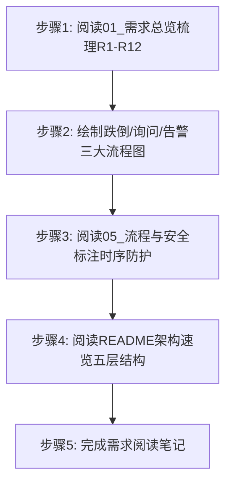
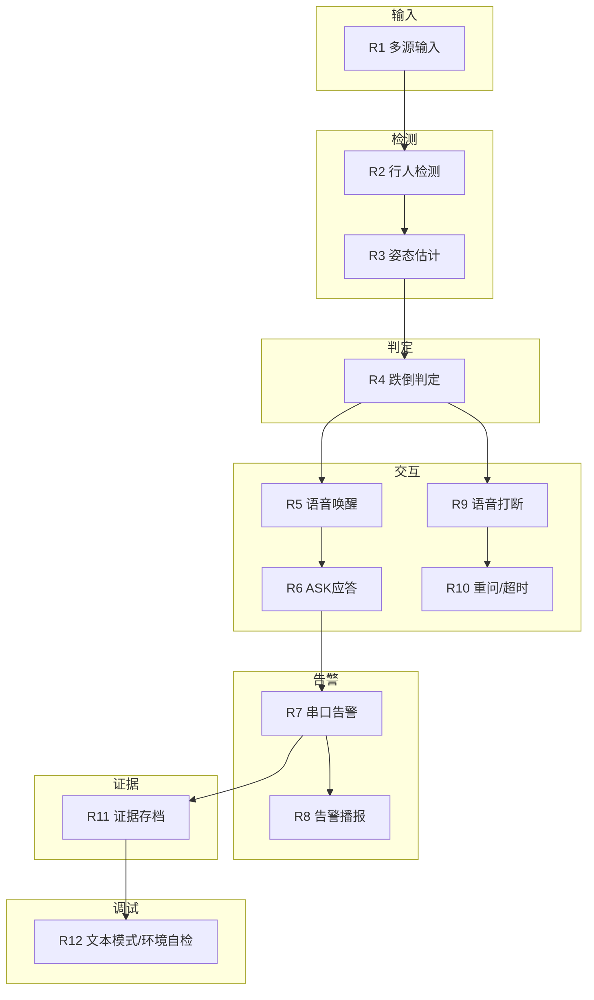
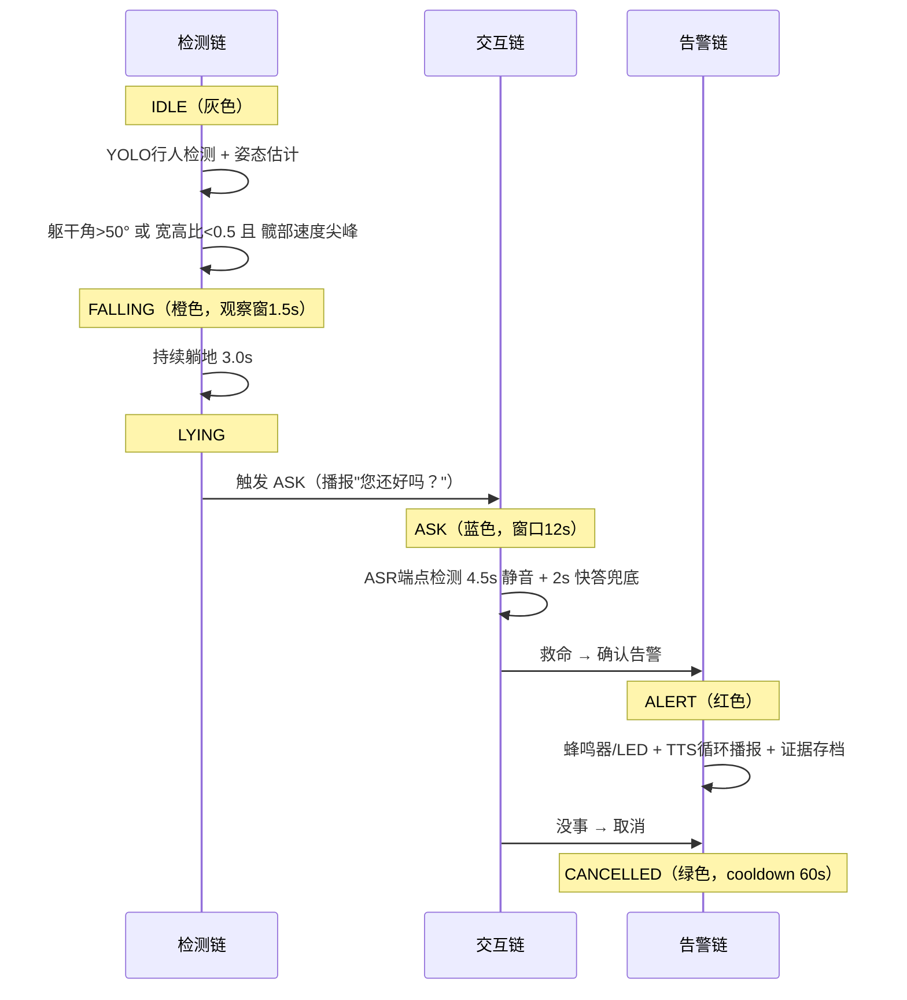
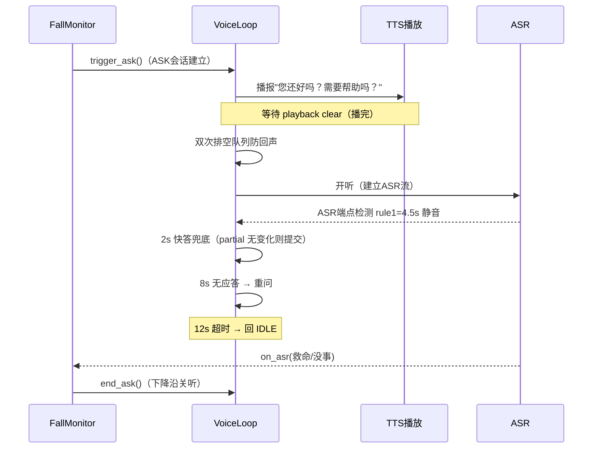
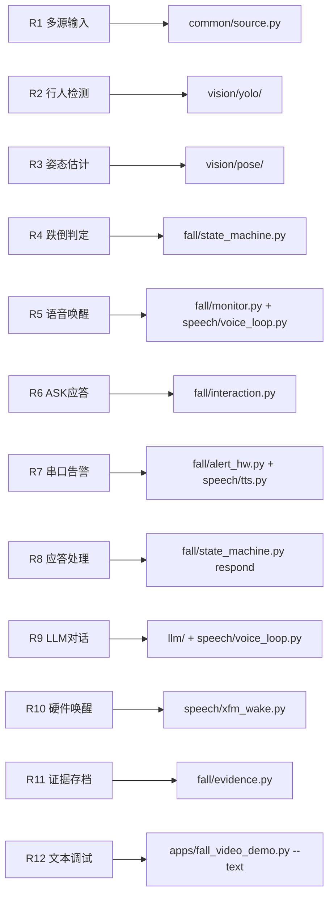

# 实验1：老人跌倒监护--项目需求分析（4h）


### 1.1 关联知识点

- 1.1.1 R1-R12 功能需求体系（前置：无；项目所有后续实验的基础）
- 1.1.2 跌倒→ASK→ALERT→取消全流程（前置：1.1.1，需先理解 R4-R8 需求条款）
- 1.1.3 语音打断/重问/超时兜底(12s)机制（前置：1.1.2，需了解 ASK 会话的触发与结束时序）

### 1.2 实验目标

1. **理解**老人跌倒监护项目 R1-R12 全部功能需求，能逐条复述每个需求的约束要点（输入源类型、检测算法、判定条件、语音交互规则、告警输出方式等）。
2. **掌握**跌倒检测→ASK 询问→ALERT 告警→取消的完整状态流转时序，能独立绘制包含唤醒、跌倒、询问、应答、告警、取消全节点的流程图。
3. **理解**语音打断（语音取消回待机）、重问机制（静默重播 ask）、超时兜底（12s ASK 会话超时、2s 快答兜底）三类时序防护的设计原理与触发条件。
4. **独立完成**一份结构化需求阅读笔记，能标注文档真实行号引用，梳理"需求编号→实现模块→关键约束"的三层映射。
5. **迁移**：把"需求总览→流程梳理→时序防护"的需求分析方法迁移到其他具身智能/老人监护场景。

### 1.3 实验环境

| 类别 | 内容 |
|------|------|
| 硬件 | 具身智能实验箱B2 / 具身智能机器人小车C1（本实验仅阅读文档，无需上电） |
| OS | Ubuntu 22.04 + ROS 2 Humble |
| Python | 3.10（本实验仅需阅读，不执行 Python） |
| 文档对象 | `ros2_ws/src/xflz_eai_car1/app/elderly_companion/docs/01_需求总览.md`、`docs/05_流程与安全.md`、`README.md` |
| 辅助工具 | 文本编辑器或笔记软件（用于撰写需求阅读笔记和流程图） |

### 1.4 实验难度

- 难度: ⭐（验证性）
- 重点：R1-R12 需求条款的逐条梳理与要点归纳；跌倒→ASK→ALERT→取消全流程的时序理解；语音打断/重问/超时兜底三类时序防护机制。
- 难点：R6 呼救直告警与 R5 ASK 询问应答的**触发路径差异**（R6 任意时刻喊救命直接 ALERT，不经过 ASK 窗口）；时序防护中"ASK 开听晚于 ask 播完"与"双次排空防回声"的设计理由。

### 1.5 实验现象

**快速验证流程**（纯文档类实验，以下为快速阅读清单）：

```bash
# 在 elderly_companion 包目录下
ls docs/
grep -n "R[0-9]" docs/01_需求总览.md          # 快速定位 R1-R12 各条款行号
grep -n "时序防护\|兜底\|重问\|打断" docs/05_流程与安全.md  # 定位时序防护章节
head -50 README.md                             # 架构速览与关键决策
```

**预期效果描述**：

- 能列出 R1-R12 每一条的一句话要点，并能说出"哪几条属于输入/检测、哪几条属于判定/交互、哪几条属于告警/证据、哪几条属于调试/运维"。
- 能画出 `唤醒 → 对话/跌倒检测 → ASK 询问 → 应答(救命→ALERT / 没事→取消) → 证据存档` 的完整时序图，并标注每个状态转换的触发条件。
- 能说出时序防护六个要点中至少三个（ASK 开听晚于 ask 播完、DIALOG 无话超时 10s、ASK 快答兜底 2s、打断丢弃 epoch+1、单次应答、重问 8s）。

### 1.6 实验步骤

#### 整体流程图



#### 步骤1：通读需求总览，梳理 R1-R12（90min）

**知识点讲解**：

**1.1.1 R1-R12 功能需求体系**

- **原理**：需求体系回答"系统要做什么、边界是什么"两个核心问题。R1-R3 定义输入层（多源统一、行人检测、姿态估计），R4 定义核心判定（跌倒的几何特征与状态机流转），R5-R6 定义语音交互层（ASK 询问应答与呼救直告警两条路径），R7-R8 定义输出层（告警输出与语音取消），R9 定义自由对话（LLM 回复），R10 定义硬件唤醒（六麦阵列 AIUI），R11 定义证据存档（截图+视频+事件日志），R12 定义调试运维（文本模式、MJPEG、环境自检）。梳理时建议按"输入→检测→判定→交互→告警→证据→调试"七个维度分组，逐条标注"可量化约束"（如躯干角>50°、宽高比<0.5、12s 超时、60s cooldown）。R12 的文本调试模式特别重要——`--text` 与音频模式走同一状态机，是后续所有实验的基础调试路径。
- **源码对应**：`docs/01_需求总览.md L1-L20（R1-R12 需求清单完整表格）、L22-L27（非目标范围边界）、L29-L31（验收路径）`

```markdown
### R1. 多源输入统一
- 静态图片 / 本地视频 / 实时摄像头（ROS 话题）三种输入源，config 或 CLI 切换，业务代码零改动
### R4. 跌倒判定
- 躯干角 >50° 或 框宽高比 <0.5 且 髋部速度尖峰 → FALLING → LYING
- 每人独立 ID + IoU 跨帧关联
### R5. 询问应答（ASK）
- 跌倒后 TTS 播"您还好吗？需要帮助吗？" → 语音应答窗口：救命/疼 → ALERT、没事/不用 → 取消
### R6. 呼救直告警
- 任意时刻喊"救命/帮帮我/摔倒了" → 直接升级 ALERT（不等待 ASK）
```

- **配图**（需求分组图）：把 R1-R12 分成"输入（R1）、检测（R2-R3）、判定（R4）、交互（R5-R6, R9, R10）、告警（R7-R8）、证据（R11）、调试（R12）"七组，并标注每组之间的依赖箭头（如 R2-R3 检测 → R4 判定 → R5/R6 交互 → R7 告警 → R11 证据）。



**操作步骤**：

1. 打开 `docs/01_需求总览.md`，通读全文。
2. 用表格整理 R1-R12：每条记录「需求编号 / 一句话要点 / 可量化约束 / 实现位置 / 分组归属」。
3. 特别关注 R4 的三个几何判定条件（躯干角、宽高比、髋部速度尖峰）与 R5/R6 的两条触发路径差异，单独摘抄。
4. 标注非目标范围（`docs/01_需求总览.md L22-L27`），明确"不做 ROS 业务节点、不做多人会话仲裁"。

**易错点**：

- ⚠️ 误以为 R6 呼救直告警也经过 ASK 窗口 → **解决**：对照 `docs/01_需求总览.md` R6 条目（"任意时刻喊救命→直接升级 ALERT，不等待 ASK"），R5 是"跌倒后才问"，R6 是"随时能喊"，两条独立触发路径。

#### 步骤2：绘制跌倒检测/语音询问/告警存档三大流程图（90min）

**知识点讲解**：

**1.1.2 跌倒→ASK→ALERT→取消全流程**

- **原理**：系统运行时存在三条核心时序流程，贯穿 R4-R8 需求：①跌倒检测流程——YOLOv8 行人检测 → IoU 跨帧关联 → BlazePose/RTMPose 姿态估计 → 几何特征提取（躯干角>50° 或 宽高比<0.5 且髋速尖峰）→ FALLING 状态（1.5s 确认）→ LYING 状态（3s 确认）→ 触发 ASK；②语音询问流程——monitor 触发 ask_tts 播"您还好吗？" → VoiceLoop.trigger_ask() 开听 → ASR 端点检测 → 用户应答（救命/没事）→ monitor.on_asr 判定 → ALERT 或 CANCELLED；③告警存档流程——ALERT 触发 STM32 串口告警（蜂鸣器/LED/OLED）→ TTS 循环播报 → 证据存档（FrameRing 前后帧截图/.avi 视频/events.jsonl）。三条流程共享"每人独立状态机"与"IoU 跨帧人员关联"机制，确保多人同框时互不干扰。绘制流程图时应把 FALLING→LYING 的确认时间、ASK 12s 超时、cooldown 60s 等关键时间节点显式标注。
- **源码对应**：`docs/05_流程与安全.md L1-L41（跌倒全流程时序完整时间线）、docs/01_需求总览.md L13-L19（R4-R8 需求条款）`

```markdown
### 跌倒全流程时间线（摘要）
- 唤醒前：录音线程未启动（等硬件唤醒）——XFM 监听态不持续上送音频流
- 用户说"小飞小飞" → XFM 串口唤醒事件 → 录音线程启动（ALSA 打开，~3s 就绪）
- 视频/摄像头检测到跌倒 → FALLING→LYING→ASK 判定（~3-6s）
- 用户答话："救命"→ALERT / "没事"→CANCELLED
- 会话结束 → 回 IDLE（等待下一次唤醒）
```

- **配图**（三条核心流程融合时序图）：纵轴为时间线，横轴分三列（检测/交互/告警），用颜色区分不同状态（IDLE 灰色、FALLING 橙色、ASK 蓝色、ALERT 红色、CANCELLED 绿色），标注每个状态转换的触发条件与时间阈值。



**操作步骤**：

1. 用流程图工具（draw.io / PlantUML / mermaid）绘制三大流程图。
2. 跌倒检测流程图必须包含：YOLOv8 检测 → IoU 关联 → 姿态估计 → 几何特征 → FALLING(1.5s) → LYING(3s) → ASK。
3. 语音询问流程图必须包含：ask_tts 播报 → VoiceLoop 开听 → ASR → 用户应答 → on_asr 判定 → ALERT/CANCELLED。
4. 告警存档流程图必须包含：ALERT → STM32 串口 → TTS 循环播报 → 证据存档（截图/视频/事件日志）。
5. 对比三条流程的共享点（每人独立 ID、IoU 关联、单次应答防重复）与差异点。

**易错点**：

- ⚠️ 流程图漏掉 FALLING→LYING 的确认时间（1.5s/3s）→ **解决**：对照 `docs/05_流程与安全.md L27`（FALLING→LYING 判定），这两个时间窗口是状态机防误报的关键设计，必须在流程图中标注。

#### 步骤3：阅读流程与安全文档，标注 ASK 重问/超时兜底/语音打断点（60min）

**知识点讲解**：

**1.1.3 语音打断/重问/超时兜底(12s)机制**

- **原理**：时序防护是语音交互可靠性的核心。系统设计了六类防护机制：①ASK 开听晚于 ask 播完——`trigger_ask` 等 `playback_event` set→clear（8s 未播/15s 未播完双超时兜底），防止 ASR 把 ask 播报回声当成用户应答；②DIALOG 无话超时——10s 无 partial → 关窗回 IDLE（防唤醒后无人说话一直听）；③ASK 快答兜底——partial 非空且 2s 无变化 → 强制提交（不必等 4.5s 端点静音），确保用户说"救命/没事"后快速响应；④打断丢弃——SPEAKING 中新的唤醒/跌倒 → `epoch+1` → LLM worker 完成后发现 epoch 变化即丢弃回复（防打断后迟到播报）；⑤单次应答——`on_asr` 对首个响应会话 break，多人（ASK 静默合并/ALERT 多台机器）只响应一次，防重复告警播报；⑥重问与超时归 monitor——`ask_retry_interval=8s` 静默重播 ask；ASK 超时（目标消失）→ 会话结束回 IDLE，语音层不重复实现。其中重问（静默重播）与超时（12s ASK 会话超时）是两类独立机制：重问是"没听清再问一次"，超时是"人可能不在了直接结束"。
- **源码对应**：`docs/05_流程与安全.md L44-L51（关键时序防护六要点完整列表）、docs/05_流程与安全.md L11-L41（全流程时间线含 ASK/打断/取消节点）`

```markdown
### 关键时序防护（原文摘要）
1. ASK 开听晚于 ask 播完：trigger_ask 等 playback_event set→clear
2. DIALOG 无话超时：10s 无 partial → 关窗回 IDLE
3. ASK 快答兜底：partial 非空且 2s 无变化 → 强制提交
4. 打断丢弃：epoch+1 → LLM worker 发现 epoch 变化即丢弃
5. 单次应答：on_asr 对首个响应 break
6. 重问与超时归 monitor：ask_retry_interval=8s 静默重播
```

- **配图**（ASK 会话时序防护图）：纵轴为时间线，标注 ask 播报时段→等待 playback clear→双次排空→开听→ASR 端点检测（4.5s 静音）→2s 快答兜底→8s 重问→12s 超时回 IDLE 的完整时序，突出每个防护节点的触发条件。



**操作步骤**：

1. 在 `docs/05_流程与安全.md` 中找到"关键时序防护"小节（`L44-L51`），逐条阅读并在需求笔记中标注行号。
2. 在"跌倒全流程（时序）"时间线（`L11-L41`）中标注三个关键打断点：①用户说"没事/不用"（语音取消，`L36`）；②ASK 超时目标消失（`L41`）；③新唤醒打断当前播报（`L32`）。
3. 用时序图画出"ASK 会话生命周期"：从 monitor 触发 ask_tts → VoiceLoop 开听 → ASR 端点检测 → 应答判定 → 会话结束的完整时间线，标注每个防护节点的超时值。
4. 对比重问（`ask_retry_interval=8s`）与超时（12s ASK 会话超时）的区别：重问是"再给一次机会"，超时是"主动结束"。

**易错点**：

- ⚠️ 混淆"语音取消"（R8）与"ASK 重问" → **解决**：语音取消是用户主动说"没事/不用"触发 CANCELLED；重问是系统静默重播 ask_tts（`ask_retry_interval=8s`），两者触发源不同、目标不同。对照 `docs/05_流程与安全.md L36`（取消）与 `L44-L51`（重问）。

#### 步骤4：阅读 README 架构速览，理解五层结构与关键决策（30min）

**知识点讲解**：

**综合（五层结构与关键决策）**

- **原理**：README 的"架构速览"把需求落地为五个模块层：common 层（输入源/配置/日志/串口）、vision 层（yolo 检测 + pose/pose_rtm 姿态估计）、fall 层（monitor 状态机 + 证据 + 告警硬件）、speech 层（voice_loop 单状态机 + KWS/ASR/TTS）、llm 层（flask 子进程 + 多轮历史）。"关键决策速览"回答"需求怎么变成设计"：跌倒 vs 语音分层（monitor 只做视觉判定，语音链路独立通过三个接口对接）、单录音线程 + 队列（消除旧架构"四门叠加"问题）、唤醒后启动录音（XFM 时序约束）、提示音防回声（双次排空）、ASK 应答窗口（播完再开听 + 2s 兜底快答）、单次应答（防重复告警）。该步骤把 R1-R12 与模块一一对应起来，为实验 2 的架构设计打基础。
- **源码对应**：`README.md L14-L34（架构速览 ASCII 图 + 跌倒判定 + 语音时序 + 应答单次化 + 文本调试）、L36-L48（关键决策速览八个要点）`

```markdown
## 架构速览
common(输入源/配置/日志/串口) → vision/yolo(检测) + vision/pose|pose_rtm(姿态)
  → fall/monitor(FallMonitor：每人独立状态机，IoU 关联，ASK 全局会话)
  → sink(OutputSink：事件/播报/证据) + alert_hw(STM32 串口告警)
语音：speech/voice_loop(VoiceLoop 单状态机) ──单录音线程→队列→主循环路由──
  IDLE(KWS 唤醒/呼救) → LISTENING(ASR 端点检测+兜底) → SPEAKING(TTS 播完回 IDLE)
```

- **配图**（需求→模块映射图）：左侧列 R1-R12，右侧列对应模块（R1→common/source.py、R2→vision/yolo/、R3→vision/pose/、R4→fall/state_machine.py、R5→fall/monitor.py+speech/voice_loop.py、R6→fall/interaction.py、R7→fall/alert_hw.py+speech/tts.py、R8→fall/state_machine.py respond、R9→llm/+speech/voice_loop.py、R10→speech/xfm_wake.py、R11→fall/evidence.py、R12→apps/fall_video_demo.py --text），连线标注关键决策。



**操作步骤**：

1. 通读 `README.md` 的架构速览（`L14-L34`）与关键决策速览（`L36-L48`）两节。
2. 在笔记中绘制"需求编号 → 实现模块 → 关键决策"三层映射表。
3. 阅读 README 常用命令部分（`L50-L80`），记录核心调试命令 `python3 apps/fall_video_demo.py --video testdata/fall_slow_x264.mp4 --text`（本实验仅记录，不执行）。
4. 特别关注文本模式（`--text`）与音频模式走同一状态机的设计——这是 R12 的核心，也是后续所有实验的基础调试路径。

**易错点**：

- ⚠️ 把 speech 与 fall 误记为同一模块 → **解决**：README 架构速览图明确画出 fall 层与 speech 层是**并行**的（fall 做视觉判定，speech 做语音交互），通过 `monitor.on_kws/on_asr/has_ask_session` 三个接口对接，不是包含关系。

#### 步骤5：完成需求阅读笔记（30min）

**操作步骤**：

1. 汇总前四步产出，按"输入需求（R1-R3）/ 判定需求（R4）/ 交互需求（R5-R6, R9-R10）/ 告警需求（R7-R8）/ 证据需求（R11）/ 调试需求（R12）"六节撰写笔记。
2. 每节附上文档行号引用（`docs/01_需求总览.md` 与 `docs/05_流程与安全.md` 的真实行号区间）与关键约束摘录。
3. 自检清单：能否不看文档说清 R1-R12 要点；能否画出跌倒→ASK→ALERT→取消全流程；能否说清六类时序防护中至少三个的触发条件与设计理由。

**易错点**：

- ⚠️ 笔记只抄条款不做归纳 → **解决**：每条需求必须提炼"可量化约束"（如躯干角>50°、宽高比<0.5、10s 无话超时、2s 快答兜底、8s 重问间隔、12s ASK 超时、60s cooldown）和"设计含义"（对哪个模块、影响什么实现），才算有效笔记。

### 1.7 注意事项

- ⚠️ 本实验为**纯文档阅读，无硬件操作**，不需要给底盘/STM32 上电，也不需要启动 ROS 节点。
- ⚠️ 文档路径 `ros2_ws/src/xflz_eai_car1/app/elderly_companion/` 为板端实机路径，若在工程机以外阅读需注意路径映射。
- ⚠️ R5 与 R6 的触发路径不同（R5 需先跌倒后询问，R6 任意时刻呼救直告警），梳理时注意区分。
- ⚠️ 时序防护中的超时值（10s/2s/8s/12s）均为当前配置值，实验 3 中可调整，本实验仅需理解原理。

### 1.8 实验总结

**完成成果**: 一份 R1-R12 需求梳理表（含量化约束与实现位置映射）；跌倒检测/语音询问/告警存档三大流程图各一张（含状态转换条件与时间节点）；一份时序防护要点笔记（六类防护的触发条件与设计理由）；一份"需求→模块→关键决策"三层映射表。

**技能收获**:

- 技能1：需求文档结构化梳理方法（分组→量化约束→实现映射）
- 技能2：状态机全流程时序图绘制（显式标注触发条件与时间阈值）
- 技能3：语音交互时序防护分析（六类防护机制的触发条件与设计理由）

**常见问题与解决**:

| 问题 | 原因 | 解决方法 |
|------|------|----------|
| R5 ASK 与 R6 呼救混淆 | 两条都是"语音→告警"路径 | 按"触发时机/前置条件"区分：R5 需跌倒后才触发 ASK；R6 任意时刻喊救命直接 ALERT |
| 时序防护超时值记混 | 6 类防护各有不同超时值 | 列表整理：DIALOG 无话 10s / ASR 端点 4.5s / ASK 快答 2s / 重问 8s / ASK 超时 12s / cooldown 60s |
| 架构图把 speech 当 fall 子模块 | 两者在架构速览中并列 | 对照 README 架构速览 ASCII 图，fall 与 speech 是**并行**的，通过三个接口对接 |

### 1.9 实验报告要求

**思考题**:

1. R6 要求"任意时刻喊'救命/帮帮我'直接升级 ALERT（不等待 ASK）"，而 R5 要求"跌倒后先播'您还好吗？'再等应答"。请分析两条触发路径的设计理由：为什么不能只保留 R5？为什么不能把 R6 的呼救也放进 ASK 窗口内？
2. 时序防护中"ASK 开听晚于 ask 播完"（`trigger_ask` 等 `playback_event`）与"双次排空队列"分别解决什么问题？如果省去任一防护，会导致什么具体故障？
3. R12 的文本调试模式（`--text`）与音频模式走"完全相同的状态机与回调链"，这种设计带来什么好处？如果文本模式走独立简化状态机，会在后续集成测试中暴露什么问题？

**评分标准**:

- 需求梳理表完整准确（35 分）：R1-R12 逐条覆盖、量化约束正确、实现位置映射准确
- 三大流程图（30 分）：跌倒→ASK→ALERT→取消全流程正确、时间阈值标注齐全、三条流程差异体现
- 时序防护分析（25 分）：六类防护触发条件正确、重问与超时区别表达清楚
- 笔记规范与行号引用（10 分）：引用真实文档行号、结构完整 = 100 分。

---
