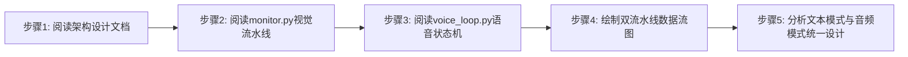
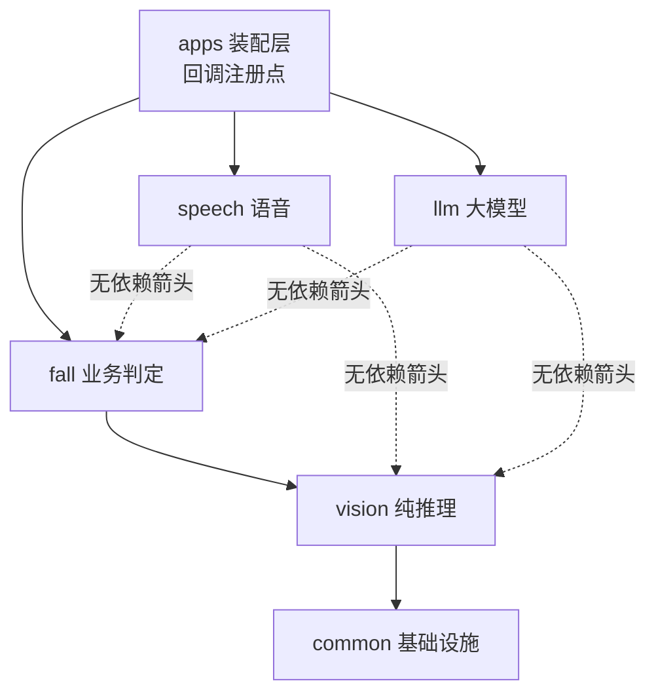
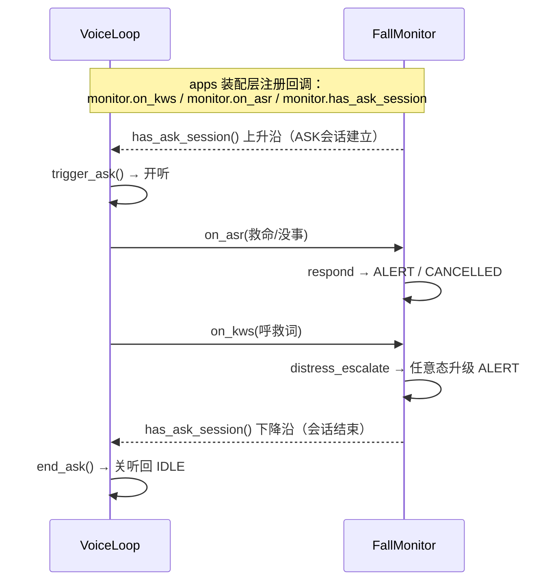
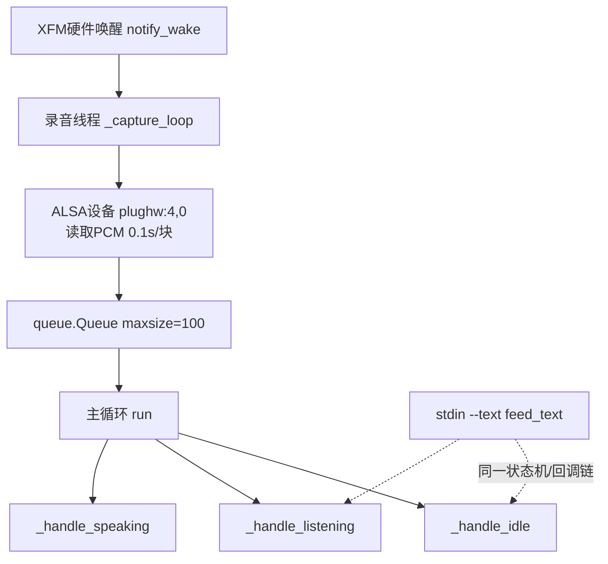
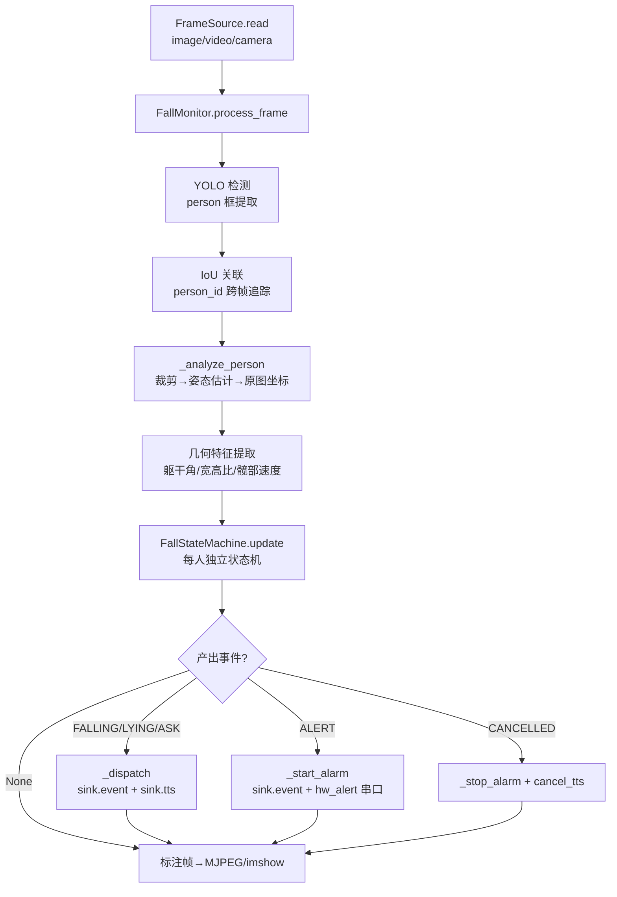
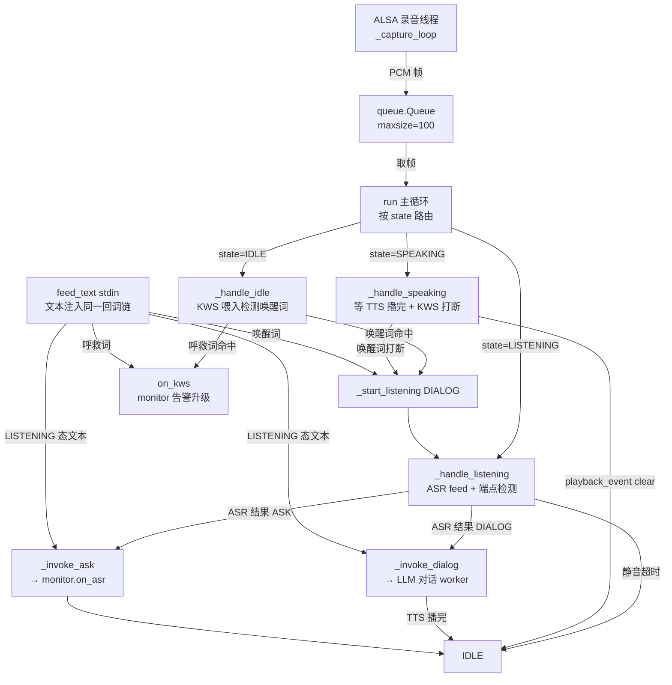
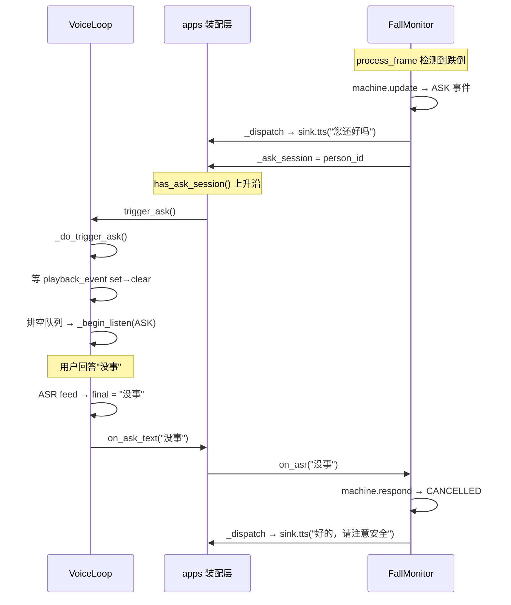

# 实验2：老人跌倒监护--系统架构设计（4h）

### 1.1 关联知识点

- 1.2.1 五层模块划分(apps/common/vision/fall/speech/llm)[概念,dep 1.1.1]（前置：实验1已了解R1-R12功能需求）
- 1.2.2 视觉流水线(YOLO→IoU→姿态→特征→状态机)[原理,dep 1.2.1]（前置：需理解每帧处理链路的概念）
- 1.2.3 语音单状态机(IDLE/LISTENING/SPEAKING)+单录音线程+队列[概念,dep 1.2.1]（前置：了解线程与队列基本概念）
- 1.3.1 monitor↔VoiceLoop三接口(on_kws/on_asr/has_ask_session)[原理,dep 1.2.2,1.2.3]（前置：1.2.2视觉链路与1.2.3语音状态机）
- 1.3.2 多输入源抽象FrameSource(image/video/ROS)[概念,dep 1.2.1]（前置：了解OpenCV/ROS话题基础概念）
- 1.3.3 文本模式(--text)与音频模式状态机统一[原理,dep 1.2.3]（前置：理解语音状态机流程）

### 1.2 实验目标

1. **理解**老人跌倒监护项目的六层模块划分（apps/common/vision/fall/speech/llm），能说清每一层的职责与依赖方向，能独立画出分层架构图。
2. **掌握**视觉流水线"YOLO→IoU关联→姿态估计→几何特征→跌倒状态机"的数据流，能用mermaid图画出从摄像头帧到事件产出的完整链路。
3. **掌握**语音单状态机（IDLE/LISTENING/SPEAKING）的工作原理，理解"单录音线程+队列路由"替代"多线程直调"的设计理由。
4. **理解**monitor与VoiceLoop之间的三个接口（on_kws/on_asr/has_ask_session），能解释视觉判定如何与语音链路解耦。
5. **掌握**FrameSource多输入源抽象的设计，能解释image/video/camera三种模式为何可以走同一条处理链路。
6. **理解**文本模式（--text）与音频模式走同一状态机的设计：`feed_text()`直接注入状态机回调，与录音线程输出同一回调链，因此调试时无需麦克风/扬声器。

### 1.3 实验环境

| 类别 | 内容 |
|------|------|
| 硬件 | 无（纯源码阅读实验，无需上电） |
| 源码路径 | `ros2_ws/src/xflz_eai_car1/app/elderly_companion/` |
| 阅读对象 | `docs/02_架构设计.md`、`fall/monitor.py`、`speech/voice_loop.py`、`common/source.py`、`common/sink.py` |
| Python | 3.10（本实验仅阅读，无需运行环境） |
| 工具 | mermaid流程图绘制工具（draw.io / PlantUML / 在线编辑器均可） |

### 1.4 实验难度

- 难度: ⭐⭐（设计性）
- 重点：六层模块职责与依赖方向；视觉流水线五步链路；语音单状态机三态流转；monitor↔VoiceLoop三接口解耦设计。
- 难点：**解耦设计的理解**——视觉判定（process_frame）与语音交互（VoiceLoop）为何独立运行、通过三接口协作；**单录音线程+队列**替代多线程直调的原因（ALSA设备单打开、回声消除、状态机统一控制）；文本模式与音频模式的统一回调链。

### 1.5 实验现象

**快速验证流程**（纯源码阅读，以下为快速定位清单）：

```bash
# 在 elderly_companion 目录下
ls docs/02_架构设计.md fall/monitor.py speech/voice_loop.py common/source.py common/sink.py

# 快速定位关键类与方法
grep -n "class FallMonitor" fall/monitor.py
grep -n "class VoiceLoop" speech/voice_loop.py
grep -n "class FrameSource" common/source.py
grep -n "class OutputSink\|class LocalSink" common/sink.py

# 定位关键接口
grep -n "def on_kws\|def on_asr\|def has_ask_session\|def process_frame" fall/monitor.py
grep -n "def notify_wake\|def trigger_ask\|def end_ask\|def feed_text" speech/voice_loop.py
```

**预期效果描述**：

- 能画出六层架构图：`apps → fall → vision → common`（单向依赖），`speech/llm` 独立，对接点在 apps 装配层。
- 能画出视觉流水线数据流图：`FrameSource.read → YOLO检测 → IoU关联 → 姿态估计 → 几何特征 → 状态机 → 事件分发`。
- 能画出语音状态机图：`IDLE →(唤醒)→ LISTENING →(ASR结果)→ SPEAKING →(播完)→ IDLE`，标注录音线程→队列→主循环的路由。
- 能说出 monitor↔VoiceLoop 三接口各自的调用时机：on_kws=呼救词命中、on_asr=ASK窗口应答、has_ask_session=ASK会话开关。

### 1.6 实验步骤

#### 整体流程图



#### 步骤1：阅读架构设计文档，理解六层依赖关系（40min）

**知识点讲解**：

**1.2.1 五层模块划分**

- **原理**：系统采用分层+分域的混合架构。纵向依赖链为 `apps → fall → vision → common`，严格单向（上层依赖下层，下层不感知上层）。横向独立域为 `speech`（语音交互）和 `llm`（大模型推理），它们不依赖 fall/vision/common，与 fall 的对接点在 apps 装配层。这种设计的核心收益是：每个模块可独立测试（common→vision→fall 分层验证）、可独立替换（speech 的 ASR/TTS 引擎可换不影响 fall 逻辑）、IO 与业务解耦（`common/sink.py` 定义 OutputSink 协议，未来迁移 ROS 只需新增 RosSink 转发层）。common 层提供基础设施（FrameSource输入源、OutputSink输出协议、配置加载、STM32串口帧、环境自检）；vision 层是纯推理层（YOLO检测 + BlazePose/RTMPose姿态），零业务逻辑；fall 层是业务编排核心（FallMonitor 每帧调度检测→关联→更新→分发）；speech 层是语音调度（VoiceLoop 单状态机 + 录音线程 + 队列路由）；llm 层是大模型服务（RKLLM推理 + Flask HTTP + 多轮对话）。
- **源码对应**：`docs/02_架构设计.md` 分层结构图（第3-16行）、依赖方向说明（第17行）、关键模块表（第40-50行）

```text
依赖方向严格单向：common ← vision ← fall ← apps、speech/llm 独立
```

- **配图**（六层依赖架构图）：左侧纵列为 apps → fall → vision → common（单向箭头向下），右侧并列 speech 与 llm（无箭头指向 fall/vision），标注对接点在 apps 装配层。



**操作步骤**：

1. 打开 `docs/02_架构设计.md`，通读"分层结构"部分。
2. 用表格记录每一层的职责（一句话）与对外暴露的关键接口。
3. 标注依赖方向：哪些层可以独立测试，哪些层必须配合。

**易错点**：

- ⚠️ 误以为 speech 依赖 fall → **解决**：对照 `docs/02_架构设计.md` 第17行"speech/llm 独立"，它们通过 apps 装配层的回调函数间接交互，不是直接 import。

#### 步骤2：阅读fall/monitor.py，理解视觉流水线与三接口（80min）

**知识点讲解**：

**1.2.2 视觉流水线（YOLO→IoU→姿态→特征→状态机）**

- **原理**：每帧处理链路（`process_frame`）是系统的核心循环：(1) YOLO检测提取 person 框，(2) IoU关联将检测框映射到持久 person_id（跨帧追踪），(3) 裁剪→姿态估计→原图坐标映射，(4) 几何特征提取（躯干角/宽高比/髋部速度），(5) 每人独立状态机 `update` 产出事件 dict（FALLING/LYING/ASK/ALERT/CANCELLED）或 None，(6) `_dispatch` 事件分发到 sink（日志+证据）和 hw_alert（STM32串口告警）。整个链路是同步单线程，每帧处理完才处理下一帧——这保证了状态机更新的时序确定性。关键设计：业务逻辑与 IO 解耦（"规则 20"），FallMonitor 通过 OutputSink 协议接收外部 IO，不直接依赖 ROS/TTS/ASR。
- **源码对应**：`fall/monitor.py` L223-322（process_frame 主链路）、L226-229（YOLO检测）、L230（IoU关联）、L245-260（_analyze_person 裁剪→姿态→特征）、L290-322（machine.update→_dispatch）、L424-480（_dispatch 事件分发）

```python
# fall/monitor.py L247-252 —— process_frame 入口
def process_frame(self, frame: np.ndarray) -> np.ndarray:
    """单帧主链路；返回标注帧"""
    now = time.time()
    with self._lock:
        self._frame_ring.push(frame, now)
    try:
        dets = self._ensure_yolo().detect(frame)
    except Exception as exc:
        self.log.error(f"检测推理失败（跳过本帧）: {exc}")
        dets = []
    persons = [item for item in self._iter_person_boxes(dets)]
    tracks = self._assoc.update([(bb, d) for d, bb in persons], now)
```

**1.3.1 monitor↔VoiceLoop三接口**

- **原理**：FallMonitor 暴露三个接口供 VoiceLoop（通过 apps 装配层）回调：(1) `on_kws(text)`——呼救词命中（KWS检测到"救命/帮帮我"等），任意态升级 ALERT；(2) `on_asr(text)`——ASK窗口语音应答（ASR识别到"没事"→CANCELLED 或"救命"→ALERT），一次应答只作用于一个会话（防多person重复触发）；(3) `has_ask_session()`——返回当前是否存在 ASK 应答会话，VoiceLoop 用上升沿触发开听、下降沿关听。这三个接口实现了视觉判定与语音链路的解耦：monitor 只负责"视觉判断是否跌倒+何时需要询问"，VoiceLoop 只负责"何时录音+何时播放"，两者通过 apps 层的回调函数连接。
- **源码对应**：`fall/monitor.py` L100-104（has_ask_session）、L115-168（on_kws 呼救词处理）、L169-220（on_asr ASK应答）、L460-480（_dispatch 中 ASK 会话管理）

```python
# fall/monitor.py L152-157 —— has_ask_session
def has_ask_session(self) -> bool:
    """当前是否存在 ASK 应答会话（app 层用它触发 VoiceLoop 应答窗口）"""
    with self._lock:
        return self._ask_session is not None
```

```python
# fall/monitor.py L168-173 —— on_kws 入口
def on_kws(self, text: str) -> None:
    """呼救词命中（KWS/ASR 呼救/文本调试）：任意态升级 ALERT。"""
    if not text:
        return
    now = time.time()
    inter = self.cfg["interaction"]
    hits = match_keywords(text, inter.get("distress_words", []))
    hits += match_keywords(text, inter.get("confirm_words", []))
```

- **配图**（monitor↔VoiceLoop 三接口协作时序图）：on_kws / on_asr / has_ask_session 的协作时序。



**操作步骤**：

1. 在 `fall/monitor.py` 中定位 `process_frame`（L223），逐行跟踪视觉流水线：detect→关联→_analyze_person→machine.update→_dispatch。
2. 定位 `on_kws`（L115），理解呼救词匹配逻辑（distress_words + confirm_words 任一命中即告警）。
3. 定位 `on_asr`（L169），理解 ASK 应答逻辑（cancel_words→CANCELLED / confirm_words→ALERT，一次应答只作用于一个会话）。
4. 定位 `has_ask_session`（L100），理解 ASK 会话的开关时机。
5. 在 `_dispatch`（L424）中跟踪 ASK/ALERT/CANCELLED 三种事件的分发路径。

**易错点**：

- ⚠️ 误以为 monitor 自己做 ASR 识别 → **解决**：对照 `fall/monitor.py` L1-8（docstring："业务逻辑与 IO 解耦（规则 20）"），monitor 只接收文本结果，ASR 识别由 VoiceLoop 完成。
- ⚠️ on_kws 与 on_asr 分不清 → **解决**：`on_kws` 是 KWS 检测到呼救词（任意态升级 ALERT，无需 ASK 窗口）；`on_asr` 是 ASK 窗口中的 ASR 识别结果（决定 CANCELLED 还是 ALERT）。KWS 是关键词硬匹配，ASR 是完整语句识别。

#### 步骤3：阅读speech/voice_loop.py，理解语音状态机与录音线程+队列路由（80min）

**知识点讲解**：

**1.2.3 语音单状态机 + 单录音线程 + 队列**

- **原理**：VoiceLoop 是系统唯一的语音调度器，采用"单录音线程 + 单状态机"架构。录音线程（`_capture_loop`）从 ALSA 设备读取音频帧（每帧 0.1s@16k），放入 `queue.Queue(maxsize=100)`。主循环（`run`）从队列取帧，按当前状态路由：IDLE 喂 KWS（检测唤醒词/呼救词），LISTENING 喂 ASR（带端点检测 + 静音兜底），SPEAKING 喂 KWS（检测唤醒词打断）并等 TTS 播完。这种设计替代了旧框架的"四门叠加"（set_enabled/active/playback_event互斥/wake_event门控），消除了所有门控——没有任何门，任何状态可立即开听，时序只由状态机一处控制。录音线程在硬件唤醒后才启动（XFM麦克风阵列需唤醒后 ALSA 流才可用，提前打开会导致流稀疏且唤醒后不恢复）。
- **源码对应**：`speech/voice_loop.py` L1-19（模块docstring，状态机说明）、L202-244（`_capture_loop` 录音线程）、L245-290（`run` 主循环+状态路由）、L291-310（`_handle_idle` KWS喂入）、L311-345（`_handle_listening` ASR feed+端点检测）、L346-360（`_handle_speaking` 播报+打断）

```python
# speech/voice_loop.py L1-22 —— 模块架构说明
"""单录音线程 + 单状态机语音循环（voice_interaction.py 架构移植）。

2026-08 重构核心：录音线程常开（sherpa_onnx.Alsa → audio_queue，maxsize=100），
主循环消费队列并按状态机路由每帧音频——IDLE 喂 KWS（唤醒/呼救）、
LISTENING 喂 ASR（带端点检测 + 静音兜底）、SPEAKING 喂 KWS（唤醒词打断）
并等 TTS 播完回 IDLE。
"""
```

```python
# speech/voice_loop.py L224-271 —— run 主循环状态路由
def run(self) -> None:
    # ...
    while self._running:
        # 硬件唤醒事件（不依赖队列）
        if self._hw_wake_ev.is_set():
            self._hw_wake_ev.clear()
            self._start_listening(DIALOG)
            continue
        # 跌倒 ASK / monitor 结束 ASK 会话 ...
        try:
            chunk = self._q.get(timeout=0.3)
        except queue.Empty:
            continue
        if self.state == IDLE:
            self._handle_idle(chunk)
        elif self.state == LISTENING:
            self._handle_listening(chunk)
        elif self.state == SPEAKING:
            self._handle_speaking(chunk)
```

**1.3.3 文本模式（--text）与音频模式状态机统一**

- **原理**：`feed_text(line)` 方法接收 stdin 逐行输入，直接注入与录音线程相同的回调链：唤醒词匹配→`_start_listening(DIALOG)`，LISTENING 态文本→`_invoke_dialog(text)` 或 `_invoke_ask(text)`，呼救词→`_on_help_kws(text)`。这意味着 `--text` 模式与音频模式走完全相同的状态机、相同的回调函数、相同的后续处理（LLM对话/TTS播报/告警），唯一差异是音频来源：音频模式从队列取 PCM 帧喂 KWS/ASR，文本模式从 stdin 取文本直接喂回调。设计意图：无需麦克风/扬声器即可完成全链路调试（`python3 apps/speech_text_demo.py`），开发效率大幅提升。
- **源码对应**：`speech/voice_loop.py` L141-170（feed_text 方法）

```python
# speech/voice_loop.py L154-181 —— feed_text 文本注入同一回调链
def feed_text(self, text: str) -> None:
    """文本调试：stdin 逐行喂，与音频路径同一状态机/回调链。"""
    text = text.strip()
    if not text:
        return
    if text in self.wake_words:
        self._start_listening(DIALOG)
        return
    if self.state == LISTENING:
        if self._mode == DIALOG:
            self._invoke_dialog(text)
        else:
            self._invoke_ask(text)
        return
    # IDLE：呼救词优先
    from common.keywords import match_keywords
    distress = self.cfg.get("interaction", {}).get("distress_words", [])
    if match_keywords(text, distress):
        self._on_help_kws(text)
        return
```

- **配图**（单录音线程 + 队列路由架构图）：录音线程常开，主循环按状态路由。



**操作步骤**：

1. 在 `speech/voice_loop.py` 中定位 `IDLE/LISTENING/SPEAKING` 三个状态常量（L27-28）。
2. 定位 `run` 主循环（L245），追踪队列取帧→状态分支→回调的完整路径。
3. 定位 `_capture_loop`（L202），理解录音线程的 ALSA 读取 + 队列写入 + 满队列丢弃策略。
4. 定位 `feed_text`（L141），理解文本输入如何注入同一状态机回调链。
5. 对比 `_handle_idle`（KWS喂入）和 `_handle_listening`（ASR feed + 端点检测 + 兜底超时）的差异。

**易错点**：

- ⚠️ 误以为 VoiceLoop 内部直接调 TTS → **解决**：对照 `speech/voice_loop.py` L362-375（`_invoke_dialog`），对话 TTS 走 apps 层回调 `_on_dialog_text`（在 worker 线程中调用 LLM+TTS），VoiceLoop 只负责状态转换（切到 SPEAKING）和 epoch 丢弃。
- ⚠️ 录音线程何时启动 → **解决**：对照 `speech/voice_loop.py` L193-197（`_ensure_capture`），有硬件唤醒时在 `notify_wake()` 后启动（XFM ALSA 需唤醒后才可用），无硬件唤醒时在 `run()` 中常开。

#### 步骤4：绘制视觉与语音双流水线数据流图（40min）

**操作步骤**：

1. 基于步骤2和步骤3的源码阅读，用 mermaid 画出**视觉流水线**：



2. 画出**语音流水线**：



3. 画出**三接口协作时序图**：



4. 检查：双流水线图是否完整覆盖了 spec 中的所有知识点（分层架构、视觉流水线五步、语音三态、单录音线程+队列、三接口、FrameSource、文本模式统一）。

**易错点**：

- ⚠️ 数据流图缺少 "sink" 层 → **解决**：对照 `common/sink.py` L11-15（OutputSink 协议），事件/播报/ASR控制走 sink 协议，与 monitor 业务解耦。
- ⚠️ 漏画 FrameSource → process_frame 的输入 → **解决**：对照 `common/source.py` L30-40（FrameSource.read），它是视觉流水线的唯一入口。

#### 步骤5：说明文本模式与音频模式状态机统一的设计（40min）

**知识点讲解**：

**1.3.3 文本模式（--text）与音频模式状态机统一**

- **原理**：`--text` 模式的核心设计是"文本直接注入音频回调链"：用户在 stdin 输入的文本（如"小飞小飞"、"救命"、"没事"）被 `feed_text()` 接收后，走与音频帧完全相同的处理路径——唤醒词→`_start_listening`，LISTENING态→`_invoke_dialog`/`_invoke_ask`，呼救词→`_on_help_kws`。唯一的差异是音频来源：音频模式从 `queue.Queue` 取 PCM 帧喂 KWS/ASR 引擎，文本模式跳过 KWS/ASR 直接喂最终文本。这意味着 `--text` 模式下：状态机流转完全一致、回调函数完全一致、后续处理（LLM对话/TTS播报/告警）完全一致。设计意图是"零硬件调试"：`python3 apps/speech_text_demo.py` 无需麦克风、扬声器、XFM六麦阵列，仅靠 stdin 即可验证全链路行为。同时，`feed_text` 中呼救词走同一 `_on_help_kws` 回调（L166），确保文本模式下呼救也能触发 ALERT 告警。
- **源码对应**：`speech/voice_loop.py` L141-170（feed_text 方法）、L362-375（_invoke_dialog worker线程）、L377-385（_invoke_ask 同步回调）

**操作步骤**：

1. 阅读 `feed_text`（L141-170），追踪每个分支对应的回调函数。
2. 对比 `_invoke_dialog`（L362）和 `_invoke_ask`（L377）：对话走 worker 线程（异步），ASK 走同步回调。
3. 构造一个文本输入序列验证：`小飞小飞`（唤醒）→`我摔倒了`（对话）→`救命`（呼救），画出状态流转图。
4. 对比音频模式的等效流程：录音线程→KWS检测"小飞小飞"→`_start_listening`→ASR识别"我摔倒了"→`_invoke_dialog`，验证两条路径的最终状态一致。
5. 在笔记中记录：文本模式为何能覆盖全链路（原因：回调链统一）。

**易错点**：

- ⚠️ 误以为文本模式跳过状态机 → **解决**：对照 `feed_text` L150（唤醒词→`_start_listening(DIALOG)`）和 L155-158（LISTENING态→`_invoke_dialog`/`_invoke_ask`），文本输入经过完全相同的状态转换和回调调用。

### 1.7 注意事项

- ⚠️ 本实验为**纯源码阅读实验，无硬件操作**，不需要给设备上电。
- ⚠️ 源码行号以实际文件为准，不同版本可能有偏移——重点关注类名和方法名定位，行号作为参考。
- ⚠️ mermaid 流程图绘制时，注意区分"数据流"（帧/PCM 从输入到输出）与"控制流"（状态机状态转换），两者不要混淆。
- ⚠️ `docs/02_架构设计.md` 中的架构图是文本格式（非 mermaid），阅读时需自行转换为结构化图表。

### 1.8 实验总结

**完成成果**:

- 一张六层架构依赖图（含依赖方向箭头与每层职责标注）。
- 一张视觉流水线数据流图（从 FrameSource.read 到事件分发，含每步源码行号引用）。
- 一张语音流水线架构图（含录音线程→队列→主循环→状态分支→回调，标注 feed_text 注入点）。
- 一张 monitor↔VoiceLoop 三接口时序图。
- 一份"文本模式与音频模式统一"的设计分析笔记。

**技能收获**:

- 技能1：分层架构阅读方法（从依赖方向入手，逐层理解职责与接口）
- 技能2：状态机数据流图绘制（区分数据流与控制流，标注关键回调）
- 技能3：IO 解耦设计理解（OutputSink 协议 + 回调注入 vs 直接耦合）

**常见问题与解决**:

| 问题 | 原因 | 解决方法 |
|------|------|----------|
| 分不清 on_kws 与 on_asr 的职责 | 两个接口都接收文本参数 | on_kws = KWS关键词硬匹配（任意态升级ALERT）；on_asr = ASK窗口ASR识别结果（决定CANCELLED/ALERT） |
| 误以为 VoiceLoop 直接调 TTS | 未追踪回调链 | `_invoke_dialog` 走 apps 层 `_on_dialog_text` worker 线程，VoiceLoop 只管状态转换 |
| 录音线程启动时机混淆 | 未理解 XFM ALSA 时序 | 有硬件唤醒时 `notify_wake()` 后启动（L193 `_ensure_capture`）；无硬件唤醒时 `run()` 中常开 |
| 文本模式为何能覆盖全链路 | 以为文本模式是独立分支 | `feed_text` 直接调用 `_start_listening`/`_invoke_dialog`/`_on_help_kws`，与音频回调链完全相同 |

### 1.9 实验报告要求

**思考题**:

1. 为什么语音链路与视觉判定解耦（通过 apps 层回调而非直接 import），而不是让 VoiceLoop 直接持有 FallMonitor 实例？请从可测试性、可替换性、依赖方向三个角度分析。
2. 为什么 VoiceLoop 采用"单录音线程 + 队列路由"而非"多线程直调"（如每个 KWS/ASR/TTS 各一个线程）？请结合 ALSA 设备特性（单打开）和状态机统一控制的时序确定性分析。
3. `has_ask_session()` 为何需要"上升沿触发开听"的设计，而非在 `_dispatch` 中直接调用 VoiceLoop？请从 monitor↔VoiceLoop 解耦的角度分析。
4. FrameSource 的三种模式（image/video/camera）为何能走同一条处理链路（`read()` 返回 `(ok, frame)`）？如果未来新增一种输入源（如 RTSP 流），需要改哪些接口？

**评分标准**:

- 六层架构依赖图（20分）：层级正确、依赖方向正确、每层职责标注清晰
- 视觉流水线数据流图（25分）：五步链路完整（YOLO→IoU→姿态→特征→状态机）、源码行号引用准确
- 语音流水线架构图（25分）：单录音线程→队列→状态机三态流转完整、feed_text 注入点标注清晰
- monitor↔VoiceLoop 三接口时序图（15分）：on_kws/on_asr/has_ask_session 调用时机正确、apps 装配层标注清晰
- 思考题回答（15分）：解耦设计理由充分、队列路由优势分析到位 = 100分。

---
