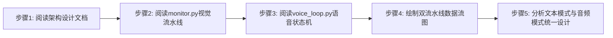
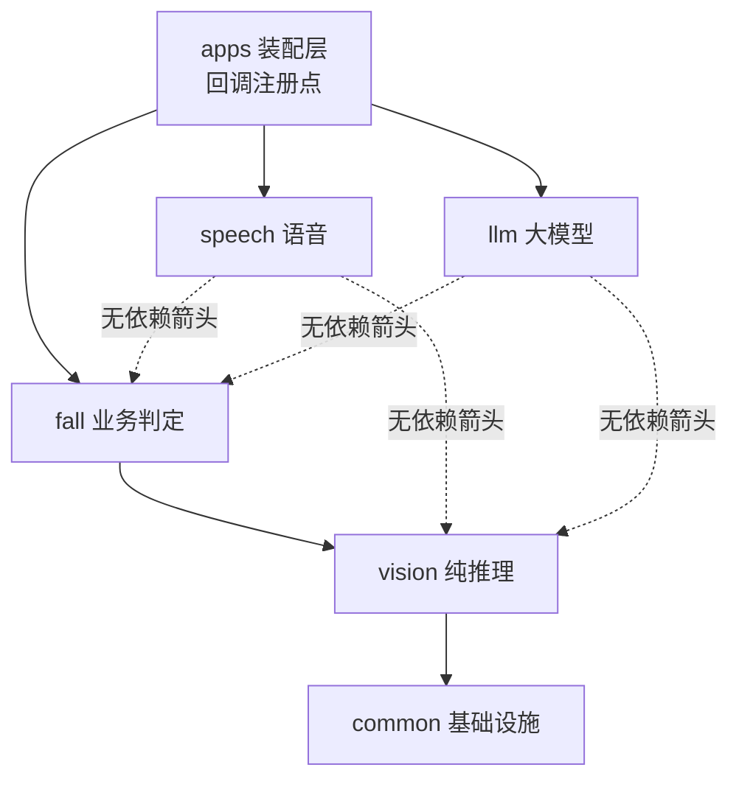
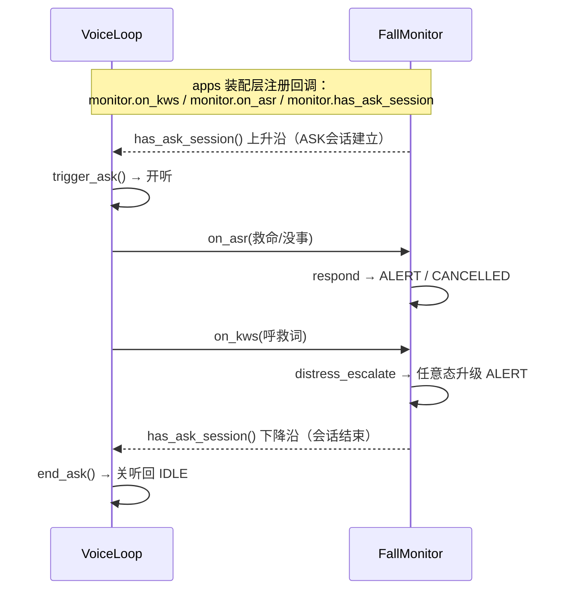
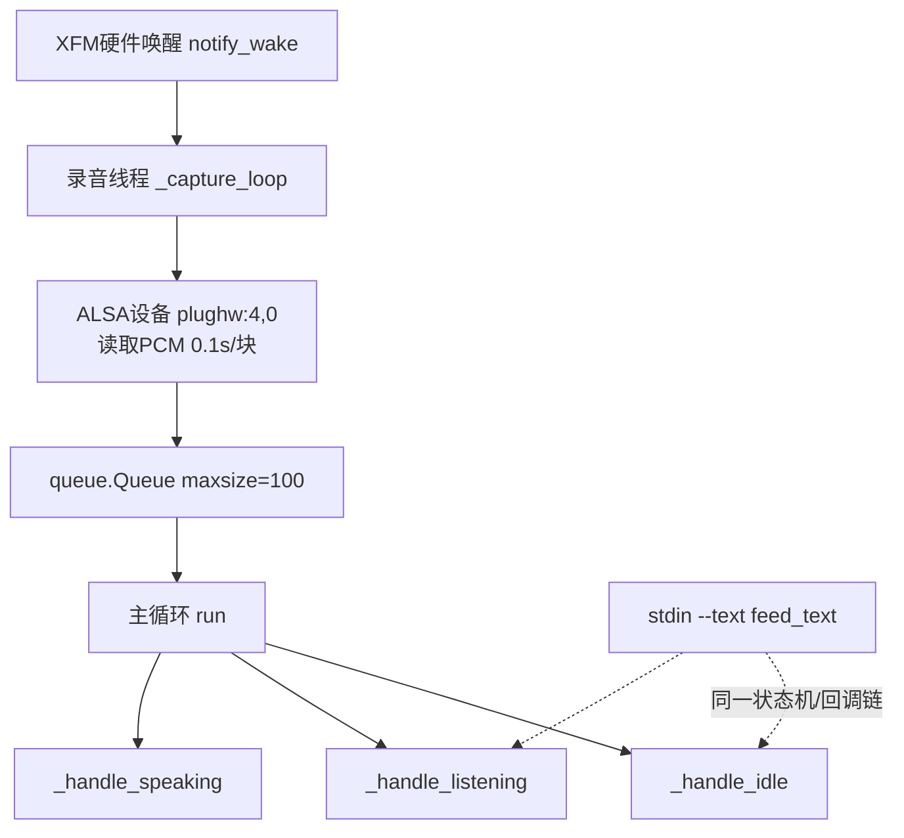
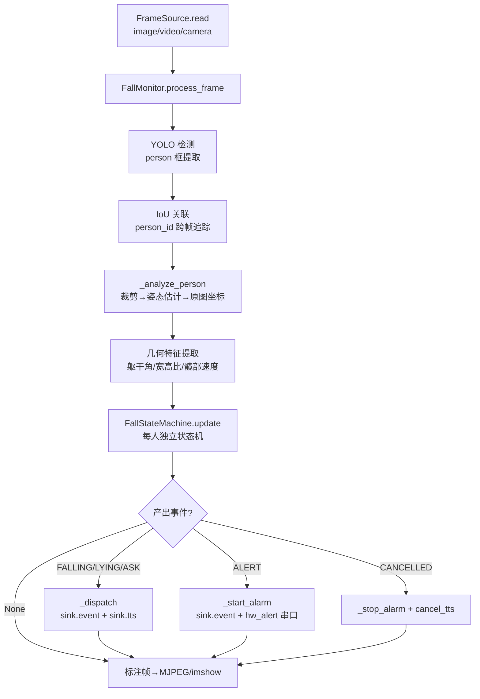
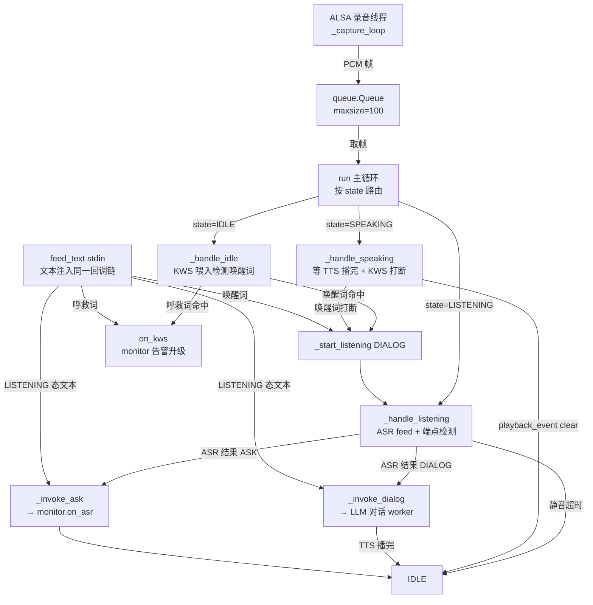
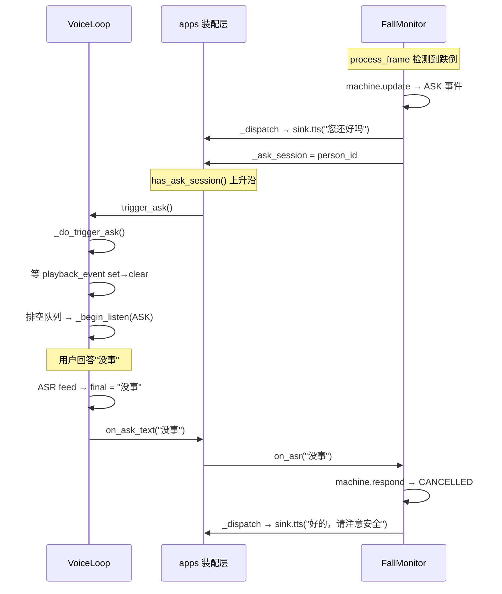

# 实验2：老人跌倒监护--系统架构设计（4h）

### 1.1 关联知识点

- 1.2.1 五层模块划分(apps/common/vision/fall/speech/llm)[概念,dep 1.1.1]（前置：实验1已了解R1-R12功能需求）
- 1.2.2 视觉流水线(YOLO→IoU→姿态→特征→状态机)[原理,dep 1.2.1]（前置：需理解每帧处理链路的概念）
- 1.2.3 语音单状态机(IDLE/LISTENING/SPEAKING)+单录音线程+队列[概念,dep 1.2.1]（前置：了解线程与队列基本概念）
- 1.3.1 monitor↔VoiceLoop三接口(on_kws/on_asr/has_ask_session)[原理,dep 1.2.2,1.2.3]（前置：1.2.2视觉链路与1.2.3语音状态机）
- 1.3.2 多输入源抽象FrameSource(image/video/ROS)[概念,dep 1.2.1]（前置：了解OpenCV/ROS话题基础概念）
- 1.3.3 文本模式(--text)与音频模式状态机统一[原理,dep 1.2.3]（前置：理解语音状态机流程）

### 1.2 实验目标

1. **理解**老人跌倒监护项目的六层模块划分（apps/common/vision/fall/speech/llm），能说清每一层的职责与依赖方向，能独立画出分层架构图。
2. **掌握**视觉流水线"YOLO→IoU关联→姿态估计→几何特征→跌倒状态机"的数据流，能用mermaid图画出从摄像头帧到事件产出的完整链路。
3. **掌握**语音单状态机（IDLE/LISTENING/SPEAKING）的工作原理，理解"单录音线程+队列路由"替代"多线程直调"的设计理由。
4. **理解**monitor与VoiceLoop之间的三个接口（on_kws/on_asr/has_ask_session），能解释视觉判定如何与语音链路解耦。
5. **掌握**FrameSource多输入源抽象的设计，能解释image/video/camera三种模式为何可以走同一条处理链路。
6. **理解**文本模式（--text）与音频模式走同一状态机的设计：`feed_text()`直接注入状态机回调，与录音线程输出同一回调链，因此调试时无需麦克风/扬声器。

### 1.3 实验环境

| 类别 | 内容 |
|------|------|
| 硬件 | 无（纯源码阅读实验，无需上电） |
| 源码路径 | `ros2_ws/src/xflz_eai_car1/app/elderly_companion/` |
| 阅读对象 | `docs/02_架构设计.md`、`fall/monitor.py`、`speech/voice_loop.py`、`common/source.py`、`common/sink.py` |
| Python | 3.10（本实验仅阅读，无需运行环境） |
| 工具 | mermaid流程图绘制工具（draw.io / PlantUML / 在线编辑器均可） |

### 1.4 实验难度

- 难度: ⭐⭐（设计性）
- 重点：六层模块职责与依赖方向；视觉流水线五步链路；语音单状态机三态流转；monitor↔VoiceLoop三接口解耦设计。
- 难点：**解耦设计的理解**——视觉判定（process_frame）与语音交互（VoiceLoop）为何独立运行、通过三接口协作；**单录音线程+队列**替代多线程直调的原因（ALSA设备单打开、回声消除、状态机统一控制）；文本模式与音频模式的统一回调链。

### 1.5 实验现象

**快速验证流程**（纯源码阅读，以下为快速定位清单）：

```bash
# 在 elderly_companion 目录下
cd ~/ros2_ws/src/xflz_eai_car1/app/elderly_companion   

ls docs/02_架构设计.md fall/monitor.py speech/voice_loop.py common/source.py common/sink.py

# 快速定位关键类与方法
grep -n "class FallMonitor" fall/monitor.py
grep -n "class VoiceLoop" speech/voice_loop.py
grep -n "class FrameSource" common/source.py
grep -n "class OutputSink\|class LocalSink" common/sink.py

# 定位关键接口
grep -n "def on_kws\|def on_asr\|def has_ask_session\|def process_frame" fall/monitor.py
grep -n "def notify_wake\|def trigger_ask\|def end_ask\|def feed_text" speech/voice_loop.py
```

**预期效果描述**：

- 能画出六层架构图：`apps → fall → vision → common`（单向依赖），`speech/llm` 独立，对接点在 apps 装配层。
- 能画出视觉流水线数据流图：`FrameSource.read → YOLO检测 → IoU关联 → 姿态估计 → 几何特征 → 状态机 → 事件分发`。
- 能画出语音状态机图：`IDLE →(唤醒)→ LISTENING →(ASR结果)→ SPEAKING →(播完)→ IDLE`，标注录音线程→队列→主循环的路由。
- 能说出 monitor↔VoiceLoop 三接口各自的调用时机：on_kws=呼救词命中、on_asr=ASK窗口应答、has_ask_session=ASK会话开关。

### 1.6 实验步骤

#### 整体流程图



#### 步骤1：阅读架构设计文档，理解六层依赖关系（40min）

**知识点讲解**：

**1.2.1 五层模块划分**

- **原理**：系统采用分层+分域的混合架构。纵向依赖链为 `apps → fall → vision → common`，严格单向（上层依赖下层，下层不感知上层）。横向独立域为 `speech`（语音交互）和 `llm`（大模型推理），它们不依赖 fall/vision/common，与 fall 的对接点在 apps 装配层。这种设计的核心收益是：每个模块可独立测试（common→vision→fall 分层验证）、可独立替换（speech 的 ASR/TTS 引擎可换不影响 fall 逻辑）、IO 与业务解耦（`common/sink.py` 定义 OutputSink 协议，未来迁移 ROS 只需新增 RosSink 转发层）。common 层提供基础设施（FrameSource输入源、OutputSink输出协议、配置加载、STM32串口帧、环境自检）；vision 层是纯推理层（YOLO检测 + BlazePose/RTMPose姿态），零业务逻辑；fall 层是业务编排核心（FallMonitor 每帧调度检测→关联→更新→分发）；speech 层是语音调度（VoiceLoop 单状态机 + 录音线程 + 队列路由）；llm 层是大模型服务（RKLLM推理 + Flask HTTP + 多轮对话）。
- **源码对应**：`docs/02_架构设计.md` 分层结构图（第3-16行）、依赖方向说明（第17行）、关键模块表（第40-50行）

```text
依赖方向严格单向：common ← vision ← fall ← apps、speech/llm 独立
```

- **配图**（六层依赖架构图）：左侧纵列为 apps → fall → vision → common（单向箭头向下），右侧并列 speech 与 llm（无箭头指向 fall/vision），标注对接点在 apps 装配层。



**知识储备补充**：
- **分层架构背景**：分层架构（layered architecture）的核心是把系统按"依赖方向"纵向切层——上层依赖下层、下层不感知上层，同层内可以自由替换实现。这里采取"分层 + 分域"的混合：垂直方向 `apps → fall → vision → common` 严格单向；水平方向 `speech`/`llm` 是两个独立域，它们不依赖 fall/vision/common，只与 apps 装配层通过回调函数（`on_kws`/`on_asr`/`has_ask_session`）间接协作。这种"单向依赖 + 回调注入"避免了横切关注点（语音、大模型）反向污染核心业务逻辑。
- **分层收益（可测试性）**：因依赖严格单向，从下往上每一层都能脱离上层独立验证——common 层可单独测 FrameSource/OutputSink 协议；vision 层可单独跑 `detect_demo.py`/`pose_demo.py` 验证检测与姿态；fall 层可喂合成帧验证状态机。上层依赖的都是下层"已测"的稳定接口，这就是分层能支撑增量开发的根因。
- **可替换性**：`common/sink.py` 定义 OutputSink 协议（`event`/`tts`/`asr_ctrl`），monitor 只依赖协议不依赖具体实现；未来迁移 ROS 只需新增 `RosSink` 转发层（把事件 publish 到 `/fall/event`、播报发布到 `/interaction/tts/speak`），核心算法文件（`fall/*`）一字不改——`common/sink.py` L19-23（OutputSink Protocol）正是这种"面向接口不面向实现"设计的落点。
- **common 层基础设施（FrameSource 入口）**：`common/source.py` 的 FrameSource 是视觉流水线的唯一输入入口。它把 image/video/camera 三种后端统一成同一个 `read() -> (ok, frame)` 接口：image 用 `cv2.imread` 单帧消费一次（读后置 `_image_consumed=True`，再次返回 `(False, None)`）；video 用 `cv2.VideoCapture` 逐帧读；camera 复用 `Ros2Camera` 订阅 ROS 话题（`rclpy` 惰性导入——camera 模式才初始化，保证 image/video 模式完全无 ROS 依赖）。`open()`/`read()`/`release()` 三接口对齐，消费方（`process_frame`）只依赖"取到帧就处理、取不到就结束"，因此新增第四种输入源（如 RTSP）只需新增一个后端分支，`process_frame` 无需改动——`common/source.py` L63-72（`read()` 三模式统一返回 `(ok, frame)`）。

- **依赖方向与"回调注册"的边界**：`apps` 层是唯一的"装配点"——它在 `FallMonitor` 上注册语音回调（VoiceLoop 的 `notify_wake`/`trigger_ask`/`end_ask` 由 app 接线），并把 `monitor` 的 `on_kws`/`on_asr`/`has_ask_session` 注入 VoiceLoop 的 app 层回调。任何业务模块都不直接持有其他域实例，依赖全部收敛到 apps——这正对应 `docs/02_架构设计.md` L18"依赖方向严格单向…接口对接点在 apps 装配层"。

- **参考资源**：分层架构与依赖倒置的经典论述见 Robert C. Martin《Clean Architecture》依赖规则章；"协议/接口注入"可参考 Python `typing.Protocol` 官方文档（structural subtyping）；OpenCV `VideoCapture`/`imread` 返回约定见 OpenCV Python 教程。

**操作步骤**：

1. 打开 `docs/02_架构设计.md`，通读"分层结构"部分。
2. 用表格记录每一层的职责（一句话）与对外暴露的关键接口。
3. 标注依赖方向：哪些层可以独立测试，哪些层必须配合。

**易错点**：

- ⚠️ 误以为 speech 依赖 fall → **解决**：对照 `docs/02_架构设计.md` 第17行"speech/llm 独立"，它们通过 apps 装配层的回调函数间接交互，不是直接 import。

#### 步骤2：阅读fall/monitor.py，理解视觉流水线与三接口（80min）

**知识点讲解**：

**1.2.2 视觉流水线（YOLO→IoU→姿态→特征→状态机）**

- **原理**：每帧处理链路（`process_frame`）是系统的核心循环：(1) YOLO检测提取 person 框，(2) IoU关联将检测框映射到持久 person_id（跨帧追踪），(3) 裁剪→姿态估计→原图坐标映射，(4) 几何特征提取（躯干角/宽高比/髋部速度），(5) 每人独立状态机 `update` 产出事件 dict（FALLING/LYING/ASK/ALERT/CANCELLED）或 None，(6) `_dispatch` 事件分发到 sink（日志+证据）和 hw_alert（STM32串口告警）。整个链路是同步单线程，每帧处理完才处理下一帧——这保证了状态机更新的时序确定性。关键设计：业务逻辑与 IO 解耦（"规则 20"），FallMonitor 通过 OutputSink 协议接收外部 IO，不直接依赖 ROS/TTS/ASR。
- **源码对应**：`fall/monitor.py` L223-322（process_frame 主链路）、L226-229（YOLO检测）、L230（IoU关联）、L245-260（_analyze_person 裁剪→姿态→特征）、L290-322（machine.update→_dispatch）、L424-480（_dispatch 事件分发）

```python
# fall/monitor.py L247-252 —— process_frame 入口
def process_frame(self, frame: np.ndarray) -> np.ndarray:
    """单帧主链路；返回标注帧"""
    now = time.time()
    with self._lock:
        self._frame_ring.push(frame, now)
    try:
        dets = self._ensure_yolo().detect(frame)
    except Exception as exc:
        self.log.error(f"检测推理失败（跳过本帧）: {exc}")
        dets = []
    persons = [item for item in self._iter_person_boxes(dets)]
    tracks = self._assoc.update([(bb, d) for d, bb in persons], now)
```

**知识储备补充**：
- **背景与动机**：单帧目标检测（detection）本身是无记忆的——它只知道"这一帧画面里有 N 个 person 框"，不知道这些框对应画面中的"同一个人"。跌倒判定需要跨帧追踪一个人从站着到躺下的过程，所以必须在检测之后加一个 **IoU 关联（data association）** 步骤：把当前帧检测框与上一帧已追踪的 person_id 做交并比匹配，把"位置变化不大的框"归到同一个持久 id。没有这一步，状态机会在每帧看到一个"新的人"，永远无法累积"正在跌倒"的时序证据。
- **链路每一环的职责（数学含义）**：
  - **YOLO 检测**（`_ensure_yolo().detect(frame)`，`fall/monitor.py` L247-252）：输出若干 person 检测框 $b_i=(x_{min},y_{min},w,h)$ 与置信度，只保留行人（过滤出 person 类别）。
  - **IoU 关联**（`self._assoc.update(...)`）：对第 $t$ 帧每个检测框 $B_i^{(t)}$ 与第 $t-1$ 帧轨迹框 $B_j^{(t-1)}$ 计算
    $$
    IoU(B_i, B_j) = \frac{ |B_i \cap B_j| }{ |B_i \cup B_j| }
    $$
    取 IoU 最大的轨迹（且超过阈值）作为该检测框归属的 person，产出 `tracks`（`pid, bbox, meta`）列表。重叠越大越可能是同一人。
  - **姿态估计 → 几何特征**（`_analyze_person`，`fall/monitor.py` L388）：裁剪出人体区域送 BlazePose/RTMPose 得到关键点，再在**原图坐标**上计算躯干角、检测框宽高比、髋部速度等特征——这是后续状态机判定的输入量。
  - **状态机 update**（每人独立）：每人一台 `FallStateMachine`，用当帧特征驱动状态迁移，产出事件 dict 或 None。
- **"同步单线程、逐帧"的时序确定性**：`process_frame` 是同步串行——同一时刻只处理一帧，检测→关联→分析→更新→分发全部在调用线程内完成，无并发。这让"状态机的状态更新顺序"完全可复现：同一段输入视频、同一配置，任何一次运行都得到相同的事件序列。若是多线程并发每帧，帧到达顺序不定，状态机先后翻转就会漂移，跌倒判定就不可复现。
- **依赖注入 OutputSink（业务与 IO 解耦）**：`process_frame` 本身不做任何 IO（不写日志文件、不推流、不驱动串口）。它只通过 `self.sink`（OutputSink 协议）把事件交给外部——`sink.event`（日志+evidence.jsonl）、`sink.tts`（播报）、`sink.asr_ctrl`（ASR 开关）；硬件告警则收敛到 `_dispatch` 内 `self._start_alarm`（`fall/monitor.py` L462-501）。这样 monitor 可脱离 ROS/声卡/串口单独测逻辑。
- **参考资源**：检测框关联的经典做法见 SORT（Simple Online and Realtime Tracking）论文与 IoU 追踪综述；多目标跟踪基准 MOT Challenge 可查；YOLOv8 检测输出格式见 Ultralytics 官方文档。

**1.3.1 monitor↔VoiceLoop三接口**

- **原理**：FallMonitor 暴露三个接口供 VoiceLoop（通过 apps 装配层）回调：(1) `on_kws(text)`——呼救词命中（KWS检测到"救命/帮帮我"等），任意态升级 ALERT；(2) `on_asr(text)`——ASK窗口语音应答（ASR识别到"没事"→CANCELLED 或"救命"→ALERT），一次应答只作用于一个会话（防多person重复触发）；(3) `has_ask_session()`——返回当前是否存在 ASK 应答会话，VoiceLoop 用上升沿触发开听、下降沿关听。这三个接口实现了视觉判定与语音链路的解耦：monitor 只负责"视觉判断是否跌倒+何时需要询问"，VoiceLoop 只负责"何时录音+何时播放"，两者通过 apps 层的回调函数连接。
- **源码对应**：`fall/monitor.py` L100-104（has_ask_session）、L115-168（on_kws 呼救词处理）、L169-220（on_asr ASK应答）、L460-480（_dispatch 中 ASK 会话管理）

```python
# fall/monitor.py L152-157 —— has_ask_session
def has_ask_session(self) -> bool:
    """当前是否存在 ASK 应答会话（app 层用它触发 VoiceLoop 应答窗口）"""
    with self._lock:
        return self._ask_session is not None
```

```python
# fall/monitor.py L168-173 —— on_kws 入口
def on_kws(self, text: str) -> None:
    """呼救词命中（KWS/ASR 呼救/文本调试）：任意态升级 ALERT。"""
    if not text:
        return
    now = time.time()
    inter = self.cfg["interaction"]
    hits = match_keywords(text, inter.get("distress_words", []))
    hits += match_keywords(text, inter.get("confirm_words", []))
```

- **配图**（monitor↔VoiceLoop 三接口协作时序图）：on_kws / on_asr / has_ask_session 的协作时序。



**知识储备补充**：
- **背景与动机（为何需要三接口）**：视觉判定（monitor）与语音链路（VoiceLoop）是两个异步、独立的运行循环：monitor 在 `process_frame` 的每帧同步链路里运行，VoiceLoop 在它自己的单状态机线程里运行。两者在物理上是"视觉先无可观察、语音后确认"的协作关系，但没有一个循环能"阻塞等对方"——所以必须在 apps 装配层用回调/查询接口把它们接成"事件驱动"的协作，而不是让某一方直接持有对方实例做同步调用。
- **三接口的职责边界（各自驱动方）**：
  - `has_ask_session() -> bool`（`fall/monitor.py` L152-156）：查询型接口，由 **apps 层**在 VoiceLoop 循环里轮询/边沿触发。它返回内部 `self._ask_session is not None`（`_dispatch` 中 ASK 事件建立会话、ALERT/CANCELLED/IDLE 清空，L462-501）。apps 检测到"False→True 上升沿"就调 VoiceLoop `trigger_ask()` 让语音去开听；"True→False 下降沿"就调 `end_ask()` 让语音关听回 IDLE。
  - `on_kws(text)`（`fall/monitor.py` L168-211）：**语音侧主动推入**。KWS 检测到呼救词（`distress_words` ∪ `confirm_words` 任一命中）即调它，monitor 找到处于 ASK/LYING 的人做 `distress_escalate` 升级 ALERT；无人在跌倒态也直接告警（纯语音告警）。此接口**不带任何视觉信息**——是提权视觉链路的语音入口。
  - `on_asr(text)`（`fall/monitor.py` L213-224）：**语音侧主动推入**。ASK 应答窗口内 ASR 识别到完整语句才调它；monitor 在 `_machines` 中定位 ASK 态的人，`respond` 出 CANCELLED（"没事/不用"）或 ALERT（"救命"），一次应答只作用于一个会话。它和 `on_kws` 的关键差异在下方"边界"。
- **解耦的关键：monitor 只收文本，不做 ASR/KWS**。`on_kws`/`on_asr` 收到的都是**已识别好的字符串**，monitor 侧只用 `match_keywords` 做词表硬匹配（`interaction.distress_words`/`confirm_words`/`cancel_words`）。音频采集、唤醒词检测、语音识别全部在 VoiceLoop/speech 域完成。于是要换 ASR 引擎（zipformer→其他）只动 speech 域，monitor 的判定逻辑零改动；反之要改跌倒判定也不影响语音唤醒。
- **`on_kws` 与 `on_asr` 的职责边界（易混淆点深化）**：`on_kws` 是"任意时刻的关键词硬匹配"，只要命中呼救词就升级 ALERT，**不需要处于 ASK 窗口**；`on_asr` 是"ASK 窗口内的完整语句识别结果"，决定 CANCELLED 还是 ALERT，**必须等到 ASK 会话建立才有意义**。前者对应"老人家突然喊救命"，后者对应"系统问'您还好吗'后的回答"。
- **参考资源**：生产者-消费者解耦与回调注入可参考 GoF 观察者模式；音频唤醒→识别→应答的分层同理可见于 smart_agent 类架构（可查 sherpa-onnx 官方文档的 KWS/ASR 分离范例）；"上升沿/下降沿"触发语义参考数字电路边沿触发概念。

**操作步骤**：

1. 在 `fall/monitor.py` 中定位 `process_frame`（L223），逐行跟踪视觉流水线：detect→关联→_analyze_person→machine.update→_dispatch。
2. 定位 `on_kws`（L115），理解呼救词匹配逻辑（distress_words + confirm_words 任一命中即告警）。
3. 定位 `on_asr`（L169），理解 ASK 应答逻辑（cancel_words→CANCELLED / confirm_words→ALERT，一次应答只作用于一个会话）。
4. 定位 `has_ask_session`（L100），理解 ASK 会话的开关时机。
5. 在 `_dispatch`（L424）中跟踪 ASK/ALERT/CANCELLED 三种事件的分发路径。

**易错点**：

- ⚠️ 误以为 monitor 自己做 ASR 识别 → **解决**：对照 `fall/monitor.py` L1-8（docstring："业务逻辑与 IO 解耦（规则 20）"），monitor 只接收文本结果，ASR 识别由 VoiceLoop 完成。
- ⚠️ on_kws 与 on_asr 分不清 → **解决**：`on_kws` 是 KWS 检测到呼救词（任意态升级 ALERT，无需 ASK 窗口）；`on_asr` 是 ASK 窗口中的 ASR 识别结果（决定 CANCELLED 还是 ALERT）。KWS 是关键词硬匹配，ASR 是完整语句识别。

#### 步骤3：阅读speech/voice_loop.py，理解语音状态机与录音线程+队列路由（80min）

**知识点讲解**：

**1.2.3 语音单状态机 + 单录音线程 + 队列**

- **原理**：VoiceLoop 是系统唯一的语音调度器，采用"单录音线程 + 单状态机"架构。录音线程（`_capture_loop`）从 ALSA 设备读取音频帧（每帧 0.1s@16k），放入 `queue.Queue(maxsize=100)`。主循环（`run`）从队列取帧，按当前状态路由：IDLE 喂 KWS（检测唤醒词/呼救词），LISTENING 喂 ASR（带端点检测 + 静音兜底），SPEAKING 喂 KWS（检测唤醒词打断）并等 TTS 播完。这种设计替代了旧框架的"四门叠加"（set_enabled/active/playback_event互斥/wake_event门控），消除了所有门控——没有任何门，任何状态可立即开听，时序只由状态机一处控制。录音线程在硬件唤醒后才启动（XFM麦克风阵列需唤醒后 ALSA 流才可用，提前打开会导致流稀疏且唤醒后不恢复）。
- **源码对应**：`speech/voice_loop.py` L1-19（模块docstring，状态机说明）、L202-244（`_capture_loop` 录音线程）、L245-290（`run` 主循环+状态路由）、L291-310（`_handle_idle` KWS喂入）、L311-345（`_handle_listening` ASR feed+端点检测）、L346-360（`_handle_speaking` 播报+打断）

```python
# speech/voice_loop.py L1-22 —— 模块架构说明
"""单录音线程 + 单状态机语音循环（voice_interaction.py 架构移植）。

2026-08 重构核心：录音线程常开（sherpa_onnx.Alsa → audio_queue，maxsize=100），
主循环消费队列并按状态机路由每帧音频——IDLE 喂 KWS（唤醒/呼救）、
LISTENING 喂 ASR（带端点检测 + 静音兜底）、SPEAKING 喂 KWS（唤醒词打断）
并等 TTS 播完回 IDLE。
"""
```

```python
# speech/voice_loop.py L224-271 —— run 主循环状态路由
def run(self) -> None:
    # ...
    while self._running:
        # 硬件唤醒事件（不依赖队列）
        if self._hw_wake_ev.is_set():
            self._hw_wake_ev.clear()
            self._start_listening(DIALOG)
            continue
        # 跌倒 ASK / monitor 结束 ASK 会话 ...
        try:
            chunk = self._q.get(timeout=0.3)
        except queue.Empty:
            continue
        if self.state == IDLE:
            self._handle_idle(chunk)
        elif self.state == LISTENING:
            self._handle_listening(chunk)
        elif self.state == SPEAKING:
            self._handle_speaking(chunk)
```

**知识储备补充**：
- **"四门叠加被单状态机取代"的原理**：旧框架用 `set_enabled`/`active`/`playback_event` 互斥/`wake_event` 四个布尔门控来协调 KWS/ASR/TTS 的互斥与优先级，状态组合呈 $2^4=16$ 种，组合爆炸且时序难测。新设计用一个枚举状态 `state ∈ \{IDLE, LISTENING, SPEAKING\}$ 唯一表达系统当前在做什么，音频帧路由只问"当前状态是哪个"，不存在"多个门同时为真"的局面——状态互斥由单一状态变量天然保证（`voice_loop.py` L27-28 定义三态常量）。
- **音频帧路由是核心动作**：`run` 主循环（L224-271）每次 `queue.Queue.get` 一帧（0.1s 音频），按 `self.state` 分派到 `_handle_idle`/`_handle_listening`/`_handle_speaking`。状态不是"回调自改"，而是回调消费帧后改变 `self.state`，下一轮按新状态路由——状态机与队列形成"取帧→按状态处理→可能切状态→再取帧"的闭环。
- **阈值与兜底（决定何时必须切状态）**：`_handle_listening`（L285-323）用 ASR 的 `final`（完整端点）决定提交，**ASK 模式 2 秒无 partial 变化就强制 `_invoke_ask`（快答兜底，不等 4.5s 端点静音）**，DIALOG 模式 10s 无话则静默回 IDLE——这些兜底是"端点检测失灵"时的状态机自愈路径。
- **录音线程生命周期（何时启动）**：有 XFM 硬件唤醒时，录音线程在 `notify_wake()` 里经 `_ensure_capture()` 才启动（L139+L193-197），因为 XFM 阵列需唤醒后 ALSA 流才可用；无硬件唤醒（普通麦克风/软件 KWS）时在 `run()` 中常开。录音线程常开但主循环空闲时也只在 `_q.get(timeout=0.3)` 上短期阻塞空转，不持续占满 CPU。
- **参考资源**：有限状态机设计见《Design Patterns》State；流式 ASR 的 partial/final 语义见 sherpa-onnx 官方 `StreamingRecognizer` 文档。

**1.3.3 文本模式（--text）与音频模式状态机统一**

- **原理**：`feed_text(line)` 方法接收 stdin 逐行输入，直接注入与录音线程相同的回调链：唤醒词匹配→`_start_listening(DIALOG)`，LISTENING 态文本→`_invoke_dialog(text)` 或 `_invoke_ask(text)`，呼救词→`_on_help_kws(text)`。这意味着 `--text` 模式与音频模式走完全相同的状态机、相同的回调函数、相同的后续处理（LLM对话/TTS播报/告警），唯一差异是音频来源：音频模式从队列取 PCM 帧喂 KWS/ASR，文本模式从 stdin 取文本直接喂回调。设计意图：无需麦克风/扬声器即可完成全链路调试（`python3 apps/speech_text_demo.py`），开发效率大幅提升。
- **源码对应**：`speech/voice_loop.py` L141-170（feed_text 方法）

```python
# speech/voice_loop.py L154-181 —— feed_text 文本注入同一回调链
def feed_text(self, text: str) -> None:
    """文本调试：stdin 逐行喂，与音频路径同一状态机/回调链。"""
    text = text.strip()
    if not text:
        return
    if text in self.wake_words:
        self._start_listening(DIALOG)
        return
    if self.state == LISTENING:
        if self._mode == DIALOG:
            self._invoke_dialog(text)
        else:
            self._invoke_ask(text)
        return
    # IDLE：呼救词优先
    from common.keywords import match_keywords
    distress = self.cfg.get("interaction", {}).get("distress_words", [])
    if match_keywords(text, distress):
        self._on_help_kws(text)
        return
```

- **配图**（单录音线程 + 队列路由架构图）：录音线程常开，主循环按状态路由。



**知识储备补充**：
- **背景与动机（为何"单状态机"）**：语音交互天然是串行的"一问一答"——同一时刻只可能处于唤醒/聆听/播报中的一种，且音频采集、识别、播报共用同一个 ALSA 设备。如果给 KWS/ASR/TTS 各开一个线程"多线程直调"，就会遇到 ALSA 单打开冲突、回声（播放提示音被录音采集走）、以及状态互斥门控爆炸等问题。旧框架"四门叠加"（`set_enabled`/`active`/`playback_event`/`wake_event` 互斥）就是多门控失控的教训。新设计把"当前在干什么"收敛到**一个状态**，录音线程只负责搬音频、主循环只认状态机，从根上消除门控。
- **状态定义与流转（三个点的数学/时序含义）**：
  $$
  IDLE \xrightarrow{\text{唤醒词/硬件唤醒}} LISTENING \xrightarrow{\text{ASR final}} SPEAKING \xrightarrow{\text{播放完}} IDLE
  $$
  - `IDLE`：等待唤醒。喂 KWS（`_handle_idle`，`voice_loop.py` L272）、或 XFM 硬件唤醒事件（`notify_wake`，L139）。命中唤醒词 → `_start_listening(DIALOG)`。
  - `LISTENING`：ASR 识别中。喂 ASR 流（`_handle_listening`，L285），产出 `final` → `_invoke_dialog`/`_invoke_ask`；有静音/无话兜底。
  - `SPEAKING`：TTS 播报中。喂 KWS 支持唤醒词打断（`_handle_speaking`，L325），`playback_event` 清空（播完）→ 双次 `_drain_q()` 排空回声 → 回 `IDLE`。
- **队列路由的"容量与丢弃策略"**：录音线程 `_capture_loop`（L182-222）每次读 `alsa.read(1600)` 即 0.1s@16kHz 的 PCM，`self._q.put(samples, timeout=0.5)` 入队（`queue.Queue(maxsize=100)` ≈ 10 秒音频缓冲）。队列满时先 `get_nowait()` 丢弃最旧帧再 `put_nowait`——即在状态机被慢任务拖住时，最新音频优先、旧帧被挤掉，保证"聆听的是最新的话音"而非积压的历史。
- **"文本 vs 音频走同一状态机"的解耦设计（呼应 1.3.3）**：`run` 主循环消费 `queue.Queue` 取 PCM 帧，按当前 `state` 分派到 `_handle_idle/_handle_listening/_handle_speaking`（`voice_loop.py` L224-271）；而 `feed_text()`（L154-177）跳过录音/KWS 直接对 `_start_listening`/`_invoke_dialog`/`_invoke_ask`/`_on_help_kws` 这几个**与音频分支相同的状态转换入口**调用。所以音频与文本两条路径在"状态机层面"完全等价，差异只在"帧的来源"（PCM vs 文本）——这就是 `--text` 模式能无麦克风/扬声器做全链路调试的原因。
- **参考资源**：单生产者-单消费者队列路由见 Python `queue` 官方文档；ALSA 只单打开限制见 ALSA 项目文档；状态机模式见《Design Patterns》State 模式，及 sherpa-onnx 官方流式 ASR/KWS 示例。

**操作步骤**：

1. 在 `speech/voice_loop.py` 中定位 `IDLE/LISTENING/SPEAKING` 三个状态常量（L27-28）。
2. 定位 `run` 主循环（L245），追踪队列取帧→状态分支→回调的完整路径。
3. 定位 `_capture_loop`（L202），理解录音线程的 ALSA 读取 + 队列写入 + 满队列丢弃策略。
4. 定位 `feed_text`（L141），理解文本输入如何注入同一状态机回调链。
5. 对比 `_handle_idle`（KWS喂入）和 `_handle_listening`（ASR feed + 端点检测 + 兜底超时）的差异。

**易错点**：

- ⚠️ 误以为 VoiceLoop 内部直接调 TTS → **解决**：对照 `speech/voice_loop.py` L362-375（`_invoke_dialog`），对话 TTS 走 apps 层回调 `_on_dialog_text`（在 worker 线程中调用 LLM+TTS），VoiceLoop 只负责状态转换（切到 SPEAKING）和 epoch 丢弃。
- ⚠️ 录音线程何时启动 → **解决**：对照 `speech/voice_loop.py` L193-197（`_ensure_capture`），有硬件唤醒时在 `notify_wake()` 后启动（XFM ALSA 需唤醒后才可用），无硬件唤醒时在 `run()` 中常开。

#### 步骤4：绘制视觉与语音双流水线数据流图（40min）

**操作步骤**：

1. 基于步骤2和步骤3的源码阅读，用 mermaid 画出**视觉流水线**：



2. 画出**语音流水线**：



3. 画出**三接口协作时序图**：



4. 检查：双流水线图是否完整覆盖了 spec 中的所有知识点（分层架构、视觉流水线五步、语音三态、单录音线程+队列、三接口、FrameSource、文本模式统一）。

**易错点**：

- ⚠️ 数据流图缺少 "sink" 层 → **解决**：对照 `common/sink.py` L11-15（OutputSink 协议），事件/播报/ASR控制走 sink 协议，与 monitor 业务解耦。
- ⚠️ 漏画 FrameSource → process_frame 的输入 → **解决**：对照 `common/source.py` L30-40（FrameSource.read），它是视觉流水线的唯一入口。

#### 步骤5：说明文本模式与音频模式状态机统一的设计（40min）

**知识点讲解**：

**1.3.3 文本模式（--text）与音频模式状态机统一**

- **原理**：`--text` 模式的核心设计是"文本直接注入音频回调链"：用户在 stdin 输入的文本（如"小飞小飞"、"救命"、"没事"）被 `feed_text()` 接收后，走与音频帧完全相同的处理路径——唤醒词→`_start_listening`，LISTENING态→`_invoke_dialog`/`_invoke_ask`，呼救词→`_on_help_kws`。唯一的差异是音频来源：音频模式从 `queue.Queue` 取 PCM 帧喂 KWS/ASR 引擎，文本模式跳过 KWS/ASR 直接喂最终文本。这意味着 `--text` 模式下：状态机流转完全一致、回调函数完全一致、后续处理（LLM对话/TTS播报/告警）完全一致。设计意图是"零硬件调试"：`python3 apps/speech_text_demo.py` 无需麦克风、扬声器、XFM六麦阵列，仅靠 stdin 即可验证全链路行为。同时，`feed_text` 中呼救词走同一 `_on_help_kws` 回调（L166），确保文本模式下呼救也能触发 ALERT 告警。
- **源码对应**：`speech/voice_loop.py` L141-170（feed_text 方法）、L362-375（_invoke_dialog worker线程）、L377-385（_invoke_ask 同步回调）

**知识储备补充**：
- **为何"文本直喂回调"而非再造一条文本状态机**：若为文本模式单独实现一套状态流转，就要维护两份状态机、两份回调入口，任何在某一处修的状态转换 bug 不会同步到另一处，导致文本模式的验证结果**不能代表**音频模式真实行为。这里的核心洞察是：**状态机的输入其实是"语义事件"（唤醒、一句话、呼救），而不是"音频帧"**。音频模式的 KWS/ASR 只是把 PCM 帧翻译成语义事件的"翻译器"；文本模式跳过翻译器直接给出事件。两种模式在状态机层面完全同构，因此共享同一份 `feed_text → _start_listening/_invoke_dialog/_invoke_ask` 回调链即可。
- **抽象关系（数学化描述）**：设音频路径的识别为映射 $f_{audio}: \text{PCM帧} \rightarrow \text{文本事件}$，文本路径为恒等 $f_{text}: \text{文本} \rightarrow \text{文本}$。两条路径在**文本事件之后完全一致**：
  $$
  \text{状态机} \circ f_{audio}(\text{PCM}) = \text{状态机} \circ f_{text}(\text{文本})
  $$
  只要输入文本与 ASR 识别结果一致，两条路径到达的状态与回调完全相同——这就是"文本模式能覆盖全链路、能代表音频行为"的数学依据。
- **`_invoke_dialog` 与 `_invoke_ask` 的差异（异步 vs 同步）**：`_invoke_dialog`（L433-441）把 LLM 对话放到独立 `worker` 线程（`threading.Thread(target=worker...)`）执行——因为大模型推理耗时秒级，不能阻塞语音主循环；它先 `self.state=SPEAKING` 再异步调 `_on_dialog_text(text, start_epoch)`，用 `epoch` 计数丢弃被用户打断前的过期回复。`_invoke_ask`（L443-459）是**同步**调用 `_on_ask_text(text)`（→ `monitor.on_asr`）——ASK 应答是词表匹配的快速判定，可同步完成。这一差异解释了 feed_text 中 LISTENING 分支为何能同时覆盖这两种回调。
- **设计意图（零硬件调试）**：`python3 apps/speech_text_demo.py` 在无麦克风/扬声器/XFM 环境下，仅靠 stdin 文本即可驱动完整状态机与回调链（唤醒→对话→呼救→ASK 应答），是 exp4/5/6 集成测试前最快的冒烟验证手段。
- **参考资源**：回调链统一与测试替身思想见《Clean Architecture》"测试替身/依赖注入"；async worker 丢弃旧结果设计参考 golang context 取消与 epoch 计数惯例；入口 CLI `--text` 说明见 `docs/10_程序参数详解.md`。

**操作步骤**：

1. 阅读 `feed_text`（L141-170），追踪每个分支对应的回调函数。
2. 对比 `_invoke_dialog`（L362）和 `_invoke_ask`（L377）：对话走 worker 线程（异步），ASK 走同步回调。
3. 构造一个文本输入序列验证：`小飞小飞`（唤醒）→`我摔倒了`（对话）→`救命`（呼救），画出状态流转图。
4. 对比音频模式的等效流程：录音线程→KWS检测"小飞小飞"→`_start_listening`→ASR识别"我摔倒了"→`_invoke_dialog`，验证两条路径的最终状态一致。
5. 在笔记中记录：文本模式为何能覆盖全链路（原因：回调链统一）。

**易错点**：

- ⚠️ 误以为文本模式跳过状态机 → **解决**：对照 `feed_text` L150（唤醒词→`_start_listening(DIALOG)`）和 L155-158（LISTENING态→`_invoke_dialog`/`_invoke_ask`），文本输入经过完全相同的状态转换和回调调用。

### 1.7 注意事项

- ⚠️ 本实验为**纯源码阅读实验，无硬件操作**，不需要给设备上电。
- ⚠️ 源码行号以实际文件为准，不同版本可能有偏移——重点关注类名和方法名定位，行号作为参考。
- ⚠️ mermaid 流程图绘制时，注意区分"数据流"（帧/PCM 从输入到输出）与"控制流"（状态机状态转换），两者不要混淆。
- ⚠️ `docs/02_架构设计.md` 中的架构图是文本格式（非 mermaid），阅读时需自行转换为结构化图表。

### 1.8 实验总结

**完成成果**:

- 一张六层架构依赖图（含依赖方向箭头与每层职责标注）。
- 一张视觉流水线数据流图（从 FrameSource.read 到事件分发，含每步源码行号引用）。
- 一张语音流水线架构图（含录音线程→队列→主循环→状态分支→回调，标注 feed_text 注入点）。
- 一张 monitor↔VoiceLoop 三接口时序图。
- 一份"文本模式与音频模式统一"的设计分析笔记。

**技能收获**:

- 技能1：分层架构阅读方法（从依赖方向入手，逐层理解职责与接口）
- 技能2：状态机数据流图绘制（区分数据流与控制流，标注关键回调）
- 技能3：IO 解耦设计理解（OutputSink 协议 + 回调注入 vs 直接耦合）

**常见问题与解决**:

| 问题 | 原因 | 解决方法 |
|------|------|----------|
| 分不清 on_kws 与 on_asr 的职责 | 两个接口都接收文本参数 | on_kws = KWS关键词硬匹配（任意态升级ALERT）；on_asr = ASK窗口ASR识别结果（决定CANCELLED/ALERT） |
| 误以为 VoiceLoop 直接调 TTS | 未追踪回调链 | `_invoke_dialog` 走 apps 层 `_on_dialog_text` worker 线程，VoiceLoop 只管状态转换 |
| 录音线程启动时机混淆 | 未理解 XFM ALSA 时序 | 有硬件唤醒时 `notify_wake()` 后启动（L193 `_ensure_capture`）；无硬件唤醒时 `run()` 中常开 |
| 文本模式为何能覆盖全链路 | 以为文本模式是独立分支 | `feed_text` 直接调用 `_start_listening`/`_invoke_dialog`/`_on_help_kws`，与音频回调链完全相同 |

### 1.9 实验报告要求

**思考题**:

1. 为什么语音链路与视觉判定解耦（通过 apps 层回调而非直接 import），而不是让 VoiceLoop 直接持有 FallMonitor 实例？请从可测试性、可替换性、依赖方向三个角度分析。
2. 为什么 VoiceLoop 采用"单录音线程 + 队列路由"而非"多线程直调"（如每个 KWS/ASR/TTS 各一个线程）？请结合 ALSA 设备特性（单打开）和状态机统一控制的时序确定性分析。
3. `has_ask_session()` 为何需要"上升沿触发开听"的设计，而非在 `_dispatch` 中直接调用 VoiceLoop？请从 monitor↔VoiceLoop 解耦的角度分析。
4. FrameSource 的三种模式（image/video/camera）为何能走同一条处理链路（`read()` 返回 `(ok, frame)`）？如果未来新增一种输入源（如 RTSP 流），需要改哪些接口？

**评分标准**:

- 六层架构依赖图（20分）：层级正确、依赖方向正确、每层职责标注清晰
- 视觉流水线数据流图（25分）：五步链路完整（YOLO→IoU→姿态→特征→状态机）、源码行号引用准确
- 语音流水线架构图（25分）：单录音线程→队列→状态机三态流转完整、feed_text 注入点标注清晰
- monitor↔VoiceLoop 三接口时序图（15分）：on_kws/on_asr/has_ask_session 调用时机正确、apps 装配层标注清晰
- 思考题回答（15分）：解耦设计理由充分、队列路由优势分析到位 = 100分。

---

## 更新日志

| 版本 | 日期 | 说明 |
|------|------|------|
| v1.1 | 2026-08-21 | 知识点补充 |
