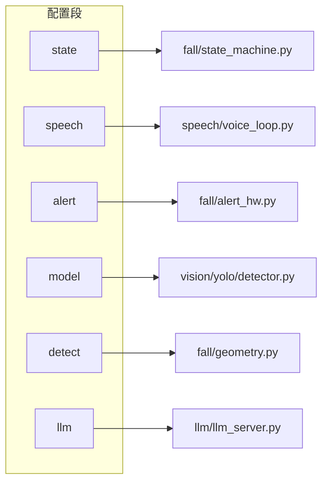
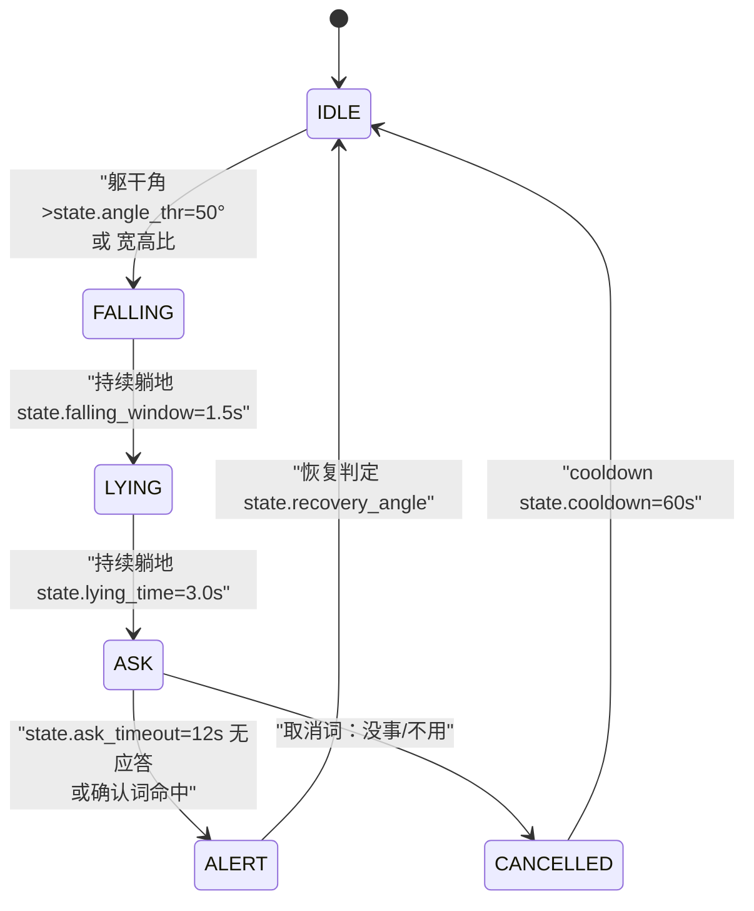
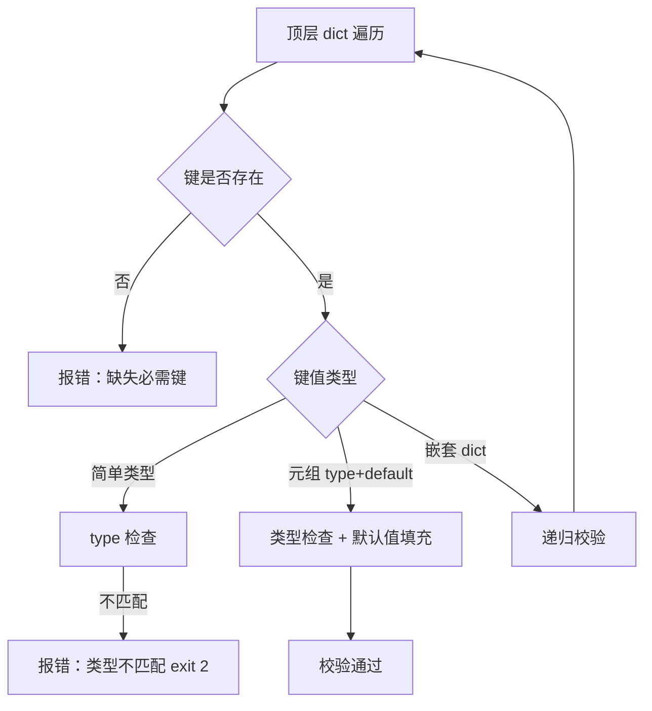
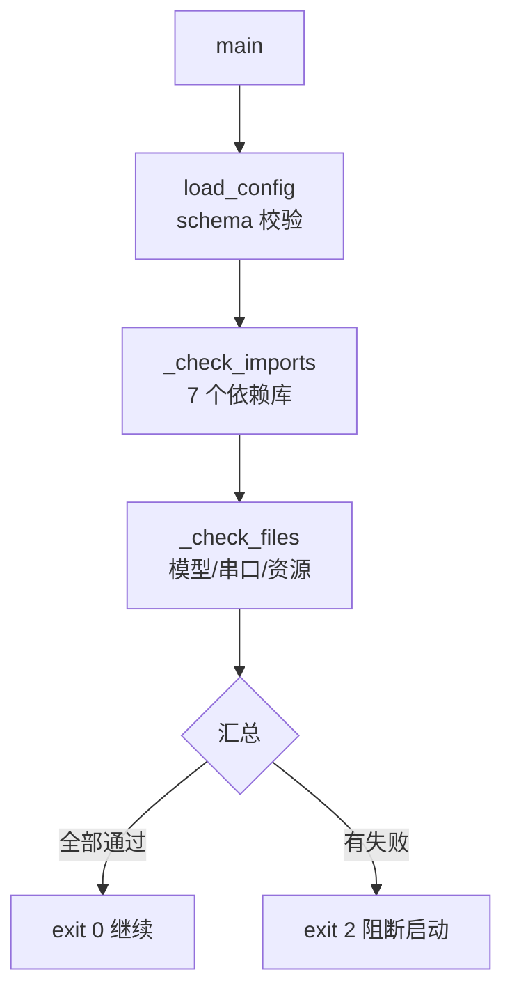
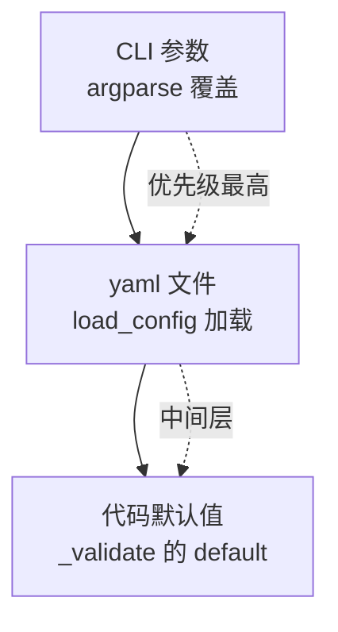

# 实验3：老人跌倒监护--配置与接口设计（4h）

### 1.1 关联知识点

- 2.1.1 fall_config.yaml 十四段配置（model/detect/source/speech/state/interaction/alert/evidence/llm）[概念，前置：1.2.1 五层模块划分]
- 2.1.2 config_schema 强制键校验与类型检查 [原理，前置：2.1.1]
- 2.1.3 CLI 传参与配置覆盖规则（CLI > yaml > 默认）[流程，前置：2.1.1]
- 2.2.1 文本→音频→摄像头三级开发模式 [概念，前置：1.3.3 文本模式与音频模式状态机统一]
- 2.2.2 环境自检 env_check（依赖/模型/串口/ALSA）[事实，前置：2.1.1]
- 2.2.3 运行产物不入库（runs/ 证据/日志/缓存）与资源清理 [流程，前置：2.2.1]

### 1.2 实验目标

1. **掌握** fall_config.yaml 各段（model/detect/source/speech/state/interaction/alert/evidence/llm 等十四段）配置键的含义与调参方法，能独立修改模型路径、阈值、端口等关键参数。
2. **理解** config_schema.py 的 REQUIRED 嵌套 schema 校验机制，能解释"叶键 = 类型 → 必填，(类型, 默认) → 可缺省，嵌套 dict → 递归"的校验逻辑，并通过故意改错键名观察 schema 拦截报错。
3. **掌握** CLI 参数与配置文件的覆盖优先级（CLI > yaml > 代码默认值），能独立使用 `--score-thr`、`--angle-thr`、`--mjpeg`、`--text` 等参数覆盖 config 中的对应键。
4. **完成** env_check 环境自检，能读懂自检输出中的 `[env] OK` / `[env] MISSING` 标记并定位缺失资源。
5. **理解** VLM 开关（model.vlm.enabled）的内存影响与默认关闭理由，掌握按需启用的场景。
6. **迁移**：将"配置 → 校验 → 自检 → 覆盖"的配置设计方法应用到其他边缘 AI 项目。

### 1.3 实验环境

| 类别 | 内容 |
|------|------|
| 硬件 | 具身智能实验箱 B2 / 具身智能机器人小车 C1（本实验以配置阅读为主，env_check 可离线运行） |
| OS | Ubuntu 22.04（板端） |
| Python | 3.10+（env_check 依赖 PyYAML） |
| 核心库 | PyYAML（配置加载）、importlib（env_check 依赖检测） |
| 依赖 | 配置文件 `config/fall_config.yaml`；schema 校验 `config/config_schema.py`；环境自检 `common/env_check.py` |

### 1.4 实验难度

- 难度: ⭐⭐（设计性）
- 重点：fall_config.yaml 十四段配置键的含义与调参；config_schema 强制校验的拦截机制；CLI 参数覆盖优先级；env_check 自检流程。
- 难点：config_schema 嵌套递归校验的报错定位（"missing key: detect.model_path" 需回溯到 yaml 第几层）；CLI 与 yaml 的覆盖边界区分（CLI 改的是内存值，不写回 yaml）；VLM 开关的内存权衡。

### 1.5 实验现象

**快速验证流程**（本实验以配置阅读与 schema 校验为主）：

```bash
# 进入项目目录
cd /home/iflytek/ros2_ws/src/xflz_eai_car1/app/elderly_companion/

# 1. env_check 自检
python3 common/env_check.py --config config/fall_config.yaml

# 2. 故意改错键名后运行（预期 schema 报错）
#    注意：须用"必填键"（schema 中纯 type、无默认值）才会报 missing key；
#    可缺省键(如 state.angle_thr，带默认值)改错会被静默填入默认值，不报错。
cp config/fall_config.yaml config/fall_config.yaml.bak
# 手动将 detect.model_path 改为 detect.model_pth（少写 e）
python3 -c "from common.config import load_config; from fall.config_schema import REQUIRED; load_config('config/fall_config.yaml', REQUIRED)"

# 恢复备份
mv config/fall_config.yaml.bak config/fall_config.yaml
```

**预期效果描述**：

- env_check 输出以 `[env] OK` / `[env] MISSING` 开头的逐行自检清单，覆盖依赖库版本（numpy、cv2、rknnlite 等）、模型文件（yolov8n.rknn、rtmpose_s_256x192_int8.rknn）、语音模型（encoder/decoder/joiner 三件套）、TTS 模型文件、串口设备（/dev/ttyUSB0）。
- 故意改错键名后，schema 报 `ConfigError: missing key: detect.model_path`（报缺失而非崩溃），验证校验拦截。
- 恢复备份：`mv config/fall_config.yaml.bak config/fall_config.yaml`。

```bash
(ros2_venv) iflytek@localhost:~/ros2_ws/src/xflz_eai_car1/app/elderly_companion$ python3 -c "from common.config import load_config; from fall.config_schema import REQUIRED; load_config('config/fall_config.yaml', REQUIRED)"
Traceback (most recent call last):
  File "<string>", line 1, in <module>
  File "/home/iflytek/ros2_ws/src/xflz_eai_car1/app/elderly_companion/common/config.py", line 66, in load_config
    return _validate(data, REQUIRED, "")
  File "/home/iflytek/ros2_ws/src/xflz_eai_car1/app/elderly_companion/common/config.py", line 37, in _validate
    out[key] = _validate(node[key], spec, path)
  File "/home/iflytek/ros2_ws/src/xflz_eai_car1/app/elderly_companion/common/config.py", line 44, in _validate
    raise ConfigError(f"missing key: {path}")
common.config.ConfigError: missing key: detect.model_path
```

### 1.6 实验步骤

#### 整体流程图


#### 步骤1：阅读配置方案文档，记录十四段配置键（40min）

**知识点讲解**：

**2.1.1 fall_config.yaml 十四段配置**

- **原理**：fall_config.yaml 是整个老人跌倒监护系统的唯一配置入口，设计原则是"迁移机器只改本文件，代码零改动"。全文分为十四段顶层键：`paths`（模型根路径）、`model`（姿态引擎/VLM 开关）、`detect`（YOLO 检测参数）、`source`（输入源模式/相机话题）、`session`（遗留键，wake_words 仍读取）、`speech`（KWS/ASR/TTS/硬件唤醒）、`state`（跌倒判据阈值与时序）、`interaction`（语音词表与话术）、`alert`（STM32 串口告警）、`evidence`（证据存档参数）、`monitor`（无人超时）、`arm_reaction`（机械臂联动，默认关）、`server`/`display`/`save`/`log`（推流/显示/保存/日志）、`llm`（大模型对话服务）。每段的键名拼写受 config_schema 的 REQUIRED 字典强制校验，拼写错误会报 `config error`。模型路径全部使用板端绝对路径（如 `/home/iflytek/models/rkllm/…`），迁移到不同机器时只需修改 yaml 中的路径，代码无硬编码。
- **源码对应**：`docs/04_配置方案.md L1-L8（总览）、L10-L18（4.1 顶层键表）`

```yaml
# fall_config.yaml 顶层结构速览（十四段）
paths:     { models_dir: ... }
model:     { pose_type, pose_path, rtmpose: {...}, vlm: {...} }
detect:    { model_path, classes_file, num_classes, imgsz, score_thr, iou_thr, classes, crop_margin }
source:    { mode, image_path, video_path, camera: {...} }
session:   { wake_words: [...] }           # 遗留键，wake_words 仍读取
speech:    { text_mode, capture_device, kws: {...}, asr: {...}, tts: {...} }
state:     { angle_thr, aspect_thr, speed_factor, falling_window, lying_time, ask_timeout, ... }
interaction: { cancel_words, confirm_words, distress_words, ask_tts, ... }
alert:     { port, buzzer: {...}, led: {...}, oled: {...} }
evidence:  { dir, pre_seconds, post_seconds, max_files, fps }
monitor:   { no_person_timeout }
arm_reaction: { enabled, amp_rad, reps, step_sleep }
server/display/save/log: { ... }
llm:       { enabled, server: {...}, chat: {...} }
```

**知识储备补充**：

- **配置单一入口的动机**：fall_config.yaml 把全部"机器相关、场所相关"的可变项（模型路径、端口、串口设备、阈值、词表、开关）收拢进一份文件，承载"迁移机器只改本文件"。配套约束是**代码零硬编码**：`config/fall_config.yaml L2` 注释明确"模型路径全部为板端全局路径"，代码中不出现 `/home/iflytek/...` 字面量，全部经 `load_config()` 读键。迁移到新机器时只需修改 `paths.models_dir` 与各模型绝对路径。

- **必填与可缺省的"双轨"设计意图**：yaml 中键分两类——`model.pose_path`、`detect.model_path`、`detect.classes` 等是**必填键**（schema 中值为纯 `type`），无程序兜底，缺失直接报 `missing key` 阻止启动；`detect.score_thr`、`detect.crop_margin` 等是**可缺省键**（schema 中值为 `(type, default)`），yaml 不写时由 `_validate` 自动填入默认值。"必填键保正确、可缺省键给旋钮"的双重设计，既防止关键资产（模型）漏配，又不强迫每个键都手写。

- **十四段的物理分组**：段与"模块只读自己那一段"一一对应——`state`→fall/state_machine.py、`speech`→speech/voice_loop.py、`alert`→fall/alert_hw.py、`model`→vision 姿态/VLM 引擎、`detect`→vision/yolo/detector.py、`llm`→llm/llm_server.py。每个模块只依赖自己的命名空间，互不干扰，便于定位"某行为对应哪段参数"。`session` 是**遗留段**（老会话架构），当前代码仅剩 `wake_words` 仍被 VoiceLoop 读取分流。

- **参考资源**：YAML 1.2 规范（https://yaml.org/spec/1.2.2/）；PyYAML 官方文档（https://pypi.org/project/PyYAML/）；RKNN-Toolkit2 模型格式说明（https://github.com/airockchip/rknn-toolkit2）。

- **配图**（十四段配置 → 模块映射图）：左侧列 yaml 段名，右侧列对应模块（如 state → fall/state_machine.py，speech → speech/voice_loop.py，alert → fall/alert_hw.py），帮助理解"每个模块读哪个段"。



**操作步骤**：

1. 打开 `docs/04_配置方案.md`，通读 §4.1 顶层键表，记录十四段键名与对应模块。
2. 用表格整理：`| 段名 | 核心键 | 对应模块/文档章节 |`。
3. 标注"哪些段是必填的（schema 强制）、哪些键有默认值可缺省"。

**易错点**：

- ⚠️ 误以为 session.wake_words 是遗留无效键 → **解决**：`docs/04_配置方案.md L281-L283` 明确标注"session.wake_words 仍读取（VoiceLoop 用其分流 KWS 唤醒词）"，而 session 下其他键如 post_tts_close_delay 才是无效键。

#### 步骤2：对照 fall_config.yaml，逐段理解各键含义（50min）

**知识点讲解**：

**2.1.1 / 2.1.2 配置内容与 schema 校验**

- **原理**：逐段阅读 yaml 是理解系统行为的关键。核心段落包括：(1) `model` 段控制姿态引擎切换（pose_type: blazepose/rtmpose）和 VLM 开关（vlm.enabled 默认 false，开启后占约 1.5G 内存）；(2) `detect` 段定义 YOLOv8 检测参数，score_thr=0.25 和 crop_margin=1.5 是实测最优值（1.0 时躺姿检出失败）；(3) `state` 段是跌倒判据核心，angle_thr=50°、aspect_thr=0.5、lying_time=3s、ask_timeout=12s 共同决定"跌倒→观察→询问→告警"的时序；(4) `speech` 段下有 kws/asr/tts 三个子段，其中 kws 默认关闭（板端无 USB 六麦阵列时保留实现），hardware_wakeup 硬件唤醒默认开启；(5) `llm` 段控制 LLM 对话服务的端口（8080）、模型路径、多轮历史窗口（max_history=6）。这些值都通过 config_schema.py 的 REQUIRED 字典定义校验规则：叶键为 `type` 时必填，`(type, default)` 时可缺省并插入默认值，嵌套 dict 递归校验。
- **源码对应**：`config/fall_config.yaml L1-L180（全文）`；`config/config_schema.py L10-L147（REQUIRED 字典）`；`docs/04_配置方案.md L20-L180（§4.2-§4.11 各段详解）`

```yaml
# 关键配置摘录（带行号锚点）
model:
  pose_type: rtmpose              # L9: 姿态引擎选择
  vlm:
    enabled: false                # L16: VLM 默认关闭（内存考虑）
detect:
  score_thr: 0.25                 # L27: 检测置信度阈值
  crop_margin: 1.5                # L33: 裁剪框放大（1.0 躺姿失败）
state:
  angle_thr: 50.0                 # L57: 躯干角阈值
  ask_timeout: 12.0               # L62: ASK 超时（秒）
speech:
  kws:
    hardware_wakeup:
      enabled: true               # L39: XFM 硬件唤醒默认开
      port: /dev/ttyACM0          # L41: AIUI 串口
llm:
  enabled: true                   # L170: LLM 对话总开关
  server:
    port: 8080                    # L173: Flask HTTP 端口
```

**知识储备补充**：

- **模型三段（model.*）的物理含义**：`model.pose_path` 是 BlazePose（全 33 点）模型，`model.rtmpose.model_path` 是 RTMPose（COCO 17 点，躺姿更稳）模型，`model.rtmpose.vis_threshold=0.3` 是关键点可见度阈值（两个 head 的响应峰值均值），低于则判定该关键点不可信；二者经 `model.pose_type` 切换（`config/config_schema.py L11` 默认 `blazepose`）。启用不同引擎直接决定姿态特征提取质量，影响后续跌倒判据。

- **检测参数（detect.*）的物理含义**：`score_thr=0.25` 是 YOLO 输出的类别置信度阈值，低于则丢弃该框；`iou_thr=0.45` 是 NMS 去重的 IoU 阈值；`imgsz=640` 是模型输入分辨率（yolov8n 训练尺寸）；`classes=[person]` 限定只取 person 一个类别（跌倒监护不关心其他物体，减少误报）；`crop_margin=1.5` 是把姿态输入裁剪框放大 1.5 倍（1.0 时躺姿裁剪过小检出失败）。这五个键共同决定 YOLOv8 检测输出质量。

- **阈值（threshold）与时延（window）的语义区分**：angle_thr/aspect_thr 是**空间阈值**（躯干角/宽高比的判定线），falling_window/lying_time/ask_timeout/cooldown 是**时间窗口**（状态停留时长）。空间阈值决定"判定什么"，时间窗口决定"判定多久"——两者搭配才能形成 state_machine FALLING→LYING→ASK→ALERT 的完整时序。

- **VLM 开关（model.vlm.enabled）与内存权衡**：真 VLM 二审（Qwen3.5-0.8B_vision，fall/vision_judge.py）是可选增强，默认关（`config/fall_config.yaml L16`），开启会显著增加内存占用。同理 `asr.enabled`、`tts.enabled` 控制对应引擎的加载/启动（语音链路关闭后交互中断）。开启前需用 env_check 确认已装相应模型与库。

- **源码对应**：`config/fall_config.yaml L1-L132（全文）`；`config/config_schema.py L1-L107（REQUIRED 字典，各键默认值）；`docs/04_配置方案.md §4.2-§4.11`

- **参考资源**：Ultralytics YOLOv8 官方文档（https://docs.ultralytics.com/）；RTMPose（GitHub, COCO 17 点姿态）https://github.com/Tau-J/RTMPose；RKNN-Toolkit2 README（https://github.com/airockchip/rknn-toolkit2）。

- **配图**（state 段状态机图）：从 FALLING（1.5s 观察窗）→ LYING（3s 躺地）→ ASK（12s 询问窗口）→ ALERT（告警升级），每个状态旁标注对应 yaml 键名与默认值，帮助理解参数如何控制判定流程。



**操作步骤**：

1. 逐段阅读 `config/fall_config.yaml`，重点标注以下键：
   - `model.vlm.enabled`（L16）：VLM 开关，默认 false
   - `detect.score_thr`（L27）、`detect.crop_margin`（L33）：检测参数
   - `state.angle_thr`（L57）、`state.ask_timeout`（L62）：跌倒判据
   - `speech.kws.hardware_wakeup.port`（L41）：串口映射
   - `alert.port`（L115）：STM32 串口（USB0，非 USB1）
   - `llm.server.port`（L173）：LLM 端口（8080，与 MJPEG 8088 不冲突）
2. 对照 `docs/04_配置方案.md` 各段说明，记录每个键的"含义/默认值/调参建议"。
3. 绘制"state 段时序图"，标注各阈值与状态流转。

**易错点**：

- ⚠️ 混淆 alert.port（USB0 = STM32）与 USB1（雷达） → **解决**：`docs/04_配置方案.md L253-L255` 明确说明"USB1 是雷达，自动发现会选错，必须显式"。
- ⚠️ 误以为 llm.server.port=8080 与 server.port=8088 冲突 → **解决**：`docs/04_配置方案.md L289` 注释说明"与 llm.server.port 同号会启动报错"，8080 ≠ 8088，不冲突。

#### 步骤3：故意改错键名，验证 schema 校验拦截（30min）

**知识点讲解**：

**2.1.2 config_schema 强制键校验与类型检查**

- **原理**：config_schema.py 定义了 REQUIRED 嵌套字典，其校验逻辑由 `common/config.py` 的 `_validate()` 函数实现（L28-L56）。校验规则：(1) 叶键为 `type`（如 `str`、`float`）→ 必填，缺失报 `missing key: xxx.yyy`；(2) 叶键为 `(type, default)` → 缺失时自动插入默认值并继续；(3) 嵌套 dict → 递归校验，缺失的父键也会递归检查子键；(4) 类型不符报 `xxx: expected float, got str`。设计意图是"拼写错误在启动时就被拦截，而非运行时静默失效"。例如将必填键 `detect.model_path` 改为 `detect.model_pth`，启动时 schema 会报 `missing key: detect.model_path`，直接阻止程序启动。反之，可缺省键（如 `state.angle_thr`，带默认值 `(float, 50.0)`）改错为 `state.angl_thr` 时，schema 只会静默填入默认值 50.0、不报错——因此验证"缺键拦截"必须选必填键。
- **源码对应**：`common/config.py L28-L56（_validate 函数）`；`config/config_schema.py L10-L147（REQUIRED 字典）`；`docs/04_配置方案.md L6-L8（schema 校验说明）`

```python
# common/config.py L28-L56 校验核心逻辑
def _validate(node: dict, schema: dict, prefix: str) -> dict:
    for key, spec in schema.items():
        path = f"{prefix}.{key}" if prefix else key
        if isinstance(spec, dict):       # 嵌套 dict → 递归
            ...
        expected = _leaf_type(spec)
        if key not in node:
            if isinstance(spec, tuple):  # (type, default) → 缺省插入默认值
                out[key] = spec[1]
                continue
            raise ConfigError(f"missing key: {path}")  # 必填缺失 → 报错
```

**知识储备补充**：

- **REQUIRED 是"白名单"而非"黑名单"**：`_validate()`（`common/config.py L26-54`）只遍历 schema 中声明的键，yaml 中未声明的键被忽略（不进返回的 cfg dict，也不报错）。这意味着"拼对但属未声明键的静默失效"比"拼错误"更隐蔽——拼错报错、未声明静默失效。这是刻意设计：让 schema 成为系统行为的唯一真源。

- **校验的三态语义**：每个键的 schema 声明决定三态：`type`→必填（缺失 raise `missing key`）；`(type, default)`→可缺省（缺失用 `spec[1]` 填充）；嵌套 dict→递归进入 `_validate` 逐子校验。类型不符 raise `xxx: expected <type>, got <type>`。注意到 float 字段对 int 有隐式转换（`common/config.py L43-44`：yaml 的 `0` 是 int），故 `detect.crop_margin: 1` 合法。

- **幂等且只读**：`_validate` 返回**新 dict**，不修改原 yaml 内容（`common/config.py L54` 注释"返回只含 schema 声明的键"）；`load_config` 先 `yaml.safe_load` 再 `_validate`，文件本身永不被改写。因此"改错键名 → schema 拦截 → 修复"循环是安全的，不会污染源配置。

- **加载即校验**：`load_config()` 在启动路径最开始调用（env_check 的 `main`、`fall_app.py` 等入口都先 `load_config`），所以拼错键在进程启动即刻以异常形式被拦截，而不是运行到某个深层功能才崩溃——这正是"拼写错误在启动时被拦截，而非运行时静默失效"的实现机制。

- **参考资源**：PyYAML `safe_load` 官方文档（https://pypi.org/project/PyYAML/）；Python 类型校验最佳实践（https://docs.python.org/3/library/typing.html）；JSON Schema 概念（YAML 同源，https://json-schema.org/learn/）。

- **配图**（config_schema 校验决策树）：顶层 dict 遍历 → 叶键类型判断（type vs (type, default) vs 嵌套 dict）→ 缺失/类型不匹配/递归三条分支，帮助理解校验流程。



**操作步骤**：

1. 备份配置文件：`cp config/fall_config.yaml config/fall_config.yaml.bak`
2. 编辑 `config/fall_config.yaml`，将必填键 `detect.model_path` 改为 `detect.model_pth`（故意拼错）。
3. 运行校验（预期报错）：
   ```bash
   python3 -c "from common.config import load_config; from fall.config_schema import REQUIRED; load_config('config/fall_config.yaml', REQUIRED)"
   ```
   预期输出：`common.config.ConfigError: missing key: detect.model_path`（报的是缺失，而非崩溃）。
4. 恢复备份：`mv config/fall_config.yaml.bak config/fall_config.yaml`
5. 再尝试改错类型（如将可缺省键 `state.angle_thr: 50.0` 改为 `state.angle_thr: "五十"`），运行校验 → 报 `state.angle_thr: expected float, got str`，观察类型报错。
6. 观察"有默认值的键缺省时的处理"：删除 `detect.crop_margin` 行（schema 定义为 `(float, 1.5)`），运行校验 → 不报错，自动填入 1.5。

**易错点**：

- ⚠️ 误以为 schema 报错会修改 yaml 文件 → **解决**：schema 校验是只读的（`_validate` 返回新 dict 不修改原 data），报错通过异常（ConfigError）抛出，yaml 文件不被修改。
- ⚠️ 误以为所有键缺失都报错 → **解决**：`(type, default)` 形式的键（如 crop_margin、score_thr 等）缺失时自动填入默认值，只有纯 `type` 形式的键（如 detect.model_path、model.pose_path）缺失才报错。

#### 步骤4：运行 env_check 自检依赖/模型/串口完整性（30min）

**知识点讲解**：

**2.2.2 环境自检 env_check**

- **原理**：env_check 是启动前的强制自检脚本，检查两类资源：(1) 依赖库版本（`_check_imports()`，common/env_check.py L32-L41）——检查 numpy、cv2、scipy、rknnlite、sherpa_onnx、serial、yaml 七个库是否可 import 并打印版本号；(2) 模型/资源文件完整性（`_check_files()`，L47-L116）——从已加载的 cfg 中提取 detect.model_path、model.pose_path、speech.kws/asr/tts 各模型路径、alert 串口设备等，逐个检查文件存在且非空。若 vlm.enabled=true 则额外检查 VLM 模型和 librkllmrt.so。脚本绝不自动安装（板端禁装），只打印 `[env] MISSING <路径> <提示>` 由人工处理。返回 True=通过，False=有缺失（app 打印清单后 exit 2）。脚本通过 `load_config(cfg_path, REQUIRED)` 先完成 schema 校验，因此 env_check 本身就隐含了 config_schema 校验——如果 yaml 有拼错键，env_check 会先报 config error 退出。
- **源码对应**：`common/env_check.py L1-L15（导入与 docstring）`、`L32-L41（_check_imports）`、`L47-L116（_check_files）`、`L117-L135（env_check + main）`；`docs/04_配置方案.md L6-L8`

```bash
# 运行 env_check（带 config 参数）
# 进入项目目录
cd /home/iflytek/ros2_ws/src/xflz_eai_car1/app/elderly_companion/

python3 common/env_check.py --config config/fall_config.yaml

# 预期输出（部分）：
# [env] 环境自检开始 ...
# [env] OK   numpy 1.24.3
# [env] OK   cv2 4.8.1
# [env] OK   rknnlite 2.3.2
# [env] OK   /home/iflytek/ros2_ws/.../yolov8n.rknn (file 4567 KB)
# [env] MISSING /dev/ttyUSB0  提示: STM32 串口设备不存在（检查 USB 连接）
# [env] 自检通过
```

**知识储备补充**：

- **env_check 是"启动前哨兵"设计**：它的职责不是"修环境"而是"尽早暴露环境缺口"。`_check_imports()`（`common/env_check.py L30-42`）用 `importlib.import_module` 探测 7 库（numpy/cv2/scipy/rknnlite/sherpa_onnx/serial/yaml）并打印版本号；`_check_files()`（`L45-114`）从已加载 cfg 收集全部模型路径 + 串口设备，逐 `Path.exists()` + 非空检查。两者都只是"检测并报告"，绝不自动安装（板端禁装）。

- **为什么绝不自动安装**：板端 deb/rknn 运行环境是人工配置的固定版本（rknnlite 2.3.2、sherpa_onnx、serial 等），`pip install` 可能破坏既有 ABI/依赖。规则 1（板端禁装）让 env_check 只做只读侦探。

- **VLM 条件检查**：`_check_files` 中 `if vlm.enabled: `（`L101-105`）额外检查 vision 编码器、LLM 模型、`librkllmrt.so` 三个资源——这是 VLM 开关（model.vlm.enabled）的配套自检：开关一开，三个相关资源必须在场，否则启动后 judge 才崩。提前在启动前暴露，省一次运行时报错。

- **串口/日志检查的运维意义**：`alert.port`（/dev/ttyUSB0，STM32）存在性检查帮助在"板端 USB 未插/权限错误"这类运维问题发生时，给出 `[env] MISSING` 而非运行时 `PermissionError`，可快速定位硬件连接问题——这也是 env_check"把可预见的启动失败提前到自检阶段"的价值。

- **常见自检项语义**：`_check_files`（`common/env_check.py L45-114`）逐个校验 detect.model_path、model.pose_path、speech.kws/asr/tts 各模型与 alert.port 串口，VLM 条件检查（L101-105）额外校 vision 编码器/LLM/rkllm 库；全部"存在 + 非空"双条件。

- **参考资源**：importlib 官方文档（https://docs.python.org/3/library/importlib.html）；RKLLM 运行库说明（https://github.com/airockchip/rknn-toolkit2#rkllm-）；sherpa-onnx（https://github.com/k2-fsa/sherpa-onnx）。

- **配图**（env_check 自检流程图）：main() → load_config（schema 校验）→ _check_imports（7 个库）→ _check_files（模型/串口/资源）→ 汇总通过/失败。



**操作步骤**：

1. 运行 `python3 common/env_check.py --config config/fall_config.yaml`。
2. 逐行阅读输出，区分 `[env] OK`（通过）和 `[env] MISSING`（缺失）。
3. 关注 MISSING 项的"提示"字段（如 "STM32 串口设备不存在"、"YOLO 检测模型"），理解每个缺失项的影响。
4. 记录 env_check 检查的完整清单（依赖库 7 个 + 模型文件 + 串口设备）。

**易错点**：

- ⚠️ 误以为 env_check 会自动修复缺失 → **解决**：env_check 绝不自动安装（规则 1），只打印清单由人工处理；这在板端是必要的安全约束。
- ⚠️ 在工程机（非板端）运行 env_check 报大量 MISSING → **解决**：这是预期行为——模型文件仅在板端存在，工程机可用于验证 env_check 逻辑本身是否正常运行。

#### 步骤5：阅读程序参数详解，掌握全部 CLI 参数与覆盖规则（40min）

**知识点讲解**：

**2.1.3 CLI 传参与配置覆盖规则**

- **原理**：所有入口脚本的 CLI 参数优先级最高：**CLI 参数 > config 文件 > 代码默认值**。核心入口 fall_app.py 支持的 CLI 参数包括：`--config`（指定配置文件路径，默认 config/fall_config.yaml）、`--mode`（camera/image/video 三选一）、`--input`（图片/视频路径）、`--text`（文本调试模式）、`--vis/--no-vis`（显示窗口）、`--save/--no-save`（保存标注）、`--mjpeg/--no-mjpeg`（推流）、`--log-level`（日志级别）、`--score-thr`（检测置信度覆盖）、`--angle-thr`（躯干角阈值覆盖）。有 `--xxx/--no-xxx` 成对的开关：CLI 显式传参即覆盖 config 中的对应键（如 `--no-mjpeg` 在 config `server.enabled: true` 时强制关推流）。CLI 覆盖的是内存中的 config dict，不写回 yaml 文件——下次启动如不传 CLI 参数，仍读 yaml 原值。覆盖的映射关系：`--score-thr` → detect.score_thr，`--angle-thr` → state.angle_thr，`--mjpeg/--no-mjpeg` → server.enabled，`--save/--no-save` → save.enabled，`--vis/--no-vis` → display.show，`--text` → speech.text_mode，`--log-level` → log.level。
- **源码对应**：`docs/10_程序参数详解.md L1-L6（优先级说明）`、`L8-L42（§10.1 fall_app.py 参数表）`、`L80-L100（§10.6 覆盖规则速查）`

```bash
# 进入项目目录
cd /home/iflytek/ros2_ws/src/xflz_eai_car1/app/elderly_companion/

ros2 launch ascamera hp60c.launch.py        # 终端 1
# CLI 覆盖示例
python3 apps/fall_app.py --mode camera --score-thr 0.4 --log-level DEBUG		# 终端 2
# → detect.score_thr 被 CLI 覆盖为 0.4（yaml 原值 0.25 不变）
# → log.level 被覆盖为 DEBUG
# → 其余键仍读 yaml 原值

# --no-mjpeg 强制关推流（fall_app.py 专属成对开关；fall_video_demo.py 无此参数）
python3 apps/fall_app.py --mode video --input testdata/fall_slow_x264.mp4 --no-mjpeg
# 注：fall_video_demo.py 只有 --config/--video/--text/--save/--mjpeg，无 --no-mjpeg，
#     其推流默认关闭（传 --mjpeg 才开启），故无需负开关。
```

**知识储备补充**：

- **覆盖规则是"自上而下"的三层优先链**：CLI > yaml > 代码默认值。`fall_app.py` 的 `_merge_args()`（`apps/fall_app.py L97-124`）在 `load_config` 之后逐参数把 CLI 值写回 cfg dict 对应键（`--score-thr`→`cfg["detect"]["score_thr"]`、`--angle-thr`→`cfg["state"]["angle_thr"]` 等），因此 CLI 只改内存 dict，不写回 yaml 文件——这是"覆盖边界"设计的核心。

- **每对参数的分级语义**：`--vis/--no-vis`、`--save/--no-save`、`--mjpeg/--no-mjpeg` 是**成对开关**（仅 `fall_app.py` 支持这些负开关），任一显式传入即覆盖 config 中的对应 bool 键；否则读 yaml。`--mode`/`--input`/`--text`/`--log-level` 等则各自独立覆盖 source.mode / source.image_path|video_path / speech.text_mode / log.level。`fall_video_demo.py` 等子入口不含 `--no-` 负开关（`--mjpeg` 为 store_true 默认关，无需负向）。

- **覆盖不写回 yaml 的价值**：使"本次调试想改阈值/开推流"不污染版本控制的源配置——下次启动不传 CLI 恢复原 yaml。这支持"临时调试用 CLI、持久化改 yaml"的工作流，避免多人协作时把个人调试参数意外打进 config。

- **安全边界（哪些覆盖、哪些不可覆盖）**：只有 docs/10_程序参数详解.md 列出的约 10 个参数可 CLI 覆盖；模型路径（model.pose_path 等）、串口（alert.port）、词表（interaction.*）等只能改 yaml——因为 CLI 只暴露高频调试旋钮，低频且高风险项留在 yaml 减小误传风险。

- **源码对应**：`apps/fall_app.py L96-125（_merge_args CLI 覆盖）`；`docs/10_程序参数详解.md §10.1-§10.6`

- **参考资源**：Python argparse 官方文档（https://docs.python.org/3/library/argparse.html）；12-Factor Config 原则（https://12factor.net/config）。

- **配图**（CLI → config → 默认值三级覆盖优先级图）：最底层"代码默认值"（_validate 的 default），中间层"yaml 文件"（load_config 加载），最顶层"CLI 参数"（argparse 覆盖），箭头方向为"上层覆盖下层"。



**操作步骤**：

1. 通读 `docs/10_程序参数详解.md`，整理各入口脚本的参数表。
2. 绘制"CLI → config 键映射表"：`| CLI 参数 | config 键 | 默认值 | 说明 |`。
3. 总结覆盖规则：CLI 显式传参 = 覆盖；未传 CLI = 读 yaml；yaml 缺失 = schema 默认值。
4. 标注"遗留键"（如 session.post_tts_close_delay、asr.open_delay）的无效性。

**易错点**：

- ⚠️ 误以为 CLI 覆盖会写回 yaml → **解决**：`docs/10_程序参数详解.md L1-L3` 明确说明"CLI 参数 > config 文件 > 代码默认值"，覆盖仅作用于内存 dict，yaml 文件不变。
- ⚠️ 误以为 --video 是 video 模式的默认值 → **解决**：`--video` 是 `fall_video_demo.py` 的必选参数（`required=True`），不传会 argparse 报错退出。

#### 步骤6：CLI 覆盖实践——验证优先级（30min）

**知识点讲解**：

**2.1.3 / 2.2.1 CLI 覆盖与三级开发模式**

- **原理**：本步骤将步骤1-5的知识串联：先用 env_check 确认环境可用，再通过 CLI 覆盖验证"CLI > yaml > 默认值"的优先级链。实践方法：(1) 在 yaml 中设 score_thr=0.25，不传 CLI → 观察程序使用 0.25；(2) 传 --score-thr 0.4 → 观察程序使用 0.4；(3) 删除 yaml 中 score_thr（schema 有默认值 0.25）→ 不传 CLI → 观察程序仍用 0.25（schema 默认值兜底）。三级开发模式（文本→音频→摄像头）也是通过配置控制：speech.text_mode=true 或 --text 进入文本模式，无需麦克风/扬声器即可完成全链路调试——这在板端无外设时尤为重要。
- **源码对应**：`docs/10_程序参数详解.md L80-L100（覆盖规则速查）`；`docs/04_配置方案.md L149-L152（speech.text_mode 说明）`

```bash
# 进入项目目录
cd /home/iflytek/ros2_ws/src/xflz_eai_car1/app/elderly_companion/

# 实践1：CLI 覆盖 score_thr
python3 apps/detect_demo.py --input testdata/stand_up.jpg --score-thr 0.4 --save
# → 使用 0.4 阈值（yaml 原值 0.25 被覆盖）

# 实践2：文本模式全链路（无需硬件）
python3 apps/fall_video_demo.py --video testdata/fall_slow_x264.mp4 --text
# → speech.text_mode 被 --text 覆盖为 true
# → stdin 喂词走同一状态机（验证配置驱动模式切换）
```

**知识储备补充**：

- **三级覆盖实验的本质是"最小改动的行为验证"**：本步骤通过三个对照实验证链 `CLI > yaml > 默认值`——(1) yaml 原值 vs CLI 覆盖值看检测框数差异；(2) `--text` 把 speech.text_mode 置 true 走文本链路（无麦克风）；(3) `fall_app.py` 的 `--no-mjpeg` 在 yaml 关闭时无差异、在 yaml 开启时强制关推流（故前文强调"yaml 原值先确认"）。三者共用同一 `load_config` + `_merge_args` 管线。

- **文本模式的"模拟"而非"跳过"**：`--text` 置 `speech.text_mode=true` 后，录音线程/麦克风不启用，但状态机全链路（唤醒→ASR 喂词→LLM→ASK/ALERT 回调）照常执行，只是输入源改 stdin——这正是"三级开发模式"（文本→音频→摄像头）的配置骨架：先在无硬件下验证状态机正确，再逐步接硬件，从而隔离"算法 bug"与"硬件问题"。

- **优先级链在图与码双重印证**：覆盖层在 `apps/fall_app.py L96-125 _merge_args`；默认值兜底在 `common/config.py L26-54 _validate`；二者拼接即"CLI > yaml > 默认值"的完整实现。实践时若覆盖不生效，先确认参数是这套 pipeline 收录的键（看 `_merge_args` 覆盖哪几个），再查 yaml 原值。

- **安全边界复盘**：可 CLI 覆盖的只有高频调试旋钮（score_thr/angle_thr/mjpeg/save/vis/text/log-level）；模型路径、串口、词表等低频且高风险项留 yaml。理解"为什么只允许覆盖这些"能帮你判断"某个键能不能在命令行临时改"。

- **源码对应**：`apps/fall_app.py L78-125（argparse 定义 + _merge_args）`；`docs/10_程序参数详解.md §10.6（覆盖规则速查）》`；`config/fall_config.yaml L149-152（speech.text 说明）`

- **参考资源**：12-Factor（Config）https://12factor.net/config；Python `argparse` 官方文档（https://docs.python.org/3/library/argparse.html）。

**操作步骤**：

1. 确认 env_check 通过后，运行 `python3 apps/detect_demo.py --input testdata/stand_up.jpg --score-thr 0.4 --save`，对比不传 `--score-thr` 时的检测框数量差异。
2. 运行文本模式：`python3 apps/fall_video_demo.py --video testdata/fall_slow_x264.mp4 --text`，输入"小飞小飞"验证唤醒，输入"救命"验证 ALERT。
3. 尝试传 `--no-mjpeg` 验证负向覆盖：`python3 apps/fall_app.py --mode video --input testdata/fall_slow_x264.mp4 --no-mjpeg`（即使 yaml server.enabled=true，推流也不启动）；注意此参数仅 fall_app.py 支持，fall_video_demo.py 无 --no-mjpeg（其推流默认关，传 --mjpeg 才开）。
4. 总结 CLI 覆盖的"安全边界"：哪些键可以 CLI 覆盖（score_thr/angle_thr/mjpeg/save/vis/text/log-level），哪些键只能改 yaml（模型路径、串口、词表）。

**易错点**：

- ⚠️ 误以为所有 yaml 键都有 CLI 覆盖 → **解决**：只有 docs/10_程序参数详解.md 中列出的参数（约 10 个）支持 CLI 覆盖，其余键（如 model.pose_path、speech.asr.model_dir）只能改 yaml。
- ⚠️ 误以为 --text 只影响语音模块 → **解决**：--text 是全局开关（speech.text_mode），影响录音线程是否启动、ASR/TTS 是否加载——文本模式下整个语音链路被"模拟"而非跳过。

### 1.7 注意事项

- ⚠️ 修改 fall_config.yaml 前务必备份（`cp config/fall_config.yaml config/fall_config.yaml.bak`），实验结束后恢复原文件。
- ⚠️ env_check 在工程机运行会报模型文件 MISSING（模型仅在板端存在），这是预期行为——重点是验证 env_check 逻辑和自检清单完整性。
- ⚠️ 不要在板端随意修改模型路径（如 rtmpose.model_path），错误路径会导致 RKNN 推理失败且无友好提示。
- ⚠️ `--score-thr` 和 `--angle-thr` 的覆盖仅作用于本次启动，重启后如不传 CLI 则恢复 yaml 原值——调参时注意记录"哪次用了什么值"。
- ⚠️ config_schema 的 REQUIRED 字典是"白名单"——只有 schema 中声明的键会被保留和校验，yaml 中未声明的键会被静默丢弃（不报错但也无效）。

### 1.8 实验总结

**完成成果**：

- 一份 fall_config.yaml 十四段配置键梳理表（含每段核心键、含义、默认值、对应模块）。
- 一次 schema 校验拦截实操记录（故意改错键名 → 报错 → 恢复）。
- 一份 env_check 自检输出记录（标注 OK/MISSING 项）。
- 一份 CLI 参数→config 键映射表（含覆盖优先级说明）。

**技能收获**：

- 技能1：配置文件结构化阅读方法（分段 → 键名 → 类型 → 默认值 → 调参建议）
- 技能2：schema 校验的调试方法（报错定位 → 回溯 yaml 行号 → 修复拼写/类型）
- 技能3：CLI 覆盖优先级实践（CLI > yaml > 默认值；覆盖不写回 yaml）

**常见问题与解决**：

| 问题 | 原因 | 解决方法 |
|------|------|----------|
| schema 报 `missing key: detect.model_path` | yaml 必填键名拼写错误（少写 e） | 对照 REQUIRED 字典修正键名，注意大小写与下划线；可缺省键改错不会报错（静默填默认值），须用必填键验证 |
| env_check 报 `[env] MISSING` 模型文件 | 模型文件仅在板端存在 | 在板端运行；工程机的 MISSING 可忽略（仅验证逻辑） |
| `--no-mjpeg` 不生效（推流仍启动）或报 unrecognized arguments | 该负开关仅 fall_app.py 支持；fall_video_demo.py 无 --no-mjpeg（传入会 argparse 报错） | 用 `fall_app.py --mode video --input <视频> --no-mjpeg` 验证负向覆盖；且 --no-mjpeg 只在 yaml server.enabled=true 时才有"关推流"效果，先确认 yaml 原值 |
| CLI 覆盖后重启恢复原值 | CLI 覆盖仅作用于内存 dict | 这是设计行为——持久化改 yaml，临时调试用 CLI |

### 1.9 实验报告要求

**思考题**：

1. 为什么 fall_config.yaml 采用"叶键 = 类型 → 必填，(类型, 默认) → 可缺省"的双重 schema 设计，而不是"所有键都必填"或"所有键都有默认值"？请结合 model.pose_path（必填）和 detect.crop_margin（可缺省，默认 1.5）两个键说明设计理由。
2. env_check 为什么"绝不自动安装"缺失的依赖库？请从板端安全约束（规则 1）和生产环境一致性两个角度分析原因。如果 env_check 改为自动 pip install 会带来什么风险？
3. CLI 覆盖不写回 yaml 文件的设计有什么好处？如果改为"CLI 覆盖同时写回 yaml"，在多人协作或版本控制场景下会有什么问题？

**评分标准**：

| 评分项 | 分值 | 说明 |
|--------|------|------|
| 十四段配置键梳理表 | 30 分 | 十四段完整覆盖、核心键识别准确、含义与默认值正确 |
| schema 校验实操记录 | 25 分 | 改错操作正确、报错信息记录完整、恢复操作正确 |
| env_check 自检记录 | 20 分 | 自检命令正确、输出逐行记录、OK/MISSING 标注清晰 |
| CLI 参数映射表与覆盖规则 | 15 分 | 映射表完整、优先级规则表述正确 |
| 思考题回答质量 | 10 分 | 结合源码与设计约束、逻辑清晰 |
| **合计** | **100 分** |

---

## 更新日志

| 版本 | 日期 | 说明 |
|------|------|------|
| v1.1 | 2026-08-21 | 知识点补充：为各知识点追加知识储备补充（配置双轨校验/十四段分组/白名单三态/env_check/CLI 覆盖）；修正"缺键拦截"示例键（state.angle_thr 改 detect.model_path，因前者带默认值不报 missing key）；修正 --no-mjpeg 误用（仅 fall_app.py 支持，fall_video_demo.py 无此参数且推流默认关） |
