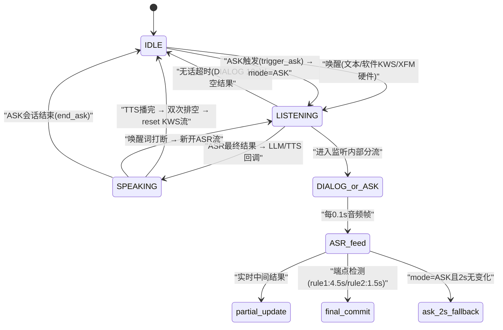

# 实验4：老人跌倒监护--语音交互集成测试（6h）

### 1.1 关联知识点

- 3.1.1 XFM六麦硬件唤醒（AIUI事件/beam/angle）[事实，前置：ROS2 串口通信基础]
- 3.1.2 软件KWS关键词检出（sherpa-onnx）[概念，前置：3.1.1 理解硬件唤醒与软件KWS的分层关系]
- 3.1.3 流式ASR（zipformer增量解码+端点检测）[原理，前置：3.1.2 理解音频队列消费链路]
- 3.2.1 TTS播报与预合成缓存（零合成延迟）[概念，前置：3.1.3 理解ASR→应答→TTS的串行关系]
- 3.2.2 唤醒后启动录音（XFM时序）+双次排空防回声[原理，前置：3.1.1 理解硬件唤醒触发录音的时序约束]
- 3.2.3 ASK应答窗口与单次应答防重复[流程，前置：1.3.1 monitor↔VoiceLoop三接口 + 3.1.3 ASR端点检测]

### 1.2 实验目标

1. **掌握**语音链路唤醒→提示音→ASR识别→LLM应答→TTS播报→打断的全流程，能独立追踪每一步在代码中的状态迁移路径。
2. **理解**录音线程在硬件唤醒后才启动的原因（XFM ALSA流时序约束），以及软件KWS/文本模式下录音线程常开的设计差异。
3. **独立完成**语音模块各子系统（KWS/ASR/TTS）的单点测试与全链路集成测试，能按 docs/07_语音测试用例.md 逐条验证。
4. **掌握**ASK应答窗口的2s兜底快答机制、双次排空防回声原理、epoch单次应答防重复设计。
5. **迁移应用**：能自定义唤醒词并验证端到端流程，理解唤醒词配置对KWS/XFM双链路的影响。

### 1.3 实验环境

| 类别 | 内容 |
|------|------|
| 硬件 | 具身智能机器人小车C1（RK3576）、XFM六麦阵列（/dev/ttyACM0，VID 0x1a86 PID 0x55d4）、扬声器（plughw:3,0）；**--text模式无需任何硬件** |
| OS | Ubuntu 22.04，Python 3.10（/home/iflytek/ros2_venv） |
| 核心依赖 | sherpa-onnx（KWS/ASR/TTS推理）、ALSA（plughw:4,0 捕获）、aplay（plughw:3,0 播放）、numpy |
| 源码位置 | `ros2_ws/src/xflz_eai_car1/app/elderly_companion/` |
| 关键文件 | speech/voice_loop.py、speech/xfm_wake.py、speech/kws.py、speech/asr.py、speech/tts.py、config/kws_keywords.txt、docs/07_语音测试用例.md |

### 1.4 实验难度

- 难度: ⭐⭐（综合性）
- 重点：语音三状态机（IDLE/LISTENING/SPEAKING）的完整流转；唤醒→提示音→ASR→应答→打断闭环；ASK应答窗口与2s兜底快答。
- 难点：硬件唤醒后XFM ALSA流时序（提前打开不恢复）导致的录音线程延迟启动；双次排空防回声的队列操作原理；epoch计数器防止ASK应答重复的并发设计。

### 1.5 实验现象

**快速验证流程（文本模式，无需硬件）**：

```bash
cd /home/iflytek/ros2_ws/src/xflz_eai_car1/app/elderly_companion
# 文本模式状态机验证
python3 apps/speech_text_demo.py
# 输入: 小飞小飞 → 唤醒; 你好 → LLM对话; ask → 模拟跌倒; 救命 → 告警; exit → 退出
```

**预期效果描述**：
- 输入 `小飞小飞` → 日志输出 `[文本] 唤醒` → `开始聆听（mode=DIALOG）`
- 输入任意文本（已唤醒状态） → LLM回复（若llm.enabled=true）或 `LLM 未启用` 提示
- 输入 `ask` → 模拟跌倒 ASK 窗口 → 输入 `救命` → `>>> ASK 确认（ALERT）` → 告警日志
- 输入 `ask` → 输入 `没事` → `>>> ASK 取消（CANCELLED）`
- 输入 `救命`（任意时刻） → `[文本] 呼救` → `>>> 呼救 ALERT`

```bash
(ros2_venv) iflytek@localhost:~/ros2_ws/src/xflz_eai_car1/app/elderly_companion$ python3 apps/speech_text_demo.py
[2026-08-21 17:12:30,741][INFO][llm_mgr] 拉起 LLM 服务: /home/iflytek/ros2_venv/bin/python3 /home/iflytek/ros2_ws/src/xflz_eai_car1/app/elderly_companion/llm/llm_server.py --rkllm_model_path /home/iflytek/models/rkllm/Qwen3.5-0.8B_w4a16_g128_rk3576.rkllm --target_platform rk3576 --port 8080（日志 runs/logs/llm_server.log，首次加载 30-60s）
[2026-08-21 17:12:36,762][INFO][llm_mgr] LLM 服务就绪: http://127.0.0.1:8080
[2026-08-21 17:12:36,762][INFO][speech_text_demo] LLM 对话就绪: http://127.0.0.1:8080
语音文本链路调试（纯文本模式，对麦克风说话无反应属正常；输入后回车执行）:
  小飞小飞/小飞同学/芝麻开门 → 唤醒对话；任意文本 → LLM
  ask → 模拟跌倒（ASK 窗口：救命→ALERT / 没事→CANCELLED）
  救命/帮帮我/摔倒了 → 呼救 ALERT；exit → 退出
[2026-08-21 17:12:38,833][INFO][asr] ASR 就绪（provider=cpu, threads=4, method=greedy_search, hotwords=无）
[2026-08-21 17:12:41,929][INFO][kws] KWS 就绪（5 词）: ['小飞同学', '你好小飞', '小飞小飞', '救命', '帮帮我']
小飞小飞
[2026-08-21 17:12:49,332][INFO][voice_loop] [文本] 唤醒
[2026-08-21 17:12:49,333][INFO][voice_loop] 开始聆听（mode=DIALOG）...
你好

[LLM] 你好！[2026-08-21 17:12:54,881][INFO][tts] [TTS-stream] 你好！
我是 Qwen3.[2026-08-21 17:12:55,478][INFO][tts] [TTS-stream] 我是 Qwen3.
5，[2026-08-21 17:12:55,650][INFO][tts] [TTS-stream] 5，
由通义实验室研发的超大规模语言模型。[2026-08-21 17:12:56,760][INFO][tts] [TTS-stream] 由通义实验室研发的超大规模语言模型。
我擅长在复杂任务中提供逻辑推理、[2026-08-21 17:12:57,941][INFO][tts] [TTS-stream] 我擅长在复杂任务中提供逻辑推理、
代码编写和创意构思等支持。[2026-08-21 17:12:58,891][INFO][tts] [TTS-stream] 代码编写和创意构思等支持。
请问有什么我可以帮你的吗？[2026-08-21 17:12:59,741][INFO][tts] [TTS-stream] 请问有什么我可以帮你的吗？

[2026-08-21 17:12:59,858][INFO][speech_text_demo] >>> LLM 回复: 你好！我是 Qwen3.5，由通义实验室研发的超大规模语言模型。我擅长在复杂任务中提供逻辑推理、代码编写和创意构思等支持。请问有什么我可以帮你的吗？
ask
模拟跌倒：ASK 窗口已请求（输入 救命 或 没事）
[2026-08-21 17:13:18,858][INFO][voice_loop] 跌倒打断播报
[2026-08-21 17:13:19,061][INFO][voice_loop] 开始聆听（mode=ASK）...
救命
[2026-08-21 17:13:21,175][WARNING][speech_text_demo] >>> ASK 确认（ALERT）: 救命
```

### 1.6 实验步骤

#### 整体流程图



#### 步骤1：文本模式验证语音状态机（60min）

**知识点讲解**：

**3.1.3 流式ASR + 文本模式统一（知识点讲解前半部分）**

文本模式（`--text`）是整个语音系统的调试基座：所有音频组件（KWS、ASR、TTS）均被禁用，stdin逐行读入文本直接喂入同一套状态机回调链。这意味着文本模式走的代码路径与硬件模式完全一致——状态机（IDLE/LISTENING/SPEAKING）相同、回调链（`feed_text → _start_listening → _invoke_dialog/_invoke_ask`）相同、epoch打断机制相同。设计目的是让开发者在无硬件环境下完整验证交互逻辑，排查状态机bug。

**源码对应**：

```python
# speech/voice_loop.py L154-L181（feed_text 方法）
def feed_text(self, text: str) -> None:
    """文本调试：stdin 逐行喂，与音频路径同一状态机/回调链。"""
    text = text.strip()
    if not text:
        return
    if text in self.wake_words:
        log.info("[文本] 唤醒")
        self._start_listening(DIALOG)       # → 开听
        return
    if self.state == LISTENING:
        if self._mode == DIALOG:
            self._invoke_dialog(text)       # → LLM+TTS
        else:
            self._invoke_ask(text)          # → ASK应答判断
        return
```

```python
# apps/speech_text_demo.py L86-L110（主循环）
loop = VoiceLoop(cfg, speaker, asr, kws_det, llm_chat,
                 on_dialog_text=_demo_dialog,
                 on_ask_text=_demo_ask,
                 on_help_kws=_demo_help,
                 text_mode=True)
loop.start()
# ...
loop.feed_text(text)   # stdin 逐行 → 同一状态机
```

**知识储备补充**：

- **背景与动机**：语音系统接驳硬件前，需要一个"无硬件可复现"的调试基座。文本模式把 stdin 逐行文本当作"音频一帧"喂入同一 `VoiceLoop`，复用同一状态机与回调链——让开发者先验证交互逻辑正确性，再把音频替换进来。这正是「驱动层与状态机分离」的设计：`feed_text`（voice_loop.py L154-L179）只负责把文本映射为状态迁移动作，不关心文本来源是键盘还是麦克风。

- **单状态机三态沉淀**：`VoiceLoop` 本质是三态有限状态机 `IDLE / LISTENING / SPEAKING`（voice_loop.py L34-L35 定义常量）。一切外部事件——XFM 硬件唤醒、软件 KWS 命中、文本 `feed_text`、ASK 触发——最终只做一件事：推动状态迁移。`feed_text` 的判定顺序（voice_loop.py L158-L178）即状态机的"输入解码表"：唤醒词 → `_start_listening(DIALOG)`；LISTENING 态 → 按 `_mode` 决定 `_invoke_dialog/_invoke_ask`；SPEAKING 态 → 唤醒词打断；IDLE 态 → 仅呼救词触发 `on_help_kws` 回调。

- **回调注入与可测性**：`on_dialog_text / on_ask_text / on_help_kws` 三个回调在 `VoiceLoop.__init__`（L72-L74）由 app 层注入，状态机只负责"何时调谁回调"，不关心 LLM/TTS/monitor 内部。这使 `speech_text_demo` 能注入日志桩（`_demo_dialog/_demo_ask`）在无模型环境下跑通全链路，是"回调隔离"利于测试的典型范式。

- **参考资源**：sherpa-onnx 文档（状态机/流式接口）；Python `threading.Event` 官方文档；有限状态机（FSM）原理。

**操作步骤**：

1. 启动文本模式：`python3 apps/speech_text_demo.py`。
2. 输入 `小飞小飞` → 观察 `[文本] 唤醒` 和 `开始聆听（mode=DIALOG）`。
3. 输入任意文本（如 `你好`）→ 观察 LLM回复（需 llm.enabled=true）或 `LLM 未启用`。
4. 输入 `ask` → 模拟跌倒 ASK 窗口 → 输入 `救命` → 观察 `ASK 确认（ALERT）`。
5. 输入 `ask` → 输入 `没事` → 观察 `ASK 取消（CANCELLED）`。
6. 输入 `救命`（IDLE态）→ 观察 `呼救 ALERT` 日志。

```bash
cd /home/iflytek/ros2_ws/src/xflz_eai_car1/app/elderly_companion
# 文本模式状态机验证
python3 apps/speech_text_demo.py
# 输入: 小飞小飞 → 唤醒; 你好 → LLM对话; ask → 模拟跌倒; 救命 → 告警; exit → 退出
```

**易错点**：

- ⚠️ 忘记设置 `llm.enabled=true` → 输入对话文本无反应 → **解决**：在 `config/fall_config.yaml` 中确认 `llm.enabled: true`，或检查 LLM 服务是否已启动。
- ⚠️ 在IDLE态输入非唤醒词文本被忽略属正常 → **解决**：对照 `speech/voice_loop.py L170-L177`，IDLE态只有呼救词才触发回调，其余忽略。

#### 步骤2：语音子系统单点验证（90min）

**知识点讲解**：

**3.1.2 软件KWS关键词检出（sherpa-onnx）**

软件KWS（Wake Word Spotting）基于sherpa-onnx的KeywordSpotter引擎，使用轻量级zipformer模型（epoch-13, chunk-16）实时检测预定义唤醒词。每个音频帧（0.1s, 16kHz）通过 `create_stream()` + `feed()` 外部驱动识别——VoiceLoop在IDLE态每帧喂KWS，命中唤醒词则切换到LISTENING。KWS模型初始化时加载 `kws_keywords.txt` 中的词表（拼音+中文对照，如 `x iǎo f ēi x iǎo f ēi @小飞小飞`），`score=1.5` 和 `threshold=0.25` 控制检出灵敏度。

**源码对应**：

```python
# speech/kws.py L33-L42（__init__，词表解析）
for line in Path(keywords_file).read_text(encoding="utf-8").splitlines():
    line = line.strip()
    if not line or "@" not in line:
        continue
    self._cn_words.append(line.split("@", 1)[1].strip())

# speech/kws.py L62-L73（feed，外部驱动检测）
def feed(self, stream, samples) -> str | None:
    stream.accept_waveform(self.sample_rate, samples)
    while self._kws.is_ready(stream):
        self._kws.decode_stream(stream)
    result = self._kws.get_result(stream)
    if result:
        kw = result.split("@")[-1].strip() if "@" in result else result.strip()
        self._kws.reset_stream(stream)
        return kw
    return None
```

```python
# config/kws_keywords.txt（完整内容）
x iǎo f ēi t óng x ué @小飞同学
n ǐ h ǎo x iǎo f ēi @你好小飞
x iǎo f ēi x iǎo f ēi @小飞小飞
j iù m ìng @救命
b āng b āng w ǒ @帮帮我
```

**知识储备补充**：

- **背景与动机**：关键词检出（Keyword Spotting, KWS）是从连续音频流中识别若干预设短词的轻量任务，与 ASR 全文识别互补。部署在板端 C1（RK3576）的 KWS 需极低延迟与低算力，故采用 sherpa-onnx 的 `KeywordSpotter`：它是**流式实时检测器**，一帧（0.1s/1600 样本）即可增量判断是否命中，无需等整句。KWS 与硬件 XFM 双链路并存：硬件负责能量级唤醒，软件 KWS 作为无 XFM/降级场景的兜底（voice_loop.py L272-L283 在 `IDLE` 态每帧 `kws.feed`）。

- **拼音词表与解码原理**：词表格式为 `拼音@中文`（音节间空格分隔，见 config/kws_keywords.txt）：

  $$
  x\,iǎo\,f\,ēi\ \ x\,iǎo\,f\,ēi\ \Rightarrow\ \text{小飞小飞}
  $$

  拼音串经由 sherpa-onnx 映射为 token 序列，KWS 在流式解码中维护多条候选路径（`max_active_paths=4`），对唤醒词持续累计匹配分数，越过 `keywords_threshold` 即判定命中。命中后立刻 `reset_stream`（kws.py L83-L84）清空检测状态，避免同一唤醒词在后续帧被重复检出（这也是防重复触发的第一道闸）。

- **关键参数**：构造函数（kws.py L22-L30）的 `threshold`（命中阈值，越大越难触发、越不易误唤醒，默认 0.25）、`score`（唤醒词热词加分，越大唤醒越灵敏，默认 1.5），在 `_init_kws`（kws.py L47-L65）透传进 `KeywordSpotter` 的 `keywords_threshold`/`keywords_score`。`num_trailing_blanks=2` 表示命中后额外消耗的空帧数，用于抑制词内部重复。`max_active_paths=4`、`num_threads=4` 是解码广度与算力的折中。`score` 与 `threshold` 共同决定「灵敏度 ⇄ 误唤醒」平衡：调高 `score` 拉升候选分、调低 `threshold` 放低门槛，都能让唤醒更灵敏但也更易被环境噪声/回声触发。

- **外部驱动与录音线程解耦**：`feed`（kws.py L71-L83）不自己开 ALSA，而是被 `VoiceLoop` 主动喂帧调用——`stream.accept_waveform(sample_rate, samples)` 入帧 → 循环 `decode_stream` 增量解码 → `get_result` 取命中词。这种设计让 KWS/ASR/TTS 共享同一条录音队列（voice_loop.py `_q`，maxsize=100），避免多个子系统各自持有 ALSA 流互抢 `/dev` 设备——这是 2026-08 重构「四门叠加」为「单状态机单线程」的要害。

- **参考资源**：sherpa-onnx KeywordSpotter 官方文档；KWS 唤醒词检测背景资料。

**3.1.3 流式ASR（zipformer增量解码+端点检测）**

ASR基于sherpa_onnx.OnlineRecognizer，使用zipformer（epoch-99, chunk-1）模型做增量解码。关键参数：`enable_endpoint_detection=True` 开启三规则端点检测——rule1=4.5s静音（长静音判终止）、rule2=1.5s短静音（短句终止）、rule3=300ms极短持续（单字终止）。VoiceLoop在LISTENING态每帧调用 `asr.feed(stream, chunk)` 返回 `(partial, final)` 元组：partial是实时中间结果（显示在日志），final在端点检测命中时非None（触发状态迁移）。

**源码对应**：

```python
# speech/asr.py L48-L62（_init，端点检测参数）
self._recognizer = sherpa_onnx.OnlineRecognizer.from_transducer(
    # ...模型文件...
    enable_endpoint_detection=True,
    rule1_min_trailing_silence=4.5,   # 长静音终止
    rule2_min_trailing_silence=1.5,   # 短静音终止
    rule3_min_utterance_length=300.0, # 极短句终止（ms）
)

# speech/asr.py L68-L76（feed，外部驱动识别）
def feed(self, stream, samples) -> tuple[str, str | None]:
    stream.accept_waveform(self.sample_rate, samples)
    self._recognizer.decode_stream(stream)
    partial = self._recognizer.get_result(stream).strip()
    # ...端点检测逻辑...
    return partial, final
```

**知识储备补充**：

- **背景与动机**：流式 ASR（Streaming ASR）与离线 ASR 区别在于"边说话边出结果"——它逐帧增量更新识别结果，适合对话/问答这类低延迟交互；离线 ASR 则需整句音频才能识别。本项目基于 sherpa-onnx 的 `OnlineRecognizer`（transducer 架构：encoder + decoder + joiner），用 zipformer（epoch-99）作为 encoder 做增量编码，`decoding_method=greedy_search`（配置见 config/fall_config.yaml `speech.asr`，板端 CPU 下比 beam_search 快 3-5 倍）。

- **增量编码与端点检测的分层**：`OnlineRecognizer` 内部把"逐帧编码"与"端点检测"解耦——编码层持续推进声学特征，端点检测层（`enable_endpoint_detection=True`，asr.py L73）依据 trailing silence 与句长判定"这一句已说完"。三规则含义：

  $$
  \text{rule1:}\ t_{sil} > 4.5\,\text{s}\ (\text{长静音→终止}),\quad
  \text{rule2:}\ t_{sil} > 1.5\,\text{s}\ (\text{短句静音→终止})
  $$

  $$
  \text{rule3:}\ t_{utt} > 300\,\text{ms}\ (\text{极短句达到句长上界→终止})
  $$

  （`t_{sil}`：末尾连续静音时长；`t_{utt}`：已说话时长。参数见 asr.py L74-L76。静音判定基于能量/对数判决，是端点检测的标准引擎内置能力。）三规则构成"尽快终句"的最小代价组合：既不让说话中间长停顿把句尾拖到 4.5s，也不让单字短句停在 300ms 内被误吞。

- **`feed` 返回值语义**（asr.py L88-L104）：`partial` 是实时中间结果（不完全，可能随后续帧改变），`final` 是端点检测命中后的最终结果（若非 `None` 表示整句结束）。`VoiceLoop._handle_listening`（voice_loop.py L285-L323) 消费此元组：`partial` 变化时刷新日志并重置 `_listen_started`（=防 10s 无话超时的活性指针），`final` 非空则提交给 `_invoke_dialog/_invoke_ask` 并关流。

- **为什么需要"静音兜底"**：ASR 自带的 rule2=1.5s 端点检测在**用户已沉默**时也要 1.5s 才判终，而老人跌倒 ASK 场景要求"喊一声立刻应答"。故 voice_loop.py L305-L309 叠加了 ASK 专属的 2s+120ms 兜底快答（见 Step5），把 ASK 场景的响应延迟从「等 1.5s 端点」压到约 2s。

- **参考资源**：sherpa-onnx OnlineRecognizer 文档；Zipformer（Efficient Conformer）论文/介绍。

**3.2.1 TTS播报与预合成缓存（零合成延迟）**

TTS使用Matcha-TTS（acoustic model + Vocos vocoder）+ sherpa_onnx.OfflineTts。固定提示语（如"您还好吗？需要帮助吗？"）在启动前通过 `pre_synthesize()` 预合成，运行时 `say()` 直接查 `_pcm_cache` 字典播放，省去 ~1s/句合成耗时。落盘缓存（MD5索引的.raw文件）支持跨次启动零合成。动态文本（LLM回复）实时合成。

**源码对应**：

```python
# speech/tts.py L204-L230（Speaker.pre_synthesize，预合成+磁盘缓存）
def pre_synthesize(self, texts: list[str], cache_dir: str = "") -> None:
    for t in texts:
        key = f"{t}|{self.speed}|{self.gain}|{self.sid}"
        fp = cache / f"{hashlib.md5(key.encode()).hexdigest()[:16]}.pcm" \
            if cache is not None else None
        if fp is not None and fp.exists():
            self._pcm_cache[t] = fp.read_bytes()  # 磁盘加载→零合成
            continue
        pcm = self._synth(t)
        if pcm:
            self._pcm_cache[t] = pcm              # 内存缓存
```

```python
# speech/tts.py L232-L255（Speaker.say，播放路径）
def say(self, text: str) -> None:
    if self.playback_event is not None:
        self.playback_event.set()                  # 录播互斥（合成前开始）
    pcm = self._pcm_cache.get(text.strip())        # 优先查缓存
    if pcm is None:
        pcm = self._synth(text)                    # 动态文本实时合成
    self._playback.write(pcm)                      # 入队异步播放
```

**知识储备补充**：

- **背景与动机**：TTS（Text-to-Speech）把文本转成可播放 PCM。本项目用 matcha-TTS（acoustic model）生成频谱 + Vocos vocoder 还原波形，两者同经 sherpa-onnx `OfflineTts` 统一调用（tts.py `_init`）。合成本身较重（板端 CPU 下约 1s/句），而跌倒监护的固定提示语（如"您还好吗？需要帮助吗？"）每次播报内容不变——若每次都实时合成，会引入不可接受的延迟与板端 CPU 峰值。预合成缓存正是"把可预知的固定延迟提前扣除"。

- **两级缓存结构**（tts.py `pre_synthesize` L368-L407）：

  - **内存缓存** `_pcm_cache`：`{text: PCM_bytes}` 字典，运行时 `say` 命中间接返回；
  - **磁盘缓存** `cache_dir`（config `speech.tts.cache_dir`，如 `runs/tts_cache`）：以 MD5 命名的 `.pcm` 文件，第二次启动直接 `read_bytes()` 加载，零合成。

- **缓存键与失效**：缓存键为 `f"{text}|{speed}|{gain}|{sid}"`，再取 MD5 前 16 位作文件名——即"文本+语速+增益+音色"任一变化都自动换缓存（tts.py L383-L384）。这是内容寻址缓存：相同键必得相同 PCM，键变了则重合成新条目。

- **数字增益的 tanh 软饱和**（`_synth` tts.py L291-L292）：合成样本经数字增益后过 `np.tanh` 再量化到 int16：

  $$
  y = \text{round}\left( 32767 \cdot \tanh(g \cdot x) \right),\quad x \in [-1,1]
  $$

  目的：`tanh` 渐近饱和（而非硬 clip），大音量时平滑压缩、无损方波破音。实测说明增益取 3.0（config `speech.tts.gain`）时人声清晰且无削顶。

- **mono→stereo 交织**：合成是单声道 float32，而 ES8388 I2S 是立体声设备——代码 `np.repeat(mono, 2)` 把每个样本复制为 L/R 两声道交织（tts.py L298），否则直接喂单声道会 2 倍速播放。这是板端声卡接口约束而非 TTS 本身。

- **预合成与 LLM 动态文本的分工**：`pre_synthesize` 只缓存**固定提示语**（ask/cancel/alert/无人提示），LLM 动态回复不走缓存、仍实时 `say_stream_chunk` 流式合成（tts.py L321-L330），确保首句在 LLM 输出几句后即可出声。

- **参考资源**：sherpa-onnx OfflineTts / Matcha-TTS 文档；Vocoder（神经

**操作步骤**：

1. 运行KWS单点测试：`python3 apps/speech_kws_test.py`（若可用），观察唤醒词检出日志。
2. 运行ASR单点测试：`python3 apps/speech_asr_test.py`，喂入音频观察partial/final输出。
3. 运行TTS单点测试：`python3 apps/speech_tts_test.py`，验证合成+播放链路。
4. 若无单点测试脚本，通过 `speech_text_demo.py` 的 `ask` 命令间接验证：输入 `ask` → 观察TTS合成日志 `[TTS 播放]` → 缓存命中日志 `预合成（磁盘加载）`。

```bash
cd /home/iflytek/ros2_ws/src/xflz_eai_car1/app/elderly_companion

# 1. 运行KWS单点测试：
python3 apps/speech_kws_test.py

# 2. 运行ASR单点测试：
python3 apps/speech_asr_test.py

# 3. 运行TTS单点测试：
python3 apps/speech_tts_test.py
```

```bash
(ros2_venv) iflytek@localhost:~/ros2_ws/src/xflz_eai_car1/app/elderly_companion$ python3 apps/speech_kws_test.py
[2026-08-21 17:22:51,366][INFO][kws] KWS 就绪（5 词）: ['小飞同学', '你好小飞', '小飞小飞', '救命', '帮帮我']
关键词表（5 词）: ['小飞同学', '你好小飞', '小飞小飞', '救命', '帮帮我']
[2026-08-21 17:22:51,367][WARNING][kws] KWS(文本) 命中: 小飞小飞 <- 救命啊 小飞小飞 帮帮我 今天天气不错
[2026-08-21 17:22:51,368][WARNING][kws_test] KWS 命中: 小飞小飞
文本模式命中: ['小飞小飞']
(ros2_venv) iflytek@localhost:~/ros2_ws/src/xflz_eai_car1/app/elderly_companion$ python3 apps/speech_asr_test.py
[2026-08-21 17:22:56,030][INFO][asr] ASR 就绪（provider=cpu, threads=4, method=greedy_search, hotwords=无）
[0.wav] (0.9s, 实时率 0.2x): 对我做了介绍那么我想说的是大家如果对我的研究感兴趣
[1.wav] (0.7s, 实时率 0.1x): 重点呢想谈三个问题首先就是这一轮全球金融动能的表现
[8k.wav] (1.7s, 实时率 0.3x): 深入地分析分析这一次全球金融动荡背后的根源
(ros2_venv) iflytek@localhost:~/ros2_ws/src/xflz_eai_car1/app/elderly_companion$ python3 apps/speech_tts_test.py
[2026-08-21 17:23:14,063][INFO][tts] TTS 就绪
合成成功: '您好，需要帮助吗？检测到老人跌倒，正在呼叫帮助'...
  时长 5.20s，合成耗时 2.03s（实时率 0.39x）
  RTF=0.39（<1 即实时合成）
  输出: /home/iflytek/ros2_ws/src/xflz_eai_car1/app/elderly_companion/runs/out/tts_test.wav（324 KB，S16_LE 立体声 16k）
```

**易错点**：

- ⚠️ TTS合成失败（模型未初始化）→ **解决**：检查 `config/fall_config.yaml` 中 `speech.tts.model_dir` 路径是否正确；首次运行需约1s合成延迟，后续走缓存。
- ⚠️ ALSA设备被占用（`aplay`残留进程）→ **解决**：`pkill -9 aplay` 清理后重试。

#### 步骤3：语音全链路集成（90min）

**知识点讲解**：

**3.2.2 唤醒后启动录音（XFM时序）+双次排空防回声**

硬件唤醒场景下，XFM六麦阵列的ALSA流只有在唤醒后才可用——如果提前打开ALSA设备，XFM会停留在监听态输出稀疏帧，唤醒后也不恢复。因此 `_ensure_capture()` 幂等方法仅在 `notify_wake()` 被调用后才真正启动录音线程（`_cap_started` 保护）。软件KWS/普通麦克风场景下，录音线程在 `run()` 中常开（`self._ensure_capture()` 直接启动）。双次排空防回声：TTS播报结束后，`_handle_speaking` 连续执行两次 `_drain_q()`（中间 sleep 0.2s），确保提示音/播报残留帧被完全清空，避免KWS将TTS回声误判为唤醒词。

**源码对应**：

```python
# speech/voice_loop.py L124-L138（_ensure_capture，XFM时序控制）
def _ensure_capture(self) -> None:
    """启动录音线程（幂等）。XFM 硬件唤醒场景：唤醒事件后才开 ALSA
    （XFM 需唤醒后 ALSA 流才可用——提前打开会让设备停在监听态稀疏流，
    唤醒后也不恢复）。"""
    if self.text_mode or self._cap_started or not self._running:
        return
    with self._cap_lock:
        if self._cap_started:
            return
        self._cap_started = True
        self._cap_thread = threading.Thread(
            target=self._capture_loop, daemon=True)
        self._cap_thread.start()

# speech/voice_loop.py L139-L144（notify_wake，硬件唤醒入口）
def notify_wake(self) -> None:
    self.wake_seen.set()
    self._hw_wake_ev.set()
    self._ensure_capture()  # 唤醒后开 ALSA：流才可用
```

```python
# speech/voice_loop.py L338-L341（双次排空防回声）
def _handle_speaking(self, chunk) -> None:
    # ...唤醒词打断逻辑...
    ev = self.speaker.playback_event
    if ev is not None and not ev.is_set():
        self._drain_q()           # 第一次排空（清残留帧）
        time.sleep(0.2)           # 等待残帧处理
        self._drain_q()           # 第二次排空（确保清空）
        if self.kws is not None:
            self.kws._kws.reset_stream(self._kws_stream)  # reset KWS流
        self.state = IDLE
```

**知识储备补充**：

- **核心问题：为何唤醒后才开 ALSA？** XFM 六麦阵列（`/dev/ttyACM0`，VID 0x1a86 PID 0x55d4）的 ALSA 音频流严格绑定其**唤醒状态**——设备只有被唤醒词点亮后才输出正常密集的音频流；若在未唤醒时提前 `sherpa_onnx.Alsa(...)` 打开，设备会停留"监听态稀疏流"（实测约 10 帧/5s，见 docs/07 T7-4），且**唤醒后也不恢复**。因此录音线程必须延迟到硬件唤醒事件之后才启动。这种"设备侧时序约束 → 软件延迟初始化"的耦合，是嵌入式音频外设的常见陷阱。

- **幂等启动（`_ensure_capture` 的双重保护）**：voice_loop.py L124-L138 用 `_cap_started` 布尔 + `_cap_lock` 双保险保证录音线程只启动一次：外层 `if ... or self._cap_started` 快速短路，内层 `with self._cap_lock` 再判一次防竞态（`notify_wake` 可能被 XFM 回调线程与主循环线程并发调用）。`_capture_loop`（L182）用 `sherpa_onnx.Alsa(self.capture_device)`（config `plughw:4,0`，"4"为声卡号）`read(1600)` 每 0.1s 读 1600 样本：

  $$
  1600\ \text{样本} = 16000\ \text{Hz} \times 0.1\ \text{s} \implies \text{每帧 0.1s 音频}
  $$

- **音频队列与主循环解耦**：录音线程 `self._q.put(samples)`（maxsize=100，≈10s 缓冲）入队即回；主循环 `self._q.get(timeout=0.3)` 取帧按状态机路由（IDLE→KWS、LISTENING→ASR、SPEAKING→KWS 打断）。这样录音线程永不阻塞于 ASR/TTS 的慢操作，是全链路低延迟的关键。队列满时 `get_nowait` 丢最旧帧（L222-L227）以保时效。

- **双次排空防回声的量化原理**（voice_loop.py L338-L341、`_drain_q` L422-L431）：TTS 播完后提示音/播报残留帧仍在队列与 KWS 流中，若不清空，`IDLE` 态下一帧 KWS 会把回声误判为唤醒词。`_drain_q` 把队列 `get_nowait` 取到空：

  $$
  N_{drain} = \sum_{k} \mathbb{1}[\,get\_nowait() \neq \varnothing\,]
  $$

  第一次 `_drain_q` 清掉已入队的残留帧；`sleep(0.2)` 等待仍在 ALSA 间缓冲、尚在途的最后一批帧落地入队；第二次 `_drain_q` 再清空——两次排空覆盖"入队瞬间帧"与"在途帧"两个时段。最后 `kws.reset_stream`（L366-L367）把 KWS 检测器内部状态也复位，双保险杜绝回声误唤醒（测试 T7-7）。

- **与软件 KWS 场景的差异**：**无 XFM**（普通麦/软件 KWS）时，麦克风流与扬声器是独立的，不存在"XFM 需唤醒才有流"的时序约束，故 `run()`（L226-L229）直接调用 `_ensure_capture()` 常开录音线程。两种路径的统一判断在 `run()`：`if self._hardware_wake is None: self._ensure_capture()`。

- **参考资源**：sherpa-onnx Alsa 音频捕获文档；ALSA（Advanced Linux Sound Architecture）设备模型。

**3.1.1 XFM六麦硬件唤醒（AIUI事件）**

XFM六麦阵列通过串口（/dev/ttyACM0）使用AIUI协议通信：`receive_loop()` 线程持续读串口 → `_process_buffer()` 按 `0xA5` 同步头拆帧 → `_handle_frame()` 解析消息。`msg_type=0x04` 的设备消息中，JSON payload含 `type=aiui_event` 且 `eventType=4` 时即为唤醒事件，提取 `ivw.beam`（声束方向）、`ivw.angle`（角度）、`ivw.keyword`（唤醒词）。3秒防抖（`last_wakeup_time`）避免重复唤醒。`HardwareWake` 封装了串口打开→唤醒词设置→回调注册的完整流程，设备无响应时降级为软件KWS。

**源码对应**：

```python
# speech/xfm_wake.py L109-L127（_handle_frame，AIUI唤醒事件解析）
if msg.get('type') == 'aiui_event':
    content = msg.get('content', {})
    if content.get('eventType') == 4:       # 唤醒事件
        info = json.loads(content.get('info', '{}'))
        ivw = info.get('ivw', {})
        beam = ivw.get('beam')
        angle = ivw.get('angle')
        keyword = ivw.get('keyword')
        if current_time - self.last_wakeup_time > 3.0:  # 3s防抖
            if self.wakeup_lock.acquire(blocking=False):
                self.wakeup_callback()      # → VoiceLoop.notify_wake()
```

```python
# speech/xfm_wake.py L244-L276（HardwareWake，封装串口+唤醒词设置）
class HardwareWake:
    def start(self) -> None:
        self._arr = XfMicArray(port=self.port, vendor_id=0x1a86,
                               product_id=0x55d4)
        self._arr.start()
        for w in self.wake_words:
            self._arr.set_wake_word(w)
        self._arr.wakeup_callback = self._on_wake_event
```

**知识储备补充**：

- **背景与动机**：XFM 六麦阵列把唤醒词检测与声源定位放在**板载固件**完成，通过串口（AIUI 协议）把"我听到了唤醒词"这件事上报给主机——主机侧无需跑 KWS 模型，只需可靠解析串口帧即可，延迟低、省 CPU。这是"端侧智能 + 主机协调"的分工范式。

- **串口帧协议与校验**（xfm_wake.py）：`send_msg`（L43-L77）构造 7 字节头 + 数据 + 1 字节校验：

  ```
  | 0xA5 | user_id(=1) | msg_type | msg_len(LE×2) | msg_id(LE×2) | data... | checksum |
  ```

  `checksum`（L39-L41）为对整帧求和的补码低 8 位：

  $$
  \text{checksum} = (\sim\!\!\left(\sum_{i=1}^{n} b_i\right) + 1) \bmod 256
  $$

  相当于把总和取反加一（二进制补码）再截断到 1 字节。接收端 `_process_buffer`（L117）按同步头 `0xA5` 搜索帧、依 `msg_len` 分帧、对接收帧重算校验和比对（L160-L164）——校验和失配即丢弃当前 `0xA5` 并继续搜下一个同步头，实现噪声环境下的鲁棒拆帧。

- **消息类型与唤醒事件**：`msg_type=0x04` 为设备消息（_handle_frame L171），其 payload 是可 JSON 解析的文本；`payload.type=='aiui_event'` 且 `content.eventType==4` 即为唤醒事件（L195-L197）。唤醒词的 `ivw.beam/angle/keyword` 即固件声源定位的输出——`beam` 为声束方向、`angle` 为偏离角度，用于后续可选的声源追踪；`keyword` 为命中的唤醒词文本。

- **3 秒防抖与并发保护**（L209-L215）：`current_time - last_wakeup_time > 3.0` 保证两次唤醒事件至少间隔 3s；`wakeup_lock.acquire(blocking=False)` 非阻塞拿锁，防止同一时刻多个唤醒回调并发执行 `wakeup_callback()` 造成重复唤醒/重复开听——这是"时间窗 + 互斥锁"双保险的典型并发去重。

- **降级策略**：设备无响应（`rx_bytes===0`，UART 打开失败或固件挂起）时 `HardwareWake.available=False`（L304），VoiceLoop 自动降级纯软件 KWS，保证监护不掉线。

- **参考资源**：AIUI（讯飞智能人机交互开放平台）协议文档；UART 串口通信协议背景。

**操作步骤**：

1. 启动语音全链路（文本模式）：`python3 apps/fall_video_demo.py --video testdata/fall_slow_x264.mp4 --text`。
2. 输入 `小飞小飞` → 观察 `开始聆听（mode=DIALOG）` → 输入任意文本 → 观察LLM回复 + TTS播报日志。
3. 验证打断：LLM播报中输入 `小飞小飞` → 观察 `打断播报` → 新提示音 → 开听。
4. 验证DIALOG无话超时：唤醒后10s内不输入 → 观察 `DIALOG 无话超时 → IDLE`。
5. 若有硬件：启动音频模式 `python3 apps/fall_video_demo.py --video testdata/fall_slow_x264.mp4 --mjpeg`，说"小飞小飞"验证提示音+录音线程启动。

```bash
cd /home/iflytek/ros2_ws/src/xflz_eai_car1/app/elderly_companion
# 文本模式状态机验证,--text是不语音播报的
python3 apps/fall_video_demo.py --video testdata/fall_slow_x264.mp4 --text
```

**易错点**：
- ⚠️ 无硬件时说唤醒词无反应属正常 → **解决**：文本模式对麦克风无反应是设计行为，必须通过stdin输入。
- ⚠️ XFM硬件唤醒后无"录音线程"日志 → **解决**：检查 `/dev/ttyACM0` 是否被 `log_server` 占用，停占用进程后重插USB。

#### 步骤4：唤醒对话闭环验证（60min）

**知识点讲解**：

**3.2.2 唤醒后启动录音（XFM时序）——闭环时序**

完整的唤醒对话闭环：硬件XFM检测到唤醒词 → `_handle_frame` 解析AIUI事件 → `wakeup_callback()` → `VoiceLoop.notify_wake()` → `wake_seen.set()` + `_ensure_capture()` 启动录音线程 → 主循环 `_hw_wake_ev` 触发 `_start_listening(DIALOG)` → 播提示音PCM（`_prompt_pcm`）→ 等待播放时长+0.8s → 双次排空 → 开ASR流 → LISTENING态等待用户语音 → ASR端点检测命中 → `_invoke_dialog` → LLM回复 → TTS播报 → `playback_event.clear()` → 双次排空 → IDLE。文本模式跳过提示音和排空，直接 `_begin_listen(mode)`。

**源码对应**：

```python
# speech/voice_loop.py L358-L375（_start_listening，完整时序）
def _start_listening(self, mode: str) -> None:
    """播提示音 → 排空回声 → 开 ASR 流"""
    if self.text_mode:
        self._begin_listen(mode)           # 文本模式：跳过提示音
        return
    if self._prompt_pcm:
        pb.write(self._prompt_pcm)         # 写提示音PCM
        time.sleep(self._prompt_dur + 0.8) # 等播放+余量
    self._drain_q()                        # 第一次排空
    time.sleep(0.2)
    self._drain_q()                        # 第二次排空
    self._begin_listen(mode)               # 开ASR流 → LISTENING
```

```python
# speech/voice_loop.py L376-L383（_begin_listen，开ASR流）
def _begin_listen(self, mode: str) -> None:
    self._asr_stream = self.asr.create_stream()
    self._last_partial = ""
    self._listen_started = time.time()
    self._mode = mode
    self.state = LISTENING
    log.info(f"开始聆听（mode={mode}）...")
```

**知识储备补充**：

- **闭环时序的全局视图**：唤醒对话闭环是"唤醒→提示音→排空→开 ASR→识别→应答→TTS→排空→IDLE"的串行编排。把各阶段与源码行号对齐：

  ```mermaid
  graph TD
      A["硬件XFM _handle_frame"] --> B["VoiceLoop notify_wake"]
      B --> C["_ensure_capture 开ALSA"]
      B --> D["_start_listening 提示音"]
      D --> E["双次排空_drain_q"]
      E --> F["_begin_listen ASR流"]
      F --> G["ASR final 回调"]
      G --> H["worker LLM+TTS"]
      H --> I["播完双次排空 回IDLE"]
  ```

  其中文本模式跳过提示音与排空（`_start_listening` L361-L363），直接 `_begin_listen`。

- **提示音时长的量化**（voice_loop.py L358-L374）：`_prompt_dur` 为提示音 PCM 时长：

  $$
  t_{prompt} = \frac{\text{len(pcm bytes)}}{2 \times 2 \times 16000}
  $$

  分母的 `2 × 2 × 16000` = 字节/样本 × 声道数 × 采样率，故 `_prompt_pcm` 为 16k 立体声 S16LE（每样本 2 字节、双声道）。`_start_listening` 播提示音后 `sleep(t_prompt + 0.8)`——0.8s 是留给扬声器实际出声+ALSA 缓冲的安全余量。

- **开 ASR 流状态重置**：`_begin_listen`（L376-L382）新建 `asr.create_stream()`、清 `_last_partial`、记录 `_listen_started=time.time()` 并置 `state=LISTENING`。`_listen_started` 是 Step5 中 2s 兜底与 10s 无话超时的计时基准，一行时间戳承担双重超时语义。

- **打断的 epoch 隔离**：`_interrupt`（L349-L355）`_epoch += 1` 并调 `Playback.interrupt()`（杀 aplay、清队列、重启进程，tts.py L158-L180）。`_epoch` 是全局单调递增计数器，用于让"迟到回复"失效（见 Step5），这是多线程下丢弃过期结果的经典版本号法。

- **参考资源**：sherpa-onnx 流式识别状态机；Python `time.sleep` / 线程计时语义。

**操作步骤**：

1. 文本模式启动全链路：`python3 apps/fall_video_demo.py --video testdata/fall_slow_x264.mp4 --text`。
2. 输入 `小飞小飞` → 验证唤醒→开听→对话完整闭环。
3. 验证打断闭环：唤醒后输入对话文本（如 `你好`），播报过程中输入 `小飞小飞` → 观察打断+新开ASR流+继续对话。
4. 验证epoch丢弃：在LLM播报中连续打断两次 → 观察第一次迟到回复被epoch丢弃（日志无第二次回复输出）。

```bash
cd /home/iflytek/ros2_ws/src/xflz_eai_car1/app/elderly_companion
# 文本模式状态机验证,--text是不语音播报的
python3 apps/fall_video_demo.py --video testdata/fall_slow_x264.mp4 --text
```

**易错点**：

- ⚠️ 提示音后立即说话无反应 → **解决**：提示音播放需 `prompt_dur + 0.8s`，加上双次排空共约1.5s等待期，这是正常延迟。
- ⚠️ 打断后旧回复仍播完 → **解决**：检查 `Playback.interrupt()` 是否正确清队列+杀aplay+重启进程（`speech/tts.py L158-L180`）。

#### 步骤5：按docs/07逐条执行测试用例（90min）

**知识点讲解**：

**3.2.3 ASK应答窗口与单次应答防重复**

ASK应答窗口由跌倒状态机 `trigger_ask()` 触发：monitor检测到跌倒→调用 `VoiceLoop.trigger_ask()` → 主循环执行 `_do_trigger_ask()`：打断当前播报 → 等 `playback_event`（ask_tts开始播放）→ 等播放结束（`playback_event.clear()`）→ 双次排空 → `_begin_listen(ASK)` 开ASR流。ASK窗口内，2s兜底快答机制：当partial存在但2s内无新变化时，强制提交当前partial（不等4.5s端点静音）。单次应答防重复通过epoch计数器实现：每次 `_invoke_dialog` 记录 `start_epoch = self._epoch`，worker完成后检查epoch是否被更新——更新说明被打断，丢弃回复。ASK应答由 `_invoke_ask` 同步回调monitor，不走worker线程。

**源码对应**：

```python
# speech/voice_loop.py L393-L421（_do_trigger_ask，ASK窗口时序）
def _do_trigger_ask(self) -> None:
    if self.state == SPEAKING:
        self._interrupt()               # 打断当前播报
    # 阶段1：等 playback_event set（ask_tts开始播放）
    ev = self.speaker.playback_event
    while not ev.is_set() and waited < 8.0:
        time.sleep(0.05)
    # 阶段2：等播放结束（clear）
    while ev.is_set() and waited < 15.0:
        time.sleep(0.05)
    self._drain_q()                     # 第一次排空
    time.sleep(0.2)
    self._drain_q()                     # 第二次排空
    self._begin_listen(ASK)             # 开听（mode=ASK）
```

```python
# speech/voice_loop.py L307-L313（LISTENING态2s兜底快答）
# 静音兜底：ASK 快答（2s 无变化强制提交，不等 4.5s 端点静音）
if (self._mode == ASK and partial
        and now - self._listen_started > 2.0 + 120.0 / 1000.0):
    log.info(f"[ASR 结果(兜底)] {partial}")
    self._close_stream()
    self._invoke_ask(partial)
    return
```

```python
# speech/voice_loop.py L433-L442（_invoke_dialog，epoch防重复）
def _invoke_dialog(self, text: str) -> None:
    self.state = SPEAKING
    start_epoch = self._epoch           # 记录当前epoch
    def worker() -> None:
        self._on_dialog_text(text, start_epoch)  # 传epoch给回调
    threading.Thread(target=worker, daemon=True).start()
```

**知识储备补充**：

- **ASK 窗口的触发语义**：跌倒检测（fall 状态机）在判定跌倒后调用 `VoiceLoop.trigger_ask()`（voice_loop.py L145-L148，只置 `_ask_pending` 标志）；主循环在下轮迭代消费该标志并执行 `_do_trigger_ask()`（L393-L420）——"置位 + 主循环执行"避免了在任意回调线程里直接改状态机的竞态。`end_ask()`（L150）同理，monitor 结束 ASK 会话时置 `_end_ask_pending` 关听回 IDLE。

- **`_do_trigger_ask` 的两阶段等待**（voice_loop.py L393-L420）：ASK 触发后要等 monitor 播完"您还好吗"这句 ask_tts 才开听（否则 ASR 会把播报回声当用户第一句话）。阶段 1：等 `playback_event` 置位（ask_tts 开始播放，最长 8s）；阶段 2：等它 `clear()`（播完，最长 15s）。`playback_event` 是共享 `threading.Event`（录播互斥，见 tts.py `say` L415-L417）——既防回声又做播放进度同步，一个事件量承担双重语义。

- **2s 兜底快答的数学含义**（voice_loop.py L305-L309）：当 `mode==ASK` 且已有 `partial` 在 2s+120ms 内无变化时强制提交：

  $$
  \Delta t = t_{now} - t_{listen\_started} > 2.0 + 0.120
  $$

  其中 120ms 是 `ASI` 语音静音兜底的余量阈值（voice_loop.py L306 实为 `2.0 + 120.0/1000.0`）。对比 ASR 内置端点检测 rule2=1.5s：2s 兜底是**VoiceLoop 层的外部定时**，不等 ASR 内部静音判断，直接 `_close_stream()` 并 `_invoke_ask(partial)`——让只喊一句"救命"的极短反馈立刻生效，避免 ASK 窗口因"用户答完就沉默"而干等 1.5s 端点。

- **为什么 ASK 需要而 DIALOG 不需要**：DIALOG 是开放式对话，用户可能停顿思考（>2s），过早兜底会截断整句；而 ASK 是二选一确认（救命/没事），语义短促、时间敏感，老人跌倒后每多等一秒都危险。故 2s 兜底只在 `mode==ASK` 生效，用"场景差异"而非"同一参数"适配两种对话意图——是领域时序约束的典型体现。

- **epoch 版本号防重复**（`_invoke_dialog` L433-L441）：每次调用记录 `start_epoch = self._epoch`（表示此回复所属的"代"），LLM/TTS 异步在 worker 线程跑；若期间发生打断，`_interrupt`（L349-L355）会把 `_epoch` 加一，worker 完成时 app 层 `_dialog_reply` 检查 `loop.epoch != start_epoch` 即丢弃迟到回复（见 speech_text_demo.py `_on_token`）。这是**乐观并发控制（版本号协议）**：不带锁，靠比较快照版本判断结果是否过期。

- **ASK 应答为何同步**：`_invoke_ask`（L443-L460）直接同步调 `_on_ask_text`（monitor.on_asr），不走 worker——确保"一次跌倒只产生一次 ASK 应答"，配合 `epoch` 与 monitor 的 break 防止 `ASK 应答 [1][2][3]` 多响（docs/07 T7-5 单次断言）。

- **参考资源**：`threading.Event` 官方文档（录播互斥/播放进度）；版本号乐观并发（optimistic concurrency）原理。

**操作步骤**：

1. 按 `docs/07_语音测试用例.md` 执行T7-1至T7-9。
2. **T7-1 唤醒→对话→LLM**：文本模式下输入 `小飞小飞` → `你是什么模型` → 验证LLM回复。
3. **T7-2 呼救直告警**：IDLE态输入 `救命` → 验证呼救ALERT日志。
4. **T7-3 ASK窗口应答**：输入 `ask` → `救命` → 验证单次确认（`ASK 确认 [x] ALERT` 一条）。
5. **T7-7 防回声**：播报结束后观察无误唤醒（双次排空+KWS reset生效）。
6. **T7-8 ASR模型直测**：若可用，用预合成PCM直接喂ASR验证模型链路。

**易错点**：
- ⚠️ ASK应答后出现多条 `ASR 应答` → **解决**：检查 `_invoke_ask` 是否同步调用且不走worker线程，确认没有循环break遗漏（`speech/voice_loop.py L443-L461`）。
- ⚠️ ASK窗口不答话无超时重问 → **解决**：重问由fall/interaction.py的monitor控制（12s超时），文本模式下需手动输入 `ask` 再次触发。

#### 步骤6：自定义唤醒词测试（30min）

**知识点讲解**：

**3.1.1 + 3.1.2 双链路唤醒词配置**

唤醒词配置同时作用于硬件XFM和软件KWS两条链路。修改 `config/kws_keywords.txt` 增加自定义唤醒词（格式：拼音 + `@` + 中文），KWS模型自动加载新词表。XFM硬件唤醒词通过 `xfm_wake.py` 的 `set_wake_word()` 设置（JSON格式，如 `{"type":"wakeup_keywords","content":{"keywords":"自定义词","threshold":"900"}}`），需同步修改VoiceLoop的 `wake_words` 元组（从 `config/fall_config.yaml` 的 `session.wake_words` 读取）。文本模式下仅验证KWS文本路径：`feed_text()` 对照 `self.wake_words` 判断是否为唤醒词。

**源码对应**：

```python
# speech/kws.py L33-L38（词表解析，@分隔拼音+中文）
for line in Path(keywords_file).read_text(encoding="utf-8").splitlines():
    if "@" not in line:
        continue
    self._cn_words.append(line.split("@", 1)[1].strip())

# speech/voice_loop.py L82-L84（wake_words从配置读取）
self.wake_words = tuple(cfg.get("session", {}).get(
    "wake_words", ["小飞小飞", "小飞同学", "芝麻开门"]))
```

```markdown
# config/kws_keywords.txt（添加自定义词格式）
# 拼音（空格分隔） @ 中文词
z ì dìng y ì @自定义词
```

**知识储备补充**：

- **双链路的职责分层**：同一份唤醒词需要同时喂给**两条检测链路**——软件 KWS（sherpa-onnx，主机 CPU 跑模型）与硬件 XFM（板载固件，串口上报）。它们检测机理完全不同：KWS 靠声学模型流式打分，XFM 靠固件唤醒引擎监听。因此配置也要"三处同步"：`config/kws_keywords.txt`（KWS 词表）、XFM `set_wake_word()` 的 JSON（硬件词表）、`config/fall_config.yaml` 的 `session.wake_words`（VoiceLoop 分流判断）。三者不一致会导致"KWS 检出了但 VoiceLoop 不认"或反之。

- **KWS 词表解析**（kws.py L33-L40）：`__init__` 逐行读 `keyword_file`，跳过空行与不含 `@` 的行，取 `@` 后中文段存入 `_cn_words`。`@` 前是拼音串（供模型 token 化），`@` 后是中文显示名（供回调返回）。`feed_text`（kws.py L35-L38）则用 `common.keywords.match_keywords` 对中文文本做子串匹配——文本调试路径只比中文、不比拼音。

- **XFM 固件唤醒词设置**：`set_wake_word`（xfm_wake.py L88-L105）封装为 JSON 命令（如 `{"type":"wakeup_keywords","content":{"keywords":"自定义词","threshold":"900"}}`），经 `send_msg(0x05)` 下发。`threshold=900` 由固件解释为唤醒灵敏度阈值——**这是 XFM 固件私有字段，与软件 KWS 的 `keywords_threshold` 互不相通**，两条链路的灵敏度需分别调。"唤醒词仍不识别"常因固件词表数量/格式限制，而非 VoiceLoop 配置错误。

- **VoiceLoop 分流判断**（voice_loop.py L82-L84）：`self.wake_words = tuple(cfg.get("session",{}).get("wake_words", [...default...]))`——从配置读中文词表，`_handle_idle`（L272-L283）中 KWS 命中的词若 ∈ `wake_words` 则唤醒（DIALOG），否则按呼救回调 `_on_help_kws`。故"自定义词仅加进 kws_keywords.txt 而不同步 session.wake_words"，KWS 能检出但被当成呼救词而非唤醒词。

- **参考资源**：sherpa-onnx 关键词检测词表配置；讯飞 AIUI 唤醒词设置文档。

**操作步骤**：

1. 编辑 `config/kws_keywords.txt`，添加自定义唤醒词（如 `z ì dìng y ì @自定义词`）。
2. 修改 `config/fall_config.yaml` 的 `session.wake_words` 列表，加入自定义词。
3. 重启 `python3 apps/speech_text_demo.py`，输入自定义唤醒词 → 验证唤醒。
4. 若有硬件：重启全链路程序，对XFM说自定义唤醒词 → 观察AIUI事件日志（`检测到唤醒! Keyword: 自定义词`）。

```bash
cd /home/iflytek/ros2_ws/src/xflz_eai_car1/app/elderly_companion
# 修改config唤醒词
python3 apps/speech_text_demo.py
```

**易错点**：
- ⚠️ 自定义词在KWS文本路径无效 → **解决**：确认 `kws_keywords.txt` 格式正确（拼音@中文，行首无空格）；确认 `wake_words` 配置列表包含中文部分。
- ⚠️ 硬件XFM不识别自定义词 → **解决**：XFM固件可能限制唤醒词数量/格式，检查 `HardwareWake.start()` 的设备响应日志（`rx_bytes > 0` 表示设备存活）。

### 1.7 注意事项

- ⚠️ **文本模式无需硬件**：`--text` 模式下对麦克风说话无反应属正常，必须通过stdin输入文本。
- ⚠️ **ALSA设备清理**：每次测试前执行 `pkill -9 aplay` 清理残留播放进程，避免设备占用导致播放失败。
- ⚠️ **XFM串口占用**：`/dev/ttyACM0` 可能被 `log_server` 占用，检查 `lsof /dev/ttyACM0` 后停占用进程。
- ⚠️ **录音线程时序**：XFM硬件唤醒场景下，录音线程只在唤醒后启动——这是设计约束而非bug。
- ⚠️ **LLM服务**：对话功能需先启动LLM服务（`python3 llm/llm_server.py`），否则对话输入无回复。
- ⚠️ **运行产物清理**：测试完成后 `pkill -9 aplay` + `pkill -f llm_server` 清理残留进程。

### 1.8 实验总结

**完成成果**：一份语音全链路测试报告（含文本模式状态机验证、KWS/ASR/TTS单点验证、全链路集成验证、docs/07用例执行结果、自定义唤醒词测试结果）。

**技能收获**：
- 技能1：语音三状态机（IDLE/LISTENING/SPEAKING）的完整流转与代码追踪能力
- 技能2：XFM硬件唤醒时序（唤醒后开ALSA）与双次排空防回声原理
- 技能3：ASK应答窗口2s兜底快答与epoch单次防重复设计

**常见问题与解决**：

| 问题 | 原因 | 解决方法 |
|------|------|----------|
| 唤醒后无"录音线程"日志 | XFM未唤醒态/ALSA被占用 | 确认 `检测到唤醒` 日志；停 `log_server` 释放串口；重插USB |
| 录音X/5s中X≈10帧 | XFM监听态（未真正唤醒） | 仅测试软件KWS/文本模式；硬件唤醒需真人对麦克风说唤醒词 |
| 有录音无partial输出 | ASR模型未初始化/模型文件缺失 | 检查 `speech.asr.model_dir` 路径；跑ASR单点测试验证模型 |
| 提示音残留导致误唤醒 | 双次排空未完全清空队列 | 检查 `_handle_speaking` 的两次 `_drain_q()` 是否执行；确认 `kws._kws.reset_stream()` 被调用 |
| ASK应答后多条 `ASR 应答` | `_invoke_ask` 循环未break/worker重复提交 | 检查 `voice_loop.py` 的 ASK 路径：`_invoke_ask` 应同步调用且不走worker线程 |

### 1.9 实验报告要求

**思考题**：

1. 为什么XFM硬件唤醒场景下录音线程必须在唤醒后才启动，而软件KWS场景可以常开？请结合 `xfm_wake.py` 的AIUI事件时序和ALSA流特性分析原因。若提前打开ALSA设备会发生什么？
2. 双次排空防回声机制中，`_drain_q()` 被调用两次且中间 sleep 0.2s——如果只调用一次或去掉 sleep，会产生什么问题？请结合KWS的 `reset_stream()` 和音频帧残留分析。
3. ASK应答窗口的2s兜底快答与ASR内置的4.5s端点静音检测有什么区别？为什么ASK场景需要额外的2s兜底，而DIALOG场景不需要？
4. epoch计数器如何实现"单次应答防重复"？如果 `_invoke_dialog` 走同步调用而非worker线程，epoch机制是否还有必要？

**评分标准**：
- 文本模式状态机验证（20分）：唤醒/对话/ASK/呼救四条路径全部通过，日志正确
- 语音子系统单点验证（20分）：KWS/ASR/TTS各子系统独立验证，记录模型参数
- 全链路集成验证（25分）：唤醒→提示音→ASR→应答→打断闭环完整，双次排空/epoch机制生效
- docs/07测试用例执行（20分）：T7-1至T7-9逐条覆盖，结果记录完整
- 自定义唤醒词（10分）：双链路（KWS+XFM）配置正确，端到端验证通过
- 思考题回答深度（5分）：至少2题回答准确，有源码行号支撑

---

## 更新日志

| 版本 | 日期 | 说明 |
|------|------|------|
| v1.1 | 2026-08-21 | 知识点补充 |
