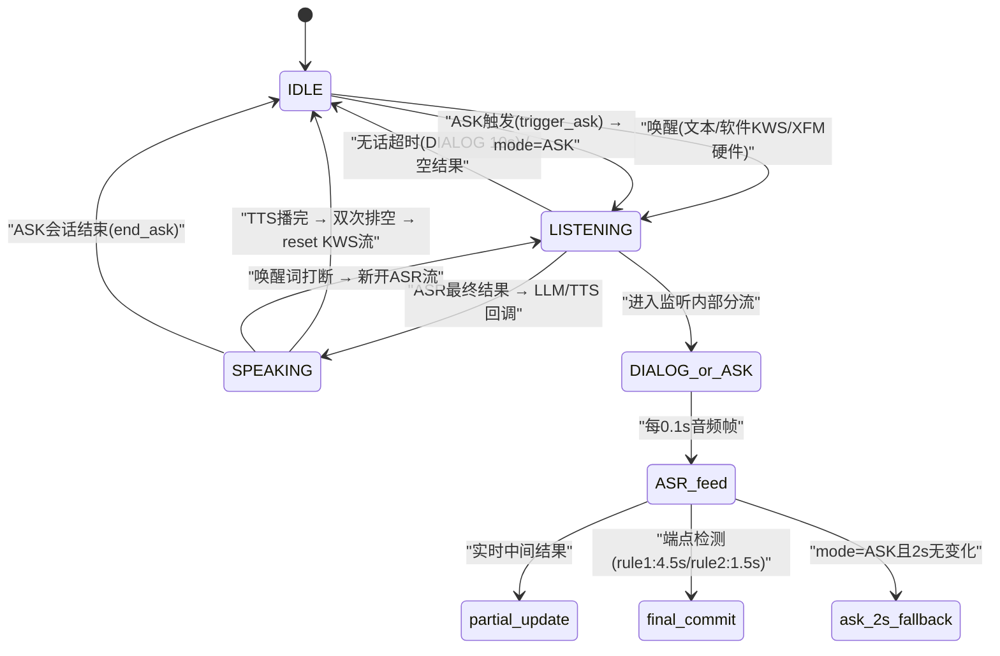

# 实验4：老人跌倒监护--语音交互集成测试（6h）

### 1.1 关联知识点

- 3.1.1 XFM六麦硬件唤醒（AIUI事件/beam/angle）[事实，前置：ROS2 串口通信基础]
- 3.1.2 软件KWS关键词检出（sherpa-onnx）[概念，前置：3.1.1 理解硬件唤醒与软件KWS的分层关系]
- 3.1.3 流式ASR（zipformer增量解码+端点检测）[原理，前置：3.1.2 理解音频队列消费链路]
- 3.2.1 TTS播报与预合成缓存（零合成延迟）[概念，前置：3.1.3 理解ASR→应答→TTS的串行关系]
- 3.2.2 唤醒后启动录音（XFM时序）+双次排空防回声[原理，前置：3.1.1 理解硬件唤醒触发录音的时序约束]
- 3.2.3 ASK应答窗口与单次应答防重复[流程，前置：1.3.1 monitor↔VoiceLoop三接口 + 3.1.3 ASR端点检测]

### 1.2 实验目标

1. **掌握**语音链路唤醒→提示音→ASR识别→LLM应答→TTS播报→打断的全流程，能独立追踪每一步在代码中的状态迁移路径。
2. **理解**录音线程在硬件唤醒后才启动的原因（XFM ALSA流时序约束），以及软件KWS/文本模式下录音线程常开的设计差异。
3. **独立完成**语音模块各子系统（KWS/ASR/TTS）的单点测试与全链路集成测试，能按 docs/07_语音测试用例.md 逐条验证。
4. **掌握**ASK应答窗口的2s兜底快答机制、双次排空防回声原理、epoch单次应答防重复设计。
5. **迁移应用**：能自定义唤醒词并验证端到端流程，理解唤醒词配置对KWS/XFM双链路的影响。

### 1.3 实验环境

| 类别 | 内容 |
|------|------|
| 硬件 | 具身智能机器人小车C1（RK3576）、XFM六麦阵列（/dev/ttyACM0，VID 0x1a86 PID 0x55d4）、扬声器（plughw:3,0）；**--text模式无需任何硬件** |
| OS | Ubuntu 22.04，Python 3.10（/home/iflytek/ros2_venv） |
| 核心依赖 | sherpa-onnx（KWS/ASR/TTS推理）、ALSA（plughw:4,0 捕获）、aplay（plughw:3,0 播放）、numpy |
| 源码位置 | `ros2_ws/src/xflz_eai_car1/app/elderly_companion/` |
| 关键文件 | speech/voice_loop.py、speech/xfm_wake.py、speech/kws.py、speech/asr.py、speech/tts.py、config/kws_keywords.txt、docs/07_语音测试用例.md |

### 1.4 实验难度

- 难度: ⭐⭐（综合性）
- 重点：语音三状态机（IDLE/LISTENING/SPEAKING）的完整流转；唤醒→提示音→ASR→应答→打断闭环；ASK应答窗口与2s兜底快答。
- 难点：硬件唤醒后XFM ALSA流时序（提前打开不恢复）导致的录音线程延迟启动；双次排空防回声的队列操作原理；epoch计数器防止ASK应答重复的并发设计。

### 1.5 实验现象

**快速验证流程（文本模式，无需硬件）**：

```bash
cd /home/iflytek/ros2_ws/src/xflz_eai_car1/app/elderly_companion
# 文本模式状态机验证
python3 apps/speech_text_demo.py
# 输入: 小飞小飞 → 唤醒; 你好 → LLM对话; ask → 模拟跌倒; 救命 → 告警; exit → 退出
```

**预期效果描述**：
- 输入 `小飞小飞` → 日志输出 `[文本] 唤醒` → `开始聆听（mode=DIALOG）`
- 输入任意文本（已唤醒状态） → LLM回复（若llm.enabled=true）或 `LLM 未启用` 提示
- 输入 `ask` → 模拟跌倒 ASK 窗口 → 输入 `救命` → `>>> ASK 确认（ALERT）` → 告警日志
- 输入 `ask` → 输入 `没事` → `>>> ASK 取消（CANCELLED）`
- 输入 `救命`（任意时刻） → `[文本] 呼救` → `>>> 呼救 ALERT`

### 1.6 实验步骤

#### 整体流程图



#### 步骤1：文本模式验证语音状态机（60min）

**知识点讲解**：

**3.1.3 流式ASR + 文本模式统一（知识点讲解前半部分）**

文本模式（`--text`）是整个语音系统的调试基座：所有音频组件（KWS、ASR、TTS）均被禁用，stdin逐行读入文本直接喂入同一套状态机回调链。这意味着文本模式走的代码路径与硬件模式完全一致——状态机（IDLE/LISTENING/SPEAKING）相同、回调链（`feed_text → _start_listening → _invoke_dialog/_invoke_ask`）相同、epoch打断机制相同。设计目的是让开发者在无硬件环境下完整验证交互逻辑，排查状态机bug。

**源码对应**：

```python
# speech/voice_loop.py L154-L181（feed_text 方法）
def feed_text(self, text: str) -> None:
    """文本调试：stdin 逐行喂，与音频路径同一状态机/回调链。"""
    text = text.strip()
    if not text:
        return
    if text in self.wake_words:
        log.info("[文本] 唤醒")
        self._start_listening(DIALOG)       # → 开听
        return
    if self.state == LISTENING:
        if self._mode == DIALOG:
            self._invoke_dialog(text)       # → LLM+TTS
        else:
            self._invoke_ask(text)          # → ASK应答判断
        return
```

```python
# apps/speech_text_demo.py L86-L110（主循环）
loop = VoiceLoop(cfg, speaker, asr, kws_det, llm_chat,
                 on_dialog_text=_demo_dialog,
                 on_ask_text=_demo_ask,
                 on_help_kws=_demo_help,
                 text_mode=True)
loop.start()
# ...
loop.feed_text(text)   # stdin 逐行 → 同一状态机
```

**操作步骤**：

1. 启动文本模式：`python3 apps/speech_text_demo.py`。
2. 输入 `小飞小飞` → 观察 `[文本] 唤醒` 和 `开始聆听（mode=DIALOG）`。
3. 输入任意文本（如 `你好`）→ 观察 LLM回复（需 llm.enabled=true）或 `LLM 未启用`。
4. 输入 `ask` → 模拟跌倒 ASK 窗口 → 输入 `救命` → 观察 `ASK 确认（ALERT）`。
5. 输入 `ask` → 输入 `没事` → 观察 `ASK 取消（CANCELLED）`。
6. 输入 `救命`（IDLE态）→ 观察 `呼救 ALERT` 日志。

**易错点**：
- ⚠️ 忘记设置 `llm.enabled=true` → 输入对话文本无反应 → **解决**：在 `config/fall_config.yaml` 中确认 `llm.enabled: true`，或检查 LLM 服务是否已启动。
- ⚠️ 在IDLE态输入非唤醒词文本被忽略属正常 → **解决**：对照 `speech/voice_loop.py L170-L177`，IDLE态只有呼救词才触发回调，其余忽略。

#### 步骤2：语音子系统单点验证（90min）

**知识点讲解**：

**3.1.2 软件KWS关键词检出（sherpa-onnx）**

软件KWS（Wake Word Spotting）基于sherpa-onnx的KeywordSpotter引擎，使用轻量级zipformer模型（epoch-13, chunk-16）实时检测预定义唤醒词。每个音频帧（0.1s, 16kHz）通过 `create_stream()` + `feed()` 外部驱动识别——VoiceLoop在IDLE态每帧喂KWS，命中唤醒词则切换到LISTENING。KWS模型初始化时加载 `kws_keywords.txt` 中的词表（拼音+中文对照，如 `x iǎo f ēi x iǎo f ēi @小飞小飞`），`score=1.5` 和 `threshold=0.25` 控制检出灵敏度。

**源码对应**：

```python
# speech/kws.py L33-L42（__init__，词表解析）
for line in Path(keywords_file).read_text(encoding="utf-8").splitlines():
    line = line.strip()
    if not line or "@" not in line:
        continue
    self._cn_words.append(line.split("@", 1)[1].strip())

# speech/kws.py L62-L73（feed，外部驱动检测）
def feed(self, stream, samples) -> str | None:
    stream.accept_waveform(self.sample_rate, samples)
    while self._kws.is_ready(stream):
        self._kws.decode_stream(stream)
    result = self._kws.get_result(stream)
    if result:
        kw = result.split("@")[-1].strip() if "@" in result else result.strip()
        self._kws.reset_stream(stream)
        return kw
    return None
```

```python
# config/kws_keywords.txt（完整内容）
x iǎo f ēi t óng x ué @小飞同学
n ǐ h ǎo x iǎo f ēi @你好小飞
x iǎo f ēi x iǎo f ēi @小飞小飞
j iù m ìng @救命
b āng b āng w ǒ @帮帮我
```

**3.1.3 流式ASR（zipformer增量解码+端点检测）**

ASR基于sherpa_onnx.OnlineRecognizer，使用zipformer（epoch-99, chunk-1）模型做增量解码。关键参数：`enable_endpoint_detection=True` 开启三规则端点检测——rule1=4.5s静音（长静音判终止）、rule2=1.5s短静音（短句终止）、rule3=300ms极短持续（单字终止）。VoiceLoop在LISTENING态每帧调用 `asr.feed(stream, chunk)` 返回 `(partial, final)` 元组：partial是实时中间结果（显示在日志），final在端点检测命中时非None（触发状态迁移）。

**源码对应**：

```python
# speech/asr.py L48-L62（_init，端点检测参数）
self._recognizer = sherpa_onnx.OnlineRecognizer.from_transducer(
    # ...模型文件...
    enable_endpoint_detection=True,
    rule1_min_trailing_silence=4.5,   # 长静音终止
    rule2_min_trailing_silence=1.5,   # 短静音终止
    rule3_min_utterance_length=300.0, # 极短句终止（ms）
)

# speech/asr.py L68-L76（feed，外部驱动识别）
def feed(self, stream, samples) -> tuple[str, str | None]:
    stream.accept_waveform(self.sample_rate, samples)
    self._recognizer.decode_stream(stream)
    partial = self._recognizer.get_result(stream).strip()
    # ...端点检测逻辑...
    return partial, final
```

**3.2.1 TTS播报与预合成缓存（零合成延迟）**

TTS使用Matcha-TTS（acoustic model + Vocos vocoder）+ sherpa_onnx.OfflineTts。固定提示语（如"您还好吗？需要帮助吗？"）在启动前通过 `pre_synthesize()` 预合成，运行时 `say()` 直接查 `_pcm_cache` 字典播放，省去 ~1s/句合成耗时。落盘缓存（MD5索引的.raw文件）支持跨次启动零合成。动态文本（LLM回复）实时合成。

**源码对应**：

```python
# speech/tts.py L204-L230（Speaker.pre_synthesize，预合成+磁盘缓存）
def pre_synthesize(self, texts: list[str], cache_dir: str = "") -> None:
    for t in texts:
        key = f"{t}|{self.speed}|{self.gain}|{self.sid}"
        fp = cache / f"{hashlib.md5(key.encode()).hexdigest()[:16]}.pcm" \
            if cache is not None else None
        if fp is not None and fp.exists():
            self._pcm_cache[t] = fp.read_bytes()  # 磁盘加载→零合成
            continue
        pcm = self._synth(t)
        if pcm:
            self._pcm_cache[t] = pcm              # 内存缓存
```

```python
# speech/tts.py L232-L255（Speaker.say，播放路径）
def say(self, text: str) -> None:
    if self.playback_event is not None:
        self.playback_event.set()                  # 录播互斥（合成前开始）
    pcm = self._pcm_cache.get(text.strip())        # 优先查缓存
    if pcm is None:
        pcm = self._synth(text)                    # 动态文本实时合成
    self._playback.write(pcm)                      # 入队异步播放
```

**操作步骤**：

1. 运行KWS单点测试：`python3 apps/speech_kws_test.py`（若可用），观察唤醒词检出日志。
2. 运行ASR单点测试：`python3 apps/speech_asr_test.py`，喂入音频观察partial/final输出。
3. 运行TTS单点测试：`python3 apps/speech_tts_test.py`，验证合成+播放链路。
4. 若无单点测试脚本，通过 `speech_text_demo.py` 的 `ask` 命令间接验证：输入 `ask` → 观察TTS合成日志 `[TTS 播放]` → 缓存命中日志 `预合成（磁盘加载）`。

**易错点**：
- ⚠️ TTS合成失败（模型未初始化）→ **解决**：检查 `config/fall_config.yaml` 中 `speech.tts.model_dir` 路径是否正确；首次运行需约1s合成延迟，后续走缓存。
- ⚠️ ALSA设备被占用（`aplay`残留进程）→ **解决**：`pkill -9 aplay` 清理后重试。

#### 步骤3：语音全链路集成（90min）

**知识点讲解**：

**3.2.2 唤醒后启动录音（XFM时序）+双次排空防回声**

硬件唤醒场景下，XFM六麦阵列的ALSA流只有在唤醒后才可用——如果提前打开ALSA设备，XFM会停留在监听态输出稀疏帧，唤醒后也不恢复。因此 `_ensure_capture()` 幂等方法仅在 `notify_wake()` 被调用后才真正启动录音线程（`_cap_started` 保护）。软件KWS/普通麦克风场景下，录音线程在 `run()` 中常开（`self._ensure_capture()` 直接启动）。双次排空防回声：TTS播报结束后，`_handle_speaking` 连续执行两次 `_drain_q()`（中间 sleep 0.2s），确保提示音/播报残留帧被完全清空，避免KWS将TTS回声误判为唤醒词。

**源码对应**：

```python
# speech/voice_loop.py L124-L138（_ensure_capture，XFM时序控制）
def _ensure_capture(self) -> None:
    """启动录音线程（幂等）。XFM 硬件唤醒场景：唤醒事件后才开 ALSA
    （XFM 需唤醒后 ALSA 流才可用——提前打开会让设备停在监听态稀疏流，
    唤醒后也不恢复）。"""
    if self.text_mode or self._cap_started or not self._running:
        return
    with self._cap_lock:
        if self._cap_started:
            return
        self._cap_started = True
        self._cap_thread = threading.Thread(
            target=self._capture_loop, daemon=True)
        self._cap_thread.start()

# speech/voice_loop.py L139-L144（notify_wake，硬件唤醒入口）
def notify_wake(self) -> None:
    self.wake_seen.set()
    self._hw_wake_ev.set()
    self._ensure_capture()  # 唤醒后开 ALSA：流才可用
```

```python
# speech/voice_loop.py L338-L341（双次排空防回声）
def _handle_speaking(self, chunk) -> None:
    # ...唤醒词打断逻辑...
    ev = self.speaker.playback_event
    if ev is not None and not ev.is_set():
        self._drain_q()           # 第一次排空（清残留帧）
        time.sleep(0.2)           # 等待残帧处理
        self._drain_q()           # 第二次排空（确保清空）
        if self.kws is not None:
            self.kws._kws.reset_stream(self._kws_stream)  # reset KWS流
        self.state = IDLE
```

**3.1.1 XFM六麦硬件唤醒（AIUI事件）**

XFM六麦阵列通过串口（/dev/ttyACM0）使用AIUI协议通信：`receive_loop()` 线程持续读串口 → `_process_buffer()` 按 `0xA5` 同步头拆帧 → `_handle_frame()` 解析消息。`msg_type=0x04` 的设备消息中，JSON payload含 `type=aiui_event` 且 `eventType=4` 时即为唤醒事件，提取 `ivw.beam`（声束方向）、`ivw.angle`（角度）、`ivw.keyword`（唤醒词）。3秒防抖（`last_wakeup_time`）避免重复唤醒。`HardwareWake` 封装了串口打开→唤醒词设置→回调注册的完整流程，设备无响应时降级为软件KWS。

**源码对应**：

```python
# speech/xfm_wake.py L109-L127（_handle_frame，AIUI唤醒事件解析）
if msg.get('type') == 'aiui_event':
    content = msg.get('content', {})
    if content.get('eventType') == 4:       # 唤醒事件
        info = json.loads(content.get('info', '{}'))
        ivw = info.get('ivw', {})
        beam = ivw.get('beam')
        angle = ivw.get('angle')
        keyword = ivw.get('keyword')
        if current_time - self.last_wakeup_time > 3.0:  # 3s防抖
            if self.wakeup_lock.acquire(blocking=False):
                self.wakeup_callback()      # → VoiceLoop.notify_wake()
```

```python
# speech/xfm_wake.py L244-L276（HardwareWake，封装串口+唤醒词设置）
class HardwareWake:
    def start(self) -> None:
        self._arr = XfMicArray(port=self.port, vendor_id=0x1a86,
                               product_id=0x55d4)
        self._arr.start()
        for w in self.wake_words:
            self._arr.set_wake_word(w)
        self._arr.wakeup_callback = self._on_wake_event
```

**操作步骤**：

1. 启动语音全链路（文本模式）：`python3 apps/fall_video_demo.py --video testdata/fall_slow_x264.mp4 --text`。
2. 输入 `小飞小飞` → 观察 `开始聆听（mode=DIALOG）` → 输入任意文本 → 观察LLM回复 + TTS播报日志。
3. 验证打断：LLM播报中输入 `小飞小飞` → 观察 `打断播报` → 新提示音 → 开听。
4. 验证DIALOG无话超时：唤醒后10s内不输入 → 观察 `DIALOG 无话超时 → IDLE`。
5. 若有硬件：启动音频模式 `python3 apps/fall_video_demo.py --video testdata/fall_slow_x264.mp4 --mjpeg`，说"小飞小飞"验证提示音+录音线程启动。

**易错点**：
- ⚠️ 无硬件时说唤醒词无反应属正常 → **解决**：文本模式对麦克风无反应是设计行为，必须通过stdin输入。
- ⚠️ XFM硬件唤醒后无"录音线程"日志 → **解决**：检查 `/dev/ttyACM0` 是否被 `log_server` 占用，停占用进程后重插USB。

#### 步骤4：唤醒对话闭环验证（60min）

**知识点讲解**：

**3.2.2 唤醒后启动录音（XFM时序）——闭环时序**

完整的唤醒对话闭环：硬件XFM检测到唤醒词 → `_handle_frame` 解析AIUI事件 → `wakeup_callback()` → `VoiceLoop.notify_wake()` → `wake_seen.set()` + `_ensure_capture()` 启动录音线程 → 主循环 `_hw_wake_ev` 触发 `_start_listening(DIALOG)` → 播提示音PCM（`_prompt_pcm`）→ 等待播放时长+0.8s → 双次排空 → 开ASR流 → LISTENING态等待用户语音 → ASR端点检测命中 → `_invoke_dialog` → LLM回复 → TTS播报 → `playback_event.clear()` → 双次排空 → IDLE。文本模式跳过提示音和排空，直接 `_begin_listen(mode)`。

**源码对应**：

```python
# speech/voice_loop.py L358-L375（_start_listening，完整时序）
def _start_listening(self, mode: str) -> None:
    """播提示音 → 排空回声 → 开 ASR 流"""
    if self.text_mode:
        self._begin_listen(mode)           # 文本模式：跳过提示音
        return
    if self._prompt_pcm:
        pb.write(self._prompt_pcm)         # 写提示音PCM
        time.sleep(self._prompt_dur + 0.8) # 等播放+余量
    self._drain_q()                        # 第一次排空
    time.sleep(0.2)
    self._drain_q()                        # 第二次排空
    self._begin_listen(mode)               # 开ASR流 → LISTENING
```

```python
# speech/voice_loop.py L376-L383（_begin_listen，开ASR流）
def _begin_listen(self, mode: str) -> None:
    self._asr_stream = self.asr.create_stream()
    self._last_partial = ""
    self._listen_started = time.time()
    self._mode = mode
    self.state = LISTENING
    log.info(f"开始聆听（mode={mode}）...")
```

**操作步骤**：

1. 文本模式启动全链路：`python3 apps/fall_video_demo.py --video testdata/fall_slow_x264.mp4 --text`。
2. 输入 `小飞小飞` → 验证唤醒→开听→对话完整闭环。
3. 验证打断闭环：唤醒后输入对话文本（如 `你好`），播报过程中输入 `小飞小飞` → 观察打断+新开ASR流+继续对话。
4. 验证epoch丢弃：在LLM播报中连续打断两次 → 观察第一次迟到回复被epoch丢弃（日志无第二次回复输出）。

**易错点**：
- ⚠️ 提示音后立即说话无反应 → **解决**：提示音播放需 `prompt_dur + 0.8s`，加上双次排空共约1.5s等待期，这是正常延迟。
- ⚠️ 打断后旧回复仍播完 → **解决**：检查 `Playback.interrupt()` 是否正确清队列+杀aplay+重启进程（`speech/tts.py L158-L180`）。

#### 步骤5：按docs/07逐条执行测试用例（90min）

**知识点讲解**：

**3.2.3 ASK应答窗口与单次应答防重复**

ASK应答窗口由跌倒状态机 `trigger_ask()` 触发：monitor检测到跌倒→调用 `VoiceLoop.trigger_ask()` → 主循环执行 `_do_trigger_ask()`：打断当前播报 → 等 `playback_event`（ask_tts开始播放）→ 等播放结束（`playback_event.clear()`）→ 双次排空 → `_begin_listen(ASK)` 开ASR流。ASK窗口内，2s兜底快答机制：当partial存在但2s内无新变化时，强制提交当前partial（不等4.5s端点静音）。单次应答防重复通过epoch计数器实现：每次 `_invoke_dialog` 记录 `start_epoch = self._epoch`，worker完成后检查epoch是否被更新——更新说明被打断，丢弃回复。ASK应答由 `_invoke_ask` 同步回调monitor，不走worker线程。

**源码对应**：

```python
# speech/voice_loop.py L393-L421（_do_trigger_ask，ASK窗口时序）
def _do_trigger_ask(self) -> None:
    if self.state == SPEAKING:
        self._interrupt()               # 打断当前播报
    # 阶段1：等 playback_event set（ask_tts开始播放）
    ev = self.speaker.playback_event
    while not ev.is_set() and waited < 8.0:
        time.sleep(0.05)
    # 阶段2：等播放结束（clear）
    while ev.is_set() and waited < 15.0:
        time.sleep(0.05)
    self._drain_q()                     # 第一次排空
    time.sleep(0.2)
    self._drain_q()                     # 第二次排空
    self._begin_listen(ASK)             # 开听（mode=ASK）
```

```python
# speech/voice_loop.py L307-L313（LISTENING态2s兜底快答）
# 静音兜底：ASK 快答（2s 无变化强制提交，不等 4.5s 端点静音）
if (self._mode == ASK and partial
        and now - self._listen_started > 2.0 + 120.0 / 1000.0):
    log.info(f"[ASR 结果(兜底)] {partial}")
    self._close_stream()
    self._invoke_ask(partial)
    return
```

```python
# speech/voice_loop.py L433-L442（_invoke_dialog，epoch防重复）
def _invoke_dialog(self, text: str) -> None:
    self.state = SPEAKING
    start_epoch = self._epoch           # 记录当前epoch
    def worker() -> None:
        self._on_dialog_text(text, start_epoch)  # 传epoch给回调
    threading.Thread(target=worker, daemon=True).start()
```

**操作步骤**：

1. 按 `docs/07_语音测试用例.md` 执行T7-1至T7-9。
2. **T7-1 唤醒→对话→LLM**：文本模式下输入 `小飞小飞` → `你是什么模型` → 验证LLM回复。
3. **T7-2 呼救直告警**：IDLE态输入 `救命` → 验证呼救ALERT日志。
4. **T7-3 ASK窗口应答**：输入 `ask` → `救命` → 验证单次确认（`ASK 确认 [x] ALERT` 一条）。
5. **T7-7 防回声**：播报结束后观察无误唤醒（双次排空+KWS reset生效）。
6. **T7-8 ASR模型直测**：若可用，用预合成PCM直接喂ASR验证模型链路。

**易错点**：
- ⚠️ ASK应答后出现多条 `ASR 应答` → **解决**：检查 `_invoke_ask` 是否同步调用且不走worker线程，确认没有循环break遗漏（`speech/voice_loop.py L443-L461`）。
- ⚠️ ASK窗口不答话无超时重问 → **解决**：重问由fall/interaction.py的monitor控制（12s超时），文本模式下需手动输入 `ask` 再次触发。

#### 步骤6：自定义唤醒词测试（30min）

**知识点讲解**：

**3.1.1 + 3.1.2 双链路唤醒词配置**

唤醒词配置同时作用于硬件XFM和软件KWS两条链路。修改 `config/kws_keywords.txt` 增加自定义唤醒词（格式：拼音 + `@` + 中文），KWS模型自动加载新词表。XFM硬件唤醒词通过 `xfm_wake.py` 的 `set_wake_word()` 设置（JSON格式，如 `{"type":"wakeup_keywords","content":{"keywords":"自定义词","threshold":"900"}}`），需同步修改VoiceLoop的 `wake_words` 元组（从 `config/fall_config.yaml` 的 `session.wake_words` 读取）。文本模式下仅验证KWS文本路径：`feed_text()` 对照 `self.wake_words` 判断是否为唤醒词。

**源码对应**：

```python
# speech/kws.py L33-L38（词表解析，@分隔拼音+中文）
for line in Path(keywords_file).read_text(encoding="utf-8").splitlines():
    if "@" not in line:
        continue
    self._cn_words.append(line.split("@", 1)[1].strip())

# speech/voice_loop.py L82-L84（wake_words从配置读取）
self.wake_words = tuple(cfg.get("session", {}).get(
    "wake_words", ["小飞小飞", "小飞同学", "芝麻开门"]))
```

```markdown
# config/kws_keywords.txt（添加自定义词格式）
# 拼音（空格分隔） @ 中文词
z ì dìng y ì @自定义词
```

**操作步骤**：

1. 编辑 `config/kws_keywords.txt`，添加自定义唤醒词（如 `z ì dìng y ì @自定义词`）。
2. 修改 `config/fall_config.yaml` 的 `session.wake_words` 列表，加入自定义词。
3. 重启 `python3 apps/speech_text_demo.py`，输入自定义唤醒词 → 验证唤醒。
4. 若有硬件：重启全链路程序，对XFM说自定义唤醒词 → 观察AIUI事件日志（`检测到唤醒! Keyword: 自定义词`）。

**易错点**：
- ⚠️ 自定义词在KWS文本路径无效 → **解决**：确认 `kws_keywords.txt` 格式正确（拼音@中文，行首无空格）；确认 `wake_words` 配置列表包含中文部分。
- ⚠️ 硬件XFM不识别自定义词 → **解决**：XFM固件可能限制唤醒词数量/格式，检查 `HardwareWake.start()` 的设备响应日志（`rx_bytes > 0` 表示设备存活）。

### 1.7 注意事项

- ⚠️ **文本模式无需硬件**：`--text` 模式下对麦克风说话无反应属正常，必须通过stdin输入文本。
- ⚠️ **ALSA设备清理**：每次测试前执行 `pkill -9 aplay` 清理残留播放进程，避免设备占用导致播放失败。
- ⚠️ **XFM串口占用**：`/dev/ttyACM0` 可能被 `log_server` 占用，检查 `lsof /dev/ttyACM0` 后停占用进程。
- ⚠️ **录音线程时序**：XFM硬件唤醒场景下，录音线程只在唤醒后启动——这是设计约束而非bug。
- ⚠️ **LLM服务**：对话功能需先启动LLM服务（`python3 llm/llm_server.py`），否则对话输入无回复。
- ⚠️ **运行产物清理**：测试完成后 `pkill -9 aplay` + `pkill -f llm_server` 清理残留进程。

### 1.8 实验总结

**完成成果**：一份语音全链路测试报告（含文本模式状态机验证、KWS/ASR/TTS单点验证、全链路集成验证、docs/07用例执行结果、自定义唤醒词测试结果）。

**技能收获**：
- 技能1：语音三状态机（IDLE/LISTENING/SPEAKING）的完整流转与代码追踪能力
- 技能2：XFM硬件唤醒时序（唤醒后开ALSA）与双次排空防回声原理
- 技能3：ASK应答窗口2s兜底快答与epoch单次防重复设计

**常见问题与解决**：

| 问题 | 原因 | 解决方法 |
|------|------|----------|
| 唤醒后无"录音线程"日志 | XFM未唤醒态/ALSA被占用 | 确认 `检测到唤醒` 日志；停 `log_server` 释放串口；重插USB |
| 录音X/5s中X≈10帧 | XFM监听态（未真正唤醒） | 仅测试软件KWS/文本模式；硬件唤醒需真人对麦克风说唤醒词 |
| 有录音无partial输出 | ASR模型未初始化/模型文件缺失 | 检查 `speech.asr.model_dir` 路径；跑ASR单点测试验证模型 |
| 提示音残留导致误唤醒 | 双次排空未完全清空队列 | 检查 `_handle_speaking` 的两次 `_drain_q()` 是否执行；确认 `kws._kws.reset_stream()` 被调用 |
| ASK应答后多条 `ASR 应答` | `_invoke_ask` 循环未break/worker重复提交 | 检查 `voice_loop.py` 的 ASK 路径：`_invoke_ask` 应同步调用且不走worker线程 |

### 1.9 实验报告要求

**思考题**：

1. 为什么XFM硬件唤醒场景下录音线程必须在唤醒后才启动，而软件KWS场景可以常开？请结合 `xfm_wake.py` 的AIUI事件时序和ALSA流特性分析原因。若提前打开ALSA设备会发生什么？
2. 双次排空防回声机制中，`_drain_q()` 被调用两次且中间 sleep 0.2s——如果只调用一次或去掉 sleep，会产生什么问题？请结合KWS的 `reset_stream()` 和音频帧残留分析。
3. ASK应答窗口的2s兜底快答与ASR内置的4.5s端点静音检测有什么区别？为什么ASK场景需要额外的2s兜底，而DIALOG场景不需要？
4. epoch计数器如何实现"单次应答防重复"？如果 `_invoke_dialog` 走同步调用而非worker线程，epoch机制是否还有必要？

**评分标准**：
- 文本模式状态机验证（20分）：唤醒/对话/ASK/呼救四条路径全部通过，日志正确
- 语音子系统单点验证（20分）：KWS/ASR/TTS各子系统独立验证，记录模型参数
- 全链路集成验证（25分）：唤醒→提示音→ASR→应答→打断闭环完整，双次排空/epoch机制生效
- docs/07测试用例执行（20分）：T7-1至T7-9逐条覆盖，结果记录完整
- 自定义唤醒词（10分）：双链路（KWS+XFM）配置正确，端到端验证通过
- 思考题回答深度（5分）：至少2题回答准确，有源码行号支撑
