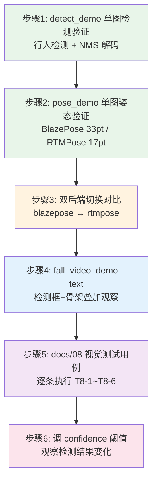

# 实验5：老人跌倒监护--视觉检测与姿态估计集成测试（8h）

### 1.1 关联知识点

- **4.1.1 YOLOv8行人检测(COCO person)** — 基于 COCO 数据集预训练的 YOLOv8 检测模型，仅保留 person 类（class_id=0），输入 640×640 RGB 图像，输出检测框+置信度（前置：无）
- **4.1.2 letterbox预处理与NMS后处理解码** — letterbox 等比缩放+居中补黑边→RGB NHWC 4D→RKNN 推理→DFL softmax 解码→逐类 NMS 去重（前置：4.1.1）
- **4.1.3 RKNN NPU推理与core_mask核选择** — rknnlite2.3.2 板端推理 API，core_mask 控制 NPU 核分配（AUTO=0 / CORE_0=1 / CORE_0_1=3），RK3576 双核（前置：4.1.1）
- **4.2.1 BlazePose 33关键点引擎** — mediapipe pose_landmark_full 模型，整图 256×256 输入，输出 33×4 [x,y,z,vis] 像素关键点+presence 评分（前置：4.1.1）
- **4.2.2 RTMPose 17关键点(SimCC双头解码)** — RTMPose-s 256×192 竖版输入，SimCC 双头输出 simcc_x(1,17,384)+simcc_y(1,17,512)，argmax÷split_ratio→像素坐标，vis=双头峰值均值（前置：4.1.1）
- **4.2.3 检测/姿态双后端切换与MJPEG推流** — pose_type 配置切换 blazepose/rtmpose；MjpegServer 封装 mjpeg_streamer 库实现 :8088/fall.mjpg 实时预览（前置：4.2.1, 4.2.2）

### 1.2 实验目标

1. **理解** YOLOv8 行人检测的完整推理链路：letterbox 预处理 → RGB 4D 输入 → RKNN NPU 推理 → DFL 解码 → NMS 去重 → unletterbox 映射回原图，能说出每个阶段的数据形状变化。
2. **掌握** BlazePose 与 RTMPose 两种姿态引擎的差异：33pt vs 17pt、整图 vs top-down、visibility 计算方式，能独立切换后端并对比输出。
3. **理解** letterbox 预处理对关键点坐标的影响（补边+等比缩放→坐标需逆映射），以及 NMS IoU 阈值对检测漏检/误检的权衡。
4. **独立完成** detect_demo/pose_demo/fall_video_demo 三层逐步验证，能定位检测漏检、姿态不跟帧、推流卡顿等常见问题。
5. **掌握** MJPEG 实时推流验证方法与 --text 文本叠加观察技巧，理解"视觉层可独立于语音层验证"的设计意图。
6. **迁移**：将"逐层单跑→集成联调→参数调优"的验证方法论应用到其他视觉检测场景（如工业质检、安防监控）。

### 1.3 实验环境

| 类别 | 内容 |
|------|------|
| 硬件 | 具身智能实验箱B2 / 具身智能机器人小车C1（RK3576 + 6TOPS NPU） |
| OS | Ubuntu 22.04 + Python 3.10 |
| 核心库 | rknnlite2.3.2（NPU 推理）、opencv-python（图像处理）、numpy |
| 模型文件 | yolov8n.rknn（640×640, COCO person）、blazepose pose_landmark_full.rknn（256×256）、rtmpose_s_256x192_int8.rknn（已打包至 models/rtmpose/） |
| 测试素材 | testdata/stand_up.jpg、testdata/fall_1.png、testdata/fall_slow_x264.mp4（离线可用） |
| 可选 | mjpeg_streamer（pip install，MJPEG 推流需用） |

### 1.4 实验难度

- 难度: ⭐⭐⭐（综合性）
- 重点：YOLOv8 检测链路（letterbox→RGB→RKNN→DFL→NMS→unletterbox）；BlazePose/RTMPose 双后端切换与关键点差异；--text 模式下检测框+骨架叠加观察。
- 难点：letterbox 补边对关键点坐标逆映射的影响（scale+pad 双参数恢复）；SimCC 双头 argmax÷split_ratio 解码逻辑；NMS IoU 阈值调优的漏检/误检权衡。

### 1.5 实验现象

**快速验证命令**（本实验核心入口）：

```bash
# 步骤1：行人检测单图验证
python3 apps/detect_demo.py --input testdata/stand_up.jpg --save

# 步骤2：姿态估计单图验证
python3 apps/pose_demo.py --input testdata/fall_1.png --save

# 步骤4：视频检测+姿态叠加（--text 文本模式）
python3 apps/fall_video_demo.py --video testdata/fall_slow_x264.mp4 --text --mjpeg
```

**预期效果描述**：

- detect_demo：终端打印 person 检测框坐标与置信度（score ≥ 0.5），--save 保存标注图到 runs/out/；无人物图返回 0 框不崩溃。
- pose_demo：终端打印关键点数量（33 或 17）与 score，--save 保存骨架标注图；无人体关键点时打印"未检测到人体关键点"不崩溃。
- fall_video_demo --text：终端逐帧输出 person_id / 检测框 / 姿态 score / 状态（IDLE/FALLING 等），检测框+骨架以文本方式叠加观察；无卡顿。


### 1.6 实验步骤

#### 整体流程图



#### 步骤1：运行 detect_demo.py 验证行人检测（90min）

**知识点讲解**：

**4.1.1 YOLOv8 行人检测(COCO person)**

- **原理**：YOLOv8 是单阶段目标检测器，采用 CSPDarknet53 骨干 + PANet FPN + 解耦头（Decoupled Head）架构。本项目使用 yolov8n（nano）版本，模型经 RKNN 工具链转换为 .rknn 格式，在 RK3576 NPU 上执行 INT8 量化推理。模型仅保留 COCO 数据集的 person 类（class_id=0），输入为 640×640 RGB 图像，输出为每层 3 组张量（box 回归 logits + 类别分数 + cls_sum），经 DFL 解码和 NMS 后得到最终检测框。选择 nano 版本是因为 RK3576 仅 6TOPS 算力，nano 模型推理延迟约 30-50ms，能满足实时性要求。
- **源码对应**：`vision/yolo/detector.py L13-27（模块文档说明标准 detect 3×nl 契约）`、`vision/yolo/detector.py L36-41（YOLODetector 类定义，接收 backend/buf_classes/imgsz/score_thr/iou_thr）`

**知识储备补充**：
- **结构拆解**：YOLOv8 是 anchor-free 单阶段目标检测器，三段式架构——CSPDarknet 骨干（yolov8n 用 C2f + SPP 结构）负责逐级下采样，PANet neck 负责多尺度特征融合，解耦头（Decoupled Head）并行走 anchor-free 的框回归与类别分类。anchor-free 意味着不依赖预设锚框，每个特征图网格单元直接预测目标中心附近的目标。yolov8n（nano）约 320 万参数、8.9 GFLOPs，是 YOLOv8 家族最小版本，正好匹配 RK3576 仅 6TOPS 的算力预算（INT8 量化后推理 30-50ms）。
- **多尺度输出形状**：输入 640×640 时，P3/P4/P5 三层 stride 分别为 8/16/32，对应特征图网格尺寸：
  $$
  80\times80,\quad 40\times40,\quad 20\times20
  $$
  每层（共 nl=3 层）输出 3 个张量，合计 nl×3=9 个：`box (1,64,h,w)`（4 条边 × 16 个 DFL bin）、`cls (1,nc,h,w)`（nc=80 为 COCO 类数，已在图内 sigmoid）、`cls_sum`（忽略）。网格小→单格感受野大→负责大目标；网格密→更精细→负责小目标。
- **DFL 分布回归**：YOLOv8 的框回归不是直接回归 4 个偏移量，而是对每条边回归一个长度 mc=16 的离散分布，解码时 softmax 后按 bin 加权求和得到亚像素偏移（`dfl_decode` postprocess_detect.py L34-42）：
  $$
  \hat{b}=\sum_{l=0}^{15} l\cdot \mathrm{softmax}(z)_l
  $$
  其中 $z\in\mathbb{R}^{16}$ 为该边的 logit 向量、$l$ 为 bin 索引（0-15，对应 0~1 网格单位偏移）、$\mathrm{softmax}(z)_l$ 为索引 $l$ 处的归一化概率。softmax 分布和为 1，故加权平均即精确边位置。相比顶点回归，DFL 在量化下更加稳定、能表达边界不确定性。
- **person 类过滤**：模型仍是 COCO 全 80 类，`YOLODetector` 解码后由 `_apply_filter`（detector.py L45-48 校验、L53-55 过滤）只保留 person（class_id=0），但 decode 需 nc=80 的 cls 张量（逐格取 argmax 得类 id）。COCO 中 person 类内形变差异大（站/坐/躺/遮挡），对检测器是挑战性类别。
- **参考资源**：Ultralytics YOLOv8 官方文档；YOLOv8 论文（arXiv:2308.00508）；Generalized Focal Loss（DFL 来源，arXiv:2008.04388）；rknn_model_zoo（RKNN 官方示例仓库）。

**4.1.2 letterbox 预处理与 NMS 后处理解码**

- **原理**：预处理阶段，`letterbox()` 将原图等比缩放至 640×640 并居中补黑边（pad=0，与 rknn_model_zoo 一致），返回缩放比 scale 和补边像素 (pad_w, pad_h)。随后 `to_rgb()` 执行 BGR→RGB 转换并添加批维，生成 (1, 640, 640, 3) uint8 NHWC 张量（板端 static_shape 模型要求 4D 输入）。推理输出经 `dfl_decode()` 对 64-bin DFL logits 做 softmax 加权得到精确偏移，`box_process()` 结合网格坐标+stride 还原为 letterbox 空间的 xyxy 框。最后 `classwise_nms()` 执行逐类 NMS（IoU 阈值默认 0.45），`unletterbox()` 通过 `(xyxy - pad) / scale` 逆映射回原图空间。
- **源码对应**：`vision/yolo/preprocess.py L18-29（letterbox 等比缩放+补 0）`、`vision/yolo/preprocess.py L32-38（to_rgb BGR→RGB+批维）`、`vision/yolo/postprocess_detect.py L38-45（dfl_decode softmax@16 bins）`、`vision/yolo/postprocess_detect.py L47-61（box_process 网格+stride→xyxy）`、`vision/yolo/postprocess_detect.py L63-75（classwise_nms 逐类 NMS）`、`vision/yolo/preprocess.py L41-53（unletterbox 逆映射回原图）`

**知识储备补充**：
- **letterbox 缩放公式**：letterbox 在保持纵横比的前提下把图像等比例缩放到目标框内并居中补边（preprocess.py L19-38）。缩放比取两个方向上尺度较小的那个（保证整图完整放进目标框、不裁切）：
  $$
  scale = \min\left(\frac{new\_shape}{h},\ \frac{new\_shape}{w}\right)
  $$
  缩放后宽高 $w'=w\cdot scale$、$h'=h\cdot scale$；单边补边像素（左/上侧）：
  $$
  pad_w=\frac{new\_shape-w'}{2},\qquad pad_h=\frac{new\_shape-h'}{2}
  $$
  本项目 pad 值为 0（黑边，与 rknn_model_zoo 一致）。补边的作用是：(1) 满足模型固定输入尺寸；(2) 避免等比例拉伸导致目标畸变影响检测。
- **NMS IoU 去重**：`classwise_nms`（postprocess_detect.py L65-93）按类别分组，同一类内按分数降序贪心去重。两框重叠度用交并比（IoU）衡量：
  $$
  \mathrm{IoU}(A,B) = \frac{A\cap B}{A\cup B} = \frac{\text{交集面积}}{\text{并集面积}}
  $$
  判定规则：当前得分最高的框保留，与它 IoU > iou_thr 的框全部抑制（删除）；iou_thr 默认 0.45。交集面积通过批量 `np.maximum`/`np.minimum` 计算（L81-84），并集为两框面积和减交集，`+1e-6` 防止除零。锚点描述里全是同尺度框，NMS 消除同一人的重复高 IoU 框。
- **unletterbox 逆映射**：解码出的检测框在 letterbox 像素空间，需逆映射回原图（preprocess.py L52-62）。对中心/角落点坐标：
  $$
  x_{orig}=\frac{x_{lb} - pad_w}{scale},\qquad y_{orig}=\frac{y_{lb} - pad_h}{scale}
  $$
  其中 $(pad_w,pad_h)$ 为补边像素、$scale$ 为缩放比；框的宽高只需除以 scale（不削 pad）。若漏用 pad，所有框会整体向补边方向偏移一个固定的 `pad/scale` 像素。
- **DFL 解码空间**：`box_post`（postprocess_detect.py L45-61）先用 `dfl_decode` 把每条边的 16-bin 分布加权为 0~1 网格单位偏移，再叠加网格坐标与 0.5 半格偏移、乘 stride 还原到 letterbox 像素：
  $$
  x_{1}=\left(gx + 0.5 - \hat{t}_{left}\right)\cdot s,\qquad x_{2}=\left(gx + 0.5 + \hat{t}_{right}\right)\cdot s
  $$
  $gx$ 为网格列坐标、$\hat{t}$ 为 DFL 解码出的边偏移（0~1）、$s$ 为该层 stride（8/16/32）。stride 由 `imgsz/grid` 推导，支持非方形 letterbox。
- **参考资源**：YOLOv5 letterbox 实现（ultralytics C++/Python）；rknn_model_zoo yolov8 解码参考（yolov8.py）；NMS 算法详解（Neubeck & Van Gool "Efficient Non-Maximum Suppression"，2006）。

**4.1.3 RKNN NPU 推理与 core_mask 核选择**

- **原理**：rknnlite2.3.2 是 RK3576 专用的板端推理 API（区别于 x86 环境的 rknn-toolkit2）。`RKNNLiteBackend` 封装了 `load_rknn()` → `init_runtime(core_mask=...)` → `inference()` 三步流程。core_mask 控制 NPU 核分配：0=NPU_CORE_AUTO（自动，推荐）、1=CORE_0、2=CORE_1、3=CORE_0_1（双核）。RK3576 仅有 2 个 NPU 核，多核轮转意义有限，实测 core_mask=None 会报错"The core mode None is not supported"，因此默认使用 0（AUTO）。当 YOLO 和姿态模型同时推理时，两者共享 NPU，可能出现排队等待。
- **源码对应**：`vision/yolo/backend.py L19-33（RKNNLiteBackend 文档说明 core_mask 默认 0=NPU_CORE_AUTO）`、`vision/yolo/backend.py L34-45（core_mask 常量定义 + __init__）`、`vision/yolo/backend.py L47-56（load: load_rknn + init_runtime）`、`vision/yolo/backend.py L58-65（predict: inference with nhwc）`

**知识储备补充**：
- **NPU 推理架构**：RK3576 内置 6TOPS NPU，负责卷积类算子加速。rknnlite2.3.2 是通过 `RKNNLite` 实例在板上跑推理的轻量库（区别于 x86 转换环境用的 rknn-toolkit2）。推理三步骤（backend.py L47-55 load）：`load_rknn(path)` 加载 .rknn 模型 → `init_runtime(core_mask=...)` 初始化运行时并绑定 NPU 核 → `inference(inputs, data_format="nhwc")` 执行推理（L57-63）。
- **core_mask 物理意义**：core_mask 是 `init_runtime` 的 NPU 核分配参数，用位掩码表示哪些核心参与该模型的推理调度（backend.py L35-40）：
  $$
  \text{core\_mask} = \sum 2^{core\_id}
  $$
  0 位=NPU_CORE_0（值 1）、1 位=NPU_CORE_1（值 2）、2 位=NPU_CORE_2（值 4）；`NR=0=NPU_CORE_AUTO` 让运行时自动调度全部可用核。组合值如 NPU_CORE_0_1=3（位 0|位 1）、NPU_CORE_0_1_2=7。RK3576 物理上只有 2 个 NPU 核，所以 CORE_2=4 不可用、多核组合意义有限。
- **多进程无关性**：`core_mask=None` 与 `0` 不同——None 不是合法掩码，`librknnrt` 会报 "The core mode None is not supported"（实测），而 `0` 是合法 AUTO。默认 `RKNNLiteBackend.__init__` 用 `core_mask=NPU_CORE_AUTO`（backend.py L42）。
- **线程池与核轮转**：`RKNNPool`（rknnpool.py L29-55）用 N 个 worker 线程×各自 backend 实例做并发推理，`backend_factory`（L18-26）支持 `auto`（全部 NPU_CORE_AUTO）与 `round_robin`（按 `tid % 3` 轮转 CORE_0/1/2）。板端实测 RK3576 仅 2 核，round_robin 会把两 worker 挤到同核，故池配置优先 `auto`（见 AGENTS.md gotcha 5）。
- **双模型 NPU 竞争**：当 YOLO 检测与姿态估计（BlazePose/RTMPose）同时加载时，两个模型共享同一 NPU 计算单元，每帧串行排队执行——推理延迟接近两模型耗时之和，这解释了帧率下降的现象。
- **参考资源**：RKNN 文档（瑞芯微 RKNN-Toolkit2/RKNNLite 说明）；rknn_model_zoo（RKNN NPU 官方示例）；RK3576 硬件规格（6TOPS NPU）。core_mask=None 不支持（librknnrt 2.3.2 行为）见 backend.py L25-32 文档注释。

**操作步骤**：

1. 确认 testdata 目录下有 stand_up.jpg（单人站立图）：

2. 运行检测 demo：
   ```bash
   cd ~/ros2_ws/src/xflz_eai_car1/app/elderly_companion
   
   python3 apps/detect_demo.py --input testdata/stand_up.jpg --save
   ```

   ```bash
   OK: 1 detections in 76 ms (13.1 fps)
     cls=0(person) score=0.837 box=(31.2,7.8,183.2,393.5)
   saved: /home/iflytek/ros2_ws/src/xflz_eai_car1/app/elderly_companion/runs/out/detect_image.jpg
   ```

3. 观察终端输出：应打印 person 检测框坐标 (x1,y1,x2,y2)、置信度 score（≥0.5）、推理耗时（ms）。

4. 检查标注图保存：
   ```bash
   ls runs/out/   # 应有 detect_image.jpg
   ```

5. 如有多人图，换图测试多人检测，观察各 person_id 独立输出。


**易错点**：

- ⚠️ RKNN 加载失败报"load_rknn failed" → **解决**：检查 config/fall_config.yaml 中 detect.model_path 路径是否正确，运行 `python3 common/env_check.py` 自检模型完整性。
- ⚠️ 报"need 4dims input" → **解决**：确认 preprocess 输出为 4D NHWC（to_rgb 已添加批维），板端 static_shape 模型必须 4D 输入。
- ⚠️ 检测框偏移或缩放错误 → **解决**：unletterbox 需同时用 scale 和 pad 逆映射，检查 letterbox 返回的 (r, (dw, dh)) 是否正确传递。

#### 步骤2：运行 pose_demo.py 验证姿态估计（90min）

**知识点讲解**：

**4.2.1 BlazePose 33 关键点引擎**

- **原理**：BlazePose 是 mediapipe 的人体姿态估计方案，本项目使用 pose_landmark_full 模型。输入为整图 256×256 RGB（`prepare()` 执行 BGR→RGB 重塑，不手动归一化，模型转换时已配置 mean=127.5/std=128）。输出布局为 outputs[0] shape (1,195)=39×5 交错排列（33 pose + 6 附加点），每点含 [x,y,z,vis,presence]；outputs[1] 为整体 presence 评分。解码时取前 33 点的 x/y/z/vis，通过 `px = (lm - pad) / scale` 逆映射回原图像素坐标。visibility 低于阈值（VIS_THRESHOLD=0.5）的点不绘制。BlazePose 的优势在于整图推理（不需要先检测再裁剪），33 点覆盖全身，适合跌倒判定的躯干角计算。
- **源码对应**：`vision/pose/pose.py L12-27（输出布局文档：195=39×5 交错）`、`vision/pose/pose.py L42-55（resize_pad letterbox 256×256）`、`vision/pose/pose.py L58-75（decode_pose 解码+逆映射）`、`vision/pose/pose.py L77-80（prepare BGR→RGB 不手动归一化）`、`vision/pose/engine.py L20-23（PoseEngine 整图推理管线）`

**知识储备补充**：
- **结构拆解**：BlazePose 是 Google mediapipe 的人体姿态方案，pose_landmark_full 采用两阶段（检测 then 对齐）思想但以**整图推理**实现——先由主干网络在整图 256×256 上直接回归 33 个 2.5D 关键点，不需要先裁剪人体区域（区别于 RTMPose 的 top-down）。33 点是 mediapipe 自研的 33 关键点拓扑（`POSE_CONNECTIONS`，pose.py L22-30），比 COCO 17 点多出面部/手部/脚部细节，适合做躯干角与跌倒判定。输出分段 `outputs[0] (1,195) = 39×5`：前 33 个 pose 点 + 6 个附加点（脸/手锚定），每点 5 字段 `[x,y,z,vis,presence]`。
- **关键参数物理意义**：每点 5 字段（pose.py L58-75 decode）：
  - `x,y`：255 输入空间的归一化像素坐标（0~1 相对整图）；
  - `z`：相对尺度深度（原点在臀部中心，正值表示更靠近相机）；
  - `vis`（visibility）：该点可见度，sigmoid 前 logit，绘制时低于 `VIS_THRESHOLD=0.5`（engine.py L27）的点/线跳过；
  - `presence`：该点存在置信度。
  整体 `outputs[1]` 是整图人体存在评分（presence 已经 sigmoid，fp16 模型）。
- **逆映射公式**：模型输出是 256×256 letterbox 空间归一化坐标，需先乘 256 再逆映射回原图（与检测 unletterbox 同式）：
  $$
  px=\frac{norm\times 256 - pad_w}{scale},\qquad py=\frac{norm\times 256 - pad_h}{scale}
  $$
  深度 z 也除 scale（相对尺度随缩放变化）：$z'=z/scale$。其中 $pad=(pad_w,pad_h)$ 为补边、（×256）是把归一化坐标放大回 256 输入空间。若不处理 pad，关键点在含补边方向会整体偏移。
- **归一化已烘焙**：模型转换时配置 mean=127.5/std=128，故 `prepare`（pose.py L87-92）只做 BGR→RGB 重塑为 (1,256,256,3) uint8，不手动 `(x/127.5-1)`——手动归一化反而破坏输入（源码注释：手动后 presence 0.055 vs uint8 0.998）。RKNN 推理内部对 uint8 输入自动执行归一化。
- **参考资源**：mediapipe Pose Landmarker 文档（Google）及 pose_landmarker_full 模型说明；BlazePose 论文（CVPR 2020, arXiv:2006.10204）；mediapipe POSE_CONNECTIONS 拓扑图。

**4.2.2 RTMPose 17 关键点(SimCC 双头解码)**

- **原理**：RTMPose 是基于 SimCC（Simulated Coordinate Classification）的 top-down 姿态估计方案。输入为单人裁剪图 192×256（竖版，灰边 128），经 BGR→RGB 转换后送入 RKNN。模型输出两个张量：simcc_x shape (1,17,384) 和 simcc_y shape (1,17,512)，其中 384=W(192)×2、512=H(256)×2，split_ratio=2.0。解码时对每个关键点取 x/y 头的 argmax 索引，除以 split_ratio 得到输入图像素坐标，再通过 `(xs - pad_w) / scale` 逆映射回原图。visibility 计算为双头响应峰值均值（FP32 实测有人 0.75~1.2，无人 <0.15，INT8 后量级可能漂移，需用 vis_threshold 调节）。RTMPose 的优势在于 17 点 COCO 格式兼容性好，top-down 裁剪使躺姿检测更稳定。
- **源码对应**：`vision/pose_rtm/engine.py L1-25（SimCC 输出契约文档）`、`vision/pose_rtm/simcc.py L1-12（SimCC 输出形状说明 384/512）`、`vision/pose_rtm/simcc.py L17-18（SPLIT_RATIO=2.0）`、`vision/pose_rtm/simcc.py L25-42（to_responses 输出规整）`、`vision/pose_rtm/simcc.py L45-63（simcc_decode argmax÷2→像素+逆映射）`


**知识储备补充**：

- **SimCC 坐标分类原理**：常规姿态估计用回归（直接回归像素坐标，精度不稳）或热图（Heatmap，Gaussian 峰值定位，精度高但需大模型）。SimCC（Simulated Coordinate Classification）取折中——把 x、y 两个坐标分别做离散化分类：每个关键点在 x 方向对 384 个 bin、y 方向对 512 个 bin 生成一个响应分布，argmax 即最可能位置。相比热图，SimCC 把 2D 输出拆分两个 1D 头，输出维度大幅压缩、更省算力。
- **双头输出形状**：该模型输入 192×256（竖版 W×H），两个分类头长度正好是边长的 split_ratio 倍（simcc.py L22-24）：
  $$
  \text{simcc\_x}=(1,17,\underbrace{384}_{192\times 2}),\qquad \text{simcc\_y}=(1,17,\underbrace{512}_{256\times 2})
  $$
  $SPLIT\_RATIO=2.0$ 表示上采样倍率：argmax 索引除以 2 才是输入图像素坐标。17 是 COCO 关键点数量。
- **SimCC 解码公式**：对每个关键点 k 取 x/y 双头的 argmax 索引，÷split_ratio 还原到 letterbox 输入空间，再逆映射回原图（simcc.py L47-63）：
  $$
  x_k=\frac{\arg\max_{j}\mathrm{simcc\_x}_k^{(j)} / 2.0 - pad_w}{scale},\qquad y_k=\frac{\arg\max_{j}\mathrm{simcc\_y}_k^{(j)} / 2.0 - pad_h}{scale}
  $$
  其中 $j$ 为 bin 索引、$\arg\max$ 输出最高响应 bin、除以 split_ratio=2 后得输入图像素、减去补边再除以缩放即原图像素。
- **可见度（vis）**：用双头峰值响应的均值作为该点置信度（simcc.py L58）：
  $$
  \mathrm{vis}_k=\frac{\max_j \mathrm{simcc\_x}_k[j]+\max_j \mathrm{simcc\_y}_k[j]}{2}
  $$
  规则是响应越尖锐（峰值越大）该点越可信。FP32 实测有人 0.75~1.2、无人 <0.15，建议阈值 0.3（engine.py L50 vis_threshold 默认 0.3）；INT8 量化后量级可能漂移，需要调 config `model.rtmpose.vis_threshold`。
- **top-down 结构**：RTMPose 是 top-down 方案——输入必须是**单人裁剪图**（由上游行人检测框裁剪而来），因此在跌倒场景中比整图的 BlazePose 对目标尺度/裁切更鲁棒；COCO 17 点（`KEYPOINT_NAMES` simcc.py L10-16：鼻子/双眼/双耳/双肩…双踝）格式标准、下游骨骼分析兼容性好。
- **参考资源**：RTMPose 论文与源码（MMPose 官方实现）；SimCC 论文（SimCC: a Simple Coordinate Classification Perspective for Human Pose Estimation，ECCV 2022, arXiv:2107.03332）；COCO 17 关键点定义文档。

**操作步骤**：

1. 确认 testdata 目录下有 fall_1.png（跌倒姿态图）：
   ```bash
   cd ~/ros2_ws/src/xflz_eai_car1/app/elderly_companion
   
   ls testdata/fall_1.png
   ```

2. 运行姿态 demo（默认 rtmpose）：
   ```bash
   cd ~/ros2_ws/src/xflz_eai_car1/app/elderly_companion
   # config/fall_config.yaml 默认 model.pose_type: rtmpose，无需修改
   python3 apps/pose_demo.py --input testdata/fall_1.png --save
   ```

   rtmpose 默认输出应打印 **17 keypoints**（COCO 17 点）。以下为切换至 blazepose（33 点）时的对比输出（二者均为真实性输出示例）

3. 观察终端输出：默认 rtmpose 应打印 keypoints 数量（17）、score 值、前 5 个关键点坐标。

4. 检查标注图：runs/out/pose_image.jpg 默认（rtmpose）应有 17 点红色关键点 + 绿色骨架连线（若已切 blazepose 则为 33 点）。

5. 若无人体关键点，检查图片是否有清晰人体、模型是否加载成功。


**易错点**：

- ⚠️ 报"未检测到人体关键点"但图中有人 → **解决**：检查图片是否有遮挡/模糊/角度极端；尝试换图或调低 vis_threshold。
- ⚠️ score 很低（<0.1） → **解决**：默认 rtmpose（top-down）对整图多人/密集遮挡更稳；若用 blazepose 整图推理则对小目标/遮挡敏感，可切换 rtmpose 对比。
- ⚠️ 关键点位置偏移 → **解决**：确认 resize_pad 的 scale/pad 与 decode_pose 的逆映射参数一致（`vision/pose/pose.py L58-75`）。

#### 步骤3：切换 pose/pose_rtm 双后端对比关键点输出（60min）

**知识点讲解**：

**4.2.3 检测/姿态双后端切换**

- **原理**：项目通过 config/fall_config.yaml 的 `model.pose_type` 字段控制姿态引擎切换：`blazepose` 使用 33pt 整图引擎（`vision/pose/engine.py`），`rtmpose` 使用 17pt top-down 引擎（`vision/pose_rtm/engine.py`）。两者接口对齐——`process(frame_bgr) -> PoseResult`，PoseResult 均包含 `.landmarks (K,4)` 原图像素坐标和 `.score`。`pose_demo.py` 通过 `build_pose_engine(cfg)` 工厂函数按配置自动创建对应引擎，并使用各自的 `draw_skeleton()` 绘制不同关键点数量的骨架。切换时只需修改 YAML 配置，无需改代码。
- **源码对应**：`apps/pose_demo.py L49-52（import 双引擎 draw_skeleton）`、`apps/pose_demo.py L54-59（build_pose_engine 按 pose_type 创建引擎）`、`apps/pose_demo.py L62-66（_draw 按 pose_type 选择绘制函数）`

**知识储备补充**：
- **工厂模式**：双后端切换依赖 `build_pose_engine(cfg)` 工厂（`fall/monitor.py` L41-61）——读取 `model.pose_type`，为 `rtmpose` 返回 `PoseRTMEngine`（含 `vis_threshold`），为 `blazepose` 返回 `PoseEngine`（含 `min_detection_confidence`）。工厂把"按配置创建引擎"的逻辑集中在一处，CLI demo 与 fall 节点复用同一入口，切换只需改 YAML 不动代码。
- **接口同一**：两引擎实现统一协议 `process(frame_bgr) -> PoseResult`，返回 `.landmarks (K,4)`（原图像素坐标）与 `.score`（blazepose 的 presence / rtmpose 的双头响应均值）。`PoseResult` 类分别定义在 pose.py L32-40 与 pose_rtm/engine.py L35-44，字段语义一致，上层（姿态特征→跌倒判定）无需区分后端。
- **关键点差异**：33 点（BlazePose，mediapipe 拓扑，含面部/手部）vs 17 点（RTMPose，COCO 拓扑）。`draw_skeleton` 两套连接表不同——`POSE_CONNECTIONS`（pose.py L22-30，35 边）vs `COCO17_CONNECTIONS`（simcc.py L5-9，手臂三角/躯干/腿边）。缩放与耗时也不同：BlazePose 整图单次推理，RTMPose 依赖先行检测框、需逐人裁剪推理。
- **切换影响面**：切换根本不改推理代码，只影响 (1) 输入尺寸（256² vs 192×256）、(2) 解码函数（decode_pose vs simcc_decode）、(3) vis 阈值判断。姿态层与检测层通过 config 的解耦设计，正是"逐层单跑→集成联调"验证方法能成立的前提。
- **参考资源**：代码（工厂）模式（设计模式入门）；mediapipe Pose vs MMPose RTMPose 对比；「策略模式」概念（工厂按配置选择实现）。

**操作步骤**：

1. 查看当前配置中的姿态引擎类型：
   ```bash
   cd ~/ros2_ws/src/xflz_eai_car1/app/elderly_companion
   grep -A2 "pose_type" config/fall_config.yaml
   ```
2. 默认应为 `rtmpose`，运行检测：
   ```bash
   cd ~/ros2_ws/src/xflz_eai_car1/app/elderly_companion
   python3 apps/pose_demo.py --input testdata/fall_1.png --save
   ```
3. 记录输出：17 个关键点、score 值、前 5 个 landmark 坐标（RTMPose COCO 17 点）。
4. 修改配置切换为 blazepose：
   ```bash
   # 编辑 config/fall_config.yaml，将 pose_type 改为 blazepose
   # 或通过 sed 临时修改：
   sed -i 's/pose_type: rtmpose/pose_type: blazepose/' config/fall_config.yaml
   ```
5. 重新运行：
   ```bash
   cd ~/ros2_ws/src/xflz_eai_car1/app/elderly_companion
   python3 apps/pose_demo.py --input testdata/fall_1.png --save
   ```
6. 对比输出：blazepose 应为 33 个关键点、不同 score 值、不同的关键点坐标分布（与默认 rtmpose 的 17 点对比）。
7. **恢复配置**：改回 `pose_type: rtmpose`，避免影响后续实验。


**易错点**：

- ⚠️ 切换后报模型路径错误 → **解决**：RTMPose 需要 model.rtmpose.model_path 配置项，检查 config 中路径是否指向 models/rtmpose/rtmpose_s_256x192_int8.rknn。
- ⚠️ RTMPose score 异常（INT8 量级漂移） → **解决**：INT8 后 vis 量级可能偏移，调节 config 中 model.rtmpose.vis_threshold（默认 0.3）。
- ⚠️ 切换后忘记恢复配置 → **解决**：实验结束前务必恢复 pose_type: rtmpose，否则影响后续 exp06 跌倒判定。

#### 步骤4：运行 fall_video_demo.py --text 观察检测框+骨架叠加（90min）

**知识点讲解**：

**4.2.3 MJPEG 推流（基础）与 --text 文本叠加**

- **原理**：`fall_video_demo.py` 是跌倒全链路离线调试入口，`--text` 参数启用文本模式（stdin 交互，无需麦克风）。该 demo 将 YOLO 检测 → IoU 关联 → 姿态估计 → 特征提取 → 状态机判定串联为完整流水线。每帧处理后，终端以文本方式叠加输出检测框坐标、骨架关键点、person_id、状态等信息，便于离线观察。MJPEG 推流通过 `MjpegServer`（`vision/yolo/mjpeg_server.py`）封装 mjpeg_streamer 库实现，启动后在浏览器访问 `http://<板端IP>:8088/fall.mjpg` 即可实时预览。MjpegServer 使用 daemon 线程运行 aiohttp 服务，stop() 时吞掉 GracefulExit 异常避免崩溃。
- **源码对应**：`apps/fall_video_demo.py L13-16（模块文档：--text 文本模式）`、`apps/fall_video_demo.py L36-49（argparse 定义 --video/--text/--mjpeg 等参数）`、`vision/yolo/mjpeg_server.py L13-20（MjpegServer 文档：mjpeg_streamer 封装）`、`vision/yolo/mjpeg_server.py L30-37（MjpegServer.__init__: Stream+Server 初始化）`、`vision/yolo/mjpeg_server.py L39-43（start: 预检端口+启动）`

**知识储备补充**：
- **stream_name 自动补后缀**：MjpegServer 构造时若 `stream_name` 不以 `.mjpg` 结尾会自动追加（mjpeg_server.py L42-43 `name = stream_name if stream_name.endswith(".mjpg") else stream_name + ".mjpg"`），所以配置里写 `fall` 即可生成 `/fall.mjpg` 端点；若手动写 `fall.mjpg` 也不会重复。
- **线程与异常处理**：MjpegServer 用 daemon 线程运行 aiohttp 服务；`stop()` 时库内部抛 aiohttp `GracefulExit`，wrapper 吞掉（mjpeg_server.py L54-56）避免板上曾出现的 `Aborted core dumped` 崩溃。start 前预检端口占用（L48-53）：若 8088 被占用会明确报错而非浏览器静默 404。
- **端口路由与卡顿排查**：浏览器 404 通常是端口被其他 demo 占用（`lsof -i :8088` 排查）；帧率低则优先怀疑双模型 NPU 排队（关 LLM 等资源）。`--mjpeg` 是本 demo 的 MJPEG 推流开关，`--text` 是文本调试开关，两者可叠加。
- **参考资源**：MJPEG over HTTP 规范（RFC 描述）；mjpeg_streamer PyPI 文档；aiohttp 服务器文档。

**操作步骤**：

1. 确认测试视频存在：
   ```bash
   ls testdata/fall_slow_x264.mp4
   ```
2. 运行 fall_video_demo 文本模式：
   ```bash
   cd ~/ros2_ws/src/xflz_eai_car1/app/elderly_companion
   python3 apps/fall_video_demo.py --video testdata/fall_slow_x264.mp4 --text
   ```
3. 观察终端逐帧输出：
   - `[frame N] person_id=1 box=(x1,y1,x2,y2) score=0.xx`
   - `pose: 33/17 keypoints, score=0.xx`
   - 状态变化：`IDLE → FALLING → LYING → ASK`
4. 视频中出现跌倒动作时，观察状态机流转日志。
5. 如需交互，在 --text 模式下输入"救命"验证 ALERT 流程，输入"没事"验证 CANCELLED 流程（此为语音交互部分，本实验可跳过）。
6. （可选）加 --mjpeg 参数启动推流：
   ```bash
   python3 apps/fall_video_demo.py --video testdata/fall_slow_x264.mp4 --text --mjpeg
   # 浏览器打开 http://<板端IP>:8088/fall.mjpg 观察实时画面
   ```


**易错点**：

- ⚠️ 帧率低/推理堆积 → **解决**：RK3576 NPU 双模型（YOLO+姿态）同时推理可能排队，关闭 LLM 等其他服务（`pkill -9 llm_server`）释放资源。
- ⚠️ --text 模式下输入无效 → **解决**：确认 stdin 可交互（非管道重定向），输入后按 Enter。
- ⚠️ MJPEG 404 → **解决**：检查端口 8088 是否被占用（`lsof -i :8088`），先关闭占用进程。

#### 步骤5：按 docs/08 视觉测试用例逐条执行（60min）

**知识点讲解**：

**4.1~4.2 综合（测试用例方法论）**

- **原理**：`docs/08_视觉测试用例.md` 定义了视觉模块的标准测试集，覆盖检测（T8-1/T8-2）、姿态（T8-3）、跌倒判定状态机（T8-4/T8-5）、输入源（T8-6）四个维度。测试用例设计遵循"单点验证→集成验证→参数调优"的递进原则：先用 detect_demo/pose_demo 单点验证检测和姿态各自正确，再用 fall_video_demo 集成验证端到端流水线，最后通过 config 参数调优验证鲁棒性。每个用例有明确的输入/命令/期望输出，便于自动化回归。
- **源码对应**：`docs/08_视觉测试用例.md L1-5（文档头：视觉模块标准测试用例）`、`docs/08_视觉测试用例.md L18-23（T8-1 单图检测）`、`docs/08_视觉测试用例.md L25-29（T8-2 视频检测连续性）`、`docs/08_视觉测试用例.md L31-35（T8-3 姿态引擎切换）`、`docs/08_视觉测试用例.md L37-43（T8-4 状态迁移）`、`docs/08_视觉测试用例.md L45-53（T8-5 判据调节）`、`docs/08_视觉测试用例.md L55-61（T8-6 输入源等价性）`

**知识储备补充**：
- **测试金字塔思想**：视觉模块测试遵循「单元/单点 → 集成 → 端到端」金字塔。先 detect_demo/pose_demo 单点验证各模块（输入→输出），再 fall_video_demo 验证模块间连线（YOLO 检测→IoU 关联→姿态→状态机），最后参数调优验证鲁棒性（见 T8-5）。单点先跑能快速隔离故障源——若单点失败是模块自身问题，若单点通过而集成失败是接口/参数传递问题。
- **输入源等价性（T8-6）**：测试用例刻意覆盖图片/视频/（可选）相机等多类输入源，验证管线对输入源不敏感。核心是 src/ 输入抽象与 sink（`common.source`/`common.sink`）把"帧来源"与"视觉处理"解耦，同一张图片既可来自文件也可来自相机，逻辑一致。
- **自动化回归价值**：每个用例有明确输入/命令/期望输出，可脚本化批量执行，利于防止检测器升级、配置改动、NPU 资源调整后的退化回归。实际工程中这些用例会成为 CI 冒烟测试的核心子集。
- **参考资源**：软件测试金字塔（Martin Fowler 文章）；测试用例设计（边界值/等价类划分）。

**操作步骤**：

1. 打开 `docs/08_视觉测试用例.md`，通读 T8-1 至 T8-6 全部用例。
2. **T8-1 单图检测**：运行 `python3 apps/detect_demo.py --input testdata/stand_up.jpg --save`，验证 person 框+置信度。
3. **T8-2 视频检测连续性**：运行 `python3 apps/fall_video_demo.py --video testdata/fall_slow_x264.mp4 --text`，验证帧率稳定+多人独立 ID。
4. **T8-3 姿态引擎切换**：按步骤 3 方法切换 blazepose/rtmpose，验证 33pt/17pt 输出。
5. **T8-4 状态迁移**：在 fall_video_demo 中观察 FALLING→LYING→ASK 事件序列；站立/行走视频应无误报。
6. **T8-5 判据调节**：修改 config 中 state.angle_thr/state.aspect_thr/state.speed_factor，观察误报变化（详见步骤 6）。
7. **T8-6 输入源等价性**：如有图片模式，运行 `python3 apps/fall_app.py --mode image --input testdata/fall_1.png --save` 验证标注图。

**易错点**：

- ⚠️ T8-2 帧率不稳定 → **解决**：关闭后台 LLM/语音服务，单独跑视觉链路。
- ⚠️ T8-4 多人状态机混淆 → **解决**：确认 IoU 关联正确（`fall/assoc.py`），每人独立 person_id。
- ⚠️ T8-5 调参后误报反而增加 → **解决**：angle_thr 调低更敏感（误报↑），需根据实际场景平衡灵敏度与误报率。

#### 步骤6：修改 detect.confidence 阈值观察检测结果变化（60min）

**知识点讲解**：

**4.1.2 NMS 阈值权衡（补充）**

- **原理**：config/fall_config.yaml 的 detect 段包含 score_thr（置信度阈值，默认 0.5）和 iou_thr（NMS IoU 阈值，默认 0.45）。score_thr 控制"多低的置信度算检测到"——调低则检出更多框（包括遮挡/模糊的低置信度框），调高则更保守。iou_thr 控制 NMS 去重力度——调高则保留更多重叠框（可能重复检测同一人），调低则去重更激进（可能误删相邻人员的框）。在跌倒监护场景中，漏检（没检测到跌倒的人）比误检（多报一个框）后果更严重，因此 score_thr 不宜过高；但过低会导致大量噪声框干扰姿态估计。实测建议：score_thr=0.4~0.6，iou_thr=0.4~0.5。
- **源码对应**：`vision/yolo/postprocess_detect.py L63-75（classwise_nms 使用 iou_thr 参数）`、`apps/detect_demo.py L40-42（--score-thr CLI 覆盖）`、`vision/yolo/detector.py L38-41（YOLODetector 接收 score_thr/iou_thr）`

**知识储备补充**：
- **score_thr 与 iou_thr 的先后次序**：两个阈值在解码流水线中作用阶段不同。score_thr（置信度阈值）在 NMS **之前**过滤掉低于阈值网格候选（`decode_detect_rknn` postprocess_detect.py L102-... 先按 score>score_thr 取掩膜），iou_thr 在 NMS 去重时使用。所以 score_thr 决定"候选框有多少"，iou_thr 决定"重叠候选怎么合并"。源码文档/原理中"阈值作用在 NMS 后"指的仅是最终过滤环节（分数排序输出）。
- **漏检/误检权衡**：跌倒监护是高召回率（recall）优先场景——漏报（人跌倒没检测到）可能直接导致无人救助，代价远高于误报（多一个框）。因此 score_thr 不宜设过高（易漏检）；但过低会让大量置信度低的噪声框（树叶晃动/模糊）通过，干扰姿态引擎——pose 引擎收到的是一次性裁剪图，噪声框可能让姿态算在错误区域。
- **IoU 表达式与边界行为**：IoU 阈值只影响同类框之间的合并。iou_thr 对应 NMS 保留条件 IoU ≤ 阈值：

  - 极大值（如 0.9）：几乎不抑制，同一人多框残留→重复 person_id；
  - 极小值（如 0.2）：去重激进，相邻两个人的框若重叠>0.2 会被误删→漏检。
  工程上 0.4-0.5 是通用良好默认。由于 iou_thr 只在 classwise_nms 内部生效，改它不影响预处理/DFL 解码产生的坐标数值。
- **阈值与量化关系**：score 在 INT8 量化下可能略微偏移（与姿态 vis 的漂移同理），因此若板端检测框数量与 x86 明显不同，可优先微调 score_thr 而不是怀疑解码。
- **参考资源**：NMS 及置信度阈值参数调优路径（YOLO 系目标检测实践）；Precision/Recall 权衡；YOLOv8 超参数调优文档（Ultralytics）。

**操作步骤**：

1. 查看当前配置：
   ```bash
   grep -A5 "detect:" config/fall_config.yaml | grep -E "score_thr|iou_thr"
   ```
2. 运行基准测试（默认 score_thr=0.5）：
   ```bash
   cd ~/ros2_ws/src/xflz_eai_car1/app/elderly_companion
   python3 apps/detect_demo.py --input testdata/stand_up.jpg --save
   # 记录检测框数量和 score
   ```
3. 调低阈值（CLI 覆盖，不改配置文件）：
   ```bash
   cd ~/ros2_ws/src/xflz_eai_car1/app/elderly_companion
   python3 apps/detect_demo.py --input testdata/stand_up.jpg --save --score-thr 0.3
   # 观察是否检出更多框
   ```
4. 调高阈值：
   ```bash
   cd ~/ros2_ws/src/xflz_eai_car1/app/elderly_companion
   python3 apps/detect_demo.py --input testdata/stand_up.jpg --save --score-thr 0.7
   # 观察是否漏检
   ```
5. 在多人/遮挡场景图中重复测试，记录不同阈值下的检出数和误检数。
6. 总结：跌倒监护场景应选择偏保守还是偏宽松的阈值？为什么？

**易错点**：

- ⚠️ CLI --score-thr 覆盖后重启又恢复 → **解决**：CLI 参数仅本次生效，如需持久化修改 config/fall_config.yaml。
- ⚠️ 调低阈值后噪声框过多影响姿态估计 → **解决**：姿态引擎接收的是检测框裁剪图，噪声框可能导致姿态在错误区域推理；可通过 filter_classes=person 过滤非人框。
- ⚠️ 不理解 unletterbox 逆映射与阈值的关系 → **解决**：阈值作用在 NMS 之后（vision/yolo/postprocess_detect.py L78-88），不影响预处理/解码，仅影响最终过滤。

### 1.7 注意事项

- ⚠️ **模型文件已内置**：rtmpose_s_256x192_int8.rknn 已打包至 models/rtmpose/，无需额外下载；yolov8n.rknn 和 blazepose 模型由 config 指定路径，确保 env_check 通过。
- ⚠️ **离线可用**：本实验所有测试素材（stand_up.jpg / fall_1.png / fall_slow_x264.mp4）均在 testdata/ 目录，无需网络或相机。
- ⚠️ **NPU 资源竞争**：YOLO 和姿态模型共享 NPU，双模型同时推理可能排队；如帧率不稳，关闭 LLM 等其他 NPU 消费者。
- ⚠️ **配置恢复**：步骤 3 切换 pose_type 为 blazepose 对比后务必恢复为 rtmpose，否则影响后续 exp06 跌倒判定实验。
- ⚠️ **MJPEG 端口**：如使用 --mjpeg，确保 8088 端口未被占用（`lsof -i :8088`），用完及时关闭进程。
- ⚠️ **安全提示**：本实验无硬件操作风险，仅涉及软件调试；注意 testdata 为教学素材，不涉及隐私数据。

### 1.8 实验总结

**完成成果**:

- 一份 detect_demo 检测结果记录（检测框坐标、score、推理耗时）。
- 一份 pose_demo 姿态结果记录（33pt/17pt 关键点、score、landmark 坐标示例）。
- 一份双后端对比表（blazepose vs rtmpose：关键点数、score 范围、推理耗时、躺姿稳定性）。
- 一份 fall_video_demo --text 运行日志（逐帧 person_id / 检测框 / 姿态 / 状态）。
- 一份 docs/08 测试用例执行记录（T8-1~T8-6 逐条通过/失败）。
- 一份 confidence 阈值调优记录（不同 score_thr 下的检出数/漏检数/误检数）。

**技能收获**:

- 技能1：YOLOv8 检测链路完整理解（letterbox→RGB→RKNN→DFL→NMS→unletterbox）
- 技能2：BlazePose/RTMPose 双后端切换与对比分析
- 技能3：逐层单跑→集成联调→参数调优的视觉验证方法论
- 技能4：--text 文本模式调试与 MJPEG 实时推流验证

**常见问题与解决**:

| 问题 | 原因 | 解决方法 |
|------|------|----------|
| RKNN 加载失败 | 模型路径错误或模型文件损坏 | 运行 env_check.py 自检；核对 config 中路径 |
| 检测漏检 | score_thr 过高或目标遮挡/模糊 | 调低 detect.score_thr（CLI --score-thr）；确认目标在有效范围 |
| 姿态不跟帧 | YOLO+姿态双模型抢 NPU | 关闭 LLM 等服务；只保留一种姿态引擎 |
| 推流卡顿 | 板端负载过高 | 关闭非必要服务；降输入分辨率 |
| RTMPose score 异常 | INT8 量化后 vis 量级漂移 | 调节 model.rtmpose.vis_threshold |
| 关键点位置偏移 | letterbox scale/pad 逆映射错误 | 检查 preprocess→decode 的参数传递一致性 |

### 1.9 实验报告要求

**思考题**:

1. **letterbox 预处理对关键点坐标的影响**：letterbox 将原图等比缩放+居中补黑边后送入模型，模型输出的关键点坐标位于 letterbox 空间。请解释 unletterbox 逆映射公式 `px = (lm - pad) / scale` 中 scale 和 pad 各自的作用；如果只用 scale 逆映射而忽略 pad，关键点会产生什么偏移？（知识点：4.1.2, 4.2.2）

2. **NMS IoU 阈值的权衡**：classwise_nms 使用 iou_thr 参数控制去重力度。请分析：(1) iou_thr 过高（如 0.7）会导致什么问题？(2) iou_thr 过低（如 0.2）会导致什么问题？(3) 在跌倒监护场景中，漏检和误检哪个后果更严重？应如何选择 iou_thr？（知识点：4.1.2）

3. **BlazePose vs RTMPose 的选型理由**：本项目同时支持 33pt BlazePose 和 17pt RTMPose。请从输入方式（整图 vs top-down）、关键点数量、躺姿检测稳定性、推理耗时四个维度对比两种方案，并说明为什么跌倒监护场景更倾向于 RTMPose 的 top-down 方案。（知识点：4.2.1, 4.2.2）

**评分标准**:

| 评分项 | 分值 | 说明 |
|--------|------|------|
| detect_demo 检测结果 | 15 分 | 检测框正确、score 合理、推理耗时记录完整 |
| pose_demo 姿态结果 | 15 分 | 33pt/17pt 关键点正确、score 合理、标注图保存 |
| 双后端对比分析 | 20 分 | blazepose/rtmpose 四维度对比表完整、分析有深度 |
| fall_video_demo 运行 | 15 分 | --text 模式逐帧输出正确、状态机流转可观察 |
| docs/08 测试用例执行 | 15 分 | T8-1~T8-6 逐条执行、结果记录完整 |
| confidence 阈值调优 | 10 分 | 不同阈值下检出数/漏检数/误检数记录、分析合理 |
| 思考题回答 | 10 分 | 3 题回答准确、有源码依据、分析有深度 |
| **合计** | **100 分** | |

---

### 更新日志

| 版本 | 日期 | 说明 |
|------|------|------|
| v1.1 | 2026-08-21 | 知识点补充（每知识点追加知识储备：YOLOv8 行人与 DFL 解码/letterbox 与 NMS/unletterbox 逆映射/core_mask 核选择及 NPU 竞争/BlazePose 33 点拓扑/RTMPose SimCC 双头解码/检测姿态双后端切换与 MJPEG 推流） |
| v1.2 | 2026-08-21 | 修正默认姿态引擎说明：实际默认 pose_type=rtmpose（17 点，config/fall_config.yaml 显式配置，非 schema 默认 blazepose）；步骤2/3 的"切换/恢复"方向全部反向修正（默认 rtmpose → 切 blazepose 对比 → 恢复 rtmpose） |
