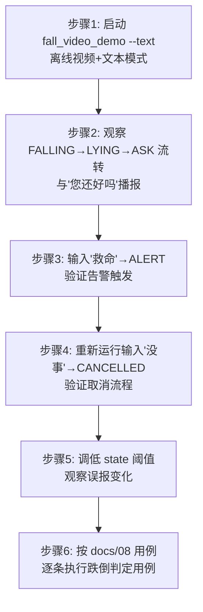

# 实验6：老人跌倒监护--跌倒判定集成测试（4h）

### 1.1 关联知识点

- 5.1.1 几何特征判定（躯干角>50° / 宽高比<0.5 / 髋部速度尖峰）（前置：4.2.2 RTMPose/BlazePose 姿态估计输出原图像素坐标关键点）
- 5.1.2 六状态机（IDLE / FALLING / LYING / ASK / ALERT / CANCELLED）每人独立（前置：5.1.1，特征值驱动状态转移）
- 5.1.3 IoU 跨帧人员关联与 cooldown 60s（前置：5.1.2，多人场景下每人独立 FSM + 全局 ASK 会话合并）

### 1.2 实验目标

1. **理解**跌倒判定的三大几何特征（躯干角、检测框宽高比、髋部速度尖峰）的物理含义与阈值意义，能解释每个判据在跌倒/站立/弯腰场景下的表现差异。
2. **掌握**六状态机（IDLE→FALLING→LYING→ASK→ALERT/CANCELLED）每帧推进逻辑，能说出每个状态转移的触发条件与时间窗口。
3. **理解**IoU 跨帧关联的贪心匹配机制——同一目标在连续帧中保持相同 `person_id`——以及 `FallbackCue` 在姿态不可用时的低置信回退路径。
4. **独立完成**跌倒→询问→应答全流程（救命→ALERT / 没事→CANCELLED）的端到端验证，能观察日志中的 `EVENT` 事件序列与 TTS 播报行为。
5. **迁移**：通过调参（`state.angle_thr`、`state.speed_factor` 等）感受阈值与误报率/漏报率的权衡，掌握"调参→观察→记录"的实验方法论。

### 1.3 实验环境

| 类别 | 内容 |
|------|------|
| 硬件 | 具身智能实验箱 B2 / 机器人小车 C1（RK3576 + NPU，本实验仅需离线视频，无需上电） |
| OS | Ubuntu 22.04，Python 3.10 |
| 测试素材 | `testdata/fall_slow_x264.mp4`（慢速跌倒视频，本地已有） |
| 运行命令 | `python3 apps/fall_video_demo.py --video testdata/fall_slow_x264.mp4 --text` |
| 核心模块 | `fall/monitor.py`、`fall/state_machine.py`、`fall/geometry.py`、`fall/assoc.py`、`fall/interaction.py` |
| 配置文件 | `config/fall_config.yaml`（state/interaction 两段） |
| 辅助文档 | `docs/08_视觉测试用例.md` |

### 1.4 实验难度

- 难度: ⭐⭐⭐（综合性）
- 重点：理解"每帧流水线 YOLO→IoU→姿态→特征→状态机"的完整数据流；掌握六状态机每个状态转移的时间条件和几何判据。
- 难点：**多目标场景下 ASK 全局会话合并**（`_ask_session` 机制）的边界行为；**FallbackCue** 低置信路径的触发条件（`vis_ok=False` + `bbox_aspect < 0.45` 持续 2s）与正常路径的区别。

### 1.5 实验现象

**快速验证命令**：

```bash
cd ros2_ws/src/xflz_eai_car1/app/elderly_companion/
python3 apps/fall_video_demo.py --video testdata/fall_slow_x264.mp4 --text
```

**预期效果描述**：

- 视频播放期间，检测框上方标注 `#1 FALLING` → `#1 LYING` → `#1 ASK` 状态流转。
- 进入 ASK 时终端输出 `EVENT to=ASK`，同时 TTS 播报"您还好吗？需要帮助吗？"（text 模式下为终端打印）。
- 在 stdin 输入 `救命` → 状态跳转 `ALERT`，日志输出 `ALERT: {...}`。
- 重新运行并输入 `没事` → 状态跳转 `CANCELLED`，日志输出 `EVENT to=CANCELLED` + "好的，请注意安全"。
- 画面叠加骨架（RTMPose 17 点），标注 `ang=XX spd=X.X` 实时特征值。

### 1.6 实验步骤

#### 整体流程图



#### 步骤1：启动 fall_video_demo 离线调试（30min）

**知识点讲解**：

**1.1.1 几何特征判定**

跌倒判定的核心是三个可量化的几何信号：**躯干角**（torso_angle_deg）= 肩中点到髋中点连线与竖直方向的夹角，0° 为直立、90° 为水平躺地，>50° 判为躺倒；**检测框宽高比**（bbox_aspect）= 框高/框宽，站立时通常 >1.5，躺下后 <1.0，阈值 0.5 意味着框宽是高的两倍以上才算"躺"；**髋部速度尖峰**（hip_speed）= 髋中点帧间像素位移，跌倒瞬间急速下降产生速度尖峰，阈值为 `0.25 × bbox_h`（即框高的 25%）。三个信号中"躺姿形态"（角+宽高比）是必要条件，"速度尖峰"是触发条件——只有"看起来像躺"且"动得很快"才判定为跌倒，避免弯腰捡物等静止低姿态误报。`fallback_cue.py` 中还有一条低置信路径：当姿态不可用（`vis_ok=False`）时，仅凭宽高比 <0.45 持续 2s 触发 `FALL_CUE_LOW`，直接进入 ASK（confidence=0.6），不经过 FALLING/LYING 观察窗。

**源码对应**：

- 几何特征计算：`fall/geometry.py L45-L80`（`fall_features` 函数：从 BlazePose/COCO 关键点计算 torso_angle_deg、hip_speed、bbox_aspect、vis_ok）
- 躯干角计算原理：`fall/geometry.py L58-L60`（`np.degrees(np.arctan2(abs(dx), abs(dy)))`：dx 为肩髋水平偏移、dy 为垂直偏移）
- 判据函数：`fall/state_machine.py L111-L126`（`_is_lying`：angle>thr 或 aspect<thr 或 bbox 形态）、`L127-L138`（`_speed_ok`：hip_speed > factor × bh 或 center_y_speed > factor × bh）

```bash
cd ros2_ws/src/xflz_eai_car1/app/elderly_companion/
python3 apps/fall_video_demo.py --video testdata/fall_slow_x264.mp4 --text
```

**操作步骤**：

1. 进入 `elderly_companion/` 目录，运行上述命令。`--text` 开启文本模式——stdin 代替麦克风/扬声器，无需硬件。
2. 程序启动后，加载 YOLOv8 行人检测模型和 RTMPose 姿态模型（约 5s），终端输出 `全部设备就绪，开始推理`。
3. 视频开始播放，画面左上角显示 FPS 和 ALERT 状态，检测框标注 `#1 IDLE`（白色）。
4. 当视频中人物跌倒时，观察检测框颜色和标注变化——这是几何特征触发状态转移的可视化。

**易错点**：

- ⚠️ 程序启动卡在"预初始化设备" → **解决**：检查 `config/fall_config.yaml` 中模型路径是否正确；若无 TTS 硬件，`speech.tts.enabled` 可设为 `false` 跳过预加载。
- ⚠️ 视频播放无检测框 → **解决**：确认 YOLO 模型路径 `detect.model_path` 指向 `yolov8n.rknn`；检查 `detect.classes: [person]` 过滤是否生效。

#### 步骤2：观察 FALLING→LYING→ASK 状态流转（45min）

**知识点讲解**：

**5.1.2 六状态机**

`FallStateMachine` 是一个纯逻辑的每帧推进器（`fall/state_machine.py L34-L83`），每人一个实例，完全独立。状态转移时序如下：**IDLE→FALLING**：`_is_lying(f)` 且 `_speed_ok(f)` 同时成立（形态+速度双条件），记录 `_fall_cue_ts`。**FALLING→LYING**：持续满足 `_is_lying(f)` 超过 `falling_window`（默认 1.5s），即"确实躺了"——若 1.5s+2s 内未满足则回 IDLE（误触发）。**LYING→ASK**：持续躺地超过 `lying_time`（默认 3.0s），即"起不来"，进入 ASK 询问；cooldown 期间不触发。**ASK→ALERT**：`ask_timeout`（默认 12s）内无语音应答则自动升级；收到 `confirm_words`（救命/帮/疼/起不来）立即 ALERT；收到 `cancel_words`（没事/不用）则 CANCELLED。**ALERT→IDLE**：`_is_recovered(f)` 恢复（bbox_aspect > 1.8 或 angle < 25° 持续 2s）后解除告警。**CANCELLED→FALLING**：冷却期只挡 ASK，不挡新跌倒——若再次满足形态+速度双条件可重新进入 FALLING。

**源码对应**：

- 状态机参数：`config/fall_config.yaml L49-L70`（state 段：angle_thr=50, aspect_thr=0.5, falling_window=1.5, lying_time=3.0, ask_timeout=12, cooldown=60）
- 状态转移逻辑：`fall/state_machine.py L134-L230`（`update` 方法：每个 `if self.state is PersonState.XXX` 分支对应一个状态的转移判据）
- 事件分发：`fall/monitor.py L340-L383`（`_dispatch` 方法：ASK→播报"您还好吗"+开应答窗口；ALERT→启动告警+证据存档；CANCELLED→停告警+播报"好的请注意安全"）

```bash
# 保持步骤1运行，观察终端 EVENT 日志
# 当视频中人物跌倒时，依次看到：
# EVENT from=IDLE to=FALLING   （躯干角>50° 且髋速尖峰）
# EVENT from=FALLING to=LYING  （持续躺地 1.5s）
# EVENT from=LYING to=ASK      （躺地 3s 起不来，播报"您还好吗"）
```

**操作步骤**：

1. 视频播放时，紧盯终端日志。跌倒瞬间输出 `EVENT from=IDLE to=FALLING`。
2. 约 1.5s 后输出 `EVENT from=FALLING to=LYING`——观察窗验证。
3. 再约 3s 后输出 `EVENT from=LYING to=ASK`——"起不来"确认。
4. 同时观察画面：检测框颜色从黄色（FALLING）→ 橙色（LYING）→ 紫色（ASK），叠加显示实时 `ang=XX spd=X.X`。
5. TTS 播报"您还好吗？需要帮助吗？"（text 模式下终端打印而非语音）。

**易错点**：

- ⚠️ FALLING→LYING 未触发就回 IDLE → **解决**：检查 `falling_window`（默认 1.5s）——若视频中跌倒后迅速起身（<1.5s），观察窗超时回 IDLE 是正确行为（`fall/state_machine.py L176-L178`："观察窗超时仍未躺下 → 回 IDLE（误触发）"）。
- ⚠️ ASK 未触发 → **解决**：检查 `cooldown` 是否在冷却期——60s 内第二次跌倒不会触发 ASK（`fall/state_machine.py L189-L190`：`if now < self._cooldown_until: return None`）。

#### 步骤3：输入"救命"验证 ALERT 告警流程（30min）

**知识点讲解**：

**5.1.2 ASK→ALERT（救命=确认词）**

ASK 窗口打开后（12s 超时），系统通过 `VoiceLoop.trigger_ask()` 开启语音应答窗口。用户在 stdin 输入文本后，`VoiceLoop` 调用 `monitor.on_asr(text)`，后者遍历所有 `FallStateMachine` 实例调用 `respond(text, now)`（`fall/state_machine.py L232-L255`）。`respond` 内部调用 `classify_response`（`fall/interaction.py L12-L20`）：按顺序匹配 `confirm_words`（救命/帮/疼/摔/起不来/救）和 `cancel_words`（没事/不用/还好/不需要/没有/扶起来/拉我）。确认词命中 → `ALERT`；取消词命中 → `CANCELLED`；都不命中 → 无动作（继续等）。**关键设计：一次应答只作用于一个会话**（`fall/monitor.py L206-L208`：`break` 后不再遍历），防止多人 ASK 场景下同一个"没事"触发多次 CANCELLED。

**源码对应**：

- ASR 应答入口：`fall/monitor.py L185-L213`（`on_asr` 方法：遍历 machines → respond → break）
- 应答分类：`fall/interaction.py L12-L20`（`classify_response`：先匹配 confirm_words，再匹配 cancel_words）
- 确认词列表：`config/fall_config.yaml L77`（`confirm_words: [救命, 帮, 疼, 摔, 起不来, 救]`）

```bash
# ASK 状态下，在 stdin 输入：
救命
# 预期：EVENT from=ASK to=ALERT，日志输出 ALERT: {...}，画面 ALERT=True 红色闪烁
```

**操作步骤**：

1. 等待视频中状态流转至 ASK（紫色框 + "您还好吗"播报）。
2. 在 stdin 快速输入 `救命` 并回车。
3. 观察日志：`EVENT from=ASK to=ALERT`，`ALERT: {'person_id': 1, 'from': 'ASK', 'to': 'ALERT', ...}`。
4. 画面左上角 `ALERT: True` 变红，检测框闪烁（`_annotate` 中 ALERT 状态隔帧变色 `L463-L464`）。
5. 证据自动存档：`runs/evidence/` 下生成截图 + `.avi` 视频片段 + `events.jsonl`。

**易错点**：

- ⚠️ 输入"救命"无反应 → **解决**：确认输入时机——必须在 ASK 窗口期内（12s 超时前）；若已超时自动进入 ALERT，再输入"救命"是多余操作（`fall/state_machine.py L199-L201`：`now >= self._ask_deadline` → ALERT）。
- ⚠️ 多次输入同一词触发重复告警 → **解决**：代码已有保护——`on_asr` 中 `break` 确保一次应答只作用于一个会话（`fall/monitor.py L208`）。

#### 步骤4：重新运行输入"没事"验证 CANCELLED 取消流程（30min）

**知识点讲解**：

**5.1.2 ASK→CANCELLED（没事=取消词）**

取消流程是安全设计的关键路径：ASK 期间用户回复"没事/不用"→ 系统判定"虚惊一场"→ 进入 CANCELLED 状态 → 停止蜂鸣器/LED → 播报"好的，请注意安全"→ 冷却 60s 内不再触发 ASK。CANCELLED 还有一个特殊行为：**冷却期只挡 ASK，不挡新跌倒**——若 60s 内用户再次跌倒（形态+速度双条件满足），可重新进入 FALLING→LYING→ASK 全流程（`fall/state_machine.py L215-L220`）。此外，ALERT 态下说"没事/不用"也可取消（`fall/state_machine.py L246-L250`），防止 ALERT 无视觉起身时永久卡死。

**源码对应**：

- 取消词匹配：`fall/state_machine.py L246-L250`（`respond` 方法：ALERT 态匹配窄表"没事/不用" → CANCELLED）
- 取消后动作：`fall/monitor.py L375-L378`（`_dispatch CANCELLED`：`_stop_alarm` + `sink.tts(cancel_tts)`）
- 冷却期逻辑：`fall/state_machine.py L189-L190`（LYING→ASK 前检查 `_cooldown_until`）
- CANCELLED→FALLING 重新判定：`fall/state_machine.py L215-L220`（"冷却期只挡 ASK，不挡新的跌倒判定"）

```bash
# 重新启动（Ctrl+C 退出后重新运行）：
python3 apps/fall_video_demo.py --video testdata/fall_slow_x264.mp4 --text
# 等待 ASK 状态出现后输入：
没事
# 预期：EVENT from=ASK to=CANCELLED，播报"好的，请注意安全"
```

**操作步骤**：

1. 重新运行命令，等待 ASK 状态出现。
2. 在 stdin 输入 `没事` 并回车。
3. 观察：日志输出 `EVENT from=ASK to=CANCELLED`，TTS 播报"好的，请注意安全"。
4. 画面检测框变灰（`STATE_COLORS[CANCELLED] = (128, 128, 128)`，`fall/monitor.py L39`）。
5. 验证冷却期：60s 内视频继续播放不应再次触发 ASK——若再次跌倒进入 FALLING→LYING，到 ASK 时被 cooldown 挡住。

**易错点**：

- ⚠️ CANCELLED 后又触发了 ASK → **解决**：检查 `cooldown` 值（默认 60s）；若视频持续播放超过 60s，冷却期结束后确实可以再次触发 ASK——这是设计行为（`fall/state_machine.py L189-L190`）。
- ⚠️ "没事"在 ALERT 态下不生效 → **解决**：ALERT 态取消使用窄表仅匹配"没事/不用"（`fall/state_machine.py L248`），"还好/不需要"等不在窄表中——这是故意设计，防止闲聊误取消告警。

#### 步骤5：调低 state 阈值观察误报变化（30min）

**知识点讲解**：

**5.1.1 几何特征阈值敏感性**

阈值是误报率与漏报率的权衡杠杆。`angle_thr`（默认 50°）调低至 30° 后，弯腰捡物（躯干角约 40°-60°）也会触发 FALLING——误报率显著上升；`aspect_thr`（默认 0.5）调高至 0.8 后，蹲姿（宽高比约 0.7-0.9）也会被判为"躺"；`speed_factor`（默认 0.25）调低至 0.1 后，正常行走的帧间位移也被判为"速度尖峰"。`config/fall_config.yaml` 的 state 段提供了一张完整的调参表：每个键对应一个判据的灵敏度旋钮。调参时建议"单变量调试"——每次只改一个参数，观察误报/漏报变化，记录基线与调优后的 EVENT 序列差异。

**源码对应**：

- 配置段定义：`config/fall_config.yaml L49-L70`（state 段全部参数）
- 阈值在状态机中的使用：`fall/state_machine.py L36-L37`（`angle_thr`/`aspect_thr`）、`L38`（`speed_factor`）
- bbox 形态备选判据：`fall/state_machine.py L42-L47`（`bbox_shrink_thr`/`bbox_center_drop_thr`/`bbox_lying_aspect`）
- docs/08 调参参考：`docs/08_视觉测试用例.md T8-5`（调参效果表）

```bash
# 编辑 config/fall_config.yaml，修改 state 段：
#   angle_thr: 30.0      # 从 50 降到 30（更敏感）
#   speed_factor: 0.10   # 从 0.25 降到 0.1（更敏感）
# 重新运行：
python3 apps/fall_video_demo.py --video testdata/fall_slow_x264.mp4 --text
# 观察弯腰/蹲姿是否触发 FALLING（误报↑）
```

**操作步骤**：

1. 备份原始 `config/fall_config.yaml`。
2. 修改 `state.angle_thr` 为 30.0（降低 20°），重新运行。
3. 观察：视频中弯腰/蹲姿是否触发 `EVENT from=IDLE to=FALLING`——若触发，说明 30° 对弯腰场景过于敏感。
4. 恢复 `angle_thr` 为 50.0，改 `state.speed_factor` 为 0.10，重新运行。
5. 观察：正常行走是否误触发——因为帧间位移容易超过 0.1×bbox_h。
6. 恢复所有参数，记录调参观察笔记。

**易错点**：

- ⚠️ 改了参数没生效 → **解决**：检查修改的文件路径是否正确（`config/fall_config.yaml`，不是别的副本）；确认程序重启后加载了新配置（日志无 `config error`）。
- ⚠️ 调参后整个视频都不触发了 → **解决**：可能阈值调太高（如 `angle_thr: 80`），跌倒时躯干角不够大——检查视频中实际角度值（画面叠加的 `ang=XX`）。

#### 步骤6：按 docs/08 执行跌倒判定用例（30min）

**知识点讲解**：

**5.1.3 IoU 跨帧人员关联**

IoU 关联器（`fall/assoc.py L28-L67`）解决"同一目标在连续帧中保持相同 ID"的问题。贪心匹配算法：每帧所有检测框与已有轨迹按 IoU 降序配对，IoU ≥ 0.3（`iou_thr`）才关联；未关联的框分配新 ID；丢失超过 3s（`max_age`）的轨迹释放 ID。这保证了：(1) 同一人在多帧中保持 `person_id` 不变，每个 ID 对应独立的 `FallStateMachine`；(2) 走出画面再回来可重新获得新 ID；(3) 多人同时存在时各走各的状态机。`docs/08_视觉测试用例.md` 中 T8-4 定义了完整的状态迁移断言表——不同场景（正面跌倒/侧面跌倒/弯腰/多人/起身）的期望事件序列。

**源码对应**：

- IoU 计算：`fall/assoc.py L28-L43`（`iou` 函数：交集面积/并集面积）
- 贪心关联：`fall/assoc.py L48-L67`（`update` 方法：过期清理 → 贪心配对 → 未关联分配新 ID）
- ASK 全局会话合并：`fall/monitor.py L351-L354`（`_dispatch ASK`：已有 `_ask_session` 时静默合并，不重复播报）
- docs/08 测试用例：`docs/08_视觉测试用例.md T8-4`（状态迁移断言表）

```bash
# 按 docs/08 T8-4 执行：
# 场景1：正面跌倒 → 期望 IDLE→FALLING→LYING→ASK
# 场景2：弯腰捡物 → 期望无 FALLING（角度/速度判据不误报）
# 场景3：多人先后跌倒 → 各自独立 FSM，ASK 全局合并
# 场景4：目标走出画面 → ASK 会话结束
# 场景5：起身 → CANCELLED 或 ALERT 解除
```

**操作步骤**：

1. 按 `docs/08_视觉测试用例.md T8-4` 表格逐场景验证。
2. 正面跌倒：等待完整 IDLE→FALLING→LYING→ASK 序列，记录 EVENT 日志。
3. 弯腰/蹲姿：观察是否有误触发（期望无 FALLING 或 FALLING 后回 IDLE）。
4. 多人场景（若有）：观察多人独立 `person_id`，验证"ASK 会话已存在（person X），person Y 进入 ASK 静默合并"日志。
5. 按 `docs/08_视觉测试用例.md T8-5` 调参效果表，验证 `angle_thr`/`aspect_thr`/`speed_factor` 的调参效果。
6. 汇总所有用例结果，填写实验报告。

**易错点**：

- ⚠️ 多人场景无法复现 → **解决**：`testdata/fall_slow_x264.mp4` 可能只有单人——可从 `testdata/` 中选取含多人的视频，或理解原理即可（IoU 关联逻辑可通过阅读 `fall/assoc.py L48-L67` 验证）。
- ⚠️ "目标走出画面"用例无法执行 → **解决**：离线视频中目标通常不走出画面——该用例主要验证代码逻辑（`fall/monitor.py L391-L407`：清理过期机器 + ASK 会话迁移），理解原理即可。

### 1.7 注意事项

- ⚠️ 本实验使用 `--text` 文本模式，**无需麦克风/扬声器**，stdin 输入代替语音——方便在无硬件环境下完成。
- ⚠️ Ctrl+C 退出后，若有残留进程占用 XFM 串口或 aplay 设备，运行 `pkill -f fall_video_demo` 和 `pkill -9 aplay` 清理。
- ⚠️ 修改 `config/fall_config.yaml` 前建议备份原文件，实验结束后恢复默认值。
- ⚠️ 证据文件存放在 `runs/evidence/`（不入库），实验结束后可清理。
- ⚠️ 多次运行同一视频，cooldown 60s 会阻断重复触发 ASK——若需快速测试多次触发，可缩小 `cooldown` 值或分段截取视频。

### 1.8 实验总结

**完成成果**：

- 成功运行 `fall_video_demo.py --text` 离线调试，观察到完整的 FALLING→LYING→ASK 状态流转。
- 验证了"救命→ALERT"和"没事→CANCELLED"两条语音应答路径。
- 通过调参实验感受了阈值与误报率的权衡关系。
- 按 `docs/08` T8-4/T8-5 用例完成了跌倒判定集成测试。

**技能收获**：

- 技能1：理解每帧流水线（YOLO→IoU→姿态→特征→状态机）的数据流与各模块职责边界。
- 技能2：掌握六状态机的每帧推进逻辑，能解释每个状态转移的时间/几何条件。
- 技能3：理解 IoU 跨帧关联和 ASK 全局会话合并机制，能分析多人场景下的边界行为。
- 技能4：通过调参实验掌握了"单变量调试→记录→分析"的实验方法论。

**常见问题与解决**：

| 问题 | 原因 | 解决方法 |
|------|------|----------|
| FALLING→LYING 不触发 | 跌倒后迅速起身，<1.5s 未满足 lying 条件 | 正确行为——`falling_window` 过滤瞬时姿态异常 |
| ASK 未触发 | cooldown 60s 内第二次跌倒 | 等待冷却期结束，或临时调小 `cooldown` 值 |
| 输入"救命"无反应 | 已超过 ask_timeout 12s | 在 ASK 窗口期内（12s 内）输入 |
| "没事"在 ALERT 态不生效 | ALERT 态仅匹配窄表"没事/不用" | 输入精确匹配词"没事"或"不用" |
| 多人 ASK 重复播报 | 已有保护——`break` 确保单次应答 | 检查日志中"ASK 会话静默合并"确认保护生效 |

### 1.9 实验报告要求

**思考题**：

1. **躯干角阈值与误报率的关系**：若将 `state.angle_thr` 从 50° 调低至 30°，哪些日常动作可能被误判为跌倒？请结合 `fall/state_machine.py L111-L126`（`_is_lying` 判据）和 `fall/state_machine.py L127-L138`（`_speed_ok` 判据）分析：为什么单纯调低角度阈值还不够，还需要速度尖峰作为第二条件？如果去掉速度条件会怎样？
2. **多目标应答单次化**：`fall/monitor.py L206-L208` 中 `on_asr` 遍历所有 `FallStateMachine` 后 `break` 的设计意图是什么？假设没有这个 `break`，当两人同时处于 ASK 状态时，用户输入一个"没事"会触发什么后果？请结合 `fall/monitor.py L351-L354`（ASK 全局会话合并）说明系统如何保证"只播一次询问、只开一个应答窗口"。
3. **FallbackCue 低置信路径**：`fallback_cue.py` 中 `FALL_CUE_LOW` 路径（confidence=0.6，直接进 ASK）与正常路径（IDLE→FALLING→LYING→ASK，confidence=1.0）有什么区别？什么场景下姿态不可用（`vis_ok=False`）？为什么不给低置信路径也加一个观察窗？

**评分标准**：

- 实验操作完成度（40 分）：6 个步骤全部完成，日志截图/记录完整（FALLING→LYING→ASK 流转 + 救命→ALERT + 没事→CANCELLED）。
- 状态机理解（30 分）：能准确画出六状态机转移图，标注每个转移的时间/几何条件；能解释 `_is_lying`/`_speed_ok`/`_is_recovered` 三个判据的物理含义。
- 调参实验（20 分）：至少调一个参数观察误报变化，记录基线与调优后对比，分析阈值与误报率的权衡关系。
- 思考题回答（10 分）：≥2 题回答完整、有源码引用、逻辑清晰 = 100 分。

---
