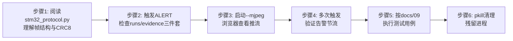
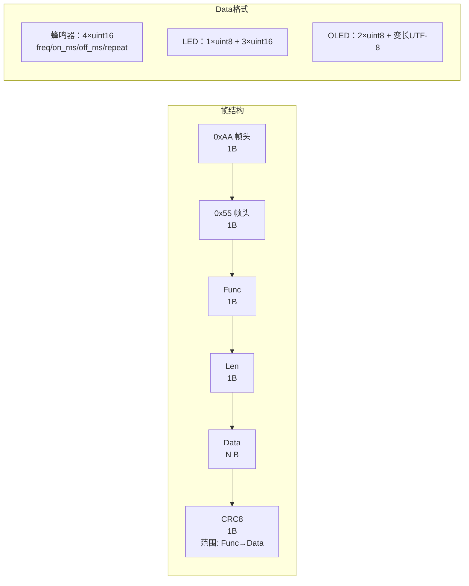

# 实验7：老人跌倒监护--告警与证据存档集成测试（4h）


### 1.1 关联知识点

- 5.2.1 STM32串口告警协议（0xAA 0x55帧+CRC8）[事实]（前置：Python字节操作、串口通信基础概念）
- 5.2.2 证据存档（FrameRing前后帧截图/.avi视频/events.jsonl）[流程]（前置：5.1.2跌倒状态机ALERT触发机制、cv2视频编码基础）
- 5.2.3 MJPEG实时推流（:8088/fall.mjpg）[概念]（前置：4.1.2 NMS后处理解码、HTTP流媒体基本概念）

### 1.2 实验目标

1. **理解**STM32串口告警协议的帧结构（0xAA 0x55帧头 + Func + Len + Data + CRC8校验）与三种设备帧（蜂鸣器/LED/OLED）的编码方式，能手工计算一帧的CRC8校验值。
2. **掌握**告警链路从状态机ALERT事件到硬件蜂鸣器触发的完整调用链（`_dispatch → _start_alarm → _refresh_alarm → hw_alert.buzzer_on → build_buzzer → uart.send`），理解告警节流（`buzzer.refresh`）防止串口刷屏的机制。
3. **理解**证据存档三件套（触发前截图 `.jpg`、告警前后窗口视频 `.avi`、事件日志 `events.jsonl`）的落盘时机与 `FrameRing` 环形缓冲的工作原理。
4. **掌握**MJPEG推流的启动验证方法（`--mjpeg` 参数 + 浏览器 `http://<IP>:8088/fall.mjpg`），能判断流是否正常播放。
5. **独立完成**告警与证据存档全流程的集成测试，按测试用例逐项验证蜂鸣器触发/停止、证据完整性、端口冲突、进程清理等场景。
6. **迁移**：将"硬件协议帧 → 门控函数 → 节流策略 → 证据落盘"的告警集成模式迁移到其他嵌入式报警/日志存档场景。

### 1.3 实验环境

| 类别 | 内容 |
|------|------|
| 硬件 | 具身智能机器人小车C1（RK3576 + STM32F407）；STM32串口告警板（USB0 `/dev/ttyUSB0`，1Mbps）；蜂鸣器/LED/OLED模块 |
| OS | Ubuntu 22.04 + ROS 2 Humble |
| Python | 3.10（使用板端默认环境） |
| 核心库 | pyserial（串口通信）、opencv-python（视频编码/截图）、mjpeg_streamer（推流服务） |
| 依赖 | `stm32_protocol.py`（CRC8查表帧构造）、`alert_hw.py`（硬件告警门控）、`evidence.py`（证据落盘） |
| 离线替代 | MJPEG推流与证据存档可离线验证（`--video` 模式 + `--text` 文本调试，蜂鸣器/LED降级为日志输出；无STM32串口时串口告警自动降级为音频+日志） |

> ⚠️ 本实验需要STM32串口告警硬件（USB0）才能验证蜂鸣器物理响应。若无硬件，蜂鸣器/LED/OLED操作将降级为日志输出（`alert_hw.py` L30-34 串口打开失败自动降级），不影响证据存档与MJPEG推流的验证。

### 1.4 实验难度

- 难度: ⭐⭐⭐（综合性）
- 重点：STM32串口协议帧结构（0xAA 0x55 + Func + Len + Data + CRC8）；告警触发到硬件响应的完整链路（`_start_alarm → _refresh_alarm → hw_alert.buzzer_on → build_buzzer → uart.send`）；证据三件套的落盘时机与文件格式。
- 难点：CRC8校验算法的手工验证（查表法遍历）；告警节流机制中 `buzzer.refresh`（5s）与 `alert_tts_interval`（10s）两套独立定时器的交互；证据 `FrameRing` 容量计算（`pre_seconds × fps`）与 `_pending_save` 两阶段收集逻辑。

### 1.5 实验现象

**快速验证流程**：

```bash
# 进入源码目录
cd ~/ros2_ws/src/xflz_eai_car1/app/elderly_companion

# 1. 查看STM32协议帧结构
grep -n "build_frame\|checksum_crc8\|0xAA" common/stm32_protocol.py

# 2. 查看告警配置
grep -A5 "^alert:" config/fall_config.yaml

# 3. 运行文本模式触发告警 ask的时候回复救命
python3 apps/fall_video_demo.py --video testdata/fall_slow_x264.mp4 --text

# 4. 检查证据文件
ls runs/evidence/ | tail
cat runs/evidence/events.jsonl | tail -1
```

**预期效果描述**：

- 文本模式输入"救命"后，日志输出 `串口告警就绪: /dev/ttyUSB0` → `ALERT: {…}` → 蜂鸣器以 1000Hz/0.15s 间隔交替响（有硬件时）或日志 `buzzer_on` 输出（无硬件时）。
- `runs/evidence/` 目录下生成 `fall_YYYYMMDD-HHMMSS_mmm_<person_id>.jpg`（触发前最后一帧截图）、`fall_…_post.jpg`（触发后首帧截图）、`fall_….avi`（告警前后窗口视频），`events.jsonl` 追加一条含 `person_id/from/to/ts/confidence` 的JSON记录。
- 多次触发时，蜂鸣器按 `buzzer.refresh=5.0s` 节流不刷屏；TTS按 `alert_tts_interval=10.0s` 节流不重复播报。
- 运行后执行 `pkill -9 aplay` 清理残留音频播放进程，确认无悬空子进程。

### 1.6 实验步骤

#### 整体流程图



#### 步骤1：阅读STM32协议帧结构与CRC8校验（50min）

**知识点讲解**：

**5.2.1 STM32串口告警协议（0xAA 0x55帧+CRC8）**

- **原理**：STM32F407与主控RK3576之间通过USB串口（默认 `/dev/ttyUSB0`，波特率1Mbps）通信，采用自定义帧协议。帧格式为：帧头 `0xAA 0x55`（2字节固定）+ `Func`（1字节，设备类型）+ `Len`（1字节，Data长度）+ `Data`（变长，设备参数）+ `CRC8`（1字节，从Func到Data末尾的校验和）。CRC8使用查表法（256项预计算表），遍历 func 到 data 全部字节计算校验值，确保帧在传输过程中未被篡改或损坏。三种设备类型帧分别控制蜂鸣器（`PACKET_FUNC_BUZZER=2`，`<HHHH>`格式：频率Hz、响时ms、停时ms、重复次数）、LED（`PACKET_FUNC_LED=1`，`<BHHH>`格式：LED编号、亮时ms、灭时ms、重复次数）、OLED（`PACKET_FUNC_OLED=10`，行号+UTF-8文本）。协议文档8.2的LEN=09描述与实际8字节不符，以 `board_sdk.py` 实测代码为准。
- **源码对应**：`common/stm32_protocol.py L31-33`（设备类型常量）、`L36-40`（CRC8查表函数）、`L44-47`（`build_frame` 完整帧构造）、`L50-56`（`build_buzzer` 蜂鸣器帧）、`L59-65`（`build_led` LED帧）、`L68-71`（`build_oled` OLED帧）

```python
# common/stm32_protocol.py L31-33
PACKET_FUNC_LED = 1
PACKET_FUNC_BUZZER = 2
PACKET_FUNC_OLED = 10

# common/stm32_protocol.py L36-40
def checksum_crc8(data: bytes) -> int:
    """CRC8 查表校验，范围 = func 到 data 末尾（与 STM32 checksum_crc8 一致）。"""
    check = 0
    for b in data:
        check = _CRC8_TABLE[check ^ b]
    return check & 0xFF

# common/stm32_protocol.py L44-47
def build_frame(func: int, data: bytes) -> bytes:
    """完整帧: AA 55 | func | len | data | crc8。"""
    payload = bytes([func, len(data)]) + data
    return b"\xAA\x55" + payload + bytes([checksum_crc8(payload)])
```

- **配图**（STM32 串口告警帧结构图）：标注每个字段的字节数：[AA][55][Func:1B][Len:1B][Data:N B][CRC8:1B]，下方标注三种Func对应的Data格式（蜂鸣器4个uint16、LED 1个uint8+3个uint16、OLED 2个uint8+变长UTF-8）。



**知识储备补充**：

- **背景与动机**：串口（UART/USB-虚拟串口）是字节流式、无帧边界的信道，收发双方必须靠"帧头 + 长度 + 校验"自行切分并验证一条完整报文。帧头 `0xAA 0x55`（两字节互补值）用于字节级同步对齐——只要在收端滑动窗口匹配到这两个字节，就认为找到了帧起点；`Len` 让接收端知道一段 Data 要收多少字节，形成"帧头→Len→按Len收Data→读CRC→校验"的确定性解析流程。CRC（循环冗余校验）相比简单的累加和/异或校验，能在**省一个字节校验位的前提下**检测出更多种错误形态（突发位翻转、整字节丢失/重复、字节顺序交换等），因此嵌入式点对点协议普遍用 CRC8/CRC16。
- **CRC8 数学定义**：本协议使用 **CRC-8/MAXIM**（多项式 $x^8 + x^5 + x^4 + 1$，即十六进制 `0x31`，反射多项式 `0x8C`），标准的校验字节计算式（字节按位、反射形式）：

  $$
  \begin{aligned}
  \mathrm{crc} &= 0x00 \\
  \text{对每个字节 } b_i &\in \text{payload}: \quad \mathrm{crc} \leftarrow \mathrm{crc} \oplus b_i, \quad \text{逐位 } 8 \text{ 次} \\
  \mathrm{crc} &\leftarrow \begin{cases}
  (\mathrm{crc} \gg 1) \oplus 0x8C & \text{if } \mathrm{crc} \And 1 = 1 \\
  \mathrm{crc} \gg 1 & \text{otherwise}
  \end{cases}
  \end{aligned}
  $$

  其中 `payload = [func, len(data)] + data`（`build_frame` L45），即从 Func 到 Data 末尾，**不含帧头**。标准校验值校验：`checksum_crc8(b"123456789") == 0xA1`（CRC-8/MAXIM 的公开 check 值，可作为实现是否正确的手工对拍基准）。
- **查表法原理**：逐位移位 8 次太慢——对每个输入字节，其影响可以预先算好一次移位结果并固化成 256 项表 $T[x]$。查表法把 `crc ^= byte; crc = 移位8次的结果(byte)` 预先做到表里，运行时每字节仅一次异或 + 一次查表（两行代码），1Mbps 下每帧（≤13 字节）CRC 只需微秒级，几乎零开销。
- **数值示例手工验证**：取 `build_buzzer(1000, 0.15, 0.15, 0)`，`len(data_)=8`（`<HHHH`），`payload = [0x02, 0x08] + 0xE803_9600_9600_0000`（小端）：

  运行 `checksum_crc8` 得到 `0x2D`，完整帧为 `AA 55 02 08 E8 03 96 00 96 00 00 00 2D`；可把 `0x2D` 与逐字节手算表值对拍。
- **三种设备帧的 Data 编码**：协议用 `struct.pack`（`<` 小端）构造。蜂鸣器 `<HHHH>`（4×uint16=8B，低字节在前）：频率Hz、响ms、停ms、重复次数；LED `<BHHH>`（1×uint8 + 3×uint16=7B）：LED编号、亮ms、灭ms、重复；OLED `bytes([line, len(tb)]) + tb`（2×uint8 + UTF-8 变长）：行号、文本字节长、UTF-8 文本。注意 OLED 的 `Len` = 2 + `len(tb)`（含 line 与 utf8 长度两字节），如 `build_oled(0,"跌倒告警!")` 的 `tb` 为 13 字节（4 汉字×3 + `!`×1），`Len=0x0F=15`（实测整帧 `AA 55 0A 0F 00 0D …`，CRC=0x8A）。
- **参考资源**：CRC-8/MAXIM 参数表（RevEng CRC Catalogue）；`struct` 打包格式官方文档（`<HHHH` 小端语义）。

**操作步骤**：

1. 打开 `common/stm32_protocol.py`，通读全文，重点理解 `_CRC8_TABLE`（L9-28 查找表）、`checksum_crc8`（L36-40 查表法）、`build_frame`（L44-47 帧构造）三个核心函数。
2. 手工验证一帧蜂鸣器数据的CRC8：用 `build_buzzer(1000, 0.15, 0.15, 0)` 计算 `data = struct.pack("<HHHH", 1000, 150, 150, 0)`，验证 `payload = [2, 8] + data` 的CRC8结果与Python运行结果一致。
3. 在 `fall/alert_hw.py` 中理解告警门控机制：`_gated()`（L70-78）同时检查config开关（`buzzer.enabled`）与串口可用性（`self.available`），两个条件任一不满足则静默跳过。

**易错点**：

- ⚠️ 误以为CRC8校验范围包含帧头 `0xAA 0x55` → **解决**：对照 `build_frame`（L44-47），`checksum_crc8(payload)` 中 `payload = bytes([func, len(data)]) + data`，CRC8范围从Func开始到Data末尾，不包含帧头。
- ⚠️ 忘记 `Len` 字段是Data长度而非整帧长度 → **解决**：`build_frame` L46 明确 `len(data)` 仅为Data部分长度，不含Func/Len本身。

#### 步骤2：触发ALERT，检查证据三件套（60min）

**知识点讲解**：

**5.2.2 证据存档（FrameRing前后帧截图/.avi视频/events.jsonl）**

- **原理**：证据存档采用"前后帧"策略：`FrameRing` 是一个固定容量的环形缓冲（容量 = `pre_seconds × fps`，默认3.0×10=30帧），每帧 `process_frame` 调用时将当前帧推入（`_frame_ring.push(frame, now)`）。当状态机进入ALERT时，`_start_alarm` 从FrameRing提取触发前的所有帧（`_frame_ring.window(now, pre_seconds)`）作为"前段"，同时启动 `_pending_save` 定时器收集触发后的帧（`post_seconds` 秒，默认2s）。定时器到期后调用 `save_evidence` 落盘三件套：触发前最后一帧截图（`.jpg`）、触发后首帧截图（`_post.jpg`）、前后帧合并的视频（`.avi`，mp4v编码）、事件日志追加到 `events.jsonl`（每行一个JSON，含 `person_id/from/to/ts/confidence`）。超过 `max_files`（默认100）自动轮转删除最旧事件（连带同名jpg/post/avi）。
- **源码对应**：`fall/evidence.py L19-33`（FrameRing类）、`L42-86`（`save_evidence` 完整落盘）、`fall/monitor.py L94-95`（FrameRing初始化）、`L251`（每帧push）、`L354-363`（ALERT后post帧收集与落盘）、`L502-513`（`_start_alarm` 提取前段+启动pending_save）

```python
# fall/evidence.py L19-27
class FrameRing:
    """按时间窗保留帧（存 BGR ndarray 引用，容量 = pre_seconds × fps）。"""
    def __init__(self, pre_seconds: float = 3.0, fps: float = 10.0):
        self.capacity = max(1, int(pre_seconds * fps))
        self._frames: deque = deque(maxlen=self.capacity)

    def push(self, frame: np.ndarray, ts: float) -> None:
        self._frames.append((ts, frame))

# fall/monitor.py L502-513
def _start_alarm(self, ev: dict) -> None:
    self._alert_active = True
    self._alert_person = ev.get("person_id")
    self.log.warning(f"ALERT: {ev}")
    now = time.time()
    pre = self._frame_ring.window(now, self.cfg["evidence"]["pre_seconds"])
    self._pending_save = {
        "ts": now, "pid": ev.get("person_id", -1),
        "pre": pre, "post": [], "due": now + self.cfg["evidence"]["post_seconds"],
        "events": [ev],
    }
    self._refresh_alarm(force=True)
```

**知识储备补充**：

- **背景与动机**：跌倒事件只有"事后复盘"价值，若只在 ALERT 触发当下才开存，会丢失触发前关键的"姿态前兆帧"（老人是怎么倒的、摔倒前画面）；若全程录像，文件体积与写入开销又难以接受。环形缓冲（ring buffer）正解法——**始终只保留最近一个时间窗的帧**，触发瞬间即可"取回带时间戳的前段"，无需提前知道事件何时发生。
- **环形缓冲与容量**：`collections.deque(maxlen=capacity)`（`evidence.py L24`）是数组化、线程安全的双端队列，当长度达到 `maxlen` 时，新 `append` 自动挤出最旧元素——这就是"环形"语义：容量固定为

  $$
  \text{capacity} = \max(1, \lfloor \text{pre\_seconds} \times \text{fps} \rfloor)
  $$

  默认 `3.0s × 10fps = 30` 帧。内存占用 ≈ `capacity × W × H × 3` 字节（仅存 ndarray 引用，不拷贝像素）：30 帧 640×480×3 ≈ 27.6 MB。增加 `pre_seconds` 或 `fps` 会线性加大常驻内存——板端 RK3576 只有 ~4GB 可用内存，故容量必须克制。
- **时间窗提取（window）**：`window(now, pre_seconds)`（`evidence.py L29-32`）以**时间戳**而非帧计数筛帧——返回 `t >= now - pre_seconds` 的所有帧。要点：容量是按预分配时间窗算的，但"取回多少"看 `last` 分支的 `now - pre_seconds` 截止时刻；若检测帧率低于 `fps`（掉帧），实际取回帧数可能少于 30，这是环形缓冲"按时间而非按数量"设计的健壮性来源。
- **双阶段 `_pending_save` 收集**：ALERT 触发时只做两件事——①提取前段 `pre`（**立即**，从 ring 取 `last` 秒窗口）；②登记 `_pending_save = {ts, pid, pre, post:[], due, events}`（`monitor.py L508-512`）。之后的每一帧 `process_frame` 都往 `post` 追加当前帧（`L356`），直到 `now >= due`（`due = ALERT时刻 + post_seconds=2.0`，`L510`）才落盘。因此截图"触发前最后一帧"取自 `pre_frames[-1]`、"触发后首帧"取自 `post_frames[0]`（`evidence.py L57/L59`）。
- **落盘与轮转清理**：`save_evidence`（`evidence.py L42-86`）按 `pre_frames[-1]`/`post_frames[0]` 写主 jpg 与 `_post.jpg`，合并视频用 `cv2.VideoWriter_fourcc(*"mp4v")` 写 `.avi`（≥2 帧才写，L62）；事件 JSON 以追加行写 `events.jsonl`（每行一个对象，`ensure_ascii=False` 保留中文）。轮转（L74-80）：按 `fall_*.jpg` 主文件计数，超过 `max_files`（默认100）删最旧（连带同名 `_post.jpg`/`.avi`），保证长期运行目录不无限膨胀。
- **参考资源**：CPython `collections.deque` maxlen 环形队列官方文档；OpenCV `VideoWriter` 与 FourCC 编码列表官方文档。

**操作步骤**：

1. 运行文本模式跌倒演示，触发一次ALERT：
   ```bash
   cd ~/ros2_ws/src/xflz_eai_car1/app/elderly_companion
   python3 apps/fall_video_demo.py --video testdata/fall_slow_x264.mp4 --text
   ```
2. 观察日志输出：状态机流转 `IDLE → FALLING → LYING → ASK → "您还好吗？"` → 输入"救命" → `ALERT: {person_id: 0, from: "ASK", to: "ALERT", …}`。
3. 等待证据收集完成（`post_seconds=2.0s`），检查 `runs/evidence/` 目录：
   ```bash
   cd ~/ros2_ws/src/xflz_eai_car1/app/elderly_companion
   ls -la runs/evidence/
   
   python3 -c "
   import json,sys
   lst=[json.loads(l) for l in open('runs/evidence/events.jsonl') if l.strip()]
   print(json.dumps(lst,ensure_ascii=False,indent=2))
   "
   ```
4. 验证三件套完整性：
   - `fall_<timestamp>_<person_id>.jpg`：触发前最后一帧截图（尺寸与视频帧一致）。
   - `fall_<timestamp>_<person_id>_post.jpg`：触发后首帧截图。
   - `fall_<timestamp>_<person_id>.avi`：告警前后窗口视频（约5s，3s前+2s后），可用 `ffplay` 或 `vlc` 播放。
   - `events.jsonl`：最后一条JSON包含 `person_id`、`from`（来源状态）、`to`（"ALERT"）、`ts`（时间戳）、`confidence`（置信度）。

**易错点**：

- ⚠️ 证据文件未生成 → **解决**：检查 `config/fall_config.yaml` 中 `evidence.dir` 是否为 `runs/evidence`，确认 `runs/evidence/` 目录可写；若视频帧数不足2帧（`len(all_frames) < 2`，`fall/evidence.py L66`），`.avi` 不会生成——需使用足够长的视频或降低 `pre_seconds`。
- ⚠️ `events.jsonl` 为空 → **解决**：确认状态机确实进入了ALERT（日志中应有 `ALERT: {…}` 输出），`_start_alarm`（`fall/monitor.py L502`）会将初始事件传入 `save_evidence`。

#### 步骤3：启动MJPEG推流，浏览器查看实时画面（40min）

**知识点讲解**：

**5.2.3 MJPEG实时推流（:8088/fall.mjpg）**

- **原理**：MJPEG推流基于 `mjpeg_streamer` 库（需先安装 `pip install -i https://pypi.tuna.tsinghua.edu.cn/simple mjpeg_streamer`）。`MjpegServer` 类封装了库的启动、帧推送、端口检测与停止逻辑。启动时先检测端口是否已被占用（`start()` L76-83 预检socket连接），避免静默404；推流流地址格式为 `http://<IP>:<port>/<stream_name>.mjpg`，默认端口8088（`config/fall_config.yaml server.port`）。每帧通过 `set_frame(bgr)` 推送numpy数组，浏览器端实时解码显示。画面叠加了状态色块（IDLE白→FALLING黄→LYING橙→ASK蓝→ALERT红闪烁），可直观观察状态机流转。`stop()` 吞掉库内部抛出的 `GracefulExit` 异常，防止进程退出时崩溃。
- **源码对应**：`vision/yolo/mjpeg_server.py L13-15`（安装指引）、`L56-62`（MjpegServer初始化，默认端口8080，`server.port` 覆盖为8088）、`L74-87`（`start()` 启动+端口预检）、`L89-90`（`set_frame` 推帧）

```bash
# 启动带MJPEG推流的跌倒演示
python3 apps/fall_video_demo.py --video testdata/fall_slow_x264.mp4 --text --mjpeg

# 另开浏览器访问（板端IP替换为实际地址）
# http://192.168.x.x:8088/fall.mjpg
```

**知识储备补充**：

- **MJPEG 协议原理**：MJPEG（Motion JPEG）不是"视频编码"，而是把每一帧 JPEG 编码成独立图像，再由 HTTP 以 **`multipart/x-mixed-replace`** 的流式响应逐个推送——浏览器收到后自动换帧，形成连续画面。它**没有帧间压缩**（不像 H.264 用参考帧），因此码率高、文件大，但换来的是**低延迟**（<100ms 级）与**实现简单**（每帧独立编码，丢一帧不影响后续帧）——这正是告警监看场景需要的特性（要"尽量实时"而非"尽量省码率"）。流地址 `http://<IP>:<port>/<stream_name>.mjpg` 中的流名会被 `MjpegServer.__init__` 自动补全 `.mjpg`（若未带，`mjpeg_server.py L42`）。
- **HTTP/1.1 chunked 流式响应**：服务器把 `multipart/x-mixed-replace` boundary 分隔的多帧 JPEG 作为响应体持续输出，连接不断开；服务端每推一帧就用当前 JPEG 字节覆写一段 body，客户端逐段渲染。请求建立后是一"长连接"（非一次性响应），因此 `set_frame(bgr)`（`L61-63`）可被不断调用而无需重建会话。
- **端口预检（防静默 404）**：`start()`（`L47-57`）先用 `socket.create_connection(("127.0.0.1", self.port), timeout=0.3)` 探测端口——若 0.3s 内有连接，说明端口已被占用，立即 `raise SystemExit("MJPEG 端口 … 已被占用…")`，避免用户在浏览器里看到一片空白/404 却不知根因。正常启动则 `self._server.start()`。
- **`stop()` 的 `GracefulExit` 兜底**：`mjpeg_streamer` 库内部用 aiohttp 的 daemon 线程；进程退出时库可能抛 `aiohttp.GracefulExit`（是 `BaseException` 而非 `Exception`，普通 `try/except Exception` 捕不到）——`stop()`（`L68-71`）用 `except BaseException` 吞掉，防止 `Aborted (core dumped)` 崩溃。这解释了为什么"一个守护线程的退出异常比主流程更值得专门捕获"。
- **参考资源**：`multipart/x-mixed-replace` RFC（RFC 2046 §5.1 媒体类型）；`mjpeg_streamer` PyPI 包与仓库说明。

**操作步骤**：

1. 在终端启动带 `--mjpeg` 参数的跌倒演示：
   ```bash
   python3 apps/fall_video_demo.py --video testdata/fall_slow_x264.mp4 --text --mjpeg
   ```
2. 确认日志输出 `MJPEG 端口 8088` 且无"端口已被占用"报错。
3. 在电脑浏览器打开 `http://<板端IP>:8088/fall.mjpg`，观察实时画面（延迟应 <1s）。
4. 观察画面中的状态色块变化：IDLE（白色）→ FALLING（黄色）→ LYING（橙色）→ ASK（蓝色）→ 输入"救命"后 ALERT（红色闪烁）。
5. 若端口8088被占用，先关闭占用进程或修改 `config/fall_config.yaml` 中 `server.port` 为空闲端口。

**易错点**：

- ⚠️ 浏览器显示"无法访问此网站" → **解决**：检查 `mjpeg_streamer` 是否已安装（`pip show mjpeg_streamer`）；确认板端IP与电脑在同一局域网；确认端口8088未被防火墙拦截。
- ⚠️ 端口8088已被占用（报错 `端口 8088 已被占用`） → **解决**：查找并关闭占用端口的进程 `lsof -i :8088`，或修改 `config/fall_config.yaml` 中 `server.port` 为其他端口。注意 `server.port`（MJPEG）与 `llm.server.port`（8080）不能冲突（`vision/yolo/mjpeg_server.py L47-L56` 预检）。

#### 步骤4：多次触发，验证告警节流不刷屏（40min）

**知识点讲解**：

**告警节流机制（buzzer.refresh 与 alert_tts_interval）**

- **原理**：告警触发后，系统在 ALERT 态持续运行 `_refresh_alarm`（`fall/monitor.py L515-525`），该函数每帧被调用但使用两套独立的节流定时器：①蜂鸣器/LED/OLED硬件告警受 `buzzer.refresh=5.0s` 控制——距上次蜂鸣器触发不足5s时跳过硬件发送（`_gated` + `_last_buzzer` 时间差检查），避免串口1Mbps下高频写入导致STM32缓冲区溢出或蜂鸣器持续长鸣；②TTS语音告警受 `alert_tts_interval=10.0s` 控制——距上次TTS播报不足10s时跳过语音，防止重复播报打扰老人。两套定时器独立运行，确保硬件告警频率（每5s一次蜂鸣）与语音告警频率（每10s一次播报）互不干扰。`_last_buzzer`（`fall/monitor.py L99`）和 `_last_alert_tts`（`L100`）分别记录上次触发时间戳，由 `_refresh_alarm` L518-522 和 L523-525 两个独立条件分支控制。
- **源码对应**：`fall/monitor.py L99-100`（节流时间戳初始化）、`L515-525`（`_refresh_alarm` 双定时器逻辑）、`config/fall_config.yaml` alert段（`buzzer.refresh: 5.0`）

```python
# fall/monitor.py L515-525
def _refresh_alarm(self, force: bool = False) -> None:
    now = time.time()
    a = self.cfg["alert"]
    if force or now - self._last_buzzer >= a["buzzer"]["refresh"]:
        self.hw_alert.buzzer_on()
        self.hw_alert.oled_text(a["oled"]["text"])
        self.hw_alert.led_on()
        self._last_buzzer = now
    if now - self._last_alert_tts >= self.cfg["interaction"]["alert_tts_interval"]:
        self.sink.tts(self.cfg["interaction"]["alert_tts"])
        self._last_alert_tts = now
```

**知识储备补充**：

- **背景与动机**：ALERT 态持续期间 `_refresh_alarm` 每帧都被调用（在 `process_frame` 主链路上），若每帧都发送字节到串口，1Mbps 下瞬间刷屏会溢出 STM32 的串口 FIFO / 缓冲区，蜂鸣器也会因指令不停而长鸣失真。节流（throttling)= 对**同一外部副作用**（串口写 / TTS 播报）设置最小触发间隔，把"高频轮询"收敛成"低频采样发出"。
- **两套独立定时器为何不合并**：硬件告警（蜂鸣/LED/OLED，5s）与语音告警（TTS，10s）是**不同生理通道**，语义与周期都不同——蜂鸣是"持续提醒声"（间隔短、不打断对话），语音是"询问式播报"（间隔长、避免骚扰老人）。若合并成单一定时器，要么语音被硬件的 5s 节奏拖得太频（骚扰），要么硬件被语音的 10s 拖得太疏（提醒不足）。故 `buzzer.refresh` 与 `alert_tts_interval` 分别维护各自上一触发戳 `_last_buzzer` / `_last_alert_tts`，独立分支判断，节奏互补而非同步。
- **门控逻辑拆解**：第一分支（`L518`）闸 `force or now - _last_buzzer >= buzzer.refresh`；第二分支（`L523`）闸 `now - _last_alert_tts >= alert_tts_interval`。条件用**单调时间戳差值**而非计数/累加器——天然免疫主循环帧率波动：无论帧率多少，只要距上次 ≥ 阈值就发，严格保证最小间隔 = 阈值。
- **force 语义**：`force=True` 让第一次（刚进入 ALERT）无条件立即响，避免"老人刚摔倒、系统却要等 5s 才响"的安全空洞（`_start_alarm` L513 传入 `force=True`）。后续每轮由时间差闸住。
- **硬件帧只发"偏置"**：`buzzer.refresh=5s` 时，STM32 每 5s 才收到一次 `build_buzzer` 帧，但其 `repeat=0` 表示"按给定 on/off 交替无限重复"——一次指令即可持续响 5s，节流不减少响铃覆盖、只减少串口写入频率。这是"节流"与"抑制"的关键区别：**周期短于硬件自持时长也能连续发声**。
- **参考资源**：Linux 单调时钟 `time.time()`/`time.monotonic()` 文档（节流时间差用单调时钟更稳）；通用 rate-limiting（令牌桶/min-interval）设计模式说明。

**操作步骤**：

1. 启动跌倒演示并触发第一次ALERT（输入"救命"），记录日志中 `buzzer_on` 出现的时间。
2. 在ALERT状态持续运行（不输入"没事"取消），观察日志中后续 `buzzer_on` 的时间间隔——应约为5s（`buzzer.refresh` 配置值）。
3. 同时观察TTS播报间隔——应约为10s（`alert_tts_interval` 配置值）。
4. 多次触发验证：输入"没事"取消 → 重新触发跌倒 → 再次输入"救命" → 确认节流时间戳正确重置（`_start_alarm` 中 `force=True` 首次不受节流限制）。
5. 检查串口日志无"串口发送失败"报错（有硬件时），确认STM32未因高频发送溢出。

**易错点**：

- ⚠️ 节流首次触发也被跳过 → **解决**：`_start_alarm`（L513）调用 `_refresh_alarm(force=True)` 强制首次无条件触发，节流仅在后续重复调用时生效。
- ⚠️ 修改 `buzzer.refresh` 后节流行为不符预期 → **解决**：`refresh` 单位是秒（float），确保 `config/fall_config.yaml` 中 `alert.buzzer.refresh` 值正确（默认5.0）；代码中 `now - self._last_buzzer >= a["buzzer"]["refresh"]`（L518）使用时间差比较，修改配置后需重启生效。

#### 步骤5：按docs/09_告警与证据测试用例.md执行测试（50min）

**知识点讲解**：

**测试用例结构化验证**

- **原理**：`docs/09_告警与证据测试用例.md` 定义了告警与证据模块的标准测试用例，分为四大类：串口告警（T9-1蜂鸣器触发与停止、T9-2串口不可用降级）、证据存档（T9-3证据完整性、T9-4证据目录清理与增长）、标注输出与推流（T9-5标注视频保存、T9-6 MJPEG推流、T9-7端口冲突检测）、生命周期（T9-8退出清理）。每条用例包含操作步骤与期望结果，应逐条执行并记录实际结果。重点关注T9-2（串口降级）——拔掉USB0后运行程序，确认降级为TTS播报+日志而不崩溃；T9-7（端口冲突）——修改 `server.port` 与 `llm.server.port` 为相同值，确认启动时检测到冲突并报错退出。
- **源码对应**：`docs/09_告警与证据测试用例.md` 全文（T9-1至T9-8）、`fall/alert_hw.py L25-34`（串口打开失败降级逻辑）

```bash
cd ~/ros2_ws/src/xflz_eai_car1/app/elderly_companion
# T9-1: 蜂鸣器触发与停止
python3 apps/fall_video_demo.py --video testdata/fall_slow_x264.mp4 --text
# 输入"救命" → 观察蜂鸣器响 / 日志 buzzer_on
# 输入"没事" → 观察蜂鸣停止 / 日志 buzzer_off

# T9-2: 串口不可用降级（拔掉USB0后运行）
python3 apps/fall_video_demo.py --video testdata/fall_slow_x264.mp4 --text
# 期望: 日志 "串口打开失败，硬件告警降级为音频+日志" + 不崩溃

# T9-3: 证据完整性
# 触发一次 ALERT 后 Ctrl+C
ls -la runs/evidence/
# 期望: jpg + _post.jpg + avi + events.jsonl 四件套

# T9-6: MJPEG推流
python3 apps/fall_video_demo.py --video testdata/fall_slow_x264.mp4 --text --mjpeg
# 浏览器打开 http://<板端IP>:8088/fall.mjpg

# T9-7: 端口冲突检测
# 修改 config/fall_config.yaml: server.port: 8080, llm.server.port: 8080
python3 apps/fall_video_demo.py --video testdata/fall_slow_x264.mp4 --text --mjpeg
# 期望: 启动报错退出（端口冲突）
```

**知识储备补充**：

- **背景与动机**：告警与证据是"安全关键"路径，必须靠**结构化测试用例**逐条固化行为，否则回归风险高（改状态机或证据逻辑时无意破坏降级/轮转/端口检测）。T9-1 至 T9-8 按 4 大类组织，把"正常流 + 异常流"都覆盖：正常（T9-1/T9-3/T9-5/T9-6）、降级（T9-2）、轮转（T9-4）、冲突/失败（T9-7/T9-8）。逐条执行并记录 Pass/Fail，是这类嵌入式告警集成模块的标准验收方式。
- **T9-2 串口降级的边界设计**：拔掉 USB0 后，`HardwareAlert.start()` 的 `uart.open()` 抛异常，被 `except Exception`（`alert_hw.py L34-37`）捕获置 `available=False` 并 WARN。之后 `buzzer_on/led_on/oled_text` 全走 `_gated()`（L70-78）——`not self.available` 分支直接 DEBUG 返回 False，**不会触碰 `self.uart.send`**，因此不会因 `NoneType` 崩溃。这就是"降级而不崩溃"的关键：把"串口是否可用"抽成门控条件，所有设备操作共用。
- **T9-7 端口冲突检测链路**：修改 `server.port` 与 `llm.server.port` 均为 8080 后，`apps/fall_app.py L336` 在装配阶段比较两者（`server.port == llm.server.port`）即报错退出；即便未显式比较，`MjpegServer.start()` 的 socket 预检（`mjpeg_server.py L52-57`）也会因 `llm` 已占 8080 而探测到占用 → `SystemExit`。双保险：配置层显式校验 + 运行时端口探测。
- **T9-8 退出清理的双层保障**：应用层 `shutdown()`（`monitor.py L580-588`）先强制落盘未保存的 `_pending_save` 证据，再释放 pose 引擎；进程层 `atexit`/`_cleanup` 兜底关闭硬件；独立子进程（aplay/llm_server/mjpeg_streamer）需 `pkill -9` 单独清理。真正"无残留"需三层都做——这不只是礼貌，还影响下轮实验（端口占用、音频设备被占）。
- **参考资源**：IEEE 829 软件测试文档标准（测试用例=前置条件+步骤+期望结果）；ISTQB 测试用例设计（正常/异常/边界流）通用方法。

**操作步骤**：

1. 打开 `docs/09_告警与证据测试用例.md`，通读T9-1至T9-8全部用例。
2. 逐条执行T9-1（蜂鸣器触发与停止）、T9-2（串口不可用降级）、T9-3（证据完整性）、T9-4（证据目录清理与增长）、T9-6（MJPEG推流）、T9-8（退出清理）。
3. 记录每条用例的期望结果与实际结果，标注Pass/Fail。
4. 若有Fail用例，定位根因并尝试修复（常见：mjpeg_streamer未安装→`pip install`、端口被占用→`lsof -i :8088`杀进程）。
5. 注意T9-8（退出清理）：正常退出后执行 `pgrep -f aplay` 和 `pgrep -f llm_server`，确认无残留子进程。

**易错点**：

- ⚠️ T9-2（串口降级）时程序崩溃 → **解决**：确认 `alert_hw.py` L30-34 的 `except Exception` 捕获块正常工作（`available=False` 后续操作被 `_gated` 拦截）；若崩溃，检查是否有未捕获的 `uart.send` 调用（`_send` L80-84 应已捕获）。
- ⚠️ T9-4（长时间运行证据增长）时证据文件丢失 → **解决**：检查 `evidence.max_files=100` 轮转机制（`fall/evidence.py L76-80`），超过100个主jpg后自动删除最旧事件；若需保留所有证据，增大 `max_files`。

#### 步骤6：资源清理——pkill清理残留进程（20min）

**知识点讲解**：

**运行产物不入库（runs/）与资源清理**

- **原理**：`runs/` 目录是所有运行产物（证据、日志、TTS缓存）的临时存放点，不纳入版本控制（`.gitignore` 排除）。程序退出时应执行两层清理：①进程级——`pkill -9 aplay` 清理残留的音频播放进程（ALSA aplay 是独立子进程，Ctrl+C 有时无法正确终止）；`pgrep -f llm_server` 检查LLM Flask服务子进程是否残留（`server_manager` 管理其生命周期）；②文件级——`runs/evidence/` 证据文件可通过 `rm -rf runs/evidence/*` 清理（不影响下次运行，程序会自动重建）。硬件资源释放由 `hw_alert.close()`（`fall/alert_hw.py L86-92`）和 `atexit` 兜底处理确保串口关闭、蜂鸣器停止。
- **源码对应**：`fall/alert_hw.py L86-92`（`close` 串口关闭）、`fall/monitor.py L579-588`（`shutdown` 证据强制落盘+资源释放）、`common/stm32_protocol.py`（帧构造纯函数无状态，无需清理）

```bash
cd ~/ros2_ws/src/xflz_eai_car1/app/elderly_companion
# 清理残留音频播放进程
pkill -9 aplay
pgrep -f aplay   # 应返回空

# 检查LLM服务子进程
pgrep -f llm_server
# 若有残留: pkill -9 -f llm_server

# 检查MJPEG进程
pgrep -f mjpeg_streamer
# 若有残留: pkill -9 -f mjpeg_streamer

# 清理运行产物（可选，下次运行自动重建）
rm -rf runs/evidence/*
```

**知识储备补充**：

- **背景与动机**：嵌入式/ROS 进程常派生"一次性外部子进程"（音频用 `aplay`/`paplay`、语音服务用 Flask/`llm_server`、推流用 aiohttp daemon 线程）。这类子进程**不随父进程 Ctrl+C 自动回收**——尤其 ALSA `aplay` 会持续占用声卡、aiohttp daemon 线程会残留占用端口。不清理的后果直接落到下一轮实验：`No available audio device`、`端口 8088 已被占用` 报错。故清理是"可复现实验"的必备环节而非可选动作。
- **进程树 vs 守护线程的清理差异**：`aplay`/`llm_server` 是**独立进程**（有 PID），用 `pgrep -f` 按命令行模糊匹配 + `pkill -9 -f` 强杀；`mjpeg_streamer` 的 aiohttp daemon 线程**没有独立 PID**，`pkill -9 -f mjpeg_streamer` 匹配的是包含 `mjpeg_streamer` 字样的 Python 主进程——因此日志里"查无此进程"反而可能是好事（daemon 线程已随主进程退出）。`hw_alert.close()`（`alert_hw.py L86-93`）负责串口关闭，`atexit` 在进程退出时兜底调用，确保串口 fd 不泄漏。
- **退出后端口必须被释放的时间差**：已 close 的 socket 端口会进入短时 `TIME_WAIT`，若立刻重启程序探测端口可能仍显示占用——用 `lsof -i :8088` 确认占用进程是"僵尸 TIME_WAIT"还是"真残留进程"，后者才需 `pkill`。
- **运行产物不入库的原因**：`runs/`（证据 jpg/avi、日志、TTS 缓存）体积大、易漂移、含隐私（跌倒人像），纳入 git 会污染仓库且版本对比失真；用 `.gitignore` 排除，下次运行自动重建，目录本身代码创建。
- **参考资源**：Linux 进程管理 `pgrep`/`pkill`/`kill` 手册页（`-f` 匹配完整命令行、`-9` SIGKILL 语义）；ALSA `aplay` 播放器文档（设备占用与 `-D` 指定设备）。

**操作步骤**：

1. 在实验结束后，依次执行以下清理命令：
   ```bash
   pkill -9 aplay
   pgrep -f llm_server && pkill -9 -f llm_server
   pgrep -f mjpeg_streamer && pkill -9 -f mjpeg_streamer
   ```
2. 确认所有子进程已终止：`pgrep -a -f elderly_companion` 应返回空。
3. 验证硬件资源已释放：串口 `/dev/ttyUSB0` 不再被占用（`lsof /dev/ttyUSB0` 返回空）。
4. （可选）清理 `runs/` 目录：`rm -rf runs/evidence/* runs/logs/* runs/tts_cache/*`。

**易错点**：

- ⚠️ `pkill -9 aplay` 无效（进程仍在） → **解决**：确认 `aplay` 进程名准确（`pgrep -a aplay` 先查看），若进程名包含路径需用 `pkill -9 -f aplay`。某些ALSA设备（如 `plughw:3,0`）的播放进程可能以 `aplay` 子进程形式存在。
- ⚠️ 清理后下次运行报"端口已被占用" → **解决**：`mjpeg_streamer` 的aiohttp daemon线程可能在进程退出后残留，执行 `pkill -9 -f mjpeg_streamer` 彻底清理。

### 1.7 注意事项

- ⚠️ 本实验**需要STM32串口告警硬件**（USB0 `/dev/ttyUSB0`）才能验证蜂鸣器/LED/OLED的物理响应。无硬件时，告警操作自动降级为日志输出（`alert_hw.py` L30-34），不影响证据存档与MJPEG推流验证。
- ⚠️ 证据文件存储在 `runs/evidence/`（`config/fall_config.yaml` 的 `evidence.dir`），该目录被 `.gitignore` 排除，**不入库**。清理时 `rm -rf runs/evidence/*` 不影响版本控制。
- ⚠️ MJPEG端口（默认8088）与LLM Flask端口（默认8080）不能冲突。若两者配置相同，程序启动时报错退出（`mjpeg_server.py` L76-83 预检）。
- ⚠️ 蜂鸣器节流（`buzzer.refresh=5.0s`）与TTS节流（`alert_tts_interval=10.0s`）是两套独立定时器，修改任一配置需重启生效。
- ⚠️ 退出程序后务必执行 `pkill -9 aplay` 清理残留音频播放进程，避免影响后续实验的音频设备占用。
- ⚠️ 安装 `mjpeg_streamer` 需使用清华镜像：`pip install -i https://pypi.tuna.tsinghua.edu.cn/simple mjpeg_streamer`。

### 1.8 实验总结

**完成成果**:

- 一份STM32串口协议帧结构分析笔记（含CRC8手工验证过程与三种设备帧格式对照表）。
- 告警触发→硬件响应完整链路图（从状态机ALERT事件到 `uart.send` 字节流）。
- 证据三件套（截图/视频/事件日志）的完整性验证记录（含文件命名规则与events.jsonl格式）。
- 告警节流机制分析（buzzer.refresh 5s + alert_tts_interval 10s 双定时器）。
- docs/09测试用例执行记录（T9-1至T9-8逐条Pass/Fail结果）。
- 资源清理检查清单（aplay/llm_server/mjpeg_streamer 进程清理）。

**技能收获**:

- 技能1：嵌入式串口协议帧结构分析方法（帧头+功能码+长度+数据+校验 → 逐字段解析与手工验证）
- 技能2：硬件告警门控与节流策略设计（config开关 + 串口可用性 + 时间差节流 → 防刷屏/防溢出）
- 技能3：事件驱动证据存档（环形缓冲 → 前后帧分离收集 → 多文件联合落盘 → 自动轮转清理）

**常见问题与解决**:

| 问题 | 原因 | 解决方法 |
|------|------|----------|
| 证据 `.avi` 文件未生成 | 视频帧数不足2帧（`fall/evidence.py L66` 条件不满足） | 使用更长的测试视频或降低 `evidence.pre_seconds` 确保至少2帧 |
| 蜂鸣器首次触发也被节流 | 误以为 `force=True` 不生效 | `_start_alarm` L513 调用 `_refresh_alarm(force=True)` 强制首次无条件触发，检查日志确认 |
| 端口8088被占用报错退出 | 上次demo未关闭或端口被其他服务占用 | `lsof -i :8088` 查找并kill占用进程，或修改 `server.port` |
| `events.jsonl` 为空 | 状态机未进入ALERT | 确认日志中有 `ALERT: {…}` 输出；检查 `confirm_words` 配置是否包含输入词 |
| 串口降级后程序仍崩溃 | `_gated` 拦截了buzzer但oled/led未拦截 | 确认 `alert_hw.py` L70-78 三种设备都经过 `_gated` 门控检查 |

### 1.9 实验报告要求

**思考题**:

1. STM32串口协议为什么选用查表法（256项CRC8查找表）而非逐字节计算？在1Mbps波特率下，CRC8校验能检测出哪些类型的传输错误？如果帧头 `0xAA 0x55` 被干扰翻转为其他值，CRC8能否检测出来？为什么？
2. 证据存档采用"前后帧"策略（`FrameRing` 3s前 + 2s后），请分析：如果将 `pre_seconds` 从3s增大到10s，在板端RK3576内存受限环境下会带来什么影响？`FrameRing` 的容量计算公式 `capacity = int(pre_seconds × fps)` 中，`fps=10` 的选择依据是什么？将 `fps` 改为30会怎样？
3. 告警节流使用两套独立定时器（`buzzer.refresh=5s` 与 `alert_tts_interval=10s`），为什么不让两者共用一个定时器？在ALERT持续状态下（老人未应答），这两套定时器如何保证硬件告警与语音告警的节奏互补而非叠加？
4. `alert_hw.py` 中串口打开失败时降级为"音频+日志"（`L30-34`），而不是直接报错退出。请分析这种"优雅降级"设计对老人监护场景的安全意义：如果告警因硬件故障直接退出程序，会导致什么后果？

**评分标准**:

- STM32协议帧结构分析（25分）：帧格式正确（AA 55+Func+Len+Data+CRC8）、CRC8手工验证过程完整、三种设备帧格式对照正确
- 告警触发链路分析（25分）：从状态机ALERT到 `uart.send` 的完整调用链、节流双定时器机制理解正确、`force=True` 首次触发逻辑正确
- 证据三件套验证（25分）：文件完整性（jpg+post.jpg+avi+jsonl）、events.jsonl格式正确、FrameRing容量与前后帧策略分析
- 测试用例执行与资源清理（25分）：T9-1至T9-8逐条执行记录、pkill清理检查清单、进程残留确认无 = 100分

---
## 更新日志

| 版本 | 日期 | 变更说明 |
|------|------|----------|
| v1.1 | 2026-08-21 | 知识点补充 |
