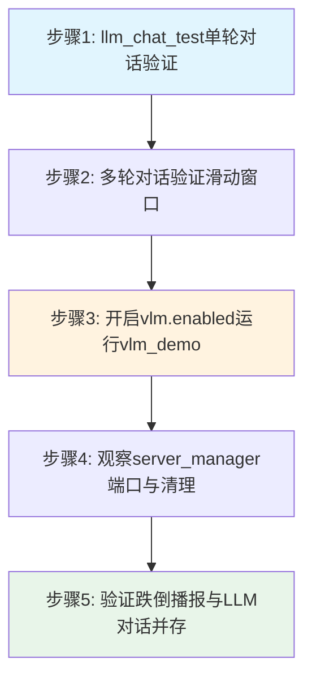

# 实验8：老人跌倒监护--LLM对话与VLM复核集成测试（8h）

### 1.1 关联知识点

- 6.1.1 RKLLM本地大模型推理（Qwen3.5 RK3576 NPU）（前置：RKNN NPU基础概念、ctypes动态库加载）
- 6.1.2 Flask OpenAI兼容HTTP服务与多轮历史滑动窗口（前置：6.1.1，需理解HTTP API与SSE流式传输）
- 6.1.3 server_manager子进程生命周期（端口自动管理/清理）（前置：6.1.2，需了解子进程Popen管理）
- 6.2.1 VLM视觉复核（vision_judge，默认关闭/内存考虑）（前置：6.1.1、4.1.1，需了解RKLLM多模态输入）
- 6.2.2 跌倒判定与LLM对话并存路由（前置：1.3.1、6.2.1，需了解monitor三接口机制）

### 1.2 实验目标

1. **理解**RKLLM本地大模型在RK3576 NPU上的推理机制，掌握Qwen3.5模型通过ctypes加载`librkllmrt.so`动态库并运行推理的完整链路。
2. **掌握**Flask OpenAI兼容HTTP服务（`/v1/chat/completions`）的请求/响应格式，理解SSE流式传输与非流式两种模式的差异。
3. **理解**多轮对话历史滑动窗口的工作原理：`LLMChat.ask()`将历史拼入用户消息内容，通过`max_history`参数控制窗口大小，避免token无限增长。
4. **掌握**`LLMServerManager`子进程生命周期管理：端口预检（`pick_free_port`从8080递增）、冲突检测（复用外部服务vs拉起子进程）、就绪轮询（GET `/v1/models`）、退出清理（`stop()`仅终止自己拉起的进程）。
5. **理解**VLM视觉复核在跌倒判定中的二审角色，掌握`RKLLMVisionJudge`懒加载机制（首次judge时初始化，约10-60s）与异常降级策略。
6. **完成**LLM单轮对话、多轮历史滑动窗口、VLM复核、端口管理与进程清理的全链路验证。

### 1.3 实验环境

| 类别 | 内容 |
|------|------|
| 硬件 | 具身智能实验箱B2 / 机器人小车C1（RK3576 + 6TOPS NPU） |
| OS | Ubuntu 22.04 + Python 3.10 |
| 核心模型 | Qwen3.5-0.8B_w4a16_g128_rk3576.rkllm（约1.5G内存）；VLM需额外Qwen3.5-0.8B_vision_rk3576.rknn（约1.3G内存） |
| 动态库 | librkllmrt.so（位于/usr/lib） |
| 核心库 | Flask、ctypes、urllib（stdlib）、threading |
| 配置 | config/fall_config.yaml（llm段+model.vlm段） |
| 内存注意 | LLM单独约1.5G；VLM开启后总计约3.0G+，板端内存紧张需谨慎 |

### 1.4 实验难度

- 难度: ⭐⭐⭐（综合性）
- 重点：RKLLM服务启动与OpenAI兼容API交互；多轮历史滑动窗口的拼接机制；server_manager端口预检与子进程清理。
- 难点：`LLMChat.ask()`将多轮历史拼入单条用户消息的设计原因（RKLLM服务端`get_last_input`只取最后一条新增user消息）；VLM懒加载时机与内存占用权衡；端口冲突检测与外部服务复用的判断逻辑。

### 1.5 实验现象

**快速验证命令**：

```bash
cd ~/ros2_ws/src/xflz_eai_car1/app/elderly_companion
# 在 elderly_companion 目录下

# 1. LLM 单轮对话
python3 apps/llm_chat_test.py --prompt "你好，你是谁？"
# 预期：输出"小飞"自我介绍（≤2句话），约2-8s响应

# 2. 查看 LLM 服务配置
grep -A 12 "^llm:" config/fall_config.yaml
# 预期：显示 llm.enabled=true, port=8080, max_history=6

# 3. VLM 配置检查（默认关闭）
grep -A 6 "vlm:" config/fall_config.yaml
# 预期：显示 model.vlm.enabled=false

# 4. 端口检查（LLM 服务启动后）
ss -tlnp | grep 8080
# 预期：显示 Flask 服务监听 8080
```

**预期效果描述**：

- 单轮对话：输入"你好"→ 2-8s内收到小飞的友好回复（不超过两句话）。
- 多轮对话：连续提问→每轮回复自然衔接上下文；输入`reset`后上下文清空。
- VLM复核（开启后）：输入跌倒图片→输出label=fall/not_fall/uncertain + confidence + reason。
- 端口管理：服务启动后`ss -tlnp | grep 8080`可见监听；退出后端口释放。
- 进程清理：退出llm_chat_test后`ps aux | grep llm_server`无残留flask进程。

```bash
(ros2_venv) iflytek@localhost:~/ros2_ws/src/xflz_eai_car1/app/elderly_companion$ python3 apps/llm_chat_test.py --prompt "你好，你是谁？"
[2026-08-21 18:00:13,655][INFO][llm_mgr] 拉起 LLM 服务: /home/iflytek/ros2_venv/bin/python3 /home/iflytek/ros2_ws/src/xflz_eai_car1/app/elderly_companion/llm/llm_server.py --rkllm_model_path /home/iflytek/models/rkllm/Qwen3.5-0.8B_w4a16_g128_rk3576.rkllm --target_platform rk3576 --port 8080（日志 runs/logs/llm_server.log，首次加载 30-60s）
[2026-08-21 18:00:17,678][INFO][llm_mgr] LLM 服务就绪: http://127.0.0.1:8080
LLM 就绪: http://127.0.0.1:8080（输入 exit 退出）
[5.9s] 回复: 你好！我是 Qwen3.5，是通义千问系列大模型中的一个版本。我具备人类语言模型所具备的多种能力：包括逻辑推理、代码编写、数学计算、文本生成等。
[2026-08-21 18:00:24,511][INFO][llm_mgr] LLM 服务子进程已停止
```

### 1.6 实验步骤

#### 整体流程图



#### 步骤1：LLM单轮对话验证（90min）

**知识点讲解**：

**6.1.1 RKLLM本地大模型推理**

RKLLM是Rockchip推出的NPU本地大模型推理框架，通过`ctypes.CDLL('/usr/lib/librkllmrt.so')`加载C++动态库（`llm/llm_server.py L15-L16`），在RK3576的6TOPS NPU上运行量化后的Qwen3.5-0.8B模型。模型以RKLLM格式存储（约1.5G），推理时通过`RKLLMParam`结构体传入模型路径与平台参数（`rk3576`），由`RKLLM.__init__()`完成初始化（`llm/llm_server.py L255-L360`）。推理采用回调机制：`callback_impl`在C++侧逐token触发，将输出累积到`global_text`全局列表（`llm/llm_server.py L213-L214, L221-L232`），Python侧通过`run_inference()`或`generate_stream()`消费这些token。本地推理的优势在于零网络延迟、数据不出板端，适合老人监护等隐私敏感场景。

**6.1.2 Flask OpenAI兼容HTTP服务**

`llm_server.py`在底部（`L692-L762`）启动Flask服务，暴露两个OpenAI兼容端点：`GET /v1/models`（`L584-L596`）返回模型列表；`POST /v1/chat/completions`（`L598-L690`）接收标准OpenAI请求格式（messages数组），支持`stream=true`的SSE流式响应。`LLMClient`（`llm/llm_client.py L59-L150`）是零依赖HTTP客户端（仅用stdlib urllib），提供`chat()`（非流式）、`chat_stream()`（SSE逐token）、`chat_json()`（JSON解析）三种调用方式。请求通过`urllib.request`发送POST到`{endpoint}/v1/chat/completions`（`llm/llm_client.py L77`），响应解析`choices[0].message.content`字段。

- **源码对应**：`llm/llm_server.py L15-L16（ctypes加载）、L213-L232（回调机制）、L584-L696（路由定义与启动）`；`llm/llm_client.py L59-L96（LLMClient.chat）`、`llm/llm_client.py L98-L145（chat_stream SSE解析）`

```python
# llm/llm_server.py L15-L16：加载 RKLLM 动态库
rkllm_lib = ctypes.CDLL('/usr/lib/librkllmrt.so')

# llm/llm_client.py L68-L78：LLMClient.chat 非流式调用
def chat(self, messages: list[dict], max_tokens: int = 200) -> str:
    """POST /v1/chat/completions；返回 assistant 文本。失败抛 LLMError。"""
    ...
    f"{self.endpoint}/v1/chat/completions",
    ...
```

**知识储备补充**：

- **量化与内存**：Qwen3.5-0.8B 为约 8 亿参数的 decoder-only 模型，即约 $0.8 \times 10^9$ 个权重。以 FP16 存储需 $0.8 \times 2 \approx 1.6\,\mathrm{GB}$；本工程用 w4a16 量化（权重 4bit、激活 16bit），权重下压至约 `0.8 × 0.5 ≈ 0.4 GB`，加激活/中间态后实测约 1.5G。量化损失精度换取 NPU 上可运行性——RK3576 板端 RAM 有限，FP16 全精度模型无法常驻。

- **采样参数与数学含义**（`llm/llm_server.py L259-L272`，`RKLLM.__init__` 预设）：`temperature=0.8` 控制下一个 token 概率分布的软化程度；`top_p=0.9`（nucleus 采样）只从累积概率达 0.9 的 token 集合中采样；`top_k=1` 即贪心解码（取概率最高 token）；`repeat_penalty=1.1` 对已生成 token 的概率打折抑制重复；`max_context_len=4096` 为上下文长度上限。这些参数同时可经 POST `/v1/chat/completions` 的请求体按次覆盖（`llm/llm_server.py L617-621`）。

- **采样公式**：在每一步，模型输出词表上的 logits 向量 $z_i$，经 softmax 得概率。加入 temperature 后：

  $$
  P(w_i \mid \mathrm{context}) = \frac{\exp(z_i / T)}{\sum_{j} \exp(z_j / T)}, \qquad T = \mathrm{temperature}
  $$

  $T > 1$ 使分布更均匀（更随机），$T \to 0$ 逼近贪心（取 argmax）。top_p 在其上再做截断：设 $V = \{w_i : \sum_{i'\in V} P_{i'} \approx 0.9\}$ 为概率和贴近 0.9 的最小累积集合，仅在该集合内重归一化采样。逐 token 由 C++ 侧 `callback_impl` 回调到 Python，累积入 `global_text` 全局列表（`llm/llm_server.py L221-232`）。

- **回调即流式**：`callback_impl(result, userdata, state)` 的 state 取 `LLMCallState`（NORMAL=0/FINISH=2/ERROR=3）。NORMAL 时把 `result.contents.text` 追加进 `global_text`——每个 token 到达都会触发一次回调，因此**无需额外改动即天然构成逐 token 输出流**；`generate_stream()`（`llm/llm_server.py L563`）正是消费这个队列按 token yield，供 Flask SSE 推送。

- **SSE 流式协议**：OpenAI 兼容端点在与 `stream=true` 时逐块返回 `text/event-stream`，每块形如 `data: {"choices":[{"delta":{"content":"..."}}]}\n\n`，结尾 `data: [DONE]`。`LLMClient.chat_stream`（`llm/llm_client.py L98-L145`）逐行解析 `data:` 前缀取 `delta.content`，遇 `[DONE]` 停止。非流式 `chat()`（`L59-L96`）则一次读回完整 JSON，解析 `choices[0].message.content`。

- **参考资源**：Rockchip RKLLM 文档 `https://github.com/airockchip/rknn-llm`；OpenAI Chat Completions 流式规范 `https://platform.openai.com/docs/api-reference/chat`；Qwen 量化 w4a16 说明（`https://qwen.readthedocs.io/`）。

**操作步骤**：

```bash
cd ~/ros2_ws/src/xflz_eai_car1/app/elderly_companion
# 单发模式：输入一个问题，获取回复后退出
python3 apps/llm_chat_test.py --prompt "你好，你是谁？"
```

1. 观察输出：服务启动约5-15s（RKLLM模型加载），随后输出回复。
2. 注意回复格式：小飞自我介绍不超过两句话（受system_prompt约束）。
3. 记录响应时间：`[{time}s]`显示的耗时（首次含模型加载，后续为纯推理时间）。

**易错点**：

- ⚠️ 首次启动时模型加载需要5-15s无输出 → **解决**：耐心等待，这是RKLLM在NPU上加载模型的正常行为；若超过30s无响应，检查`model_path`是否正确（`config/fall_config.yaml L145`）。
- ⚠️ 报错`LLM 服务不可用` → **解决**：检查`llm.server.model_path`路径是否存在（`config/fall_config.yaml L145`），确认librkllmrt.so已安装在`/usr/lib`。

#### 步骤2：多轮对话验证历史滑动窗口（90min）

**知识点讲解**：

**6.1.2 多轮历史滑动窗口**

`LLMChat`类（`llm/chat.py L16-L73`）管理多轮对话历史。核心机制在`ask()`方法（`L25-L70`）：由于RKLLM服务端的`get_last_input()`（`llm/llm_server.py L468`）只取最后一条新增的user消息（忽略历史列表），`LLMChat`采用**拼接策略**——将最近`max_history`轮的历史以`用户：xxx\n小飞：xxx`格式拼入单条user消息内容（`llm/chat.py L36-L46`），并加前缀"以下是一段对话记录，请根据上下文自然回答最后一句，不要复述记录"。`max_history`默认为6（`config/fall_config.yaml L151`），即保留最近6轮（12条消息），超出后`self.history`按`[-2 * max_history:]`截断（`llm/chat.py L68-L69`）。这种设计在RKLLM不支持原生多轮messages数组的情况下，通过内容注入实现了上下文感知的多轮对话。

- **源码对应**：`llm/chat.py L25-L70（ask方法）、L36-L46（历史拼接逻辑）、L68-L69（滑动截断）`

```python
# llm/chat.py L36-L46：历史拼接为单条用户消息
if self.history:
    lines = []
    for m in self.history[-2 * self.max_history:]:
        who = "用户" if m["role"] == "user" else "小飞"
        lines.append(f"{who}：{m['content']}")
    lines.append(f"用户：{text}")
    content = ("以下是一段对话记录，请根据上下文自然回答最后一句，"
               "不要复述记录：\n" + "\n".join(lines))
```

**知识储备补充**：

- **滑动窗口数学**：`LLMChat.history` 按 `[user, assistant]` 交替追加（`llm/chat.py L70-71`），每次 `ask` 增 2 条。窗口取最近 `max_history` 轮，即 `self.history[-2*max_history:]`（`L43`）——`max_history=6` 时保留最近 6 轮共 12 条消息，更早的被丢弃。token 占用上界近似：

  $$
  \mathrm{tokens}_{window} \approx \sum_{i=1}^{2 \cdot max\_history} \mathrm{len\_tokens}(m_i) + \text{固定前缀开销}
  $$

  每多保留 1 轮多约 2 条消息长度；窗口过大虽有更多上下文，却逼近 `max_context_len=4096`（`llm/llm_server.py L259`）上限，超出会被 RKLLM 截断或降质。故窗口是"上下文深度"与"token 预算"的折中。

- **为什么要拼接进单条 user 消息**：RKLLM 服务端 `get_last_input()`（`llm/llm_server.py L468`）用 `_last_messages` 记录上次请求，只取"本次新增的 user/tool 消息"作为 prompt——历史列表会被忽略（不参与拼接）。因此 `LLMChat` 把历史主动拼成 `用户：xxx\n小飞：xxx` 文本注入单条 content，配合提示语（`llm/chat.py L36-46`）提示模型"据此回答最后一句"。这是 RKLLM 不支持原生多轮数组时的工程代偿：上下文由**客户端拼接**而非服务端自动维护。

- **截断双层防内存**：窗口截断在**消息构造层**（`L43` 只取最近窗口）；另有**历史存储层**兜底（`L73-74`）：`len(history) > 2*max_history+8` 时才裁到 `[-2*max_history:]`。两者约束不同：前者控制单次请求的 token 量（服务端正例），后者防 Python 侧 `self.history` 无限增长。`reset()`（`L139-140`）直接置 `self.history = []` 清空。

- **参考资源**：Tiktoken 词元切分原理 `https://github.com/openai/tiktoken`；Qwen Chat Template 说明 `https://qwen.readthedocs.io/`。

**操作步骤**：

```bash
cd ~/ros2_ws/src/xflz_eai_car1/app/elderly_companion
# 交互模式：输入 exit 退出，输入 reset 清空历史
python3 apps/llm_chat_test.py
```

1. 输入第一轮对话：`你好，我叫张三`→ 记住回复。
2. 输入第二轮：`我叫什么名字？`→ 观察是否记住"张三"（上下文感知）。
3. 输入第三轮：`今天天气怎么样？`→ 观察是否仍记得名字（窗口内）。
4. 输入`reset`→ 再问`我叫什么名字？`→ 观察上下文已清空。
5. 输入`exit`退出。

```bash
(ros2_venv) iflytek@localhost:~/ros2_ws/src/xflz_eai_car1/app/elderly_companion$ python3 apps/llm_chat_test.py
[2026-08-21 18:03:37,544][INFO][llm_mgr] 拉起 LLM 服务: /home/iflytek/ros2_venv/bin/python3 /home/iflytek/ros2_ws/src/xflz_eai_car1/app/elderly_companion/llm/llm_server.py --rkllm_model_path /home/iflytek/models/rkllm/Qwen3.5-0.8B_w4a16_g128_rk3576.rkllm --target_platform rk3576 --port 8080（日志 runs/logs/llm_server.log，首次加载 30-60s）
reset[2026-08-21 18:03:41,562][INFO][llm_mgr] LLM 服务就绪: http://127.0.0.1:8080
LLM 就绪: http://127.0.0.1:8080（输入 exit 退出）
> 
[2026-08-21 18:03:44,934][INFO][llm_chat] LLM 对话历史已清空
> 我的名字叫张三
[3.1s] 你好，张三！很高兴认识你。

我是 Qwen3.5 的 AI 助手，我的名字叫**Qwen**。如果你有任何问题或需要帮助，请随时告诉我！
> 我叫做什么名字
[1.6s] 你好，张三！
> 
```

**易错点**：

- ⚠️ 多轮后"忘记"早期对话 → **解决**：`max_history=6`只保留最近6轮，超过后最早轮次被截断（`llm/chat.py L68-L69`）；可修改`config/fall_config.yaml L151`增大窗口（但会增加token消耗）。
- ⚠️ `reset`后仍记得之前内容 → **解决**：确认输入的是`reset`而非其他词；`chat.reset()`清空`self.history`列表（`llm/chat.py L72-L73`）。

#### 步骤3：开启VLM复核并运行vlm_demo（90min）

**知识点讲解**：

**6.2.1 VLM视觉复核（vision_judge）**

VLM（Vision-Language Model）二审是跌倒判定的视觉复核机制。当几何特征（躯干角/宽高比）判定跌倒后，VLM通过多模态大模型对裁剪帧进行"是/否摔倒"的语义判断，降低误报率。架构设计为双层：`VisionJudge`协议接口（`fall/vision_judge.py L34-L37`）定义`judge(crop_bgr, context) -> JudgeResult`；`FakeVisionJudge`（`L40-L44`）在VLM关闭时返回`uncertain`，不改变主流程；`RKLLMVisionJudge`（`L223-L415`）是真正的VLM实现，采用**懒加载**——首次调用`judge()`时才初始化视觉编码器与LLM（`_load()`，约10-60s），之后复用。推理流程：`_preprocess()`将BGR图缩放至448×448→转RGB（`L316-L328`）→`_encode_image()`通过RKLLM的`RKLLM_INPUT_MULTIMODAL`输入类型编码图像（`L330-L333`）→`_run_llm()`用视觉嵌入+文本prompt运行LLM推理（`L335-L368`）→`_parse()`解析"是/否/不确定"三分类结果（`L404-L413`）。VLM默认关闭（`config/fall_config.yaml L13`：`vlm.enabled: false`），原因：VLM模型额外占用约1.3G内存，RK3576板端RAM有限（2G/4G），开启后总内存约3.0G+可能导致OOM。

- **源码对应**：`fall/vision_judge.py L23-L25（PROMPT/LABELS常量）、L40-L44（FakeVisionJudge）、L223-L225（RKLLMVisionJudge类定义）、L378-L401（judge方法）、L404-L413（_parse分类逻辑）`；`config/fall_config.yaml L12-L16（vlm配置段）`

```yaml
# config/fall_config.yaml L12-L16：VLM 配置段（默认关闭）
vlm:
  enabled: false                                  # 真 VLM 二审开关；false 用 FakeVisionJudge
  vision_model_path: /home/iflytek/models/rkllm/Qwen3.5-0.8B_vision_rk3576.rknn
  llm_model_path: /home/iflytek/models/rkllm/Qwen3.5-0.8B_w4a16_g128_rk3576.rkllm
  lib_dir: /usr/lib                               # librkllmrt.so
```

```python
# fall/vision_judge.py L23-L25：VLM 判断常量
LABELS = ("fall", "not_fall", "uncertain")
PROMPT = "图中的人是否摔倒了？只回答'是'或'否'或'不确定'，然后写一句理由。"
```

**知识储备补充**：

- **多模态输入原理**：VLM 需把图像"翻译"成 LLM 可读的 token 序列。本工程双模型方案（`fall/vision_judge.py L243-309 _load`）：① `RKNNLite` 加载视觉编码器 `Qwen3.5-0.8B_vision_rk3576.rknn`，把 448×448 图像 encoder 成**视觉嵌入** `embed`（`L330-333`，`_encode_image` 输出 1×196×1024 展平）；② 嵌入经 `RKLLM_INPUT_MULTIMODAL`（`input_type=3`）注入 LLM，配特殊标记 `<|vision_start|>…<|image_pad|>…<|vision_end|>`（`L345-356`）告知模型此段为图像 token。LLM 端 `max_context_len=2048`、`max_new_tokens=256`（`L267-268`），`temperature=0.6`（`L271`）比纯文本对话（0.8）更保守，求回答稳定。

- **视觉嵌入 token 数**：`n_image_tokens=196`、`embed_size=1024`（`L234-235`）来自 448×448 输入经 VIT 后的 patch 化：448×448 切成 32×32 patch（共 $14 \times 14 = 196$ 个 token），每个 patch 映射到 1024 维嵌入。

  $$
  n\_image\_tokens = \left(\frac{448}{32}\right)^2 = 14^2 = 196,\qquad d_{embed} = 1024
  $$

  这 196 个图像 token 与文本 token 一起进入 LLM 的自注意力，故模型能"看图作答"。

- **三分类判定逻辑（`_parse`，L404-413）**：按关键词匹配返回 `JudgeResult`：

  $$
  \mathrm{label} = \begin{cases} \mathrm{fall} & \text{含"是"且不含"否"} \\ \mathrm{not\_fall} & \text{含"否"} \\ \mathrm{uncertain} & \text{含"不确定" 或 无关键词 / 报错} \end{cases}
  $$

  `confidence` 为预设值：`fall`/`not_fall` → 0.8，`uncertain` → 0.5。这是规则式解析而非概率校准——置信度仅反映判定确定性档位，不来自模型 logits。

- **懒加载与降级**：`_load()`（`L243`）首次 judge 时才初始化（10-60s，含 vision encoder + LLM 双模型加载）；`_loaded` 标志后续复用。任何加载/推理异常（`L388-399`）都捕获并返回 `JudgeResult("uncertain", 0.0, "VLM error: …")`——**主流程永不因 VLM 故障崩溃**，这是降级策略。`close()`（`L415`）释放 `rkllm_destroy` 与 `rknn.release()`。

- **内存权衡（默认关闭原因）**：LLM 主模型约 1.5G，VLM 另加约 1.3G（视觉编码器 + 第二个 LLM），总计 3.0G+。RK3576 板端 RAM 仅 2G/4G，2G 板开启必 OOM。故 `config/fall_config.yaml L13` `vlm.enabled: false` 默认关闭，用 `FakeVisionJudge`（`L40-44`）恒返 uncertain 保持接口兼容——只在明确测试或 4G 板端临时开启。

- **参考资源**：RKLLM 多模态输入 API `https://github.com/airockchip/rknn-llm`；RKNN 模型转换 `https://github.com/airockchip/rknn-toolkit2`；Qwen-VL 架构说明 `https://qwen.readthedocs.io/`。

**操作步骤**：

1. **修改配置**：编辑`config/fall_config.yaml`，将`model.vlm.enabled: false`改为`true`（`L13`）。

```bash
cd ~/ros2_ws/src/xflz_eai_car1/app/elderly_companion
# 修改前
sed -n '13p' config/fall_config.yaml
# 预期输出:     enabled: false

# 修改后
sed -i 's/enabled: false.*# 真 VLM/enabled: true  # 真 VLM/' config/fall_config.yaml
```

2. **运行VLM演示**：

```bash
python3 apps/vlm_demo.py --image testdata/fall_1.png
```

3. 观察输出：首次加载约10-60s（懒加载），随后输出`label=fall`/`not_fall`/`uncertain`、`confidence=0.8`、`reason=...`。
4. **恢复配置**：测试完成后务必将`vlm.enabled`改回`false`，避免内存持续占用。

```bash
I rkllm: Enabled cpus: [4, 5, 6, 7]
I rkllm: Enabled cpus num: 4
I rkllm: Using mrope
[2026-08-21 18:04:59,256][I][vlm] VLM 就绪
[2026-08-21 18:05:03,880][I][vlm] VLM: vision 0.87s, llm 3.76s, answer='是'
label=fall
confidence=0.8
reason=是
```

**易错点**：

- ⚠️ 报错`请在 config 开启 model.vlm.enabled: true 后运行` → **解决**：`apps/vlm_demo.py L42-L43`检查配置，需先修改`config/fall_config.yaml L13`。
- ⚠️ VLM初始化时间过长（>60s）→ **解决**：`RKLLMVisionJudge._load()`需要加载两个RKLLM模型（视觉编码器+LLM），首次启动属正常；后续judge复用已加载模型。
- ⚠️ 内存不足OOM → **解决**：VLM开启后LLM+VLM总计约3.0G内存，RK3576 2G RAM板端可能OOM；4G RAM板端可行但需关闭其他大内存进程。

#### 步骤4：观察server_manager端口管理与子进程清理（60min）

**知识点讲解**：

**6.1.3 server_manager子进程生命周期**

`LLMServerManager`（`llm/server_manager.py L22-L125`）管理Flask LLM服务的完整生命周期。`ensure_running()`方法（`L55-L111`）是入口：①端口预检——`pick_free_port(8080)`从8080端口递增尝试绑定（`L33-L40`），找空闲端口；②冲突检测——`_port_open(port)`检测目标端口是否已有服务监听（`L42-L45`），若有则`_models_ok(endpoint)`验证是否为兼容的RKLLM服务（`L47-L53`，GET `/v1/models`）；③按需拉起——若无可用服务则`subprocess.Popen`启动`llm_server.py`子进程（`L91-L99`），传入`--rkllm_model_path`、`--target_platform`、`--port`等参数；④就绪轮询——循环GET `/v1/models`直到响应成功或超时120s（`L106-L110`）；⑤退出清理——`stop()`方法（`L113-L125`）仅终止自己拉起的子进程（`self._proc.terminate()`→`wait(5)`→`kill()`），不干扰外部复用的服务。这种设计支持"多入口共享一个LLM服务"的场景：第一个入口拉起服务，后续入口复用。

- **源码对应**：`llm/server_manager.py L33-L40（pick_free_port）、L42-L53（端口检测+模型验证）、L55-L111（ensure_running完整流程）、L91-L99（subprocess.Popen拉起子进程）、L113-L125（stop清理）`

```python
# llm/server_manager.py L33-L40：端口自动选取
@staticmethod
def pick_free_port(start: int = 8080, tries: int = 20) -> int:
    """从 start 递增找空闲 TCP 端口。"""
    ...
    raise RuntimeError(f"端口 {start}-{start + tries} 全部被占用")

# llm/server_manager.py L113-L125：仅终止自己拉起的进程
def stop(self) -> None:
    """仅终止自己拉起的子进程；外部复用服务不动。"""
    if self._proc is not None:
        ...
        self._proc = None
```

**知识储备补充**：

- **端口预检原理（`pick_free_port`，L33-40）**：从 `start=8080` 起对每个端口 `socket.connect_ex(("127.0.0.1", port))`——连接成功（返回 0）说明端口被占用，连接被拒（非 0）则空闲可取。从 8080 递增最多 20 个（8080-8099），全占则抛 `RuntimeError`。这是典型的"探测式选端口"，无注册中心，靠 TCP 握手失败判断可用性。

  $$
  p_{free}(n) = \min\{p \ge 8080 : connect\_ex(p) \neq 0\}
  $$

  配 `llm.server.port=0` 时（`L58-60`）自动调用此函数选端口；配具体值则直接使用。

- **复用 vs 拉起的决策树**：`ensure_running()`（`L55-111`）：① 端口占用 → 探测 `/v1/models`，返回 200 说明已是兼容 RKLLM 服务则**直接复用**（`_endpoint` 记录，`self._proc` 保持 None）；② 端口占用但非 LLM 服务 → 报错拒绝，防误用；③ 端口空闲 → 若 `auto_start=true`（默认）则 `subprocess.Popen` 拉起子进程（`L91-110`），否则报错。设计目标是"多入口共享一个服务"：首个入口拉起，后续复用，避免每入口各占一份模型内存。

- **就绪轮询与超时**：拉起后 `while time.time() < deadline(120s)` 循环，每 2s `_models_ok(endpoint)`（GET `/v1/models`）探测一次（`L106-110`）；若子进程 `poll()` 提前退出（NPU 被占/内存不足/模型路径错）立即报错并 `self._proc=None`。120s 超时未就绪则 `stop()` 后抛异常——上限覆盖 RKLLM 模型首次加载（30-60s）。

- **优雅终止三阶段（`stop`，L113-124）**：`self._proc.terminate()`（SIGTERM 软终止）→ `wait(timeout=5)` 等 5s → 仍未退出 `self._proc.kill()`（SIGKILL 强杀）。软→硬递进：先给 Flask 优雅关停机会，超时再强制；`self._proc=None` 置空避免二次终止。**仅清理自己拉起的进程**，外部复用服务（`self._proc` 为 None）不动——这是"不干扰他人服务"的关键。

- **子进程日志隔离**：Popen 的 `stdout`/`stderr` 重定向到 `runs/logs/llm_server.log`（`L85-89`），子进程崩溃时靠该日志排查（NPU 占用/内存/OOM/路径错），同时不污染调用终端的 stdout。

- **参考资源**：Python `subprocess.Popen` 生命周期 `https://docs.python.org/3/library/subprocess.html`；TCP 端口探测 `https://docs.python.org/3/library/socket.html`。

**操作步骤**：

1. **启动LLM服务**：

```bash
cd ~/ros2_ws/src/xflz_eai_car1/app/elderly_companion
python3 apps/llm_chat_test.py --prompt "你好"
# 观察启动日志中 "LLM 就绪: http://127.0.0.1:8080" 字样
```

2. **检查端口**（服务运行期间另开终端）：

```bash
ss -tlnp | grep 8080
# 预期：显示 LISTEN 状态，进程为 llm_server.py
```

3. **检查进程**：

```bash
ps aux | grep llm_server
# 预期：显示 flask 子进程（由 server_manager 拉起）
```

4. **退出后检查清理**：

```bash
# 等 llm_chat_test 退出后
ps aux | grep llm_server
# 预期：无 flask 残留进程（stop() 已清理）
ss -tlnp | grep 8080
# 预期：端口已释放
```

5. **验证端口冲突检测**：手动启动一个占用8080的服务（如`python3 -m http.server 8080`），再运行`llm_chat_test.py`，观察端口自动避让到8081+。

**易错点**：

- ⚠️ 退出后仍有llm_server进程残留 → **解决**：`stop()`通过`terminate()`→`wait(5)`→`kill()`三级清理（`llm/server_manager.py L115-L124`）；若异常退出（kill -9），需手动`pkill -9 llm_server`。
- ⚠️ 端口被占用报错 → **解决**：`pick_free_port`从8080递增20个端口（`L33`），若全部被占用说明系统端口资源紧张；可手动释放或改用小端口号。

#### 步骤5：验证跌倒播报与LLM对话并存不冲突（90min）

**知识点讲解**：

**6.2.2 跌倒判定与LLM对话并存路由**

跌倒监护系统中，LLM对话与跌倒判定/告警播报并行运行，通过`monitor`的三接口机制（`on_kws/on_asr/has_ask_session`）实现路由分离。LLM对话通过`LLMClient`向本地Flask服务发送HTTP请求，运行在独立线程中；跌倒判定通过视觉流水线（YOLO→姿态→状态机）在主循环中运行，TTS播报通过`aplay`播放PCM音频。两者共享同一TTS播放设备（`plughw:3,0`），通过`voice_loop.py`的状态机（IDLE/LISTENING/SPEAKING）避免冲突：TTS播报时进入SPEAKING状态，此期间LLM回复会被缓冲等待播报完成后发送。当跌倒告警触发ALERT状态时，告警TTS循环播报（`alert_tts_interval`默认10s），LLM对话请求会被排队——这不是bug而是设计：告警优先级高于闲聊，确保老人安全信息不被对话打断。

- **源码对应**：`llm/llm_server.py L598-L690（chat_completions路由，Flask处理并发请求）`；`speech/voice_loop.py`（状态机控制TTS与录音互斥）；`config/fall_config.yaml L140-L151（llm配置段）`

**知识储备补充**：

- **GIL 下的"伪并发"**：Python 的 GIL（全局解释器锁）使同一进程内 CPU 密集线程无法真正并行。但 LLM 对话的 IO 是**网络阻塞 + 子进程/C 库**：`LLMClient` 的 `urllib.urlopen` 等待 HTTP 响应时释放 GIL，让出 CPU 给视觉/状态机线程；RKLLM 推理本身跑在 C++ 库内也释放 GIL。故"跌倒检测与 LLM 对话并存"实质为**IO 阻塞交错**而非真正并行——同一进程内仍可能有轻微延迟抖动（这正是实验步骤 5 易错点提到"ALERT 期间 LLM 响应变慢"的根源）。

- **TTS 播放设备互斥**：LLM 回复与告警播报都经 `aplay -D plughw:3,0`（同一音频设备）。`voice_loop.py` 状态机把 TTS 期间置为 SPEAKING（`speech/voice_loop.py` 状态定义），此期间不录音、不触发新对话；告警 ALERT 时告警 TTS 循环播报（`alert_tts_interval`），LLM 回复缓冲等待。分时复用单一音频设备，避免两个 PCM 流争抢 `plughw:3,0` 造成爆音/错乱。

- **状态机优先级模型**：系统的行为可用有限状态机描述——state ∈ {IDLE, LISTENING, SPEAKING}（语音侧）+ 视觉侧 {TRACKING, ASK, ALERT}。并行请求按优先级仲裁：

  $$
  \mathrm{优先级:}\quad \mathrm{ALERT\ 告警} > \mathrm{ASK\ 询问} > \mathrm{SPEAKING\ 播报} > \mathrm{LLM\ 闲聊}
  $$

  告警（老人安全）永远最高，LLM 闲聊最低——故告警期间 LLM 请求被排队，这是**安全设计**而非 bug。`monitor` 的 `on_kws/on_asr/has_ask_session` 三接口（`fall/monitor.py`）把视觉告警状态暴露给语音链路，是实现抢占比的耦合点。

- **端口与连接治理**：Flask 端点 `POST /v1/chat/completions`（`llm/llm_server.py L599` 起）用 `lock` + `is_blocking` 全局标志串行化 RKLLM 推理（同一模型句柄一次只能跑一个推理），并发请求后者返回 `503 server busy`——`LLMClient` 重试或回退非流式处理。故"对话与告警并存"在 HTTP 层也是一对一的串行，仅请求排队不互阻。

- **参考资源**：CPython GIL 文档 `https://docs.python.org/3/glossary.html#term-global-interpreter-lock`；Flask 并发与多线程 `https://flask.palletsprojects.com/`；有限状态机设计模式 `https://en.wikipedia.org/wiki/Finite-state_machine`。

**操作步骤**：

1. **启动文本模式全链路**：

```bash
cd ~/ros2_ws/src/xflz_eai_car1/app/elderly_companion
python3 apps/speech_text_demo.py
```

2. **测试LLM对话**（文本模式下通过 stdin 输入）：

```
> 你好，你是谁？
# 预期：小飞自我介绍回复
> 今天天气怎么样？
# 预期：小飞回答（可能说不知道，但应正常回复）
```

3. **模拟跌倒场景**（另开终端，使用离线视频）：

```bash
cd ~/ros2_ws/src/xflz_eai_car1/app/elderly_companion
python3 apps/fall_video_demo.py --video testdata/fall_slow_x264.mp4 --text --mjpeg
```

4. **观察并存行为**：
   - 跌倒检测触发后，系统进入ASK状态，播报"您还好吗？"。
   - 在ASK窗口期间，在`speech_text_demo`终端输入"救命"→ 触发ALERT告警。
   - 观察告警播报与LLM对话不互相阻塞：告警TTS循环播放的同时，LLM仍可响应新的对话请求。

5. **验证LLM服务持续可用**：

```bash
# 在跌倒告警运行期间
curl http://127.0.0.1:8080/v1/models
# 预期：返回模型列表JSON，说明LLM服务未因告警而停止
```

**易错点**：

- ⚠️ ALERT期间LLM响应变慢 → **解决**：告警TTS占用播放设备，LLM HTTP请求本身不阻塞，但若在同一进程内共享GIL可能有轻微延迟；这是正常现象，告警优先级设计如此。
- ⚠️ 文本模式下看不到跌倒流程 → **解决**：`speech_text_demo.py`需要配合视频输入或手动模拟状态转换；完整跌倒流程需运行`fall_video_demo.py`。

### 1.7 注意事项

- ⚠️ **内存警告**：RKLLM模型约1.5G内存，VLM额外约1.3G。RK3576 2G RAM板端开启VLM可能导致OOM；4G RAM板端建议仅在测试时短暂开启VLM，测试后立即关闭。
- ⚠️ **模型加载时间**：首次启动RKLLM服务需5-15s加载模型，VLM首次judge需10-60s。不要误判为程序卡死。
- ⚠️ **端口冲突**：`llm.server.port`（默认8080）与`server.port`（MJPEG推流，默认8088）使用不同端口，不会冲突；但若手动指定相同端口会启动报错。
- ⚠️ **进程清理**：异常退出后务必执行`pkill -9 llm_server`和`pkill -9 aplay`清理残留进程，避免端口占用和音频设备锁定。
- ⚠️ **VLM配置恢复**：测试VLM后务必将`config/fall_config.yaml`中`model.vlm.enabled`改回`false`，避免下次启动时意外加载VLM模型占用内存。
- ⚠️ **不要在生产环境修改system_prompt**：`config/fall_config.yaml L149`的system_prompt定义了小飞的角色定位，修改可能导致对话行为异常。

### 1.8 实验总结

**完成成果**：

1. 成功运行`llm_chat_test.py`完成LLM单轮对话验证，确认RKLLM服务在RK3576 NPU上正常推理。
2. 通过多轮交互验证了`LLMChat`历史滑动窗口机制，确认`max_history=6`窗口截断行为正确。
3. 开启`vlm.enabled:true`后运行`vlm_demo.py`完成VLM视觉复核验证，确认三分类输出（fall/not_fall/uncertain）与置信度。
4. 观察并记录了`LLMServerManager`端口预检、子进程拉起、就绪轮询、退出清理的完整生命周期。
5. 验证了跌倒告警播报与LLM对话并存不冲突，确认系统多任务并行的稳定性。

**技能收获**：

- 技能1：RKLLM本地大模型推理链路（ctypes加载→回调机制→Flask HTTP服务→OpenAI兼容API）
- 技能2：多轮对话历史管理（拼接策略、滑动窗口截断、reset清空）
- 技能3：子进程生命周期管理（端口自动选取、冲突检测、优雅终止）
- 技能4：VLM多模态二审架构（懒加载、异常降级、内存权衡）

**常见问题与解决**：

| 问题 | 原因 | 解决方法 |
|------|------|----------|
| LLM启动超30s无响应 | 模型路径错误或NPU驱动未加载 | 检查`config/fall_config.yaml L145`的`model_path`；运行`cat /sys/kernel/debug/rknpu/version`确认NPU驱动 |
| 多轮对话"忘记"早期内容 | `max_history=6`窗口截断 | 增大`config/fall_config.yaml L151`的`max_history`值（注意token消耗） |
| VLM开启后OOM | RK3576 2G RAM内存不足 | 关闭其他大内存进程；或使用4G RAM板端 |
| 退出后端口8080仍被占用 | 异常退出未触发`stop()` | `pkill -9 llm_server`手动清理 |
| `chat_stream`报SSE解析错误 | 旧版RKLLM服务端不支持stream | `LLMChat.ask()`自动降级非流式（`llm/chat.py L56-L59`），无需手动处理 |
| VLM judge返回uncertain | 图片质量差或光照不足 | 使用清晰的跌倒图片；调整裁剪框`crop_margin`参数 |

### 1.9 实验报告要求

**思考题**：

1. **多轮滑动窗口的作用**：`LLMChat`将历史拼入单条user消息而非使用OpenAI标准的messages数组，请结合`llm_server.py`中`get_last_input()`的实现（只取最后一条新增user消息）说明这种设计的原因。如果改为标准messages数组格式，RKLLM服务端需要做什么修改？

2. **VLM复核如何降低误报**：在跌倒判定流水线中，几何特征（躯干角>50°或宽高比<0.5）可能因蹲下、弯腰等非跌倒姿势产生误报。请分析VLM视觉复核如何通过多模态语义理解降低这类误报，并讨论其代价（内存、延迟）与收益的权衡。

3. **端口自动管理的设计考量**：`LLMServerManager`为什么选择"检测已有服务→复用"而非"总是拉起新进程"？在什么场景下这种复用设计会产生问题？（提示：考虑多个入口同时运行的情况）

4. **LLM对话与告警并存的优先级**：当跌倒告警（ALERT状态，循环播报"检测到老人跌倒"）正在执行时，用户发起的LLM对话请求应如何处理？请分析当前系统的处理策略及其合理性。

**评分标准**：

- LLM单轮对话验证（20分）：成功启动服务、获取回复、响应时间记录正确
- 多轮滑动窗口验证（25分）：上下文感知验证正确、reset功能正常、窗口截断行为理解
- VLM复核验证（25分）：配置修改正确、vlm_demo输出完整、三分类结果理解、配置恢复
- server_manager生命周期（15分）：端口检测、进程拉起/清理观察记录完整
- 并存验证与思考题（15分）：并存行为观察正确、思考题分析深入 = 100分

---

## 更新日志

| 版本 | 日期 | 内容 |
|------|------|------|
| v1.1 | 2026-08-21 | 知识点补充 |
