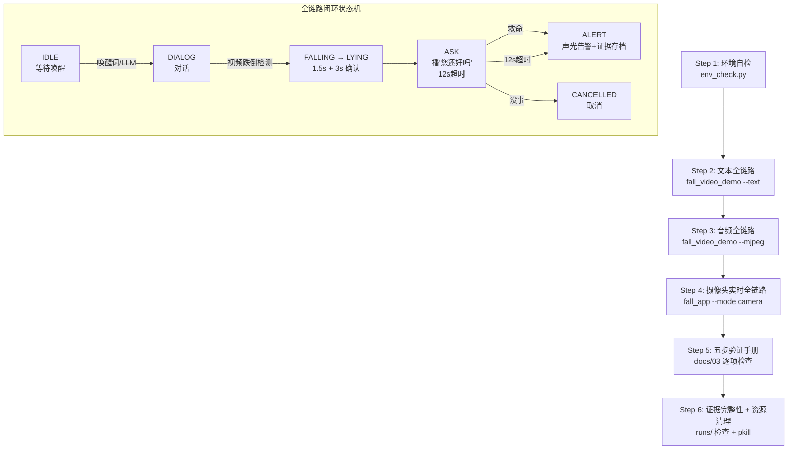

# 实验9：老人跌倒监护--全功能快速验证（6h）

### 1.1 关联知识点

- **6.2.3 全链路闭环验证（唤醒→对话→跌倒→询问→应答→告警→存档）**（前置：5.1.2 六状态机；6.2.2 跌倒判定与LLM对话并存路由）

> 本实验是课程收官实验，仅关联知识点 6.2.3，但需综合运用前8个实验所学全部技能：三模式入口（2.2.1）、环境自检（2.2.2）、三级开发模式（2.2.3）、全链路故障排查（6.2.3）与证据/日志完整性验证。

### 1.2 实验目标

1. **掌握** `fall_app.py` 三模式入口（`--mode camera/image/video`）的启动方法与适用场景，能根据硬件条件选择正确模式。
2. **完成** 唤醒→对话→跌倒→询问→应答→告警→存档全链路闭环验证，从环境自检到证据存档逐步跑通。
3. **掌握** 故障排查与资源清理方法，能独立处理残留进程、串口占用、音频设备冲突等常见问题。
4. **理解** `docs/03_开发模式与验证.md` 五步验证手册的分层验证策略，能按手册逐项检查系统完整性。
5. **验证** `runs/` 目录下证据（截图/.avi视频/events.jsonl）与日志的完整性，能判断一次完整告警链路是否成功。

### 1.3 实验环境

| 类别 | 内容 |
|------|------|
| 硬件（实时模式） | 具身智能机器人小车C1（RK3576 + STM32F407），HP60C RGB-D深度相机（ROS2话题 `/ascamera_hp60c/camera_publisher/rgb0/image`），XFM六麦阵列（`/dev/ttyACM0`），扬声器（`plughw:3,0`），STM32F407控制板（`/dev/ttyUSB0`） |
| 硬件（离线模式） | 仅需板端环境，无需相机/麦克风/扬声器（`--text` 文本模式），或需麦克风+扬声器（`--mjpeg` 音频模式） |
| OS | Ubuntu 22.04 + ROS 2 Humble（实时模式需 `source /opt/ros/humble/setup.bash`） |
| Python | 3.10（`/home/iflytek/ros2_venv/bin/python3`，sherpa-onnx/rknnlite/flask 等已预装） |
| 核心库 | rknnlite 2.3.2, sherpa-onnx 1.13.4, opencv-python 4.11.0, flask, pyserial 3.5, mjpeg_streamer |
| 模型 | yolov8n.rknn, pose_landmark_full.rknn, zipformer_kws + zipformer_onnx + Matcha-TTS, RKLLM（Qwen3.5） |
| 源码路径 | `ros2_ws/src/xflz_eai_car1/app/elderly_companion/` |
| 测试素材 | `testdata/fall_slow_x264.mp4`（跌倒测试视频，不入库） |

### 1.4 实验难度

- 难度: ⭐⭐⭐（综合性）
- **重点**：三模式入口（camera/image/video）的选择与切换；全链路闭环验证的六个阶段（环境自检→离线全链路→实时全链路→五步验证手册→证据完整性→资源清理）。
- **难点**：实时摄像头模式需正确启动 ROS2 相机节点（`ros2 launch car1_peripherals depth_camera.launch.py`）并处理相机话题断连/重连；故障排查需综合判断串口占用（`/dev/ttyACM0` AIUI vs `log_server`）、音频设备冲突（`aplay` 残留）与内存溢出（VLM+LLM 同开超 3.8G）三种不同层级问题。

### 1.5 实验现象

**快速验证流程**：

```bash
cd ~/ros2_ws/src/xflz_eai_car1/app/elderly_companion

# Step 1: 环境自检
python3 common/env_check.py --config config/fall_config.yaml

# Step 2: 离线视频全链路（--text 文本模式，无需硬件）
python3 apps/fall_video_demo.py --video testdata/fall_slow_x264.mp4 --text

# Step 3: 离线视频全链路（--mjpeg 音频模式，需麦克风+扬声器）
pkill -9 aplay; pkill -f llm_server
python3 apps/fall_video_demo.py --video testdata/fall_slow_x264.mp4 --mjpeg

# Step 4: 实时摄像头（需 ROS2 相机节点 + 深度相机 HP60C）
source /opt/ros/humble/setup.bash && source ~/ros2_ws/install/setup.bash
ros2 launch car1_peripherals depth_camera.launch.py   # 另一终端
python3 apps/fall_app.py --mode camera --mjpeg

# Step 5: 资源清理
pkill -9 aplay; pkill -f llm_server; pkill -f fall_video_demo; pkill -f fall_app
```

**预期效果描述**：

- Step 1 全部输出 `[env] OK`，无 `MISSING`；任何 `FAIL` 需先解决。
- Step 2 stdin 交互：输入 `小飞小飞` → 唤醒对话；视频跌倒 → 播"您还好吗？"；输入 `救命` → ALERT 告警；输入 `没事` → CANCELLED 取消。
- Step 3 真实语音链路：说"小飞小飞"唤醒 → 提示音叮 → ASR 识别 → LLM 对话 → 视频跌倒 → TTS 询问 → 喊"救命"/"没事" → 告警/取消。
- Step 4 实时画面推流（`http://<板端IP>:8088/fall.mjpg`）、跌倒检测/告警/语音应答与离线视频模式一致，标注视频保存至 `runs/`。
- Step 5 `runs/evidence/` 下有截图、.avi 视频和 events.jsonl，日志文件完整。

### 1.6 实验步骤

#### 整体流程图



#### 步骤1：环境自检——确认依赖/模型/串口完整性（30min）

**知识点讲解**：

**2.2.2 环境自检 env_check（依赖/模型/串口/ALSA）**

- **原理**：`env_check.py` 是老人跌倒监护系统的"启动前置闸门"，在所有 `apps/` 入口脚本启动时自动调用（`apps/fall_video_demo.py L60`、`apps/fall_app.py L162`），也可独立运行。它检查三大类资源：① **Python 依赖库**（numpy/cv2/scipy/rknnlite/sherpa_onnx/serial/yaml，共7个，`common/env_check.py L32-L43`）——缺失时打印 `[env] MISSING 依赖库 xxx`；② **模型/资源文件**（`_check_files` 函数，`L49-L112`）——按 `fall_config.yaml` 配置逐项检查 YOLO 检测模型、YOLO 类名表、姿态模型、KWS 三件套（encoder/decoder/joiner）、ASR 三件套、TTS 八件套、VLM 模型（若开启）、STM32 串口设备，缺失时打印 `[env] MISSING <路径> 提示: <建议>`；③ **config_schema 校验**（`fall/config_schema.py REQUIRED` 键校验，`L25`）——确保配置文件包含所有必需键。设计原则是"绝不自动安装"（板端禁装规则），只报告问题由用户解决。自检返回 `True=通过` / `False=有缺失`，`apps/` 入口收到 `False` 后以 `exit 2` 退出，避免在残缺环境下启动导致运行时崩溃。
- **源码对应**：`common/env_check.py L1-L8（docstring/用法）、L32-L43（_check_imports 依赖库检查）、L49-L112（_check_files 模型/资源检查）、L115-L121（env_check 主函数）、L124-L141（main CLI 入口）`

```bash
# 独立运行环境自检
cd /home/iflytek/ros2_ws/src/xflz_eai_car1/app/elderly_companion
python3 common/env_check.py --config config/fall_config.yaml
```

**知识储备补充**：

- **背景与动机**：环境自检对应"能停不下就绝不静默失败"的原则（`apps/` 入口在装配任何组件前先 `env_check`）。跌倒监护链路上游是 RKNN 模型、sherpa-onnx 语音、FLask 推流 + STM32 硬件告警——任一依赖缺失都会在运行时 mid-stream 崩溃（如 `rknnlite` 未装 → `import` 即抛 `ImportError`；模型文件被置空 → 推理产出 NaN/空框；串口 `/dev/ttyUSB0` 消失 → `HardwareAlert` 写阻塞）。与其等到推理进入一半再崩，不如在入口用一次 `env_check` 把"能否开机"决策前置，用 `return 2`（非零退出码）阻止残缺环境启动，也方便 CI/脚本判断。

- **依赖库检查机制（`_check_imports`，`common/env_check.py L30-L42`）**：遍历 `("numpy","cv2","scipy","rknnlite","sherpa_onnx","serial","yaml")` 七个模块，逐个 `importlib.import_module(mod)` 动态导入并与 `importlib.import_module` 配套读取 `mod.__version__`。动态导入（而非 `from xxx import yyy`）的好处：导入失败时以 `ImportError` 被过程捕获，能区分"这一项缺失"，而不是整个脚本在第一行就崩。版本号 `getattr(m, "__version__", "?")`——部分库（如 scipy）可能不导出 `__version__`，缺失时打印 `?` 仍判 OK（只判"能 import"，不判版本下限）。

- **模型/资源逐项检查（`_check_files`，`common/env_check.py L45-L120`）**：内部定义 `check(path, hint)` 闭包，对每个资源做"存在 + 非空"二元判定：`p.exists() and p.stat().st_size > 0`。统计上 `st_size == 0` 视为缺——因为空文件无法被模型加载。检查对象分层：① YOLO 检测模型 `models/yolov8n.rknn` + COCO 类名表；② 姿态模型 `pose_landmark_full.rknn`；③ KWS 三件套（encoder/decoder/joiner）；④ ASR 三件套；⑤ TTS 八件套；⑥ VLM（`model.vlm.enabled=true` 时才查 vision/llm 模型 + `/usr/lib/librkllmrt.so`）；⑦ STM32 告警串口（`alert.port`，`L107-L113` 用 `Path(port).exists()` 判设备节点在不在）。缺项打印 `MISSING <路径> 提示: <hint>`，`hint` 告诉学生该去哪修，且**绝不自动 pip install**——板上禁装规则。

- **config schema 校验**：`env_check` 分支前 `load_config(cfg_path, REQUIRED)` 已用 `fall/config_schema.py` 的 `REQUIRED` 嵌套字典校验必需键存在与类型。这保证自检读到的 `cfg` 一定含所有模型/串口键；若 config 缺键，会在 `load_config` 阶段抛 `ConfigError`（返回码 2），根本走不到自检打印。

- **返回值与退出码语义**：`env_check` 聚合 `_check_imports().and(_check_files)` 的布尔结果，`main` 里 `return 0 if env_check(cfg) else 2`（`L126-L139`）。`0`=通过、`2`=有缺失——与 shell 通用约定一致：**非 0 即失败**，可被 `.sh`/CI 用 `$?` 捕获；`apps/` 入口收到 `False` 后 `log.error("环境自检失败，退出"); return 2`（如 `apps/fall_app.py L204-205`）。

- **参考资源**：[Python importlib 官方文档](https://docs.python.org/3/library/importlib.html)；[Python os.path.exists 与 stat 文档](https://docs.python.org/3/library/os.path.html)；[Linux 退出码约定（exit codes）](https://tldp.org/LDP/abs/html/exitcodes.html)。

**操作步骤**：

1. 进入 `elderly_companion` 项目根目录。
2. 运行 `python3 common/env_check.py --config config/fall_config.yaml`。
3. 逐行检查输出：所有依赖库显示 `[env] OK xxx 版本号`；所有模型文件显示 `[env] OK <路径> (file xxx KB)`；STM32 串口显示 `[env] OK /dev/ttyUSB0 (serial device)`。
4. 若有 `MISSING` 项，按提示解决：依赖库问题→确认板端 venv（`/home/iflytek/ros2_venv/bin/python3`）；模型路径错→修改 `config/fall_config.yaml` 对应键；串口不存在→检查 USB 连接（`ls /dev/ttyUSB*`）。
5. 确认输出 `[env] 自检通过`。

**易错点**：

- ⚠️ 使用系统 `python3` 而非 venv 运行 → 报大量 `MISSING 依赖库` → **解决**：使用 `/home/iflytek/ros2_venv/bin/python3 common/env_check.py` 或确认已 `source` venv。
- ⚠️ `log_server` 在跑占 `/dev/ttyACM0` → XFM 唤醒串口被抢 → **解决**：先 `pkill -f log_server`，再重跑自检。

#### 步骤2：文本全链路——离线视频 + 文本模式打通状态机（60min）

**知识点讲解**：

**2.2.1 文本→音频→摄像头三级开发模式 + 6.2.3 全链路闭环**

- **原理**：三级开发模式是本项目的"渐进式验证策略"（`docs/03_开发模式与验证.md L5-L14`）。文本模式（`--text`）通过 stdin 喂词模拟语音，走**完全相同的状态机与回调链**（`speech/voice_loop.py` 的 `feed_text` 与音频块同一路由），因此文本模式验证过的状态迁移/词表匹配/LLM/告警路由在音频模式必然成立，音频模式只新增"录音/识别/播放"三个硬件环节。`fall_video_demo.py` 是 `fall_app --mode video` 的独立入口，`--text` 标志将 `cfg["speech"]["text_mode"]` 置为 `True`（`apps/fall_video_demo.py L87`），VoiceLoop 启动后启用 stdin 喂词线程（`L258-L261`）。全链路闭环的六个阶段：① 唤醒（`小飞小飞` → `[文本] 唤醒`）→ ② 对话（`你好` → LLM 请求→回复）→ ③ 跌倒（视频自动触发 → `FALLING→LYING→ASK`）→ ④ 询问（播"您还好吗？" → `开始聆听(mode=ASK)`）→ ⑤ 应答（`救命` → `ASR 应答 ALERT` / `没事` → `CANCELLED`）→ ⑥ 告警+存档（STM32 声光 + `runs/evidence/` 截图/视频/events.jsonl）。
- **源码对应**：`apps/fall_video_demo.py L1-L8（docstring 用法）、L60（env_check 调用）、L84-L87（--text 标志设置 text_mode）、L258-L261（stdin 喂词线程启动）、L200-L203（monitor.has_ask_session → loop.trigger_ask）、L208-L215（end_ask 回 IDLE）、L267-L317（finally 资源释放）`

```bash
# 文本全链路（离线视频，无硬件参与）
cd /home/iflytek/ros2_ws/src/xflz_eai_car1/app/elderly_companion
python3 apps/fall_video_demo.py --video testdata/fall_slow_x264.mp4 --text
```

**知识储备补充**：

- **三级开发模式的验证学动机**：它本质是"最弱假设先跑通、最强假设最后验证"的递进策略（`docs/03_开发模式与验证.md L3-L13`）。硬件环节（录音/识别/播放）是故障密度最高的部分，若先接音频再去排查状态机逻辑，两个变量同时扰动，无法定位根因。项目把验证拆成三级：

  ① `--text` 只验证纯软件状态机/词表/LLM/告警路由；

  ② 音频模式复核新增三个硬件环节；

  ③ 摄像头模式换实时输入流。三级的验证对象逐层增加，但**每一级验证过的下层必然成立**——因为同一份 `VoiceLoop` 状态机代码同时服务文本与音频（`docs/03 L5-L8`）。

- **text_mode 的单一开关实现**：三级模式的软件开关不是三份代码，而是 config 里**一个布尔开关**——`cfg["speech"]["text_mode"]`。`fall_video_demo.py L91` 的 `--text` 标志在 `L132` 置 `text_mode=True`；`VoiceLoop` 收到 `text_mode` 后决定启动录音线程还是启用 stdin 喂词线程（`apps/fall_video_demo.py L263-L266` 用 `threading.Thread(target=_stdin_loop, daemon=True)` 起 daemon 线程不断 `loop.feed_text(line)`）。同一状态机、同一回调，只是输入源从 ALSA 换成 stdin——这正是"逻辑必然成立"的代码依据。

- **stdin 喂词线程的 daemon 性质**：`daemon=True` 意味着主程序 `Ctrl+C` 退出时，喂词线程随之被强杀，**不阻塞进程退出**，也无需显式 join。`feed_text` 把整行喂进 `loop` 内部队列，与音频块同一路由处理。

- **全链路闭环六阶段的数学意义**（六状态机，`docs/03 L7-L13`）：

  $$
  \mathrm{IDLE} \xrightarrow{\text{唤醒词/文字}} \mathrm{DIALOG} \xrightarrow{\text{视频跌倒}} \mathrm{FALLING} \to \mathrm{LYING} \xrightarrow{3\text{s 确认}} \mathrm{ASK} \xrightarrow{\text{救命}} \mathrm{ALERT},\quad \mathrm{ASK} \xrightarrow{\text{没事}} \mathrm{CANCELLED}, \quad \mathrm{ASK} \xrightarrow{12\text{s 超时}} \mathrm{ALERT}
  $$

  每条迁移最终都落到**证据**（`runs/evidence/` 截图 / `.avi` / events.jsonl 事件）。因此"闭环验证"不只是"日志对"，还要每个状态在证据里留下对应事件——这正是步骤6判定完整性的依据。

- **参考资源**：[ROS2 话题通信入门](https://docs.ros.org/en/humble/Tutorials/Beginner-CLI-Tools/Understanding-ROS2-Topics/Understanding-ROS2-Topics.html)；[sherpa-onnx 语音识别](https://k2-fsa.github.io/sherpa/onnx/)；[Ultralytics YOLOv8 文档（跌倒检测常基于该检测模型）](https://docs.ultralytics.com/)。

**stdin 交互（与音频模式同一状态机）**：

| 输入 | 预期日志 | 验证点 |
|------|----------|--------|
| `小飞小飞` | `[文本] 唤醒` → `开始聆听（mode=DIALOG）` | 唤醒词触发状态机迁移 |
| `你好` | `LLM 请求` → `[LLM 回复]` | LLM 对话链路通畅 |
| （视频跌倒） | `ASK 会话建立` → `开始聆听（mode=ASK）` | 跌倒→询问自动触发 |
| `救命` | `ASR 应答 [x] ALERT`（**一条**）→ ALERT 播报 | 告警链路通畅 |
| `没事` | `ASR 应答 [y] CANCELLED`（**一条**）→ "好的，请注意安全" | 取消链路通畅 |

**操作步骤**：

1. 确认 `testdata/fall_slow_x264.mp4` 存在（不存在则从本机拷入：`cp <本地跌倒视频>.mp4 testdata/`，testdata 不入库）。
2. 运行 `python3 apps/fall_video_demo.py --video testdata/fall_slow_x264.mp4 --text`。
3. 按上表逐项在 stdin 输入，观察终端日志输出。
4. **关键检查**：多人场景下"救命"/"没事"应答**只出现一条** `ASR 应答`——若出现 `[1]`/`[2]`/`[3]` 多条，说明 `monitor.on_asr` 单次应答逻辑未生效（`fall/monitor.py` 的 break）。
5. 退出：按 `Ctrl+C`，确认 `finally` 块输出"资源已释放"（`apps/fall_video_demo.py L315-L316`）。

**易错点**：

- ⚠️ 未拷入测试视频 → 报 `无法打开视频` → **解决**：先确认 `testdata/` 下有 mp4 文件。
- ⚠️ 多人场景下应答出现多条 `ASR 应答` → **解决**：检查 `fall/monitor.py` 的 `on_asr` 循环中是否有 `break`，确保单次应答收敛。

#### 步骤3：音频全链路——离线视频 + 真实语音（60min）

**知识点讲解**：

**2.2.3 运行产物不入库与资源清理 + 3.2.2 唤醒后启动录音**

- **原理**：音频模式在文本模式基础上新增三个硬件环节：

  ① **XFM 硬件唤醒**（`/dev/ttyACM0` AIUI 事件）→ ② **ALSA 录音**（`plughw:4,0`，录音线程在唤醒后才启动，`apps/fall_video_demo.py L158-L160`）→ ③ **TTS 播报**（`plughw:3,0` aplay 持久管道）。录音线程在唤醒后才启动是因为 XFM 硬件在监听态不上送音频流，提前打开 ALSA 会导致唤醒后仍无音频。音频模式启动前必须清理残留进程：`pkill -9 aplay`（占播放设备）+ `pkill -f llm_server`（占串口/端口），否则播报无声或 XFM 唤醒失效。运行产物（`runs/evidence/` 截图/视频/events.jsonl、`runs/tts_cache/` TTS 预合成缓存、`runs/*.log` 日志）均不入库（gitignore），证据视频增长快（告警前后 ~5s×n），需定期清理。

- **源码对应**：`apps/fall_video_demo.py L146-L165（ASR/KWS/Wake 组件装配）、L242-L253（VoiceLoop 启动与硬件唤醒等待）、docs/06_环境依赖.md L67-L72（启动顺序/清环境）、README.md L78（资源清理命令）`

```bash
# 清残留进程（必须在音频模式前执行）
pkill -9 aplay; pkill -f llm_server

# 音频全链路（离线视频 + 真实语音）
python3 apps/fall_video_demo.py --video testdata/fall_slow_x264.mp4 --mjpeg
```

**知识储备补充**：

- **"唤醒后才启动录音"的时序原理**：XFM 六麦阵列在空闲监听态**不上送原始音频流**（只上送极稀疏的帧，`[diag] 录音 10 帧/5s` ),只有被"小飞小飞"硬件唤醒后才切到全速上送（`[diag] 录音 50 帧/5s`）。若在唤醒前就 `open` ALSA 设备，会抢占 `plughw:4,0` 且拿到的全是稀疏流，唤醒后反而拿不到完整流。因此代码把录音线程的启动放在 `唤醒事件之后`（`apps/fall_video_demo.py` 中录音线程随 `VoiceLoop` 在唤醒流就绪后启动），并配 `[diag]` 帧率诊断日志判断流健康度（`docs/03 L74-L75`）。

- **ALSA 设备句柄是排他资源**：`plughw:3,0`（播放）/`plughw:4,0`（录音）是 ALSA PCM 硬件句柄，**同一时刻只能一个进程持有**。`aplay` 残留进程会一直占着播放设备，导致 TTS 播报无声；`log_server`（串口 `8090` 服务）与 AIUI 唤醒共用 `/dev/ttyACM0`，占着就抢不到唤醒事件。这是"音频模式前必须 `pkill -9 aplay; pkill -f llm_server`"的根因（`docs/03 L62`、README L78）。

- **`_warn_residual` 启动告警**：`apps/fall_video_demo.py L34-L50` 在启动时用 `subprocess.run(["pgrep","-f",...])` 探测上一次 `Ctrl+C` 是否留下残留实例，残留会抢 XFM 唤醒帧 / 占播放设备，因此提前告警并给出 `pkill` 提醒。

- **运行产物不入库的磁盘动机**：证据视频增长快（告警前后约 `pre_seconds + post_seconds = 3.0+2.0=5s`，`config` 的 `evidence.pre_seconds/post_seconds`，× n 次告警线性膨胀），TTS 预合成缓存（`runs/tts_cache/*.pcm`）与日志也不该进 git，因此全部 gitignore。这里有一个"缓存换延迟"的典型取舍：`speaker.pre_synthesize([ASK/CANCEL/ALERT/无人提示], cache_dir=runs/tts_cache)`（`apps/fall_video_demo.py L198` 附近）把固定提示语预合成落盘，二次启动**零合成延迟**直接播放，省去每次 ~1s 在线合成。

- **参考资源**：[ALSA PCM 设备命名与独占性说明](https://www.alsa-project.org/wiki/Asoundrc)；[Linux 后台进程 daemon 与资源清理](https://man7.org/linux/man-pages/man7/daemon.7.html)；[gitignore 文档](https://git-scm.com/docs/gitignore)。

**音频模式流程与判定**：

1. 程序启动后应**没有**"录音线程"日志（录音线程等唤醒才启动）。
2. 说"小飞小飞" → `检测到唤醒` → 随后出现 `录音线程: plughw:4,0（Recording started）` + `开始聆听（mode=DIALOG）` + 提示音（叮）。
3. 视频跌倒 → `ASK 会话建立` → 播"您还好吗？需要帮助吗？"（2s）→ `开始聆听（mode=ASK）`。
4. 喊"救命" → `[ASR 实时] 救命` → `[ASR 结果] 救命` → `ASR 应答 [x] ALERT` → 播报 + 蜂鸣。
5. 喊"没事" → `ASR 应答 [y] CANCELLED` → "好的，请注意安全"。

**操作步骤**：

1. 运行清残留命令（`pkill -9 aplay; pkill -f llm_server`）。
2. 运行 `python3 apps/fall_video_demo.py --video testdata/fall_slow_x264.mp4 --mjpeg`。
3. 等待启动完成后，在麦克风前说"小飞小飞"唤醒。
4. 按上述流程逐项验证。
5. **诊断日志**：`[diag] 录音 X 帧/5s`——**X≈50 正常**；X≈10 说明设备在监听态/唤醒态流未上送。
6. 浏览器打开 `http://<板端IP>:8088/fall.mjpg` 确认 MJPEG 实时推流正常。

**易错点**：

- ⚠️ 唤醒后无 `录音线程` 日志 → `notify_wake` 未触发（XFM 串口事件未到）→ **解决**：检查 `/dev/ttyACM0` 占用（先 `pkill -f log_server`），确认 `XFM 硬件唤醒就绪` 日志。
- ⚠️ 录音仅 10 帧/5s → 设备监听态/唤醒态流稀疏 → **解决**：确认唤醒后 `录音 50 帧/5s`；若仍稀疏，检查 XFM 固件/接线。
- ⚠️ MJPEG 推流无画面 → `mjpeg_streamer` 未安装或端口 8088 被占 → **解决**：`netstat -tlnp | grep 8088` 检查端口占用。

#### 步骤4：实时摄像头——启动 ROS 相机节点 + fall_app 三模式入口（90min）

**知识点讲解**：

**三模式入口（--mode camera/image/video）+ 实时摄像头（需 ROS2 相机节点）**

- **原理**：`fall_app.py` 是老人跌倒监护的统一主入口，通过 `--mode` 参数选择三种输入源（`apps/fall_app.py L80-L81`）：`camera`（实时摄像头，需 ROS2 相机节点发布话题）；`image`（单张图片，`--input` 指定路径，处理后退出）；`video`（离线视频，`--input` 指定路径）。三模式统一由 `FrameSource` 抽象（`common/source.py`），`camera` 模式通过 `common/ros2_camera.py` 惰性导入 rclpy 订阅 `/ascamera_hp60c/camera_publisher/rgb0/image` 话题（`docs/06_环境依赖.md L34`），image/video 模式走 OpenCV `cv2.VideoCapture`。实时模式的特殊时序：① 先在**另一终端**启动 ROS2 相机节点（`ros2 launch car1_peripherals depth_camera.launch.py`，`docs/06_环境依赖.md L69-L70`）→ ② 启动 `fall_app.py --mode camera` → ③ 程序等待硬件唤醒（`loop.wake_seen.wait()`，`apps/fall_app.py L354-L358`）→ ④ 唤醒后开始实时检测。`--mjpeg` 启用 MJPEG 推流（端口 8088），`--save` 保存标注视频至 `runs/`。`_atexit_cleanup`（`apps/fall_app.py L54-L70`）确保崩溃路径也能释放 monitor/source/speaker/hw 资源，防止 librknnrt 析构 abort。
- **源码对应**：`apps/fall_app.py L54-L70（_atexit_cleanup 兜底释放）、L80-L81（--mode choices）、L87-L133（_merge_args CLI 覆盖 config）、L162-L165（env_check 调用）、L230-L242（FrameSource 打开输入源）、L338-L365（主循环 frame→monitor.process_frame→ASK 触发）、L370-L398（finally 资源释放）、L415-L424（image 模式处理后退出）、docs/06_环境依赖.md L64-L75（启动顺序）`

```bash
# 终端 1：启动 ROS2 相机节点
source /opt/ros/humble/setup.bash && source ~/ros2_ws/install/setup.bash
ros2 launch car1_peripherals depth_camera.launch.py

# 终端 2：启动实时摄像头模式
cd /home/iflytek/ros2_ws/src/xflz_eai_car1/app/elderly_companion
python3 apps/fall_app.py --mode camera --mjpeg
```

**知识储备补充**：

- **三模式的抽象统一（`FrameSource`）**：`common/source.py` 用 `FrameSource` 把三种输入源收敛成统一接口 `read()/isOpened()/release()`（`source.py L19-L88`）。`open()` 按 `mode` 分派：`image` 走 `cv2.imread`；`video` 走 `cv2.VideoCapture`；`camera` 走 `Ros2Camera` 订阅 ROS 话题。因此主循环 `source.read()` 一视同仁，换模式只改 config `source.mode`——这是"多模式"不需要多份逻辑的架构关键。

- **camera 模式的 ROS 依赖**：`camera` 模式**不是**读 USB 摄像头，而是假设 ROS2 相机节点已在跑（`ros2 launch car1_peripherals depth_camera.launch.py`）。`common/ros2_camera.py`（L1-116）惰性导入 rclpy，`open()` 时才 `rclpy.init()` + `node.create_subscription(Image, "/ascamera_hp60c/camera_publisher/rgb0/image", ...)`（默认话题，`DEFAULT_TOPIC`，L29/L64），用 daemon 线程 `rclpy.spin` 驱动回调。若相机节点未启动或话题无数据，`open()` 返回失败并提示"ROS 相机订阅失败 + 请先启动节点的 hint"（`source.py L47-L50`）——这就是 `易错点 1` 的代码依据。`FrameSource` 与 `Ros2Camera` 的惰性导入（`import rclpy` 只在 `open()` 内）保证 x86 无 ROS 环境也能测试回调逻辑。

- **camera 模式"等待硬件唤醒"的特殊时序**：`apps/fall_app.py L383-L390` 明确 `if wake is not None and wake.available and not text_mode and cfg["source"]["mode"] == "camera"` 时才 `loop.wake_seen.wait()`。原因：实时相机推流消耗算力，若未唤醒就开跑，跌倒→ASR 的应答窗口会与唤醒时序错位；且唤醒态只有 ~10s 完成"跌倒→ASK→应答"，ASR 才有音频流。`image/video` 模式离线调试则自动跑、不等待。

- **三模式与 `--input` 的参数路由**：`--mode camera/image/video` + `--input` 在 `_merge_args`（`apps/fall_app.py L96-133`）按 mode 处理——`--input` 在 `video`/camera 时写 `video_path`、否则写 `image_path`。`--mjpeg` 打开 MJPEG 推流（8088），`--save` 开 `save.enabled` 写标注视频。

- **camera 模式读取失败的重试语义**：主循环里 `fall_app.py` 对 camera 模式 `if not ok: log.warning("相机读取失败，重试..."); time.sleep(0.2); continue`——即相机断连不会让程序崩溃，而是退避重试；而 video/image 模式读到结尾即 `break` 正常退出。

- **参考资源**：[ROS2 订阅者实现（rclpy）官方教程](https://docs.ros.org/en/humble/Tutorials/Beginner-Client-Libraries/Writing-A-Simple-Py-Publisher-And-Subscriber.html)；[OpenCV VideoCapture 文档](https://docs.opencv.org/4.x/d8/dfe/classcv_1_1VideoCapture.html)；[ROS2 Launch 文件入门](https://docs.ros.org/en/humble/Tutorials/Intermediate/Launch/Launch-Main.html)。

**操作步骤**：

1. 终端1启动 ROS2 相机节点，等待 `Waiting for data...` 或话题发布日志。
2. 终端2运行 `fall_app.py --mode camera --mjpeg --save`，确认输出 `=== 老人跌倒监护启动（mode=camera）===` 与 `env_check 通过`。
3. 浏览器打开 `http://<板端IP>:8088/fall.mjpg` 确认实时画面推流正常。
4. 在麦克风前说"小飞小飞"唤醒，观察实时检测框+骨架叠加。
5. 模拟跌倒（站立→蹲下/躺下），观察 `FALLING→LYING→ASK` 状态流转与 TTS 询问。
6. 喊"救命"或"没事"验证告警/取消链路。
7. `Ctrl+C` 退出，确认标注视频保存至 `runs/fall_annotated.avi`。

**易错点**：

- ⚠️ `camera` 模式启动后无画面 → 相机节点未启动 → **解决**：确认终端1的 `ros2 launch` 在运行，且话题 `/ascamera_hp60c/camera_publisher/rgb0/image` 有发布（`ros2 topic hz /ascamera_hp60c/camera_publisher/rgb0/image`）。
- ⚠️ `fall_app.py` 报 `端口冲突：MJPEG 与 LLM 都用 8088` → **解决**：修改 `config/fall_config.yaml` 中 `server.port` 或 `llm.server.port`，确保不冲突。
- ⚠️ `--save` 后 `runs/` 下无视频 → 确认 `cfg["save"]["enabled"]` 已置 True 且视频帧正常（`writer.write(annotated)`，`apps/fall_app.py L413`）。

#### 步骤5：五步验证手册——按 docs/03 逐项检查（60min）

**知识点讲解**：

**6.2.3 全链路闭环验证 + 故障排查**

- **原理**：`docs/03_开发模式与验证.md` 的"分步验证手册"（L22-L95）定义了从零到全链路的五个 Step，是系统完整性验证的权威清单。Step 1 环境自检（`env_check.py`）；Step 2 文本全链路（`fall_video_demo --text`，stdin 交互验证状态机）；Step 3 音频全链路（`fall_video_demo --mjpeg`，真实语音验证唤醒/ASR/TTS）；Step 4 音频链路故障排查（按出现概率排序的五类问题与处理方法，`docs/03 L63-L83`）；Step 5 摄像头模式（整机实时验证）。每个 Step 都有明确的"预期日志"与"判定标准"，逐项对照即可判断系统是否完整可用。Step 4 的故障排查表覆盖：唤醒后无录音线程（串口占用）、录音帧率低（设备态异常）、无 ASR 实时输出（模型/配置）、ASK 窗口时序错（触发逻辑）、播报无声（aplay 残留）。这是课程所有实验的"集成验收标准"。
- **源码对应**：`docs/03_开发模式与验证.md L1-L14（三级开发模式）、L22-L38（Step 1-2）、L42-L53（Step 3 音频流程）、L63-L83（Step 4 故障排查表）、L86-L95（Step 5 摄像头模式）`

**知识储备补充**：

- **分步验证手册的方法论**：`docs/03` 五步手册是"分而治之 + 逐层加硬件"的工程实践（L22-L95）。Step 1-3 已在文本/音频模式完成验证，Step 4 是故障画像、Step 5 是整机实时验收。每个 Step 都有明确的"预期日志 + 判定标准"——这比"逐行读源码找 bug"更适合集成验收，因为验收关心的是"系统是否可用"而非"哪里坏了"。

- **Step 4 故障排查表的分层思想**：五类高频问题按**出现概率排序**（`docs/03 L77-L85`），且把"软/硬"分层处理：
  - **唤醒后无录音线程** → 软件层（`notify_wake` 串口事件在 `/dev/ttyACM0` 被 log_server 占用时到不了）；
  - **录音 10 帧/5s** → 硬件层（XFM 固件/接线，与代码无关——明确标注"与代码无关"避免误杀）；
  - **有录音无 `[ASR 实时]`** → 模型/配置层（`decoding_method`、`runs/tts_cache/*.pcm` 直喂验证模型）；
  - **ASK 开听过早** → 时序层（`has_ask_session` 上升沿、VoiceLoop 等 playback 播完）；
  - **播报无声** → 进程/设备层（aplay 残留、`ttyUSB0` 告警串口）。把症状映射到"软/硬件/模型/时序/进程"五个层面，是故障排查的核心。

- **分步判定与回归的严谨性**：必须严格 Step1→2→3→4→5 顺序，因为每级用"上一步已通过"作为前提（如 Step 5 摄像头模式依赖 Step 2 状态机逻辑正确）。跳过 Step 1（环境自检）直接跑 Step 3 会因模型缺失在运行时崩溃——这正是"分层验证强度递增、级间依赖不可跳过"的体现。

- **参考资源**：[系统化调试方法论（Debug Like a Human）](https://www.debuglike.com/)；[进程管理与信号处理（man signal）](https://man7.org/linux/man-pages/man7/signal.7.html)；[ALSA 音频故障排查](https://wiki.archlinux.org/title/Advanced_Linux_Sound_Architecture)。

**操作步骤**：

1. 打开 `docs/03_开发模式与验证.md`，对照"分步验证手册"的 Step 1-5 逐项执行。
2. **Step 1**：运行 `env_check.py`，确认全部 OK（已在步骤1完成）。
3. **Step 2**：运行 `fall_video_demo --text`，按 stdin 交互表验证（已在步骤2完成）。
4. **Step 3**：运行 `fall_video_demo --mjpeg`，按音频流程验证（已在步骤3完成）。
5. **Step 4**：对照故障排查表（`docs/03 L63-L83`），逐一核对是否有对应症状，记录排查结果。
6. **Step 5**：运行 `fall_app --mode camera --mjpeg --save`，确认实时画面推流与离线视频模式行为一致（已在步骤4完成）。
7. 在实验报告中记录每个 Step 的通过/未通过状态与发现的问题。

**易错点**：

- ⚠️ 跳过 Step 1 直接跑 Step 3 → 模型缺失导致运行时崩溃 → **解决**：严格按 Step 1→2→3→4→5 顺序，每步通过后再进下一步。
- ⚠️ Step 4 故障排查只查日志不查硬件 → 串口占用、设备断连等硬件问题日志无直接提示 → **解决**：结合 `ls /dev/ttyUSB*`、`ls /dev/ttyACM*`、`arecord -l`、`aplay -l` 等硬件检查命令。

#### 步骤6：证据完整性验证与资源清理（30min）

**知识点讲解**：

**运行产物不入库（runs/ 证据/日志/缓存）与资源清理**

- **原理**：一次完整的告警链路会在 `runs/evidence/` 下生成三类证据：① **前后帧截图**（跌倒前/后的 JPEG 图片，由 `FallMonitor` 的 `FrameRing` 环形缓冲区提供）；② **告警视频**（`.avi` 格式，告警前后约 5 秒，由 `apps/fall_app.py L409-L413` 的 `cv2.VideoWriter` 写入）；③ **事件日志**（`events.jsonl`，每行一条 JSON 事件记录，包含时间戳/事件类型/状态机状态等）。`runs/` 目录同时存放 `tts_cache/`（TTS 预合成 PCM 缓存，二次启动零合成延迟）、日志文件和标注视频。这些运行产物全部 gitignore 不入库，需定期清理以释放磁盘（证据视频增长快）。资源清理是实验收尾的必要步骤：`pkill -9 aplay` 清理残留播放进程（占 `plughw:3,0` 播放设备）；`pkill -f llm_server` 停 LLM Flask 子进程（占端口 8080 + ~1.5G 内存）；`pkill -f fall_video_demo/fall_app` 停主程序残留。
- **源码对应**：`apps/fall_video_demo.py L267-L316（finally 块资源释放）、apps/fall_app.py L54-L70（_atexit_cleanup 兜底释放）、L370-L398（finally 块释放 monitor/source/speaker/hw/wake/llm_mgr）、README.md L98-L101（常用命令/资源清理）、docs/06_环境依赖.md L77（runs/ 磁盘说明）`

```bash
cd ~/ros2_ws/src/xflz_eai_car1/app/elderly_companion
# 1. 检查 runs/evidence/ 证据完整性
ls -la runs/evidence/
# 预期：有 .jpg 截图、.avi 视频、events.jsonl

# 2. 检查 events.jsonl 事件日志
cat runs/evidence/events.jsonl
# 预期：包含 FALLING/ASK/ALERT 或 CANCELLED 事件记录

# 3. 检查 runs/ 日志文件
ls -la runs/*.log

# 4. 资源清理
pkill -9 aplay; pkill -f llm_server; pkill -f fall_video_demo; pkill -f fall_app

# 5. 确认残留进程已清理
pgrep -af "aplay|llm_server|fall_video_demo|fall_app"
# 预期：无输出（所有残留已清理）

# 6. （可选）清理 runs/ 释放磁盘
rm -rf runs/evidence/*.avi runs/evidence/*.jpg
```

**知识储备补充**：

- **证据的三种介质与格式**：完整告警链路在 `runs/evidence/` 沉淀三类证据：
  - **前后帧截图**（JPEG）：由 `FallMonitor` 的 `FrameRing` 环形缓冲区提供——圈内保留最近 N 帧，跌倒触发时取"前帧 + 后帧"各一帧落盘。**为什么不是只存跌倒瞬间**：前帧能证明"跌倒前是正常站立"（区分跌倒 vs 本来就躺着），后帧证明"确实持续倒下"（防抖动误判），二者是"这件事真的发生"的最小可验证对。
  - **告警视频**（`.avi`，`cv2.VideoWriter` 写 `fall_annotated.avi`）：截取的告警前后共 `pre_seconds+post_seconds=5s` 连续流（`config` 的 `evidence.pre_seconds/post_seconds`），与单帧截图互补——帧是静态证据，视频是时序证据。
  - **事件日志**（`events.jsonl`）：每行一条 JSON 事件（时间戳、事件类型、状态机状态），`FALLING/ASK/ALERT（或 CANCELLED）` 全部落盘，构成"推理过程"的可审计轨迹。
    判定完整性的充要条件：截图 + 视频 + 事件日志**三件套齐**，且事件类型覆盖 `FALLING→ASK→ALERT`（或 `CANCELLED`）——这正是步骤6每一 checks 的判定标准。

- **证据目录的磁盘经济**：`runs/evidence/` 设 `max_files`（默认 100，`config_schema`）上限，超过会被清理策略淘汰；`runs/tts_cache/` 是 TTS 预合成 PCM 缓存（二次启动零合成），`runs/*.log` 是日志。三者全部 gitignore（运行产物不入库）。证据视频增长快（每次告警 ~5s），故需定期 `rm -rf runs/evidence/*.avi` 释放磁盘。

- **资源清理的进程树语义**：资源释放沿进程层次：`pkill -9 aplay` 杀残留播放进程（占 `plughw:3,0`）→ `pkill -f llm_server` 停 LLM Flask 子进程（占端口 8080 + ~1.5G 内存）→ `pkill -f fall_video_demo/fall_app` 停主程序。`pgrep -af` 复查确认无残留（否则下次启动串口/Aplay 被占）。程序内 `finally` 也会释放 monitor/loop/source/speaker/hw/wake/llm_mgr（`apps/fall_video_demo.py L313-L326`、`apps/fall_app.py L451-L470`），`_atexit_cleanup`（`apps/fall_app.py L58-L70`）兜底崩溃路径。

- **参考资源**：[JBOD 环形缓冲区（FrameRing 循环缓存）概念](https://en.wikipedia.org/wiki/Circular_buffer)；[FFmpeg/OpenCV VideoWriter 视频编码格式](https://docs.opencv.org/4.x/dd/d9e/classcv_1_1VideoWriter.html)；[Linux 进程信号与清理（kill/pkill）](https://man7.org/linux/man-pages/man1/pkill.1.html)。

**操作步骤**：

1. 在一次完整的告警链路执行后（步骤2/3/4任一），检查 `runs/evidence/` 目录。
2. 确认有 `.jpg` 截图（跌倒前后帧）、`.avi` 告警视频、`events.jsonl` 事件日志。
3. 查看 `events.jsonl` 内容，确认事件类型覆盖 `FALLING`/`LYING`/`ASK`/`ALERT`（或 `CANCELLED`）。
4. 运行资源清理命令，逐一 kill 残留进程。
5. 用 `pgrep -af` 确认所有残留已清理。
6. 可选：清理 `runs/evidence/` 下的大文件释放磁盘。

**易错点**：

- ⚠️ `runs/evidence/` 为空 → 告警链路未完整执行（未触发 ALERT）→ **解决**：确保一次完整的"跌倒→ASK→救命→ALERT"链路执行完毕。
- ⚠️ 清理后下次启动报串口占用 → 残留进程未完全清理 → **解决**：`pgrep -af` 逐个确认，必要时 `kill -9 <PID>`。

### 1.7 注意事项

- ⚠️ **实时模式需深度相机 HP60C**：`fall_app.py --mode camera` 依赖 ROS2 相机节点发布话题，若未启动或相机未连接，程序会报 `输入源打开失败` 并退出（`apps/fall_app.py L231-L232`）。离线视频模式（`--mode video`）可完整演练全链路。
- ⚠️ **内存预算**：ASR(128M) + TTS(~600M) + LLM(~1.5G) + YOLO/姿态(~500M) = ~2.7G；VLM 额外 ~1.3G，与 LLM 同开超 3.8G 可能 OOM（`docs/06_环境依赖.md L78`），默认 `model.vlm.enabled: false`。
- ⚠️ **端口冲突**：MJPEG（8088）与 LLM Flask（8080）不可共用端口（`apps/fall_video_demo.py L224-L228`），启动时自动检测并报错退出。
- ⚠️ **串口占用**：`log_server`（端口 8090）与 AIUI 唤醒共用 `/dev/ttyACM0`，必须先停 `log_server` 才能正常唤醒。
- ⚠️ **Ctrl+C 退出时序**：`stop_sig.wait_grace(1.0)` 等待 1 秒确保 NPU/IO 恢复（`apps/fall_app.py L372`），防止 `librknnrt` 析构 abort——不要在此期间强制 kill。
- ⚠️ **testdata 不入库**：测试视频在 `testdata/` 目录，gitignore 不入库，需从本机拷入。

### 1.8 实验总结

**完成成果**：

- 一份环境自检通过报告（`env_check.py` 全部 OK）。
- 文本全链路验证记录（`fall_video_demo --text`，含 stdin 交互日志）。
- 音频全链路验证记录（`fall_video_demo --mjpeg`，含唤醒/ASR/TTS 流程日志）。
- 摄像头实时全链路验证记录（`fall_app --mode camera --mjpeg --save`，含推流/检测/告警记录）。
- `docs/03` 五步验证手册逐项检查表（通过/未通过/问题记录）。
- `runs/evidence/` 证据完整性确认（截图/.avi/events.jsonl）+ 资源清理确认。

**技能收获**：

- 技能1：三模式入口（camera/image/video）的选择与启动，理解 `FrameSource` 统一抽象。
- 技能2：五步验证手册的分层验证策略，从环境自检到整机实时的完整验证链路。
- 技能3：故障排查能力——串口占用、音频设备冲突、端口冲突、内存溢出的诊断与处理。
- 技能4：运行产物管理——证据存档验证、日志检查、资源清理与磁盘管理。

**常见问题与解决**：

| 问题 | 原因 | 解决方法 |
|------|------|----------|
| `env_check` 报 MISSING 依赖库 | 未使用板端 venv 运行 | 使用 `/home/iflytek/ros2_venv/bin/python3` 或确认 venv 已激活 |
| `camera` 模式启动后无画面 | ROS2 相机节点未启动 | 终端1 先 `ros2 launch car1_peripherals depth_camera.launch.py` |
| 唤醒后无录音线程日志 | XFM 串口被 `log_server` 占用 | `pkill -f log_server` 后重试 |
| 播报无声音 | `aplay` 残留占播放设备 | `pkill -9 aplay` 后重启程序 |
| 端口冲突报错退出 | MJPEG 与 LLM 共用端口 | 修改 config 中 `server.port` 或 `llm.server.port` |
| VLM+LLM 同时启用后 OOM | 内存超 3.8G | 保持 `model.vlm.enabled: false`（默认关闭） |
| `runs/evidence/` 为空 | ALERT 链路未完整执行 | 确保完成"跌倒→ASK→救命→ALERT"完整流程 |

### 1.9 实验报告要求

**思考题**：

1. **三级开发模式（文本→音频→摄像头）为什么能保证逐级升级不出错？** 请结合"文本模式与音频模式走完全相同的状态机与回调链"这一设计（`docs/03 L7-L9`），解释为什么文本模式验证过的逻辑在音频模式必然成立，并分析音频模式新增的三个硬件环节各自可能引入哪些新的故障模式。

2. **`fall_app.py` 的 `camera` 模式启动时为什么需要等待硬件唤醒后才开始检测？** 请结合 XFM 硬件唤醒事件的时序（`apps/fall_app.py L354-L358`）与 ALSA 录音流的设备特性（`docs/06 L38` 监听态不上送流），说明如果跳过唤醒等待直接开始检测会出什么问题。

3. **一次完整的告警链路会在 `runs/evidence/` 下生成哪些证据？** 请结合 `FrameRing` 环形缓冲区机制、`cv2.VideoWriter` 告警视频写入（`apps/fall_app.py L409-L413`）和 `events.jsonl` 事件日志，说明每类证据的生成时机与内容格式，并解释为什么需要"前帧+后帧"截图而非仅保存跌倒瞬间。

**评分标准**：

- 环境自检通过 + 证据完整性确认（20 分）：`env_check.py` 全部 OK；`runs/evidence/` 三件套齐全（截图/.avi/events.jsonl）。
- 全链路闭环验证记录（40 分）：文本/音频/摄像头三模式各有一份验证记录，stdin 交互表与音频流程逐项通过，单次应答收敛。
- 五步验证手册检查表（20 分）：Step 1-5 逐项有通过/未通过记录，故障排查有对应处理。
- 思考题回答（20 分）：回答准确，结合源码行号与设计原理，分析有深度。总分 100 分。

---

### 更新日志

| 版本 | 日期 | 说明 |
|------|------|------|
| v1.1 | 2026-08-21 | 知识点补充（每知识点追加知识储备：三模式入口/环境自检/三级开发模式/全链路故障排查/证据完整性） |
