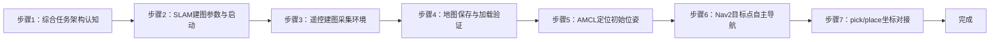

## 实验1：机器人建图与导航（8h）

> ✅ **源码已核实** 本实验对应仓库内两个已交付功能包：`slam/car1_slam`（SLAM_Toolbox 二维激光建图）与 `navigation/car1_navigation`（Nav2 导航栈）。根目录 = `ros2_ws/src/xflz_eai_car1`。这是"智能工厂综合项目"的第一环：先在真实场地用遥控建出一张栅格地图，再让机器人依赖这张地图实现 AMCL 定位与自主导航，为后续"到指定位置抓红色方块"提供坐标基础。

### 1.1 关联知识点

本实验对应"智能工厂综合项目"第 1 章"建图与导航"，覆盖以下知识点（ID 遵循 course-spec 分级约定）：

- 1.1.1 综合任务架构 > 概念 > 智能工厂闭环由「建图导航 → 视觉抓取 → 离线语音+大模型意图 → 语音控制闭环」四大环节构成，本实验夯实第一环的坐标与导航基础
- 1.1.2 SLAM 与占据栅格地图 > 原理 > SLAM（同时定位与建图）三要素：感知→定位→构图；栅格地图以 0/255/-1 表示占据/空闲/未知
- 1.1.3 SLAM_Toolbox 建图 > 流程 > `slam.launch.py` 启动 slam_toolbox + 激光雷达 + car1 底盘，`slam.yaml` 配置分辨率/回环/更新策略
- 1.2.1 遥控建图与地图保存 > 流程 > `slam_teleop.py` 遥控移动覆盖环境；`map_save.py` 保存 pgm+yaml 到 `maps/`
- 1.2.2 AMCL 定位 > 原理 > 粒子滤波自适应定位；`localization.launch.py` 启动 map_server + AMCL + lifecycle
- 1.3.1 Nav2 全局/局部规划 > 原理 > ThetaStar 全局规划器 + DWB 局部规划器 + `velocity_smoother` 速度平滑
- 1.3.2 代价地图与导航目标 > 流程 > Local/Global Costmap 膨胀层与激光障碍检测；设定 `pick_pose`/`place_pose` 目标点，`BasicNavigator.goToPose` 自主移动

### 1.2 实验目标

1. 掌握 SLAM_Toolbox 二维激光建图的流程与参数，能够用遥控器/键盘把智能工厂场地建成可复用的栅格地图 — 独立完成
2. 掌握 AMCL 粒子滤波定位与 Nav2 全局/局部导航调用，理解"建图-定位-规划"三者如何衔接 — 原理理解
3. 在已知地图上设定导航目标点，让机器人自主移动到指定位置（抓取点/放置点），验证导航成功率与精度 — 独立完成

### 1.3 实验环境

| 类别 | 配置 |
|------|------|
| 硬件 | 具身智能机器人小车 C1（STM32F407VET6 主控 + 4 轮麦克纳姆底盘 + 5DOF 机械臂 + COIN-D6 激光雷达 + HP60C 深度相机 + BMI088 IMU）；具身智能实验箱 B2 |
| OS | Ubuntu 22.04 + ROS2 Humble（车载板）；25Hz 激光 / 1Mbps STM32 串口 |
| 核心库 | rclpy、slam_toolbox、nav2、navigation2、slam_toolbox、tf2、map_server、amcl |
| 依赖包 | `car1_bringup`（bringup.launch.py 启动底盘/URDF/EKF/舵机）、`car1_peripherals`（激光雷达）、`car1_slam`、`car1_navigation` |
| 主入口 | `ros2 launch car1_slam slam.launch.py`（建图）<br>`ros2 launch car1_navigation navigation.launch.py map:=slam_map`（导航） |

### 1.4 实验难度

- 难度: ⭐⭐⭐ 综合性
- 重点: 建图 → 定位 → 导航的完整链路，及与上层抓取任务的坐标对接（`initial_pose`/`pick_pose`/`place_pose`）
- 难点: AMCL 初始位姿给的准不准、地图质量好不好，直接决定后续导航与抓取定位是否可靠；`/cmd_vel` 与 `/controller/cmd_vel` 两条速度通道的钳制差异

### 1.5 实验现象

**快速验证流程**（全程在车载 C1 板执行）：

1. 启动建图（含 bringup + 激光雷达 + slam_toolbox）：
   ```bash
   ros2 launch car1_slam slam.launch.py
   ```
2. 打开 RViz 建图视图，遥控小车遍历场地，观察占据栅格地图逐步生成：
   ```bash
   ros2 run car1_slam slam_teleop.py
   # 或 键盘键位 单独遥控（按 q 退出，r 右手系 / l 左手系，键位在脚本内）
   ```
3. 地图基本成型后保存：
   ```bash
   ros2 run car1_slam map_save.py   # 保存到 ~/ros2_ws/src/xflz_eai_car1/slam/car1_slam/maps/slam_map.pgm + .yaml
   ```
4. 关闭建图，改用已知地图启动导航（定位 + Nav2）：
   ```bash
   ros2 launch car1_navigation navigation.launch.py map:=slam_map
   ```
5. 在 RViz 中用 `2D Pose Estimate` 设置初始位姿，再用 `2D Goal Pose` 点击目标点，观察小车自主规划路径并移动到位，终端/面板显示 `Goal reached`。

**执行现象**：

- 建图阶段：RViz 的 Map 图层随小车移动不断变为占据栅格（白色=空闲、黑色=占据、灰色=未知），同时显示激光扫描线 (`/scan`) 与 EKF 轨迹；遥控转弯过快或撞墙会导致地图拖影/畸变
- 定位阶段：AMCL 粒子从初始位姿附近扩散并收敛，`/amcl_pose` 与 `/particlecloud` 显示红色粒子聚拢到机器人周围（50-100cm 误差内）
- 导航阶段：RViz 显示全局路径（绿线）+ 局部代价地图（滚动窗口 3m×3m）+ 局部轨迹（DWB 采样），小车以 `max_vel_x=0.3` 平滑行驶，到达后绿线消失、状态机置位
- 坐标对接：`/cmd_vel` 被 odom_publisher 钳制到 ±0.2 m/s；Nav2 内部走 `/controller/cmd_vel`（无钳制）保证自身控制速度不受限，见 CLAUDE.md「Velocity Command Routing」

### 1.6 实验步骤

#### 整体流程图



---

#### 步骤1：智能工厂综合任务架构认知（阶段一：能运行，30min）

> 📌 本步骤对应源码：`ros2_ws/src/xflz_eai_car1/CLAUDE.md`

**知识点讲解**：

**综合任务闭环（1.1.1）**

- **原理**：智能工厂综合项目不是把各模块简单堆叠，而是"语音指令 → 意图识别 → 建图导航 → 视觉抓取 → 运输放置"的一体化闭环。实操中，小车先（在本实验）建出场地地图，再用同一张地图导航到目标位置，随后机器人移动机械臂观察桌面红色方块、检测并抓取、导航到放置点放下。这一环节产出的地图与坐标（`pick_pose`、`place_pose`）是后续所有环节的空间基准，务必保证其质量。

**数据流与速度通道（关键工程约束）**

- **原理**：底盘速度有两条通道（见 `CLAUDE.md`）：外部 / 应用命令走 `/cmd_vel`（odom_publisher 施加 ±0.2 m/s 安全钳制），Nav2 规划输出走 `/controller/cmd_vel`（无钳制）。`navigation_base.launch.py` 中两处 cmd_vel 的 remap 必须保留，否则 Nav2 速度命令会落回 `/cmd_vel` 被钳制到 0.2 而"走得很慢"。底盘里程计先出 `odom_raw`，经 EKF（robot_localization）融合 IMU 后出 `/odometry/filtered`，Nav2 的 bt_navigator 订阅该话题（`nav2_params.yaml` L61）。

**操作步骤**：

1. 阅读 `CLAUDE.md` 的 Architecture 与 Launch Commands，梳理五种 launch 的关系（bringup / peripherals / slam / navigation / app）
2. 确认 `.bashrc` 已 source 工作空间，执行 `ros2 launch car1_slam slam.launch.py` 前的依赖服务；用一个终端随时 `ros2 topic list` 观察新增话题

**易错点**：

- ⚠️ 先启动底盘与传感器（slam.launch 内含 bringup），否则激光 `/scan` 与 `/odometry/filtered` 无数据，slam_toolbox 建图无输入

---

#### 步骤2：SLAM_Toolbox 建图参数与启动（阶段二：能理解，40min）

> 📌 本步骤对应源码：`slam/car1_slam/launch/slam.launch.py`、`slam/car1_slam/config/slam.yaml`

**知识点讲解**：

**SLAM_Toolbox 配置（1.1.3）**

- **原理**：`slam.launch.py` 依次 include bringup（底盘 + URDF + EKF + 舵机）、peripherals（激光雷达），再拉起 `slam_toolbox` 节点并加载 `slam.yaml`。`slam.yaml` 关键参数决定建图质量：
  - `resolution`（栅格分辨率，m/像素）——越小地图越精细，但文件越大、建图计算越重；
  - `map_update_interval`（地图更新时间）—— 越低刷新越频繁；
  - 回环检测（scan matching + loop closure）—— 让机器人回到已探索区域时能把地图"闭环"，纠正累计漂移。
- `slam_teleop.py` 提供遥控建图脚本：按键控制线/角速度，`q` 退出，`r`/`l` 切换刚体/非完整约束；建图时速度要慢、转弯要匀，过快会导致激光帧间位移过大、图匹配失败。

**操作步骤**：

1. 打开 `slam.yaml`，逐项阅读 `resolution`、`map_update_interval`、`slam_mode`、`scan_subscriber_queue_size` 等参数语义
2. 启动建图：
   ```bash
   ros2 launch car1_slam slam.launch.py
   ```
3. 用 `rqt_graph` 观察建图期节点拓扑：`/scan` → slam_toolbox → `/map`；用 `rviz2 -d slam.rviz` 打开建图视图

**易错点**：

- ⚠️ 建图时不要中途停车太久或原地快速转圈，机器人姿态突变会让 scan-to-scan 匹配失败
- ⚠️ `resolution=0.05` 是平衡精度与体积的常用值；现场场地较小时可适当调大，但后续 Nav2 costmap 也是 0.05，务必一致

---

#### 步骤3：遥控建图采集环境（阶段一：能运行，50min）

> 📌 本步骤对应源码：`slam/car1_slam/car1_slam/slam_teleop.py`

**知识点讲解**：

**遥控建图要领（1.2.1）**

- **原理**：栅格地图由激光在 robot pose 处的投影累加而成，机器人走到哪里、激光扫到哪里，地图才长到哪里。最终任务要求机器人能从起始点（`initial_pose`）导航到抓取点（`pick_pose`），因此场地中**起始区、抓取点桌面、放置区**务必都被建到、且道路通畅无不可达死角。
- **操作步骤**：
  1. 运行 `ros2 run car1_slam slam_teleop.py`，把小车从起始区出发，遍历过道、绕抓取桌一圈、再回到起始区（形成闭环，触发回环校正）
  2. 观察 RViz 中地图黑色区域（障碍）随激光增长，确认没有明显"断层/空鼓"（地图与真实对不上的条带）
  3. 缓慢控制小车回到起点，让激光再次扫过初始位置，尽量让地图闭合

**易错点**：

- ⚠️ 地图出现"重影/双层墙"→ 多为转角速度太快或激光被遮挡；放慢速度、控制转角 ≤30°/步重新扫
- ⚠️ 建图完成后直接关掉不要急，多停 3-5 秒让 slam_toolbox 提交回环修正

---

#### 步骤4：地图保存与加载验证（阶段一：能运行，30min）

> 📌 本步骤对应源码：`slam/car1_slam/car1_slam/map_save.py`、`slam/car1_slam/maps/slam_map.yaml`

**知识点讲解**：

**地图保存（1.2.1）**

- **原理**：地图以两文件保存：`slam_map.pgm`（灰度图像）与 `slam_map.yaml`（元数据：分辨率、原点、阈值、栅格合法性）。`map_save.py` 调用 nav2 map_saver 写出，供导航阶段的 `map_server` 加载。`slam_map.yaml` 中 `free_thresh`/`occupied_thresh` 决定灰度→占据/空闲判定。
- **操作步骤**：
  1. 保存：`ros2 run car1_slam map_save.py`，确认生成 `maps/slam_map.pgm`（可 `python`/看图软件打开预览）
  2. 阅读 `slam_map.yaml` 确认 `resolution`、`image`、`origin`（负值表示地图原点在图像中心的左下平移）
  3. 用 `ros2 run nav2_map_server map_server ...` 或直接进入导航 launch 验证加载

**易错点**：

- ⚠️ 保存脚本默认路径在 `slam/car1_slam/maps/`，若改名务必在导航启动时用 `map:=<名字>` 指定一致
- ⚠️ `origin` 是地图左下角相对 `map` 坐标系的偏移，`initial_pose` 需基于 `map` 坐标系给出，二者不能搞混

---

#### 步骤5：AMCL 定位与初始位姿设置（阶段二：能理解，50min）

> 📌 本步骤对应源码：`navigation/car1_navigation/launch/include/localization.launch.py`、`config/nav2_params.yaml`（amcl 段）

**知识点讲解**：

**AMCL 粒子滤波（1.2.2）**

- **原理**：`localization.launch.py` 用 `RewrittenYaml` 把 `yaml_filename`（地图）与 `use_sim_time` 注入同一份 `nav2_params.yaml`，拉起 `map_server`、`amcl`、`lifecycle_manager_localization` 三个节点并自动激活。AMCL 在 `initial_pose`（`nav2_params.yaml` L46-50，本例为起始停车位坐标）附近散布 500-2000 个粒子，靠激光与地图的似然收敛；`initial_particle_pose` 的协方差（L52-54 x/y=0.25、yaw=0.068）决定初始不确定性大小。
- 定位不准的本质是"地图坐标"与"机器人当前世界坐标"没对齐。提供初始位姿时应把粒子布到机器人真实所在处，精度越高收敛越快。

**操作步骤**：

1. 启动导航（含定位）：`ros2 launch car1_navigation navigation.launch.py map:=slam_map`
2. 在 RViz 用 `2D Pose Estimate` 点击小车真实位置并拖出朝向，设置初始位姿
3. 观察 `/particlecloud` 粒子从"一团"收敛到"一小撮"；用 `ros2 topic echo /amcl_pose` 对比 TF 中 `map→base_footprint` 的一致性
4. 故意把初始位姿摆偏 1m，观察 AMCL 是否仍能收敛（验证鲁棒性）

**易错点**：

- ⚠️ 定位假设"机器人在已知地图中"——若初始位姿偏差过大（超出粒子覆盖），可能收敛到错误点；保守做法是手动搬到已知位置再设置
- ⚠️ `/scan` 是 Best Effort QoS，RViz 中 LaserScan 的 Reliability 需设为 Best Effort，否则看得到 `/scan` 却不刷新

---

#### 步骤6：Nav2 全局/局部导航与目标点自主移动（阶段三：能改造，90min）

> 📌 本步骤对应源码：`navigation/car1_navigation/config/nav2_params.yaml`（controller/planner/costmap 段）、`navigation/car1_navigation/launch/navigation.launch.py`

**知识点讲解**：

**Nav2 规划链（1.3.1、1.3.2）**

- **原理**：`nav2_params.yaml` 定义了完整规划链：
  - **全局规划器** `planner_server` 用 `nav2_theta_star_planner/ThetaStarPlanner`（L185）——任意角落数/启发式代价权重，在 Global Costmap（静态地图 + 障碍 + 膨胀）上求无碰路径；
  - **局部规划器** `controller_server` 用 `dwb_core::DWBLocalPlanner`（L138）——在 3×3m 滚动 Local Costmap 上按时间采样速度空间（vx=20、vθ=40 样本、sim_time=1.5s），用代价/对齐/转向等多个 critic 加权选最优轨迹；`max_vel_x=0.3`、`max_vel_theta=1.0`；
  - **速度平滑** `velocity_smoother` 对规划输出做限速/限加速度钳制（`max_velocity`/`max_accel`）。
- **行为树导航**：`bt_navigator` 用 `navigate_to_pose_without_backup.xml`（去掉了 Backup 恢复动作，见 L71）加载 NavigateToPose 行为树，封装 ComputePath → FollowPath → 目标判定。

**操作步骤**：

1. 用 RViz `2D Goal Pose` 在抓取点位置设目标，观察全局路径（ThetaStar）与小车实际跟随（DWB）是否贴合、有无绕路
2. 在路径上临时放一个纸箱，观察 Local Costmap 障碍层把路径"顶开"，小车自动绕障
3. 阅读 `nav2_params.yaml` 的 DWB critic 权重（PathAlign 32 / GoalAlign 24 / PathDist 32 / GoalDist 24），理解各权重对"贴边/居中/冲目标"的影响
4. 用 Python 侧 `nav2_simple_commander` 的 `BasicNavigator` 发起一次 `goToPose` 编程导航（与后续综合实验一致）：
   ```python
   from nav2_simple_commander.robot_navigator import BasicNavigator
   nav = BasicNavigator()
   goal = PoseStamped()   # header.frame_id='map', 设 x/y/yaw 为 pick_pose
   nav.goToPose(goal)
   while not nav.isTaskComplete():
       print(nav.getFeedback())
   ```

**易错点**：

- ⚠️ 小车能够规划但原地不动/爬行 → 检查 `/cmd_vel` 通道钳制问题（见步骤 1 速度通道）
- ⚠️ 全局路径绕大弯 → 调整 Global Costmap 的 `inflation_radius`（L306 为 0.18）或 ThetaStar 的 `w_heuristic_cost`

---

#### 步骤7：pick/place 坐标对接与导航复测（阶段三：能改造，50min）

> 📌 本步骤对应源码：`app/car1_app/config/navigation_grasp_transport.yaml`（poses 段）

**知识点讲解**：

**任务坐标对接（1.3 延伸）**

- **原理**：综合任务用三组地图系坐标驱动导航（见 `navigation_grasp_transport.yaml` L4-9，实测 2026-07-08）：
  - `initial_pose: [-0.059, -0.103, 0.020]` —— 起始/停车区；
  - `pick_pose: [0.756, 0.872, 3.071]` —— 抓取点（`.last` 代表朝向 rad）；
  - `place_pose: [-0.059, -0.103, 0.020]` —— 放置点（与起始点相同）。
- 这三个坐标必须与**本实验建出的地图**一致；若重新建图，需用 `2D Pose Estimate` 重新标定，或在导航稳定后读取 TF 更新配置（如 `navigation_grasp_transport` 的 `set_pick_pose_from_current` 服务）。

**操作步骤**：

1. 结合步骤 6，用 BasicNavigator 依次编程导航到 `pick_pose`（停车朝向让桌面进入相机视野）与 `place_pose`，各测 3 次记录成功率与到位误差
2. 观察导航到位后小车停车朝向是否便于相机观测桌面（后续 ROTATE_SEARCH 以到位航向为基准）
3. 填写性能基线表（报告必填）：

   | 指标 | 期望值 | 实测值 |
   |------|-------|-------|
   | 建图分辨率 | 0.05 m/像素 |  |
   | 全局路径规划耗时 | <1s |  |
   | 导航到位误差 | ≤6cm（goal_tolerance 0.06） |  |
   | 前往 pick_pose 成功率 | 3/3 |  |
   | 前往 place_pose 成功率 | 3/3 |  |

**易错点**：

- ⚠️ 重新建图后坐标全部失效——务必同步更新 `navigation_grasp_transport.yaml` 的 poses，否则导航到旧位置

---

### 1.7 常见问题

| 问题 | 原因 | 解决方法 |
|------|------|---------|
| 建图出现重影/双层墙 | 转角速度过快或激光遮挡 | 放慢速度、控制转角 ≤30°/步；建图结束前多停几秒触发回环 |
| 导航时小车爬行 | Nav2 走回 `/cmd_vel` 被钳制 ±0.2 | 确认 `navigation_base.launch.py` 两处 cmd_vel remap 未改动（见 CLAUDE.md） |
| 定位收敛到错误位置 | 初始位姿偏差超出粒子覆盖 | 手动把机器人放回已知位置，用 `2D Pose Estimate` 重设 |
| RViz 中 `/scan` 不刷新 | LaserScan QoS 是 Best Effort | 把 RViz LaserScan 的 Reliability 设为 Best Effort |
| 全局路径绕大弯 | inflation_radius 过大或启发式权重失衡 | 调 `global_costmap.inflation_layer.inflation_radius`（0.18）或 ThetaStar `w_heuristic_cost` |
| map_server 加载失败 | map:= 名称与保存名不一致 | 用 `map:=slam_map` 与 `maps/slam_map.pgm` 严格对应 |

### 1.8 扩展实验

**扩展方向 1：多点连续导航（智能工厂巡逻）**
- 在场地中定义 3-4 个 waypoint，用 `nav2_simple_commander` 的 `goThroughPoses`/`followWaypoints` 编写顺序巡逻节点，验证多目标点调度与连续性

**扩展方向 2：导航与抓取联动的坐标预校验**
- 在把导航结果交给视觉抓取前，用一个脚本读取 `/amcl_pose`，与 `pick_pose` 做欧氏距离校验，超过容差则报警——作为综合任务（exp04）的可靠性前置

### 1.9 实验报告要求

**评分标准**：架构认知 10 分 + SLAM 建图 20 分 + 地图保存加载 10 分 + AMCL 定位 20 分 + Nav2 全局/局部导航 25 分 + 坐标对接与复测 15 分 = 100 分。

**报告必含内容**：
1. 综合任务闭环框图，标注本实验承担的"坐标与导航"环节
2. 建好的 `slam_map.pgm` 截图与 `slam_map.yaml` 关键参数
3. AMCL 粒子收敛前后 RViz 截图
4. 前往 pick/place 的全局路径 + 到位误差记录表
5. 回答思考题：为什么 Nav2 走 `/controller/cmd_vel` 不走 `/cmd_vel`？初始位姿给错了对后续抓取定位的连锁影响是什么？
6. 实验心得与问题记录

---

## 更新日志

| 版本 | 日期 | 变更 |
|------|------|------|
| v1.0 | 2026-09-23 | 初版生成（基于 slam/car1_slam 与 navigation/car1_navigation 源码与配置：slam.launch.py / slam.yaml / slam_teleop.py / map_save.py / localization.launch.py / nav2_params.yaml；坐标取自 navigation_grasp_transport.yaml 实测值） |