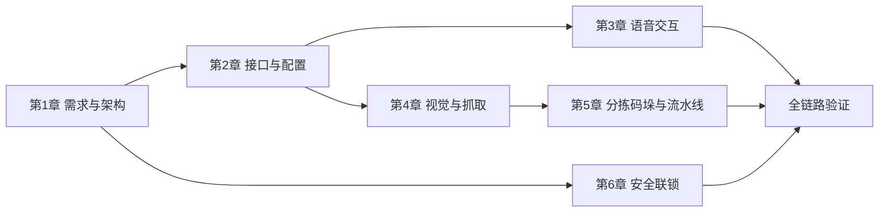

# 机器人大模型综合应用开发 知识图谱

> 课程代码: EXP006
> 总学时: 48
> 实验数: 9
> 技术栈: 语音交互 / ASR / TTS / LLM意图识别 / AprilTag视觉检测 / 机械臂抓取 / 流水线控制 / 激光雷达安全联锁
> 硬件平台: 具身智能实验箱B2 / 具身智能机器人小车C1
> 生成日期: 2026-08-14

---

## 第1章 项目需求与系统架构

> 对应实验 exp01（4h，验证性）— 具身智能工厂--项目需求分析；exp02（4h，设计性）— 具身智能工厂--系统架构设计

### 1.1 需求分析

#### 知识点 1.1.1
- **类型**: 概念
- **描述**: R1-R10 十条功能需求覆盖装货/分拣/码垛任务与安全联锁
- **难度**: 记忆
- **前置依赖**: 无

#### 知识点 1.1.2
- **类型**: 流程
- **描述**: 装货→分拣→码垛三大工业任务流程与打断复位(R8)点
- **难度**: 理解
- **前置依赖**: 1.1.1

#### 知识点 1.1.3
- **类型**: 原理
- **描述**: 安全联锁需求：雷达危险检测→释放舵机力矩→解除恢复
- **难度**: 理解
- **前置依赖**: 1.1.1

### 1.2 系统架构

#### 知识点 1.2.1
- **类型**: 概念
- **描述**: 五节点架构：N1语音/N2调度/N-vision/N-grasp/N-conveyor + N3安全
- **难度**: 记忆
- **前置依赖**: 1.1.2

#### 知识点 1.2.2
- **类型**: 原理
- **描述**: 话题(异步广播)与服务(同步请求-响应)混合通信拓扑
- **难度**: 理解
- **前置依赖**: 1.2.1

#### 知识点 1.2.3
- **类型**: 概念
- **描述**: 复用节点体系：car1_bringup/arm_controller/peripherals 提供底盘与机械臂能力
- **难度**: 记忆
- **前置依赖**: 1.2.1

### 1.3 调度编排

#### 知识点 1.3.1
- **类型**: 原理
- **描述**: N2 调度器任务状态机：intent 路由到对应 grasp/conveyor 服务
- **难度**: 理解
- **前置依赖**: 1.2.1, 1.2.2

#### 知识点 1.3.2
- **类型**: 流程
- **描述**: palletize 编排：先 run_until_sensor 送料→sensor_blocked→再抓取
- **难度**: 应用
- **前置依赖**: 1.3.1

#### 知识点 1.3.3
- **类型**: 流程
- **描述**: grasp 服务未就绪自动重试(2s 定时器)保证启动顺序容错
- **难度**: 应用
- **前置依赖**: 1.3.1

---

## 第2章 接口与配置设计

> 对应实验 exp03（4h，设计性）— 具身智能工厂--接口功能设计

### 2.1 接口体系

#### 知识点 2.1.1
- **类型**: 事实
- **描述**: A系列(N1↔N2:intent/speak/interrupt)与C系列(N3:danger/status)话题
- **难度**: 记忆
- **前置依赖**: 1.2.2

#### 知识点 2.1.2
- **类型**: 事实
- **描述**: D系列复用接口：pick/place/go_work/set_pick_target 对接 arm_controller
- **难度**: 记忆
- **前置依赖**: 1.2.3

#### 知识点 2.1.3
- **类型**: 事实
- **描述**: E系列(N2对外任务服务)与F系列(流水线 run/run_until_sensor/emergency_stop)
- **难度**: 记忆
- **前置依赖**: 2.1.1

### 2.2 配置驱动

#### 知识点 2.2.1
- **类型**: 原理
- **描述**: config/eai_factory.yaml 参数化：mode/grasp.tasks/safety/conveyor/intents
- **难度**: 理解
- **前置依赖**: 2.1.2, 2.1.3

#### 知识点 2.2.2
- **类型**: 概念
- **描述**: 双模式 debug(需confirm)/production(全自动) 配置切换
- **难度**: 理解
- **前置依赖**: 2.2.1

#### 知识点 2.2.3
- **类型**: 概念
- **描述**: 意图映射表：load→/eai_factory/start_load 等英文枚举→接口
- **难度**: 理解
- **前置依赖**: 2.2.1

---

## 第3章 语音交互

> 对应实验 exp04（6h，综合性）— 具身智能工厂--语音交互集成测试

### 3.1 语音链路

#### 知识点 3.1.1
- **类型**: 原理
- **描述**: KWS 唤醒词(小飞小飞等)本地检测，唤醒后进入识别态
- **难度**: 理解
- **前置依赖**: 无

#### 知识点 3.1.2
- **类型**: 原理
- **描述**: ASR 热词 modified_beam_search 提升专有词识别率
- **难度**: 理解
- **前置依赖**: 3.1.1

#### 知识点 3.1.3
- **类型**: 概念
- **描述**: TTS 固定播报文案(装货完成/分拣完成/码垛完成)
- **难度**: 记忆
- **前置依赖**: 3.1.1

### 3.2 LLM 意图

#### 知识点 3.2.1
- **类型**: 流程
- **描述**: LLM 意图三分类 load/sort/palletize/none 输出到 /eai_factory/intent
- **难度**: 应用
- **前置依赖**: 3.1.1, 3.1.2

#### 知识点 3.2.2
- **类型**: 原理
- **描述**: intent_hints 配置驱动，收录 ASR 误识别词(马舵/封建)无需改代码
- **难度**: 应用
- **前置依赖**: 3.2.1

#### 知识点 3.2.3
- **类型**: 原理
- **描述**: 语音打断(R8)：interrupt 信号→N2 中止当前任务
- **难度**: 理解
- **前置依赖**: 3.2.1

---

## 第4章 视觉感知与装货抓取

> 对应实验 exp05（8h，综合性）— 具身智能工厂--视觉自适应装货集成测试

### 4.1 AprilTag 检测

#### 知识点 4.1.1
- **类型**: 概念
- **描述**: tag36h11 AprilTag 编码图案，tag_id/tag_size 可配置
- **难度**: 记忆
- **前置依赖**: 无

#### 知识点 4.1.2
- **类型**: 原理
- **描述**: PnP 位姿解算：2D 角点→相机坐标系 6DOF 位姿
- **难度**: 理解
- **前置依赖**: 4.1.1

#### 知识点 4.1.3
- **类型**: 原理
- **描述**: camera_depth_optical_frame→base_link TF 变换链定位到机械臂系
- **难度**: 理解
- **前置依赖**: 4.1.2

### 4.2 抓取原语

#### 知识点 4.2.1
- **类型**: 概念
- **描述**: 双模式抓取：load 视觉抓取 / sort·palletize 固定点位
- **难度**: 记忆
- **前置依赖**: 4.1.3

#### 知识点 4.2.2
- **类型**: 流程
- **描述**: 抓取序列：移观察位→检测→TF→set_pick_target→pick→place→回work
- **难度**: 应用
- **前置依赖**: 4.2.1

#### 知识点 4.2.3
- **类型**: 原理
- **描述**: pick_offset_x/y/z 补偿手眼标定系统性偏差
- **难度**: 理解
- **前置依赖**: 4.2.2

---

## 第5章 分拣码垛与流水线

> 对应实验 exp06（4h，综合性）— 具身智能工厂--分拣集成测试；exp07（6h，综合性）— 具身智能工厂--码垛集成测试

### 5.1 分拣

#### 知识点 5.1.1
- **类型**: 概念
- **描述**: 固定点位抓取 vision=false，依赖 observe_pose/place_pose 配置
- **难度**: 记忆
- **前置依赖**: 4.2.1

#### 知识点 5.1.2
- **类型**: 流程
- **描述**: 手动打点：调机械臂到位→记录姿态→写入 yaml 配置
- **难度**: 应用
- **前置依赖**: 5.1.1

#### 知识点 5.1.3
- **类型**: 流程
- **描述**: sort 动作原语：移观察位→提前开爪→抓取→抬升→放置
- **难度**: 应用
- **前置依赖**: 5.1.1

### 5.2 流水线

#### 知识点 5.2.1
- **类型**: 原理
- **描述**: 流水线电机复用底盘电机通道 M1，motor_id 现场配置
- **难度**: 理解
- **前置依赖**: 1.2.3

#### 知识点 5.2.2
- **类型**: 流程
- **描述**: run_until_sensor 运转直到光电遮挡→定点停，防抖确认
- **难度**: 应用
- **前置依赖**: 5.2.1

#### 知识点 5.2.3
- **类型**: 原理
- **描述**: 流水线状态机 idle/running/sensor_blocked/emergency 与急停复位
- **难度**: 理解
- **前置依赖**: 5.2.2

---

## 第6章 安全联锁与系统验证

> 对应实验 exp08（4h，综合性）— 具身智能工厂--危险急停集成测试；exp09（8h，综合性）— 全功能快速验证

### 6.1 雷达安全

#### 知识点 6.1.1
- **类型**: 原理
- **描述**: 激光雷达前方 60° 扇区(±30°)，danger_dist=20cm 判定危险
- **难度**: 理解
- **前置依赖**: 1.1.3

#### 知识点 6.1.2
- **类型**: 原理
- **描述**: 障碍持续 0.5s(persist_time) 才判危险，防瞬时误报
- **难度**: 理解
- **前置依赖**: 6.1.1

#### 知识点 6.1.3
- **类型**: 原理
- **描述**: 危险时通过 /car1_base_driver/bus_servo/set_state 释放 6 舵机力矩
- **难度**: 应用
- **前置依赖**: 6.1.2

### 6.2 恢复机制

#### 知识点 6.2.1
- **类型**: 流程
- **描述**: 危险解除→恢复力矩→/arm_controller/go_work 回 work
- **难度**: 应用
- **前置依赖**: 6.1.3

#### 知识点 6.2.2
- **类型**: 原理
- **描述**: 打断分层：雷达危险打断 > 语音打断，危险时不强行运动
- **难度**: 理解
- **前置依赖**: 3.2.3, 6.1.3

#### 知识点 6.2.3
- **类型**: 流程
- **描述**: N-grasp/conveyor 订阅 danger 立即停止抓取/运转
- **难度**: 应用
- **前置依赖**: 6.2.1

### 6.3 系统集成验证

#### 知识点 6.3.1
- **类型**: 流程
- **描述**: Launch 一键启动：bringup→arm_controller→peripherals→eai_factory 节点
- **难度**: 应用
- **前置依赖**: 1.2.3, 2.2.1

#### 知识点 6.3.2
- **类型**: 概念
- **描述**: 7 个模块开关 start_base/viz/voice/vision/grasp/conveyor/radar
- **难度**: 记忆
- **前置依赖**: 6.3.1

#### 知识点 6.3.3
- **类型**: 流程
- **描述**: 语音→意图→任务→执行→完成播报全链路闭环与停止清理
- **难度**: 应用
- **前置依赖**: 3.2.1, 4.2.2, 5.2.2, 6.2.1

---

## 知识点统计

| 维度 | 数量 |
|------|------|
| 总章节数 | 6 |
| 总知识点数 | 42 |
| **类型分布** | |
| 概念类 | 10 |
| 原理类 | 17 |
| 流程类 | 12 |
| 事实类 | 3 |
| **难度分布** | |
| 记忆 | 11 |
| 理解 | 18 |
| 应用 | 13 |
| 分析 | 0 |

---

## 知识点依赖关系图（Mermaid）

## 实验-章节覆盖映射

| 实验 | 章节 | 学时 |
|------|------|------|
| exp01 需求分析 | 第1章 | 4h |
| exp02 架构设计 | 第1章 | 4h |
| exp03 接口功能设计 | 第2章 | 4h |
| exp04 语音交互 | 第3章 | 6h |
| exp05 视觉装货 | 第4章 | 8h |
| exp06 分拣 | 第5章 | 4h |
| exp07 码垛 | 第5章 | 6h |
| exp08 危险急停 | 第6章 | 4h |
| exp09 全功能验证 | 第6章 | 8h |
