# 机器人大模型综合应用开发 实验指导书（合并版）

> 课程代码: EXP006
> 总学时: 48
> 实验数: 9
> 适用对象: 人工智能/机器人工程/智能科学与技术 本科高年级
> 制定日期: 2026-08-14
> 模式: human_waiver（源码位于 ROS2 工作空间 src/，未复制到 source-codes/EXP006/）

---

## 目录

1. [实验1：具身智能工厂--项目需求分析](#实验1具身智能工厂--项目需求分析4h)
2. [实验2：具身智能工厂--系统架构设计](#实验2具身智能工厂--系统架构设计4h)
3. [实验3：具身智能工厂--接口功能设计](#实验3具身智能工厂--接口功能设计4h)
4. [实验4：具身智能工厂--语音交互集成测试](#实验4具身智能工厂--语音交互集成测试6h)
5. [实验5：具身智能工厂--视觉自适应装货集成测试](#实验5具身智能工厂--视觉自适应装货集成测试8h)
6. [实验6：具身智能工厂--分拣集成测试](#实验6具身智能工厂--分拣集成测试4h)
7. [实验7：具身智能工厂--码垛集成测试](#实验7具身智能工厂--码垛集成测试6h)
8. [实验8：具身智能工厂--危险急停集成测试](#实验8具身智能工厂--危险急停集成测试4h)
9. [实验9：具身智能工厂--全功能快速验证](#实验9具身智能工厂--全功能快速验证8h)

---

## 实验总览

| 编号 | 名称 | 学时 | 类型 | 难度 | 源码路径 |
|------|------|------|------|------|----------|
| exp01 | 具身智能工厂--项目需求分析 | 4h | 验证性 | ⭐ | `ros2_ws/src/xflz_eai_car1/app/eai_factory/` |
| exp02 | 具身智能工厂--系统架构设计 | 4h | 设计性 | ⭐⭐ | `ros2_ws/src/xflz_eai_car1/app/eai_factory/` |
| exp03 | 具身智能工厂--接口功能设计 | 4h | 设计性 | ⭐⭐ | `ros2_ws/src/xflz_eai_car1/app/eai_factory/` |
| exp04 | 具身智能工厂--语音交互集成测试 | 6h | 综合性 | ⭐⭐ | `ros2_ws/src/xflz_eai_car1/app/eai_factory/` |
| exp05 | 具身智能工厂--视觉自适应装货集成测试 | 8h | 综合性 | ⭐⭐⭐ | `ros2_ws/src/xflz_eai_car1/app/eai_factory/` |
| exp06 | 具身智能工厂--分拣集成测试 | 4h | 综合性 | ⭐⭐⭐ | `ros2_ws/src/xflz_eai_car1/app/eai_factory/` |
| exp07 | 具身智能工厂--码垛集成测试 | 6h | 综合性 | ⭐⭐⭐ | `ros2_ws/src/xflz_eai_car1/app/eai_factory/` |
| exp08 | 具身智能工厂--危险急停集成测试 | 4h | 综合性 | ⭐⭐⭐ | `ros2_ws/src/xflz_eai_car1/app/eai_factory/` |
| exp09 | 具身智能工厂--全功能快速验证 | 8h | 综合性 | ⭐⭐⭐ | `ros2_ws/src/xflz_eai_car1/app/eai_factory/` |

**学时合计**: 4+4+4+6+8+4+6+4+8 = **48h**

**类型分布**: 验证性 1 个 + 设计性 2 个 + 综合性 6 个

**难度分布**: ⭐ 1 个 + ⭐⭐ 3 个 + ⭐⭐⭐ 5 个

---

## 跨实验知识脉络

```
exp01 需求分析 ─► exp02 架构设计 ─► exp03 接口设计
                                          │
            ┌───────────────┬─────────────┤
            ▼               ▼             ▼
    exp04 语音交互   exp05 视觉装货   exp06/07 分拣/码垛
            │               │             │
            └───────────────┴─────────────┘
                        ▼
              exp08 危险急停（安全联锁）
                        ▼
              exp09 全功能快速验证
```

> 跨实验一致性：所有 eai_factory 节点统一使用 `/eai_factory/*` 命名空间话题与服务（`/eai_factory/intent`、`/eai_factory/speak`、`/eai_factory/safety/danger`、`/eai_factory/grasp/start`、`/eai_factory/conveyor/state`），一键启动主命令 `ros2 launch eai_factory eai_factory.launch.py`。

---

## 实验快速验证命令（全功能）

```bash
# 一键启动全部（bringup + 机械臂 + 相机 + eai_factory 节点 + 调试画面）
ros2 launch eai_factory eai_factory.launch.py

# 只测雷达安全（低内存）
ros2 launch eai_factory eai_factory.launch.py start_base:=false start_voice:=false \
  start_vision:=false start_grasp:=false start_conveyor:=false start_radar:=true

# 停止（防残留）
bash scripts/stop_eai_factory.sh
```

---
# 实验1：具身智能工厂--项目需求分析（4h）

### 1.1 关联知识点

- 1.1.1 R1-R10 需求体系（前置：ROS 2 话题/服务/参数基础概念、机器人基础）
- 1.1.2 三大任务流程（前置：1.1.1，需先理解 R4-R6 任务条款）
- 1.1.3 安全联锁需求（前置：1.1.1，需了解激光雷达 /scan 数据基本概念）

### 1.2 实验目标

1. **理解**具身智能工厂综合项目 R1-R10 需求体系，能逐条复述每个需求的约束要点（唤醒词集合、任务指令集合、安全阈值等）。
2. **掌握**装货/分拣/码垛三大任务流程的物流走向与执行顺序，能独立绘制任务流程图。
3. **理解**安全联锁机制（雷达危险检测 → 释放机械臂总线舵机力矩），以及语音打断（R8）与雷达打断（R9）的分层关系。
4. **理解**语音 + 大模型驱动的交互方式（唤醒 → ASR → LLM 意图 → 执行 → 播报的单轮闭环），并解释"大模型只做功能映射、不生成应答文案"的设计理由。
5. **独立完成**一份结构化需求阅读笔记，能标注出需求中的【待定】项与隐含约束。
6. **迁移**：把"需求总览 → 流程梳理 → 安全约束"的需求分析方法迁移到其他具身智能/智能制造场景。

### 1.3 实验环境

| 类别 | 内容 |
|------|------|
| 硬件 | B2 麦克纳姆底盘、C1 五自由度机械臂 + 夹爪（本实验仅阅读文档，无需上电）；文档涉及的传感器：激光雷达、RGB-D 深度相机、语音阵列麦克风、光电传感器、AprilTag 标签（tag36h11） |
| OS | Ubuntu 22.04 + ROS 2 Humble |
| Python | 3.10（语音/视觉/抓取节点运行时使用 /home/iflytek/ros2_venv 虚拟环境） |
| 核心库 | rclpy、std_msgs、std_srvs、geometry_msgs、sensor_msgs（本实验仅需理解消息类型概念） |
| 依赖 | 无运行依赖；阅读对象为 `app/eai_factory/` 包内 `docs/01_需求总览.md`、`docs/05_流程与安全.md`、`README.md` |

### 1.4 实验难度

- 难度: ⭐（验证性）
- 重点：R1-R10 需求条款的逐条梳理与要点归纳；三大任务（装货/分拣/码垛）流程绘制；R8 语音打断与 R9 雷达安全联锁的理解。
- 难点：R8 与 R9 两类打断的**优先级分层**（雷达打断 > 语音打断）以及"危险期间语音回 work 被抑制"的边界理解；需求中【待定】项与实际配置的对应关系。

### 1.5 实验现象

**快速验证流程**（纯文档类实验，以下为快速阅读清单）：

```bash
# 在~/ros2_ws/src/xflz_eai_car1/app/eai_factory包目录下
ls docs/
grep -n "R[0-9]" docs/01_需求总览.md          # 快速定位 R1-R10 各条款行号
grep -n "R8\|R9" docs/05_流程与安全.md          # 定位打断与安全章节
head -50 README.md                             # 架构速览与关键决策
```

**预期效果描述**：

- 能列出 R1-R10 每一条的一句话要点，并能说出"哪几条属于交互、哪几条属于任务、哪几条属于安全"。
- 能画出 `装货区 → 分拣区 → 流水线(定点停靠) → 码垛区` 的物流链图，并标注每个阶段结束后"回 work 姿态"这一安全约定（R4.1）。
- 能说出雷达危险触发的三个量化条件（60° 扇区、20 cm、持续 0.5 s）与触发动作（释放 6 个总线舵机力矩 + 发 danger）。
- 能说出语音打断（R8）四步复位流程：中断动作 → 回 work → 流水线停止 → 取消任务。

### 1.6 实验步骤

#### 整体流程图


#### 步骤1：通读需求总览，梳理 R1-R10（60min）

**知识点讲解**：

**1.1.1 R1-R10 需求体系**

- **原理**：需求体系回答"系统要做什么、边界是什么"两个问题。R1-R3 定义交互方式（语音+大模型、唤醒、指令识别），R4-R6 定义三大任务（装货/分拣/码垛），R7-R8 定义播报与打断复位，R9-R9.1 定义安全联锁与打断优先级，R10 定义工程组织。其中 R3 有一个关键约束："一律走大模型意图解析，不用关键词匹配"，且"大模型只做功能映射、不用大模型生成应答文案"——这决定了 N1 语音节点的实现方式（固定文案 TTS + LLM 分类）。梳理需求时建议按"交互/任务/安全/工程"四个维度分组，逐条标注"可量化约束"与【待定】项。
- **源码对应**：`docs/01_需求总览.md L14-L18（R1）、L20-L24（R2）、L26-L32（R3）、L90-L92（R10）`

```markdown
### R1. 交互方式：语音 + 大模型
- 交互模式：单轮、无多轮追问。每次都必须 唤醒 → ASR 识别 → LLM 功能识别 → 执行对应功能 → 播报
- 大模型只做功能映射（装货/分拣/码垛），不用大模型生成应答文案；所有对外播报用固定文案
### R3. 指令识别（意图）
- 唤醒后识别「开始装货」「开始分拣」「开始码垛」，一律走大模型意图解析，不用关键词匹配
```

**操作步骤**：

1. 打开 `docs/01_需求总览.md`，通读全文。
2. 用表格整理 R1-R10：每条记录「需求编号 / 一句话要点 / 可量化约束 / 涉及节点 」。
3. 特别关注 R3 的意图枚举（load/sort/palletize）与 R9 的三个量化条件，单独摘抄。

**易错点**：

- ⚠️ 误以为"语音打断=雷达急停"是同一种打断 → **解决**：对照 `docs/01_需求总览.md L80-L88`（R9.1），R8 是语音唤醒打断（中断动作→回 work），R9 是雷达危险打断（释放力矩，不动作），两者**优先级不同**（雷达 > 语音）。

#### 步骤2：绘制装货/分拣/码垛三大任务流程图（60min）

**知识点讲解**：

**1.1.2 三大任务流程**

- **原理**：三个任务共用"抓取-放置"原语，但物流走向不同：装货（R4）是"装货区视觉抓取 AprilTag → 放到固定位置"；分拣（R5）是"分拣区抓取 → 放到流水线 → 流水线自动运转送料 → 定点停靠"；码垛（R6）是"从流水线定点取料位抓取 → 放到码垛区"。共同约束是 R4.1：**每步操作完成后必须先回 work 姿态**，才能进行下一步/等待下一条指令。绘制流程图时应把"回 work"画成一个显式状态，这是流程图中最容易漏掉的环节。
- **源码对应**：`docs/01_需求总览.md L34-L38（R4 装货）、L40-L45（R5 分拣）、L47-L50（R6 码垛）、L52-L55（R4.1 回 work 约定）`；物流链总览见 `docs/05_流程与安全.md L3-L18`

```markdown
### R4.1 关键安全约定：每步操作后回 work 姿态
- 每次机械臂操作完成后，必须先回到 work 姿态，才能进行下一步/等待下一条语音指令。
- 适用：装货放置后、分拣放置后、流水线放置后、码垛放置后，以及打断后（见 R8）。
```

**操作步骤**：

1. 用流程图工具（draw.io / PlantUML / mermaid）绘制三张任务流程图。
2. 每张图必须包含：触发条件（语音指令）、执行序列（观察/抓取/放置/流水线）、结束动作（回 work）、完成播报。
3. 对比三张图的差异，重点标注"分拣有流水线环节、码垛有送料等待环节、装货是纯视觉抓取"。

**易错点**：

- ⚠️ 流程图漏掉"回 work 姿态" → **解决**：对照 R4.1（`docs/01_需求总览.md L52-L55`），回 work 是每个任务与下个任务之间的强制状态，必须显式画出。

#### 步骤3：标注语音打断（R8）与雷达急停（R9）安全点（60min）

**知识点讲解**：

**1.1.3 安全联锁需求**

- **原理**：R9 定义"雷达自身前方扇区检测→释放力矩"的安全联锁：检测基于激光雷达自身坐标系（laser_link），不依赖车身 TF；三个量化条件是前方 60° 范围（0° 为中心 ±30° 跨 0° 环绕）、距离 20 cm 内、障碍持续超过 0.5 s。触发动作是释放机械臂全部 6 个总线舵机力矩（微阻力、可被外力推动、不强行运动，避免伤人），同时发 `/eai_factory/safety/danger=true`；危险解除后恢复力矩并调 `/arm_controller/go_work` 回 work。R9.1 定义分层：**雷达打断优先级 > 语音打断**，危险期间语音打断的"回 work"被抑制。R8 则是语音唤醒打断的四步复位流程。
- **源码对应**：`docs/01_需求总览.md L62-L68（R8）、L70-L78（R9）、L80-L88（R9.1）`；`docs/05_流程与安全.md L22-L27（检测条件）、L29-L41（触发与解除动作）、L67-L79（打断复位流程）`

```markdown
### R9. 工厂安全保护（激光雷达）
- 检测条件：雷达前方 60° 范围（0° 为中心 ±30°，跨 0° 环绕）内、距离 20 cm 内
  存在持续障碍物超过 0.5 s → 判危险。
- 触发动作（N3 safety 节点）：释放机械臂全部 6 个舵机力矩 + 发 /eai_factory/safety/danger=true。
- 危险解除后：恢复舵机力矩 + 调 /arm_controller/go_work 回 work 姿态 + 发 danger=false。
```

**操作步骤**：

1. 在 `docs/05_流程与安全.md` 中找到 R8 打断复位四步（`L67-L75`）与 R9 触发/解除动作（`L29-L41`），在需求笔记中标注行号。
2. 用箭头图画出"危险检测 → 释放力矩 → 危险解除 → 恢复力矩 → 回 work"完整时序。
3. 对比 R8 与 R9：R8 是"用户主动打断、动作复位"，R9 是"系统安全联锁、力矩释放"，总结两者的触发源、动作、解除条件差异表。

**易错点**：

- ⚠️ 误以为危险解除后任务会自动继续 → **解决**：对照 `docs/01_需求总览.md L87`（R9.1），危险解除进入 work 后需**等待重新唤醒**再执行任务，不会自动续跑。

#### 步骤4：阅读 README 架构速览，理解五模块与关键决策（30min）

**知识点讲解**：

**1.1.1 / 1.1.2 综合（五模块与关键决策）**

- **原理**：README 的"架构速览"把需求落地为五个模块：N1 语音（KWS→ASR→LLM 意图→TTS）、N2 调度器（任务状态机）、N-grasp（双模式抓取）、N3 安全（雷达扇区检测→释放力矩）、N-conveyor（流水线）。"关键决策速览"回答"需求怎么变成设计"：抓取=双模式（load 视觉 / sort·palletize 固定点位）、姿态统一 base_link 走 IK 且全部 yaml 配置、流水线复用底盘电机、打断分层=雷达>语音、全链路闭环=语音→intent→任务→执行→grasp status→完成播报。该步骤把 R1-R10 与模块一一对应起来，为实验 2 的架构设计打基础。
- **源码对应**：`README.md L31-L38（架构速览）、L40-L48（关键决策速览）`

```markdown
## 架构速览
- **N1 eai_factory_voice**：KWS→ASR→LLM 意图→TTS 播报 / 语音打断
- **N2 eai_factory_scheduler**：任务状态机（装货/分拣/码垛），grasp 未就绪自动重试
- **N-grasp eai_factory_grasp**：双模式抓取 + R8 打断 + 雷达危险中断 + 完成状态发布
- **N3 eai_factory_safety**：雷达自身前方扇区检测→释放舵机力矩→危险解除恢复+回 work
- **N-conveyor eai_factory_conveyor**：流水线电机 + 光电传感器定点停 + 急停
```

- **配图说明**：配一张"需求→模块映射表图"，左侧列 R1-R10，右侧列对应模块（R1-R3→N1/N2、R4-R6→N-grasp/N-conveyor、R9→N3），连线标注关键决策（双模式/打断分层/全链路闭环）。

**操作步骤**：

1. 通读 `README.md` 的架构速览与关键决策两节。
2. 在笔记中绘制"需求编号 → 模块 → 关键决策"三层映射。
3. 阅读 README 常用命令（`L50-L81`），记录一键启动命令 `ros2 launch eai_factory eai_factory.launch.py` 与 7 个开关的用途（本实验仅记录，不执行）。

**易错点**：

- ⚠️ 把"复用节点"误记为 eai_factory 自己的模块 → **解决**：README `L38` 明确列出复用清单（car1_bringup / car1_arm_controller / car1_peripherals / apriltag_detector / visual_grasp），这些是"复用不改"的既有节点。

#### 步骤5：撰写需求阅读笔记（30min）

**操作步骤**：

1. 汇总前四步产出，按"交互需求 / 任务需求 / 安全需求 / 工程组织"四节撰写笔记。
2. 每节附上文档行号引用与关键约束摘录，标注【待定】项（如 R4/R5/R6 中的坐标待定项）。
3. 自检清单：能否不看文档说清 R1-R10 要点；能否画出三大任务流程；能否说清 R8/R9 分层。

**易错点**：

- ⚠️ 笔记只抄条款不做归纳 → **解决**：每条需求必须提炼"可量化约束"（如唤醒词集合、60°/20cm/0.5s、6 舵机）和"设计含义"（对哪个模块、影响什么实现），才算有效笔记。

### 1.7 注意事项

- ⚠️ 本实验为**纯文档阅读，无硬件操作**，不需要给底盘/机械臂上电。
- ⚠️ 文档中多处标注【待定】（如装货区坐标、分拣区观察位），阅读时注意区分"已确认约束"与"待定项"，不要把它们当成已实现坐标。
- ⚠️ 本实验不执行任何 ros2 命令；若在工程机以外阅读，注意 README 中的路径（/home/iflytek/ros2_ws/...）为实机路径。

### 1.8 实验总结

**完成成果**: 一份 R1-R10 需求梳理表（含量化约束与【待定】标注）；三大任务流程图各一张（含回 work 状态）；一张 R8/R9 打断分层与安全联锁时序图；一份需求阅读笔记（含需求→模块映射）。

**技能收获**:

- 技能1：需求文档结构化梳理方法（分组 → 量化约束 → 待定项）
- 技能2：任务流程图绘制（显式画出安全状态）
- 技能3：安全联锁与打断优先级分析

**常见问题与解决**:

| 问题 | 原因 | 解决方法 |
|------|------|----------|
| 分不清 R8 与 R9 | 两类打断都叫"打断"，但触发源不同 | 按"触发源/动作/解除条件"三列做对比表（语音唤醒→复位动作；雷达危险→释放力矩） |
| 流程图漏掉回 work | 未注意到 R4.1 是显式需求 | 用 `docs/01_需求总览.md L52-L55` 的适用清单逐项核对每个任务的收尾 |
| 把【待定】坐标当实现值 | 需求文档与配置文档混读 | 以【待定】标记为准，坐标类数值以实验 3 的 config/eai_factory.yaml 为准 |

### 1.9 实验报告要求

**思考题**:

1. 为什么 R3 要求"一律走大模型意图解析，不用关键词匹配"，而 R7 却用固定文案播报？请结合"大模型只做功能映射"的设计约束说明其理由。
2. R9 的检测条件有三个量化参数（60°、20cm、0.5s），请分析每个参数的作用；若把 persist_time 改为 0.1s 会带来什么问题？
3. 在"分拣 → 流水线送料 → 码垛"链路中，R4.1 的"每步回 work"是如何保证任务之间安全的？如果省去某一步回 work 会有什么风险？

**评分标准**:

- 需求梳理表完整准确（40 分）：R1-R10 逐条覆盖、量化约束正确、【待定】标注清晰
- 三大任务流程图（30 分）：物流走向正确、回 work 状态齐全、分拣/码垛差异体现
- R8/R9 分层与安全联锁分析（20 分）：触发/动作/解除条件正确、优先级分层表达清楚
- 笔记规范与行号引用（10 分）：引用真实文档行号、结构完整 = 100 分。


# 实验2：具身智能工厂--系统架构设计（4h）

### 2.1 关联知识点

- 1.2.1 五节点架构（前置：实验 1 的 R1-R10 需求体系、ROS 2 节点/话题/服务概念）
- 1.2.2 通信拓扑（前置：1.2.1，需理解话题异步与服务同步的区别）
- 1.2.3 复用节点（前置：1.2.1，需了解 car1_bringup / car1_arm_controller / car1_peripherals 等既有包）
- 1.3.1 任务状态机（前置：1.2.1，需先理清 N2 调度器职责）
- 1.3.2 palletize 编排（前置：1.3.1，需理解流水线 run_until_sensor 语义）
- 1.3.3 自动重试（前置：1.3.1，需理解服务未就绪场景）

### 2.2 实验目标

1. **掌握**五节点（N1/N2/N3/N-grasp/N-conveyor）职责划分与协作关系，能解释"为什么拆成五个节点、每个节点管什么、谁消费谁的数据"。
2. **理解**N2 调度器任务状态机的运行逻辑（load/sort/palletize 三条路由与 palletize 的"先送料后抓取"编排）。
3. **理解**码垛"先送料后抓取"的编排机制（run_until_sensor 异步送料 → 订阅 conveyor/state 等待 sensor_blocked → 再触发 grasp），并解释为什么采用异步而不是同步阻塞。
4. **掌握**launch 多节点编排方法（7 个开关、venv python 直跑 .py 与 console_scripts 入口两种启动方式的差异）。
5. **独立完成**一张 eai_factory 系统架构图与一份架构理解笔记。
6. **迁移**：能对一个多节点 ROS 2 项目快速建立"节点-接口-编排"三维认知。

### 2.3 实验环境

| 类别 | 内容 |
|------|------|
| 硬件 | B2 麦克纳姆底盘、C1 五自由度机械臂 + 夹爪（本实验仅阅读源码，无需上电）；文档涉及的传感器：激光雷达、RGB-D 深度相机、光电传感器 |
| OS | Ubuntu 22.04 + ROS 2 Humble |
| Python | 3.10（voice/vision/grasp/conveyor 节点运行时使用 /home/iflytek/ros2_venv/bin/python3；scheduler/safety 用 console_scripts 入口） |
| 核心库 | rclpy（Node、ReentrantCallbackGroup、Timer）、std_msgs、std_srvs |
| 依赖 | 阅读对象：`docs/02_架构设计.md`、`eai_factory/scheduler_node.py`、`eai_factory/grasp_node.py`、`eai_factory/conveyor_node.py`、`eai_factory/safety_node.py`、`launch/eai_factory.launch.py`；复用包：car1_bringup / car1_arm_controller / car1_peripherals / apriltag_detector |

### 2.4 实验难度

- 难度: ⭐⭐（设计性）
- 重点：五节点职责划分与通信拓扑；N2 任务状态机的三条路由；palletize"先送料（run_until_sensor）→ 等 sensor_blocked → 再抓取"的异步编排；launch 双启动方式（venv python 直跑 vs entry point）。
- 难点：palletize 编排中"异步服务 + 状态话题回滚"的同步机制设计（为什么 start 立即返回、完成靠 /eai_factory/conveyor/state 通知）；2s 定时器自动重试在服务未就绪时的兜底逻辑。

### 2.5 实验现象

**快速验证流程**（纯源码阅读类实验，以下为快速阅读清单）：

```bash
# 在 eai_factory 包目录下
grep -n "def _" eai_factory/scheduler_node.py        # 列出调度器全部回调/方法及行号
grep -n "create_service\|create_subscription\|create_publisher" \
  eai_factory/grasp_node.py eai_factory/conveyor_node.py eai_factory/safety_node.py
grep -n "DeclareLaunchArgument\|ExecuteProcess\|Node(" launch/eai_factory.launch.py
```

**预期效果描述**：

- 能画出五节点拓扑图（N1→N2→N-grasp/N-conveyor，N3 并行监听 /scan 并向各节点广播 danger）。
- 能说出 N2 对 load/sort 走"直接触发 grasp"、对 palletize 走"先送料后抓取"的路由差异，并解释 2s 自动重试的触发条件。
- 能说出 launch 文件里 7 个开关的名字与作用，以及 voice/vision/grasp/conveyor 用 venv python 直跑、scheduler/safety 用入口点的原因。

### 2.6 实验步骤

#### 整体流程图

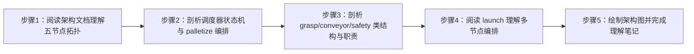

#### 步骤1：阅读架构文档，理解五节点拓扑（60min）

**知识点讲解**：

**1.2.1 五节点架构 + 1.2.2 通信拓扑**

- **原理**：系统按"职责单一"拆成五个节点：N1 语音负责交互（KWS→ASR→LLM→TTS），N2 调度器负责任务编排（唯一做决策的节点），N-grasp 只做"抓取-放置"原语，N3 安全常驻监听雷达，N-conveyor 只管流水线电机+光电传感器。通信拓扑是"星形+并行"：N1 通过意图话题驱动 N2，N2 通过 set_task/grasp start 驱动 N-grasp、通过 run_until_sensor 驱动 N-conveyor，N3 则并行地把 danger 广播给 N2/N-grasp/N-conveyor。选择"话题异步 + 服务同步"组合的原因：任务执行（机械臂动作）是秒级阻塞，用服务调用可拿到 success 确认；而 intent/interrupt/danger 这类状态信号用话题广播，保证任何节点随时可订阅、不被服务占用卡死。
- **源码对应**：`docs/02_架构设计.md L5-L24（架构总览图）、L97-L106（节点职责表）`

```
┌─ 复用（不改）────────────────────────────────────────┐
│ car1_bringup / car1_arm_controller / car1_peripherals │
│ apriltag_detector（现成 ROS 节点）                     │
└──────────────────────────────────────────────────────┘
N1 eai_factory_voice     ROS节点：KWS→ASR→LLM意图→TTS播报 / 语音打断检测
N2 eai_factory_scheduler ROS节点：任务状态机（装货/分拣/码垛）
N3 eai_factory_safety    ROS节点：雷达自身前方扇区检测→释放舵机力矩→危险解除恢复+回work
N-conveyor eai_factory_conveyor ROS节点：流水线电机 + 光电传感器定点停
```

**操作步骤**：

1. 通读 `docs/02_架构设计.md` 的"架构总览"与"节点职责"两节，记录每个节点的订阅/发布/服务概貌。
2. 在笔记中画出 N1→N2→N-grasp/N-conveyor 与 N3 广播的两层拓扑。
3. 对照"动作完成确认方式"一节（`L83-L88`），记录"为什么用服务确认、暂不加 Action"的两条理由（服务阻塞式返回 success=到位；打断用 N3 安全优先 + emergency_stop 即可）。

**易错点**：

- ⚠️ 误以为 N3 只跟 N2 通信 → **解决**：N3 的 danger 广播是发给 N2/N-grasp/N-conveyor 三方（`docs/02_架构设计.md L40` C1 接口、`L81` F10 接口），流水线收到 danger 会急停并调 /arm_controller/emergency_stop，抓取节点收到 danger 会立即停止抓取。

#### 步骤2：剖析调度器任务状态机与 palletize 编排（60min）

**知识点讲解**：

**1.3.1 任务状态机 + 1.3.2 palletize 编排 + 1.3.3 自动重试**

- **原理**：N2 是"决策中枢"，但它的状态机很轻：`_run_task` 按 intent 值做三分支——palletize 走 `_start_palletize_sequence`（先送料后抓取），load/sort 走 `_trigger_grasp`（直接抓取）。palletize 编排的核心是"异步两步"：先异步调用 conveyor 的 run_until_sensor（服务立即返回，流水线内部线程运转），N2 置 `_awaiting_sensor=True` 后回到主循环，等 `_conveyor_state_cb` 收到 state=sensor_blocked 时再触发抓取——这样 N2 在等待期间不被阻塞，能及时响应 interrupt/danger。自动重试：若 grasp/conveyor 服务未就绪（如 N-grasp 启动慢），N2 保存 `_pending_task` 并创建 2s 定时器 `_retry_grasp`，服务就绪后重放任务。
- **源码对应**：`scheduler_node.py L80-L94（_run_task 路由）、L98-L110（_start_palletize_sequence）、L121-L127（_conveyor_state_cb）、L129-L152（_trigger_grasp）、L154-L169（_retry_grasp）`

```python
def _run_task(self, task):
    if task == 'palletize':
        self._start_palletize_sequence()
    elif task in ('load', 'sort'):
        self._trigger_grasp(task)
    else:
        self.get_logger().warn(f'[SCHEDULER] unknown intent: {task}')

def _conveyor_state_cb(self, msg):
    # palletize: item reached sensor -> start grasp at take-out point
    if self._awaiting_sensor and msg.data == 'sensor_blocked':
        self._awaiting_sensor = False
        self.get_logger().info(
            '[SCHEDULER] palletize: item at sensor — starting grasp')
        self._trigger_grasp('palletize')
```

**操作步骤**：

1. 通读 `scheduler_node.py` 全文（247 行），按行号标注六个关键方法：`_run_task`、`_start_palletize_sequence`、`_conveyor_state_cb`、`_trigger_grasp`、`_retry_grasp`、`_grasp_status_cb`。
2. 写出 load/sort/palletize 三条路由的执行链，注意 `_trigger_grasp` 中"先发 set_task 再调 start 服务"的顺序保证（同一条 DDS 链路 FIFO，`L145-L150`）。
3. 解释 `_retry_grasp`（`L154-L169`）中 `_pending_task is None` 早退、按任务选服务（conveyor vs grasp）就绪判断的设计。

**易错点**：

- ⚠️ 误以为 run_until_sensor 是阻塞等待送料完成 → **解决**：它是"立即返回 + 完成走 state 话题"的异步服务（`conveyor_node.py L223-L238` 服务端、`docs/02_架构设计.md L74` F3 接口说明"**异步**：运转直到光电遮挡→定点停；完成走 state 话题"），N2 必须靠 `_conveyor_state_cb` 感知完成。

#### 步骤3：剖析 grasp / conveyor / safety 类结构与职责（60min）

**知识点讲解**：

**1.2.1 / 1.2.3 节点职责与复用**

- **原理**：三个执行类节点都是"自包含"的：N-grasp 把"抓取-放置"原语按 vision 标志分双模式（视觉抓取走 arm pick/place 服务；固定点位抓取自行编排 set_gripper + target_pose，`_do_fixed_grasp` 八步序列），并提供 /eai_factory/grasp/start|confirm|abort 三个服务；N-conveyor 复用底盘电机通道（M1）+ GPIO17 光电传感器，提供 5 个流水线服务并内置急停；N3 在 /scan 回调内直接算扇区最小距离并双发（danger 话题 + 舵机力矩释放），无服务往返、响应最快（150~220ms）。它们共同遵循"复用不改"原则：复用 car1_arm_controller 的 pick/place/go_work/set_gripper 服务与 car1_base_driver 的 set_motor/set_state 话题，不重复实现底层驱动。
- **源码对应**：`grasp_node.py L413-L485（_do_fixed_grasp 固定抓取八步）、L246-L306（start_grasp 双模式入口）`；`conveyor_node.py L297-L339（_run_until_sensor_worker 先清沿后遮挡沿防抖）、L240-L248（_emergency_cb）`；`safety_node.py L78-L99（_get_sector_min_range 扇区最小距离）、L163-L177（_enter_danger 双发）`

```python
# grasp_node.py — 固定点位抓取：提前开夹爪 → 直接到抓取点 → 闭爪 → 抬升 → 放置 → 开爪 → 回 work
# ① open gripper BEFORE moving, wait fully open
if not self._call_gripper(True):
    return
# ② move directly to the pick point (manual taught pose + pitch)
self._move_to_pose(ox, oy, oz, opitch)
time.sleep(self.move_delay)
# ③ close gripper to grasp (fully closed)
if not self._call_gripper(False):
    return
```

**操作步骤**：

1. 阅读 `grasp_node.py`，在笔记中整理三类输入（话题订阅）、两类输出（话题发布）、五类服务调用（pick/place/go_work/set_gripper/emergency_stop）与服务提供（start/confirm/abort），记录行号。
2. 阅读 `conveyor_node.py` 的 `_run_until_sensor_worker`（`L297-L339`），理解"先等 clear 沿、再等 blocked 沿（防抖 debounce_reads=3）"的两段式逻辑。
3. 阅读 `safety_node.py`，记录 ARM_SERVO_IDS = range(6)（`L34`）、扇区跨 0° 环绕处理（`L90-L94`）、_enter_danger 双发动作（danger_pub + _set_arm_torque(False)，`L163-L177`）。

**易错点**：

- ⚠️ 误以为 N3 通过服务调机械臂停止 → **解决**：N3 危险时是**话题直发**释放力矩（`safety_node.py L105-L120` 一个 DDS 发布、无服务往返），回 work 才用 /arm_controller/go_work 服务（`L122-L128`）；在 scan 回调内直接响应是"最快"的刻意设计。

#### 步骤4：阅读 launch 文件，掌握多节点编排方法（60min）

**知识点讲解**：

**1.2.1 五节点架构（launch 集成）**

- **原理**：`eai_factory.launch.py` 用 7 个 DeclareLaunchArgument 开关（start_base/start_viz/start_voice/start_vision/start_grasp/start_conveyor/start_radar）控制整套系统的启动范围，默认全开。启动方式分两种：voice/vision/grasp/conveyor 用 `ExecuteProcess` + `/home/iflytek/ros2_venv/bin/python3` 直跑 .py 脚本（因为 sherpa_onnx 只在 venv、cv2 4.11 新 API 才能可靠检测 AprilTag）；scheduler/safety 用 `Node` + console_scripts 入口（仅标准 ROS 接口，系统 python 即可）。venv 脚本路径由 `_venv_script_path` 从安装目录拼出，开关条件用 `IfCondition(LaunchConfiguration(...))` 注入。这种"同包两种启动方式"是混用第三方 Python 依赖时的标准做法。
- **源码对应**：`launch/eai_factory.launch.py L73-L86（7 个开关声明）、L99-L105（voice ExecuteProcess）、L107-L113（scheduler Node）、L115-L121（safety Node）、L123-L146（vision/grasp/conveyor ExecuteProcess）、L149-L160（rqt_image_view TimerAction）`

```python
DeclareLaunchArgument('start_voice', default_value='true',
                      description='Start voice node (LLM ~500MB). Set false to save memory...'),
DeclareLaunchArgument('start_radar', default_value='false',
                      description='Start lidar only (independent of start_base; low-memory testing of safety node)'),
# N2: standard ROS interfaces only, entry point is fine
Node(package='eai_factory', executable='eai_factory_scheduler',
     name='eai_factory_scheduler', output='screen', parameters=[config_path]),
```

**操作步骤**：

1. 通读 `eai_factory.launch.py`，用表格整理 7 个开关的默认值、作用与典型组合（如 `start_base:=false start_voice:=false` 省内存测视觉抓取）。
2. 对比 ExecuteProcess 与 Node 两种写法的差异，解释 voice 为什么不能走 entry point（shebang 是 /usr/bin/python3，无 sherpa_onnx）。
3. 记录低内存只测雷达安全的组合命令（`start_base:=false start_voice:=false start_vision:=false start_grasp:=false start_conveyor:=false start_radar:=true`），本实验不执行。

**易错点**：

- ⚠️ 以为节点启动顺序由"写得早的启动得早"保证 → **解决**：launch 只保证"启动**尝试**顺序"，N-grasp 若启动慢于 N2，会触发 N2 的 2s 自动重试兜底（`scheduler_node.py L136-L144`）——这正是 1.3.3 自动重试存在的意义，不要依赖启动顺序。

#### 步骤5：绘制系统架构图并完成架构理解笔记（30min）

**操作步骤**：

1. 综合前四步产出，绘制一张完整系统架构图（五节点 + 复用层 + 话题/服务连线 + 打断分层标注）。
2. 撰写架构理解笔记：每节附源码行号引用（scheduler/grasp/conveyor/safety/launch 各至少一处）。
3. 自检清单：能否不看代码讲清 palletize 编排的异步机制；能否解释 2s 重试的触发条件与解除条件。

**易错点**：

- ⚠️ 架构图只画节点不画接口 → **解决**：接口是架构的"连接件"，本实验的图必须标注关键话题/服务名（intent、speak、danger、grasp/start、run_until_sensor 等），与实验 3 的接口清单表呼应。

### 2.7 注意事项

- ⚠️ 本实验为**纯源码阅读，无硬件操作**，不需要上电。
- ⚠️ 涉及 launch 命令时注意**顺序依赖**：一键启动命令 `ros2 launch eai_factory eai_factory.launch.py` 会先拉起底层（bringup/arm/peripherals）再起 eai_factory 节点；若底层已在跑，需加 `start_base:=false` 避免重复启动。
- ⚠️ launch 中 venv python 路径 `/home/iflytek/ros2_venv/bin/python3` 为实机路径，跨环境阅读时不要照搬到其他机器。

### 2.8 实验总结

**完成成果**: 一张五节点通信拓扑图；一份含行号引用的调度器状态机分析（三条路由 + palletize 异步编排 + 2s 重试）；一份三类执行节点职责对比；一份 launch 开关与双启动方式对照表；一份系统架构理解笔记。

**技能收获**:

- 技能1：多节点 ROS 2 架构分析方法（节点-接口-编排三维度）
- 技能2：异步服务 + 状态话题的编排设计（palletize 送料等待）
- 技能3：服务未就绪的定时器自动重试兜底模式
- 技能4：launch 多开关与双启动方式（ExecuteProcess vs entry point）编排

**常见问题与解决**:

| 问题 | 原因 | 解决方法 |
|------|------|----------|
| 以为 palletize 是"先抓取再送料" | 未理解码垛取料位在流水线上 | 对照 `scheduler_node.py L8-L9` docstring 与 `L98-L127`：先 run_until_sensor 送料到取料位，等 sensor_blocked 再抓取 |
| 误以为 start 服务返回=任务完成 | 混淆"触发"与"完成"两种语义 | grasp/start 与 run_until_sensor 都是**立即返回**（触发语义），完成走 /eai_factory/grasp/status 与 /eai_factory/conveyor/state 话题（`docs/02_架构设计.md L50、L74`） |
| 分不清 ExecuteProcess 与 Node 入口 | 不了解 venv 依赖隔离 | voice 依赖 sherpa_onnx（仅 venv）、vision 依赖 cv2 4.11，必须 ExecuteProcess 直跑；scheduler/safety 仅标准接口，用 console_scripts（`launch L96-L146`） |
| 以为重试会无限堆积定时器 | 未看 `_pending_task` 早退逻辑 | `_retry_grasp` 先判 `_pending_task is None` 直接 return，成功重放后置 None 并 cancel 定时器（`scheduler_node.py L154-L169`） |

### 2.9 实验报告要求

**思考题**:

1. 为什么 palletize 采用"run_until_sensor 立即返回 + 订阅 conveyor/state 感知完成"的异步方案，而不是直接阻塞等待送料完成？请结合 N2 需要实时响应 interrupt/danger 说明。
2. `_trigger_grasp` 中"先发布 set_task、再调用 grasp/start 服务"的顺序依赖什么保证？如果两者走不同的 DDS 链路会发生什么？
3. 对比 N3（scan 回调内话题直发释放力矩）与 N-conveyor（danger 回调内调 /arm_controller/emergency_stop 服务）两种"停机械臂"的实现，分析各自的适用场景与延迟差异。

**评分标准**:

- 五节点拓扑与通信连线正确（30 分）：职责划分、话题/服务连线、N3 广播三方无误
- 调度器状态机与 palletize 编排分析（30 分）：三条路由、异步机制、2s 重试触发/解除条件正确
- 三类执行节点职责对比（20 分）：grasp 双模式、conveyor 两段式送料、safety 双发动作表达清楚
- launch 编排与架构图（20 分）：7 开关、双启动方式、架构图完整 = 100 分。


# 实验3：具身智能工厂--接口功能设计（4h）

### 3.1 关联知识点

- 2.1.1 A/C 系列接口（前置：实验 2 的五节点拓扑、ROS 2 话题/服务消息类型概念）
- 2.1.2 D 系列复用接口（前置：2.1.1，需了解复用包 car1_arm_controller / car1_base_driver）
- 2.1.3 E/F 系列接口（前置：2.1.1，需先理清 N2 对外服务与 N-conveyor 服务）
- 2.2.1 YAML 参数化（前置：ROS 2 参数机制，需理解 /** ros__parameters 结构）
- 2.2.2 双模式（前置：2.2.1，需先理解 grasp 双模式含义）
- 2.2.3 意图映射（前置：2.2.1，需先理解 D2 意图映射层设计）

### 3.2 实验目标

1. **掌握**A/C/D/E/F 五大系列接口的定义位置、消息类型与方向（谁发布、谁订阅、谁调用）。
2. **理解**"意图 → 任务 → 执行"的接口调用链（intent 话题 → start_load 服务 → grasp/start 服务 → grasp/status 话题 → speak 话题），能画出完整闭环。
3. **掌握**`config/eai_factory.yaml` 的参数配置方法（mode / grasp.tasks / safety / conveyor / intents），会解释意图映射（load → /eai_factory/start_load）的配置驱动原理。
4. **独立完成**一份接口清单表（接口编号/名称/类型/方向/消息/实现位置/行号），并能用 ros2 命令验证（可选）。
5. **迁移**：能对任意 ROS 2 项目快速产出"接口清单 + 消息类型 + 实现位置"对照表。

### 3.3 实验环境

| 类别 | 内容 |
|------|------|
| 硬件 | B2 麦克纳姆底盘、C1 五自由度机械臂 + 夹爪（本实验可纯文档阅读，也可在已启动的系统中验证）；文档涉及的传感器：激光雷达、RGB-D 深度相机、光电传感器、AprilTag 标签（tag_id=3） |
| OS | Ubuntu 22.04 + ROS 2 Humble |
| Python | 3.10（voice/vision/grasp/conveyor 节点运行时使用 /home/iflytek/ros2_venv/bin/python3） |
| 核心库 | rclpy、std_msgs、std_srvs、geometry_msgs、sensor_msgs、car1_base_driver_msgs（SetBusServoState / MotorsState）、tf2_ros |
| 依赖 | 阅读对象：`docs/02_架构设计.md`（接口定义 v1 章节）、`config/eai_factory.yaml`、`eai_factory/scheduler_node.py`、`eai_factory/grasp_node.py`、`eai_factory/conveyor_node.py`、`eai_factory/voice_node.py`、`eai_factory/safety_node.py` |

### 3.4 实验难度

- 难度: ⭐⭐（设计性）
- 重点：A/C/D/E/F 系列接口与消息类型的对应关系；意图→任务→执行的接口调用链；yaml 参数化与意图映射配置。
- 难点：区分"触发语义"（start 类服务立即返回）与"完成语义"（status/state 话题通知）两类接口；双模式（vision=true/false）下同一接口在不同任务中的不同用法；F10 danger 接口"双停"（流水线急停 + 机械臂 emergency_stop）的联锁链。

### 3.5 实验现象

**快速验证流程**（本实验可选起环境验证，以下为命令类验证流程；若不满足起环境条件可只做文档梳理）：

```bash
# 方式一：完整启动（需实机，耗时较长）
ros2 launch eai_factory eai_factory.launch.py start_voice:=false

# 方式二：验证节点与接口（系统已启动后）
ros2 node list | grep eai_factory                     # 应看到 5 个节点
ros2 topic list | grep eai_factory                    # 应看到 intent/speak/interrupt/danger/...
ros2 service list | grep eai_factory                  # 应看到 start_load/start_sort/start_palletize/grasp/start/...
ros2 interface show std_srvs/srv/Trigger              # 查看 Trigger 消息结构（success + message）
ros2 interface show geometry_msgs/msg/PoseStamped     # 查看位姿消息结构
ros2 service call /eai_factory/start_load std_srvs/srv/Trigger "{}"   # 手动触发装货（需安全环境）
```

**预期效果描述**：

- 能默写出 A1-A3、C1-C4、D1-D7、E1-E3、F1-F10 每个接口的名称、类型、方向与消息类型。
- 能画出"语音→intent→start_load→grasp/start→grasp/status→speak"的闭环调用链。
- 能指出 yaml 中 mode/grasp.tasks/safety/conveyor/intents 各段的配置项与作用，并解释意图映射为何"改 yaml 不改代码"。

### 3.6 实验步骤

#### 整体流程图


#### 步骤1：阅读接口定义 v1，记录 A/C/D/E/F 系列接口（60min）

**知识点讲解**：

**2.1.1 A/C 系列接口 + 2.1.2 D 系列复用接口 + 2.1.3 E/F 系列接口**

- **原理**：接口定义按"归属系列"组织：A 系列是 N1↔N2 的意图/播报/打断话题（A1 intent、A2 speak、A3 interrupt，全 std_msgs 基础类型）；C 系列是 N3 安全接口（C1 danger 话题、C2 status 话题、C3 舵机力矩话题 SetBusServoState、C4 go_work 服务）；D 系列是 N2 对复用节点的调用（D1-D7，含 /visual_grasp/start 服务与 /visual_grasp/status 话题、arm_controller 服务组、set_motor 话题、set_pick_target 话题）；E 系列是 N2 对外暴露的三个任务服务（E1-E3 start_load/start_sort/start_palletize，全 std_srvs/Trigger）；F 系列是 N-conveyor 的流水线接口（F1-F9 服务与话题、F10 是 N3→conveyor 的 danger 联锁）。消息类型选择规律：状态类用 std_msgs/String 枚举（conveyor/state 的 idle/running/sensor_blocked/...、safety/status 的 safe/danger/recover、grasp/status 的 task|done/failed），触发类用 std_srvs/Trigger（success+message），位姿类用 geometry_msgs/PoseStamped。理解这套规律后，看到任何新接口都能先猜出类型。
- **源码对应**：`docs/02_架构设计.md L30-L34（A1-A3）、L38-L43（C1-C4）、L47-L56（D1-D7）、L62-L66（E1-E3）、L70-L81（F1-F10）`

| # | 接口 | 类型 | 方向 | 消息 | 说明 |
|---|------|------|------|------|------|
| A1 | `/eai_factory/intent` | 话题 | N1→N2 | `std_msgs/String` | 意图："load"/"sort"/"palletize"（英文枚举） |
| C1 | `/eai_factory/safety/danger` | 话题 | N3→N2,N1 | `std_msgs/Bool` | true=危险(释放力矩)，false=解除(恢复+回work) |
| D3 | `/arm_controller/pick` | 服务 | N2→ | `std_srvs/Trigger` | 抓取 |
| E1 | `/eai_factory/start_load` | 服务 | →N2 | `std_srvs/Trigger` | 装货任务（视觉抓取） |
| F3 | `/eai_factory/conveyor/run_until_sensor` | 服务 | →N-conveyor | `std_srvs/Trigger` | **异步**：运转直到光电遮挡→定点停；完成走 state 话题 |

- **配图说明**（重点）：配一张"接口五系列分布图"：以 N2 为中心，左侧挂 A 系列（与 N1）、下侧挂 E 系列（对外服务）、右侧挂 D 系列（复用调用）、上侧挂 C 系列（N3）、右下挂 F 系列（N-conveyor），每个接口标类型图标（话题=圆点、服务=方括号）。

**操作步骤**：

1. 通读 `docs/02_架构设计.md` 的"接口定义（v1，已确认）"章节（`L26-L81`）。
2. 按系列抄录接口清单：编号、接口名、类型、方向、消息、说明六列，逐条填写。
3. 特别标注"触发语义 vs 完成语义"两类接口（如 E1 是触发、grasp/status 与 conveyor/state 是完成），在清单表加一列"语义"。

**易错点**：

- ⚠️ 把 D 系列（复用接口）误记为 eai_factory 自定义接口 → **解决**：`docs/02_架构设计.md L58` 注明"D 系列为复用现有接口"，接口实现在 car1_arm_controller / car1_base_driver / visual_grasp 等复用包中，eai_factory 只调用不改。

#### 步骤2：阅读 yaml，理解参数化与意图映射（50min）

**知识点讲解**：

**2.2.1 YAML 参数化 + 2.2.2 双模式 + 2.2.3 意图映射**

- **原理**：`config/eai_factory.yaml` 用 `/**: ros__parameters:` 顶层结构向所有节点下发参数：mode（debug/production 双模式）在 `L7`；voice 段（唤醒词/热词/LLM intent_hints/固定播报文案）在 `L10-L54`；vision 段（tag_id=3/tag_size=0.025/tag_family=tag36h11）在 `L56-L63`；grasp 段（move_delay/lift_height/pick_offset 三轴补偿/tasks 三任务 pose 与 vision 标志）在 `L65-L90`；safety 段（enabled/front_start_deg=-30/front_end_deg=30/danger_dist=0.20/persist_time=0.5）在 `L92-L98`；conveyor 段（motor_id=1/run_speed/photo_gpio_file/sensor_timeout/debounce_reads/poll_period）在 `L100-L108`；intents 意图映射（load→/eai_factory/start_load 等）在 `L110-L117`。参数化带来的收益是"改坐标/改阈值不动代码"：grasp.tasks 里每个任务的 observe_pose/place_pose 是 [x,y,z,pitch] 四元组，vision 标志决定走视觉抓取还是固定点位抓取（双模式）；intents 段是"意图 ↔ 服务名"的表驱动映射，新增意图只需改 yaml。意图映射的实现消费端是 voice 节点（`voice_node.py L228` 读取 intent_hints 做 LLM 提示词、`L748` 关键字兜底）与调度器（服务路由）。
- **源码对应**：`config/eai_factory.yaml L7（mode）、L78-L90（grasp.tasks 双模式）、L92-L98（safety 段）、L110-L117（intents 映射）`

```yaml
mode: production
grasp:
  tasks:
    load:      # 装货（视觉抓取）
      vision: true
      observe_pose: [0.16, 0.0, 0.27, 2.5307]
      place_pose:   [0.05675, -0.13166, 0.20386, 2.93322]
    sort:      # 分拣（固定点位抓取，无视觉）
      vision: false
      observe_pose: [0.0622, -0.1158, 0.1951, 3.0371]
    palletize: # 码垛（固定点位抓取，无视觉）
      vision: false
      observe_pose: [0.145, 0.0027, 0.1850, 3.1381]
intents:
  load:      { action: "/eai_factory/start_load" }
  sort:      { action: "/eai_factory/start_sort" }
  palletize: { action: "/eai_factory/start_palletize" }
```

- **配图说明**（重难点）：配一张"参数驱动链图"：yaml 文件 → 各节点 declare_parameter/get_parameter → 运行行为（mode 决定 debug 是否等 confirm；vision 标志决定抓取模式；intents 决定意图到服务的映射），用颜色区分"坐标类/开关类/映射类"参数。

**操作步骤**：

1. 通读 `config/eai_factory.yaml` 全文（117 行），按段记录参数名、默认值、作用。
2. 对比 `docs/02_架构设计.md L161-L175`（D9 配置示例）与 yaml 实际值，找出差异（如 sort.place_pose 从 [0.1334,-0.1396,0.1975,2.7283] 调整为 [0.1434,-0.1296,0.2075,2.7283]），理解"配置驱动、改配置不动代码"。
3. 在笔记中写出意图映射表的两种消费方式：voice 侧读 intent_hints 提示词（`voice_node.py L228、L699-L705`）、调度器侧路由服务（`scheduler_node.py L62-L67`）。

**易错点**：

- ⚠️ 以为 mode 只影响抓取 → **解决**：mode 在 `config/eai_factory.yaml L7` 定义、由 grasp 节点读取（`grasp_node.py L50、L73`），debug 模式在视觉抓取时"检测到目标→存目标→等 /eai_factory/grasp/confirm 服务"（`grasp_node.py L295-L301`），production 直接 pick；改 mode 需重启节点生效。

#### 步骤3：源码联查各 node.py，核对接口实现（50min）

**知识点讲解**：

**2.1.1/2.1.2/2.1.3 接口实现核对**

- **原理**：接口定义（文档）与接口实现（代码）必须一一对应。核对方法是抓三个点：①create_publisher/create_subscription 对应话题接口；②create_service/create_client 对应服务接口；③节点 docstring 头部通常自带接口清单（如 grasp_node.py 与 conveyor_node.py 的模块 docstring）。核对重点是消息类型一致性：例如 A1 用 std_msgs/String、A3 用 std_msgs/Bool（`voice_node.py L250-L253` 与 `scheduler_node.py L37-L42` 对得上）；F3 服务端是 Trigger（`conveyor_node.py L109-L111`）、客户端也在 Trigger（`scheduler_node.py L57-L59` 调用同一名字）；E1-E3 服务端注册在 `scheduler_node.py L62-L67`。联查时要特别核对"文档写的接口是否真的存在"，如文档 D1 提到 /visual_grasp/start，但 eai_factory 当前实现实际走 /eai_factory/grasp/start（N-grasp 自提供服务），这是版本演进留下的差异，需要在清单表里标注。
- **源码对应**：`grasp_node.py L2-L30（docstring 接口清单）、L104-L148（订阅/发布/服务实现）`；`conveyor_node.py L2-L35（docstring 服务/话题清单）、L83-L117（发布/服务实现）`；`voice_node.py L250-L253（A1/A3/A2 三接口实现）`；`safety_node.py L56-L63（C1/C2/C3 发布与 C4 客户端）`

```python
# voice_node.py — A 系列接口实现
self.intent_pub = self.create_publisher(String, '/eai_factory/intent', 10)      # A1
self.interrupt_pub = self.create_publisher(Bool, '/eai_factory/interrupt', 10)  # A3
self.speak_sub = self.create_subscription(String, '/eai_factory/speak', self._speak_cb, 10)  # A2

# conveyor_node.py — F 系列服务实现（节选）
self.run_until_sensor_srv = self.create_service(
    Trigger, '/eai_factory/conveyor/run_until_sensor',
    self._run_until_sensor_cb, callback_group=self._cbg)                        # F3
```

- **配图说明**：配一张"文档接口 ↔ 代码实现对照抽查表图"，列 5 个抽查点（A1/A3、C1/C3、E1、F3、D3/D4）分别给出"文档行号 → 实现文件行号 → 一致性结论"。

**操作步骤**：

1. 用 Grep 抽查五组接口的实现位置：`grep -n "create_publisher\|create_subscription\|create_service\|create_client" eai_factory/*.py`。
2. 核对消息类型：重点看 A1/A3（voice_node.py L250-L253 vs scheduler_node.py L37-L42）、C1/C3（safety_node.py L58-L61 vs conveyor_node.py L94-L96）、F3（conveyor_node.py L109-L111 vs scheduler_node.py L57-L59）。
3. 在接口清单表中为每个接口标注"实现位置（文件+行号）"与"一致性结论（一致/差异说明）"。

**易错点**：

- ⚠️ 直接照抄文档接口不核对代码 → **解决**：以代码为准。例如文档 D1 写 /visual_grasp/start，而 grasp_node.py 实际提供 /eai_factory/grasp/start（`L140-L142`）、scheduler 也调用后者（`scheduler_node.py L55-L56`），清单表应标注差异并说明"当前实现自包含，未使用 visual_grasp 原节点"。

#### 步骤4：用 ros2 命令验证接口（可选，30min）

**知识点讲解**：

**2.1.x 接口运行时验证**

- **原理**：接口的"运行时真值"是节点启动后由 ROS 2 图（graph）暴露的。`ros2 node list / topic list / service list / interface show` 四件套可以无侵入地核对"文档接口是否存在、消息类型是什么"：`interface show` 能直接打印消息/服务结构的字段定义；`service call` 能手工触发服务（如 start_load）观察返回的 success/message。验证注意：Trigger 请求体是空结构 `{}`，服务调用是阻塞式等响应的；在实机上触发任务类服务前必须确认安全环境（机械臂活动范围无人、无遮挡）。本步骤为**可选**：无法起环境时，直接跳过，不影响实验成果（接口清单表基于文档+源码完成）。
- **源码对应**：`std_srvs/srv/Trigger`（success: bool + message: string）被 E1-E3/F1-F5/grasp start 等所有 Trigger 服务共用；`PoseStamped`（header + pose.position + pose.orientation）被 A 系列外的位姿话题（vision/target、target_pose、set_pick_target）共用。

**操作步骤**：

1. （环境允许时）启动系统或仅启动 eai_factory 节点后，依次执行 `ros2 node list`、`ros2 topic list | grep eai_factory`、`ros2 service list | grep eai_factory`，与清单表比对。
2. 执行 `ros2 interface show std_srvs/srv/Trigger` 与 `ros2 interface show geometry_msgs/msg/PoseStamped`，记录字段结构。
3. （安全环境确认后）执行 `ros2 service call /eai_factory/start_load std_srvs/srv/Trigger "{}"`，观察返回 `success: True / message: 'load task triggered'`（对应 `scheduler_node.py L214-L218`）。

**易错点**：

- ⚠️ 在未启动对应节点时调用服务报 "service not available" → **解决**：先 `ros2 service list | grep start_load` 确认服务存在；eai_factory 各服务由调度器提供（`scheduler_node.py L62-L67`），需先启动 eai_factory 节点。

#### 步骤5：完成接口清单表（20min）

**操作步骤**：

1. 汇总前四步产出，整理一张完整接口清单表：编号 / 接口名 / 类型 / 方向 / 消息 / 语义（触发 or 完成）/ 实现位置（文件+行号）/ 一致性结论。
2. 补画"意图→任务→执行"调用链图：语音 → A1 intent("load") → N2 _run_task → E1 start_load（或直接内部路由）→ set_task + grasp/start 服务 → 执行 → grasp/status("load|done") → speak("装货完成")。
3. 自检清单：A/C/D/E/F 五系列是否齐全；每个接口是否都有实现行号；"触发/完成"语义是否标注。

**易错点**：

- ⚠️ 清单表漏掉"完成语义"接口（grasp/status、conveyor/state） → **解决**：全链路闭环的最后一环正是 grasp/status → speak（`scheduler_node.py L195-L208`），漏掉它就无法解释"装货完成"播报从哪来。

### 3.7 注意事项

- ⚠️ 本实验可**纯文档阅读**（步骤 4 可选）；若实机验证，触发 `ros2 service call /eai_factory/start_load` 前必须确认机械臂活动范围内无人员与障碍物，建议在 debug 模式下验证（yaml `mode: debug`，视觉抓取会停在 await confirm 等待人工确认）。
- ⚠️ 涉及 launch 的命令注意顺序依赖：`ros2 launch eai_factory eai_factory.launch.py start_voice:=false` 会拉起底层系统（bringup/arm/peripherals），若底层已在跑需加 `start_base:=false`。
- ⚠️ `grasp.tasks` 中 observe_pose/place_pose 的 [x,y,z,pitch] 为 base_link 系四元组，修改配置需同步重启 grasp 节点生效；切勿在机械臂运动过程中改 yaml。

### 3.8 实验总结

**完成成果**: 一份覆盖 A/C/D/E/F 五系列的接口清单表（含消息类型、语义、实现行号、一致性结论）；一张"意图→任务→执行→完成播报"调用链图；一份 yaml 参数配置解读（mode/grasp.tasks/safety/conveyor/intents 各段）；（可选）ros2 命令验证记录。

**技能收获**:

- 技能1：接口清单化整理方法（编号/类型/方向/消息/语义/实现位置六要素）
- 技能2：文档接口与代码实现的一致性核对方法
- 技能3：ros2 topic/service/interface 四件套的运行时验证
- 技能4：yaml 参数化与表驱动（意图映射）配置思维

**常见问题与解决**:

| 问题 | 原因 | 解决方法 |
|------|------|----------|
| 接口消息类型记混（String vs Bool） | 未按"语义定类型"规律记忆 | 状态枚举用 String（intent/state/status）、布尔信号用 Bool（interrupt/danger/detected）、触发类服务用 Trigger（`docs/02_架构设计.md L30-L81`） |
| 文档接口与代码不一致 | 版本演进（如原计划复用 visual_grasp/start，后改为自包含 grasp/start） | 以代码为准：grasp_node.py L140-L142 提供 /eai_factory/grasp/start，scheduler_node.py L55-L56 调用同名单，清单表标注差异 |
| service call 报 not available | 对应节点未启动或服务名拼错 | `ros2 service list` 先查存在性；服务由调度器提供（E1-E3）、由 grasp/conveyor 提供（grasp/start、F1-F5） |
| 改了 yaml 坐标不生效 | 参数在节点启动时读取一次 | 修改 yaml 后重启对应节点；运行中可用 `ros2 param get /eai_factory_grasp grasp.tasks.load.observe_pose` 检查当前值 |

### 3.9 实验报告要求

**思考题**:

1. 对比 A1（intent 话题）与 E1（start_load 服务）：为什么意图用话题广播、而任务触发同时提供服务？两种方式各自的适用场景是什么？
2. F3（run_until_sensor）与 F4（emergency_stop）同为 Trigger 服务，为什么一个是"异步完成走 state 话题"、一个是"同步立即生效"？请结合单线程 executor 的阻塞风险分析。
3. 如果要把"start_load 的调用改为不再经过调度器服务，而是由 intent 话题直接驱动"，需要改动哪些接口？请从 E 系列与 A 系列接口的设计角度分析利弊。

**评分标准**:

- 接口清单表完整准确（40 分）：A/C/D/E/F 五系列齐全、类型/方向/消息正确、语义标注清晰
- 调用链与实现核对（30 分）：意图→任务→执行闭环正确、实现行号真实、差异标注合理
- yaml 参数化解读（20 分）：mode/grasp.tasks/safety/conveyor/intents 各段作用正确、意图映射原理清楚
- 验证记录与报告规范（10 分）：（可选）ros2 命令验证记录完整、行号引用真实 = 100 分。


# 实验4：具身智能工厂--语音交互集成测试（6h）

> **源码**：`ros2_ws/src/xflz_eai_car1/app/eai_factory/`
> **主命令**：`ros2 launch eai_factory eai_factory.launch.py start_base:=false start_viz:=false start_vision:=false start_grasp:=false start_conveyor:=false start_safety:=false`（最小化启动：仅语音 + 意图路由）
> **覆盖模块**：N1 语音节点（`voice_node.py`）→ N2 调度器（`scheduler_node.py`）
> **测试用例**：`docs/07_语音测试用例.md`（TC1~TC6）

### 4.1 关联知识点

- 3.1.1 KWS 唤醒词 > 原理 > 本地关键词检测（小飞小飞/小飞同学/芝麻开门），唤醒后进入识别态
- 3.1.2 ASR 热词 > 原理 > modified_beam_search + 热词文件提升"开始装货"等专有词识别率
- 3.1.3 TTS 播报 > 概念 > 固定播报文案（装货完成/分拣完成/码垛完成）离线合成播放
- 3.2.1 意图三分类 > 流程 > LLM 将指令分为 load/sort/palletize/none 并发布 /eai_factory/intent
- 3.2.2 intent_hints > 原理 > 配置驱动意图提示词，收录 ASR 误识别词（马舵/封建）无需改代码
- 3.2.3 语音打断 > 原理 > SPEAKING 态唤醒词打断 → interrupt 信号 → N2 中止当前任务

### 4.2 实验目标

1. 理解语音链路 KWS→ASR→LLM→TTS 的完整流程与状态机（IDLE→LISTENING→PROCESSING/SPEAKING→IDLE）— **原理理解**
2. 掌握唤醒词、ASR 热词、意图提示词（intent_hints）的配置方法并实测验证效果 — **流程掌握**
3. 独立完成"语音→意图"链路测试（任务执行与完成播报留待 exp09），并能解读 voice/scheduler 各节点日志 — **独立完成**
4. 理解语音打断（R8）机制与 interrupt 信号的传播路径（N1→N2→N-grasp）— **原理理解**
5. 能够将"意图三分类 + 配置驱动"模式迁移到其他任务场景（新增任务意图、新增误识别词）— **迁移应用**

### 4.3 实验环境

| 类别 | 配置 |
|------|------|
| 硬件 | 具身智能实验箱 B2 / 机器人小车 C1（5DOF 机械臂，总线舵机）+ XFM 麦克风阵列（未检测到自动回退板载 mic） |
| OS | Ubuntu 22.04 + ROS2 Humble |
| Python | 3.10；语音节点须用 ros2_venv（`/home/iflytek/ros2_venv/bin/python3`，sherpa_onnx 仅在 venv 中） |
| 核心库 | rclpy、sherpa_onnx（KWS/ASR/TTS 离线推理）、requests（OpenAI 兼容 LLM 客户端） |
| 模型 | KWS/ASR/TTS 模型（`/home/iflytek/models/`）+ Qwen3.5-0.8B w4a16（RKLLM，内嵌服务端口 8080） |
| 依赖 | 需 ROS2 Humble 环境变量（`source /opt/ros/humble/setup.bash` + `source /home/iflytek/ros2_ws/install/setup.bash`） |

### 4.4 实验难度

- 难度: ⭐⭐
- 重点: 语音链路四段（KWS→ASR→LLM→TTS）与意图路由（intent → start_load/start_sort/start_palletize）
- 难点: 热词与意图提示词调优（ASR 误识别词的收录与验证）；打断机制与任务中止的跨节点联动

### 4.5 实验现象

**快速验证流程**：

> 本实验为**纯语音链路**实验：只启动语音（N1 voice）与意图路由（N2 scheduler）两个模块，通过 launch 参数关闭机械臂 / 视觉 / 流水线 / 安全等其余模块，聚焦"唤醒 → ASR → LLM 意图 → TTS 播报"的语音 + 大模型交互闭环。

1. 最小化启动（仅语音模块，关闭其余全部模块）：
   ```bash
   ros2 launch eai_factory eai_factory.launch.py start_base:=false start_viz:=false \
     start_vision:=false start_grasp:=false start_conveyor:=false start_safety:=false
   ```
   保留 `start_voice`（默认 true）与 `start_scheduler`（默认 true）；观察 voice/scheduler 节点日志
2. 终端 2 监听语音链路话题（分多个终端分别 echo，或用 tmux 分窗）：
   ```bash
   ros2 topic echo /eai_factory/intent      # N1 发布的意图
   ros2 topic echo /eai_factory/interrupt   # N1 发布的打断信号
   ros2 topic echo /eai_factory/speak       # N2 请求 N1 播报的文案
   ```
3. 对麦克风说「小飞小飞」→ 听到 KWS 提示音，日志出现 `IDLE → LISTENING`
4. 接着说「开始装货」→ 日志出现 `[LLM] LLM 分类: "load"`，终端 2 的 intent 话题输出 `data: 'load'`，扬声器播报"好的，开始装货"；随后 scheduler 日志出现 `[SCHEDULER] intent: load` 与 `grasp service not ready — will retry in 2s`（本实验未启动 grasp，属预期现象，验证到"语音→意图"为止）
5. 播报"好的…"尚未结束再说「小飞小飞」→ 播报被打断，interrupt 话题输出 `data: true`

**预期效果描述**：

- 启动后 `ros2 node list` 仅见 `/eai_factory_voice` 与 `/eai_factory_scheduler`，无 vision/grasp/conveyor/safety 等节点
- 三个唤醒词（小飞小飞/小飞同学/芝麻开门）均可唤醒，每次唤醒都能听到提示音
- 三条任务指令（开始装货/开始分拣/开始码垛）均被正确分类为对应意图并发布 `/eai_factory/intent`；无关指令（如"讲个笑话"）播报"未识别指令，请重新唤醒"且不发布 intent
- 热词启用后"开始分拣"等词条识别更稳（可与关闭热词 A/B 对比）
- 打断后回到监听态，可继续说新指令
- 本实验不启动机械臂，"装货完成/分拣完成/码垛完成"等任务完成播报留待 exp09 全功能验证

### 4.6 实验步骤

#### 整体流程图


---

#### 步骤1：最小化启动（仅语音）与节点观察（50min）

**知识点讲解**：

**KWS 唤醒（3.1.1）**
- **原理**：语音链路第一段是 KWS（Keyword Spotting）本地关键词检测。节点上电后处于 IDLE 态，只对唤醒词做持续监听（不识别其他语音、省算力）；检测到唤醒词后播放提示音（kws.wav）并进入 LISTENING 态开始 ASR。KWS 是整条链路的"门禁"——它决定"什么时候开始听指令"，且每轮对话结束后回到 IDLE，下一次交互必须重新唤醒。
- **源码对应**：`voice_node.py` L836-875（run 主循环）与 L574-591（_handle_idle KWS 检测）；唤醒词通过 yaml 声明（`eai_factory.yaml` L13）并在启动时下发麦克风阵列（`voice_node.py` L844-846）

```python
# voice_node.py L586-591：IDLE 态 KWS 唤醒检测
result = self.kws.get_result(self.kws_stream)
if result:
    kw = result.split("@")[-1].strip() if "@" in result else result.strip()
    self.kws.reset_stream(self.kws_stream)
    log_kws.info(f"唤醒: {kw}")
    self._play_prompt_then_start_asr()
    log.info("IDLE → LISTENING")
```

**操作步骤**：

1. 终端 1 最小化启动（仅语音模块，关闭机械臂/视觉/流水线/安全及调试画面）：
   ```bash
   source /opt/ros/humble/setup.bash
   source /home/iflytek/ros2_ws/install/setup.bash
   ros2 launch eai_factory eai_factory.launch.py \
     start_base:=false start_viz:=false start_vision:=false \
     start_grasp:=false start_conveyor:=false start_safety:=false
   ```
   参数说明：`start_base:=false` 不启动底盘/机械臂/相机底层；`start_vision:=false`、`start_grasp:=false`、`start_conveyor:=false` 不启动视觉/抓取/流水线节点；`start_safety:=false` 不启动安全节点；`start_viz:=false` 不启动 rqt 调试画面。保留 `start_voice`（默认 true）与 `start_scheduler`（默认 true）。
2. 观察启动日志（docs/07 L19-33）：`eai_factory_voice`（N1）与 `eai_factory_scheduler`（N2）进程启动；voice 日志依次出现"使用麦克风阵列: 录音=plughw:x,0" → "启动 LLM: Qwen3.5-0.8B… (端口 8080)" → "LLM 服务就绪" → "N1 voice node 初始化完成" → "N1 voice 就绪 — 说唤醒词开始"
3. 终端 2 验证节点与 LLM 服务：
   ```bash
   ros2 node list        # 应只看到 /eai_factory_voice /eai_factory_scheduler（无 vision/grasp/conveyor/safety）
   curl -s http://127.0.0.1:8080/v1/models   # LLM 服务，返回模型 JSON
   ```

**易错点**：

- ⚠️ 日志卡在"启动 LLM"或"LLM 启动超时" → LLM 服务占用约 500MB 内存、首次加载慢；内存不足时可用 `start_voice:=false` 跳过（launch L77-78），但本实验必须语音，需保证内存充足
- ⚠️ 看不到"使用麦克风阵列"日志 → 麦克风阵列未识别自动回退板载 mic（`voice_node.py` L259-269），唤醒灵敏度会下降；重新插拔阵列后重启
- ⚠️ `ros2 node list` 出现 vision/grasp 等节点 → 参数未生效，检查是否拼写错误（如 `start_vision:=false`）；最小化启动后这些节点应不存在

---

#### 步骤2：唤醒词测试（70min）

**知识点讲解**：

**KWS 唤醒词配置（3.1.1）**
- **原理**：唤醒词由 yaml 的 `voice.wakeup_words` 配置（默认 ["小飞小飞", "小飞同学", "芝麻开门"]），节点启动时逐个下发到麦克风阵列的硬件唤醒（`voice_node.py` L844-846：`for word in self.wakeup_words[:3]: self.mic_array.set_wake_word(word)`）。板载 mic 回退路径则用 sherpa_onnx KeywordSpotter 软件检测（`_init_kws`，L338-355）。检测到唤醒词后 `_play_prompt_then_start_asr`（L593-612）先播放预加载的提示音 PCM，再清空音频队列（排掉提示音回声）进入 LISTENING。
- **源码对应**：`voice_node.py` L844-846（下发唤醒词）、L593-612（提示音与进入 LISTENING）；`eai_factory.yaml` L13（唤醒词配置）

```python
# voice_node.py L593-599：唤醒后播放提示音
def _play_prompt_then_start_asr(self):
    if self._prompt_pcm:
        prompt_dur = len(self._prompt_pcm) / (2 * 2 * self.sample_rate)
        self.playback.write(self._prompt_pcm)
        wait_time = prompt_dur + 0.4   # 压缩等待，提升唤醒响应
        time.sleep(wait_time)
```

**操作步骤**：

1. 终端 2 保持监听（可选）：
   ```bash
   ros2 topic echo /eai_factory/interrupt
   ```
2. 对麦克风依次说「小飞小飞」「小飞同学」「芝麻开门」，每次等待提示音结束
3. 对照 docs/07 TC1（L50-62）核对日志：每个唤醒词都应出现 `[KWS] 硬件唤醒检测` + `[Main] IDLE → LISTENING`
4. 修改唤醒词实验：编辑 `config/eai_factory.yaml` 的 `voice.wakeup_words`，例如仅保留 ["小飞同学"]，重启后确认其余唤醒词不再生效

**易错点**：

- ⚠️ 唤醒后提示音未播放或很小 → 检查 aplay 设备（`playback_device`）是否被占用；`Playback.interrupt()`（L94-102）会在打断时 kill 并重开 aplay 管道
- ⚠️ 修改 wakeup_words 后不生效 → 参数在节点启动时一次性读取（`voice_node.py` L239），需重启 launch；不要在运行时 `ros2 param set`

---

#### 步骤3：意图识别测试（90min）

**知识点讲解**：

**LLM 意图三分类（3.2.1）**
- **原理**：ASR 识别出指令文本后，voice 节点把文本交给本地 LLM（Qwen3.5-0.8B）做三分类。`_llm_intent_worker`（L688-767）将提示词与用户指令拼成一条 user 消息（flask_server 忽略 system 角色，只取最后一条 user 消息），LLM 流式输出后解析出 load/sort/palletize 之一；为兜底小模型误判，还叠加了基于 ASR 原文的关键字纠正（`_keyword_fallback`，L769-786，如"马舵→码垛"）与 LLM 结果做仲裁。识别成功后 `_publish_intent`（L816-820）发布 /eai_factory/intent，scheduler 的 `_intent_cb`（L75-78）收到后 `_run_task`（L80-94）路由到对应任务服务。
- **源码对应**：`voice_node.py` L688-767（意图分类 worker）、L769-786（关键字兜底）、L816-820（发布 intent）；`scheduler_node.py` L75-94（intent 路由）

```python
# voice_node.py L746-754：关键字校验/纠正 LLM 结果
kw_intent = self._keyword_fallback(user_text)
if kw_intent is not None:
    intent = kw_intent
    if kw_intent != llm_intent:
        log_llm.info(f"关键字纠正: LLM={llm_intent} → 关键字={kw_intent} ({user_text})")
else:
    intent = llm_intent
```

**ASR 热词（3.1.2）**
- **原理**：`voice.asr.hotwords_enable: true` 时 ASR 解码方式从 greedy_search 切换为 modified_beam_search 并加载热词文件（`config/hotwords.txt`，6 个词条：开始装货/开始分拣/开始码垛/装货/分拣/码垛），score=2.0 提升这些专有词的识别权重（`_init_asr`，L363-385）。热词对"开始分拣"这类专有指令的识别稳定性至关重要——不开热词时 beam 解码容易把"分拣"识别成"风景"。
- **源码对应**：`voice_node.py` L363-385（热词分支）、L407（热词状态日志）；`eai_factory.yaml` L20-23（热词配置）；`config/hotwords.txt` L1-6

**intent_hints 配置（3.2.2）**
- **原理**：`voice.llm.intent_hints` 是配置驱动的意图提示词，每意图一组 hints（标准词 + ASR 常见误识别词）。`_llm_intent_worker`（L699-714）把 hints 拼进 LLM 提示词："- load：装货、开始装货…"，并追加 "- none：与上述无关"。新发现误识别词（如"马舵"→码垛、"封建"→分拣）只需在 yaml 补充，不用改代码——这是配置驱动设计的核心价值。
- **源码对应**：`eai_factory.yaml` L30-36（intent_hints 配置）；`voice_node.py` L699-714（hints 拼装 prompt）

```python
# voice_node.py L707-714：LLM 意图分类提示词
user_prompt = (
    "请判断下面这句话属于哪种任务，只回答一个英文单词"
    "（load/sort/palletize/none），不要解释：\n"
    + "\n".join(lines)
    + "\n"
    f"用户指令：{user_text}\n"
    "答案："
)
```

**操作步骤**：

1. 终端 2 监听 intent 话题：`ros2 topic echo /eai_factory/intent`
2. 依次唤醒后说「开始装货」「开始分拣」「开始码垛」，对照 docs/07 TC2（L69-97）核对：终端 2 依次输出 `data: 'load' / 'sort' / 'palletize'`，扬声器播报"好的，开始装货"等
3. 观察 N2 路由日志：`[SCHEDULER] intent: load`（scheduler L77）。本实验 grasp 未启动，随后会提示 `[SCHEDULER] grasp service not ready — will retry in 2s`（L136-144 自动重试），属预期现象，验证到"语音→意图"为止
4. 无关指令测试（docs/07 TC3）：说「讲个笑话」→ 播报"未识别指令，请重新唤醒"，intent 无输出，日志 `LLM 分类: "none"`
5. 热词 A/B 对比：把 `hotwords_enable` 改为 false 重启，多次说「开始分拣」，观察 ASR 是否出现"风景/封建"等误识别；再改回 true 对比

**易错点**：

- ⚠️ ASR 输出"风景/封建"而非"分拣" → 热词未生效。检查 yaml `hotwords_enable: true` 且启动日志含 `ASR 热词启用: .../hotwords.txt (score=2.0)`（L380-381）；热词只在初始化时读取，改配置需重启
- ⚠️ LLM 分类为 none 但指令正确 → 小模型对生僻表述误判。通过关键字兜底仍可纠正（L746-754），若频繁失败应在 intent_hints 中补充该表述
- ⚠️ 播报"好的，装货完成"与源码不符（docs TC2 表格中的旧文案） → 源码实际行为是识别后播"好的，开始装货"（`phrase_recognize_ok + phrases_task_start`，L759），"装货完成"由任务真正完成后 scheduler 播报，勿混淆

---

#### 步骤4：语音打断测试（60min）

**知识点讲解**：

**语音打断（3.2.3）**
- **原理**：打断是 R8 需求的实现。TTS 播报（SPEAKING 态）或任务执行期间，用户再说唤醒词即可中止当前流程：voice 节点的 `_handle_speaking`（L636-661）在 SPEAKING 态继续跑 KWS，检测到唤醒词后 `interrupt_event.set()`、`playback.interrupt()`（kill 掉 aplay 停止当前播报）、发布 /eai_factory/interrupt=true，然后回到 LISTENING 听新指令。scheduler 收到 interrupt 后记录任务中止（`_interrupt_cb`，L181-185）；N-grasp 收到 interrupt 会停止机械臂动作并回 work（grasp_node.py L179-186）。注意 `interrupt_event` 只置位一次，`_start_speaking`（L796）在开播前会 clear，避免陈旧信号压制新播报。
- **源码对应**：`voice_node.py` L636-661（SPEAKING 态打断检测）、L822-825（发布 interrupt）；`scheduler_node.py` L181-185（中断日志）；`grasp_node.py` L179-186（中止动作回 work）

```python
# voice_node.py L653-661：打断分支
if result:
    kw = result.split("@")[-1].strip() if "@" in result else result.strip()
    self.kws.reset_stream(self.kws_stream)
    log_kws.info(f"打断: {kw}")
    self.interrupt_event.set()
    self.playback.interrupt()
    self._publish_interrupt(True)
    self._play_prompt_then_start_asr()
    log.info("SPEAKING → LISTENING (打断)")
```

**操作步骤**：

1. 终端 2 监听 interrupt：`ros2 topic echo /eai_factory/interrupt`
2. 唤醒后说「开始装货」，在"好的…"还没播完时立刻说「小飞小飞」（docs/07 TC4，L117-133）
3. 核对现象：播报被中途掐断；终端 2 输出 `data: true`；日志 `[KWS] 打断: 硬件唤醒` + `[Main] SPEAKING → LISTENING (打断)`
4. 打断后继续说「开始分拣」，确认能正常重新识别（回到监听态）
5. 扩展实验（可选，需 grasp/arm_controller 已启动）：触发装货任务后，在机械臂动作中发 interrupt，观察 grasp 日志 `VOICE INTERRUPT — stopping grasp, going work` 与机械臂停止动作回 work（docs/09 TG7）——此机械臂联动留待 exp09 全功能验证

**易错点**：

- ⚠️ 打断后播报继续响 → 提示音播放采用常驻 aplay 管道（`Playback`，L59-121），打断通过 kill 管道进程实现；若杀不干净会残留回声，`_play_prompt_then_start_asr` 里的两次队列排空（L603-609）用于清掉提示音回声
- ⚠️ interrupt 只在 SPEAKING 态生效 → 任务执行中（PROCESSING 已完成、已播"开始装货"进入 SPEAKING）打断才有效；IDLE 态唤醒词走正常唤醒路径，不会发 interrupt

---

#### 步骤5：语音链路闭环与测试用例（90min）

**知识点讲解**：

**TTS 固定播报（3.1.3）**
- **原理**：播报文案分两段：(1) 识别确认段——`phrase_recognize_ok`（"好的，"）+ `phrases_task_start`（"开始装货/开始分拣/开始码垛"），由 voice 节点在意图发布后立即 TTS（L759）；(2) 任务完成段——`phrases_task_done`（"装货完成/分拣完成/码垛完成"），由 scheduler 收到 grasp 完成状态后经 /eai_factory/speak 请求 voice 播报。TTS 用 sherpa_onnx OfflineTts（Matcha 声学模型 + vocos 声码器，L409-432）离线合成 PCM，通过常驻 aplay 管道播放，无网络依赖。
- **源码对应**：`voice_node.py` L302-307（固定文案）、L409-432（TTS 初始化）、L827-830（_speak_cb）；`scheduler_node.py` L195-210（grasp 完成→播报）

```python
# scheduler_node.py L202-208：任务完成 → speak 播报
if status == 'done':
    phrase = {'load': '装货完成', 'sort': '分拣完成',
              'palletize': '码垛完成'}.get(task, '任务完成')
    self.get_logger().info(f'[SCHEDULER] task {task} done — announce "{phrase}"')
    speak = String()
    speak.data = phrase
    self.speak_pub.publish(speak)
```

**操作步骤**：

1. 终端 2 同时监听语音链路话题（docs/07 TC6）：
   ```bash
   ros2 topic echo /eai_factory/intent
   ros2 topic echo /eai_factory/speak
   ```
2. 唤醒后说「开始分拣」，对照 docs/07 L163-173 核对语音链路时序：`[VOICE] intent: sort` → 终端 2 输出 `data: 'sort'` → `[SCHEDULER] intent: sort`（grasp 未启动，任务执行段留待 exp09 验证）
3. N2 播报请求直测（docs/07 TC5）：终端 2 发布 `ros2 topic pub -1 /eai_factory/speak std_msgs/msg/String "data: '装货完成'"`，验证 voice 节点收到 speak 请求后 TTS 播报
4. 依次执行 docs/07 全部用例 TC1~TC6，记录每条用例的操作、日志摘录与结果

**易错点**：

- ⚠️ 完成播报（"装货完成"）缺失 → 本实验 grasp 未启动，`grasp: status: task|done` 不会产生，"装货完成"段播报属预期缺失；若需验证请启动 grasp（`start_grasp:=true`）
- ⚠️ scheduler 反复提示 `grasp service not ready — will retry in 2s` → 正常现象（2s 定时器自动重试，L136-144），本实验仅验证语音→意图链路
- ⚠️ 终端 2 echo 话题时命令串行阻塞 → 分多个终端分别 echo，或用 `tmux` 分窗

### 4.7 注意事项

- ⚠️ 语音节点必须用 ros2_venv python 启动（sherpa_onnx 仅 venv 有），launch 已自动配置（`eai_factory.launch.py` L99-105）；不要手动用系统 python 跑 voice_node.py
- ⚠️ LLM 服务占用约 500MB 内存并自动拉起（端口 8080）；内存不足时 `start_voice:=false` 跳过（launch L77-78）
- ⚠️ 本实验最小化启动（仅语音模块），不启动机械臂/视觉/流水线/安全；如需进行机械臂联动验证请保留 `start_grasp:=true` 并按 exp09 全功能流程执行
- ⚠️ 唤醒/识别对安静环境敏感，测试时避免空调风噪与多人同时说话
- ⚠️ 每次交互结束需重新唤醒；长时间未操作自动回 IDLE

### 4.8 实验总结

**完成成果**：

- 最小化启动（仅语音模块）并定位 N1 voice / N2 scheduler 节点与 LLM 服务
- 完成三个唤醒词的唤醒测试，验证提示音与 IDLE→LISTENING 状态迁移
- 完成三条任务指令的意图识别测试，验证 LLM 分类 + 关键字兜底双保险与 `/eai_factory/intent` 发布
- 完成热词 A/B 对比与 intent_hints 误识别词补充，理解配置驱动价值
- 完成语音打断测试与语音链路闭环（唤醒→识别→意图→TTS 播报）
- 按 docs/07 用例表完成 TC1~TC6 全部记录

**技能收获**：

- 掌握 KWS→ASR→LLM→TTS 四段语音链路的实现与状态机
- 学会通过 yaml 配置唤醒词、ASR 热词与意图提示词
- 学会用 `ros2 topic echo / service call` 验证跨节点通信并解读日志
- 理解 interrupt 打断信号的传播路径与任务中止机制

**常见问题与解决**：

| 问题 | 原因 | 解决方法 |
|------|------|---------|
| LLM 启动超时/服务未就绪 | 内存不足或加载慢 | 关其他进程；等待 120s；`start_voice:=false` 排查其余模块 |
| ASR 识别"风景/封建" | 热词未启用或配置未生效 | 置 `hotwords_enable: true` 重启；核对启动日志热词提示 |
| 唤醒词修改不生效 | 参数启动时一次性读取 | 修改 yaml 后重启 launch |
| LLM 意图误判 | 小模型（0.8B）对生僻词不稳 | 依赖关键字兜底；在 intent_hints 补充误识别词 |
| 打断无 interrupt 输出 | 不在 SPEAKING 态 | 在播报"好的…"期间打断；确认麦克风阵列唤醒正常 |
| 完成播报缺失 | grasp 未发 status | 确认 grasp 节点运行与 `grasp: status: task\|done` 日志 |

### 4.9 实验报告要求

**思考题**：

1. 为什么系统采用"先唤醒、再识别"的两段式交互，而不是持续全量 ASR？KWS 模式在功耗与算力上有什么优势？
2. ASR 热词为什么必须切换到 modified_beam_search 解码才生效？greedy_search 与 beam_search 解码在热词机制上的本质区别是什么？
3. intent_hints 中收录的"马舵、封建"等误识别词起什么作用？LLM 分类之外为什么还要保留关键字兜底（_keyword_fallback）？
4. 语音打断（R8）通过 interrupt 话题传播，如果打断发生在 N-grasp 机械臂动作中，任务状态如何恢复？结合 grasp_node.py 的 _interrupt_cb 说明。
5. 若要把任务从三类扩展到四类（例如新增"巡检"），需要修改哪些配置与代码？哪些环节可以不动代码完成？

**评分标准**：最小化启动与节点观察 15 分 + 唤醒词测试 20 分 + 意图识别与热词对比 25 分 + 语音打断测试 15 分 + 语音链路闭环与用例记录 25 分 = 100 分。


# 实验5：具身智能工厂--视觉自适应装货集成测试（8h）

> **源码**：`ros2_ws/src/xflz_eai_car1/app/eai_factory/`
> **主命令**：`ros2 launch eai_factory eai_factory.launch.py start_voice:=false`
> **覆盖模块**：N-vision 视觉节点（`vision_node.py`）→ N-grasp 抓取节点（`grasp_node.py`）→ N2 调度器（`scheduler_node.py`）
> **测试用例**：`docs/08_视觉测试用例.md`（TV1~TV3）+ `docs/09_抓取测试用例.md`（TG1~TG5）

### 5.1 关联知识点

- 4.1.1 AprilTag > 概念 > tag36h11 编码图案，tag_id/tag_size/tag_family 可配置
- 4.1.2 PnP 位姿 > 原理 > 2D 角点 → 相机坐标系 6DOF 位姿（solvePnP 解算）
- 4.1.3 TF 变换 > 原理 > camera_depth_optical_frame → base_link 变换链定位到机械臂系
- 4.2.1 双模式抓取 > 概念 > load 视觉抓取（vision=true）/ sort·palletize 固定点位（vision=false）
- 4.2.2 抓取序列 > 流程 > 移观察位→检测→TF→set_pick_target→pick→place→回work
- 4.2.3 pick_offset 补偿 > 原理 > pick_offset_x/y/z 修正手眼标定/定位系统性偏差

### 5.2 实验目标

1. 掌握 AprilTag 检测原理（编码图案、detector 配置、角点提取）与 PnP 位姿解算 — **原理理解**
2. 掌握视觉抓取完整链路：移观察位→检测→TF 变换→set_pick_target→pick→place→回 work — **流程掌握**
3. 理解双模式 confirm 机制（debug 需人工确认 / production 全自动）并独立完成装货抓取测试 — **独立完成**
4. 能够通过调优 pick_offset 与 observe_pose/place_pose 修正抓取定位偏差，验证夹爪到位精度 — **迁移应用**

### 5.3 实验环境

| 类别 | 配置 |
|------|------|
| 硬件 | 具身智能实验箱 B2 / 机器人小车 C1（5DOF 机械臂，总线舵机）+ HP60C 深度相机 + AprilTag 标签（tag36h11，id=3） |
| OS | Ubuntu 22.04 + ROS2 Humble |
| Python | 3.10；vision/grasp 节点用 ros2_venv（`/home/iflytek/ros2_venv/bin/python3`，cv2 4.11 新 ArUco API） |
| 核心库 | rclpy、cv2 4.11（aruco 模块）、cv_bridge、numpy、tf2_ros、tf2_geometry_msgs |
| 相机话题 | 订阅 `/ascamera_hp60c/camera_publisher/rgb0/image` 与 depth0/camera_info |
| 主入口 | `eai_factory.launch.py`（start_voice:=false 省内存模式） |

### 5.4 实验难度

- 难度: ⭐⭐⭐
- 重点: AprilTag PnP 位姿解算、TF 变换链、视觉抓取序列与双模式 confirm
- 难点: 手眼标定偏差补偿（pick_offset 调优）；检测-变换-抓取链路的问题定位

### 5.5 实验现象

**快速验证流程**：

1. 省内存启动：`ros2 launch eai_factory eai_factory.launch.py start_voice:=false`，观察 vision/grasp 节点启动日志
2. 将 tag_id=3 的 AprilTag 标签放到装货区相机视野内，`ros2 topic echo /eai_factory/vision/detected` 输出 `data: true`
3. `ros2 run rqt_image_view rqt_image_view /eai_factory/vision/debug_image` 看到标签被绿色框出、角点标红、显示 x/y/z 坐标文字
4. 触发装货：`ros2 service call /eai_factory/start_load std_srvs/srv/Trigger`，观察机械臂 移观察位→检测→TF→set_pick_target→pick→place 完整链路
5. 修改 `grasp.pick_offset_x/y/z` 验证夹爪到位精度变化

**预期效果描述**：

- 相机内参打印 `fx=592.9 fy=593.1 cx=335.4 cy=237.7`（docs/08 L27），标签稳定检测
- target 话题输出相机系 PoseStamped（z 约 0.19 = 19cm），debug 图带绿色轮廓框+红点+坐标文字
- 机械臂自动完成装货抓取；debug 模式下停在"目标已存"等待 confirm
- 偏移调优后夹爪准确覆盖标签中心，重复 5 次抓取成功率 ≥ 4/5

### 5.6 实验步骤

#### 整体流程图


---

#### 步骤1：启动视觉与抓取（60min）

**知识点讲解**：

**双模式抓取（4.2.1）**
- **原理**：grasp 节点按任务区分两种抓取模式：`vision=true`（load 装货）走视觉抓取——先移观察位、检测 AprilTag、TF 变换、再 pick/place（调用 arm_controller 的 pick/place 服务）；`vision=false`（sort/palletize）走固定点位抓取——直接用配置的抓取点，不依赖相机。任务类型由 yaml `grasp.tasks.<task>.vision` 决定（yaml L80/L84/L88），grasp 节点启动时统一加载到 `task_poses` 字典（`grasp_node.py` L89-94）。视觉抓取链路依赖相机与 TF，固定抓取不依赖。
- **源码对应**：`grasp_node.py` L89-94（task_poses 加载）、L246-306（start_grasp 按 vision 分支）；`eai_factory.yaml` L79-90（三任务配置）

```python
# grasp_node.py L90-94：按任务加载 observe/place 姿态与 vision 标志
for task in ('load', 'sort', 'palletize'):
    ob = self.get_parameter(f'grasp.tasks.{task}.observe_pose').value
    pl = self.get_parameter(f'grasp.tasks.{task}.place_pose').value
    vis = self.get_parameter(f'grasp.tasks.{task}.vision').value
    self.task_poses[task] = (tuple(ob), tuple(pl), bool(vis))
```

**操作步骤**：

1. 省内存启动（跳过语音/LLM，launch L77-78）：
   ```bash
   source /opt/ros/humble/setup.bash
   source /home/iflytek/ros2_ws/install/setup.bash
   ros2 launch eai_factory eai_factory.launch.py start_voice:=false
   ```
2. 确认节点与接口（docs/09 L19-24）：
   ```bash
   ros2 node list          # 应看到 eai_factory_grasp / eai_factory_vision / arm_controller 等
   ros2 service list | grep grasp
   # 应看到 /eai_factory/grasp/start /confirm /abort
   ```
3. 观察 vision 启动日志（docs/08 L25-28）：`AprilTag detector ready (OpenCV 4.11.0)` → `eai_factory_vision started | family=tag36h11 id=3 size=25mm`
4. rqt 调试画面（launch 默认 start_viz:=true 自动拉起，也可手动）：
   ```bash
   ros2 run rqt_image_view rqt_image_view /eai_factory/vision/debug_image
   ```

**易错点**：

- ⚠️ 检测不到 AprilTag → 确认 vision 节点用 venv python 启动（cv2 4.11 新 API，系统 python 4.5.4 旧 API 检测不可靠，docs/08 L30-31）；launch L123-129 已配置 venv python，不要手动替换
- ⚠️ `rqt_image_view` 无图像 → 相机话题未发布或 vision 未订阅到；`ros2 topic list | grep ascamera` 检查相机，确认 `vision.rgb_topic` 配置（yaml L61）

---

#### 步骤2：AprilTag 检测与 PnP 位姿（90min）

**知识点讲解**：

**AprilTag 编码（4.1.1）**
- **原理**：AprilTag 是类 QR 的方形二维码，tag36h11 表示 36bit 编码、最小汉明距离 11（抗误检强）。检测流程：灰度图 → ArucoDetector（DICT_APRILTAG_36h11）提取候选四边形角点 → 按 tag_id 过滤目标标签。`tag_size=0.025`（米）是编码区边长，直接决定 PnP 解算的尺度；`tag_id=3` 用于多标签场景下选目标。OpenCV 4.11 的新 API `cv2.aruco.ArucoDetector` 配合角点亚像素细化（CORNER_REFINE_SUBPIX）检测更稳。
- **源码对应**：`vision_node.py` L65-72（参数声明）、L107-139（_init_detector）、L181-200（_detect）；`eai_factory.yaml` L57-63（vision 段）

```python
# vision_node.py L194-199：按 tag_id 过滤目标标签
for i, tag_id in enumerate(ids.flatten()):
    if int(tag_id) != self._tag_id:
        continue
    corners = corners_list[i].reshape(4, 2).astype(np.float32)
    pose = self._solve_pnp(corners)
    return pose, corners
```

**PnP 位姿解算（4.1.2）**
- **原理**：PnP（Perspective-n-Point）利用"已知 3D 点 + 对应 2D 投影点 + 相机内参"恢复物体位姿。标签四角点在标签坐标系下的 3D 坐标（以 tag_size/2 构造，`vision_node.py` L204-210）与图像上检测到的 2D 角点建立对应，`cv2.solvePnP(..., SOLVEPNP_IPPE_SQUARE)` 解出旋转向量 rvec 与平移向量 tvec（L217-219），再经 Rodrigues 转旋转矩阵、Shepperd 法转四元数（L222-223），得到标签中心在相机光轴系（camera_depth_optical_frame）下的 6DOF 位姿并发布 /eai_factory/vision/target。
- **源码对应**：`vision_node.py` L202-233（_solve_pnp）、L154-179（_rgb_cb 发布 detected/target/debug_image）
- **公式/配图说明**：透视投影模型 s·[u,v,1]ᵀ = K·[R|t]·[X,Y,Z,1]ᵀ，其中 K=[[fx,0,cx],[0,fy,cy],[0,0,1]] 为内参矩阵（fx=592.9 等，`_info_cb` L141-152），[R|t] 即标签坐标系→相机坐标系的位姿；tag_size 是 3D 点的物理尺度，解算距离的精度与标签尺寸、内参标定误差强相关。

**操作步骤**：

1. 终端 2 监听检测状态与位姿（docs/08 TV1）：
   ```bash
   ros2 topic echo /eai_factory/vision/detected
   ros2 topic echo /eai_factory/vision/target
   ```
2. 将 tag_id=3 的标签放在装货区相机视野内（正对相机、距离约 15~25cm），确认 detected 输出 `data: true`、target 输出相机系 PoseStamped（z 约 0.19 = 19cm，docs/08 L60）
3. 在 rqt 调试画面观察绿色轮廓框 + 4 个红点角点 + 左上角坐标文字（`_draw_debug`，L235-251）
4. 无标签验证（docs/08 TV2）：移开标签 → detected 输出 `data: false`，target 不发布，画面显示 "TAG NOT FOUND"
5. 缓慢移动标签，观察 target 坐标实时跟随变化（~25Hz 发布）

**易错点**：

- ⚠️ 检测到但位姿跳变 → 标签被遮挡/反光/角度过斜；IPPE_SQUARE 要求标签近似正对相机；调整标签姿态与光照
- ⚠️ tag_size 设错 → 位姿尺度全错（如 z 距离翻倍），抓取必然失败；标签实际边长 25mm 时保持 `tag_size: 0.025`（yaml L59）
- ⚠️ debug 图一直 "TAG NOT FOUND" → 相机内参未就绪（`_info_cb` 未收到 camera_info）；确认 depth0/camera_info 话题发布（yaml L62）

---

#### 步骤3：装货抓取链路（120min）

**知识点讲解**：

**TF 变换（4.1.3）**
- **原理**：视觉解算出的位姿在相机系（camera_depth_optical_frame），而机械臂运动在 base_link 系，两者必须通过 TF 树连接。`_to_base_link`（`grasp_node.py` L308-327）调用 `lookup_transform(base_link, camera_depth_optical_frame)` 查询两坐标系间变换，再用 `do_transform_pose` 把标签位姿变换到 base_link。TF 树由相机外参标定（相机相对机械臂底座的安装位姿）提供；若手眼标定不准，抓取点会产生系统性偏移——这正是步骤 4 pick_offset 补偿的意义。
- **源码对应**：`grasp_node.py` L97-98（TF Buffer/Listener）、L286-292（TF 调用）、L308-327（_to_base_link）
- **公式/配图说明**：p_base = T_base←camera · p_camera。T 为 4×4 齐次变换矩阵（旋转+平移），TF 库按"相机帧 → 中间帧 → base_link"的链式关系自动累积；链上任一环缺失（如相机外参未发布）都会导致查找失败并中止抓取。

**抓取序列（4.2.2）**
- **原理**：视觉抓取八步序列：① 发布 target_pose 移到 observe_pose（装货区观察位，yaml L81）→ ② 等机械臂到位（move_delay=3.0s）→ ③ 取最新视觉目标 → ④ TF 转到 base_link → ⑤ 按模式处理（debug：set_pick_target 存目标等 confirm；production：直接 pick）→ ⑥ 移到 place_pose → ⑦ place → ⑧ go_work 回 work（`start_grasp` L246-306 + `_do_pick` L382-411）。`set_pick_target`（L352-380）只发布抓取目标不移动机械臂，由 arm_controller 在 pick 时用；视觉路径 pitch 固定 180°（夹爪朝下，L45 GRASP_PITCH）。
- **源码对应**：`grasp_node.py` L267-271（移观察位）、L281-283（检测确认）、L295-306（双模式分支）、L382-411（_do_pick）

```python
# grasp_node.py L295-306：debug / production 双模式分支
if self.mode == 'debug':
    # store target, wait for confirm
    self._set_pick_target(base_pose)
    self._grasp_state = 'awaiting_confirm'
    self._latest_grasp_pose = base_pose
    self.get_logger().info('DEBUG: target stored. Call /eai_factory/grasp/confirm to pick.')
    return False  # wait for confirm service
else:
    # release: pick immediately
    self._grasp_state = 'grasping'
    self._do_pick(base_pose)
    return True
```

**操作步骤**：

1. 确认标签在视野（detected=true），触发装货任务（经 N2 调度器路由）：
   ```bash
   ros2 service call /eai_factory/start_load std_srvs/srv/Trigger
   ```
2. 核对链路日志（docs/09 TG1）：
   ```
   Moved to observe pose, waiting for arm to settle...   ← ①移观察位
   Grasp target in base_link: (x, y, z)                   ← ③④TF
   set_pick_target (no move): (...) pitch=180.0°          ← ⑤存目标（含偏移）
   DEBUG: target stored. Call /eai_factory/grasp/confirm to pick.
   ```
3. debug 模式人工确认（docs/09 TG2）：
   ```bash
   ros2 service call /eai_factory/grasp/confirm std_srvs/srv/Trigger
   ```
4. 核对后续日志：`pick OK` → 移到放置位 → `place OK` → `go_work OK` → `=== grasp-place sequence done ===`
5. 双模式对比：把 `config/eai_factory.yaml` 的 `mode` 改为 `debug`（yaml L7）重启后体验 confirm 停等；改回 `production`（默认）则全自动无需确认

**易错点**：

- ⚠️ `No vision target detected — aborting grasp` → 触发时标签不在视野或 detected 为 false；先移开遮挡物，确认 detected=true 再触发
- ⚠️ `TF camera->base_link failed — aborting` → TF 树缺相机外参帧；`ros2 run tf2_tools view_frames` 检查 camera_depth_optical_frame 到 base_link 的链路
- ⚠️ 触发 start_load 后机械臂不动 → 确认 scheduler 与 grasp 服务就绪（`ros2 service list | grep grasp`）；scheduler 会自动 2s 重试（`scheduler_node.py` L136-144），等待或查 grasp 日志
- ⚠️ confirm 返回 `not awaiting confirm` → 模式是 production 或状态已非 awaiting_confirm（如已超时/被打断）；用 `/eai_factory/grasp/abort` 重置（docs/09 TG3）

---

#### 步骤4：pick_offset 参数调优（120min）

**知识点讲解**：

**pick_offset 补偿（4.2.3）**
- **原理**：手眼标定误差、相机安装偏差、机械臂装配误差会叠加成抓取点的系统性偏移（每次都偏同一方向、同一大小）。`grasp.pick_offset_x/y/z`（base_link 系，米）在 set_pick_target 时直接加到视觉解算的目标坐标上（`_set_pick_target` L360-371），实现一次性修正。base_link 约定：+X 前、+Y 左、+Z 上（yaml L74）。当前实测值 x=+0.015（向前 15mm）、y=-0.010（向右 10mm）、z=+0.023（向上 23mm）（yaml L75-77）。注意偏移只加在视觉抓取路径，固定点位抓取不加偏移（手动打点已含姿态）。
- **源码对应**：`grasp_node.py` L69-71（参数声明）、L80-86（读取+日志）、L352-380（_set_pick_target 加偏移）；`eai_factory.yaml` L75-77
- **公式/配图说明**：p_target = p_vision_base + [pick_offset_x, pick_offset_y, pick_offset_z]ᵀ。调优逻辑：若夹爪实际落点偏左 5mm，则增大 pick_offset_y 5mm（+Y 左）；若偏高则减小 z。判定"偏差方向"以 set_pick_target 日志坐标与实际落点对比。

```python
# grasp_node.py L360-371：视觉抓取目标叠加偏移
if vision:
    off = (self.pick_offset_x, self.pick_offset_y, self.pick_offset_z)
    if pitch is None:
        pitch = self.GRASP_PITCH
...
msg.pose.position.x = base_pose.pose.position.x + off[0]
msg.pose.position.y = base_pose.pose.position.y + off[1]
msg.pose.position.z = base_pose.pose.position.z + off[2]
```

**操作步骤**：

1. 观察当前偏移日志（`抓取偏移补偿已启用: dx=15.0mm, dy=-10.0mm, dz=23.0mm`，L84-86）
2. 动态微调（不重启，docs/09 TG5）：
   ```bash
   ros2 param set /eai_factory_grasp grasp.pick_offset_y -0.015
   ```
3. 用 `ros2 param get /eai_factory_grasp grasp.pick_offset_y` 确认参数生效，重复装货抓取，观察机械臂落点变化
4. 系统性调优流程：固定标签位置，连续抓取 3 次记录落点偏差 → 按偏差反向修正 pick_offset → 再抓 3 次验证 → 直至夹爪准确覆盖标签中心
5. 将最终值写回 `config/eai_factory.yaml` 的 pick_offset_x/y/z，重启确认
6. （进阶）观察位调优：修改 `grasp.tasks.load.observe_pose`（yaml L81）改变观察距离，记录不同距离下的检测稳定性与精度

**易错点**：

- ⚠️ z 方向双重补偿 → 注意 N-grasp `pick_offset_z` 与 arm 控制器 `gripper_depth` 可能叠加（docs/09 L159 已确认的关键认知），抓取偏高需先判断是哪一层补偿
- ⚠️ 动态 param set 只影响运行中的节点，重启后失效 → 最终值必须写回 yaml
- ⚠️ 偏移调大后机械臂撞物 → 每次只改一个方向 5~10mm，先抬升（z）再横向（x/y），小步验证

---

#### 步骤5：测试用例执行（90min）

**知识点讲解**：

**检测-抓取链路综合排障（4.2.2）**
- **原理**：视觉装货是"检测→变换→执行"三段式管线，故障定位必须分段：先验 detected（检测层）→ 再验 target 坐标与 TF（变换层）→ 最后验 pick/place 服务（执行层）。docs/08 与 docs/09 用例覆盖这三层：TV1/TV2 验证检测、TG1/TG2 验证抓取序列、TG3 验证状态重置、TG4 验证任务切换、TG5 验证偏移。任务切换用 `/eai_factory/grasp/set_task` 话题（docs/09 TG4），调度器在路由前也会发 set_task 确保 grasp 用对姿态（`scheduler_node.py` L145-148）。
- **源码对应**：`scheduler_node.py` L129-152（_trigger_grasp 先 set_task 再 start）；`docs/09` TG1~TG5；`docs/08` TV1~TV3

**操作步骤**：

1. 依次执行 docs/08 用例：TV1 AprilTag 检测（记录 detected/target 数据）、TV2 无目标、TV3 调试图像
2. 依次执行 docs/09 用例：TG1 触发抓取、TG2 确认继续、TG3 中止/重置、TG4 任务切换、TG5 抓取偏移补偿
3. 每次抓取记录：目标坐标（相机系+base_link 系）、set_pick_target 坐标、夹爪实际落点偏差、成功率
4. 整理数据表：不同 pick_offset 组合下的抓取偏差与成功率，形成调优结论

**易错点**：

- ⚠️ 用例间状态残留 → 一次抓取未完成就触发下一次会返回 `busy`（`_start_cb` L210-213 串行保护）；等 `=== grasp-place sequence done ===` 或先 `/eai_factory/grasp/abort` 重置
- ⚠️ set_task 与 start 竞态 → 调度器用 DDS 同链路 FIFO 保证 set_task 先于 start 处理（`scheduler_node.py` L133-134）；手动测试时先 `ros2 topic pub -1 /eai_factory/grasp/set_task` 再 start

### 5.7 注意事项

- ⚠️ 实机抓取前先空跑观察位/放置位轨迹，确认路径无干涉；机械臂动作中手远离工作区
- ⚠️ 相机与标签距离保持 15~25cm（z≈0.19m），过近过远都会降低 PnP 精度
- ⚠️ vision 节点必须用 ros2_venv python（cv2 4.11 新 API）；launch 已自动配置（L123-129）
- ⚠️ 标签表面保持清洁平整，反光/脏污会破坏角点提取
- ⚠️ `start_voice:=false` 可省约 500MB 内存（LLM），本实验不需要语音时务必使用（launch L77-78）
- ⚠️ pick_offset 调优遵循小步（5~10mm）单方向原则，防止机械臂碰撞

### 5.8 实验总结

**完成成果**：

- 一键启动 vision/grasp 节点（start_voice:=false），确认 rqt 调试画面
- 完成 AprilTag 检测测试：detected/target/debug_image 三话题验证
- 完成装货抓取链路：移观察位→检测→TF→set_pick_target→pick→place→回 work，含 debug confirm 停等
- 完成 pick_offset 调优实验，验证偏移对落点精度的影响并写回最终配置
- 按 docs/08、docs/09 用例完成 TV1~TV3、TG1~TG5 全部记录

**技能收获**：

- 掌握 AprilTag 检测与 PnP 位姿解算原理（2D 角点→6DOF 位姿）
- 掌握 camera→base_link TF 变换链的查询与故障定位方法
- 掌握视觉抓取八步序列与双模式（debug/production）confirm 机制
- 学会用 param set + 写回 yaml 的方式系统性调优 pick_offset

**常见问题与解决**：

| 问题 | 原因 | 解决方法 |
|------|------|---------|
| 检测不到标签 | venv cv2 4.11 未使用 / 相机未启动 | 确认 launch 用 venv python；`ros2 topic list \| grep ascamera` |
| 位姿跳变 | 标签反光/斜视/遮挡 | 调整姿态光照；保持正对相机 |
| TF 查找失败 | 相机外参帧缺失 | `view_frames` 检查 TF 树；确认相机外参发布 |
| 抓取落点系统性偏移 | 手眼标定偏差 | 按偏差反向调 pick_offset_x/y/z |
| confirm 无效 | 模式为 production 或状态错 | 改 mode: debug 重启；`/eai_factory/grasp/abort` 重置 |
| 触发任务返回 busy | 上次抓取未完成（串行保护） | 等序列 done 日志或 abort 重置后再触发 |

### 5.9 实验报告要求

**思考题**：

1. AprilTag 的 tag_size 参数在 PnP 解算中起什么作用？如果将 tag_size 设成真实值的一半，解算出的 z 距离会如何变化？
2. 为什么检测出的位姿要先做 TF 变换才能用于机械臂抓取？如果相机外参标定误差为 1cm，抓取点会偏多少？为什么 pick_offset 能修正这种误差？
3. debug 模式（awaiting_confirm 停等）与 production 模式（全自动）各自的适用场景是什么？confirm 机制在调试阶段的工程价值是什么？
4. 抓取序列中"移观察位→等待 3s（move_delay）"的作用是什么？move_delay 过小会有什么后果？
5. 如果装货区换了更高/更低的货箱，应调整 observe_pose 还是 pick_offset？为什么？

**评分标准**：启动与节点观察 15 分 + AprilTag 检测与 PnP 验证 20 分 + 装货抓取链路（含 confirm）30 分 + pick_offset 调优实验 20 分 + 用例记录与数据分析 15 分 = 100 分。


# 实验6：具身智能工厂--分拣集成测试（4h）

> **源码**：`ros2_ws/src/xflz_eai_car1/app/eai_factory/`
> **主命令**：`ros2 service call /eai_factory/start_sort std_srvs/srv/Trigger`
> **覆盖模块**：N-grasp 抓取节点（`grasp_node.py` _do_fixed_grasp）→ N2 调度器（`scheduler_node.py` _trigger_grasp）
> **测试用例**：`docs/09_抓取测试用例.md`（TG6 固定点位抓取）

### 6.1 关联知识点

- 5.1.1 固定点位抓取 > 概念 > vision=false，依赖 observe_pose/place_pose 配置，无视觉无 TF
- 5.1.2 手动打点 > 流程 > 手动调机械臂到位→记录姿态→写入 yaml 配置
- 5.1.3 sort 动作原语 > 流程 > 提前开爪→移到抓取点→闭爪抓取→抬升→放置→回 work

### 6.2 实验目标

1. 理解固定点位抓取（vision=false）的原理与适用场景，与视觉抓取（vision=true）对比差异 — **原理理解**
2. 掌握手动打点方法：调整机械臂到位、读取姿态、写入 `grasp.tasks.sort` 配置 — **流程掌握**
3. 独立完成分拣任务集成测试，观察"提前开爪→抓取→抬升→放置"完整序列并解读日志 — **独立完成**
4. 能够通过调优 sort 的 place_pose/lift_height 参数修正放置精度，并完成语音联动闭环验证 — **迁移应用**

### 6.3 实验环境

| 类别 | 配置 |
|------|------|
| 硬件 | 具身智能实验箱 B2 / 机器人小车 C1（5DOF 机械臂，总线舵机，含夹爪） |
| OS | Ubuntu 22.04 + ROS2 Humble |
| Python | 3.10；grasp 节点用 ros2_venv（`/home/iflytek/ros2_venv/bin/python3`） |
| 核心库 | rclpy、tf2_ros、std_srvs（Trigger/SetBool） |
| 依赖 | arm_controller 提供 `/arm_controller/set_gripper`、`/arm_controller/go_work` 服务（由 launch start_base 拉起） |
| 主入口 | `eai_factory.launch.py`（单测可 `start_voice:=false`；语音联动需 `start_voice:=true`） |

### 6.4 实验难度

- 难度: ⭐⭐⭐
- 重点: 固定抓取八步序列（提前开爪是关键）、手动打点方法与配置写入
- 难点: 打点姿态的精确记录与放置位调优（place_pose/lift_height）；与视觉抓取序列的差异理解

### 6.5 实验现象

**快速验证流程**：

1. 省内存启动：`ros2 launch eai_factory eai_factory.launch.py start_voice:=false`

2. 分拣取料区放置物料，触发分拣：
   ```bash
   ros2 service call /eai_factory/start_sort std_srvs/srv/Trigger
   ```

3. 观察机械臂序列：提前开爪（set_gripper open OK）→ 带张开夹爪移到抓取点（0.062, -0.116, 0.195）→ 闭爪（set_gripper close OK）→ 抬升 → 移到放置点 → 开爪放置 → 放置后抬升 5cm → go_work 回 work

4. 日志出现 `=== fixed grasp-place sequence done ===`，随后 `grasp: status: sort|done`

5. 语音联动（带语音启动）：说「分拣」→ 扬声器播报"好的，开始分拣"→ 任务完成后播报"分拣完成"

   启动分拣后，在分拣区抓取方块（固定点抓取）

   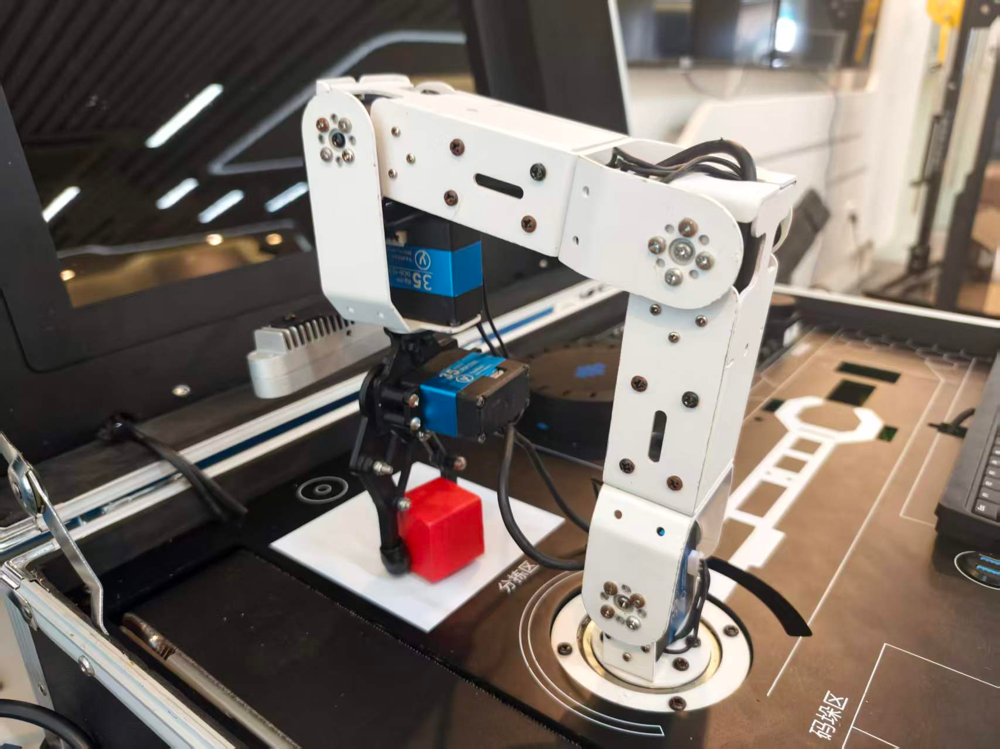

抓取成功后，将红色方块放在流水线上（固定点放置）

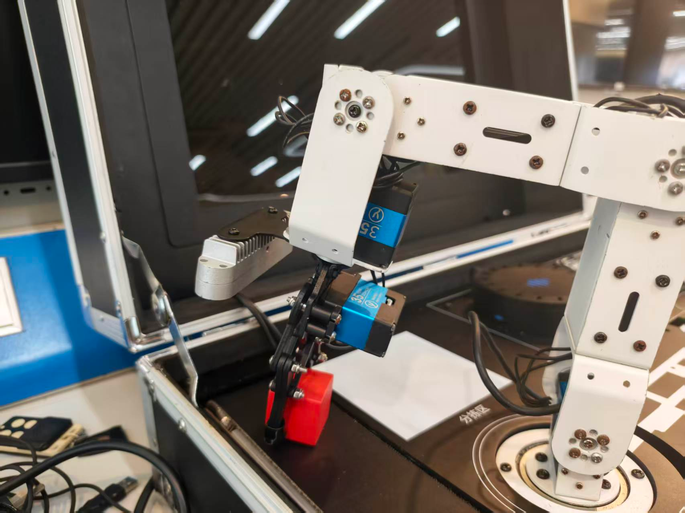

**预期效果描述**：

- 固定抓取全程不依赖相机/视觉/TF（无需 AprilTag）
- 夹爪在机械臂移动前已完全张开（提前开爪），到位立即闭爪抓取
- 分拣完成物料准确放置到放置位；`/eai_factory/grasp/status` 输出 `sort|done`
- 语音联动时 scheduler 收到 done 后经 /eai_factory/speak 播报"分拣完成"

### 6.6 实验步骤

#### 整体流程图


---

#### 步骤1：手动打点配置（60min）

**知识点讲解**：

**手动打点（5.1.2）**
- **原理**：固定点位抓取的取料位（observe_pose）与放置位（place_pose）不是视觉解算的，而是人工"打点"得到——通过 arm_controller 手动把机械臂移动到目标姿态，读取当前末端位姿（x, y, z, pitch，单位米/弧度），写成 [x, y, z, pitch] 四元组写入 yaml 的 `grasp.tasks.sort`。pitch 是末端俯仰角（sort 当前 3.0371 rad ≈ 174°，几乎垂直向下），打点时需用夹爪实际抓取姿态校准。打点质量直接决定固定抓取成功率——点打偏 1cm，抓取就偏 1cm，且没有视觉兜底。
- **源码对应**：`eai_factory.yaml` L83-86（sort 任务配置）；`grasp_node.py` L56-58（参数声明）与 L89-94（task_poses 加载）

```python
# grasp_node.py L56-58：sort 任务姿态参数声明
self.declare_parameter('grasp.tasks.sort.observe_pose', [0.0622, -0.1158, 0.1951, 3.0371])
self.declare_parameter('grasp.tasks.sort.place_pose', [0.1434, -0.1296, 0.2075, 2.7283])
self.declare_parameter('grasp.tasks.sort.vision', False)
```

**固定点位抓取（5.1.1）**

- **原理**：`vision=false` 时 grasp 不订阅视觉、不做 TF，observe_pose 就是精确抓取点，序列直接走 `_do_fixed_grasp`（`start_grasp` L273-278 分支）。它不调用 arm_controller 的 pick/place 服务，而是 grasp 自己编排 `set_gripper`（开合夹爪）与 `target_pose`（移动）服务完成整个抓放——这是与视觉抓取（load，走 pick/place 服务）最大的结构差异。好处是少依赖两个服务、时序完全可控。
- **源码对应**：`grasp_node.py` L273-278（vision=false 分支）；`eai_factory.yaml` L83-86（vision: false）

**操作步骤**：

1. 启动系统：`ros2 launch eai_factory eai_factory.launch.py start_voice:=false`
2. 通过 arm_controller 手动控制（话题/服务）把机械臂末端移到分拣取料位，姿态为夹爪垂直向下（pitch≈π）、能直接罩住物料
3. 读取当前末端位姿 (x, y, z, pitch)，记录到工作笔记（参考当前值 [0.0622, -0.1158, 0.1951, 3.0371]）
4. 编辑 `config/eai_factory.yaml` 的 `grasp.tasks.sort.observe_pose`，写入新打点值（如微调为 [0.062, -0.116, 0.195, 3.037]），保存并重启 launch 生效
5. 同样方法校准放置位 place_pose（当前 [0.1434, -0.1296, 0.2075, 2.7283]）

**易错点**：

- ⚠️ 打点姿态与抓取时姿态不一致（夹爪角度不同）→ 固定抓取用打点的 pitch（`_set_pick_target` L366-367 手动打点 pitch），必须用实际抓取姿态打点，不要用随意姿态
- ⚠️ 改 yaml 后不生效 → grasp 节点启动时一次性加载 task_poses（L89-94），必须重启；运行时改 `ros2 param set` 只影响运行中的节点
- ⚠️ 分拣/码垛共用 grasp 节点，打点时确认当前任务为 sort（日志 `Current task set to: sort`）

---

#### 步骤2：启动分拣任务（60min）

**知识点讲解**：

**sort 动作原语（5.1.3）**
- **原理**：固定抓取八步序列（`_do_fixed_grasp`，L413-485）：① `set_gripper open` 提前开爪并等待完全张开（gripper_duration+0.2s）→ ② 带张开的夹爪直接 `target_pose` 移到抓取点（不加偏移，用打点 pitch）→ ③ `set_gripper close` 闭爪抓取 → ④ 抬升到 (x, y, z+lift_height=0.03) 防碰撞 → ⑤ 移到放置点 → ⑥ 开爪放置 → ⑦ 放置后抬升 5cm（place_lift=0.05）→ ⑧ `go_work` 回 work。与视觉抓取序列不同：固定抓取**先开爪再移动**，保证机械臂到达时夹爪已完全张开、呈"骑跨"姿态罩住物料；全程用 `_call_gripper`（L494-515）同步等待夹爪动作完成再移动，避免"到位时夹爪还在张"。
- **源码对应**：`grasp_node.py` L413-485（_do_fixed_grasp）；L62-64（move_delay/lift_height/gripper_duration）；`eai_factory.yaml` L66-70
- **公式/配图说明**：抬升点 = (ox, oy, oz + lift_height)，放置后抬升点 = (px, py, pz + place_lift)。lift_height 是"抓取后抬升高度"（默认 0.03m，防碰撞），place_lift 是"放置后抬升高度"（默认 0.05m）。两个参数都只在 z 方向叠加。

```python
# grasp_node.py L433-442：①提前开爪 → ②移到抓取点
if not self._call_gripper(True):      # ① open + 等待完全张开
    return
...
self._move_to_pose(ox, oy, oz, opitch)   # ② 带张开夹爪直接到抓取点
time.sleep(self.move_delay)
```

**操作步骤**：

1. 确认 grasp 节点运行、分拣物料已在取料区，触发分拣（经 N2 调度器 /eai_factory/start_sort 服务，scheduler L64-65/L220-224）：
   ```bash
   ros2 service call /eai_factory/start_sort std_srvs/srv/Trigger
   ```
2. 核对日志（docs/09 TG6 期望日志 L109-116）：
   ```
   set_gripper open OK                      ← ①提前开爪并等待张开完成
   target_pose: (0.062, -0.116, 0.195), pitch=174°  ← ②直接到抓取点（打点姿态）
   set_gripper close OK                     ← ③到位闭爪抓取
   target_pose 抬升 → target_pose 放置点    ← ④⑤
   set_gripper open OK（放置）              ← ⑥开爪放置
   target_pose 放置点上方5cm                ← ⑦放置后抬升
   go_work OK → === fixed grasp-place sequence done ===
   ```
3. 观察机械臂动作：移动时夹爪保持张开"骑跨"物料，到位闭爪，抬升平移，放置后先抬 5cm 再回 work
4. 检查完成状态：`ros2 topic echo /eai_factory/grasp/status`（一次性）应输出 `sort|done`（`_publish_status` L487-492）
5. 串行保护验证：分拣执行中再次触发 start_sort 会返回 `busy`（`_start_cb` L210-213），等 done 后再触发

**易错点**：

- ⚠️ 机械臂到位时夹爪还在张开动作中 → 确认 `_call_gripper` 等待逻辑（L511 `time.sleep(self.gripper_duration + 0.2)`）；不要人为调小 gripper_duration 后不重启
- ⚠️ 触发 start_sort 无反应 → scheduler 的 grasp 服务未就绪会自动 2s 重试（`scheduler_node.py` L136-144）；`ros2 service list | grep grasp` 确认服务存在
- ⚠️ 分拣执行中触发码垛/装货返回 busy → 这是串行保护正常行为（docs/09 L124），等 `=== fixed grasp-place sequence done ===` 再触发

---

#### 步骤3：放置位与抬升参数调优（45min）

**知识点讲解**：

**固定点位抓取调优（5.1.1）**
- **原理**：分拣精度由两个来源决定：取料打点（observe_pose）与放置配置（place_pose + lift_height/place_lift）。放置偏了调 place_pose（x/y 水平、z 高度、pitch 角度四元组）；夹取后上升不够会蹭到物料/相邻物体，调 `grasp.lift_height`；放置后抬升不够可能压到已放物料，调 `grasp.place_lift`。这些参数都是 base_link 系的米/弧度，与视觉抓取的 pick_offset 不同——固定抓取本身**不加任何偏移**（打点已含姿态，`_set_pick_target` L364-367）。
- **源码对应**：`grasp_node.py` L62-64（lift_height/place_lift 声明）；`eai_factory.yaml` L66-70（grasp 段）、L83-86（sort 姿态）；docs/09 L161（固定抓取不加偏移）

**操作步骤**：

1. 动态微调放置高度（不重启）：
   ```bash
   ros2 param set /eai_factory_grasp grasp.lift_height 0.05
   ros2 param get /eai_factory_grasp grasp.lift_height
   ```
2. 再次触发分拣，观察抬升高度变化（日志 target_pose 的 z 值）
3. 放置位调优：若物料放置偏左 5mm，把 yaml sort 的 place_pose y 值调 +0.005（+Y 左），重启后再测
4. 记录参数→结果对照表：至少 3 组（lift_height × place_pose 组合）的放置偏差与成功率
5. 将最优值写回 `config/eai_factory.yaml`（注意 lift_height/place_lift 是 grasp 全局参数，影响 sort/palletize 两个固定抓取任务）

**易错点**：

- ⚠️ 参数只改了一半（只改 yaml 未重启，或只 param set 未写回）→ 最终验证以重启后 yaml 值为准；param set 只用于快速试参
- ⚠️ place_lift 与 lift_height 混淆 → lift_height 是"抓取后抬升"（取料侧），place_lift 是"放置后抬升"（放料侧），调错方向现象完全不同
- ⚠️ 抬升过大导致机械臂最高点超限 → z 值控制在机械臂工作空间内，逐步 ±1cm 试探

---

#### 步骤4：语音联动闭环（45min）

**知识点讲解**：

**分拣完成播报链路（5.1.3）**
- **原理**：分拣任务完成后 N-grasp 发布 `grasp/status`（"sort|done"），scheduler 的 `_grasp_status_cb`（L195-210）解析出任务与状态，命中 done 后把 `sort → 分拣完成` 的固定文案发布到 /eai_factory/speak，voice 节点 `_speak_cb`（L827-830）收到后 TTS 播报。整条链路就是"任务完成 → 状态发布 → 调度器翻译 → 语音播报"，完成语音→意图→任务→播报的闭环。
- **源码对应**：`scheduler_node.py` L195-210（_grasp_status_cb）；`voice_node.py` L827-830（_speak_cb）、L306（phrases_task_done）；`eai_factory.yaml` L52（sort_done: "分拣完成"）

```python
# scheduler_node.py L198-204：解析 grasp 状态并映射播报文案
task, status = msg.data.split('|')
...
if status == 'done':
    phrase = {'load': '装货完成', 'sort': '分拣完成',
              'palletize': '码垛完成'}.get(task, '任务完成')
```

**操作步骤**：

1. 带语音重启系统（分拣已完成打点，此时才需要语音）：`ros2 launch eai_factory eai_factory.launch.py`
2. 终端 2 监听闭环话题：
   ```bash
   ros2 topic echo /eai_factory/intent
   ros2 topic echo /eai_factory/grasp/status
   ros2 topic echo /eai_factory/speak
   ```
3. 唤醒后说「分拣」→ 扬声器播报"好的，开始分拣"（voice L759），scheduler 路由 `[SCHEDULER] set grasp task -> sort`（L148）
4. 机械臂执行固定抓取序列，完成后核对播报链路：`grasp: status: sort|done` → `[SCHEDULER] task sort done — announce "分拣完成"` → `[VOICE] speak request: "分拣完成"` → 扬声器播出"分拣完成"
5. 对照 docs/07 TC6 全链路时序（L163-173）核对完整闭环

**易错点**：

- ⚠️ 播报"好的，开始分拣"后机械臂不动 → 语音闭环正常但 grasp 服务未就绪；scheduler 自动重试（L136-144），确认 `ros2 service list | grep grasp`
- ⚠️ 完成播报缺失但分拣正常完成 → grasp 未发布 status（检查 `grasp: status: sort|done`）或 scheduler 未订阅（L50-51）；先手动 `ros2 topic pub -1 /eai_factory/speak` 验证 TTS 链路
- ⚠️ 说「分拣」被识别成"风景/封建" → ASR 热词未生效（hotwords.txt 含"分拣"词条）；确认 `hotwords_enable: true` 并重启（见实验4）

---

#### 步骤5：测试用例执行（30min）

**知识点讲解**：

**固定抓取用例验证（5.1.3）**
- **原理**：docs/09 TG6 是分拣的标准用例，覆盖固定抓取八步序列的完整验证；TG7（语音打断复位）验证任务执行中 interrupt 的停止动作与回 work（grasp `_interrupt_cb` L179-186）；TG8（雷达危险中断）验证 danger 信号立即停止抓取。本实验至少完成 TG6 与 TG7 的实机记录，TG8 属于安全联锁实验（exp08）范围可顺带观察。
- **源码对应**：docs/09 TG6（L90-124）、TG7（L126-138）；`grasp_node.py` L179-186（interrupt）、L188-202（danger）

**操作步骤**：

1. 按 docs/09 TG6 完成分拣用例：连续执行 3 次 start_sort，记录每次的八步日志与放置结果
2. 按 TG7 做打断复位：触发 start_sort 后，机械臂动作中发布
   ```bash
   ros2 topic pub -1 /eai_factory/interrupt std_msgs/msg/Bool "{data: true}"
   ```
   观察 `VOICE INTERRUPT — stopping grasp, going work` 与机械臂停止动作回 work（docs/09 L135-138）
3. 整理实验数据：打点值、调优参数、放置偏差、成功率，形成调优结论

**易错点**：

- ⚠️ 打断测试后 grasp 状态未回 idle → `_interrupt_cb` 已置位并回 work（L179-186），必要时 `/eai_factory/grasp/abort` 重置再测
- ⚠️ 连续触发时上一次未完成 → 出现 `busy`；严格遵守"等 done 再触发下一个"（docs/09 L124）

### 6.7 注意事项

- ⚠️ 固定抓取无视觉兜底，取料区物料位置每次必须与打点一致，物料挪动后重新打点
- ⚠️ 实机测试前确认机械臂工作空间无干涉；打点与调优时手远离夹爪与机械臂
- ⚠️ 总线舵机在夹爪堵转/过载时可能发热，物料尺寸过大不要强行闭爪
- ⚠️ lift_height/place_lift 是 grasp 全局参数，调优会影响 palletize（码垛），改后两任务都需复测
- ⚠️ 语音联动需要启动 voice（LLM 约 500MB 内存）；仅测分拣用 `start_voice:=false` 省内存
- ⚠️ 一次只能执行一个任务（串行保护），多任务触发前确认上一任务已完成

### 6.8 实验总结

**完成成果**：

- 完成分拣取料位/放置位手动打点并写入 grasp.tasks.sort 配置
- 跑通固定抓取八步序列（提前开爪→到点→闭爪→抬升→放置→回 work），记录完整日志
- 完成 place_pose/lift_height 参数调优，形成参数→结果对照数据
- 完成语音联动闭环："分拣"→ 开始分拣播报 → 任务完成 →"分拣完成"播报
- 按 docs/09 TG6/TG7 完成分拣与打断用例记录

**技能收获**：

- 掌握固定点位抓取（vision=false）的原理与配置方法
- 掌握手动打点流程（到位→读姿→写 yaml→验证）
- 掌握固定抓取八步序列与"提前开爪"的时序关键点
- 理解 grasp/status → speak 的完成播报链路与闭环验证方法

**常见问题与解决**：

| 问题 | 原因 | 解决方法 |
|------|------|---------|
| 抓取点偏位 | 打点不准或物料挪动 | 重新打点写入 observe_pose；固定物料位置 |
| 到位时夹爪未张开 | gripper_duration 过小/未重启 | 等 _call_gripper 的等待完成；确认参数生效 |
| 放置压到物料 | place_lift 不够 | 调大 grasp.place_lift（默认 0.05） |
| 触发返回 busy | 上一任务未完成（串行保护） | 等 `=== fixed grasp-place sequence done ===` |
| 无"分拣完成"播报 | grasp 未发 status 或语音未启 | 检查 `grasp: status: sort\|done`；用 start_voice:=true |
| 语音识别"风景/封建" | ASR 热词未生效 | 确认 hotwords_enable: true 并重启 |

### 6.9 实验报告要求

**思考题**：

1. 固定点位抓取与视觉抓取（load）在序列结构上有哪些差异？为什么固定抓取要"提前开爪"而视觉抓取不需要？
2. 手动打点的四元组 (x, y, z, pitch) 中 pitch 的含义是什么？如果打点时夹爪不是垂直向下，抓取会出现什么问题？
3. lift_height 与 place_lift 分别在序列的哪个环节生效？它们的作用分别是什么？调大/调小各有什么风险？
4. 固定抓取为什么不加 pick_offset 偏移？它与视觉抓取的 pick_offset 补偿在定位误差来源上有什么本质区别？
5. 分拣任务完成后"分拣完成"播报是如何触发的？结合 grasp/status 与 scheduler 的 _grasp_status_cb 描述完整链路。

**评分标准**：手动打点与配置 25 分 + 分拣任务执行与序列观察 30 分 + 参数调优实验 20 分 + 语音联动闭环 15 分 + 用例记录与数据分析 10 分 = 100 分。


# 实验7：具身智能工厂--码垛集成测试（6h）

### 7.1 关联知识点

- 5.2.1 流水线电机（复用底盘电机通道 M1，`conveyor.motor_id` 现场配置；前置依赖 1.2.3）
- 5.2.2 光电定点停（`run_until_sensor` 运转直到光电遮挡→定点停，防抖确认；前置依赖 5.2.1）
- 5.2.3 流水线状态机与急停（idle/running/sensor_blocked/emergency 与急停复位；前置依赖 5.2.2）
- 1.3.2 palletize 编排（先 `run_until_sensor` 送料→`sensor_blocked`→再抓取；前置依赖 1.3.1）

### 7.2 实验目标

1. 理解流水线复用底盘电机（M1）的驱动原理（发布速度→STM32 保持→发 0 即停）与光电传感器电平约定 — 原理理解
2. 掌握 `run_until_sensor` 光电定点停流程（先清沿后挡沿、防抖确认、超时保护）与流水线状态机转换关系 — 独立完成
3. 掌握 N2 调度器 palletize"先送料后抓取"跨节点编排，能独立通过服务/语音触发并观察完整码垛链路 — 独立完成
4. 掌握急停置位与复位机制，并能依据 `docs/10_流水线测试用例.md` 迁移到其他流水线场景（如分拣送料改造）完成用例验收 — 迁移应用

### 7.3 实验环境

| 类别 | 配置 |
|------|------|
| 硬件 | 具身智能实验箱 B2 / 机器人小车 C1（5DOF 机械臂 + 夹爪）；流水线电机（复用底盘电机 M1 前左轮通道）；光电传感器（GPIO0_C1=17）；AprilTag 标签（本实验码垛为固定点位抓取，不使用视觉） |
| OS | Ubuntu 22.04 + ROS2 Humble |
| Python | 3.10；conveyor / grasp / scheduler 节点经 `/home/iflytek/ros2_venv/bin/python3` 运行（launch 直接跑 .py） |
| 核心库 | rclpy、std_srvs、std_msgs、car1_base_driver_msgs（MotorsState/MotorState，复用底盘电机协议） |
| 依赖 | `scripts/setup_conveyor_gpio.sh`（导出 GPIO17 + 上拉输入）；`/sys/class/gpio/gpio17/value` 可读；机械臂 `arm_controller` 在跑（码垛抓取/放置/回 work 依赖） |

### 7.4 实验难度

- 难度: ⭐⭐⭐（综合性）
- 重点: `run_until_sensor` 光电定点停流程（清沿→挡沿→防抖→停）；palletize 跨节点编排（conveyor→grasp 状态同步）
- 难点: 状态机急停置位/复位语义（emergency 期间拒绝 run）；固定点位抓取"提前开爪"动作时序（开爪→到位→闭爪→抬升→放置→再抬升→回 work）

### 7.5 实验现象

**快速验证流程**：

1. 环境准备（导出 GPIO）与省内存启动：
   ```bash
   source /opt/ros/humble/setup.bash
   source /home/iflytek/ros2_ws/install/setup.bash
   sudo bash scripts/setup_conveyor_gpio.sh
   cat /sys/class/gpio/gpio17/value     # 应输出 0 或 1
   ros2 launch eai_factory eai_factory.launch.py start_voice:=false start_vision:=false start_grasp:=true start_viz:=false
   ```

   传送带进入准备姿态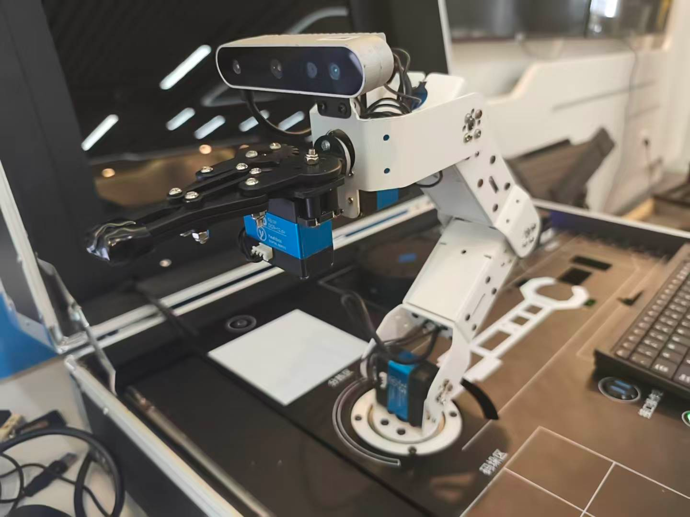

2. 流水线单测（观察 电机运转→光电遮挡→定点停）：

   ```bash
   ros2 topic echo /eai_factory/conveyor/state
   ros2 service call /eai_factory/conveyor/run_until_sensor std_srvs/srv/Trigger
   # 把物品放到流水线起始端，随流水线移动
   
   ```

   传送带开始转动

   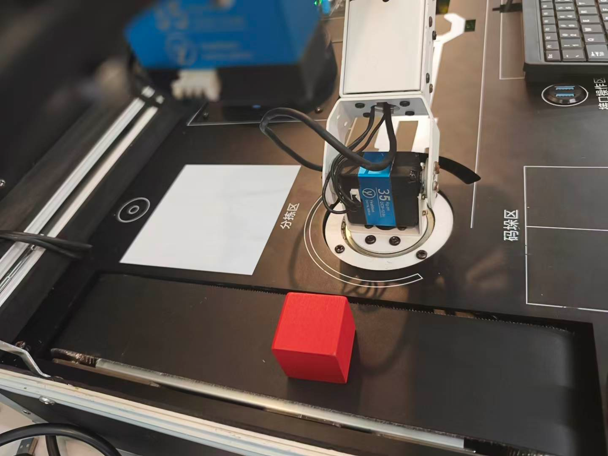

3. 码垛任务（观察 送料→sensor_blocked→抓取→放置→回 work）：

   ```bash
   ros2 topic echo /eai_factory/grasp/status
   ros2 service call /eai_factory/start_palletize std_srvs/srv/Trigger
   ```

   机械臂抓取红色方块

   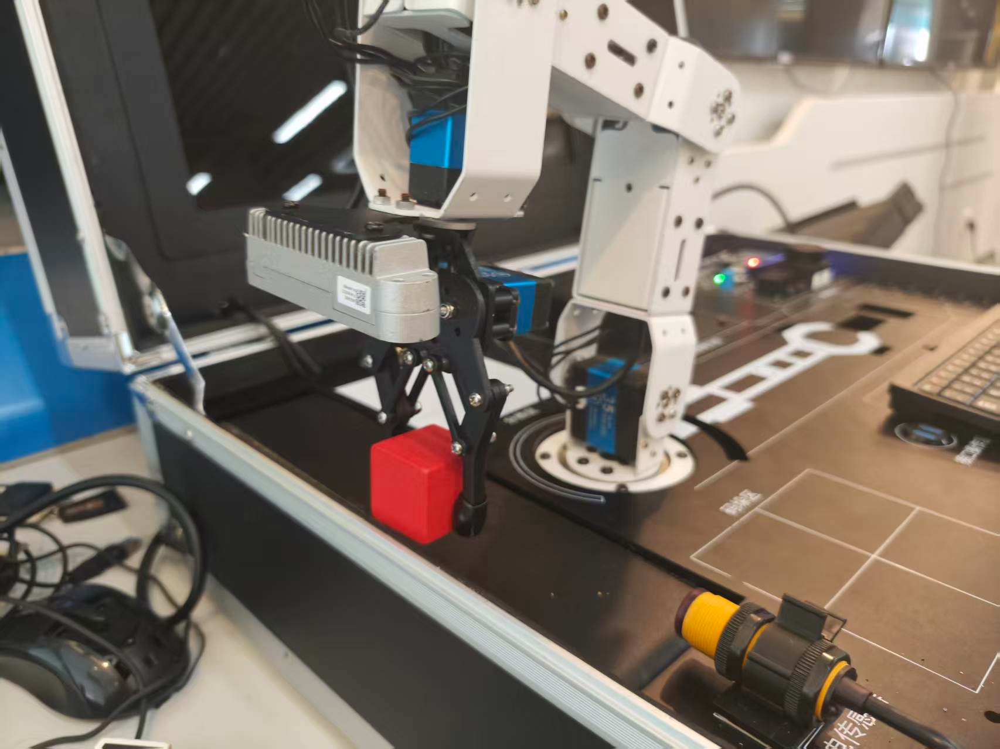

   传送带将红色方块放入到码垛区域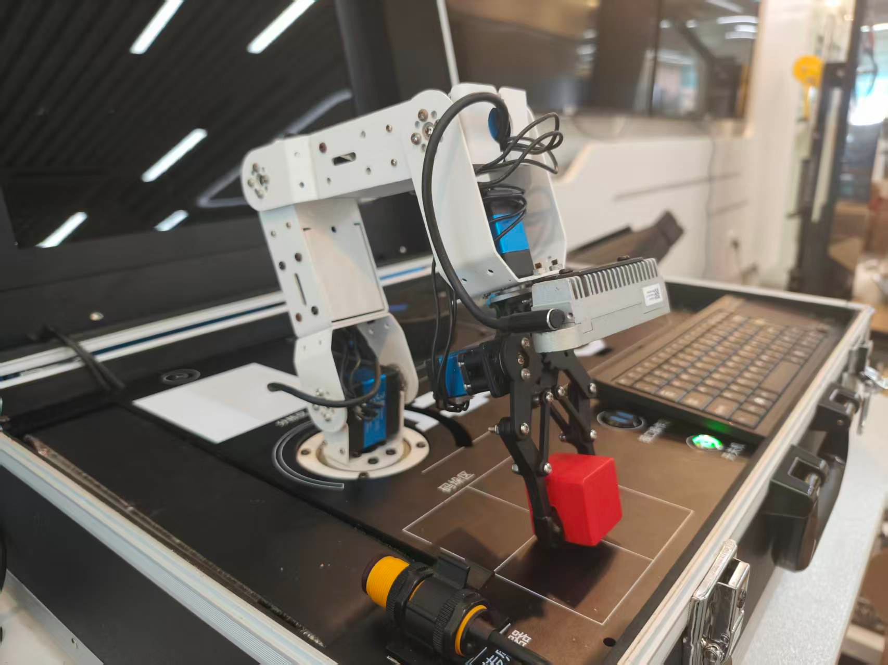

4. 急停测试（观察 急停与恢复）：

   ```bash
   ros2 service call /eai_factory/conveyor/emergency_stop std_srvs/srv/Trigger
   ros2 service call /eai_factory/conveyor/run std_srvs/srv/Trigger        # 应被拒绝
   ros2 service call /eai_factory/conveyor/reset_emergency std_srvs/srv/Trigger
   ```

5. 语音联动（说"码垛"，观察完成播报"码垛完成"）。

**预期效果描述**：

- `run_until_sensor` 服务立即返回 started；流水线电机转动（`/car1_base_driver/set_motor` 出现 `id: 1, rps: 0.1`）；物品到达光电位置后自动停（`rps: 0.0`），state 话题出现 `sensor_blocked`
- `start_palletize` 后：先送料（`running`）→ `sensor_blocked` → 机械臂开始固定点位抓取（提前开爪→到位→闭爪→抬升→放置→抬 5cm→回 work）→ grasp status `palletize|done`
- 急停后 state → `emergency`、`/eai_factory/conveyor/emergency` 话题 `data: true`，run 被拒绝；`reset_emergency` 后 emergency `data: false`，可再次 run
- 语音说"码垛"：完成码垛后播报"码垛完成"

### 7.6 实验步骤

#### 整体流程图


---

#### 步骤1：环境准备与流水线单测（70min）

**知识点讲解**：

**流水线电机复用底盘电机通道（5.2.1）**

- **原理**：智慧工厂流水线不再单独购买电机驱动，而是**复用底盘电机通道 M1（前左轮）**。N-conveyor 通过发布 `/car1_base_driver/set_motor`（`MotorsState`，含 `MotorState{id, rps}`）驱动流水线：STM32 会**保持最后收到的速度持续运转**，因此"停止"只需发布 `rps=0`（立即且可靠）。电机通道号通过 `conveyor.motor_id` 现场配置（本项目为 1），速度 `run_speed=0.1 m/s`。光电传感器接 GPIO0_C1=17，读 `/sys/class/gpio/gpio17/value`，电平约定 **HIGH(1)=无遮挡、LOW(0)=遮挡**；GPIO 必须先导出（sysfs 导出 + 内部上拉，需 root），N-conveyor 启动时检测未导出会自动 `sudo` 调 `setup_conveyor_gpio.sh`（幂等）。

- **源码对应**：`eai_factory/conveyor_node.py` L53-60（conveyor.* 参数声明）、L127-133（`_set_motor` 发布速度）、L135-165（`_ensure_gpio_exported` 自动导出）；`scripts/setup_conveyor_gpio.sh` L13-24（已导出跳过）、L47-49（sysfs 导出 + direction=in）；`config/eai_factory.yaml` L100-108（conveyor 段）
  
  ```python
  def _set_motor(self, rps):
      msg = MotorsState()
      m = MotorState()
      m.id = self.motor_id
      m.rps = float(rps)
      msg.data = [m]
      self.motor_pub.publish(msg)
  ```

**操作步骤**：

1. 进入工程目录并导出 GPIO（若已导出会提示跳过）：
   ```bash
   cd ~/ros2_ws/src/xflz_eai_car1/app/eai_factory
   sudo bash scripts/setup_conveyor_gpio.sh
   cat /sys/class/gpio/gpio17/value   # 0 或 1，可读即成功
   ```
2. 省内存启动（保留流水线 + 机械臂，关闭语音/视觉/调试画面）：
   ```bash
   source /opt/ros/humble/setup.bash
   source /home/iflytek/ros2_ws/install/setup.bash
   ros2 launch eai_factory eai_factory.launch.py \
     start_voice:=false start_vision:=false start_viz:=false
   ```
3. 确认节点与服务：
   ```bash
   ros2 node list                  # 应看到 eai_factory_conveyor / eai_factory_grasp / eai_factory_scheduler
   ros2 service list | grep conveyor   # run / stop / run_until_sensor / emergency_stop / reset_emergency
   ```
4. 流水线启动/停止单测：
   ```bash
   ros2 topic echo /car1_base_driver/set_motor     # 终端2
   ros2 service call /eai_factory/conveyor/run std_srvs/srv/Trigger
   ros2 service call /eai_factory/conveyor/stop std_srvs/srv/Trigger
   ```

**易错点**：

- ⚠️ GPIO 未导出 → `_read_photo_level` 报 `photo gpio read failed`，state 置 `error` → **解决**：先手动 `sudo bash scripts/setup_conveyor_gpio.sh` 一次（节点仅能免密 sudo 自动导出，若 sudo 配置失效需手动）
- ⚠️ 手动遮挡光电测试时方向拿反 → 电平结果与预期相反 → **解决**：确认约定 `1=无遮挡、0=遮挡`（与参考 app.py 一致）

---

#### 步骤2：码垛任务全流程验证（90min）

**知识点讲解**：

**palletize 编排：先送料后抓取（1.3.2）**

- **原理**：码垛任务不是直接抓取，而是**跨节点编排**：N2 调度器先调用 N-conveyor 的 `run_until_sensor` 让流水线送料（物品随皮带移动直到光电遮挡定点停），**等待** `/eai_factory/conveyor/state` 变为 `sensor_blocked` 后才触发 N-grasp 执行码垛抓取。该等待通过订阅 `_conveyor_state_cb` 实现（`_awaiting_sensor` 标志置位期间收到 `sensor_blocked` 即启动抓取）。N-grasp 的 palletize 任务是**固定点位抓取**（`vision=false`）：`observe_pose=[0.145, 0.0027, 0.185, 3.1381]` 即取料点、`place_pose=[0.0608, 0.1345, 0.2051, 2.6461]` 即放置点，动作序列为**提前开爪→直接到位→闭爪→抬升(lift_height=0.03)→移放置位→开爪投放→再抬升(place_lift=0.05)→回 work**。

- **源码对应**：`eai_factory/scheduler_node.py` L98-110（`_start_palletize_sequence` 送料）、L121-127（`_conveyor_state_cb` 收到 sensor_blocked 触发抓取）、L129-152（`_trigger_grasp` 先 set_task 再 start）、L226-230（`/eai_factory/start_palletize` 服务）；`eai_factory/grasp_node.py` L59-61（palletize 固定点位参数）、L273-278（vision=false 走固定抓取）、L413-485（`_do_fixed_grasp` 八步动作序列）；`config/eai_factory.yaml` L87-90（palletize 段）
  ```python
  def _conveyor_state_cb(self, msg):
      if self._awaiting_sensor and msg.data == 'sensor_blocked':
          self._awaiting_sensor = False
          self.get_logger().info('[SCHEDULER] palletize: item at sensor — starting grasp')
          self._trigger_grasp('palletize')
  ```

**操作步骤**：

1. 监听状态与抓取反馈：
   ```bash
   ros2 topic echo /eai_factory/conveyor/state
   ros2 topic echo /eai_factory/grasp/status
   ros2 topic echo /eai_factory/conveyor/photo
   ```
2. 触发码垛任务：
   ```bash
   ros2 service call /eai_factory/start_palletize std_srvs/srv/Trigger
   ```
3. 观察完整链路：送料（物品放流水线起始端）→ `running` → 光电遮挡 → `sensor_blocked` → 机械臂开爪到位抓取 → 抬升 → 放置 → 抬 5cm → 回 work → grasp status `palletize|done`
4. 全程关注机械臂动作，确认放置点在码垛区（托盘位置）。

**易错点**：

- ⚠️ 先触发任务再放物品，或物品还没到流水线上 → 送料阶段空跑 30s 后 state=`timeout` → **解决**：触发后尽快把物品放到流水线起始端（`run_until_sensor` 会先等"清沿"再等"挡沿"）
- ⚠️ 码垛时物品堆叠高度与固定点位不匹配 → 夹爪撞货/漏抓 → **解决**：保持取料点物品高度与打点一致；`grasp.lift_height=0.03` 抬升防碰撞，不要中途手扶

---

#### 步骤3：急停与复位测试（60min）

**知识点讲解**：

**流水线状态机与急停复位（5.2.3）**

- **原理**：N-conveyor 内部状态机：`idle`（空闲）→ `running`（运转）→ `sensor_blocked`（定点停）→ `emergency`（急停置位）/ `timeout`（超时）/ `error`（GPIO 读取失败）。`emergency_stop` 会**置位** `_emergency_stop=True` 并立即发 `rps=0` 停带；该标志**持续有效**，期间 `run` / `run_until_sensor` 服务都会被拒绝（返回 `emergency active — call reset_emergency first`），保证"急停后不自动复跑"的安全语义；必须显式调 `reset_emergency` 才复位回 `idle`。状态变化通过 `/eai_factory/conveyor/state`、`/eai_factory/conveyor/emergency` 发布。
- **源码对应**：`eai_factory/conveyor_node.py` L240-248（`_emergency_cb` 置位+停带+state=emergency）、L250-257（`_reset_emergency_cb` 复位）、L176-183（`_set_state` 只发布变化的状态）、L203-207（run 拒绝逻辑）、L223-227（run_until_sensor 拒绝逻辑）；`docs/10_流水线测试用例.md` L106-123（TC6 手动急停用例）
  ```python
  def _emergency_cb(self, request, response):
      self._emergency_stop = True
      self._set_motor(0.0)
      self._set_state('emergency')
      self._publish_emergency()
      ...
      response.message = 'emergency stopped'
  ```
- **公式/配图说明**（重难点）：
  - 状态转换：`idle --run--> running --stop--> idle`；`running --sensor_blocked--> idle(实为 sensor_blocked)`；任意状态 `--emergency_stop--> emergency --reset_emergency--> idle`
  - 急停保持语义：`run/run_until_sensor 均检查 self._emergency_stop 前置条件`（L204、L224）

**操作步骤**：

1. 先启动流水线：
   ```bash
   ros2 service call /eai_factory/conveyor/run std_srvs/srv/Trigger
   ```
2. 急停：
   ```bash
   ros2 service call /eai_factory/conveyor/emergency_stop std_srvs/srv/Trigger
   ```
   观察：流水线立即停、`/eai_factory/conveyor/emergency` `data: true`、日志 `EMERGENCY STOP — conveyor belt stopped`
3. 验证急停保持（应被拒绝）：
   ```bash
   ros2 service call /eai_factory/conveyor/run std_srvs/srv/Trigger
   ```
   预期返回 `success: False, message: "emergency active — call reset_emergency first"`
4. 复位并恢复运转：
   ```bash
   ros2 service call /eai_factory/conveyor/reset_emergency std_srvs/srv/Trigger
   ros2 service call /eai_factory/conveyor/run std_srvs/srv/Trigger   # 恢复成功
   ```

**易错点**：

- ⚠️ 急停后忘记 reset 直接再次触发任务 → 服务一直拒绝 → **解决**：`reset_emergency` 是显式恢复动作，属于安全设计（防误启动），必须走完"复位"再重启任务
- ⚠️ 急停后机械臂仍在原位置 → **解决**：本实验急停只停流水线；机械臂的停止由 N3 雷达 danger 信号触发（见实验8）

---

#### 步骤4：语音联动码垛（70min）

**知识点讲解**：

**语音→意图→任务→执行→完成播报闭环（1.3.2 + 3.1.1）**

- **原理**：说"码垛"后，N1 语音节点经 KWS 唤醒 → ASR 识别 → LLM 意图分类，命中 `intent_hints` 中的 palletize 提示词（"码垛/开始码垛/堆码/马舵"等误识别词），发布 intent 到 `/eai_factory/intent`；N2 调度器 `_intent_cb` 收到 `palletize` 后走与步骤2 完全相同的 `_start_palletize_sequence` 编排。任务完成后 N-grasp 发布 `palletize|done`，调度器 `_grasp_status_cb` 查表映射为中文播报词（load→装货完成/sort→分拣完成/palletize→码垛完成）并发布到 `/eai_factory/speak`，由 N1 TTS 播出"码垛完成"——形成全链路闭环。
- **源码对应**：`eai_factory/scheduler_node.py` L75-78（`_intent_cb` 路由意图）、L195-210（`_grasp_status_cb` 完成播报映射，`palletize→码垛完成`）；`config/eai_factory.yaml` L35-36（palletize 意图提示词）、L53（`palletize_done: "码垛完成"` 播报文案）、L110-117（intents 意图→接口映射表）
  ```python
  if status == 'done':
      phrase = {'load': '装货完成', 'sort': '分拣完成',
                'palletize': '码垛完成'}.get(task, '任务完成')
      ...
      speak.data = phrase
      self.speak_pub.publish(speak)
  ```
- **公式/配图说明**（重难点）：闭环链路 `唤醒词(小飞小飞) → ASR → LLM 意图(palletize) → /eai_factory/intent → 调度器编排(送料+抓取) → grasp/status(palletize|done) → speak(码垛完成) → TTS 播报`

**操作步骤**：

1. 本次启动需开启语音（全功能启动）：
   ```bash
   ros2 launch eai_factory eai_factory.launch.py start_vision:=false start_viz:=false
   ```
   （等待 LLM flask_server 就绪，端口 8080，启动日志约几十秒）
2. 唤醒并下达指令：正对麦克风说 **"小飞小飞"**（听到唤醒提示音后）再说 **"码垛"**。
3. 观察：先放物品到流水线起始端 → 流水线送料 → `sensor_blocked` → 机械臂码垛 → 播报"码垛完成"。
4. 终端同步观察调度器日志 `[SCHEDULER] palletize: feeding belt...`、`task palletize done — announce "码垛完成"`。

**易错点**：

- ⚠️ 语音听成"马舵/码舵"等 → **解决**：`intent_hints` 已内置大量误识别词（`eai_factory.yaml` L36），仍不中可现场追加；可先用 `ros2 topic echo /eai_factory/intent` 看识别结果
- ⚠️ 唤醒后 10s 内不说话导致指令丢失 → **解决**：唤醒后立即下达指令；或直接调服务 `/eai_factory/start_palletize` 对照验证（语音与服务两路等价）

---

#### 步骤5：流水线测试用例验收（70min）

**知识点讲解**：

**测试用例方法论（5.2.1-5.2.3 综合）**

- **原理**：验收需覆盖功能正确性与边界条件：`run`/`stop` 基础启停（TC1/TC2）、光电话题实时性（TC3）、`run_until_sensor` 定点停与超时（TC4/TC5）、手动急停置位/复位（TC6）、N3 安全信号联动急停（TC7）、GPIO 已导出/未导出两种场景（TC8/TC9）。重点理解"急停后任务被拒绝"这一安全语义与"未导出自动补导出"的容错设计。
- **源码对应**：`docs/10_流水线测试用例.md` L42-55（TC1 run）、L57-64（TC2 stop）、L66-76（TC3 photo 话题）、L78-93（TC4 定点停）、L95-104（TC5 超时）、L106-123（TC6 手动急停）、L125-140（TC7 N3 联动）、L142-166（TC8/TC9 GPIO 场景）
- **公式/配图说明**：验收矩阵：每个用例 = 功能 + 命令 + 结果现象三要素，逐条勾选打勾

**操作步骤**：

1. 按 `docs/10_流水线测试用例.md` 逐条执行 TC1~TC9，记录现象与截图：
   ```bash
   # TC3 光电话题
   ros2 topic echo /eai_factory/conveyor/photo        # 遮挡→true，移开→false
   # TC7 手动模拟安全信号（N3 未开时）
   ros2 topic pub -1 /eai_factory/safety/danger std_msgs/msg/Bool "{data: true}"
   ros2 topic echo /eai_factory/conveyor/emergency
   ros2 topic pub -1 /eai_factory/safety/danger std_msgs/msg/Bool "{data: false}"
   ```
2. 至少完成 TC1、TC2、TC4、TC6 四条必测项，并尝试 TC5（不放物品等 30s 看 `timeout`）。
3. 将每条用例的结果（成功/失败、实际现象、日志截图）填入实验报告表格。

**易错点**：

- ⚠️ TC7 用 `-1` 发一次性话题后状态停留在 `emergency` → **解决**：必须再发 `{data: false}` 恢复（N3 节点在跑时用真实雷达触发，见实验8 TS4）
- ⚠️ 验收时开启无关模块浪费内存（语音/视觉） → **解决**：本步骤可 `start_voice:=false start_vision:=false` 省内存，只保留 conveyor + scheduler + grasp

### 7.7 注意事项

- ⚠️ 流水线电机复用底盘电机 M1，**启动前确认机械臂处于 work 安全位、车身固定不动**，避免电机带动平台偏移
- ⚠️ 码垛为实机抓取，**全程保持手离抓取区域**；物品堆叠高度必须与固定打点一致
- ⚠️ 先执行 `run_until_sensor` 再放物品（先清沿后挡沿），否则物品已在传感器位会直接超时
- ⚠️ 急停是安全机制，**验证后必须 reset_emergency 复位**，避免后续任务被拒绝造成困惑
- ⚠️ 实验结束后 `bash scripts/stop_eai_factory.sh` 清理进程，防止残留

### 7.8 实验总结

**完成成果**: 完成流水线电机启停、光电定点停（含防抖/超时）、急停置位/复位、palletize 先送料后抓取编排及语音联动码垛的全流程验证，并按 docs/10 完成测试用例验收。

**技能收获**:

- 掌握复用底盘电机驱动流水线（set_motor 速度发布/置 0 即停）与 GPIO sysfs 导出流程
- 掌握 run_until_sensor 清沿/挡沿/防抖/超时四段式定点停与状态机转换
- 掌握 N2 调度器跨节点编排（订阅 conveyor/state 同步后再触发 grasp）与固定点位抓取八步动作序列

**常见问题与解决**:

| 问题 | 原因 | 解决方法 |
|------|------|---------|
| 流水线不转 | GPIO 未导出或电机通道接错 | `sudo bash scripts/setup_conveyor_gpio.sh`；确认 `conveyor.motor_id=1`（yaml L102） |
| run_until_sensor 立即 timeout | 物品已停在光电位（先清沿逻辑不满足） | 先移开物品再触发；或先 `run` 手动清位再 `stop` |
| 码垛触发后只送料不抓取 | 光电被物品稳定遮挡但 state 非 sensor_blocked（或防抖不满足） | 确认 `sensor_blocked_level=0`、`debounce_reads=3`；观察 `/eai_factory/conveyor/photo` 是否 `true` |
| 抓取位置偏 | 物品堆叠高度/位置与打点不一致 | 重新打点更新 `grasp.tasks.palletize.observe_pose`（yaml L89） |
| 服务拒绝 "emergency active" | 上次急停未复位 | `ros2 service call /eai_factory/conveyor/reset_emergency std_srvs/srv/Trigger` |

### 7.9 实验报告要求

**思考题**:
1. 为什么 `run_until_sensor` 要先等待"清沿"再等待"挡沿"？如果物品一开始就在光电传感器处会发生什么？
2. 急停采用"置位保持、显式复位"而非"急停后自动恢复"，请从安全工程角度分析该设计的好处。
3. palletize 编排中，调度器为何通过订阅 `/eai_factory/conveyor/state` 同步而不是直接 sleep 固定时长？若抓取服务未就绪会发生什么（结合 `_pending_task` 重试机制）？

**评分标准**: 实验报告满分 100 分 = 实验目的与原理阐述 15 分 + 操作步骤完整性（含命令与日志截图）30 分 + 四步验证现象记录（单测/码垛/急停/语音）35 分 + 测试用例验收表（TC1-TC9）10 分 + 思考题与问题分析 10 分。


# 实验8：具身智能工厂--危险急停集成测试（4h）

### 8.1 关联知识点

- 6.1.1 雷达扇区检测（激光雷达前方 60° 扇区(±30°)，danger_dist=20cm 判定危险；前置依赖 1.1.3）
- 6.1.2 危险判定（障碍持续 0.5s(persist_time) 才判危险，防瞬时误报；前置依赖 6.1.1）
- 6.1.3 力矩释放（危险时通过 `/car1_base_driver/bus_servo/set_state` 释放 6 舵机力矩；前置依赖 6.1.2）
- 6.2.1 恢复回 work（危险解除→恢复力矩→`/arm_controller/go_work` 回 work；前置依赖 6.1.3）
- 6.2.2 打断分层（雷达危险打断 > 语音打断，危险时不强行运动；前置依赖 3.2.3, 6.1.3）

### 8.2 实验目标

1. 理解激光雷达危险检测原理：前方 60° 扇区（±30°）、20cm 距离阈值、0.5s 持续判定 — 原理理解
2. 掌握危险触发时通过总线舵机 `set_state` 释放 6 舵机力矩的机制（机械臂变软、可手推）— 独立完成
3. 掌握危险解除后的恢复流程（恢复力矩 + `go_work` 回 work），理解"雷达打断 > 语音打断"的分层设计 — 理解
4. 掌握 N-grasp / N-conveyor 订阅 danger 立即停止动作的联动机制，能独立完成安全联锁集成测试并按 `docs/11_安全测试用例.md` 验收 — 迁移应用

### 8.3 实验环境

| 类别 | 配置 |
|------|------|
| 硬件 | 具身智能实验箱 B2 / 机器人小车 C1（5DOF 机械臂 + 夹爪）；激光雷达（`/dev/lidar` → ttyUSB1，发布 `/scan` 约 10Hz）；障碍物（书本/纸盒，安全测试用） |
| OS | Ubuntu 22.04 + ROS2 Humble |
| Python | 3.10；safety / scheduler 节点用 console_scripts 入口点运行；grasp / conveyor 经 `/home/iflytek/ros2_venv/bin/python3` 运行 |
| 核心库 | rclpy、sensor_msgs（LaserScan，Best Effort QoS）、std_msgs、car1_base_driver_msgs（SetBusServoState/BusServoState）、std_srvs |
| 依赖 | `car1_base_driver` 在跑（总线舵机力矩释放/恢复真正生效的前提）；`arm_controller` 在跑（`go_work` 回 work 依赖） |

### 8.4 实验难度

- 难度: ⭐⭐⭐（综合性）
- 重点: 扇区检测算法（跨 0° 环绕的扇区判定）+ 持续判定（persist_time 防误报）+ 力矩释放/恢复链路
- 难点: 打断分层（雷达打断 > 语音打断）与 N-grasp / N-conveyor 对 danger 的响应时序；"危险时不强行运动"的安全哲学

### 8.5 实验现象

**快速验证流程**：

1. 低内存只起雷达安全：
   ```bash
   source /opt/ros/humble/setup.bash
   source /home/iflytek/ros2_ws/install/setup.bash
   sudo bash scripts/setup_conveyor_gpio.sh
   ros2 launch eai_factory eai_factory.launch.py start_voice:=false start_vision:=false start_grasp:=true start_viz:=false
   ```
2. 观察接口：
   ```bash
   ros2 node list
   ros2 topic hz /scan
   ros2 topic echo /eai_factory/safety/status
   ros2 topic echo /eai_factory/safety/danger
   ros2 topic echo /car1_base_driver/bus_servo/set_state
   ```
3. 危险触发：在雷达正前方 **20cm 内**放置障碍物并保持 **0.5s 以上** → 观察 `danger=true`、`status=danger`、6 舵机力矩释放（机械臂变软可手推）
4. 危险解除：移开障碍物 → 观察 `danger=false`、`status=recover`、力矩恢复、机械臂 `go_work` 回 work
5. 任务中急停联动：执行装货/分拣/码垛任务中触发雷达危险 → 观察 N-grasp/conveyor 立即停止动作。

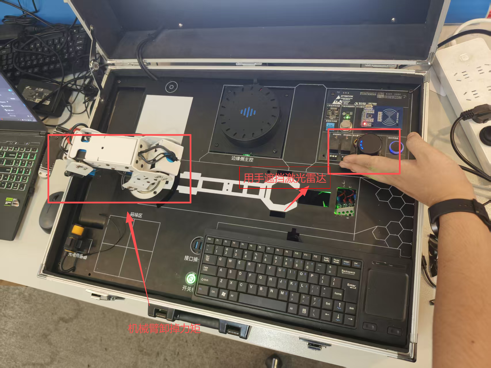

**预期效果描述**：

- `/eai_factory/safety/status`：`safe` → 放障碍 0.5s 后 `danger` → 移开后 `recover`
- `/car1_base_driver/bus_servo/set_state` 出现 `enable_torque: [0,0,0,0,0,0]`（释放）与 `[1,1,1,1,1,1]`（恢复）
- 机械臂：危险时所有关节可被外力推动（力矩释放生效）；恢复后锁死并回 work 姿态
- 任务中触发：grasp 日志 `SAFETY DANGER — stopping grasp`；conveyor 日志 `safety danger detected — belt + arm stopped`

### 8.6 实验步骤

#### 整体流程图


---

#### 步骤1：低内存启动雷达安全（50min）

**知识点讲解**：

**雷达扇区检测（6.1.1）**

- **原理**：N3 安全节点只订阅激光雷达 `/scan`（LaserScan，Best Effort QoS），**检测基于雷达自身坐标系（laser_link）**，不依赖车身 TF 与机械臂位置关系——障碍必须放在**雷达正前方**。扇区参数：`front_start_deg=-30°`、`front_end_deg=+30°`（共 60°，以雷达 0° 为中心跨 0° 环绕）、`danger_dist=0.20m`。扇区最小距离算法遍历所有扫描点，将角度归一化到 [0, 2π) 后判断是否落在扇区内（含跨 0° 环绕分支），过滤 inf/nan 与 <0.01m 的无效点，取最小距离；`min_range < danger_dist` 即"有障碍接近"。低内存模式 `start_radar:=true` 只拉 `car1_peripherals/lidar.launch.py` 与 safety 节点，不启动底盘/相机（`start_base:=false`），便于安全模块独立调试。
- **源码对应**：`eai_factory/safety_node.py` L41-51（参数声明）、L56-59（`/scan` 订阅 + danger/status 发布）、L78-99（`_get_sector_min_range` 扇区最小距离）、L142-161（`_scan_cb` 扫描回调判定）；`launch/eai_factory.launch.py` L85-86（`start_radar` 默认 false，可开）、L94（`lidar.launch.py` 单独拉起）；`config/eai_factory.yaml` L93-98（safety 段）
  ```python
  for i in range(num_readings):
      angle = angle_min + i * angle_increment
      angle_norm = angle % (2 * math.pi)
      if start_norm <= end_norm:
          in_sector = start_norm <= angle_norm <= end_norm
      else:
          # sector wraps around 0
          in_sector = angle_norm >= start_norm or angle_norm <= end_norm
  ```
- **公式/配图说明**（重难点）：
  - 扇区定义：`θ ∈ [θ_start, θ_end]`，θ_start=-30°、θ_end=30°；跨 0° 时用"或"判定（`angle_norm >= start_norm or angle_norm <= end_norm`）
  - 危险判据：`min_range(θ∈扇区) < danger_dist(0.20m)`
  - 启动组合表：`start_base:=false` + `start_radar:=true` → 只起雷达 + safety（低内存）；完整联动时保持 `start_base:=true`

**操作步骤**：

1. 关闭机器人电源前先确认雷达 USB 已接（ttyUSB1），上电。
2. 低内存启动：
   ```bash
   ros2 launch eai_factory eai_factory.launch.py \
     start_base:=false start_voice:=false start_vision:=false start_grasp:=false \
     start_conveyor:=false start_radar:=true
   ```
3. 确认接口与数据：
   ```bash
   ros2 node list              # 应看到 eai_factory_safety
   ros2 topic hz /scan         # 约 10Hz
   ros2 topic echo /eai_factory/safety/status    # 初始 safe
   ```
4. 查看启动日志：`eai_factory_safety started | front=-30°..30° dist=0.20m persist=0.5s`

**易错点**：

- ⚠️ 雷达没转/`/scan` 无数据 → `safety` 无任何输出 → **解决**：检查 `/dev/lidar` 设备节点与 ttyUSB1 接线；`start_radar:=true` 会单独拉起 lidar launch
- ⚠️ 障碍放在机械臂前方而非雷达正前方 → 不触发 → **解决**：扇区以**雷达自身坐标系**为基准，障碍对准雷达正前方（0° ±30°）才有效

---

#### 步骤2：危险触发与力矩释放（55min）

**知识点讲解**：

**危险判定与力矩释放（6.1.2 + 6.1.3）**

- **原理**：为避免瞬时误报（如飞过的纸屑、扫过的手），危险判定加入**持续计时**：`_scan_cb` 中若 `obstacle_close` 为真，记录 `_danger_since`（首次检测时间），仅当 `now - _danger_since >= persist_time(0.5s)` 才进入危险状态 `_enter_danger()`；障碍消失则清零计时。进入危险时在**同一个 scan 回调内直接发布** `/eai_factory/safety/danger=true`、`/eai_factory/safety/status=danger`，并立即通过 `/car1_base_driver/bus_servo/set_state` 发布 `enable_torque=[0]*6`（ID 0-5：5 个关节 + 1 个夹爪）**释放全部总线舵机力矩**——机械臂变软，可被外力推离，避免与操作者"较劲"造成伤害。释放走"一次 DDS 发布、无服务往返"，雷达 10Hz 最坏 100ms 检测、舵机释放约 150-220ms，响应最快。
- **源码对应**：`eai_factory/safety_node.py` L150-157（`obstacle_close` + persist 计时）、L163-177（`_enter_danger` 发 danger + status + 释放力矩）、L105-120（`_set_arm_torque` 发布 set_state）、L34（`ARM_SERVO_IDS = list(range(6))`）；`docs/11_安全测试用例.md` L40-56（TS1 扇区检测、TS2 力矩释放）
  ```python
  if obstacle_close:
      if self._danger_since is None:
          self._danger_since = now
      if now - self._danger_since >= self.persist_time:
          self._enter_danger()
  ```
  ```python
  s.target_id = list(ARM_SERVO_IDS)
  s.enable_torque = [int(enabled)] * len(ARM_SERVO_IDS)
  msg.state = [s]
  msg.duration = 0.2
  ```
- **公式/配图说明**（重难点）：
  - 危险判定时序：`检测到障碍(t0) → 持续 ≥0.5s(t0+0.5) → 进入 danger`；中途移开 → 计时清零
  - 力矩释放语义：`enable_torque=0` → 舵机输出关闭（0x0B）；`enable_torque=1` → 恢复使能（0x0C）

**操作步骤**：

1. 将实验箱切到**完整模式**（本步骤需 base_driver 驱动总线舵机）：Ctrl+C 停掉低内存模式，改用完整启动：
   ```bash
   ros2 launch eai_factory eai_factory.launch.py \
     start_voice:=false start_vision:=false start_grasp:=false start_viz:=false
   ```
2. 确认机械臂处于**安全位置**（远离雷达正前方扇区，如 work 姿态）后，在雷达正前方 20cm 内放障碍物并保持 ≥0.5s：
   ```bash
   ros2 topic echo /eai_factory/safety/danger
   ros2 topic echo /eai_factory/safety/status
   ros2 topic echo /car1_base_driver/bus_servo/set_state
   ```
3. 观察：`danger: true`、`status: danger`、`enable_torque: [0,0,0,0,0,0]`、日志 `DANGER: obstacle 0.20m in front sector`。
4. 用手轻轻推机械臂各关节，确认**可被外力推动**（释放生效）。

**易错点**：

- ⚠️ 障碍物放得太近（<10cm 盲区）或角度超出 ±30° → 不触发 → **解决**：障碍放在雷达正前方 10-20cm，保持稳定
- ⚠️ 机械臂在危险触发瞬间仍保持原姿态被"硬掰" → **解决**：触发前确认机械臂处于安全位置；释放后先观察再触碰
- ⚠️ 只触发 <0.5s → 不判危险（误报过滤） → **解决**：保持障碍 ≥0.5s 观察危险状态变化

---

#### 步骤3：危险解除与恢复回 work（50min）

**知识点讲解**：

**危险解除恢复流程（6.2.1）**

- **原理**：障碍移开后，`_scan_cb` 中 `obstacle_close` 为假，清空 `_danger_since` 计时并调用 `_exit_danger()`：发布 `danger=false`、`status=recover`，**恢复 6 舵机力矩**（`enable_torque=[1]*6`），再调用 `/arm_controller/go_work` 服务让机械臂**回到 work 安全姿态**（fire-and-forget 异步调用）。恢复后机械臂关节锁死、无法手推。该流程是"安全联锁闭环"的关键：危险解除后系统能自行复位到安全位，而不是停在危险位置。
- **源码对应**：`eai_factory/safety_node.py` L158-161（清计时 + `_exit_danger`）、L179-190（`_exit_danger` 发 danger=false + status=recover + 恢复力矩 + go_work）、L122-128（`_go_work` 异步调 go_work 服务）；`docs/11_安全测试用例.md` L58-66（TS3 恢复用例）
  ```python
  def _exit_danger(self):
      self._danger = False
      ...
      status.data = 'recover'
      self.status_pub.publish(status)
      self._set_arm_torque(True)     # 恢复力矩
      self._go_work()                # 回 work
  ```
- **公式/配图说明**（重难点）：
  - 状态序列：`safe → danger(释放力矩) → recover(恢复力矩+go_work) → safe`
  - 依赖链：恢复力矩必须先于 `go_work` 执行，否则机械臂无力无法运动

**操作步骤**：

1. 保持步骤2 的监听终端，缓慢移开雷达前方障碍物。
2. 观察：`danger: false`、`status: recover`、`enable_torque: [1,1,1,1,1,1]`、日志 `SAFE: front sector clear — torque restored, go_work`。
3. 观察机械臂自动回到 work 姿态，然后尝试用手推关节，确认**已锁死**。
4. 再次放障碍 0.5s → 再移开，验证"触发→解除"循环可重复执行。

**易错点**：

- ⚠️ `go_work` 服务未就绪 → 恢复时只恢复力矩不回 work（日志 warn） → **解决**：保证 `arm_controller` 随 launch 启动；`ros2 service list | grep go_work` 确认
- ⚠️ 危险解除瞬间手扶机械臂 → go_work 过程中阻力 → **解决**：恢复期间手离开机械臂，让其自主回位

---

#### 步骤4：任务中急停联动（50min）

**知识点讲解**：

**打断分层与 danger 响应（6.2.2 + 6.2.3）**

- **原理**：系统打断分两层：**雷达危险打断 > 语音打断**。危险时**不强行运动**（释放力矩让臂软），避免与操作者对抗；N-grasp 订阅 `/eai_factory/safety/danger`，收到 `true` 时立即停止当前抓取动作（调 `/arm_controller/emergency_stop` 中止运动、状态回 idle，恢复后需重新触发任务）；N-conveyor 订阅 danger 后同样急停流水线**并**调 arm emergency_stop 停机械臂；N2 调度器记录任务暂停，恢复后由操作者重新下达指令。实测任务中触发雷达危险：装货/分拣/码垛的抓取序列与流水线送料均会立即停止。
- **源码对应**：`eai_factory/grasp_node.py` L113-114（danger 订阅）、L188-202（`_danger_cb` 停止抓取+状态回 idle）、L532-538（`_stop_arm_action` 调 emergency_stop）；`eai_factory/conveyor_node.py` L94-96（danger 订阅）、L259-273（`_danger_cb` 停带+停臂）、L275-283（`_stop_arm_on_danger`）；`eai_factory/scheduler_node.py` L187-193（`_danger_cb` 任务暂停）；`docs/11_安全测试用例.md` L68-76（TS4 流水线联动）
  ```python
  # grasp_node._danger_cb
  if msg.data:
      self._interrupted = True
      self._grasp_state = 'idle'
      self.get_logger().warn('SAFETY DANGER — stopping grasp')
      self._stop_arm_action()
  ```
- **公式/配图说明**（重难点）：
  ```mermaid
  graph LR
      A[N3 雷达 danger=true] --> B[grasp: emergency_stop 停臂]
      A --> C[conveyor: 停带 + 停臂]
      A --> D[scheduler: 任务暂停]
      B --> E[危险解除后需重新触发任务]
  ```

**操作步骤**：

1. 完整启动（开任务所需模块）：
   ```bash
   ros2 launch eai_factory eai_factory.launch.py start_viz:=false
   ```
2. 触发一个任务（如分拣，用服务方式便于控制）：
   ```bash
   ros2 service call /eai_factory/start_sort std_srvs/srv/Trigger
   ```
3. 在任务执行（机械臂运动或流水线运转）中，于雷达正前方放障碍 ≥0.5s。
4. 观察：grasp 日志 `SAFETY DANGER — stopping grasp`；conveyor 日志 `safety danger detected — belt + arm stopped`；机械臂当前动作中止、`/eai_factory/conveyor/emergency` 话题 `data: true`。
5. 移开障碍，确认恢复（conveyor 回 idle；机械臂恢复由 N3 `go_work` 处理；任务需重新触发）。
6. 分别对装货（`/eai_factory/start_load`）与码垛（`/eai_factory/start_palletize`）重复 2-5 步。

**易错点**：

- ⚠️ 危险触发时机不对（任务已结束才放障碍）→ 观察不到联动 → **解决**：任务执行中（机械臂运动/送料中）触发
- ⚠️ 危险解除后任务不自动继续（符合"人工确认后重新触发"安全策略） → **解决**：恢复后由操作者重新下达指令，不是缺陷
- ⚠️ 抓取中 danger 后 grasp 状态卡 busy → `_danger_cb` 已置 idle，若仍 busy 可调 `/eai_factory/grasp/abort` 复位

---

#### 步骤5：安全测试用例验收（35min）

**知识点讲解**：

**测试用例方法论（6.1.1-6.2.3 综合）**

- **原理**：验收覆盖五类场景：扇区检测发 danger（TS1）、危险释放力矩（TS2）、危险解除恢复（TS3）、流水线联动（TS4）、手动验证释放/恢复（TS5，不依赖雷达直接发 `set_state` 验证驱动 cmd 修复：释放=0x0B、使能=0x0C）。重点验证"检测→释放→恢复"完整闭环与"雷达打断 > 语音打断"分层。
- **源码对应**：`docs/11_安全测试用例.md` L40-47（TS1）、L49-56（TS2）、L58-66（TS3）、L68-76（TS4）、L78-92（TS5 手动验证命令）；`eai_factory/safety_node.py` L105-120（`_set_arm_torque` 释放/恢复共用）
- **公式/配图说明**：TS5 手动命令与 N3 自动路径等价（同一话题同一消息格式），用于不依赖雷达的快速回归

**操作步骤**：

1. 按 `docs/11_安全测试用例.md` 逐条执行 TS1~TS5，记录现象与日志截图。
2. TS5 手动验证（不依赖雷达）：
   ```bash
   # 释放（ID 0-5）
   ros2 topic pub -1 /car1_base_driver/bus_servo/set_state car1_base_driver_msgs/msg/SetBusServoState \
     "{state: [{target_id: [0,1,2,3,4,5], enable_torque: [0,0,0,0,0,0]}], duration: 0.2}"
   # 恢复
   ros2 topic pub -1 /car1_base_driver/bus_servo/set_state car1_base_driver_msgs/msg/SetBusServoState \
     "{state: [{target_id: [0,1,2,3,4,5], enable_torque: [1,1,1,1,1,1]}], duration: 0.2}"
   ```
3. 将 TS1-TS5 结果填入实验报告（现象 + 判断通过/失败）。

**易错点**：

- ⚠️ TS5 手动释放后忘记恢复 → 机械臂保持软连接，后续任务异常 → **解决**：测试完立即恢复 `[1,1,1,1,1,1]`
- ⚠️ 释放/恢复命令的 `target_id` 与 `enable_torque` 数组长度不一致 → 底层驱动映射失败 → **解决**：两数组必须同为 6 元素（见 safety_node.py L113-114 注释）

### 8.7 注意事项

- ⚠️ **务必确认机械臂处于安全位置再释放力矩**（work 姿态或远离雷达扇区），释放后关节可被外力推动，防止坠落/碰撞
- ⚠️ 危险触发/解除时手离开机械臂，让 `go_work` 自主回位；恢复前不要扶臂
- ⚠️ 障碍物对准**雷达正前方**（0° 中心 ±30°），保持 ≥0.5s 才能判危险
- ⚠️ 任务中急停后需人工重新触发任务（安全策略，非缺陷）
- ⚠️ 实验结束用 `bash scripts/stop_eai_factory.sh` 清理进程，避免残留进程占用总线舵机

### 8.8 实验总结

**完成成果**: 完成低内存雷达安全单测、危险触发（扇区检测 + 0.5s 持续判定 + 6 舵机力矩释放）、危险解除（恢复力矩 + go_work 回 work）、任务中急停联动（grasp/conveyor 响应 danger）四大验证，并按 docs/11 完成 TS1-TS5 用例验收。

**技能收获**:
- 掌握激光雷达扇区最小距离算法（含跨 0° 环绕）与 persist_time 防误报判定
- 掌握总线舵机力矩释放/恢复的发布机制（`/car1_base_driver/bus_servo/set_state`）
- 掌握"雷达打断 > 语音打断"分层设计与 N-grasp / N-conveyor 的 danger 订阅联动

**常见问题与解决**:

| 问题 | 原因 | 解决方法 |
|------|------|---------|
| 放障碍不触发 danger | 障碍超出 ±30° 扇区或 <10cm 盲区/持续 <0.5s | 放在雷达正前方 10-20cm 保持 ≥0.5s（yaml L95-98） |
| 机械臂释放后无法手推 | 力矩释放未生效（驱动 cmd 修复缺失） | TS5 手动发 `enable_torque:[0]*6` 验证；确认 board_sdk 释放=0x0B |
| 危险解除后不回 work | `go_work` 服务未就绪 | `ros2 service list \| grep go_work`；保证 arm_controller 在跑 |
| 任务中危险后任务不继续 | 安全策略：人工确认后重新触发 | 恢复后重新调 `/eai_factory/start_xxx` 触发任务 |
| status 一直 safe | safety 节点未启动或 `/scan` 无数据 | 确认 `eai_factory_safety` 在 node list；`ros2 topic hz /scan` |

### 8.9 实验报告要求

**思考题**:
1. 危险判定为什么要加 0.5s 持续计时？去掉它可能出现什么误报场景？
2. 为什么"危险时不强行运动"（释放力矩）比"立即刹车保持姿态"更安全？结合人机协作场景分析。
3. 打断分层为什么"雷达打断 > 语音打断"？若机械臂抓取中同时收到语音打断与雷达危险，应按哪个执行，为什么？

**评分标准**: 实验报告满分 100 分 = 实验目的与原理阐述 15 分 + 操作步骤完整性（含命令与日志截图）30 分 + 四步验证现象记录（低内存检测/危险触发/解除恢复/任务联动）35 分 + 测试用例验收表（TS1-TS5）10 分 + 思考题与问题分析 10 分。


# 实验9：具身智能工厂--全功能快速验证（8h）

### 9.1 关联知识点

- 6.3.1 Launch 一键启动（bringup→arm_controller→peripherals→eai_factory 节点分阶段启动；前置依赖 1.2.3, 2.2.1）
- 6.3.2 7 开关模块化（start_base/viz/voice/vision/grasp/conveyor/radar；前置依赖 6.3.1）
- 6.3.3 全链路闭环与停止清理（语音→意图→任务→执行→完成播报闭环 + `stop_eai_factory.sh` 清理；前置依赖 3.2.1, 4.2.2, 5.2.2, 6.2.1）

### 9.2 实验目标

1. 掌握 `ros2 launch eai_factory eai_factory.launch.py` 一键启动机制与 bringup→arm_controller→peripherals→eai_factory 节点的分阶段启动顺序 — 原理理解
2. 掌握 7 个模块开关（start_base/viz/voice/vision/grasp/conveyor/radar）的语义，能按需裁剪启动组合节省内存 — 独立完成
3. 掌握装货/分拣/码垛/急停四大全链路闭环验证方法（语音触发 + 服务触发双通道），理解"完成播报"的闭环反馈 — 独立完成
4. 掌握 `stop_eai_factory.sh` 停止清理与残留排查方法，能独立完成系统级快速验证与故障定位 — 迁移应用

### 9.3 实验环境

| 类别 | 配置 |
|------|------|
| 硬件 | 具身智能实验箱 B2 / 机器人小车 C1（麦克纳姆底盘 + 5DOF 机械臂 + 夹爪 + 激光雷达 + RGB-D 深度相机 + 语音阵列 + 流水线电机 M1 + 光电传感器 GPIO17 + AprilTag 标签 id=3） |
| OS | Ubuntu 22.04 + ROS2 Humble |
| Python | 3.10；voice/vision/grasp/conveyor 节点经 `/home/iflytek/ros2_venv/bin/python3` 直接跑 .py（sherpa_onnx、cv2 4.11 仅在 venv）；scheduler/safety 用 console_scripts 入口点 |
| 核心库 | rclpy、std_srvs、std_msgs、sensor_msgs、car1_base_driver_msgs；venv 内 sherpa_onnx / opencv / flask_server（LLM 服务端口 8080） |
| 依赖 | LLM 模型（`Qwen3.5-0.8B_w4a16_g128_rk3576.rkllm`，`llm_server.auto_start=true` 自动拉起）；`scripts/stop_eai_factory.sh`（停止清理） |

### 9.4 实验难度

- 难度: ⭐⭐⭐（综合性）
- 重点: 一键启动编排与 7 开关裁剪；装货/分拣/码垛/急停四链路闭环验证（"任务完成"播报反馈）
- 难点: 多节点分阶段启动的时序观察（venv 进程 vs 入口点节点）；停止清理与残留进程故障排查（flask_server/8080 端口等）

### 9.5 实验现象

**快速验证流程**：

1. 全功能启动：
   ```bash
   source /opt/ros/humble/setup.bash
   source /home/iflytek/ros2_ws/install/setup.bash
   ros2 launch eai_factory eai_factory.launch.py
   ```
2. 装货验证（二选一）：
   ```bash
   # 语音：小飞小飞 → 装货
   ros2 service call /eai_factory/start_load std_srvs/srv/Trigger   # 服务方式
   ```
   观察：视觉检测→抓取→放置→播报"装货完成"
3. 分拣/码垛验证（依次语音"分拣""码垛"，或服务方式），观察完整链路与"分拣完成""码垛完成"播报。
4. 急停验证：任务中在雷达正前方放障碍 ≥0.5s → 观察释放力矩→解除→回 work。
5. 停止清理：
   ```bash
   bash scripts/stop_eai_factory.sh
   ```
   确认输出"已全部清理干净"。

**预期效果描述**：

- 启动日志按序出现：bringup（base_driver/controller）→ arm_controller → peripherals（雷达/相机）→ eai_factory 节点（voice/scheduler/safety/vision/grasp/conveyor），约 5s 后 rqt 调试画面打开
- 语音"装货/分拣/码垛"→ 对应任务执行 → 播报"装货完成/分拣完成/码垛完成"（`/eai_factory/speak` 闭环）
- 任务中触发雷达危险：grasp 停止、流水线停止、舵机力矩释放；移开障碍后恢复力矩并回 work
- `stop_eai_factory.sh` 输出"已全部清理干净"，`ps` 无残留进程、8080 端口空闲

### 9.6 实验步骤

#### 整体流程图


---

#### 步骤1：全功能一键启动（60min）

**知识点讲解**：

**Launch 一键启动与 7 开关模块化（6.3.1 + 6.3.2）**

- **原理**：`ros2 launch eai_factory eai_factory.launch.py` 一条命令拉起全系统，分两类启动源：**底层系统**（`car1_bringup` 底盘+控制器、`car1_arm_controller` 机械臂、`car1_peripherals` 雷达+相机，条件 `start_base:=true` 时经 IncludeLaunchDescription 包含）；**eai_factory 节点**——voice/vision/grasp/conveyor 四个节点因依赖 venv 的 sherpa_onnx、cv2 4.11、car1_base_driver_msgs，用 `ExecuteProcess` 以 `/home/iflytek/ros2_venv/bin/python3` 直接跑 .py；scheduler/safety 用标准 `Node` 入口点。另有 `start_viz:=true` 时 5s 后拉起 `rqt_image_view` 调试画面。**7 开关** `start_base/start_viz/start_voice/start_vision/start_grasp/start_conveyor/start_radar`（默认全 true，radar 默认 false）使各模块可独立裁剪：`start_voice:=false` 省 ~500MB LLM 内存、`start_radar:=true` 配合 `start_base:=false` 可只测雷达安全。
- **源码对应**：`launch/eai_factory.launch.py` L73-86（7 个 DeclareLaunchArgument 开关）、L89-91（base 三包 IncludeLaunchDescription）、L94（lidar 独立拉）、L99-146（voice/scheduler/safety/vision/grasp/conveyor 节点编排）、L149-160（rqt_image_view 延时 5s）；`README.md` L52-80（常用命令清单）
  ```python
  DeclareLaunchArgument('start_voice', default_value='true',
      description='Start voice node (LLM ~500MB). Set false to save memory...'),
  ...
  DeclareLaunchArgument('start_radar', default_value='false',
      description='Start lidar only (independent of start_base; low-memory testing of safety node)'),
  ```
- **公式/配图说明**：
  
  ```mermaid
  graph LR
      A[launch 入口] --> B[start_base=true: bringup + arm_controller + peripherals]
      A --> C[start_voice: venv python voice_node.py]
      A --> D[scheduler Node 入口点]
      A --> E[safety Node 入口点]
      A --> F[start_vision: venv vision_node.py]
      A --> G[start_grasp: venv grasp_node.py]
      A --> H[start_conveyor: venv conveyor_node.py]
      A --> I[start_viz: 5s 后 rqt_image_view]
  ```

**操作步骤**：

1. 检查环境与依赖（LLM 模型路径存在、venv 就绪）：
   ```bash
   ls /home/iflytek/models/rkllm/Qwen3.5-0.8B_w4a16_g128_rk3576.rkllm
   /home/iflytek/ros2_venv/bin/python3 --version    # 3.10
   ```
2. 全功能启动：
   ```bash
   ros2 launch eai_factory eai_factory.launch.py
   ```
3. 观察分阶段启动日志：bringup 底层 → arm_controller → peripherals → voice（LLM 加载约几十秒）→ scheduler/safety/vision/grasp/conveyor → 约 5s 后 rqt_image_view。
4. 确认节点齐全：
   ```bash
   ros2 node list | grep eai_factory
   ros2 service list | grep -E "start_(load|sort|palletize)"
   ros2 topic echo /eai_factory/safety/status     # 应看到 safe
   ```
5. 练习开关裁剪（省内存演示，完成后 Ctrl+C）：
   ```bash
   ros2 launch eai_factory eai_factory.launch.py start_voice:=false start_viz:=false
   ```

**易错点**：

- ⚠️ 启动失败报 ament 找不到包 → **解决**：先 `source /opt/ros/humble/setup.bash && source /home/iflytek/ros2_ws/install/setup.bash`；确认已 `colcon build --packages-select eai_factory`
- ⚠️ 语音节点启动慢（LLM 加载）误以为卡死 → **解决**：`start_voice:=false` 可跳过；或等待 8080 端口就绪 `ss -tlnp | grep 8080`
- ⚠️ 无显示器环境 rqt 报错 → **解决**：`start_viz:=false` 关闭调试画面

---

#### 步骤2：装货链路验证（90min）

**知识点讲解**：

**装货：视觉抓取全链路（6.3.3 + 4.2.3）**

- **原理**：装货是**视觉自适应抓取**（`grasp.tasks.load.vision=true`）：N-vision 检测 AprilTag（tag id=3，tag36h11）发布目标位姿 → N-grasp 观察位 `[0.16, 0.0, 0.27, 2.5307]` 到位 → 视觉目标经 camera→base_link TF 变换 → 带 `pick_offset` 补偿抓取 → 放置位 `[0.05675, -0.13166, 0.20386, 2.93322]` 放下 → 回 work。任务完成后 N-grasp 发布 `load|done`，N2 调度器 `_grasp_status_cb` 映射为"装货完成"并发布到 `/eai_factory/speak` 由 TTS 播报，形成"语音→意图→任务→执行→完成播报"闭环。语音"装货"与服务 `/eai_factory/start_load` 两路等价（同走 `_run_task('load')`）。

- **源码对应**：`eai_factory/scheduler_node.py` L214-218（`/eai_factory/start_load` 服务）、L195-210（`_grasp_status_cb`：`load→装货完成` 播报）；`eai_factory/grasp_node.py` L53-55（load 任务点位参数）、L246-306（`start_grasp` 视觉路径）；`config/eai_factory.yaml` L79-82（load 段点位）、L51（`load_done: "装货完成"`）、L110-113（intents 映射 load→`/eai_factory/start_load`）
  ```python
  def _start_load_cb(self, request, response):
      self._run_task('load')
      response.success = True
      response.message = 'load task triggered'
      return response
  ```

**操作步骤**：

1. 全功能启动（步骤1 已起；若已停止重新启动）。

2. 在装货区放置贴有 AprilTag(id=3) 的货物，观察 rqt 调试画面中检测框。

3. 触发装货（两路任选其一）：
   ```bash
   # 语音路：小飞小飞 → 装货
   # 服务路：
   ros2 service call /eai_factory/start_load std_srvs/srv/Trigger
   ```

4. 观察完整链路：机械臂移观察位 → 检测到目标 → 抓取（夹爪闭合）→ 抬升 → 移放置位 → 放下 → 回 work → 播报"装货完成"（终端可见 `[SCHEDULER] task load done — announce "装货完成"`）。

5. 记录 grasp status `load|done`。

   服务端启动装货程序后，机械臂会进入寻找姿态，开始识别物块的坐标

   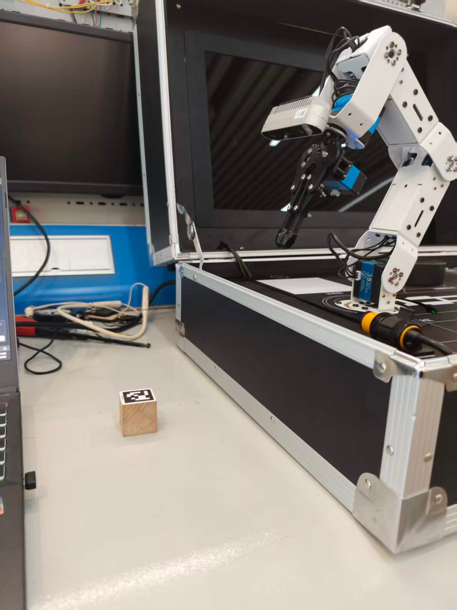

找到后坐标后，机械臂会对物块进行视觉抓取

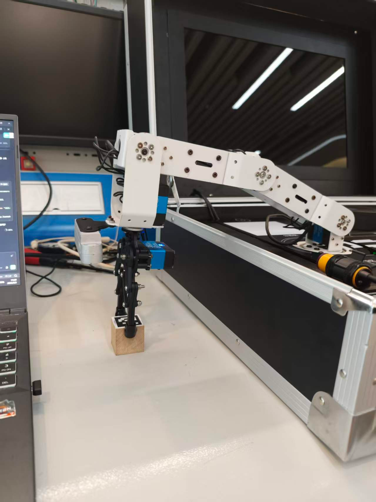

抓取成果后，将物块放在分拣区

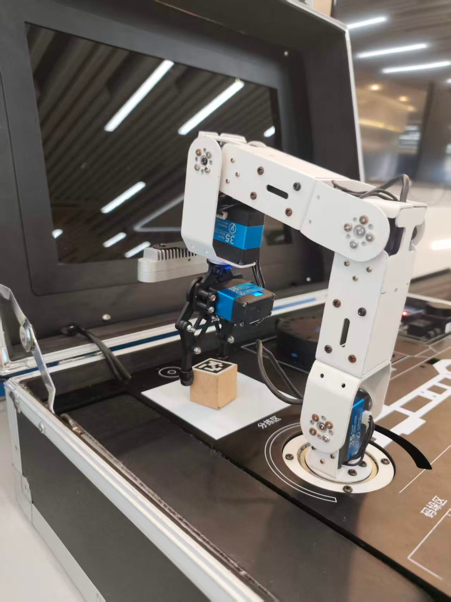

**易错点**：

- ⚠️ 检测不到 AprilTag（光照/距离/角度） → **解决**：确认标签在相机视野内、tag id=3、`/eai_factory/vision/detected` 话题 `data: true`；用 rqt 调试画面校准
- ⚠️ 抓取偏移偏大（手眼标定误差） → **解决**：`grasp.pick_offset_*`（yaml L75-77）现场微调，如向前补偿 15mm/向上 23mm
- ⚠️ 视觉路径需要 camera 已起（`start_base:=true` 含 peripherals 相机） → **解决**：确认 `/ascamera_hp60c/camera_publisher/rgb0/image` 话题存在

---

#### 步骤3：分拣链路验证（90min）

**知识点讲解**：

**分拣：固定点位抓取（6.3.3 + 5.1.3）**

- **原理**：分拣是**固定点位抓取**（`grasp.tasks.sort.vision=false`）：不依赖视觉，取料点（`observe_pose=[0.0622, -0.1158, 0.1951, 3.0371]`，手动打点）即抓取点，放置点 `[0.1434, -0.1296, 0.2075, 2.7283]`。动作序列为固定抓取八步：**提前开爪→直接到位→闭爪→抬升(0.03)→移放置位→开爪投放→再抬升(0.05)→回 work**。与装货不同，分拣无需相机与 TF，速度更快、对环境依赖更低。任务完成同样经 grasp status → 调度器播报"分拣完成"。
- **源码对应**：`eai_factory/scheduler_node.py` L220-224（`/eai_factory/start_sort` 服务）、L203-204（`sort→分拣完成` 播报映射）；`eai_factory/grasp_node.py` L56-58（sort 点位参数）、L413-485（`_do_fixed_grasp` 八步序列）；`config/eai_factory.yaml` L83-86（sort 段点位）
  ```python
  # grasp_node._do_fixed_grasp 关键序列
  if not self._call_gripper(True):            # ① 提前开爪
      return
  self._move_to_pose(ox, oy, oz, opitch)      # ② 直接到位
  ...
  if not self._call_gripper(False):           # ③ 闭爪抓取
  self._move_to_pose(ox, oy, oz + self.lift_height, opitch)   # ④ 抬升
  self._move_to_pose(px, py, pz, ppitch)      # ⑤ 移放置位
  if not self._call_gripper(True):            # ⑥ 开爪投放
  self._move_to_pose(px, py, pz + self.place_lift, ppitch)    # ⑦ 抬 5cm
  self._call_service(self.work_client, 'go_work')             # ⑧ 回 work
  ```
- **公式/配图说明**（重难点）：固定抓取时序 `开爪→到位→闭爪→抬0.03→放置→开爪→抬0.05→work`；放置后抬升 `place_lift=0.05` 是防拖拽回刮关键

**操作步骤**：

1. 在分拣取料点摆放待分拣物品（与打点位置/高度一致）。
2. 触发分拣：
   ```bash
   ros2 service call /eai_factory/start_sort std_srvs/srv/Trigger
   # 或语音：小飞小飞 → 分拣
   ```
3. 观察：提前开爪 → 到位 → 闭爪 → 抬升 → 放置 → 抬 5cm → 回 work → 播报"分拣完成"。
4. 连续执行 2 次，验证固定点位稳定性。

**易错点**：

- ⚠️ 物品摆放偏离打点位置 → 抓偏/漏抓 → **解决**：物品必须与 `sort.observe_pose` 打点位置一致（yaml L85），或用"先放货再打点"方式校准
- ⚠️ 固定抓取开爪太晚（到位才开） → 夹爪卡住物品边缘 → **解决**：确认"提前开爪"在移动前完成（`_call_gripper(True)` 在 `_move_to_pose` 之前，grasp_node.py L435-441）

---

#### 步骤4：码垛链路验证（90min）

**知识点讲解**：

**码垛：送料+抓取编排（6.3.3 + 1.3.2 + 5.2.2）**

- **原理**：码垛是**跨节点编排**任务：N2 调度器先调 N-conveyor `run_until_sensor` 送料（流水线电机 M1 运转），物品随皮带移动至光电传感器（GPIO17）遮挡定点停（`sensor_blocked`，防抖 3 次确认），调度器收到该状态后再触发 N-grasp 的 palletize 固定点位抓取（`observe_pose=[0.145, 0.0027, 0.185, 3.1381]` 取料、`place_pose=[0.0608, 0.1345, 0.2051, 2.6461]` 放置），完成后播报"码垛完成"。这是本课程**最完整的任务链路**，融合了流水线、光电、固定抓取、跨节点状态同步四大知识点。

- **源码对应**：`eai_factory/scheduler_node.py` L226-230（`/eai_factory/start_palletize` 服务）、L98-110（`_start_palletize_sequence` 先送料）、L121-127（`_conveyor_state_cb` 收到 `sensor_blocked` 触发抓取）、L203-204（`palletize→码垛完成`）；`eai_factory/grasp_node.py` L59-61（palletize 点位）、L273-278（固定抓取路径）；`config/eai_factory.yaml` L87-90（palletize 段）、L35-36（"码垛"等意图提示词）、L53（`palletize_done: "码垛完成"`）
  ```python
  def _start_palletize_sequence(self):
      ...
      self._awaiting_sensor = True
      future = self.conveyor_client.call_async(Trigger.Request())  # run_until_sensor 送料
  ```

**操作步骤**：

1. 把待码垛物品放流水线起始端备用。
2. 触发码垛：
   ```bash
   ros2 service call /eai_factory/start_palletize std_srvs/srv/Trigger
   # 或语音：小飞小飞 → 码垛（触发后立即把物品放到流水线起始端）
   ```
3. 观察：送料（`running`）→ 光电遮挡 → `sensor_blocked` → 机械臂开爪到位抓取 → 抬升 → 放置 → 抬 5cm → 回 work → 播报"码垛完成"。
4. 记录 `/eai_factory/grasp/status` 出现 `palletize|done`。

**易错点**：

- ⚠️ 语音码垛时物品没及时放上流水线 → 送料空跑 30s `timeout` → **解决**：听到"好的"后立即放物品（run_until_sensor 先等清沿再等挡沿）
- ⚠️ 码垛堆叠高度变化导致固定点位抓不到 → **解决**：保持取料点物品与打点高度一致，堆码高度超限时重新打点（yaml L89）

---

#### 步骤5：急停联动验证（80min）

**知识点讲解**：

**安全联锁与打断分层（6.2.1 + 6.2.2 + 6.2.3）**

- **原理**：任务执行中（机械臂运动/流水线送料）若激光雷达检测到前方 60° 扇区内 <20cm 障碍持续 0.5s，N3 发布 `danger=true` 并**释放 6 舵机力矩**（机械臂变软）；N-grasp 收到后立即 `emergency_stop` 中止抓取、N-conveyor 停带并停臂、N2 调度器暂停任务；障碍移开后 N3 发布 `danger=false`、`status=recover`，恢复力矩并调 `go_work` 回 work。**打断分层：雷达打断 > 语音打断**——危险时绝不强行运动，保证人机安全。恢复后任务需人工重新触发（安全策略）。
- **源码对应**：`eai_factory/safety_node.py` L163-190（`_enter_danger`/`_exit_danger`）、L105-120（`_set_arm_torque`）、L122-128（`_go_work`）；`eai_factory/grasp_node.py` L188-202（`_danger_cb` 停止抓取）；`eai_factory/conveyor_node.py` L259-273（`_danger_cb` 停带+停臂）；`eai_factory/scheduler_node.py` L187-193（`_danger_cb` 任务暂停）；`config/eai_factory.yaml` L93-98（safety 参数）
  ```python
  # safety_node._enter_danger
  self._danger = True
  self.danger_pub.publish(Bool(data=True))
  status.data = 'danger'
  self.status_pub.publish(status)
  self._set_arm_torque(False)     # 释放力矩，机械臂变软
  ```
- **公式/配图说明**（重难点）：危险时序 `放障碍 → 0.5s 持续 → danger(释放力矩) → 移开 → recover(恢复力矩+go_work)`；分层表：雷达危险 > 语音打断

**操作步骤**：

1. 全功能启动状态下，触发一个任务（如分拣或码垛），在任务执行中于**雷达正前方** 20cm 内放障碍 ≥0.5s。
2. 观察：grasp 日志 `SAFETY DANGER — stopping grasp`、conveyor 日志 `safety danger detected — belt + arm stopped`、`/car1_base_driver/bus_servo/set_state` 出现 `enable_torque: [0,0,0,0,0,0]`；机械臂变软。
3. 移开障碍：观察 `status=recover`、`enable_torque: [1,1,1,1,1,1]`、机械臂 `go_work` 回 work。
4. 再次触发任务验证恢复后可正常工作；尝试"任务中语音打断"与"任务中雷达危险"同时发生，观察雷达优先（grasp 停止动作而非回 work 继续）。

**易错点**：

- ⚠️ 障碍放错位置（非雷达正前方）不触发 → **解决**：对准雷达 0° 中心 ±30° 扇区（yaml L95-96）
- ⚠️ 危险解除后误以为任务自动继续 → **解决**：安全策略为"人工重新触发"，恢复后重新下达指令
- ⚠️ 释放力矩后机械臂下垂撞击周边 → **解决**：触发前确保机械臂处于安全位、下方无遮挡物

---

#### 步骤6：停止清理与故障排查（70min）

**知识点讲解**：

**停止清理与防残留（6.3.3）**

- **原理**：`ros2 launch` 正常 Ctrl+C 会关闭其管理的子进程，但**异常终止/后台启动**可能残留各节点、底层系统与 LLM 服务（flask_server 端口 8080），残留进程会继续占用总线舵机/串口/麦克风，导致下次启动失败。`stop_eai_factory.sh` 兜底清理：按名 pkill launch 主进程 → 5 个 venv 节点 + 2 个入口点节点 → flask_server → 底层系统（base_driver/controller/robot_state_publisher/joint_state_publisher/arm_controller/ascamera/rqt）→ 兜底清 8080 端口 → 最后自查残留输出"已全部清理干净"。故障排查则结合 `ros2 node list / ros2 topic list / ros2 service list` 与日志逐层定位。
- **源码对应**：`scripts/stop_eai_factory.sh` L18（杀 launch）、L21-26（杀 7 个 eai_factory 节点）、L29（杀 flask_server）、L33-42（杀底层系统）、L45-50（兜底清 8080）、L54-60（残留自查）；`README.md` L79-80（停止命令）
  ```bash
  for f in voice_node vision_node grasp_node conveyor_node; do
      pkill -9 -f "$f.py" ...
  done
  ...
  if ss -tlnp 2>/dev/null | grep -q ":8080 "; then ... kill -9 "$PID" ...
  ```
- **公式/配图说明**（重难点）：排查顺序 `进程是否残留(stop 脚本自查) → 话题/服务是否在(node list) → 日志定位(各节点 screen 输出)`；资源占用表：语音/LLM ~500MB、rqt GUI 依赖显示器

**操作步骤**：

1. 结束本轮验证（Ctrl+C 或直接执行停止脚本）：
   ```bash
   cd ~/ros2_ws/src/xflz_eai_car1/app/eai_factory
   bash scripts/stop_eai_factory.sh
   ```
2. 观察输出：各进程"已终止"或"无进程"，结尾显示"已全部清理干净"（或列出残留）。
3. 若有残留，手动清理：
   ```bash
   ps aux | grep -E "voice_node|flask_server|eai_factory" | grep -v grep
   pkill -9 -f "flask_server.py"
   ss -tlnp | grep 8080
   ```
4. 验证清理结果：`ros2 node list` 无 eai_factory 节点、`ss -tlnp | grep 8080` 无输出。
5. 故障排查演练：人为制造一个故障（如 `start_voice:=false` 启动后调语音指令），用 `ros2 node list` / 话题 / 日志定位原因并记录排查过程。

**易错点**：

- ⚠️ 只 Ctrl+C 不跑停止脚本 → 残留 flask_server/8080 占用 → **解决**：每次实验结束统一执行 `bash scripts/stop_eai_factory.sh`
- ⚠️ 停止脚本误杀同名前缀的其他进程 → **解决**：脚本按精确文件名匹配（`voice_node.py` 等），运行前确认无同名业务进程
- ⚠️ 下次启动报"地址被占用"（串口/麦克风） → **解决**：八成是上次残留，执行停止脚本清干净再启动

### 9.7 注意事项

- ⚠️ 全功能启动会同时拉起语音（LLM ~500MB）、视觉、机械臂、流水线、雷达，**确认内存/供电充足**，必要时用开关裁剪（`start_voice:=false` 等）
- ⚠️ 实机抓取全程**手离抓取区域**；急停验证前确认机械臂处于安全位，释放力矩后防止下垂碰撞
- ⚠️ 雷达危险触发/解除时手不要扶机械臂，让其自主回 work
- ⚠️ 码垛/分拣为固定点位抓取，物品摆放必须与打点一致；堆叠高度变化需重新打点
- ⚠️ 实验结束**必须** `bash scripts/stop_eai_factory.sh` 清理，防止残留进程占用总线舵机/串口/8080

### 9.8 实验总结

**完成成果**: 完成一键启动与 7 开关裁剪演示、装货/分拣/码垛三大任务链路验证（语音+服务双通道）、任务中雷达急停联动验证，以及停止清理与残留排查，达到"一条命令启动、全链路闭环、干净停止"的系统级快速验证目标。

**技能收获**:
- 掌握 launch 一键启动编排（venv ExecuteProcess + Node 入口点混编）与 7 开关模块化裁剪
- 掌握装货（视觉抓取）/分拣（固定抓取）/码垛（送料+抓取编排）三条任务链路与完成播报闭环
- 掌握安全联锁（雷达危险→力矩释放→解除恢复）与停止清理/残留排查方法

**常见问题与解决**:

| 问题 | 原因 | 解决方法 |
|------|------|---------|
| 启动报 ament/找不到包 | 未 source 环境或未 build | `source /opt/ros/humble/setup.bash` + `source /home/iflytek/ros2_ws/install/setup.bash`；`colcon build --packages-select eai_factory` |
| 语音无响应 | LLM 服务未就绪（8080）或麦克风被残留进程占用 | 等 `ss -tlnp \| grep 8080` 出现；先 `bash scripts/stop_eai_factory.sh` 清残留 |
| 视觉装货检测不到标签 | 光照/距离/角度或 tag id 不符 | 用 rqt 调试画面校准；确认 `tag_id: 3`（yaml L58） |
| 分拣/码垛抓偏 | 物品位置偏离打点 | 重摆物品或重新打点更新 observe_pose（yaml L85/L89） |
| 任务中危险不触发 | 障碍不在雷达正前方 ±30° | 对准雷达 0° 中心放置（yaml L95-96） |
| 下次启动串口/麦克风被占用 | 上次残留进程未清理 | `bash scripts/stop_eai_factory.sh` 后再启动 |

### 9.9 实验报告要求

**思考题**:
1. 7 个开关中 `start_radar` 默认 `false`、`start_base` 默认 `true`，请分析这两个默认值的设计意图（低内存测试 vs 完整系统）。
2. 为什么 voice/vision/grasp/conveyor 用 venv 的 python3 直接跑 .py，而 scheduler/safety 用 console_scripts 入口点？从依赖角度分析。
3. 全链路闭环中"完成播报"由哪个节点、基于什么信号触发？若 grasp 失败（`task|failed`）系统如何表现？
4. 停止脚本为何需要按文件名 pkill 与端口兜底清 8080 两道手段？残留进程会造成哪些具体危害？

**评分标准**: 实验报告满分 100 分 = 实验目的与原理阐述 15 分 + 操作步骤完整性（含命令与日志截图）30 分 + 四链路验证现象记录（启动/装货/分拣码垛/急停）35 分 + 停止清理与残留排查记录 10 分 + 思考题与问题分析 10 分。
