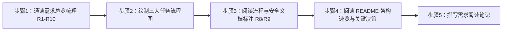

# 实验1：具身智能工厂--项目需求分析（4h）

### 1.1 关联知识点

- 1.1.1 R1-R10 需求体系（前置：ROS 2 话题/服务/参数基础概念、机器人基础）
- 1.1.2 三大任务流程（前置：1.1.1，需先理解 R4-R6 任务条款）
- 1.1.3 安全联锁需求（前置：1.1.1，需了解激光雷达 /scan 数据基本概念）

### 1.2 实验目标

1. **理解**具身智能工厂综合项目 R1-R10 需求体系，能逐条复述每个需求的约束要点（唤醒词集合、任务指令集合、安全阈值等）。
2. **掌握**装货/分拣/码垛三大任务流程的物流走向与执行顺序，能独立绘制任务流程图。
3. **理解**安全联锁机制（雷达危险检测 → 释放机械臂总线舵机力矩），以及语音打断（R8）与雷达打断（R9）的分层关系。
4. **理解**语音 + 大模型驱动的交互方式（唤醒 → ASR → LLM 意图 → 执行 → 播报的单轮闭环），并解释"大模型只做功能映射、不生成应答文案"的设计理由。
5. **独立完成**一份结构化需求阅读笔记，能标注出需求中的【待定】项与隐含约束。
6. **迁移**：把"需求总览 → 流程梳理 → 安全约束"的需求分析方法迁移到其他具身智能/智能制造场景。

### 1.3 实验环境

| 类别 | 内容 |
|------|------|
| 硬件 | B2 麦克纳姆底盘、C1 五自由度机械臂 + 夹爪（本实验仅阅读文档，无需上电）；文档涉及的传感器：激光雷达、RGB-D 深度相机、语音阵列麦克风、光电传感器、AprilTag 标签（tag36h11） |
| OS | Ubuntu 22.04 + ROS 2 Humble |
| Python | 3.10（语音/视觉/抓取节点运行时使用 /home/iflytek/ros2_venv 虚拟环境） |
| 核心库 | rclpy、std_msgs、std_srvs、geometry_msgs、sensor_msgs（本实验仅需理解消息类型概念） |
| 依赖 | 无运行依赖；阅读对象为 `app/eai_factory/` 包内 `docs/01_需求总览.md`、`docs/05_流程与安全.md`、`README.md` |

### 1.4 实验难度

- 难度: ⭐（验证性）
- 重点：R1-R10 需求条款的逐条梳理与要点归纳；三大任务（装货/分拣/码垛）流程绘制；R8 语音打断与 R9 雷达安全联锁的理解。
- 难点：R8 与 R9 两类打断的**优先级分层**（雷达打断 > 语音打断）以及"危险期间语音回 work 被抑制"的边界理解；需求中【待定】项与实际配置的对应关系。

### 1.5 实验现象

**快速验证流程**（纯文档类实验，以下为快速阅读清单）：

```bash
# 在 eai_factory 包目录下
ls docs/
grep -n "R[0-9]" docs/01_需求总览.md          # 快速定位 R1-R10 各条款行号
grep -n "R8\|R9" docs/05_流程与安全.md          # 定位打断与安全章节
head -50 README.md                             # 架构速览与关键决策
```

**预期效果描述**：

- 能列出 R1-R10 每一条的一句话要点，并能说出"哪几条属于交互、哪几条属于任务、哪几条属于安全"。
- 能画出 `装货区 → 分拣区 → 流水线(定点停靠) → 码垛区` 的物流链图，并标注每个阶段结束后"回 work 姿态"这一安全约定（R4.1）。
- 能说出雷达危险触发的三个量化条件（60° 扇区、20 cm、持续 0.5 s）与触发动作（释放 6 个总线舵机力矩 + 发 danger）。
- 能说出语音打断（R8）四步复位流程：中断动作 → 回 work → 流水线停止 → 取消任务。

### 1.6 实验步骤

#### 整体流程图



#### 步骤1：通读需求总览，梳理 R1-R10（60min）

**知识点讲解**：

**1.1.1 R1-R10 需求体系**

- **原理**：需求体系回答"系统要做什么、边界是什么"两个问题。R1-R3 定义交互方式（语音+大模型、唤醒、指令识别），R4-R6 定义三大任务（装货/分拣/码垛），R7-R8 定义播报与打断复位，R9-R9.1 定义安全联锁与打断优先级，R10 定义工程组织。其中 R3 有一个关键约束："一律走大模型意图解析，不用关键词匹配"，且"大模型只做功能映射、不用大模型生成应答文案"——这决定了 N1 语音节点的实现方式（固定文案 TTS + LLM 分类）。梳理需求时建议按"交互/任务/安全/工程"四个维度分组，逐条标注"可量化约束"与【待定】项。
- **源码对应**：`docs/01_需求总览.md L14-L18（R1）、L20-L24（R2）、L26-L32（R3）、L90-L92（R10）`

```markdown
### R1. 交互方式：语音 + 大模型
- 交互模式：单轮、无多轮追问。每次都必须 唤醒 → ASR 识别 → LLM 功能识别 → 执行对应功能 → 播报
- 大模型只做功能映射（装货/分拣/码垛），不用大模型生成应答文案；所有对外播报用固定文案
### R3. 指令识别（意图）
- 唤醒后识别「开始装货」「开始分拣」「开始码垛」，一律走大模型意图解析，不用关键词匹配
```

- **配图说明**（重点）：建议配一张"需求分组图"，把 R1-R10 分成"交互（R1-R3）、任务（R4-R6）、播报打断（R7-R8）、安全（R9-R9.1）、工程（R10）"五组，并标注每组之间的依赖箭头（如 R3 意图 → R4-R6 任务触发；R8/R9 打断作用于任务执行中）。

**操作步骤**：

1. 打开 `docs/01_需求总览.md`，通读全文。
2. 用表格整理 R1-R10：每条记录「需求编号 / 一句话要点 / 可量化约束 / 涉及节点（可暂填） / 【待定】标记」。
3. 特别关注 R3 的意图枚举（load/sort/palletize）与 R9 的三个量化条件，单独摘抄。

**易错点**：

- ⚠️ 误以为"语音打断=雷达急停"是同一种打断 → **解决**：对照 `docs/01_需求总览.md L80-L88`（R9.1），R8 是语音唤醒打断（中断动作→回 work），R9 是雷达危险打断（释放力矩，不动作），两者**优先级不同**（雷达 > 语音）。

#### 步骤2：绘制装货/分拣/码垛三大任务流程图（60min）

**知识点讲解**：

**1.1.2 三大任务流程**

- **原理**：三个任务共用"抓取-放置"原语，但物流走向不同：装货（R4）是"装货区视觉抓取 AprilTag → 放到固定位置"；分拣（R5）是"分拣区抓取 → 放到流水线 → 流水线自动运转送料 → 定点停靠"；码垛（R6）是"从流水线定点取料位抓取 → 放到码垛区"。共同约束是 R4.1：**每步操作完成后必须先回 work 姿态**，才能进行下一步/等待下一条指令。绘制流程图时应把"回 work"画成一个显式状态，这是流程图中最容易漏掉的环节。
- **源码对应**：`docs/01_需求总览.md L34-L38（R4 装货）、L40-L45（R5 分拣）、L47-L50（R6 码垛）、L52-L55（R4.1 回 work 约定）`；物流链总览见 `docs/05_流程与安全.md L3-L18`

```markdown
### R4.1 关键安全约定：每步操作后回 work 姿态
- 每次机械臂操作完成后，必须先回到 work 姿态，才能进行下一步/等待下一条语音指令。
- 适用：装货放置后、分拣放置后、流水线放置后、码垛放置后，以及打断后（见 R8）。
```

- **配图说明**（重难点）：配一张"物流链 + 状态机"融合图：`装货区 → 分拣区 → 流水线(定点停靠) → 码垛区`，每个任务下方标注触发语音（「开始装货」等）与"回 work → 播报"的收尾，突出 R4.1 回 work 是连接任务的"安全握手"。

**操作步骤**：

1. 用流程图工具（draw.io / PlantUML / mermaid）绘制三张任务流程图。
2. 每张图必须包含：触发条件（语音指令）、执行序列（观察/抓取/放置/流水线）、结束动作（回 work）、完成播报。
3. 对比三张图的差异，重点标注"分拣有流水线环节、码垛有送料等待环节、装货是纯视觉抓取"。

**易错点**：

- ⚠️ 流程图漏掉"回 work 姿态" → **解决**：对照 R4.1（`docs/01_需求总览.md L52-L55`），回 work 是每个任务与下个任务之间的强制状态，必须显式画出。

#### 步骤3：标注语音打断（R8）与雷达急停（R9）安全点（60min）

**知识点讲解**：

**1.1.3 安全联锁需求**

- **原理**：R9 定义"雷达自身前方扇区检测→释放力矩"的安全联锁：检测基于激光雷达自身坐标系（laser_link），不依赖车身 TF；三个量化条件是前方 60° 范围（0° 为中心 ±30° 跨 0° 环绕）、距离 20 cm 内、障碍持续超过 0.5 s。触发动作是释放机械臂全部 6 个总线舵机力矩（微阻力、可被外力推动、不强行运动，避免伤人），同时发 `/eai_factory/safety/danger=true`；危险解除后恢复力矩并调 `/arm_controller/go_work` 回 work。R9.1 定义分层：**雷达打断优先级 > 语音打断**，危险期间语音打断的"回 work"被抑制。R8 则是语音唤醒打断的四步复位流程。
- **源码对应**：`docs/01_需求总览.md L62-L68（R8）、L70-L78（R9）、L80-L88（R9.1）`；`docs/05_流程与安全.md L22-L27（检测条件）、L29-L41（触发与解除动作）、L67-L79（打断复位流程）`

```markdown
### R9. 工厂安全保护（激光雷达）
- 检测条件：雷达前方 60° 范围（0° 为中心 ±30°，跨 0° 环绕）内、距离 20 cm 内
  存在持续障碍物超过 0.5 s → 判危险。
- 触发动作（N3 safety 节点）：释放机械臂全部 6 个舵机力矩 + 发 /eai_factory/safety/danger=true。
- 危险解除后：恢复舵机力矩 + 调 /arm_controller/go_work 回 work 姿态 + 发 danger=false。
```

- **配图说明**（重难点）：配一张"打断分层图"：顶部画两类打断入口（语音唤醒 / 雷达危险），中间画仲裁逻辑（雷达 > 语音，危险期间抑制语音回 work），底部画最终动作（回 work / 释放力矩），并标注 R9.1 的优先级箭头。

**操作步骤**：

1. 在 `docs/05_流程与安全.md` 中找到 R8 打断复位四步（`L67-L75`）与 R9 触发/解除动作（`L29-L41`），在需求笔记中标注行号。
2. 用箭头图画出"危险检测 → 释放力矩 → 危险解除 → 恢复力矩 → 回 work"完整时序。
3. 对比 R8 与 R9：R8 是"用户主动打断、动作复位"，R9 是"系统安全联锁、力矩释放"，总结两者的触发源、动作、解除条件差异表。

**易错点**：

- ⚠️ 误以为危险解除后任务会自动继续 → **解决**：对照 `docs/01_需求总览.md L87`（R9.1），危险解除进入 work 后需**等待重新唤醒**再执行任务，不会自动续跑。

#### 步骤4：阅读 README 架构速览，理解五模块与关键决策（30min）

**知识点讲解**：

**1.1.1 / 1.1.2 综合（五模块与关键决策）**

- **原理**：README 的"架构速览"把需求落地为五个模块：N1 语音（KWS→ASR→LLM 意图→TTS）、N2 调度器（任务状态机）、N-grasp（双模式抓取）、N3 安全（雷达扇区检测→释放力矩）、N-conveyor（流水线）。"关键决策速览"回答"需求怎么变成设计"：抓取=双模式（load 视觉 / sort·palletize 固定点位）、姿态统一 base_link 走 IK 且全部 yaml 配置、流水线复用底盘电机、打断分层=雷达>语音、全链路闭环=语音→intent→任务→执行→grasp status→完成播报。该步骤把 R1-R10 与模块一一对应起来，为实验 2 的架构设计打基础。
- **源码对应**：`README.md L31-L38（架构速览）、L40-L48（关键决策速览）`

```markdown
## 架构速览
- **N1 eai_factory_voice**：KWS→ASR→LLM 意图→TTS 播报 / 语音打断
- **N2 eai_factory_scheduler**：任务状态机（装货/分拣/码垛），grasp 未就绪自动重试
- **N-grasp eai_factory_grasp**：双模式抓取 + R8 打断 + 雷达危险中断 + 完成状态发布
- **N3 eai_factory_safety**：雷达自身前方扇区检测→释放舵机力矩→危险解除恢复+回 work
- **N-conveyor eai_factory_conveyor**：流水线电机 + 光电传感器定点停 + 急停
```

- **配图说明**：配一张"需求→模块映射表图"，左侧列 R1-R10，右侧列对应模块（R1-R3→N1/N2、R4-R6→N-grasp/N-conveyor、R9→N3），连线标注关键决策（双模式/打断分层/全链路闭环）。

**操作步骤**：

1. 通读 `README.md` 的架构速览与关键决策两节。
2. 在笔记中绘制"需求编号 → 模块 → 关键决策"三层映射。
3. 阅读 README 常用命令（`L50-L81`），记录一键启动命令 `ros2 launch eai_factory eai_factory.launch.py` 与 7 个开关的用途（本实验仅记录，不执行）。

**易错点**：

- ⚠️ 把"复用节点"误记为 eai_factory 自己的模块 → **解决**：README `L38` 明确列出复用清单（car1_bringup / car1_arm_controller / car1_peripherals / apriltag_detector / visual_grasp），这些是"复用不改"的既有节点。

#### 步骤5：撰写需求阅读笔记（30min）

**操作步骤**：

1. 汇总前四步产出，按"交互需求 / 任务需求 / 安全需求 / 工程组织"四节撰写笔记。
2. 每节附上文档行号引用与关键约束摘录，标注【待定】项（如 R4/R5/R6 中的坐标待定项）。
3. 自检清单：能否不看文档说清 R1-R10 要点；能否画出三大任务流程；能否说清 R8/R9 分层。

**易错点**：

- ⚠️ 笔记只抄条款不做归纳 → **解决**：每条需求必须提炼"可量化约束"（如唤醒词集合、60°/20cm/0.5s、6 舵机）和"设计含义"（对哪个模块、影响什么实现），才算有效笔记。

### 1.7 注意事项

- ⚠️ 本实验为**纯文档阅读，无硬件操作**，不需要给底盘/机械臂上电。
- ⚠️ 文档中多处标注【待定】（如装货区坐标、分拣区观察位），阅读时注意区分"已确认约束"与"待定项"，不要把它们当成已实现坐标。
- ⚠️ 本实验不执行任何 ros2 命令；若在工程机以外阅读，注意 README 中的路径（/home/iflytek/ros2_ws/...）为实机路径。

### 1.8 实验总结

**完成成果**: 一份 R1-R10 需求梳理表（含量化约束与【待定】标注）；三大任务流程图各一张（含回 work 状态）；一张 R8/R9 打断分层与安全联锁时序图；一份需求阅读笔记（含需求→模块映射）。

**技能收获**:

- 技能1：需求文档结构化梳理方法（分组 → 量化约束 → 待定项）
- 技能2：任务流程图绘制（显式画出安全状态）
- 技能3：安全联锁与打断优先级分析

**常见问题与解决**:

| 问题 | 原因 | 解决方法 |
|------|------|----------|
| 分不清 R8 与 R9 | 两类打断都叫"打断"，但触发源不同 | 按"触发源/动作/解除条件"三列做对比表（语音唤醒→复位动作；雷达危险→释放力矩） |
| 流程图漏掉回 work | 未注意到 R4.1 是显式需求 | 用 `docs/01_需求总览.md L52-L55` 的适用清单逐项核对每个任务的收尾 |
| 把【待定】坐标当实现值 | 需求文档与配置文档混读 | 以【待定】标记为准，坐标类数值以实验 3 的 config/eai_factory.yaml 为准 |

### 1.9 实验报告要求

**思考题**:

1. 为什么 R3 要求"一律走大模型意图解析，不用关键词匹配"，而 R7 却用固定文案播报？请结合"大模型只做功能映射"的设计约束说明其理由。
2. R9 的检测条件有三个量化参数（60°、20cm、0.5s），请分析每个参数的作用；若把 persist_time 改为 0.1s 会带来什么问题？
3. 在"分拣 → 流水线送料 → 码垛"链路中，R4.1 的"每步回 work"是如何保证任务之间安全的？如果省去某一步回 work 会有什么风险？

**评分标准**:

- 需求梳理表完整准确（40 分）：R1-R10 逐条覆盖、量化约束正确、【待定】标注清晰
- 三大任务流程图（30 分）：物流走向正确、回 work 状态齐全、分拣/码垛差异体现
- R8/R9 分层与安全联锁分析（20 分）：触发/动作/解除条件正确、优先级分层表达清楚
- 笔记规范与行号引用（10 分）：引用真实文档行号、结构完整 = 100 分。
