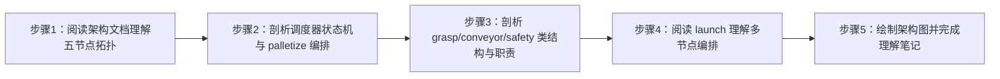

# 实验2：具身智能工厂--系统架构设计（4h）

### 2.1 关联知识点

- 1.2.1 五节点架构（前置：实验 1 的 R1-R10 需求体系、ROS 2 节点/话题/服务概念）
- 1.2.2 通信拓扑（前置：1.2.1，需理解话题异步与服务同步的区别）
- 1.2.3 复用节点（前置：1.2.1，需了解 car1_bringup / car1_arm_controller / car1_peripherals 等既有包）
- 1.3.1 任务状态机（前置：1.2.1，需先理清 N2 调度器职责）
- 1.3.2 palletize 编排（前置：1.3.1，需理解流水线 run_until_sensor 语义）
- 1.3.3 自动重试（前置：1.3.1，需理解服务未就绪场景）

### 2.2 实验目标

1. **掌握**五节点（N1/N2/N3/N-grasp/N-conveyor）职责划分与协作关系，能解释"为什么拆成五个节点、每个节点管什么、谁消费谁的数据"。
2. **理解**N2 调度器任务状态机的运行逻辑（load/sort/palletize 三条路由与 palletize 的"先送料后抓取"编排）。
3. **理解**码垛"先送料后抓取"的编排机制（run_until_sensor 异步送料 → 订阅 conveyor/state 等待 sensor_blocked → 再触发 grasp），并解释为什么采用异步而不是同步阻塞。
4. **掌握**launch 多节点编排方法（7 个开关、venv python 直跑 .py 与 console_scripts 入口两种启动方式的差异）。
5. **独立完成**一张 eai_factory 系统架构图与一份架构理解笔记。
6. **迁移**：能对一个多节点 ROS 2 项目快速建立"节点-接口-编排"三维认知。

### 2.3 实验环境

| 类别 | 内容 |
|------|------|
| 硬件 | B2 麦克纳姆底盘、C1 五自由度机械臂 + 夹爪（本实验仅阅读源码，无需上电）；文档涉及的传感器：激光雷达、RGB-D 深度相机、光电传感器 |
| OS | Ubuntu 22.04 + ROS 2 Humble |
| Python | 3.10（voice/vision/grasp/conveyor 节点运行时使用 /home/iflytek/ros2_venv/bin/python3；scheduler/safety 用 console_scripts 入口） |
| 核心库 | rclpy（Node、ReentrantCallbackGroup、Timer）、std_msgs、std_srvs |
| 依赖 | 阅读对象：`docs/02_架构设计.md`、`eai_factory/scheduler_node.py`、`eai_factory/grasp_node.py`、`eai_factory/conveyor_node.py`、`eai_factory/safety_node.py`、`launch/eai_factory.launch.py`；复用包：car1_bringup / car1_arm_controller / car1_peripherals / apriltag_detector |

### 2.4 实验难度

- 难度: ⭐⭐（设计性）
- 重点：五节点职责划分与通信拓扑；N2 任务状态机的三条路由；palletize"先送料（run_until_sensor）→ 等 sensor_blocked → 再抓取"的异步编排；launch 双启动方式（venv python 直跑 vs entry point）。
- 难点：palletize 编排中"异步服务 + 状态话题回滚"的同步机制设计（为什么 start 立即返回、完成靠 /eai_factory/conveyor/state 通知）；2s 定时器自动重试在服务未就绪时的兜底逻辑。

### 2.5 实验现象

**快速验证流程**（纯源码阅读类实验，以下为快速阅读清单）：

```bash
# 在 eai_factory 包目录下
grep -n "def _" eai_factory/scheduler_node.py        # 列出调度器全部回调/方法及行号
grep -n "create_service\|create_subscription\|create_publisher" \
  eai_factory/grasp_node.py eai_factory/conveyor_node.py eai_factory/safety_node.py
grep -n "DeclareLaunchArgument\|ExecuteProcess\|Node(" launch/eai_factory.launch.py
```

**预期效果描述**：

- 能画出五节点拓扑图（N1→N2→N-grasp/N-conveyor，N3 并行监听 /scan 并向各节点广播 danger）。
- 能说出 N2 对 load/sort 走"直接触发 grasp"、对 palletize 走"先送料后抓取"的路由差异，并解释 2s 自动重试的触发条件。
- 能说出 launch 文件里 7 个开关的名字与作用，以及 voice/vision/grasp/conveyor 用 venv python 直跑、scheduler/safety 用入口点的原因。

### 2.6 实验步骤

#### 整体流程图



#### 步骤1：阅读架构文档，理解五节点拓扑（60min）

**知识点讲解**：

**1.2.1 五节点架构 + 1.2.2 通信拓扑**

- **原理**：系统按"职责单一"拆成五个节点：N1 语音负责交互（KWS→ASR→LLM→TTS），N2 调度器负责任务编排（唯一做决策的节点），N-grasp 只做"抓取-放置"原语，N3 安全常驻监听雷达，N-conveyor 只管流水线电机+光电传感器。通信拓扑是"星形+并行"：N1 通过意图话题驱动 N2，N2 通过 set_task/grasp start 驱动 N-grasp、通过 run_until_sensor 驱动 N-conveyor，N3 则并行地把 danger 广播给 N2/N-grasp/N-conveyor。选择"话题异步 + 服务同步"组合的原因：任务执行（机械臂动作）是秒级阻塞，用服务调用可拿到 success 确认；而 intent/interrupt/danger 这类状态信号用话题广播，保证任何节点随时可订阅、不被服务占用卡死。
- **源码对应**：`docs/02_架构设计.md L5-L24（架构总览图）、L97-L106（节点职责表）`

```
┌─ 复用（不改）────────────────────────────────────────┐
│ car1_bringup / car1_arm_controller / car1_peripherals │
│ apriltag_detector（现成 ROS 节点）                     │
└──────────────────────────────────────────────────────┘
N1 eai_factory_voice     ROS节点：KWS→ASR→LLM意图→TTS播报 / 语音打断检测
N2 eai_factory_scheduler ROS节点：任务状态机（装货/分拣/码垛）
N3 eai_factory_safety    ROS节点：雷达自身前方扇区检测→释放舵机力矩→危险解除恢复+回work
N-conveyor eai_factory_conveyor ROS节点：流水线电机 + 光电传感器定点停
```

- **配图说明**（重难点）：配一张"五节点通信拓扑图"：N1、N2、N-grasp、N-conveyor、N3 五个圆角框，N3 单独挂在雷达 /scan 下；连线标注话题名（/eai_factory/intent、/eai_factory/grasp/set_task、/eai_factory/conveyor/state、/eai_factory/safety/danger）与服务名（/eai_factory/grasp/start、/eai_factory/conveyor/run_until_sensor），用实线=服务、虚线=话题区分。

**操作步骤**：

1. 通读 `docs/02_架构设计.md` 的"架构总览"与"节点职责"两节，记录每个节点的订阅/发布/服务概貌。
2. 在笔记中画出 N1→N2→N-grasp/N-conveyor 与 N3 广播的两层拓扑。
3. 对照"动作完成确认方式"一节（`L83-L88`），记录"为什么用服务确认、暂不加 Action"的两条理由（服务阻塞式返回 success=到位；打断用 N3 安全优先 + emergency_stop 即可）。

**易错点**：

- ⚠️ 误以为 N3 只跟 N2 通信 → **解决**：N3 的 danger 广播是发给 N2/N-grasp/N-conveyor 三方（`docs/02_架构设计.md L40` C1 接口、`L81` F10 接口），流水线收到 danger 会急停并调 /arm_controller/emergency_stop，抓取节点收到 danger 会立即停止抓取。

#### 步骤2：剖析调度器任务状态机与 palletize 编排（60min）

**知识点讲解**：

**1.3.1 任务状态机 + 1.3.2 palletize 编排 + 1.3.3 自动重试**

- **原理**：N2 是"决策中枢"，但它的状态机很轻：`_run_task` 按 intent 值做三分支——palletize 走 `_start_palletize_sequence`（先送料后抓取），load/sort 走 `_trigger_grasp`（直接抓取）。palletize 编排的核心是"异步两步"：先异步调用 conveyor 的 run_until_sensor（服务立即返回，流水线内部线程运转），N2 置 `_awaiting_sensor=True` 后回到主循环，等 `_conveyor_state_cb` 收到 state=sensor_blocked 时再触发抓取——这样 N2 在等待期间不被阻塞，能及时响应 interrupt/danger。自动重试：若 grasp/conveyor 服务未就绪（如 N-grasp 启动慢），N2 保存 `_pending_task` 并创建 2s 定时器 `_retry_grasp`，服务就绪后重放任务。
- **源码对应**：`scheduler_node.py L80-L94（_run_task 路由）、L98-L110（_start_palletize_sequence）、L121-L127（_conveyor_state_cb）、L129-L152（_trigger_grasp）、L154-L169（_retry_grasp）`

```python
def _run_task(self, task):
    if task == 'palletize':
        self._start_palletize_sequence()
    elif task in ('load', 'sort'):
        self._trigger_grasp(task)
    else:
        self.get_logger().warn(f'[SCHEDULER] unknown intent: {task}')

def _conveyor_state_cb(self, msg):
    # palletize: item reached sensor -> start grasp at take-out point
    if self._awaiting_sensor and msg.data == 'sensor_blocked':
        self._awaiting_sensor = False
        self.get_logger().info(
            '[SCHEDULER] palletize: item at sensor — starting grasp')
        self._trigger_grasp('palletize')
```

- **配图说明**（重难点）：配一张"palletize 时序图"：N2 → conveyor(run_until_sensor 立即返回) → [流水线运转…] → conveyor 发 state=sensor_blocked → N2 触发 grasp → grasp 回 status=palletize|done → N2 发 speak。旁边附"2s 重试分支"：服务未就绪 → 存 _pending_task → 2s 定时器 → 就绪后重放。

**操作步骤**：

1. 通读 `scheduler_node.py` 全文（247 行），按行号标注六个关键方法：`_run_task`、`_start_palletize_sequence`、`_conveyor_state_cb`、`_trigger_grasp`、`_retry_grasp`、`_grasp_status_cb`。
2. 写出 load/sort/palletize 三条路由的执行链，注意 `_trigger_grasp` 中"先发 set_task 再调 start 服务"的顺序保证（同一条 DDS 链路 FIFO，`L145-L150`）。
3. 解释 `_retry_grasp`（`L154-L169`）中 `_pending_task is None` 早退、按任务选服务（conveyor vs grasp）就绪判断的设计。

**易错点**：

- ⚠️ 误以为 run_until_sensor 是阻塞等待送料完成 → **解决**：它是"立即返回 + 完成走 state 话题"的异步服务（`conveyor_node.py L223-L238` 服务端、`docs/02_架构设计.md L74` F3 接口说明"**异步**：运转直到光电遮挡→定点停；完成走 state 话题"），N2 必须靠 `_conveyor_state_cb` 感知完成。

#### 步骤3：剖析 grasp / conveyor / safety 类结构与职责（60min）

**知识点讲解**：

**1.2.1 / 1.2.3 节点职责与复用**

- **原理**：三个执行类节点都是"自包含"的：N-grasp 把"抓取-放置"原语按 vision 标志分双模式（视觉抓取走 arm pick/place 服务；固定点位抓取自行编排 set_gripper + target_pose，`_do_fixed_grasp` 八步序列），并提供 /eai_factory/grasp/start|confirm|abort 三个服务；N-conveyor 复用底盘电机通道（M1）+ GPIO17 光电传感器，提供 5 个流水线服务并内置急停；N3 在 /scan 回调内直接算扇区最小距离并双发（danger 话题 + 舵机力矩释放），无服务往返、响应最快（150~220ms）。它们共同遵循"复用不改"原则：复用 car1_arm_controller 的 pick/place/go_work/set_gripper 服务与 car1_base_driver 的 set_motor/set_state 话题，不重复实现底层驱动。
- **源码对应**：`grasp_node.py L413-L485（_do_fixed_grasp 固定抓取八步）、L246-L306（start_grasp 双模式入口）`；`conveyor_node.py L297-L339（_run_until_sensor_worker 先清沿后遮挡沿防抖）、L240-L248（_emergency_cb）`；`safety_node.py L78-L99（_get_sector_min_range 扇区最小距离）、L163-L177（_enter_danger 双发）`

```python
# grasp_node.py — 固定点位抓取：提前开夹爪 → 直接到抓取点 → 闭爪 → 抬升 → 放置 → 开爪 → 回 work
# ① open gripper BEFORE moving, wait fully open
if not self._call_gripper(True):
    return
# ② move directly to the pick point (manual taught pose + pitch)
self._move_to_pose(ox, oy, oz, opitch)
time.sleep(self.move_delay)
# ③ close gripper to grasp (fully closed)
if not self._call_gripper(False):
    return
```

- **配图说明**：配一张"三类执行节点职责对比表图"：N-grasp（输入 set_task/interrupt/danger/vision target；输出 target_pose/set_pick_target/grasp status；调用 arm 服务）、N-conveyor（输入 danger；输出 set_motor/photo/state/emergency；提供 5 服务）、N3（输入 /scan；输出 danger/status/set_state；调用 go_work）。

**操作步骤**：

1. 阅读 `grasp_node.py`，在笔记中整理三类输入（话题订阅）、两类输出（话题发布）、五类服务调用（pick/place/go_work/set_gripper/emergency_stop）与服务提供（start/confirm/abort），记录行号。
2. 阅读 `conveyor_node.py` 的 `_run_until_sensor_worker`（`L297-L339`），理解"先等 clear 沿、再等 blocked 沿（防抖 debounce_reads=3）"的两段式逻辑。
3. 阅读 `safety_node.py`，记录 ARM_SERVO_IDS = range(6)（`L34`）、扇区跨 0° 环绕处理（`L90-L94`）、_enter_danger 双发动作（danger_pub + _set_arm_torque(False)，`L163-L177`）。

**易错点**：

- ⚠️ 误以为 N3 通过服务调机械臂停止 → **解决**：N3 危险时是**话题直发**释放力矩（`safety_node.py L105-L120` 一个 DDS 发布、无服务往返），回 work 才用 /arm_controller/go_work 服务（`L122-L128`）；在 scan 回调内直接响应是"最快"的刻意设计。

#### 步骤4：阅读 launch 文件，掌握多节点编排方法（60min）

**知识点讲解**：

**1.2.1 五节点架构（launch 集成）**

- **原理**：`eai_factory.launch.py` 用 7 个 DeclareLaunchArgument 开关（start_base/start_viz/start_voice/start_vision/start_grasp/start_conveyor/start_radar）控制整套系统的启动范围，默认全开。启动方式分两种：voice/vision/grasp/conveyor 用 `ExecuteProcess` + `/home/iflytek/ros2_venv/bin/python3` 直跑 .py 脚本（因为 sherpa_onnx 只在 venv、cv2 4.11 新 API 才能可靠检测 AprilTag）；scheduler/safety 用 `Node` + console_scripts 入口（仅标准 ROS 接口，系统 python 即可）。venv 脚本路径由 `_venv_script_path` 从安装目录拼出，开关条件用 `IfCondition(LaunchConfiguration(...))` 注入。这种"同包两种启动方式"是混用第三方 Python 依赖时的标准做法。
- **源码对应**：`launch/eai_factory.launch.py L73-L86（7 个开关声明）、L99-L105（voice ExecuteProcess）、L107-L113（scheduler Node）、L115-L121（safety Node）、L123-L146（vision/grasp/conveyor ExecuteProcess）、L149-L160（rqt_image_view TimerAction）`

```python
DeclareLaunchArgument('start_voice', default_value='true',
                      description='Start voice node (LLM ~500MB). Set false to save memory...'),
DeclareLaunchArgument('start_radar', default_value='false',
                      description='Start lidar only (independent of start_base; low-memory testing of safety node)'),
# N2: standard ROS interfaces only, entry point is fine
Node(package='eai_factory', executable='eai_factory_scheduler',
     name='eai_factory_scheduler', output='screen', parameters=[config_path]),
```

- **配图说明**：配一张"launch 启动树图"：根节点 launcher → 7 个开关 →（start_base=true 时）car1_bringup/arm_controller/peripherals → eai_factory 五节点（标注 ExecuteProcess vs Node 两种图标），右下角 rqt_image_view 画个虚线框标注"TimerAction 延迟 5s 启动、需要显示器"。

**操作步骤**：

1. 通读 `eai_factory.launch.py`，用表格整理 7 个开关的默认值、作用与典型组合（如 `start_base:=false start_voice:=false` 省内存测视觉抓取）。
2. 对比 ExecuteProcess 与 Node 两种写法的差异，解释 voice 为什么不能走 entry point（shebang 是 /usr/bin/python3，无 sherpa_onnx）。
3. 记录低内存只测雷达安全的组合命令（`start_base:=false start_voice:=false start_vision:=false start_grasp:=false start_conveyor:=false start_radar:=true`），本实验不执行。

**易错点**：

- ⚠️ 以为节点启动顺序由"写得早的启动得早"保证 → **解决**：launch 只保证"启动**尝试**顺序"，N-grasp 若启动慢于 N2，会触发 N2 的 2s 自动重试兜底（`scheduler_node.py L136-L144`）——这正是 1.3.3 自动重试存在的意义，不要依赖启动顺序。

#### 步骤5：绘制系统架构图并完成架构理解笔记（30min）

**操作步骤**：

1. 综合前四步产出，绘制一张完整系统架构图（五节点 + 复用层 + 话题/服务连线 + 打断分层标注）。
2. 撰写架构理解笔记：每节附源码行号引用（scheduler/grasp/conveyor/safety/launch 各至少一处）。
3. 自检清单：能否不看代码讲清 palletize 编排的异步机制；能否解释 2s 重试的触发条件与解除条件。

**易错点**：

- ⚠️ 架构图只画节点不画接口 → **解决**：接口是架构的"连接件"，本实验的图必须标注关键话题/服务名（intent、speak、danger、grasp/start、run_until_sensor 等），与实验 3 的接口清单表呼应。

### 2.7 注意事项

- ⚠️ 本实验为**纯源码阅读，无硬件操作**，不需要上电。
- ⚠️ 涉及 launch 命令时注意**顺序依赖**：一键启动命令 `ros2 launch eai_factory eai_factory.launch.py` 会先拉起底层（bringup/arm/peripherals）再起 eai_factory 节点；若底层已在跑，需加 `start_base:=false` 避免重复启动。
- ⚠️ launch 中 venv python 路径 `/home/iflytek/ros2_venv/bin/python3` 为实机路径，跨环境阅读时不要照搬到其他机器。

### 2.8 实验总结

**完成成果**: 一张五节点通信拓扑图；一份含行号引用的调度器状态机分析（三条路由 + palletize 异步编排 + 2s 重试）；一份三类执行节点职责对比；一份 launch 开关与双启动方式对照表；一份系统架构理解笔记。

**技能收获**:

- 技能1：多节点 ROS 2 架构分析方法（节点-接口-编排三维度）
- 技能2：异步服务 + 状态话题的编排设计（palletize 送料等待）
- 技能3：服务未就绪的定时器自动重试兜底模式
- 技能4：launch 多开关与双启动方式（ExecuteProcess vs entry point）编排

**常见问题与解决**:

| 问题 | 原因 | 解决方法 |
|------|------|----------|
| 以为 palletize 是"先抓取再送料" | 未理解码垛取料位在流水线上 | 对照 `scheduler_node.py L8-L9` docstring 与 `L98-L127`：先 run_until_sensor 送料到取料位，等 sensor_blocked 再抓取 |
| 误以为 start 服务返回=任务完成 | 混淆"触发"与"完成"两种语义 | grasp/start 与 run_until_sensor 都是**立即返回**（触发语义），完成走 /eai_factory/grasp/status 与 /eai_factory/conveyor/state 话题（`docs/02_架构设计.md L50、L74`） |
| 分不清 ExecuteProcess 与 Node 入口 | 不了解 venv 依赖隔离 | voice 依赖 sherpa_onnx（仅 venv）、vision 依赖 cv2 4.11，必须 ExecuteProcess 直跑；scheduler/safety 仅标准接口，用 console_scripts（`launch L96-L146`） |
| 以为重试会无限堆积定时器 | 未看 `_pending_task` 早退逻辑 | `_retry_grasp` 先判 `_pending_task is None` 直接 return，成功重放后置 None 并 cancel 定时器（`scheduler_node.py L154-L169`） |

### 2.9 实验报告要求

**思考题**:

1. 为什么 palletize 采用"run_until_sensor 立即返回 + 订阅 conveyor/state 感知完成"的异步方案，而不是直接阻塞等待送料完成？请结合 N2 需要实时响应 interrupt/danger 说明。
2. `_trigger_grasp` 中"先发布 set_task、再调用 grasp/start 服务"的顺序依赖什么保证？如果两者走不同的 DDS 链路会发生什么？
3. 对比 N3（scan 回调内话题直发释放力矩）与 N-conveyor（danger 回调内调 /arm_controller/emergency_stop 服务）两种"停机械臂"的实现，分析各自的适用场景与延迟差异。

**评分标准**:

- 五节点拓扑与通信连线正确（30 分）：职责划分、话题/服务连线、N3 广播三方无误
- 调度器状态机与 palletize 编排分析（30 分）：三条路由、异步机制、2s 重试触发/解除条件正确
- 三类执行节点职责对比（20 分）：grasp 双模式、conveyor 两段式送料、safety 双发动作表达清楚
- launch 编排与架构图（20 分）：7 开关、双启动方式、架构图完整 = 100 分。
