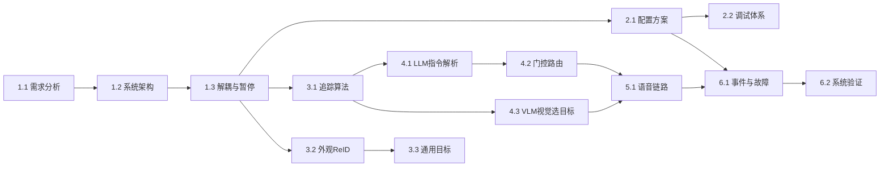

# 机器人大模型综合应用开发（通用目标追踪） 知识图谱

> 课程代码: EXP006b
> 总学时: 48
> 实验数: 9
> 技术栈: YOLOv8 / 多目标追踪DeepTrack(卡尔曼+外观ReID) / 外观重识别ReID / RKNN NPU / 本地大模型RKLLM / LLM FunctionCall / VLM视觉选目标 / 语音唤醒KWS / 流式ASR / 本地TTS / 门控路由fail-closed / MJPEG推流
> 硬件平台: 具身智能实验箱B2 / 具身智能机器人小车C1（RK3576 + STM32F407, Ubuntu 22.04 + ROS2, Python 3.10, 6TOPS NPU）
> 生成日期: 2026-09-07

---

## 第1章 项目需求与系统架构

> 对应实验 exp01（4h，验证性）— 通用目标追踪--项目需求分析；exp02（4h，设计性）— 通用目标检测与追踪底座--系统架构设计

### 1.1 需求分析

#### 知识点 1.1.1
- **类型**: 概念
- **描述**: R1-R13 十三条功能需求覆盖输入/检测/追踪/ReID/LLM指令/VLM选车/清除/语音/日志
- **难度**: 记忆
- **前置依赖**: 无

#### 知识点 1.1.2
- **类型**: 流程
- **描述**: 检测→追踪ID→LLM指令锁定→描述选车→清除→事件日志完整流程状态迁移
- **难度**: 理解
- **前置依赖**: 1.1.1

#### 知识点 1.1.3
- **类型**: 概念
- **描述**: 多源输入统一(视频/静态图/摄像头ROS话题)config或CLI切换业务代码零改动
- **难度**: 记忆
- **前置依赖**: 无

### 1.2 系统架构

#### 知识点 1.2.1
- **类型**: 概念
- **描述**: 分层架构：apps/common/tracking/tools/speech/llm/vision/config，依赖严格单向
- **难度**: 记忆
- **前置依赖**: 1.1.1

#### 知识点 1.2.2
- **类型**: 概念
- **描述**: 视觉流水线：YOLO检测→ReID→DeepTrack→确认框→按follow绘制→MJPEG
- **难度**: 理解
- **前置依赖**: 1.2.1

#### 知识点 1.2.3
- **类型**: 流程
- **描述**: 独立线程 CommandWorker 异步消费 LLM 指令，submit_effect 入队回填主循环不卡帧
- **难度**: 理解
- **前置依赖**: 1.1.2

### 1.3 解耦与暂停语义

#### 知识点 1.3.1
- **类型**: 原理
- **描述**: pending 暂停等待 + pause_timeout 看门狗，指令处理期间冻结画面防 LLM 挂死
- **难度**: 理解
- **前置依赖**: 1.2.3

#### 知识点 1.3.2
- **类型**: 概念
- **描述**: ID 锁定 TrackSession.follow_ids，有跟随仅绘制锁定 ID
- **难度**: 记忆
- **前置依赖**: 1.2.2

#### 知识点 1.3.3
- **类型**: 原理
- **描述**: _native_gate 门控路由顺序：清除→闲聊→id→描述VLM→save/clear，fail-closed
- **难度**: 理解
- **前置依赖**: 1.2.3

---

## 第2章 配置与调试体系

> 对应实验 exp03（4h，设计性）— 追踪配置与接口设计

### 2.1 配置方案

#### 知识点 2.1.1
- **类型**: 概念
- **描述**: track_config.yaml 全键：llm/vlm/detect/tracker/tracking/source/session/interaction/speech/server
- **难度**: 记忆
- **前置依赖**: 1.2.1

#### 知识点 2.1.2
- **类型**: 原理
- **描述**: config_schema 强制 REQUIRED 键校验与类型检查，拦截键名拼写错误
- **难度**: 理解
- **前置依赖**: 2.1.1

#### 知识点 2.1.3
- **类型**: 流程
- **描述**: CLI 传参与配置覆盖规则：命令行参数 > yaml 文件，_merge_args 应用
- **难度**: 应用
- **前置依赖**: 2.1.1

### 2.2 调试体系

#### 知识点 2.2.1
- **类型**: 概念
- **描述**: 文本→语音→摄像头三级开发模式递进验证，--text 与音频同一状态机
- **难度**: 记忆
- **前置依赖**: 1.1.3

#### 知识点 2.2.2
- **类型**: 事实
- **描述**: 纯逻辑 pytest(x86 可跑)验证 tools/门控/VLM 虚测/pipeline，无 RKNN/ROS 依赖
- **难度**: 记忆
- **前置依赖**: 2.1.1

#### 知识点 2.2.3
- **类型**: 原理
- **描述**: ReID 失败降级纯 IoU、TTS 失败降级文本输出，组件级容错不崩主循环
- **难度**: 理解
- **前置依赖**: 1.2.2

---

## 第3章 多目标追踪底座

> 对应实验 exp04（8h，综合性）— 多目标追踪底座集成测试

### 3.1 追踪算法

#### 知识点 3.1.1
- **类型**: 原理
- **描述**: DeepSORT结构：卡尔曼预测+IoU/外观级联关联+确认框，稳定 track id
- **难度**: 理解
- **前置依赖**: 1.2.2

#### 知识点 3.1.2
- **类型**: 原理
- **描述**: 卡尔曼常速模型(8维均值+4维协方差)按框高缩放噪声，CHI2INV95 门控
- **难度**: 理解
- **前置依赖**: 3.1.1

#### 知识点 3.1.3
- **类型**: 原理
- **描述**: min_box_w/h=32 小框剔除 + max_stale=15 超龄剔除，真消失不猜位置
- **难度**: 理解
- **前置依赖**: 3.1.1

### 3.2 外观重识别 ReID

#### 知识点 3.2.1
- **类型**: 原理
- **描述**: deepsort.rknn 提取外观特征(64x128 ImageNet 归一化)消除单帧漏检换 ID
- **难度**: 理解
- **前置依赖**: 3.1.1

#### 知识点 3.2.2
- **类型**: 流程
- **描述**: ReIDPool 多线程异步特征池，extract 超时坑哨兵多维向量不挂死
- **难度**: 应用
- **前置依赖**: 3.2.1

#### 知识点 3.2.3
- **类型**: 原理
- **描述**: min_confidence=0.3 实机 tuning 过滤低置信噪声，是 ID 稳定的根因之一
- **难度**: 理解
- **前置依赖**: 3.1.1

### 3.3 通用目标

#### 知识点 3.3.1
- **类型**: 事实
- **描述**: class_filter=[car] 只跟踪车；COCO 80 类通用，class_filter 可任意指定类别
- **难度**: 记忆
- **前置依赖**: 1.1.1

#### 知识点 3.3.2
- **类型**: 流程
- **描述**: track_demo --list 打印当前跟踪目标，--text stdin 直连验证 ID 底座
- **难度**: 应用
- **前置依赖**: 3.2.3

#### 知识点 3.3.3
- **类型**: 原理
- **描述**: 遮挡丢失后同 ID 恢复验证 ReID 外观识别；unlock_on_loss 全丢恢复全显示
- **难度**: 理解
- **前置依赖**: 3.2.1

---

## 第4章 LLM指令与门控

> 实验 exp05(4h)：LLM 指令与门控集成测试；exp06(4h):VLM 描述选目标集成测试

### 4.1 LLM 指令解析

#### 知识点 4.1.1
- **类型**: 原理
- **描述**: LLM Function Call 工具调用：(track_ids/clear_track) 秒级推理独立线程不卡帧
- **难度**: 理解
- **前置依赖**: 1.2.3

#### 知识点 4.1.2
- **类型**: 概念
- **描述**: 原生 rkllm 原生 FunctionCall `native_parser`；结构化 JSON dispatch 双路径统一落地
- **难度**: 记忆
- **前置依赖**: 4.1.1

#### 知识点 4.1.3
- **类型**: 流程
- **描述**: rules 兜底 parse_instruction 正则提取指令(无需 LLM)：id/颜色/清除，never 空 id 清锁
- **难度**: 应用
- **前置依赖**: 4.1.1

### 4.2 门控路由

#### 知识点 4.2.1
- **类型**: 原理
- **描述**: _native_gate 门控顺序：清除词短路/非指令回落对话/无 id 描述走 VLM，短路链
- **难度**: 理解
- **前置依赖**: 1.3.3

#### 知识点 4.2.2
- **类型**: 概念
- **描述**: clear_words(清除/解除/取消/停/不追/恢复全/不跟) 触发 clear_track 强制解除
- **难度**: 记忆
- **前置依赖**: 4.2.1

#### 知识点 4.2.3
- **类型**: 原理
- **描述**: ID 数值不对齐判断，回「未找到该 ID 目标」不 VLM，绝不幻觉锁错车
- **难度**: 理解
- **前置依赖**: 4.2.1

### 4.3 VLM 视觉选目标

#### 知识点 4.3.1
- **类型**: 原理
- **描述**: VLM 网格构图，crops→标准化 grid→VLM 返回编号→映射绝对 track id 锁定
- **难度**: 理解
- **前置依赖**: 4.1.1

#### 知识点 4.3.2
- **类型**: 原理
- **描述**: VLM fail-closed 铁律：不确定(99/0/无匹配)→回引导绝不锁错目标，绝不 submit 空
- **难度**: 理解
- **前置依赖**: 4.3.1

#### 知识点 4.3.3
- **类型**: 事实
- **描述**: vlm.fake_result_id 固定返回绝对 id(fake)调试；grid.cell_cap=16 候选上限超则不锁
- **难度**: 记忆
- **前置依赖**: 4.3.1

---

## 第5章 语音交互

> 实验 exp07（6h，综合性）— 语音交互集成测试

### 5.1 语音链路

#### 知识点 5.1.1
- **类型**: 概念
- **描述**: 唤醒词(软件 KWS / XFM 六麦 aiui 串口 )唤醒→录音线程启动，LasALSA plughw:4,0
- **难度**: 记忆
- **前置依赖**: 无

#### 知识点 5.1.2
- **类型**: 概念
- **描述**: 流式ASR(zipformer_onnx)增量解码+端点检测生成 partial → ASR 结果
- **难度**: 记忆
- **前置依赖**: 5.1.1

#### 知识点 5.1.3
- **类型**: 流程
- **描述**: 流式TTS 按句合成播（切句）/ 播报互斥 playback_event、打断丢弃 epoch+1
- **难度**: 应用
- **前置依赖**: 5.1.2

---

## 第6章 事件日志与故障降级

> exp08(6h)：事件日志与故障降级集成测试；exp09(8h):通用目标追踪全功能验证

### 6.1 事件日志与故障降级

#### 知识点 6.1.1
- **类型**: 概念
- **描述**: events.jsonl 追加记录指令: lost/unlock_all/命令/camera_stall/pause_timeout，事后追责
- **难度**: 记忆
- **前置依赖**: 无

#### 知识点 6.1.2
- **类型**: 原理
- **描述**: fail-closed 降级原则：任何「不确定锁谁」分支不产副作用（submit_effect）
- **难度**: 理解
- **前置依赖**: 4.3.2

#### 知识点 6.1.3
- **类型**: 流程
- **描述**: 故障注入：断网 ReID / 相机断流 / aplay 被杀 / 无 VLM，降级不崩线程
- **难度**: 应用
- **前置依赖**: 6.1.2

### 6.2 系统验证

#### 知识点 6.2.1
- **类型**: 流程
- **描述**: 三模式入口 --video/--image/--camera，文本→语音→摄像头三级验证
- **难度**: 应用
- **前置依赖**: 1.1.3

#### 知识点 6.2.2
- **类型**: 概念
- **描述**: 实时摄像头需 ROS 相机节点提供三维话题，MJPEG :8088/track.mjpg 远程预览
- **难度**: 记忆
- **前置依赖**: 1.2.2

#### 知识点 6.2.3
- **类型**: 流程
- **描述**: 全链路故障排查 + 事件日志/标注帧完整性 + pkill 清理残留进程
- **难度**: 应用
- **前置依赖**: 6.1.1

---

## 知识点统计

| 维度 | 数量 |
|------|------|
| 章数 | 6 |
| 节数 | 14 |
| 总知识点数 | 42 |
| **类型分布** | |
| 概念类 | 13 |
| 原理类 | 16 |
| 流程类 | 10 |
| 事实类 | 3 |
| **难度分布** | |
| 记忆 | 15 |
| 理解 | 19 |
| 应用 | 8 |
| 分析 | 0 |

---

## 知识点依赖关系图（Mermaid）

---

## 更新日志

| 版本 | 日期 | 说明 |
|------|------|------|
| v1.0 | 2026-09-07 | 初始版本，基于 EXP006b 课程规格文件生成 42 个知识点 |