# 机器人大模型综合应用开发（通用目标追踪） 实验指导书（合并版）

> 课程代码: EXP006b
> 总学时: 48
> 实验数: 9
> 适用对象: 人工智能/机器人工程/智能科学与技术 本科高年级
> 制定日期: 2026-09-07
> 模式: human_waiver（源码位于 ROS2 工作空间 src/，未复制到 source-codes/EXP006b/）

---

## 目录

1. [实验1：通用目标追踪--项目需求分析](#实验1通用目标追踪--项目需求分析4h)
2. [实验2：通用目标检测与追踪底座--系统架构设计](#实验2通用目标检测与追踪底座--系统架构设计4h)
3. [实验3：追踪配置与接口设计](#实验3追踪配置与接口设计4h)
4. [实验4：多目标追踪底座集成测试](#实验4多目标追踪底座集成测试8h)
5. [实验5：LLM指令与门控集成测试](#实验5llm指令与门控集成测试4h)
6. [实验6：VLM描述选目标集成测试](#实验6vlm描述选目标集成测试4h)
7. [实验7：语音交互集成测试](#实验7语音交互集成测试6h)
8. [实验8：事件日志与故障降级集成测试](#实验8事件日志与故障降级集成测试6h)
9. [实验9：通用目标追踪全功能验证](#实验9通用目标追踪全功能验证8h)

---

## 实验总览

| 编号 | 名称 | 学时 | 类型 | 难度 | 源码路径 |
|------|------|------|------|------|----------|
| exp01 | 通用目标追踪--项目需求分析 | 4h | 验证性 | ⭐ | `ros2_ws/src/xflz_eai_car1/app/object_tracking/` |
| exp02 | 通用目标检测与追踪底座--系统架构设计 | 4h | 设计性 | ⭐⭐ | `ros2_ws/src/xflz_eai_car1/app/object_tracking/` |
| exp03 | 追踪配置与接口设计 | 4h | 设计性 | ⭐⭐ | `ros2_ws/src/xflz_eai_car1/app/object_tracking/` |
| exp04 | 多目标追踪底座集成测试 | 8h | 综合性 | ⭐⭐⭐ | `ros2_ws/src/xflz_eai_car1/app/object_tracking/` |
| exp05 | LLM指令与门控集成测试 | 4h | 综合性 | ⭐⭐⭐ | `ros2_ws/src/xflz_eai_car1/app/object_tracking/` |
| exp06 | VLM描述选目标集成测试 | 4h | 综合性 | ⭐⭐⭐ | `ros2_ws/src/xflz_eai_car1/app/object_tracking/` |
| exp07 | 语音交互集成测试 | 6h | 综合性 | ⭐⭐⭐ | `ros2_ws/src/xflz_eai_car1/app/object_tracking/` |
| exp08 | 事件日志与故障降级集成测试 | 6h | 综合性 | ⭐⭐⭐ | `ros2_ws/src/xflz_eai_car1/app/object_tracking/` |
| exp09 | 通用目标追踪全功能验证 | 8h | 综合性 | ⭐⭐⭐ | `ros2_ws/src/xflz_eai_car1/app/object_tracking/` |

**学时合计**: 4+4+4+8+4+4+6+6+8 = **48h**

**类型分布**: 验证性 1 个 + 设计性 2 个 + 综合性 6 个

**难度分布**: ⭐ 1 个 + ⭐⭐ 2 个 + ⭐⭐⭐ 6 个

---

## 跨实验知识脉络

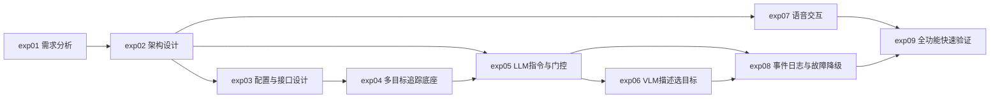
---
# 实验1：通用目标追踪--项目需求分析（4h）


### 1.1 关联知识点

- 1.1.1 R1-R13 功能需求体系（前置：无；项目所有后续实验的基础）
- 1.1.2 检测→追踪ID→LLM指令锁定→描述选车→清除→事件日志全流程（前置：1.1.1，需先理解 R1-R13 需求条款）
- 1.1.3 多源输入统一（视频/静态图/摄像头ROS话题）（前置：无，理解输入层约束）

### 1.2 实验目标

1. **理解**通用目标追踪项目 R1-R13 全部功能需求，能逐条复述每个需求的约束要点（输入源类型、检测算法、追踪方法、LLM 指令、VLM 选车、清除语义、语音、日志等）。
2. **掌握**检测→追踪 ID→LLM 指令锁定→描述选车→清除→事件日志的完整状态流转时序，能独立绘制包含输入、检测、追踪、指令、VLM 选车、清除、日志全节点的流程图。
3. **理解**门控防呆与 fail-closed 断言逻辑（清除语义强制 clear_track、ID 数值不对齐回引导、VLM 不确定不锁车）的设计原理与触发条件。
4. **独立完成**一份结构化需求阅读笔记，能标注文档真实行号引用，梳理"需求编号→实现模块→关键约束"的三层映射。
5. **迁移**：把"需求总览→流程梳理→门控安全"的需求分析方法迁移到其他具身智能/大模型综合项目场景。

### 1.3 实验环境

| 类别 | 内容 |
|------|------|
| 硬件 | 具身智能实验箱B2 / 具身智能机器人小车C1（本实验仅阅读文档，无需上电） |
| OS | Ubuntu 22.04 + ROS 2 Humble |
| Python | 3.10（本实验仅需阅读，不执行 Python） |
| 文档对象 | `ros2_ws/src/xflz_eai_car1/app/object_tracking/docs/01_需求总览.md`、`docs/05_流程与安全.md`、`README.md` |
| 辅助工具 | 文本编辑器或笔记软件（用于撰写需求阅读笔记和流程图） |

### 1.4 实验难度

- 难度: ⭐（验证性）
- 重点：R1-R13 需求条款的逐条梳理与要点归纳；检测→追踪→指令→选车→清除→日志全流程时序理解；门控防呆与 fail-closed 三层语义。
- 难点：R3 多目标追踪与 R5 LLM 指令的接口关系（追踪底座为 LLM 指令提供 ID 语义）；R7/R8 描述选车与 fail-closed 关系（绝不锁错目标）；R9 清除语义的强制优先级。

### 1.5 实验现象

**快速验证流程**（纯文档类实验，以下为快速阅读清单）：

```bash
# 在 object_tracking 包目录下
cd ~/ros2_ws/src/xflz_eai_car1/app/object_tracking

ls docs/
grep -n "R[0-9]" docs/01_需求总览.md          # 快速定位 R1-R13 各条款行号
grep -n "门控\|fail-closed\|清除\|防呆" docs/05_流程与安全.md  # 定位门控防呆章节
head -60 README.md                             # 架构速览与关键决策
```

**预期效果描述**：

- 能列出 R1-R13 每一条的一句话要点，并能说出"哪几条属于输入/检测、哪几条属于追踪/ReID、哪几条属于指令/门控、哪几条属于语音/日志、哪几条属于调试/运维"。
- 能画出 `多源输入 → 目标检测 → 追踪ID → LLM指令锁定 → 描述选车(VLM) → 清除 → 事件日志` 的完整时序图，并标注每个状态转换的触发条件与门控 fail-closed 节点。
- 能说出门控防呆至少三个要点（清除词强制 clear_track、非指令回落闲聊、ID 数值不对齐回引导、VLM 无果不锁车）。

```bash
(ros2_venv) iflytek@localhost:~/ros2_ws/src/xflz_eai_car1/app/object_tracking$ cd ~/ros2_ws/src/xflz_eai_car1/app/object_tracking
(ros2_venv) iflytek@localhost:~/ros2_ws/src/xflz_eai_car1/app/object_tracking$ ls docs/
01_需求总览.md  03_开发模式与验证.md  05_流程与安全.md  07_语音测试用例.md  09_事件与故障测试用例.md
02_架构设计.md  04_配置方案.md        06_环境依赖.md    08_视觉测试用例.md  10_程序参数详解.md
(ros2_venv) iflytek@localhost:~/ros2_ws/src/xflz_eai_car1/app/object_tracking$ grep -n "R[0-9]" docs/01_需求总览.md
3:object_tracking（场景1）综合案例功能需求（R1–R12）。对应实现位置见表末，
11:| R1 | 多源输入统一 | 本地视频 / 静态图片 / 实时摄像头（ROS 话题）三种输入源，config 或 CLI 切换，业务代码零改动 | `common/source.py` + `apps/track_app.py --video/--image/--camera` |
12:| R2 | 目标检测 | YOLOv8n（RKNN NPU 推理），COCO 80 类，`class_filter=[car]` 只跟踪车 | `vision/yolo/detector.py`（复用 elderly） |
13:| R3 | 多目标追踪 | DeepSORT 结构（卡尔曼预测 + IoU/外观关联 + 确认框），生成并维护稳定 track id | `tracking/tracker.py` + `tracking/kalman.py` |
14:| R4 | 外观重识别（ReID） | `use_reid=true` 时 deepsort.rknn 提取外观特征，消除单帧漏检换 ID（级联外观代价不再全 1e5） | `tracking/pipeline.py` + `tracking/reid.py` + `tracking/reidpool.py` |
15:| R5 | LLM FunctionCall | 自然语言指令 → LLM 输出结构化 JSON 工具调用 → 执行（追踪/清除/截图）；秒级推理在独立线程，不卡帧 | `apps/track_app.py`（CommandWorker）+ `tools/tool_dispatch.py` |
16:| R6 | 原生 FunctionCall | 预留/可选 rkllm 原生 function tools（`<tool_call>` 自标签）路径，`llm.function_call.native` 切换 | `tools/native_client.py` + `tools/native_parser.py` |
.....剩下略
```

### 1.6 实验步骤

#### 整体流程图

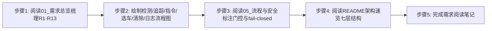

#### 步骤1：通读需求总览，梳理 R1-R13（90min）

**知识点讲解**：

**1.1.1 R1-R13 功能需求体系**

- **原理**：需求体系回答"系统要做什么、边界是什么"。

  R1-R3 定义输入层（多源统一、目标检测、多目标追踪），R4 定义外观重识别（ReID），R5-R6 定义 LLM 指令解析（结构化 JSON 工具调用 + 原生 FunctionCall 双路径），R7-R8 定义描述选车（VLM 视觉 + fail-closed 铁律），R9 定义清除语义，R10 定义门口词路由，R11 定义流式 TTS 播报，R12 定义事件日志，R13 定义调试运维（文本模式、MJPEG）。

  梳理时建议按"输入→检测→追踪→指令→选车→清除→日志→调试"八个维度分组，逐条标注"可量化约束"（如 class_filter=[car]、min_box_w/h=32、max_stale=15、min_confidence=0.3、pause_timeout=30.0、cell_cap=16）。R13 的文本调试模式特别重要——`--text` 与音频模式走同一状态机，是后续所有实验的基础调试路径。

- **源码对应**：`docs/01_需求总览.md L1-L25（需求清单表格 R1-R13）与 L28（非目标范围边界）`

```markdown
### R1. 多源输入统一
- 本地视频 / 静态图片 / 实时摄像头（ROS 话题）三种输入源，config 或 CLI 切换，业务代码零改动
### R3. 多目标追踪
- DeepSORT 结构（卡尔曼预测 + IoU/外观关联 + 确认框），生成并维护稳定 track id
### R5. LLM FunctionCall
- 自然语言指令 → LLM 输出结构化 JSON 工具调用（track_ids/clear_track），秒级推理在独立线程不卡帧
### R9. 清除语义
- 清除/解除/取消/停/不追/恢复全/不跟 → 强制解除全部锁定（0.8B 对"清除"误吐 track_ids 时也强制 clear_track，不解错）
```

**知识储备补充**：

- **需求体系设计动机**：R1-R13 把"感知→决策→执行→运维"闭环拆成独立编号（R1-R4 输入/检测/追踪/ReID 底座，R5-R9 指令/选车/清除/路由，R10-R13 语音/日志/调试），使每条需求都可被测试与断言；"可量化约束"（class_filter、min_box、max_stale、pause_timeout、cell_cap）正是把需求翻译成代码参数的关键。

- **检测进入追踪的量化判定**：一个检测候选框能否进入追踪由置信度与尺寸约束同时决定：

  $$
  \text{keep}(b) = \mathbb{1}\,[\, c_b \ge \theta_c \;\wedge\; w_b \ge \theta_w \;\wedge\; h_b \ge \theta_h \,]
  $$

  其中 $b$ 为检测框，$c_b$ 为其置信度，$w_b$、$h_b$ 为框宽、高，$\theta_c = \min\_confidence = 0.3$、$\theta_w = \theta_h = \min\_box\_w/h = 32$（min_box_w、min_box_h 两阈同值 32）。数值示例：$c_b = 0.25 < 0.3$ → 不满足 → 该框不进入追踪；$w_b = 48 \ge 32$ 且 $c_b = 0.9$ → 满足。该约束对应 `tracking/tracker.py` 的 confirmed/filter 阶段（过滤 `min_confidence`、`min_box_w`、`min_box_h`）。

- **fail-closed 门控语义（R8/R9）**：图像场景"不确定锁谁"的分支全部回引导而不动作——VLM 无返回值/返回 99、ID 数值不对齐、工具解析失败均属此列（docs/05_流程与安全.md L23-L33）；R9 清除语义由 clear_words 词表驱动，命中即强制 clear_track，忽略模型 tool 输出（0.8B 误吐 track_id 也强制解除），这是"宁可不清、不可错清"的对称设计。

- **参考资源**：`docs/01_需求总览.md`（R1-R13 清单）、`docs/05_流程与安全.md`（门控防呆表与 fail-closed 小节）、`README.md`（架构速览）；目标检测基础见 Ultralytics YOLOv8 文档；多目标追踪关联原理见 SORT 论文（arXiv:1602.00763）与 DeepSORT 论文（arXiv:1703.07402）。

**易错点**：

- ⚠️ 误以为追踪 ID 由 LLM 生成 → **解决**：追踪 ID 由 DeepTrack（R3, 追踪底座）实时生成维护，LLM 只负责理解"哪辆车"并把 id 传回；LLM 不产生也不分配 ID。
- ⚠️ 认为 fail-closed 只在 VLM 失效时触发 → **解决**：fail-closed 覆盖所有"不确定锁谁"的分支：非空 ID 数值不对齐、VLM 无果/返回 99、工具解析失败，都只回引导不动作。

#### 步骤2：绘制检测/追踪ID/指令锁定/描述选车/清除/事件日志完整流程图（约90min）

**操作步骤**：

1. 用流程图工具绘制完整时序：多源输入 →（R2-R3）检测 → 追踪 ID →（R5）LLM 指令锁定 →（R7）描述选车（VLM）→（R9）清除 →（R12）事件日志。
2. 检测→追踪流：YOLO 检测（class_filter=[car]）→ 卡尔曼预测 → IoU/外观级联关联 → 确认框 → follow 绘制。
3. 指令流：LLM 独立线程 → track_ids/clear_track → submit_effect 入队 → 主循环 apply。
4. 清除必须打通 R9：`clear_words` 命中强制 clear_track，忽略模型 tool 输出。
5. 事件日志必须打通 R12：lost/unlock_all/command/camera_stall/pause_timeout 落 events.jsonl。

**易错点**：

- ⚠️ 流程图漏掉触发 LLM 前的"存在性校验"ID → **解决**：追踪 ID 存在性校验在 CommandWorker._native_gate，ID 数值不对齐直接回「未找到该 ID 目标」，绝不 VLM 猜车。

**知识储备补充**（1.1.2 全流程视角）：

- **流程即函数复合**：完整追踪链路可看作对输入帧 $I$ 的一串有向变换，整体效果是函数复合：

  $$
  E = \mathrm{Log} \circ \mathrm{Clear} \circ \mathrm{Lock}_{LLM} \circ \mathrm{Track} \circ \mathrm{Detect}(I)
  $$

  其中 $\mathrm{Detect}$ 为检测、$\mathrm{Track}$ 为追踪（生成/维护 ID）、$\mathrm{Lock}_{LLM}$ 为 LLM 指令锁定、$\mathrm{Clear}$ 为清除语义（R9）、$\mathrm{Log}$ 为事件落盘（R12）。数值示例：输入帧 $I$ 经 $\mathrm{Detect}$ 检出车框，$\mathrm{Track}$ 分配 $id=5$，指令「追踪 id 5 的车」经 $\mathrm{Lock}_{LLM}$ 锁定 $follow=\{5\}$，VLM 描述确认后 $\mathrm{Clear}$（说「停」）解除，$\mathrm{Log}$ 追加 `command` 事件到 events.jsonl。

- **门控与 fail-closed 节点**：链路上每个"不确定锁谁"的节点都是分流点——存在性校验失败回引导、VLM 无返回值/返回 99/无匹配回引导，绝不让不确定的 ID 进入 $\mathrm{Lock}$。绘制时应把门控画成条件菱形而不只是直连箭头。

- **参考资源**：本实验 `docs/05_流程与安全.md`（追踪时序 L1-L21、门控防呆表 L23-L33）；DeepSORT 论文 arXiv:1703.07402（track ID 维护原理）；Mermaid sequenceDiagram 官方文档（绘制时序图语法）。

**参考模板**（完整流程图，可对照绘制；追踪/门控只画到事件日志的纵向主线，fail-closed 分支用虚线退出）：

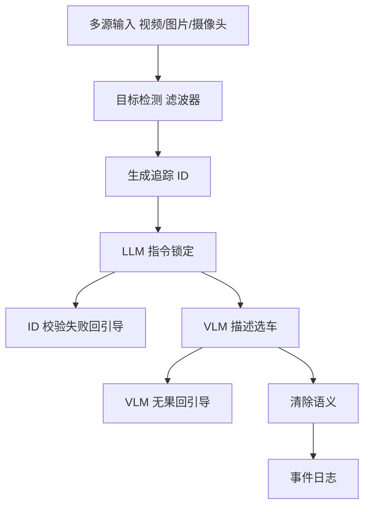

#### 步骤3：阅读流程与安全文档，标注门控防呆与 fail-closed（约60min）

**操作步骤**：

1. 在 `docs/05_流程与安全.md` 中"门控防呆（fail-closed 层级）"小节逐条阅读并在笔记标注（L1-L21 追踪时序、L23-L33 门控防呆表、L35-L42 并发锁、L44-L50 异常/安全）。
2. 标注五个防呆点：闲聊防误触工具、非空清除强制、ID 数值不对齐不 VLM、VLM 不可用/99/无匹配回引导、指令队列满丢弃不阻塞。
3. 用时序图表示 clear_words 短路后续分支（模型误吐 track_ids 时仍强制 clear_track）。

**参考模板**（clear_words 短路时序，可对照绘制）：

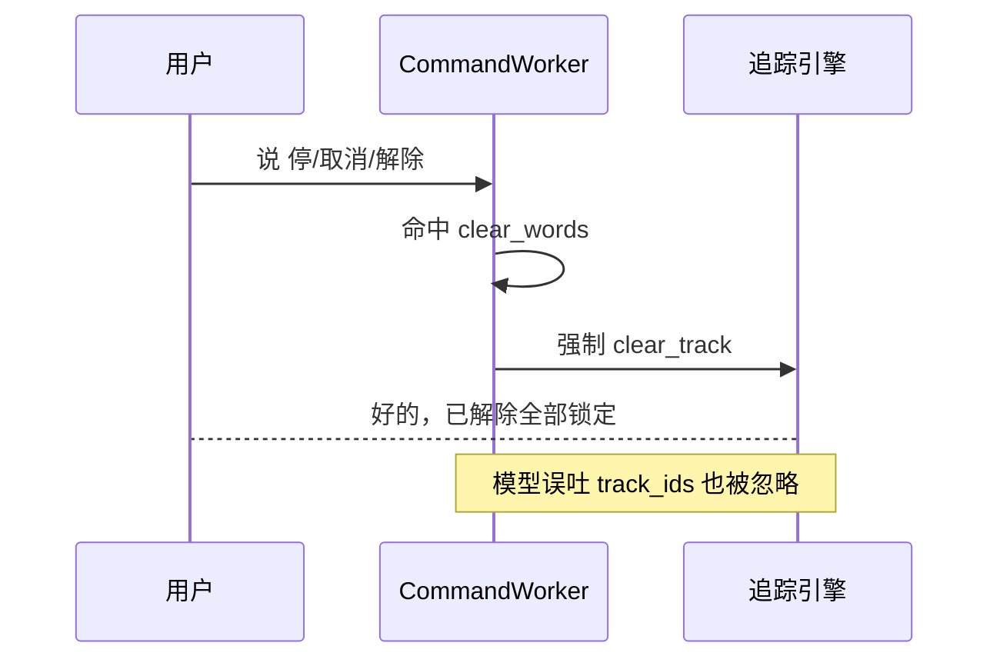

**知识储备补充**（1.1.3 clear_words 短路与全流程门控）：

- **清除短路优先级**：R9/R10 把清除做成**词表短路**——命中 `interaction.clear_words` 即强制 `clear_track` 并忽略模型 tool 输出（0.8B 误吐 track_ids 也强制解除），因此优先级高于 LLM 输出、高于存在性校验，是"不解错"的最强防线。

- **事件日志五类**：R12 把丢目标（lost）、解锁（unlock_all）、指令（command）、摄像头故障（camera_stall）、暂停超时（pause_timeout）五类事件统一追加到 events.jsonl，供回放与调参分析。

- **参考资源**：`docs/05_流程与安全.md`（门控防呆表 L23-L33）；Mermaid sequenceDiagram 官方文档。

**易错点**：

- ⚠️ 混淆"清除"（clear_track）与"解除 VLM 错误锁定" → **解决**：清除是用户显式语义（R9/R10 词表），VLM 错误锁定的回退是 fail-closed 自动回滚（R8），两种路径触发源不同。

#### 步骤4：阅读 README 架构速览，理解七层结构与关键决策（约30min）

**操作步骤**：

1. 通读 `README.md` 的架构速览（ASCII 图/数据流）与常用命令部分。
2. 记录七层模块：apps（入口）/common（输入源/配置）/tracking（自研核心）/tools（工具注册表/门控）/speech（复用 elderly）/llm（复用 elderly）/config。
3. 特别关注依赖方向严格单向：`common ← vision/tracking ← tools ← apps`、`speech/llm 独立`。

**易错点**：

- ⚠️ 把 speech/llm 当作 tracking 的子模块 → **解决**：speech/llm 复用 elderly 的独立模块，接口对接点在 apps 装配层（`track_app`），tracking 不依赖它们。

**知识储备补充**（七层结构与依赖方向）：

- **依赖方向定义**：依赖方向"单向"指**谁可以 import 谁**——底层模块（tracking 追踪核心）不 import 上层（tools 工具注册表），上层 tools/apps 依赖下层；speech/llm 复用 elderly 独立包，通过 apps 装配层（`track_app.build_engines`）对接。这样修改追踪算法不影响工具注册表，改 LLM 客户端不影响追踪引擎。

- **开发/生产配置分离**：config 中 `train.*` 与 `rknn.*` 为 PC 侧重（训练/转换用），板端运行只消费 `infer/source/server` 等段——配置按运行环境切分，减少上板误配。

- **参考资源**：`README.md`（架构速览、模块映射）；领域分层架构参考《Clean Architecture》（R. Martin），依赖方向是其核心。

#### 步骤5：完成需求阅读笔记（约30min）

**操作步骤**：

1. 汇总前四步产出，按"输入/检测/追踪/指令/选车/清除/语音/日志/调试"九节撰写。
2. 每节附文档行号引用与关键约束摘录。
3. 自检：能否不看文档说清 R1-R13 要点；能否画出完整流程图；能否说清门控防呆与 fail-closed 至少三个防呆节点的触发条件。

**易错点**：

- ⚠️ 笔记只抄条款不做归纳 → **解决**：每条需求必须提炼"可量化约束"（class_filter、min_box、max_stale、pause_timeout、cell_cap）和"门控含义"。

### 1.7 注意事项

- ⚠️ 本实验为**纯文档阅读，无硬件操作**，不需要给底盘/STM32 上电，不需要启动 ROS 节点。
- ⚠️ 文档路径 `ros2_ws/src/xflz_eai_car1/app/object_tracking/` 为板端实机路径，若在工程机外阅读需注意路径映射。
- ⚠️ R9 清除语义用词表（clear_words）实现强制，调实时无需改代码，只改 `interaction.clear_words`。
- ⚠️ fail-closed 门控是安全核心，任何"不确定锁谁"的描述都应回引导而不是猜，实验 5/6 会重点验证。

### 1.8 实验总结

**完成成果**: 一份 R1-R13 需求梳理表（含量化约束、实现模块、门控语义）；检测→追踪→追踪→清除→日志完整流程图；门控防呆与 fail-closed 要点笔记；"需求→模块→关键约束"三层映射表。

**技能收获**:

- 技能1：需求文档结构化梳理方法（分组→量化约束→实现映射）
- 技能2：多目标追踪/LLM 指令全流程时序图绘制（显式标注 fail-closed 节点）
- 技能3：大模型对话系统中的门控安全策略分析（fail-closed 与语义路由）

**常见问题与解决**:

| 问题 | 原因 | 解决方法 |
|------|------|----------|
| 把 LLM 当 ID 分配者 | L3 是 DeepTrack 生成的 | 追踪 ID 来自 Kalman+ReID 追踪器，LLM 只转发/解析 |
| R5 vs R6 混淆 | 两条 LLM 指令路径 | R5 是结构化 JSON（tool_dispatch）；R6 是 rkllm 原生 FunctionCall（native_client），双路径 |
| 清除语义误解 | R9 是词表驱动 | clear_words 命中强制 clear_track，ignore 模型 tool 输出，这是不解错的核心 |

### 1.9 实验报告要求

**思考题**:

1. R3 多目标追踪为 R5 LLM 指令提供什么核心数据？为什么 LLM 不能自己分配追踪 ID？
2. 门控中"清除语义强制 clear_track"（R9）与"ID 数值不对齐回引导"（R8 fail-closed）解决哪两类不同故障？如果省去它们，可能锁错什么？
3. R1 多源输入（视频/图/摄像头）与 R13 文本调试模式如何共同降低硬件依赖，让纯逻辑可先验证？

**评分标准**:

- 需求梳理表完整准确（35 分）：R1-R13 逐条覆盖、量化约束正确、实现与门控映射准确
- 完整流程图（30 分）：检测/追踪/指令/选车/清除/日志流程正确、fail-closed 节点标注
- 门控与 fail-closed 分析（25 分）：三个防呆节点的触发条件与设计理由清晰
- 笔记规范与行号引用（10 分）：引用真实文档行号，结构完整 = 100 分。

---

## 更新日志

| 版本 | 日期 | 说明 |
|------|------|------|
| v1.0 | 2026-09-07 | 初始版本，基于 EXP006b 源码与文档生成 |
| v2.0 | 2026-09-07 | 知识储备增强 |
---
# 实验2：通用目标检测与追踪底座--系统架构设计（4h）


### 2.1 关联知识点

- 1.2.1 七层模块划分与依赖方向（前置：1.1.1，先理解需求到模块映射）
- 1.2.2 视觉流水线 YOLO→ReID→DeepTrack→确认框（前置：1.2.1）
- 1.2.3 CommandWorker 独立线程不回卡帧（前置：1.1.2，需理解指令与主循环解耦）
- 1.3.1 pending 暂停等待看门狗（前置：1.2.3）
- 1.3.2 ID 锁定 TrackSession.follow_ids（前置：1.2.2）
- 1.3.3 _native_gate 门控路由顺序（前置：1.2.3）

### 2.2 实验目标

1. **理解**七层模块结构（apps/common/tracking/tools/speech/llm/vision/config）与依赖方向严格单向设计。
2. **掌握**视觉流水线（YOLO→ReID→DeepTrack→确认框→按follow绘制→MJPEG）与 TrackEngine 单状态机主循环。
3. **掌握**CommandWorker 独立线程 + submit_effect 入队回填主循环的不卡帧设计，以及 pending 暂停等待 + pause_timeout 看门狗语义。
4. **独立完成**视觉与语音双流水线数据流图，理解 LLM 在下达追踪/清除指令时的路由优先级（_native_gate）与 fail-closed 回退。
5. **迁移**：把"队列驱动单状态机 + 独立推理线程 + 副作用入队"的架构模式迁移到其他机器人实时视觉系统。

### 2.3 实验环境

| 类别 | 内容 |
|------|------|
| 硬件 | 具身智能实验箱B2 / 具身智能机器人小车C1（本实验仅阅读源码，无需上电） |
| OS | Ubuntu 22.04 + ROS 2 Humble |
| Python | 3.10（本实验仅需阅读，不执行 Python） |
| 源码对象 | `apps/track_app.py`、`tracking/engine.py`、`tracking/session.py`、`tools/tool_dispatch.py`、`docs/02_架构设计.md` |
| 辅助工具 | 文本编辑器 + mermaid/绘图工具 |

### 2.4 实验难度

- 难度: ⭐⭐（设计性）
- 重点：七层模块职责划分；视觉流水线与 TrackEngine 单状态机主循环；CommandWorker 不卡框解耦；ID 锁定语义。
- 难点：pending 暂停等待与 LLM 异步消费的解耦；_native_gate 路由优先级（清除短路/非指令回落/VLM 回退）；队列驱动主循环如何保证帧率。

### 2.5 实验现象

**快速验证流程**（纯源码阅读，无硬件）：

```bash
cd ~/ros2_ws/src/xflz_eai_car1/app/object_tracking

# 架构速览与数据流
cat docs/02_架构设计.md

# CommandWorker 线程与门控
grep -n "class CommandWorker\|_native_gate\|submit_effect\|pending\|epoch" apps/track_app.py

# 主循环与命令队列
grep -n "def run\|def submit_effect\|def _drain_commands\|def _compute_draw\|cmds" tracking/engine.py
```

**预期效果描述**：

- 能画出七层模块依赖图，标出 tracking/tools/apps 依赖方向。
- 能画出视觉流水线（YOLO→ReID→DeepTrack→确认框→按 follow 绘制）与语音/指令流水线（唤醒→ASR→LLM→工具执行→submit_effect）。
- 能说出三个关键时序约定：队列驱动主循环；LLM 秒级推理独立线程不卡框；pending 暂停 + pause_timeout 看门狗。

### 2.6 实验步骤

#### 整体流程图

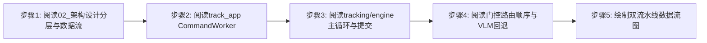

#### 步骤1：阅读架构设计文档，理解分层与依赖方向（约55min）

**知识点讲解**：

**1.2.1 七层模块架构与依赖方向**

- **原理**：模块分层的核心目标是**依赖单向 + 接口解耦**。

  架构图把系统分成七层部件，依赖方向严格单向：`common ← (vision/tracking) ← tools ← apps`，而 `speech/llm 独立`（复用 elderly 模块，通过 apps 装配层对接）。所谓"依赖方向"即"谁可以 import 谁"——底层模块（tracking 追踪核心）不 import 上层（tools 工具注册表），上层 tools/apps 依赖下层。这样修改追踪算法不影响工具注册表，改 LLM 客户端不影响追踪引擎。接口对接点集中在 apps 装配层（`track_app.build_engines` 组装引擎 + 注册工具 + 绑定语音）。`README.md` 给出模块映射：apps（入口）、common（输入源/配置）、tracking（自研核心）、tools（工具注册/门控）、speech/llm（复用 elderly）、config（配置）。

- **源码对应**：`docs/02_架构设计.md L3-L18（分层结构 ASCII 图 + 依赖方向说明）`

**操作步骤**：

1. 阅读 `docs/02_架构设计.md` 的分层结构小节（L3-L18）。
2. 在笔记中绘制七层依赖图，标出"tracking→tools→apps"依赖箭头与"speech/llm 独立"。

**易错点**：

- ⚠️ 把 speech/llm 当 tracking 子模块 → **解决**：speech/llm 是复用 elderly 的独立包，tracking 不 import 它们，接口对接在 apps 装配层。

**知识储备补充**（1.2.1 依赖方向量化）：

- **依赖即边集**：七层模块可看作有向图 $G=(V,E)$，顶点集 $V=\{apps, common, tracking, vision, tools, speech, llm, config\}$，边 $a \to b$ 表示"$a$ 依赖 $b$"。关键边：$tracking \to common$、$tools \to tracking$、$apps \to tools$、$vision \to tracking$、$speech \to apps$、$llm \to apps$。**单向性**要求图中不存在环：若同时有 $x \to y$ 与 $y \to x$，则修改 $x$ 会级联影响 $y$、又反向波及 $x$，失去模块边界。

- **为何 speech/llm 独立**：speech/llm 是复用 elderly 的独立包，tracking 不 import 它们，接口对接点在 apps 装配层（`track_app.build_engines` 组装引擎 + 注册工具 + 绑定语音）。这样替换语音方案（如换 ASR 引擎）不动追踪核心，追踪升级也不影响语音模块。

- **参考资源**：`docs/02_架构设计.md L3-L24`（分层 ASCII 图 + 依赖方向说明）；`README.md`（模块映射）；分层架构经典《Clean Architecture》（R. Martin，依赖方向是其核心）。

**参考模板**（七层依赖图，可对照绘制；箭头指向依赖方，speech/llm 画成独立分支）：

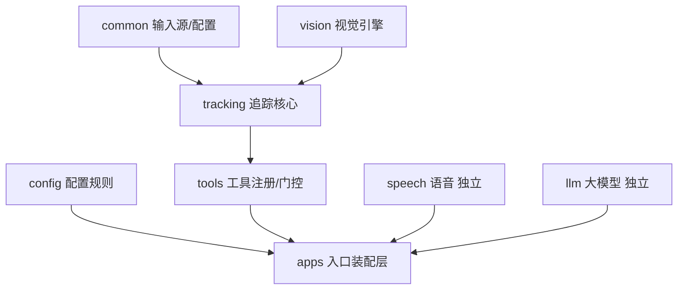

#### 步骤2：阅读 apps/track_app.py 的 CommandWorker，理解 LLM 异步消费（约50min）

**操作步骤**：

1. 阅读 `CommandWorker`（`apps/track_app.py L196-235`）：继承 threading.Thread，从有界队列 `queue.Queue(maxsize=8)` 取命令（L219-226），`push()` 用 put_nowait（L232-236）满丢新命令不阻塞。
2. 理解 `_handle()`（L246-269）：①pending.set()（L247）主循环暂停读帧；②epoch 迟到丢弃（L249-251）；③拼接 scene 上下文（L255-256）；④调 LLM（native 分支 / 非 native ask_stream）→ tool_dispatch/registry → on_reply。

**易错点**：

- ⚠️ 误以为 LLM 在主线程执行 → **解决**：CommandWorker 是独立 daemon 线程，LLM 秒级推理不阻塞主循环读帧；命令经有界队列 + submit_effect 入队回填，请求处理中主循环暂停读帧（pending）。

**知识储备补充**（1.2.3 CommandWorker 异步消费）：

- **为何要独立线程**：LLM 推理是秒级（数百 ms~数 s）的不可控延迟，若串行进主循环，帧率将被 LLM 拉低到 ~1 FPS。独立线程 + 有界队列（`queue.Queue(maxsize=8)`）+ `submit_effect` 入队回填，使 LLM 慢不丢帧、不影响主循环采样节奏。

- **有界队列的背压语义**：有界队列 $Q$ 容量 $N = 8$，`push()` 用 `put_nowait`——满时**丢弃新命令**（而非阻塞生产者）。数值示例：$N=8$ 时队列满，第 9 条命令被丢弃——这是"慢生产者不拖垮消费端"的既有设计（指令偶尔丢可接受，帧率/画面不能卡）。

- **pending 与命令消费解耦**：`engine.pending.set()` 只让主循环暂停**读帧**（`pause_wait=true`），帧停在最后标注帧；`pause_timeout` 看门狗（默认 30.0s）超时强制解暂停，防 LLM 挂死冻结画面。命令消费（`_drain_commands`）不与读帧绑死，故暂停不丢命令。

- **参考资源**：`apps/track_app.py L196-269`（CommandWorker 线程+队列+_handle）；Python `queue.Queue` 官方文档（有界队列/put_nowait）。

#### 步骤3：阅读 tracking/engine.py 的 run 单状态机主循环与 pending 暂停（约230min）

**知识点讲解**：

**1.2.2 视觉流水线与 TrackEngine 单状态机主循环**

- **原理**：TrackEngine.run 是**单状态机主循环**（`tracking/engine.py` L89-93），每轮只读一帧，成功后才进入 pipeline。pipeline.process（`tracking/pipeline.py` L14-16）完成"检测 → ReID特征 → tracker.update → 过滤 confirmed/尺寸/stale"整条视觉链路。Tracker.update（`tracking/tracker.py` L72-75）按 DeepTrack 语义（卡尔曼预测 + IoU/外观级联 + 确认框）维护 track id。主循环后半段：`_drain_commands()`（L52）消费命令队列（bounded，LLM 线程 submit），`_compute_draw()`（L56）按锁定语义算本帧绘制（只画被锁 ID），`_publish`（L63）发布/MJPEG。这样"读帧—检测—追踪—绘制—消费命令"循环是一个有界工作队列驱动的确定性主动循环，帧率稳定。

**源码对应**：`tracking/engine.py L38-54（submit_effect/_apply_effect/命令队）、L56-66（_compute_draw）、L89-98（run 主循环）`；`tracking/session.py L12-25（set_follow/visible_ids/clear）`

**1.3.1 pending 暂停等待 + pause_timeout 看门狗**

- **原理**：指令处理期间，CommandWorker 将 `engine.pending.set()`，主循环下一轮检测 pending 时暂停读帧（`pause_wait=true`），画面停在最后标注帧；LLM 完成/effect 回填后 finally `pending.clear()` 恢复。`pause_timeout` 看门狗防 LLM 挂死冻结画面，超时强制解暂停。

**2 视觉流水线数据流（Core）**

```
FrameSource.read → TrackEngine.run（每帧）
  ├─ YOLO 检测（detector.detect, class_filter=[car] 过滤）
  ├─ [可选 ReID] 裁 crop → reid_pool.extract 提取外观特征（失败降级纯 IoU）
  ├─ pipeline.process → Tracker.update（卡尔曼预测 + 级联关联）
  ├─ 小框/超龄剔除：min_box_w/h 与 max_stale 过滤 → confirmed
  ├─ session.visible_ids 过滤 → 按 follow 绘制 / MjpegServer / VideoWriter / imshow
  └─ 丢失检测：follow 目标消失 → lost 事件 + TTS 播报；全丢 unlock_on_loss 恢复全显示
```

**1.3.2 ID 锁定（TrackSession.follow_ids）**

- **原理**：TrackSession 保存 `follow_ids`（`tracking/session.py` L12-13 set_follow）。某命令锁定后 follow={3}，visible 过滤只绘制该 ID；`_compute_draw`（engine L56-66）按锁定语义算本帧要绘制目标（有 follow 只画锁定，无 follow 按 show_all 全画）。目标消失时触发 lost 事件，unlock_on_loss 全丢后恢复全显示。

**操作步骤**：

1. 阅读 `tracking/engine.py` 主循环（`run`，L87-106）、`submit_effect`/`_apply`（L38-45）、`_drain_command`（L69）、`_compute_draw`（L79-9X）——结合你的 grep 输出记录行号。
2. 阅读 `tracking/session.py`（set_follow/visible_ids）。
3. 阅读 `tracking/pipeline.py` 的 `process()`（L14-54）理解单帧流水线返回值组装。

**易错点**：

- ⚠️ 误以为"暂停"会丢帧 → **解决**：`pause_wait=true` 只暂停**读帧**，不暂停命令消费；frame 停在最后标注帧，配合 `pause_timeout` 看门狗防挂死。这是队驱动主循环的时序纪律。

**知识储备补充**（1.2.2/1.3.1 单状态机与 Kalman 预测）：

- **单状态机主循环**：`TrackEngine.run` 每轮只读一帧，成功后才进入 `pipeline.process`（检测→ReID→tracker.update→过滤）。主循环后半段依次 `_drain_commands()`、`_compute_draw()`（按锁定语义画）、`_publish`（MJPEG/发布）。"读帧—检测—追踪—绘制—消费命令"是有界工作队列驱动的**确定性主动循环**，帧率稳定。

状态机参考流程图

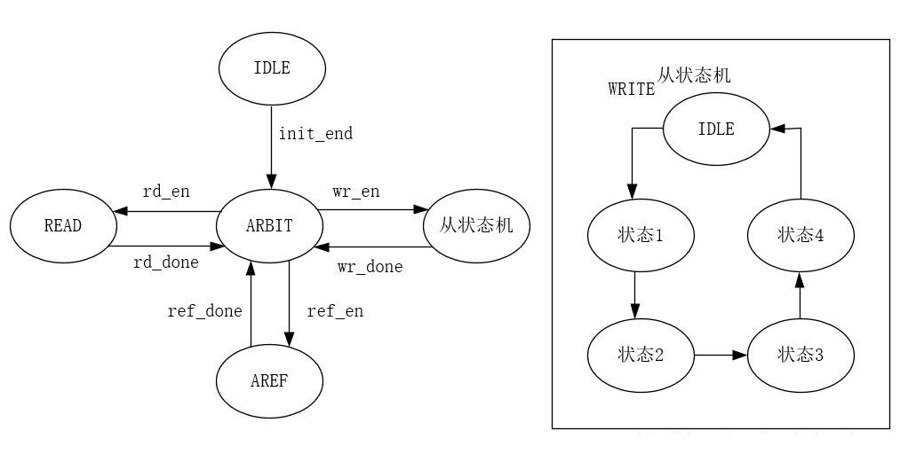

- **卡尔曼预测（时间更新）**：追踪器对每个 track 的状态做匀速运动预测——DeepTrack 采用 8 维状态 $[cx, cy, aspect, height, vx, vy, va, vh]$（`tracking/kalman.py` L29-65），其中 $cx, cy$ 为框中心，$aspect$ 为宽高比，$height$ 为高，$vx, vy, va, vh$ 为对应速度，预测方程为：
  $$
  \hat{x}_{k|k-1} = F_k\,\hat{x}_{k-1|k-1}
  $$

  其中 $\hat{x}_{k|k-1}$ 为第 $k$ 帧先验估计（8×1 向量）、$F_k$ 为状态转移矩阵（匀速模型，把上一帧后验 $\hat{x}_{k-1|k-1}$ 外推一帧）、$k$ 为帧序号。数值示例：若上一帧 $cx=320$、$vx=2$，预测帧 $cx$ 变为 $320+2=322$（同段 `kalman.py`：$F$ 中 $cx$ 行 = $[1,0,0,0,1,0,0,0]$）。

- **门控与距离度量**：CHI2INV95 门控（95% 卡方逆）决定候选关联是否合规，超出门限的检测不进入匹配；级联关联用**马氏距离/余弦距离**混合价格矩阵（DeepSORT 论文定义为 $d^{(1)}$ 马氏运动 + $d^{(2)}$ 外观余弦距离，融合价格 $C = \lambda d^{(1)} + (1-\lambda) d^{(2)}$）。本实验只要求理解语义，不写实现。

  `CHI2INV95` = **自由度为 4，卡方分布 95% 置信区间的临界值**

- **pending 暂停语义**：`engine.pending.set()` 只暂停**读帧**，不暂停命令消费；帧停在最后标注帧，配合 `pause_timeout` 看门狗（默认 30.0s）防 LLM 挂死冻结画面。

- **参考资源**：`docs/02_架构设计.md`（主循环/流水线）；DeepSORT 论文 arXiv:1703.07402（Kalman 递推定义、CHI2 门控、置信度级联——确认框：Tentative→Confirmed(hits ≥ n_init)→Deleted）；SORT 论文 arXiv:1602.00763（Kalman 单目标预测起源）。

#### 步骤4：CommandWorker._native_gate，理解清除/追踪优先级与 VLM 回退顺序（约190min）

**操作步骤**：

1. 阅读 `CommandWorker._native_gate`（`apps/track_app.py` L320-366），顺序写死：
   - 清除词短路（L336-340）：原文含 `clear_words`（停/取消/解除/不追/恢复全/不跟/清除）→ 强制 `clear_track`，忽略模型 tool，回「好的，已解除全部锁定」。
   - 非指令回落 → 非追踪指令（is_instruction=false 且无视视觉指令）→ 回落闲聊对话（_chat_reply），绝不执行工具。
   - ID 无 id → 含描述 -> VLM；否则回引导「请告诉我目标 id 例如追踪 id53」。
   - ID 有 id → 存在性/数值对齐校验 → registry.track_ids；不对齐回「未找到该 ID 目标」。
   - track_vlm → VLM 视觉选车。
   - else（save/clear 非 track）→ 放行执行。
2. 理解 VLM 回退顺序（R8 fail-closed）：VLM 不可用/返 None/99/无匹配 → 引导不锁；绝不空 id 清锁。
3. 绘制数据流图时分清"指令链路"与"视觉链路"两条主通道。

**易错点**：

- ⚠️ 以为 VLM 是任何"追踪"的先导 → **解决**：当 id 存在时直接锁定（存在性优先），绝不调视觉；VLM 只在"无 id 带描述"时介入，fail-closed 兜底。

**知识储备补充**（1.3.3 _native_gate 路由优先级）：

- **门控顺序即优先级**：`_native_gate`（`apps/track_app.py` L320-366）是**顺序短路**流水线，命中即返回，未命中才继续下一分支。按位序：

  ①清除词短路 →（忽略一切 tool/描述）；

  ②非指令回落闲聊 → 绝不执行工具；

  ③ `track_id` 存在性/数值对齐校验 → 不对齐回「未找到该 ID 目标」；

  ④ 无 id 带描述 → VLM 选车（fail-closed：不可用/None/99/无匹配 → 引导不锁，绝不空 id 清锁）；

  ⑤ else（save/clear 非 track）→ 放行执行。顺序即优先级——清除 > 闲聊回落 > 存在性 > VLM > 放行。

- **fail-closed 的穷举语义**：VLM 不可用/返 None/返回 99/无匹配 → 引导不锁；绝不空 id 清锁。"编号不存在"与"无编号"都只回引导，不一刀切放行——这是命令安全的关键。

- **参考资源**：`apps/track_app.py L320-366`（_native_gate 全表）；`tools/tool_registry.py` / `tools/tool_dispatch.py`（注册与分发）；fail-closed 设计模式见 NIST 安全设计指南。

#### 步骤5：绘制视觉与语音双流水线数据流图（约30min）

**操作步骤**：

1. 绘制**视觉流水线**（YOLO→ReID→Track→帧→follow 绘制→MJPEG）。
2. 绘制**语音/指令流水线**（苏醒→ASR→LLM 独立线程→工具→submit_effect 入队→主循环 apply→TTS 播报）。
3. 标注两条流水线的松耦合点（submit_effect 入队 / on_dialog_text 回调）与对象事件点（lost/unlock 回调）。

**易错点**：

- ⚠️ 把两条流水线画成单线程 → **解决**：视觉主循环与 CommandWorker 是两个线程，通过 `submit_effect` 命令队 + `on_event` 回调解耦，画图要显式标出两个执行体与交换通道。

**参考模板**（双流水线数据流图，可对照绘制；两条并行主线各自纵向展开）：

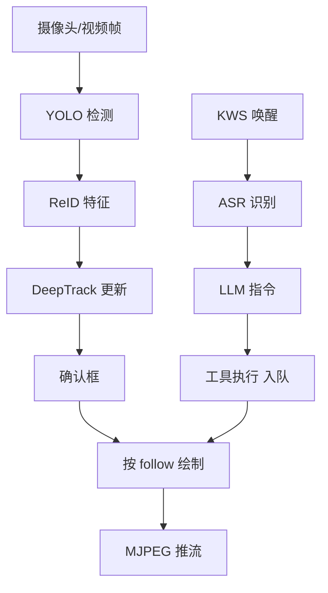

**知识储备补充**（双流水线解耦点）：

- **两个执行体**：视觉主线程（TrackEngine.run）与语音/指令线程（CommandWorker）是两个执行体，通过 `submit_effect` 命令队列（有界、put_nowait 满丢）交换；指令处理期间 `pending` 暂停读帧但不阻塞命令消费。

- **松耦合点**：`submit_effect` 入队（指令生效回填主循环）与 `on_reply` 回调（TTS 播报/文本回复）是两条流水线的唯一交换点；`lost` / `unlock_all` 事件通过 `on_event` 回调通知语音播报。画图要标出这两个交换通道。

- **参考资源**：`apps/track_app.py`（耦合点实现）；`tracking/engine.py`（主循环消费侧）；本实验 `docs/02_架构设计.md`。

### 2.7 注意事项

- ⚠️ 本实验**无硬件操作**，仅源码阅读，不需要上电/启动 ROS。
- ⚠️ 追踪 ID 由 DeepTrack（第 3 层）生成，LLM 只负责转发/解释，不要在架构上把 ID 分配画给 LLM。
- ⚠️ fail-closed 门禁顺序写死在 `_native_gate`，顺序改动会影响语义，实验 5/6 会验证；本实验只理解不修改。

### 2.8 实验总结

**完成成果**: 一张七层模块依赖图；一张 TrackEngine 单状态机主循环流程图；一张 CommandWorker 异步线程 + submit_effect 解耦图；一张双流水线（视觉 + 语音/指令）数据流图。

**技能收获**:

- 技能1：分层架构与依赖方向设计
- 技能2：队列驱动 + 单线程主循环 + 独立推理线程的实时系统解耦
- 技能3：门控路由（fail-closed）语义设计

**常见问题与解决**:

| 问题 | 原因 | 解决方法 |
|------|------|----------|
| 误认为 ID 由 LLM 分配 | 未读 track/追踪模块 | track id 由 DeepTrack 生成，LLM 只转发 id |
| 误认为 pending 丢帧 | 未读 engine | pending 只暂停读帧（停最后帧），不丢命令 |
| 误认为 VLM 是通用选车先导 | 未读 _native_gate | 存在 id 优先锁，VLM 只在无 id 带描述时 active |

### 2.9 实验报告要求

**思考题**:

1. CommandWorker 独立线程 + submit_effect 入队的设计如何保证"LLM 慢不丢帧、不改帧率采样"？如果原成串行执行会有什么问题？
2. pending 暂停 + pause_timeout 看门狗如何防止 LLM 挂死冻结画面？为什么要"暂停而非继续处理"？
3. _native_gate 中"清除语义强制 clear_track"与"ID 数值不对齐回引导"各防哪个故障？为什么 VLM 不是每条指令的先导？

**评分标准**:

- 七层架构依赖图（20 分）：依赖方向正确、speech/llm 独立标注
- TrackEngine 主循环流程（30 分）：读帧/检测/追踪/绘制/消费命令时序正确、pending/pause_timeout 与丢失检测标注
- CommandWorker 解耦（30 分）：LLM 独立线程、submit_effect 入队、不卡帧
- 双数据流与门控（20 分）：视觉与语音两链路正确、_native_gate 路由顺序与 VLM 回退标注 = 100 分。

---

## 更新日志

| 版本 | 日期 | 说明 |
|------|------|------|
| v1.0 | 2026-09-07 | 初始版本，基于 EXP006b 源码与文档生成 |
| v2.0 | 2026-09-07 | 知识储备增强 |
---
# 实验3：追踪配置与接口设计（4h）


### 3.1 关联知识点

- 2.1.1 track_config.yaml 全键配置（前置：1.2.1）
- 2.1.2 config_schema 强制 REQUIRED 键校验（前置：2.1.1）
- 2.1.3 CLI 传参与配置覆盖规则（前置：2.1.1）
- 2.2.1 三级开发模式与 --text 统一状态机（前置：1.1.3）
- 2.2.2 纯逻辑 pytest（x86 可跑）（前置：2.1.1）
- 2.2.3 组件级容错降级（ReID/TTS 降级文本）（前置：1.2.2）

### 3.2 实验目标

1. **掌握** track_config.yaml 各段配置（llm/vlm/detect/tracker/tracking/interaction/speech/server）含义与调参方法。
2. **理解** config_schema.py 强制 REQUIRED 键校验与类型检查，能通过故意改错验证拦截。
3. **掌握** CLI 参数（--video/--image/--camera/--mjpeg/--text 等）覆盖规则（CLI > yaml）。
4. **独立完成**配置接口设计任务：改 `detect.class_filter` 为 car 观察只检测车；改 `tracker.min_confidence` 观察 ID 变化。
5. **迁移**：把"单一配置文件 + schema 校验 + CLI 覆盖"的配置模式迁移到其他边缘 AI 项目。

### 3.3 实验环境

| 类别 | 内容 |
|------|------|
| 硬件 | 具身智能实验箱B2 / 具身智能机器人小车C1（本实验需板端 Python 3.10+ 环境，可仅跑 config_schema 校验） |
| OS | Ubuntu 22.04 + ROS 2 Humble |
| Python | 3.10 |
| 核心配置 | `config/track_config.yaml`（全键）、`config/config_schema.py` |
| 文档 | `docs/04_配置方案.md`、`docs/10_程序参数详解.md` |

### 3.4 实验难度

- 难度: ⭐⭐（设计性）
- 重点：track_config.yaml 各段配置含义；config_schema 校验机制；CLI 覆盖规则（CLI > yaml）。
- 难点：detect/tracker vlm 段的联动调参语义；function_call.native / vlm.fake_result_id 开关的作用与使用时机。

### 3.5 实验现象

**快速验证流程**（含板端可运行步骤）：

> **注意**：`config_schema.py` 只定义 `REQUIRED` 白名单（**无独立校验主函数**），直接 `python3 config/config_schema.py` 不会报错。真正的校验在 `common/config.py` 的 `load_config(..., REQUIRED)`（object_tracking 复用 elderly 的 common）。下面用一行 python 显式调用 `load_config` 触发校验。

```bash
cd ~/ros2_ws/src/xflz_eai_car1/app/object_tracking

# ① 正常配置 → 校验通过（输出键数）
python3 -c "import sys; sys.path.insert(0,'.'); \
from tracking.util import setup_imports; setup_imports(); \
from common.config import load_config; from config.config_schema import REQUIRED; \
print('OK, 校验通过, 顶级键数 =', len(load_config('config/track_config.yaml', REQUIRED)))"

# ② 故意改错一个键（浮点→字符串）→ load_config 抛 ConfigError 拦截
sed -i 's/min_confidence: 0.3 /min_confidence: 0.3x /' config/track_config.yaml
python3 -c "import sys; sys.path.insert(0,'.'); \
from tracking.util import setup_imports; setup_imports(); \
from common.config import load_config; from config.config_schema import REQUIRED; \
load_config('config/track_config.yaml', REQUIRED)"
#    预期报错: ConfigError: tracker.min_confidence: expected float, got str

# ③ 恢复
sed -i 's/min_confidence: 0.3x /min_confidence: 0.3 /' config/track_config.yaml
```

**预期效果描述**：

- 能说出 track_config.yaml 各段键名与调参方法（detect/tracker/lm/vlm/interaction/speech/server）。
- 能用 python 调用 `load_config` 触发校验，在故意改错键时拦截（ConfigError: missing key / expected float/int）。
- 能说出 CLI 参数覆盖规则（`--camera` 只改 source.mode、`--mjpeg` 开 server、`--text` 关 KWS）与"不新增键"约束。

```bash
(ros2_venv) iflytek@localhost:~/ros2_ws/src/xflz_eai_car1/app/object_tracking$ sed -i 's/min_confidence: 0.3 /min_confidence: 0.3x /' config/track_config.yaml
(ros2_venv) iflytek@localhost:~/ros2_ws/src/xflz_eai_car1/app/object_tracking$ python3 -c "import sys; sys.path.insert(0,'.'); \
from tracking.util import setup_imports; setup_imports(); \
from common.config import load_config; from config.config_schema import REQUIRED; \
load_config('config/track_config.yaml', REQUIRED)"
Traceback (most recent call last):
  File "<string>", line 1, in <module>
  File "/home/iflytek/ros2_ws/src/xflz_eai_car1/app/elderly_companion/common/config.py", line 66, in load_config
    return _validate(data, REQUIRED, "")
  File "/home/iflytek/ros2_ws/src/xflz_eai_car1/app/elderly_companion/common/config.py", line 37, in _validate
    out[key] = _validate(node[key], spec, path)
  File "/home/iflytek/ros2_ws/src/xflz_eai_car1/app/elderly_companion/common/config.py", line 49, in _validate
    raise ConfigError(
common.config.ConfigError: tracker.min_confidence: expected float, got str
```

### 3.6 实验步骤

#### 整体流程图

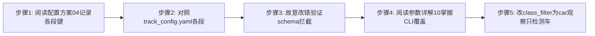

#### 步骤1：阅读配置方案文档，记录各配置段键（约50min）

**操作步骤**：

1. 阅读 `docs/04_配置方案.md`（全文）。
2. 记录顶层键表：llm/vlm/detect/tracker/tracking/source/session/interaction/speech/server/display/save/log。
3. 特别记录 `llm.function_call.native`（原生 FC 开关）与 `vlm.fake_result_id`（无真实模型回退）两个开关的语义。

**易错点**：

- ⚠️ 以为改配置后无需校验 → **解决**：所有键校验由 `config_schema.py` REQUIRED 兜底，改键必须同步 schema；不新增键。

**知识储备补充**（2.1.1 配置方案整体）：

- **配置即"参数化需求"**：`track_config.yaml` 把 R1-R13 的可量化约束集中声明（detect/tracker/tracking/interaction/speech/server 等段），比散落代码常量更易调参审计；REQUIRED 键缺失时启动即报错，防止"改键即失效"在运行时才暴露。

- **顶层段拓扑**：llm/vlm 决定对话与选车语义，detect/tracker 决定感知质量，tracking 决定暂停/看门狗时序，interaction 定义词表路由，speech 定义唤醒/识别/合成，server 定义 MJPEG 推流。修改检测阈值会影响追踪 ID 稳定性，修改 interaction 词表会改变指令路由——段与段存在联动。

- **参考资源**：`docs/04_配置方案.md`（键表）；`config/track_config.yaml`（默认值）；YAML 规范（yaml.org）。

#### 步骤2：对照 track_config.yaml 各段（约60min）

**操作步骤**：

1. 阅读 `config/track_config.yaml`，对照 detect（score_thr=0.25/iou_thr=0.45/class_filter=[car]）、tracker（use_reid=true/min_confidence=0.3/min_box_w/h=32/max_stale=15）、tracking（pause_wait=true/pause_timeout=30.0）、interaction（clear_words/track_words/desc_words）、speech（kws/asr/tts）、server（port=8088/stream_name=track.mjpg）各段。
2. 记录"实机 tuned 值"（min_confidence=0.3、class_filter=[car]）与变更注意（勿随意改低/扩类，否则 ID 跳变）。
3. 记录 interaction 门口词四类：clear_words（清除）/track_words（追踪动词）/instruct_words/color_words/desc_words。

**易错点**：

- ⚠️ class_filter 随意扩类 → 跨类外观混淆降 ID 稳定；改为 [car] 是实机 tuned；若需任意类别，确认描述词扩展入 desc_words 并重新验证。

**知识储备补充**（2.1.1 各段键语义量化）：

- **detect 段（检测器阈值）**：`score_thr=0.25` 为置信度门限、`iou_thr=0.45` 为 NMS 的 IoU 门限，其中 IoU 定义为两候选框 $A, B$ 的交并比：

  $$
  IoU(A, B) = \frac{|A \cap B|}{|A \cup B|}
  $$

  其中 $|A \cap B|$ 为两框交集面积、$|A \cup B|$ 为两框并集面积，$IoU$ 越大表示两框越重叠（$IoU=1$ 完全重合）；`class_filter=[car]` 限定只在车辆类别上检测，可调低/扩类但会引入类间外观干扰（见步骤 5）。

- **tracker 段（追踪 ID 稳定三闸）**：`min_confidence=0.3` 过滤低置信框、`min_box_w/h=32` 过滤过小框、`max_stale=15` 丢弃超过 15 帧未关联的轨迹——三者都是**身份保持**的闸门，放宽会导致短命/噪声轨迹挤占 ID 名额（ID 跳变根因之一）。

- **speech 段（语音四要素）**：kws（唤醒词，如"小飞小飞"）→ asr（识别）→ tts（合成播报）三段链路；`server` 段 `port=8088`、`stream_name=track.mjpg` 提供 MJPEG 推流（stream_name 不带 `.mjpg`，库自动补）。

- **数值示例（min_confidence 含义）**：检测框置信度 $c_b$ 与阈值 $\theta = 0.3$ 比较：$c_b \ge \theta$ 保留进追踪，$c_b < \theta$ 丢弃。示例：$c_b=0.45 \ge 0.3$ → 保留；$c_b=0.25 < 0.3$ → 丢弃。实机 tuned 值 0.3 保证召回与精度的平衡。

- **参考资源**：`config/track_config.yaml`（默认值清单）；`config/config_schema.py`（REQUIRED 键表）。

#### 步骤3：故意改错一个键，用 python 调用 load_config 验证拦截（约40min）

**操作步骤**：

运行下面 python 命令触发校验（不依赖 `track_app` 启动，直接调 `load_config`）：

```bash
python3 -c "import sys; sys.path.insert(0,'.'); \
from tracking.util import setup_imports; setup_imports(); \
from common.config import load_config; from config.config_schema import REQUIRED; \
load_config('config/track_config.yaml', REQUIRED)"
```

1. 用 sed 把 `detect.imgsz` 改成 `detect.imgsz: 640x`（字符串），重跑上面命令，观察 `ConfigError: detect.imgsz: expected int, got str`。
2. 或删掉一个 REQUIRED 键（如 `tracking.pause_wait`）再跑，观察 `ConfigError: missing key: tracking.pause_wait`。
3. 恢复后用 diff 确认回到原样。

```bash
# 改错键触发校验（先备份）
cp config/track_config.yaml /tmp/tc.bak
sed -i 's/detect.imgsz: 640/detect.imgsz: 640x/' config/track_config.yaml
python3 -c "import sys;sys.path.insert(0,'.');from tracking.util import setup_imports;setup_imports();from common.config import load_config;from config.config_schema import REQUIRED;load_config('config/track_config.yaml',REQUIRED)"   # 预期: ConfigError: detect.imgsz: expected int, got str
# 恢复
cp /tmp/tc.bak config/track_config.yaml
```

**易错点**：

- ⚠️ schema 校验只在 `load_config` 被调用时执行（不能直接 `python3 config/config_schema.py`，该文件无独立校验主函数）→ 改键后务必重跑上面的 python 校验命令一次确认配置合法，否则运行时无效配置静默。

**知识储备补充**（2.1.2 config_schema 校验机制）：

- **REQUIRED 即契约**：`config_schema.py` 用 REQUIRED 白名单声明"合法键全集 + 必填键"。真正的校验函数 `load_config`/`_validate` 在 `common/config.py`（object_tracking 复用 elderly 的 common），由入口程序或显式 python 调用触发——缺失必填键抛 `ConfigError: missing key: <path>`，类型不符抛 `ConfigError: <path>: expected <type>, got <实际类型>`。这相当于编译期类型检查的配置层版本，把"拼写/类型错误"拦截在启动前而非运行中。

- **YAML 类型映射**：`[car]` 是列表、`0.3` 是浮点、`true` 是布尔、`8088` 是整数。数值示例：把 `min_confidence: 0.3` 改成 `0.3x` → 浮点变字符串 → 类型校验失败；把 `pause_wait: true` 删除 → 缺失校验失败。两者都是 schema 拦截的典型演示（用本节 python 命令调 `load_config` 触发）。

- **参考资源**：`config/config_schema.py`（REQUIRED 白名单定义）；`common/config.py`（`load_config`/`_validate` 校验实现，elderly）；`docs/04_配置方案.md`（键表与类型说明）；Python `yaml.safe_load` 官方文档。

#### 步骤4：阅读程序参数详解，掌握全部入口 CLI 参数与覆盖规则（约60min）

**操作步骤**：

1. 阅读 `docs/10_程序参数详解.md`：track_app `--config/--video/--image/--camera/--mjpeg/--text/--show/--save/--list`。
2. 掌握覆盖规则：CLI 显式参数 > config 文件值；`--camera` 仅改 mode，不重置 video_path。
3. 文本模式 stdin 协议：首行唤醒词进入 DIALOG，随后每行 = 指令/闲聊（与音频同一 VoiceLoop 回调链）。

**易错点**：

- ⚠️ 认为 CLI 参数全部重置所有键 → **解决**：`_merge_args` 只改 CLI 显式给的键，未给的保留文件值（如 `--camera` 不改 video_path 文件值因为 mode 已切）。

**知识储备补充**（2.1.3 CLI 覆盖规则）：

- **覆盖优先级与"只改显式键"**：合并规则为 CLI 显式参数 > config 文件值，且 `_merge_args` **只改 CLI 显式给出的键**，未给的保留文件值。数值示例：config 中 `source.mode: video`、`source.video_path: a.mp4`，命令行 `--camera` 只把 mode 改成 camera 且不重置 video_path——因为 `--camera` 未显式给 `video_path`。这样 CLI 是"增量覆盖"而非"整体替换"，避免误清其他键。

- **入口参数表**：`--config`（指定 yaml）、`--video/--image/--camera`（三源）、`--mjpeg`（开推流）、`--text`（关 KWS 走 stdin 文本）、`--show/--save/--list`。文本模式 stdin 协议：首行唤醒词进 DIALOG，随后每行 = 指令/闲聊，与音频同一 VoiceLoop 回调链。

- **参考资源**：`docs/10_程序参数详解.md`（全部入口参数）；`apps/track_app.py`（argparse + _merge_args）。

#### 步骤5：修改 det.class_filter 为 car，观察只检测车（约70min）

**操作步骤**：

1. 确认 `detect.class_filter: [car]`（默认均已调优）。

2. 用文本模式离线视频跑全链路观察只绘制汽车框（R2/R4）：
```bash
python3 apps/track_app.py --video /home/iflytek/ros2_ws/src/xflz_eai_car1/vision/07_multi_object_tracking/test.mp4 --text --mjpeg
# 先输入：小飞小飞
# 再输入对话：追踪 id3 的车
```

3. 临时改成 `class_filter: []`（全类）观察误检/ID 变化，最后恢复 [car]。

```bash
cp config/track_config.yaml /tmp/tc.bak
sed -i 's/class_filter: \[car\]/class_filter: []/' config/track_config.yaml   # 全类观察误检/ID变化
python3 apps/track_app.py --video /home/iflytek/ros2_ws/src/xflz_eai_car1/vision/07_multi_object_tracking/test.mp4 --text --mjpeg   # 先小飞小飞 再追踪 id3
# 恢复
cp /tmp/tc.bak config/track_config.yaml
```

结果会导致一辆车有多个id或者的id数急速增长，原因是一辆车识别成不同类别了，也上了id

[car]

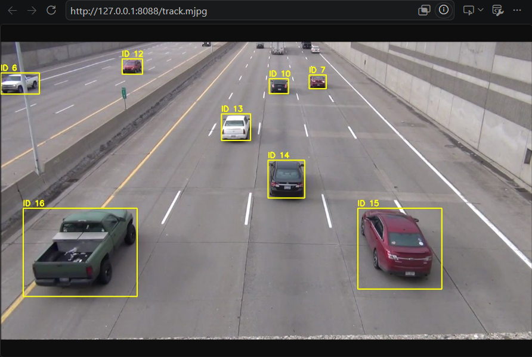

[空]：coco80全检测追踪

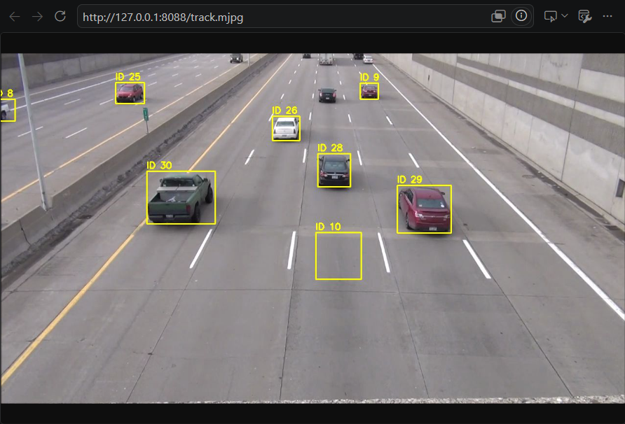

**易错点**：

- ⚠️ 改 class_filter 后 ReID 跨类互相 distract → **解决**：[car] 过滤只留车避免跨分类外观混淆；调回实机 tuned 值。

**知识储备补充**（2.2.1-2.2.3 调参联动）：

- **class_filter 扩类的代价（量化）**：检测召回类别从 $\{car\}$ 扩到全类后，ReID 特征池同时容纳车/人/其他目标，跨类外观差异（余弦距离）变小：

  $$
  d_{cos}(a, b) = 1 - \frac{a \cdot b}{\lVert a \rVert \lVert b \rVert}
  $$

  其中 $a, b$ 为两目标的外观特征向量、$a \cdot b$ 为内积、$\lVert a \rVert$ 为向量的 L2 范数，$d_{cos} \in [0,2]$ 越小表示越相似（DeepSORT 级联用此作为关联代价）。相似外观跨类出现 → 错误关联概率上升 → ID 跳变。实机 tuned 值 `[car]` 把搜索空间收窄到单类，最稳。

- **min_confidence 与 ID 生命周期**：`min_confidence` 抬高会使低置信框不被确认（Tentative），ID 存活率下降；降低则引入噪声轨迹抢 ID。实机 tuned `0.3` 是召回/精度平衡点（本实验步骤 3 演示 schema 拦截，步骤 5 观察两处联动）。

- **多区段联动示范**：`use_reid=true` 时 ReID 特征参与级联关联；`vlm.fake_result_id` 无真模型时固定回退，`vlm.enabled=false` 直接关 VLM。修改 `detect.class_filter` 与 `tracker.min_confidence` 都只影响感知层，不改 `interaction` 词表与 `_native_gate` 顺序（命令安全由后者独立保障）。

- **参考资源**：`docs/04_配置方案.md`（detect/tracker 段键表）；DeepSORT 论文 arXiv:1703.07402（外观距离与级联）；Ultralytics 文档（class_filter/置信度门限）。

### 3.7 注意事项

- ⚠️ config_schema 校验是**必需**步：改任意键后必须重跑 schema/启动一次确认，否则配置无效静默。
- ⚠️ `min_confidence` 与 `class_filter` 是实机 tuned（0.3 / [car]），勿随意改低/扩字段，否则 ID 跳变。
- ⚠️ 清理：实验后 pkill -f llm_server、恢复 config 原值。
- ⚠️ 本实验若在板端运行需 Python 3.10+ 环境；未上板时步骤5 可在任意 x86 跑纯逻辑（无 LLM/相机）验证 config loading。

### 3.8 实验总结

**完成成果**: 一张 track_config.yaml 各段键值表（含 tuned 值和变更注意），一次 schema 校验拦截演示，一张 CLI 覆盖规则示例表，一份 class_filter 调参笔记。

**技能收获**:

- 技能1：YAML 配置设计与 schema 校验
- 技能2：CLI 覆盖规则的工程设计
- 技能3：边缘 AI 参数调优（ID 稳定性的根因分析）

**常见问题与解决**:

| 问题 | 原因 | 解决方法 |
|------|------|----------|
| schema 校验报缺失 | 键删/拼写错 | 对照 docs/04 逐键核对 REQUIRED |
| 改 key 后 ID 跳变 | min_confidence 降低或 class_filter 扩类 | 恢复实机 tuned 值（0.3 / [car]） |
| CLI 参数没生效 | 覆盖规则理解 | 只改 CLI 显式键，未给的保留文件值 |
| VLM 回退不出现 | 无真模型 | vlm.fake_result_id 调试 + vlm.enabled=false 回退 |

### 3.9 实验报告要求

**思考题**:

1. `config_schema` 的 REQUIRED 校验如何保护"改键即失效"的隐患？如果只有注释没有 schema，会有什么风险？
2. CLI > config 覆盖规则：`_merge_args` 只改显式键，为什么 `--camera` 不重置 video_path？
3. `vlm.fake_result_id` 与 `vlm.enabled=false` 分别用于什么调试场景？fake 固定返回 id 的缺陷是什么？

**评分标准**:

- 配置键值表（30 分）：全键覆盖、实机 tuned 值标注、变更注意清晰
- schema 校验演示（20 分）：故意改错后拦截正确
- CLI 覆盖示例（30 分）：覆盖规则表述正确
- class_filter 调参（20 分）：现象与原因分析 = 100 分。

---

## 更新日志

| 版本 | 日期 | 说明 |
|------|------|------|
| v1.0 | 2026-09-07 | 初始版本，基于 EXP006b 源码与文档生成 |
| v2.0 | 2026-09-07 | 知识储备增强 |
---
# 实验4：多目标追踪底座集成测试（8h）


### 4.1 关联知识点

- 3.1.1 DeepSORT 结构：卡尔曼预测+IoU/外观级联关联+确认框（前置：1.2.2）
- 3.1.2 卡尔曼常速模型（8维均值+4维协方差，按框高缩放噪声，CHI2INV95 门控）（前置：3.1.1）
- 3.1.3 min_box_w/h=32 小框剔除 + max_stale=15 超龄剔除（前置：3.1.1）
- 3.2.1 deepsort.rknn 外观特征（64x128 ImageNet 归一化）消除单帧漏检换 ID（前置：3.1.1）
- 3.2.2 ReIDPool 多线程异步特征池，extract 超时哨兵（前置：3.2.1）
- 3.2.3 min_confidence=0.3 与 ID 稳定性调参（前置：3.1.1）
- 3.3.1 class_filter=[car]，COCO 80 类通用（前置：1.1.1）
- 3.3.2 track_demo --list/--text 验证 ID 底座（前置：3.2.3）
- 3.3.3 遮挡丢失后同 ID 恢复验证 ReID，unlock_on_loss（前置：3.2.1）

### 4.2 实验目标

1. **掌握**卡尔曼预测+级联关联的多目标追踪原理（DeepSORT 结构、8维常速模型）。
2. **理解**ReID 外观重识别如何消除"单帧漏检换 ID"，以及 ReID 降级纯 IoU 不崩。
3. **掌握** min_box/max_stale 过滤与 ID 稳定性调参（调低 min_confidence 观察 ID 跳变）。
4. **独立完成** `python3 -m pytest tests/ -v` 纯逻辑回归 + `track_demo --list` 验证 ID 底座。
5. **迁移**：把 DeepTrack（卡尔曼+ReID）追踪模式迁移到其他多目标场景（车/人/箱）。

### 4.3 实验环境

| 类别 | 内容 |
|------|------|
| 硬件 | 具身智能实验箱B2 / 具身智能机器人小车C1 + 深度相机（实时模式，可选） |
| OS | Ubuntu 22.04 + ROS 2 Humble |
| Python | 3.10 |
| 核心库 | numpy（追踪核心纯 numpy，零新增依赖） |
| 模型 | yolov8n.rknn / deepsort.rknn / coco_classes.json（板端） |
| 测试 | pytest（纯逻辑 x86 可跑） |
| 命令 | `python3 -m pytest tests/ -v`、`python3 apps/track_demo.py --video /home/iflytek/ros2_ws/src/xflz_eai_car1/vision/07_multi_object_tracking/test.mp4 --text --list` |

### 4.4 实验难度

- 难度: ⭐⭐⭐（综合性）
- 重点：卡尔曼预测 + 级联关联的多目标追踪；ReID 外观消除单帧漏检换 ID；ID 稳定性调参。
- 难点：ReID 在独立 worker 线程池的异步特征提取；min_box/max_stale 过滤交互；遮挡场景调参观察。

### 4.5 实验现象

**快速验证流程**：

```bash
cd ~/ros2_ws/src/xflz_eai_car1/app/object_tracking

# 1. 纯逻辑测试（x86 可跑，无 RKNN/ROS 依赖）
python3 -m pytest tests/ -v
#   test_tracker_session.py     追踪 ID 分配 / follow 过滤 / 显隐
#   test_reid_tracking.py       use_reid=true 保留遮挡目标原 ID vs false 新建
#   test_pipeline_tracker.py    小框 min_box 剔除 / stale 超龄剔除

# 2. 纯视觉 ID 底座（无 LLM，stdin 直达 engine）
printf '追踪 id3\n' | python3 apps/track_demo.py --video /home/iflytek/ros2_ws/src/xflz_eai_car1/vision/07_multi_object_tracking/test.mp4 --text --list --mjpeg
```

**预期效果描述**：

- pytest 全绿（TDD），验证追踪 ID 分配 / follow 过滤 / 显隐 / 小框剔除 / stale 剔除。
- track_demo --list 打印当前跟踪目标 ID 列表，验证 ID 底座稳定性（不随帧跳）。
- 遮挡场景验证 ReID：遮挡后同 ID 恢复（而非新建 ID）。
- 调低 min_confidence 观察 ID 跳变（噪声进入 tracker）。

```bash
(ros2_venv) iflytek@localhost:~/ros2_ws/src/xflz_eai_car1/app/object_tracking$ python3 -m pytest tests/ -v
===================================== test session starts =====================================
platform linux -- Python 3.10.12, pytest-6.2.5, py-1.10.0, pluggy-0.13.0 -- /home/iflytek/ros2_venv/bin/python3
cachedir: .pytest_cache
rootdir: /home/iflytek/ros2_ws/src/xflz_eai_car1/app/object_tracking
plugins: ament-xmllint-0.12.15, launch-testing-1.0.14, ament-flake8-0.12.15, ament-pep257-0.12.15, ament-lint-0.12.15, ament-copyright-0.12.15, launch-testing-ros-0.19.13, colcon-core-0.20.1, cov-3.0.0
collected 97 items                                                                            

tests/test_chat_prompt.py::test_chat_reply_uses_relaxed_prompt PASSED                   [  1%]
tests/test_chat_prompt.py::test_chat_reply_fallback_on_error PASSED                     [  2%]
tests/test_chat_reply_clean.py::test_chat_reply_clean_request_only_system_and_user PASSED [  3%]
tests/test_chat_reply_clean.py::test_chat_reply_strips_tool_markup_and_json_residue PASSED [  4%]
tests/test_chat_reply_clean.py::test_chat_reply_degrades_tiny_reply PASSED              [  5%]
tests/test_chat_reply_clean.py::test_fallback_chat_reply_is_topic_sensitive PASSED      [  6%]
tests/test_chat_reply_clean.py::test_chat_reply_isolated_from_history PASSED            [  7%]
tests/test_chat_reply_clean.py::test_chat_reply_streams_sentences PASSED                [  8%]
tests/test_chat_reply_clean.py::test_chat_reply_streams_keeps_strip_and_guard PASSED    [  9%]
...略
```

```bash
[命令] 追踪 id3
当前目标： （当前无确认目标）
id3 已消失
全部跟随目标已消失，恢复全显示
```

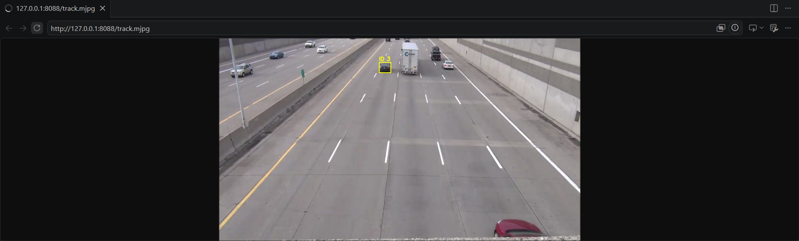

### 4.6 实验步骤

#### 整体流程图

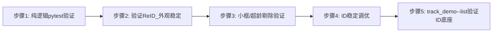

#### 步骤1：运行 pytest 验证纯逻辑测试全绿（约90min）

**操作步骤**：

1. 运行 `python3 -m pytest tests/ -v`，确认全部通过。测试文件覆盖：
   - `test_tracker_session.py`：追踪 ID 分配 / follow 过滤 / 显隐。
   - `test_reid_tracking.py`：use_reid=true 保留遮挡目标原 ID vs false 新建。
   - `test_reid_crop_heal.py`：越界 crop 不喂错特征 / extract 超时零哨兵不挂死。
   - `test_pipeline_tracker.py`：小框 min_box 剔除 / stale 超龄剔除。
   - `test_native_wiring.py`：门控路由 id 对齐 / 不对齐回「未找到」/ 清除强制 / 描述走 VLM / 闲聊回落。
   - `test_voice_loop_capture_health.py`：录音低帧自愈判定。

```bash
python3 -m pytest tests/ -v
```

**易错点**：

- ⚠️ 勿把 pytest 当"贴代码证明"——它验证的是追踪逻辑正确性（ID 分配/剔除/ReID 恢复），是后续所有实验的基础。

#### 步骤2：理解卡尔曼预测 + 级联关联（约150min）

**知识点讲解**：

**3.1.1 DeepSORT：卡尔曼预测 + IoU/外观级联关联 + 确认框**

- **原理**：DeepSORT（Deep Association Metric Tracking）在 SORT（仅 IoU 关联）基础上引入**外观特征 + 级联匹配**。目标被建模为 `Track`，生命周期 Tentative→Confirmed（hits≥n_init）→Deleted（`tracking/track.py`）。跟踪器 `Tracker.update()`（`tracking/tracker.py` L72-75）每帧做三步：

  ①卡尔曼预测每个已确认 track；

  ②对 detection 做级联匹配（先按 `time_since_update` 排序，优先级给最近更新的 track，避免被长期遮挡的 track 抢占匹配）；

  ③剩余 detection 与未确认 track 做 IoU 匹配；最后分配新旧确认框。

**4 卡尔曼门控**

- `tracking/kalman.py`：状态均值为 8 维（`np.r_[measurement, zeros(4)]` L29-31），协方差按框高缩放（`std` 语义），用 `CHI2INV95` 做马氏距离门控——只有落在 95% 置信椭圆内的匹配才接受，从而避免远距误关联。预测用常速马尔可夫模型 `x' = F x`。

**知识储备补充**：

- **背景与动机**：SORT（Simple Online and Realtime Tracking）只用 IoU 关联相邻帧检测框，速度快但目标被遮挡几帧后 IoU 归零，轨迹即断、换新 ID。DeepSORT 在 SORT 之上补两项：

  ①用卡尔曼常速模型预测"目标下一帧在哪"；

  ②用 ReID 外观特征弥补 IoU 失效。本实验的 `tracker.py` 是 deep_sort 标准结构的纯 numpy 自实现（`tracking/kalman.py`、`tracking/matching.py` 对照 vendor DeepSORT 的 BSD 参考实现），零新增依赖。

- **8 维状态向量与常速模型**：状态 $x = [cx, cy, a, h, vx, vy, va, vh]^\mathsf{T}$，前 4 维是观测（中心横/纵坐标、宽高比 aspect、高），后 4 维是它们的速度。常速（constant velocity）预测即一步线性映射：

  $$
  x' = F x = \begin{bmatrix} I_4 & I_4 \cdot \Delta t \\ 0_4 & I_4 \end{bmatrix} x, \qquad \Delta t = 1
  $$

  其中 $I_4$ 为 $4\times4$ 单位阵、$0_4$ 为 $4\times4$ 零阵；$\Delta t=1$ 表示"每帧推进一步"。实现见 `tracking/kalman.py` 的 `predict`（L36-48）：`F = np.eye(8); F[0:4, 4:] = np.eye(4)`（L45-46），即 "位置 += 速度"：$cx' = cx + vx$，$h' = h + vh$，其余同理。注意 aspect 速度 $va$ 与 aspect 噪声权重极小（1e-5），因为宽高比几乎不变，扰动主要来自 $h$。

- **按框高缩放的噪声**：DeepSORT 的关键经验是"过程/观测噪声随目标高度缩放"——大目标运动噪声大、小目标小。预测步（`kalman.py` `predict` L36-48）先按当前框高 h 计算各维标准差再平方成过程噪声协方差 $Q$：

  $$
  Q = \operatorname{diag}\left( (\sigma_{pos} h)^2,\ (\sigma_{pos} h)^2,\ 10^{-4},\ (\sigma_{pos} h)^2,\ (\sigma_{vel} h)^2,\ (\sigma_{vel} h)^2,\ 10^{-10},\ (\sigma_{vel} h)^2 \right)
  $$

  其中 $\sigma_{pos} = \frac{1}{20}$、$\sigma_{vel} = \frac{1}{160}$（L18-19）为位置/速度噪声权重，h 为当前框高（像素）；aspect 维固定用极小值（1e-2 标准差→1e-4 方差、1e-5→1e-10），因为宽高比几乎不变。数值示例：h=100 像素时位置噪声标准差 $=\frac{1}{20}\times100=5$ 像素，速度噪声标准差 $=\frac{1}{160}\times100=0.625$ 像素/帧。新建 track 时（`initiate` L29-34）不确定性更大：位置标准差 $2\sigma_{pos}h=10$ 像素、速度标准差 $10\sigma_{vel}h=6.25$ 像素/帧——首帧速度完全未知，所以初值协方差放得比稳态预测更大。

- **马氏距离门控（CHI2INV95）**：级联匹配先算马氏距离（观测空间，含缩放），检测 $z$ 与预测投影 $z'=Hx'$ 之间的马氏距离平方为：
  $$
  d_M^2(z) = (z - z')^\mathsf{T} S^{-1} (z - z')
  $$
  
  其中 $S=H P H^\mathsf{T} + R$ 是投影协方差加观测噪声、$(z-z')$ 是"检测与预测框的残差"。$d_M^2$ 服从自由度为 2（仅位置 cx,cy）或 4 的卡方分布，`CHI2INV95`（`kalman.py` L13）给出各自 95% 分位阈值：自由度 2→5.9915、4→9.4877。`gate_cost_matrix`（`tracking/matching.py` L45-51）把超过阈值的代价置为 1e5 大值，匈牙利算法就不会选中它——只有落在 95% 置信椭圆内的匹配才被接受，远距误关联被排除。
  
- **级联匹配顺序**：`Tracker._cascade`（`tracker.py` L107-127）按 `time_since_update` 从 1 到 max_age 逐层分配——刚更新过的 track（time_since_update=1）优先匹配，长期遮挡的 track（time_since_update 大）排后。这是因为一个被遮挡很久的陈旧 track 其预测位置误差已不可信，若与 IoU 全量比，会侵占本该属于新目标的检测。`_appearance_cost`（L129-150）以外观 cosine 距离为代价矩阵，再经 `gate_cost_matrix` 用马氏位置门限把超阈值项置 1e5 大值，最后 `min_cost_matching` 做门限内匈牙利指派。

- **参考资源**：DeepSORT 论文《Simple Online and Realtime Tracking with a Deep Association Metric》（Bewley 等，2017）；`nwojke/deep_sort` 官方实现（`kalman_filter.py`/`tracker.py`）；scikit-learn 的 `linear_sum_assignment` 文档（`tracking/matching.py` L26-31 调用）；马氏距离与卡方门控理论图解（卡方分布自由度与 95% 分位表）。

**操作步骤**：

1. 阅读 `tracking/kalman.py`（L29-65）、`tracking/track.py`（生命周期 predict/update）。
2. 阅读 `tracking/tracker.py` update/predict（L68-90）。
3. 记录 8 维状态向量 = `[cx, cy, aspect, height, vx, vy, va, vh]`，与常速马尔可夫模型 `x' = F x`。

**参考模板**（Track 生命周期状态图，学生绘制时可对照）：

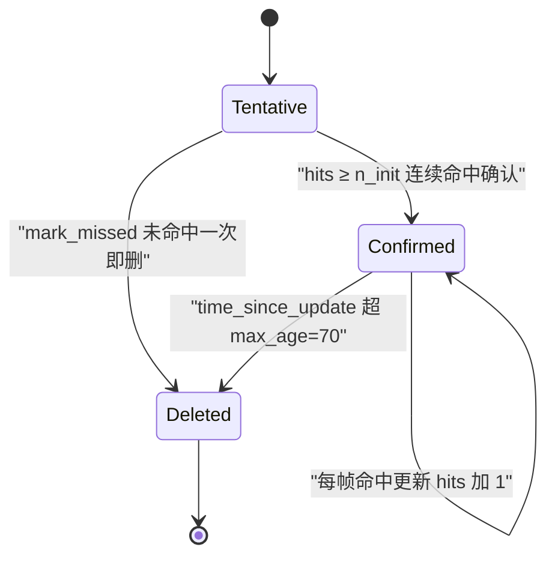

**易错点**：

- ⚠️ 试图用手工 IoU 替代级联 → **解决**：级联（time_since_update 优先）保证长期遮挡 track 不夺走新目标的匹配；纯 IoU 会让长时遮挡后误关联。

#### 步骤3：理解 ReID 外观重识别（约100min）

**操作步骤**：

1. 阅读 `tracking/reid.py`（ReIDBackend RKNN-deepsort 64x128 ImageNet 归一化）与 `tracking/reidpool.py`。
2. 阅读 `test_reid_tracking.py`（use_reid=true 保留遮挡目标原 ID vs false 新建）。
3. 理解"单帧漏检 → 外观特征保持同 ID"的定义：遮挡后 Kalman 只有预测框无特征，匹配靠 ReID 外观向量（deepsort.rknn 64x128），cosine 距离 < max_dist=0.2。
4. 理解 ReIDPool 多 worker：`reidpool.extract`（L38）逐 crop 提交，重排序；超时或异常整帧 features=None（纯 IoU），主循环不挂死。

**知识储备补充**：

- **背景与动机**：ReID（Re-Identification，行人/目标重识别）解决"外观匹配"问题——IoU 只在目标连续可见时有效；目标被挡几帧后 Kalman 预测框仍存在但无真实检测，等它重新出现时，纯 IoU 无法把"旧目标"与"新检测"对上，只能开新 ID。ReID 用深度网络对每个检测框 crop 提取 128 维外观向量，遮挡前后用向量相似度把同一目标串起来，从而保持 ID 不换。

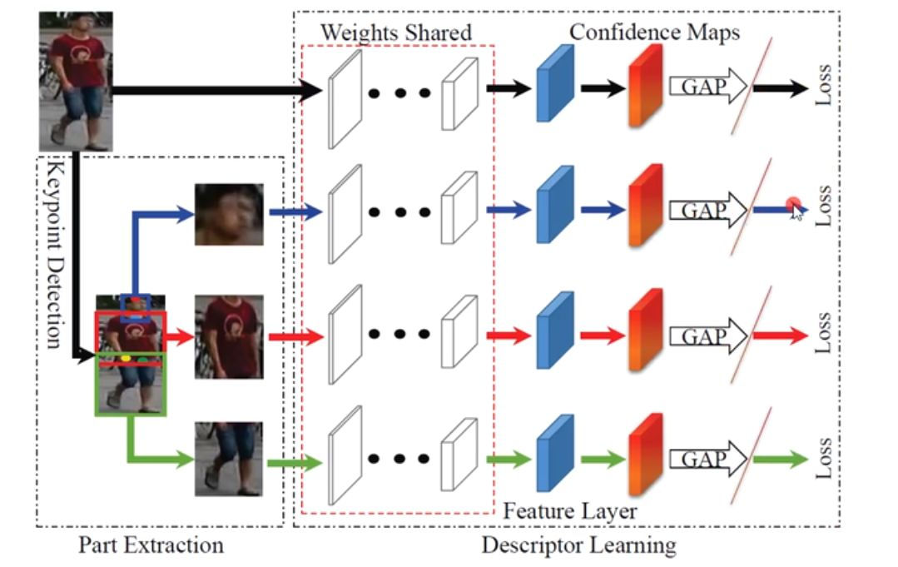

- **外观特征提取流程**：`tracking/reid.py` 的 `preprocess_crop`（L20-29）做四个步骤：cv2.resize 到 64x128 → /255 归一化到 $[0,1]$ → BGR 转 RGB（`im[..., ::-1]` L27）→ 按 ImageNet 均值/方差标准化（L16-17：$\mu=[0.485,0.456,0.406]$、$\sigma=[0.229,0.224,0.225]$）→ 转 CHW 并加 batch 维成 `[1,3,128,64]`。最后 RKNN 推理输出特征向量（通常 128 维，由模型决定：`reidpool.dim` 以首个成功行长度为准）。64×128 是深度排序官方对"行人框"的约定输入尺寸——它保留细粒度外观，同时把输入统一到固定张量形状。

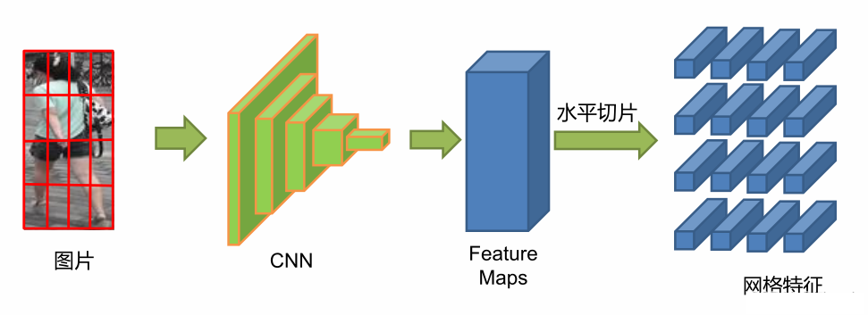

- **余弦距离公式**：两个特征向量 $a,b$ 的余弦距离（1 减余弦相似度）为：

$$
d_{cos}(a,b) = 1 - \frac{a \cdot b}{\|a\| \|b\|} = 1 - \cos\theta
$$

其中 $a\cdot b$ 为内积、$\|a\|=\sqrt{\sum_i a_i^2}$ 为 L2 范数。取值 $[0,2]$，越接近 0 越相似。`tracking/tracker.py` 的 `_cosine_dist`（L47-49）先按行 L2 归一化再做矩阵乘（等价于余弦），返回 $1 - \frac{feat \cdot target^T}{\|feat\|\|target\|}$。数值示例：两向量完全一样 → 距离 0；正交 → 距离 1；反向 → 距离 2。`max_dist=0.2`（`track_config.yaml` L47）为匹配阈值——只有距离 ≤0.2 的外观才接受入匹配（对应相似度 ≥0.8）。特征库用 `np.mean(features, axis=0)` 取 track 累计外观向量的均值（`_appearance_cost` L140-141），即"历史平均外观"而非单帧快照，抗单帧噪声。

- **ReIDPool 异步池与超时降级**：真实 RKNN 推理慢（每帧 N 个 crop 串行推理会拖住主循环），故 `reidpool.ReIDPool`（`tracking/reidpool.py` L24-67）用 N 个 worker 线程、每个线程独立 RKNN 实例（RKNN 非线程安全），提交时携带序号 (idx, crop)，`extract`（L38-66）按序号排序还原帧内顺序。容错契约（评审 P2-故障路径）：extract 不抛异常——get 超时（timeout=10，L56-59）时置空列表走纯 IoU；失败的 crop 用零向量哨兵补齐保持与输入等长（L61-66）；最终由 `pipeline.process` 检查 `len(features) != len(dets)` 再降级（`tracking/pipeline.py` L42-44）——任何一步失败都回到纯 IoU，主循环绝不挂死。

- **关键参数**：`use_reid`（config `tracker.use_reid`，默认 true）；`reid_path=deepsort.rknn`；`reid_workers=4`；`max_dist=0.2`（cosine 阈值）；`max_iou_distance=0.8`（IoU 匹配阈值，级联完剩的未确认 track 用）。调参影响：max_dist 调大 → 外观不同也接受 → 易错配裸换 ID；调小 → 外观稍变就无法关联。目标外观剧烈变化（背转面）时 ReID 特征差异大，`max_dist` 兜不住，需 `max_stale` 配合剔除真消失目标（步骤4）。

- **参考资源**：DeepSORT 论文（同步骤2）；ReID 经典综述《Deep Learning for Person Re-identification: A Survey and Outlook》；scikit-learn 余弦相似度文档；ImageNet 归一化均值/方差来源（PyTorch torchvision transforms 文档）。

**易错点**：

- ⚠️ ReID 不是万能 → **解决**：reid.py 用 64x128 ImageNet 归一化；目标外观剧烈变化（背转面）ReID 力有不逮，需 `max_stale` 配合剔除真消失目标。

#### 步骤4：小框/超龄剔除 + ID 稳定性调参（约90min）

**操作步骤**：

1. 阅读 `test_pipeline_tracker.py`：min_box 剔除（宽/高 <32 判定为噪点，不跟踪不绘制）、max_stale 剔除（连续未命中 >15 帧只剩预测框）。
2. 在 track_config.yaml 把 `tracker.min_confidence` 从 0.3 调低（如 0.1），观察 ID 跳变（噪声检测加深追踪）。
3. 改回 0.3，验证 ID 稳定。

```bash
cp config/track_config.yaml /tmp/tc.bak
sed -i 's/min_confidence: 0.3 /min_confidence: 0.1 /' config/track_config.yaml
python3 apps/track_demo.py --video /home/iflytek/ros2_ws/src/xflz_eai_car1/vision/07_multi_object_tracking/test.mp4 --text --list --mjpeg   # 观察 ID 跳变
cp /tmp/tc.bak config/track_config.yaml
```

**知识储备补充**：

- **min_box_w/h 小框剔除**：`pipeline.process`（`tracking/pipeline.py` L53-60）对每个 confirmed track 取预测宽 $w = aspect \times h$（`to_xyah` L45-48），若 $w < min\_box\_w$ 或 $h < min\_box\_h$（默认 32，`track_config.yaml` L52-53）则从可见列表剔除。物理含义：目标远去/缩小时检测框很小，多半是噪点或目标已消失只剩残影，继续画框/参与 VLM 会误导。宽度由高和宽高比算出：$w = a \cdot h$。

- **max_stale 超龄剔除**：Kalman 在目标丢失后仍持续预测（只剩预测框、无真实检测），`time_since_update` 每帧 +1。`max_stale=15`（L54）表示连续 15 帧未命中即判定目标真消失，剔除（`pipeline.py` L61-62：`time_since_update <= max_stale` 保留）。与 `max_age=70`（`track.py` L18、`Tracker` L55，deep_sort 内参）区分：max_age 是轨道生命周期上限（超 70 帧未更新直接 DELETED），max_stale 是"不画但保留轨道"的软阈值——两者配合：短期内丢失可以靠它保留候选，长期丢失彻底删除。

- **min_confidence 与 ID 稳定**：`pipeline.py` L20-21 在检测后按 `d.score >= min_confidence` 过滤，把低置信噪声挡在 tracker 之外。min_confidence 调低（0.3→0.1）会让类噪声检测也进 tracker，新建大量临时 Tentative track，ID 频繁跳变；调高则漏检真车。实机 tuned 值 0.3（可接受范围 0.25–0.6），与 `detect.score_thr=0.25`（config `detect` 段）配合构成两级置信过滤。本实验调参后务必恢复 0.3。

- **参考资源**：DeepSORT 参数说明（`nwojke/deep_sort` README 中 max_age/n_init/nn_budget）；本模块 `tests/test_pipeline_tracker.py` 中 min_box/stale 用例（L32-59）是行为基线；OpenCV 目标追踪教程（框/尺寸概念）。

**易错点**：

- ⚠️ 过度调低 min_confidence → 低置信噪声进 tracker，ID 频繁跳变；这是"ID 稳定根因"（实机 tuned 0.25–0.6 之间，勿乱改）。

#### 步骤5：track_demo --list/--text 验证 ID 底座（约80min）

**操作步骤**：

1. `printf '追踪 id3\n' | python3 apps/track_demo.py --video /home/iflytek/ros2_ws/src/xflz_eai_car1/vision/07_multi_object_tracking/test.mp4 --text --list --mjpeg`
2. 观察 stdin 直连 engine（无 VoiceLoop/无 LLM），`--list` 每帧打印 scene_summary（当前确认目标）。
3. 验证：追踪 id3 后，仅绘制该 ID；目标消失 → lost；unlock_on_loss 恢复全显示。
4. 按 `docs/08_视觉测试用例.md` 执行 O2（多车 ID 稳定）/O3（遮挡 ReID 恢复）/O4（小框剔除）。

```bash
printf '追踪 id3\n' | python3 apps/track_demo.py --video /home/iflytek/ros2_ws/src/xflz_eai_car1/vision/07_multi_object_tracking/test.mp4 --text --list --mjpeg
```

**易错点**：

- ⚠️ `track_demo` 无 VoiceLoop，stdin 直达 engine，无唤醒词；`--list` 是验证 ID 底座的核心调试开关。

### 4.7 注意事项

- ⚠️ pytest 纯逻辑 x86 可跑（无需 rknn/rclpy），先于任何硬件验证。
- ⚠️ 改 `min_confidence` / `class_filter` 会显著影响 ID 稳定，实验结束后恢复实机 tuned 值。
- ⚠️ ReID / Kalman 核心是纯 numpy，勿引入额外 GPU/torch 依赖。

### 4.8 实验总结

**完成成果**: pytest 全绿运行证明；一张卡尔曼+级联关联示意图；一张 ReID 外观恢复观察记录；min_box/max_stale 调参笔记；track_demo ID 底座验证结果。

**技能收获**:

- 技能1：多目标追踪算法（卡尔曼+级联+ReID）实现理解
- 技能2：track_demo/pytest 离线调试
- 技能3：ID 稳定性参数调优方法论

**常见问题与解决**:

| 问题 | 原因 | 解决 |
|------|------|------|
| 追踪 ID 跳变 | min_confidence 过低 / class_filter 扩类 | 恢复 0.3/[car] tuned |
| 长遮挡后新 ID | 无外观特征（use_reid=false） | 开启 use_reid + ReID 特征 |
| 小目标乱画 | min_box_w/h 过低 | 32 阈值剔除噪点 |
| pytest 失败 | 改默认值 | 检查 tests 断言与配置基线 |

### 4.9 实验报告要求

**思考题**:

1. 卡尔曼常速模型如何用 8 维状态 + 框高缩放噪声预测下一帧？级联匹配如何保障长遮挡 track 不覆盖新目标？
2. ReID 外观特征如何消除"单帧漏检换 ID"？为什么 extract 超时要降级纯 IoU 而非抛异常崩线程？
3. min_box / max_stale 剔除掉哪些目标? 调低 min_confidence 为什么导致 ID 跳变？

**评分标准**:

- pytest 全绿（20 分）
- 追踪原理讲解（25 分）：卡尔曼/级联/确认框
- ReID 分析与遮挡实验（25 分）：原 ID 恢复、降级 IOu
- 调参与底座验证（30 分）：min_box/max_stale 剔除、ID 稳定性调参、track_demo 结果 = 100 分。

---

## 更新日志

| 版本 | 日期 | 说明 |
|------|------|------|
| v1.0 | 2026-09-07 | 初始版本，基于 EXP006b 源码与文档生成 |
| v2.0 | 2026-09-07 | 知识储备增强 |

---
# 实验5：LLM指令与门控集成测试（4h）


### 5.1 关联知识点

- 4.1.1 LLM Function Call 工具调用（track_ids/clear_track）独立线程不卡帧（前置：1.2.3, 4.1 依赖 overview）
- 4.1.2 原生 rkllm FunctionCall 与结构化 JSON 双路径（前置：4.1.1）
- 4.1.3 rules 兜底 parse_instruction（前置：4.1.1）
- 4.2.1 _native_gate 门控路由顺序（前置：1.3.3）
- 4.2.2 clear_words 触发 clear_track 强制解除（前置：4.2.1）
- 4.2.3 ID 数值不对齐回引导（前置：4.2.1）

### 5.2 实验目标

1. **掌握** CommandWorker 门控路由（_native_gate）与 fail-closed 语义。
2. **理解**清除语义强制 clear_track 与闲聊回落（不执行工具）的差异。
3. **掌握** LLM 子进程常驻管理（server_manager，端口 8080）与规则兜底。
4. **独立完成**文本全链路验证（`track_app --text` 交互式：先输入`小飞小飞`唤醒，再输入`追踪 id3 的车`锁定）与门控用例。
5. **迁移**：理解大模型 FunctionCall 在机器人指令场景的门控安全设计。

### 5.3 实验环境

| 类别 | 内容 |
|------|------|
| 硬件 | 具身智能实验箱B2 / 具身智能机器人小车C1（文本模式无需语音硬件） |
| OS | Ubuntu 22.04 + ROS 2 Humble |
| Python | 3.10 |
| 核心库 | RKLLM（非 native 用 ask_stream 通过 HTTP 到 RKLLM 服务 8080） |
| 命令 | `python3 -m pytest tests/ -q -k not test_real`、`python3 apps/track_app.py --video /home/iflytek/ros2_ws/src/xflz_eai_car1/vision/07_multi_object_tracking/test.mp4 --text`（交互式：先`小飞小飞`唤醒，再输入指令/闲聊） |

### 5.4 实验难度

- 难度: ⭐⭐⭐（综合性）
- 重点：CommandWorker 门控路由（_native_gate 顺序）；clear 强制 clear_track；闲聊干净请求（不执行工具）。
- 难点：fail-closed 语义（模型误触指令拦截）；LLM 子进程生命周期与规则兜底。

### 5.5 实验现象

**快速验证流程**：

```bash
cd ~/ros2_ws/src/xflz_eai_car1/app/object_tracking

# 1. 纯逻辑门控用例（x86，无真实 LLM）
python3 -m pytest tests/ -q -k "not test_real"      # 覆盖 _native_gate/test_native_wiring/闲聊

# 2. 文本全链路（LLM FunctionCall + 门控）
python3 apps/track_app.py --video /home/iflytek/ros2_ws/src/xflz_eai_car1/vision/07_multi_object_tracking/test.mp4 --text --mjpeg
# 先输入：小飞小飞
# 在输入对话：追踪id3
# 3. 清除
python3 apps/track_app.py --video /home/iflytek/ros2_ws/src/xflz_eai_car1/vision/07_multi_object_tracking/test.mp4 --text --mjpeg
# 先输入：小飞小飞
# 在输入对话：清除
# 4. 手动输入查看结果
python3 apps/track_app.py --video /home/iflytek/ros2_ws/src/xflz_eai_car1/vision/07_multi_object_tracking/test.mp4 --text --mjpeg
# 先输入：小飞小飞
# 在输入对话：闲聊
```

预期：追踪 id3 的车 → `[cmd] track_ids {3}` → 锁车并播报"好的，只追踪 id3"；`清除` → `[cmd] 清除语义指令，执行 clear_track` → 播报"好的，已解除全部锁定"；闲聊"你好" → LLM 自然回复，无工具执行。

### 5.6 实验步骤

#### 整体流程图


#### 步骤1：运行 pytest 门控用例（约60min）

**操作步骤**：

1. `python3 -m pytest tests/ -q -k "not test_real"` 验证 gate/thread 用例。
2. 关键文件：`test_native_wiring.py`（门控路由 id 对齐/不对齐/清除/描述/闲聊）、`test_native_client.py`、`test_native_parser.py`、`test_chat_reply_*.py`。
3. 理解断言：闲聊回落干净请求，无 `<tool_call>` 残留。

```bash
python3 -m pytest tests/ -q -k "not test_real"
```

**易错点**：

- ⚠️ `-k "not test_real"` 跳过真模型用例（需板端 LLM）。纯逻辑 x86 可跑。

#### 步骤2：CommandWorker 门控路由 理解（约100min）

**操作步骤**：

1. 阅读 `apps/track_app.py` `CommandWorker._native_gate`（L320-366）路由顺序：
   - 清除词短路 → 原文含 clear_words 表 → 强制 clear_track。
   - 非指令回落对话（is_instruction=false → 闲聊）。
   - ID 无 id+描述 → VLM。
   - ID 数值不对齐 → 回「未找到该 ID 目标」。
   - track_vlm → VLM。
   - else（save_snapshot/clear_track）→ 执行。
2. 理解 fail-closed：任何"不确定锁谁"分支不 submit_effect，只回引导。

**参考模板**（_native_gate 门控路由图，学生绘制时可对照）：

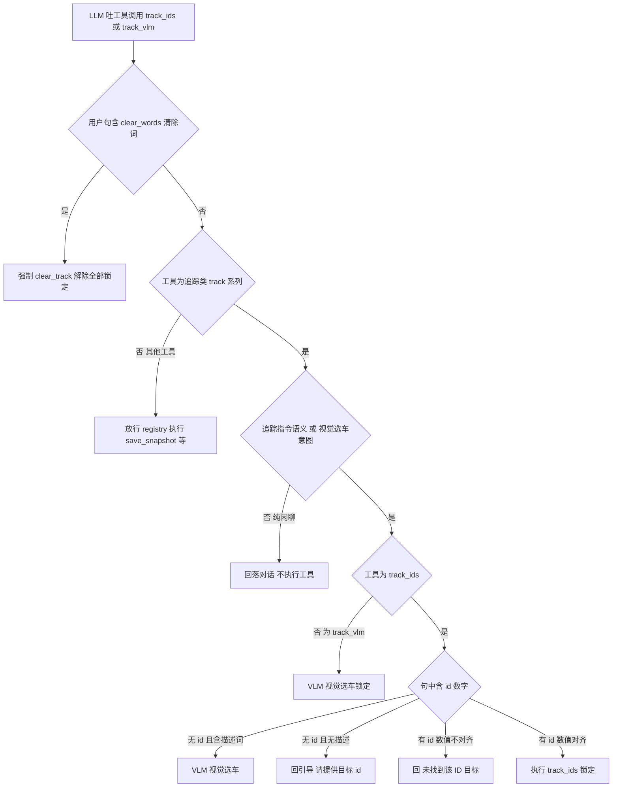

**知识储备补充**：

- **Function Call 与门控的关系**：LLM 不直接执行任何动作——它只"吐"工具调用（原生 rkllm 标签串或 JSON），真正执行的是本地 `CommandWorker._handle`（`track_app.py` L253-318）：`_native_chat` 带 `NATIVE_TOOLS`（L29-41 定义 schema：track_ids / clear_track / save_snapshot 三个函数）请求 → `parse_native` 解析 → `_native_gate` 门控 → 通过才 `registry.call`。因此安全边界在 Python 侧：模型误吐 `track_ids` 不代表会锁车，门控不点头就执行不了——这就是"模型可幻觉、代码可兜底"的信任模型。

- **消息传递解码**：`CommandWorker` 是生产者-消费者（`run` L248-251 死循环从队列 get 再 `_handle`），不阻塞主循环（`_handle` 入口 `engine.pending.set()` 暂停读帧等，L254）。LLM 慢（0.8B 推理秒级）但主循环照常应帧；副作用统一经 `engine.submit_effect(ids, text)` 入主循环事件队列，单线程消费——避免并发修改 session 状态。

- **清理词/复原词与门控短路**：第 ① 分支"清除语义"匹配词表 `config.interaction.clear_words`（清除/解除/取消/停/不追/恢复全/不跟，`track_config.yaml` L76），一旦命中即强制走 `clear_track`（`registry.call("clear_track")`），即使模型吐出的是 `track_ids` 也忽略（`track_app.py` L325-335 注释记录 0.8B 对「清除」误吐 track_ids 的实测）。原因：清除语义是安全操作，宁可多解也不能锁错。此分支与 `parse_instruction` 的 clear 分支词表一致。

- **fail-closed 语义**：门控每个"不确定锁谁"分支（id 不存在 / 数值不对齐 / 闲聊 / VLM 无果）**都不调用 `submit_effect`**，只回引导语（未找到/无法识别类回复由 `_rule_fallback` 或 `_vlm_none`（`track_app.py` L402-405）产出）。fail-closed 是"宁可不动作，也不动作错"——机器人锁车是危险副作用（锁定后即便目标消失也不跟别的车），误锁成本远高于不动作。

- **参考资源**：OpenAI 工具调用（function calling）官方文档；rkllm 原生工具调用说明（`llm_server.py` set_function_tools）；本模块 `tests/test_native_wiring.py`（门控路由 id 对齐/不对齐/清除强制/描述走 VLM/闲聊回落，L18-113）是行为基线。

**易错点**：

- ⚠️ 模型把闲聊误吐成 track_ids → 门控回落对话，不执行工具。这是 fail-closed 的关键安全。

#### 步骤3：文本全链路 + 清除强制 + 闲聊回落（约90min）

**操作步骤**：

1. 文本全链路：`python3 apps/track_app.py --video /home/iflytek/ros2_ws/src/xflz_eai_car1/vision/07_multi_object_tracking/test.mp4 --text --mjpeg`，先输入`小飞小飞`唤醒，再输入`追踪 id3 的车`。
2. 观察 `[cmd] track_ids {3}` → 播报"好的，只追踪 id3"。
3. 输入 `清除`：观察 `[cmd] 清除语义指令，执行 clear_track` → 解除锁定。验证 clear_words 命中强制 clear_track（R9）。
4. 输入 `你好`：观察 `[LLM] <自然回复>`，且 `[cmd] 不存在`——不执行工具（闲聊回落干净请求）。

```bash
python3 apps/track_app.py --video /home/iflytek/ros2_ws/src/xflz_eai_car1/vision/07_multi_object_tracking/test.mp4 --text --mjpeg
# 先输入：小飞小飞
# 再输入：追踪 id3 的车
# 再输入：清除
# 再输入：你好（闲聊）
```

**易错点**：

- ⚠️ 闲聊回落用干净请求（不写 llm_chat.history），避免工具轮串进闲聊上下文。

#### 步骤4：理解 LLM 子进程常驻（server_manager）与 rules 兜底（约50min）

**操作步骤**：

1. 阅读 `llm/server_manager.py`：auto_start=true 自动拉起 Flask 子进程（常驻 8080），同项目复用。
2. 阅读 `tools/tools.py` 的 parse_instruction（L45-68）规则兜底（无 LLM 也能追踪/清除）。
3. 模拟断网/无 LLM：服务不可达 → `_rule_fallback`，追踪/清除仍可，闲聊不可 → 理解 rules 兜底不崩线程。

```bash
pkill -f llm_server        # 清残留 LLM（断网/停服务模拟）
# 或 config 关 llm.enabled=false 后重跑 track_app
python3 apps/track_app.py --video /home/iflytek/ros2_ws/src/xflz_eai_car1/vision/07_multi_object_tracking/test.mp4 --text   # 先小飞小飞，再 追踪 id3 → 规则兜底
```

**知识储备补充**：

- **LLM 子进程生命周期**：`llm/server_manager.py`（复用 elderly_companion/llm）的 `LLMServerManager` 职责：端口预检 → 按需拉起子进程 → 就绪轮询（GET /v1/models）→ 退出清理。`ensure_running`（L55-111）：先探测 `llm.server.port`（默认 8080，0=自动选空闲）是否已监听且响应 /v1/models——已就绪则复用外部服务，否则按 `auto_start=true` 拉起 Flask 子进程并轮询等就绪（超 120s 抛错）。`stop`（L113-117）只终止自己拉起的子进程，复用外部服务不动。同一进程内多个实验共享 8080，`pkill -f llm_server` 是清理残留的标准动作（`track_app.py` main 的 finally 也调 `llm_mgr.stop()`）。

- **规则兜底 parse_instruction**：`tools/tools.py` 的 `parse_instruction`（L46-77）是无 LLM 时的规则解析器，按固定顺序：

  ①颜色词 + 车类词（红/蓝/…/车/卡车/轿车）→ `{"tool":"track_vlm","args":{"color":...}}`（L55-57）；

  ②阿拉伯/中文数字 → track_ids（L58-70，中文数字经 `_zh_to_num` L13-37 转 int，如"六十九"→69）；

  ③清除词 → clear_track（L70-72）。返回 None 表示非指令。核心约束：追踪但 id 无法解析时返回 None（L67），**绝不产空 submit 清当前锁**（评审 P0-2：防误清锁）。

```json
interaction:
  clear_words: [清除, 解除, 取消, 停, 不追, 恢复全, 不跟]
  track_words: [追踪, 追, 锁定, 识别, 找, 看, 跟, 停]
  instruct_words: [追踪, 追, 停, 取消, 解除, 不追, 恢复全, 不跟, 清除]
  color_words: [红, 蓝, 白, 黑, 绿, 黄, 灰, 粉, 紫]
  desc_words: [红, 黄, 蓝, 白, 黑, 绿, 灰, 粉, 紫, 卡车, 轿车, suv, 大, 小, 新, 旧]
```

- **中文数字解析公式**：`_zh_to_num`（`tools.py` L13-15）把中文数字串按"低位数字 + 十百千单位"求和：

  $$
  v = \sum_{i} \big(\text{低位数字}_i + \text{单位}_i \times \text{系数}_i\big),\quad \text{单位}\in\{十:10,\ 百:100,\ 千:1000\}
  $$

  其中"十/百/千"前无数字时隐式 1（"十六"→16，"三十二"→32），逐位累加：六十九 = 6×10 + 9 = 69。该函数只认 万/亿 以下层级（docstring L13-15），超出返回 None——边界是设计取舍，不是 bug。

- **fail-closed 与兜底的层次**：正常 LLM → 门控+execution；LLM 失败/超时/误触 → `_rule_fallback`（`track_app.py` L618-626：`parse_instruction` → 执行或回"没听懂"）。兜底只支持追踪/清除/列目标，不支持闲聊（闲聊无规则可匹配 → "没听懂"，`test_chat_reply_clean.py` L206-217 断言）。三层防线：FunctionCall 解析 → 门控 → 规则兜底，任一层失败都向更保守层退。

- **参考资源**：Flask 官方文档（`llm_server.py` 提供 /v1/models 的 HTTP 服务）；rkllm 官方 SDK（set_function_tools）；`tests/test_tools.py` 中文数字/规则用例；本实验 `docs/09_事件与故障测试用例.md` 内的故障注入用例。

**易错点**：

- ⚠️ 关闭 LLM `enabled=false` → 规则兜底仅支持追踪/清除/列目标，无闲聊；重启注意 pkill -f llm_server 清理。

### 5.7 注意事项

- ⚠️ 本实验文本模式 `--text` 无需语音硬件；但 LLM 服务需板端（自动起 8080）。
- ⚠️ 实验后 pkill -f llm_server 清理常驻 LLM 子进程。
- ⚠️ fail-closed 是安全核心：任何「不确定锁谁」都不执行工具；不要自行放宽门控。

### 5.8 实验总结

**完成成果**: pytest 门控用例全绿证明；一张 _native_gate 路由顺序图；文本全链路验证日志（追踪/清除/闲聊）；rules 兜底测试记录。

**技能收获**:

- 技能1：LLM FunctionCall 工具调用解析（JSON + 原生标签）
- 技能2：门控路由与 fail-closed 安全设计
- 技能3：LLM 子进程常驻管理与 rules 兜底

**常见问题与解决**:

| 问题 | 原因 | 解决 |
|------|------|------|
| 模型误触工具 | 0.8B 对非指令误吐 track_ids | 非指令回落对话（fail-closed） |
| 「清除」仍锁 | clear_words 未命中 | 补 clear_words；模型误导时强制以 clear_words 短路 |
| 无闲聊 | LLM 关闭 | 回退规则兜底（仅追踪/清除） |
| LLM 子进程占用 | server_manager 常驻 8080 | pkill -f llm_server |

### 5.9 实验报告要求

**思考题**:

1. _native_gate 路由顺序为什么"清除>非指令回落>id>描述VLM>放行"？如果颠倒顺序会带来什么安全风险？
2. "闲聊回落"为什么用干净请求（不写 history）？若不如此会怎样污染指令上下文？
3. 什么时候启用规则兜底（parse_instruction）？它对 fail-closed 的意义

**评分标准**:

- pytest 门控用例（20 分）
- 门控路由图（25 分）：顺序正确、fail-closed 标注
- 文本全链路验证（35 分）：追踪/清除/闲聊三例
- LLM 进程与兜底语义（20 分）= 100 分。

---

## 更新日志

| 版本 | 日期 | 说明 |
|------|------|------|
| v1.0 | 2026-09-07 | 初始版本，基于 EXP006b 源码与文档生成 |
| v2.0 | 2026-09-07 | 知识储备增强 |

---
# 实验6：VLM描述选目标集成测试（4h）


### 6.1 关联知识点

- 4.3.1 VLM 视觉选目标：网格构图→绝对 track id（前置：4.1.1）
- 4.3.2 VLM fail-closed（不确定/99/无匹配回引导，绝不锁错）（前置：4.3.1）
- 4.3.3 vlm.fake_result_id 调试 + cell_cap=16 候选上限（前置：4.3.1）

### 6.2 实验目标

1. **掌握**描述选车 VLM 网格构图与选目标原理（crops→grid→编号→绝对 id）。
2. **理解** VLM fail-closed 铁律（绝不锁错目标）：不确定/99/无匹配回引导。
3. **掌握** fake_result_id 与真实 VLM 回退切换以及 cell_cap=16 候选上限。
4. **独立完成** test_vlm_select 颜色选车 + 文本模式描述选车 + 未找到目标 fail-closed 验证。
5. **迁移**：把"网格构图 + 视觉选择 + fail-closed"模式迁移到任意目标描述（人/箱/车）场景。

### 6.3 实验环境

| 类别 | 内容 |
|------|------|
| 硬件 | 具身智能实验箱B2 / 具身智能机器人小车C1（VLM 需板端 RKLLM 视觉模型；无真模型可用 fake） |
| OS | Ubuntu 22.04 + ROS 2 Humble |
| Python | 3.10 |
| 模型 | Qwen3.5-0.8B_vision_rk3576.rknn（VLM 视觉，板端） |
| 命令 | `python3 apps/dump_track_grids.py --video /路径/test.mp4 --frame-step 200`（先生成网格构图到 runs/vlm_frames/）→ 再用 `python3 apps/test_vlm_select.py --image runs/vlm_frames/grid_f<实际帧号>.jpg --json ... --color 红` |
| 文档 | `docs/08_视觉测试用例.md` O7 用例 |

### 6.4 实验难度

- 难度: ⭐⭐⭐（综合性）
- 重点：VLM 网格构图原理（crops→grid→编号→绝对 track id）；fail-closed 铁律。
- 难点：VLM 泛化边界（车辆类别限制）；fake_result_id 调试的正确使用；故障注入（无 VLM 模型回退）。

### 6.5 实验现象

**快速验证流程**：

```bash
cd ~/ros2_ws/src/xflz_eai_car1/app/object_tracking

# 0. 先生成 VLM 网格构图（板端跑视觉推理，产出 runs/vlm_frames/grid_f<帧号>_rx<行>c<列>.jpg+.json）
python3 apps/dump_track_grids.py --video /home/iflytek/ros2_ws/src/xflz_eai_car1/vision/07_multi_object_tracking/test.mp4 --frame-step 200
ls runs/vlm_frames/   # 列表生成的实际文件，记下某个 grid_f*.jpg 对应帧号

# 1. 断言颜色选车（板端或 fake），--image/--json 用上面生成的对应文件
python3 apps/test_vlm_select.py --image runs/vlm_frames/grid_fXXX.jpg --json runs/vlm_frames/grid_fXXX.json --color 红
# （把 grid_fXXX 换成步骤0 里 ls 看到的实际文件名）

# 2. 文本模式描述选车
python3 apps/track_app.py --video /home/iflytek/ros2_ws/src/xflz_eai_car1/vision/07_multi_object_tracking/test.mp4 --text --mjpeg
# 先输入：小飞小飞
# 在输入对话：追踪红色皮卡
```

预期：test_vlm_select 返回匹配绝对 track id（红车）；描述选车在画面有红车时锁定该 id；无匹配/没找到走 fail-closed 回引导，不锁不空 submit。

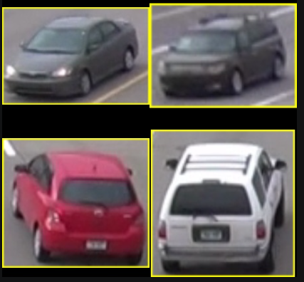

```bash
frame 200: n=4 ids=[29, 30, 32, 33] grid=2x2 cell_ids=[29, 30, 32, 33] -> grid_f200_rx2c2.jpg
frame 400: n=11 ids=[48, 52, 53, 56, 60, 61, 64, 67, 68, 69, 73] grid=4x4 cell_ids=[48, 52, 53, 56, 60, 61, 64, 67, 68, 69, 73] -> grid_f400_rx4c4.jpg
frame 600: n=2 ids=[98, 99] grid=2x2 cell_ids=[98, 99] -> grid_f600_rx2c2.jpg
frame 800: n=7 ids=[114, 117, 120, 121, 125, 126, 127] grid=4x4 cell_ids=[114, 117, 120, 121, 125, 126, 127] -> grid_f800_rx4c4.jpg
...略
```

```json
{
  "source_video": "test.mp4",
  "video_fps": 29.97,
  "frame_index": 200,
  "timestamp_s": 6.673,
  "grid": {
    "rows": 2,
    "cols": 2,
    "cell_cap": 16
  },
  "order": [
    29,
    30,
    32,
    33
  ],
  "cells": [
    {
      "id": 29,
      "class_id": 2,
      "class_name": "car"
    },
    {
      "id": 30,
      "class_id": 2,
      "class_name": "car"
    },
    {
      "id": 32,
      "class_id": 2,
      "class_name": "car"
    },
    {
      "id": 33,
      "class_id": 2,
      "class_name": "car"
    }
  ],
  "cell_count": 4,
  "class_counts": {
    "car": 4
  },
  "total_tracks": 4
}
```

```
(ros2_venv) iflytek@localhost:~/ros2_ws/src/xflz_eai_car1/app/object_tracking$ python3 apps/test_vlm_select.py --image runs/vlm_frames/grid_f200_rx2c2.jpg --json runs/vlm_frames/grid_f200_rx2c2.json --color 红
图: grid_f200_rx2c2.jpg  448x448  grid 2x2  order(row-major)=[29, 30, 32, 33]
=== PROMPT(带 id 顺序) ===
图片是 2 行 2 列的网格。数字 xx 代表该格有目标图片，? 代表没有物体（空位）。
网格编号布局（行优先从左到右、从上到下）：
1·2
3·4
编号对应 ID：
1 = 29
2 = 30
3 = 32
4 = 33
目标描述：有一辆红色车辆。
请回答目标所在格的编号数字（只答数字，1..4）。找不到时回答 0。不要写别的。
...略
=== VLM 原始输出 ===
'3'  (5s)
→ 格子编号 3 => 绝对 track id 32
```

### 6.6 实验步骤

#### 整体流程图

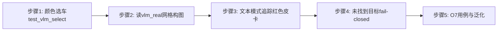

#### 步骤1：生成网格构图 + 运行颜色选车（约70min）

**操作步骤**：

1. 若 `runs/vlm_frames/` 尚无网格图，先用 `dump_track_grids.py` 生成（对视频跑 YOLO+ReID，按 `--frame-step` 采样拼 448×448 网格到 runs/vlm_frames/，不调用 VLM，只依赖检测/模型）：
   ```bash
   cd ~/ros2_ws/src/xflz_eai_car1/app/object_tracking
   python3 apps/dump_track_grids.py --video /home/iflytek/ros2_ws/src/xflz_eai_car1/vision/07_multi_object_tracking/test.mp4 --frame-step 200
   ls runs/vlm_frames/   # 记下实际生成的 grid_f<帧号>_rx<行>c<列>.jpg / .json
   ```

   ```
   grid_f200_rx2c2.jpg   grid_f400_rx4c4.jpg   grid_f600_rx2c2.jpg   grid_f800_rx4c4.jpg
   grid_f200_rx2c2.json  grid_f400_rx4c4.json  grid_f600_rx2c2.json  grid_f800_rx4c4.json
   ```

2. 用**实际生成的文件**跑颜色选车：

   ```bash
   python3 apps/test_vlm_select.py \
     --image runs/vlm_frames/grid_f<实际帧号>.jpg \
     --json  runs/vlm_frames/grid_f<实际帧号>.json \
     --color 红
    
   # 下面参考
   python3 apps/test_vlm_select.py --image runs/vlm_frames/grid_f200_rx2c2.jpg --json runs/vlm_frames/grid_f200_rx2c2.json --color 红
   ```

3. 观察 VLM 返回绝对 track id；`--desc '红色小轿车'` 亦可。

**易错点**：

- ⚠️ json 需与 image 对齐（同一帧的 grid_fXXX 的 .jpg/.json 必须名字一致，由 dump_track_grids 同帧生成）。描述词未与词表匹配（`--color`/`--desc` 不在 color_words/desc_words）时直接无果。
- ⚠️ `--frame-step` 控制采样帧号：200 → 每 200 帧 dump 一张（grid_f200/400/...）；若想指定某帧，改用 `--frame-step 1` 全量采样后挑含目标车的那张。

#### 步骤2：读 vlm_real.py，理解网格构图返回绝对 id（约90min）

**操作步骤**：

1. 读 `tools/vlm_real.py`：`build_grid`（L175-213，按 id 升序排成标准化网格）、`grid_select_prompt`（L215-240，给 VLM 布局表 + "编号 i+1={cell_ids[i]}"）、`_parse_tile`（L241-260，1..n 返 int，0/99→None）、`RKLMColorSelect`（L280-497 select_crops→绝对 id）。
2. 理解编号→绝对 id 映射：VLM 只答编号数字，`select_crops` 用 `cell_ids[k-1]` 映回绝对 track id。
3. 理解候选上限：cell_cap=16 超则不锁。

**参考模板**（VLM 网格构图与编号映射原理图，学生绘制时可对照）：

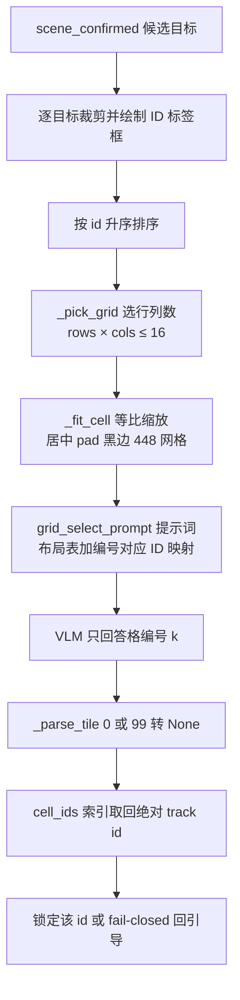

**知识储备补充**：

- **背景与动机**：多模态模型（VLM）能"看图说话"，但直接问"哪辆是红车"模型只能答"左边那辆/框里那个"这类位置描述，无法直接给出可执行的 track id——因为 track id 是 Python 侧动态分配的，模型不知道。解决方案是"网格画像"：把每个候选目标裁成小图、按 id 升序拼成标准网格、在提示词里显式给出"第 k 格 = 绝对 id X"的布局表，让 VLM 只回答格编号（1..n 的数字），再由 Python 把编号映射回绝对 id。模型回答从"自由文本"收敛为"单个枚举数字"，幻觉面大幅缩小。

- **网格构图 build_grid**：`tools/vlm_real.py` `build_grid`（L187-213）做四件事：

  ①输入 `crops`（每格目标 BGR 裁剪）与 `ids`（对应绝对 track id），按 id 升序配对（L193 `sorted(zip(ids, crops))`）；

  ②过滤空裁剪（`size>0`，L194-196）；

  ③`_pick_grid`（L170-185）从 448 的整除因子里选 (rows, cols)，约束 $rows \times cols \le cell\_cap$ 且 $\ge n$（候选数），排序键是 (方形度 |r-c|, 格子数, min(r,c), r)——**方形优先于格子数少**：例如 3 个候选时选 2×2（4 格、|r-c|=0），5 个候选时选 4×4（16 格、|r-c|=0）而不是 2×4（8 格但 |r-c|=2）；

  ④每个 crop 经 `_fit_cell`（L151-167）等比缩放到 `cell_px = 448 // max(rows,cols)`、居中黑边 pad（不拉伸破坏宽高比），按行优先填入网格。返回 `(grid_bgr, cell_ids, (rows,cols))`；无候选或超出 cell_cap → None（上层 fail-closed）。

- **布局表与编号对应**：`grid_select_prompt`（L215-240）生成提示词：先声明"图片是 R 行 C 列网格，数字 xx 代表该格有目标图、? 代表空位"，再贴布局表（有内容格填编号 1..N、空位填 `?`，行间用 `·` 分隔，L224-227）、"编号对应 ID：i+1 = cell_ids[i]"映射块（L228-231），最后给"目标描述"并问"只答数字（1..R*C），找不到答 0"。关键设计：**空位显式标记成 `?`**（旧版用 `·`/编号会让 4×4 模型把空位也当有效格，选格 0/3；改成 `?` 后 4×4 命中 3/3）；且**不提供"不确定/99"逃逸口**（L218 注释）——0.8B 见到 escape 会直接答不确定而偷懒；无匹配的唯一合法输出是 0。

- **编号→绝对 id 映射与 _parse_tile**：`_parse_tile`（L248-263）从 VLM 回复中正则提取数字：1≤k≤n 返 k（格编号），0 与 99 都→None（无选择契约，L256-258），其他→None。`select_crops`（L433-473）最后用 `int(cell_ids[k-1])` 把格编号映回**绝对 track id**（L471）。数值示例：cell_ids=[3,7,15]（3 号、7 号、15 号车），VLM 答 "2" → k=2 → cell_ids[1]=7 → 锁定 id 7。若把编号当 id 直接用（锁 2），就会锁错目标——这正是实验易错点的根源。

- **网格单元尺寸与编号公式**：448px 网格被切分为 rows×cols 个单元，单元边长与"行优先编号→绝对 id"映射关系为：

  $$
  cell\_px = \left\lfloor \frac{448}{\max(rows,\ cols)} \right\rfloor, \qquad k = r \times cols + c + 1, \qquad id = cell\_ids[k-1]
  $$

  其中 $rows, cols$ 为 `_pick_grid`（L170-185）选出的行列数、$k$ 为行优先编号（第 $r$ 行第 $c$ 列，均从 0 起）、$cell\_ids[k-1]$ 为编号 $k$ 对应的绝对 track id。数值示例：3 个候选（ids=[3,7,15]）选 2×2 网格，$cell_{px}=\lfloor448/2\rfloor=224$；布局按行优先为 cell_ids=[3,7,15,·]（第 4 格空位，提示词中显示为 `?`），编号 1→id3、2→id7、3→id15。VLM 答 "2" → 锁 id7。

- **cell_cap=16 候选上限**：`_pick_grid` 约束 $rows \times cols \le cell\_cap$（默认 16，`config/track_config.yaml` L35-36 vlm.grid.cell_cap）。原因：网格越大，VLM 视觉分辨率越差（448px 网格、4×4 时每格仅 112px），容易误判；格子太多提示词也更长。超过 16 个候选 → `build_grid` 返回 None → `_vlm_none` 回引导不锁（fail-closed）。

- **参考资源**：Qwen-VL 系列视觉模型文档（RKLLM 多模态接口）；rkllm 多模态输入（img_width/img_height/n_image_tokens，`vlm_real.py` L303-310）；`tests/test_vlm_grid.py`/`test_vlm_real.py` 网格边界用例（超容量/无候选→None）。

**易错点**：

- ⚠️ VLM 返回的是编号（无量纲），绝对 id 是 `cell_ids` 数组映射；若直接当 id 用会锁错目标。

#### 步骤3：文本模式输入"追踪红色皮卡"观察 VLM 选车锁定（约60min）

**操作步骤**：

1. `python3 apps/track_app.py --video /home/iflytek/ros2_ws/src/xflz_eai_car1/vision/07_multi_object_tracking/test.mp4 --text`，先输入`小飞小飞`唤醒，再输入`追踪红色皮卡`。
2. 有红车：`[track_vlm] dump 网格` → `锁定目标 ID X`（X 在当前画面）。
3. 无红车：`[track_vlm] 无法识别该描述目标` → 引导。

```bash
python3 apps/track_app.py --video /home/iflytek/ros2_ws/src/xflz_eai_car1/vision/07_multi_object_tracking/test.mp4 --text --mjpeg
# 先输入：小飞小飞
# 再输入：追踪红色小轿车
```

```bash
[2026-09-08 14:37:16,727][I][llm_mgr] 拉起 LLM 服务: /home/iflytek/ros2_venv/bin/python3 /home/iflytek/ros2_ws/src/xflz_eai_car1/app/elderly_companion/llm/llm_server.py --rkllm_model_path /home/iflytek/models/rkllm/Qwen3.5-0.8B_w4a16_g128_rk3576.rkllm --target_platform rk3576 --port 8080（日志 runs/logs/llm_server.log，首次加载 30-60s）
[2026-09-08 14:37:20,740][I][llm_mgr] LLM 服务就绪: http://127.0.0.1:8080
[2026-09-08 14:37:20,756][I][track_app] 文本模式：stdin 喂词（唤醒词→对话；'track idX'/'清除' 触发指令）
[2026-09-08 14:37:22,939][I][asr] ASR 就绪（provider=cpu, threads=2, method=greedy_search, hotwords=无）
小飞小飞
[2026-09-08 14:37:27,430][I][voice_loop] [文本] 唤醒
[2026-09-08 14:37:27,432][I][voice_loop] 开始聆听（mode=DIALOG）...
追踪红色小轿车
[2026-09-08 14:37:33,358][I][track_app] [cmd] 追踪红色小轿车
[2026-09-08 14:37:43,403][I][track_app] native tool=track_ids args={'ids': [18, 20, 21, 23, 24, 25]}
[2026-09-08 14:37:43,408][I][track_app] [cmd] track_ids 无 id 但含描述，改 VLM 选车
[2026-09-08 14:37:43,416][I][track_app] [track_vlm] dump 带标签网格 -> /home/iflytek/ros2_ws/src/xflz_eai_car1/app/object_tracking/runs/vlm_frames/vlm_in_1788849463414.jpg
[2026-09-08 14:37:43,417][I][track_app] [track_vlm] dump json -> /home/iflytek/ros2_ws/src/xflz_eai_car1/app/object_tracking/runs/vlm_frames/vlm_in_1788849463414.json

...

I RKNN: [14:37:45.703] RKNN LLM Runtime Information, rknn llm lib version: 2.3.3b0 (c824afd6c@2025-08-25T09:55:02)
I RKNN: [14:37:45.704] RKNN Driver Information, version: 0.9.8
I rkllm: Enabled cpus: [4, 5, 6, 7]
I rkllm: Enabled cpus num: 4
I rkllm: Using mrope
[2026-09-08 14:37:55,551][I][track_app] [track_vlm] 锁定目标 ID 24
[LLM] 好的，锁定目标 ID 24
[2026-09-08 14:37:55,553][I][tts] [TTS-stream] 好的，锁定目标 ID 24
[2026-09-08 14:37:58,817][I][tts] [TTS] id24 已消失
```

追踪前一帧

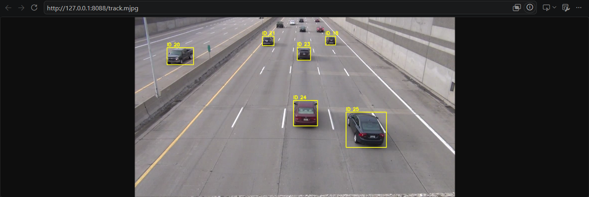

追踪后一帧，实现了VLM自动识别

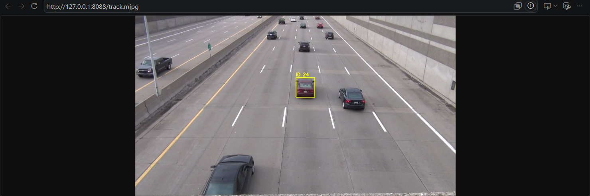

**易错点**：

- ⚠️ VLM 候选来自 scene_confirmed → 锁的必在当前画面；若描述无视觉特征（如"那个人"）→ 不确定 → 引导。

#### 步骤4：输入未找到目标描述，验证 fail-closed 回引导不锁（约50min）

**操作步骤**：

1. 输入 `追踪蓝色轿车`（画面无蓝车）→ 观察 `[track_vlm] 无法识别` 回引导，不锁车。
2. 验证 0/99/无匹配 → `_vlm_none`，绝不 submit 空/错 id。
3. 思考 fail-closed 铁律的意义：绝不锁错目标（R8）。

```bash
python3 apps/track_app.py --video /home/iflytek/ros2_ws/src/xflz_eai_car1/vision/07_multi_object_tracking/test.mp4 --text --mjpeg
# 先输入：小飞小飞
# 再输入：追踪火车（画面无蓝车 → fail-closed 回引导，不锁车）
```

```bash
[2026-09-08 14:42:02,712][I][llm_mgr] 拉起 LLM 服务: /home/iflytek/ros2_venv/bin/python3 /home/iflytek/ros2_ws/src/xflz_eai_car1/app/elderly_companion/llm/llm_server.py --rkllm_model_path /home/iflytek/models/rkllm/Qwen3.5-0.8B_w4a16_g128_rk3576.rkllm --target_platform rk3576 --port 8080（日志 runs/logs/llm_server.log，首次加载 30-60s）
[2026-09-08 14:42:08,726][I][llm_mgr] LLM 服务就绪: http://127.0.0.1:8080
[2026-09-08 14:42:08,742][I][track_app] 文本模式：stdin 喂词（唤醒词→对话；'track idX'/'清除' 触发指令）
[2026-09-08 14:42:10,825][I][asr] ASR 就绪（provider=cpu, threads=2, method=greedy_search, hotwords=无）
小飞小飞
[2026-09-08 14:42:11,702][I][voice_loop] [文本] 唤醒
[2026-09-08 14:42:11,706][I][voice_loop] 开始聆听（mode=DIALOG）...
追踪火车
[2026-09-08 14:42:15,165][I][track_app] [cmd] 追踪火车
[2026-09-08 14:42:25,226][I][track_app] native tool=track_ids args={'ids': [6, 10, 12, 13, 14, 15, 16]}
[2026-09-08 14:42:25,233][I][track_app] [cmd] track_ids 无可用 id，回引导
[LLM] 好的，要追踪请告诉我目标 id，例如「追踪 id53」
[2026-09-08 14:42:25,234][I][tts] [TTS-stream] 好的，要追踪请告诉我目标 id，例如「追踪 id53」
```

**知识储备补充**：

- **fail-closed 的定义域**：fail-closed（失效即关闭/保守）指"任何无法确定锁哪个目标的路径都不得产生副作用"。本实验具体三条：①VLM 不可用（懒加载失败 `self._loaded=False`）→ `select`/`select_crops` 返回 None（`vlm_real.py` L417-431/L442-462 的 try/except 全程兜底）；

  ②VLM 回复解析不出合法编号（0 / 99 / 非数字 / 越界）→ `_parse_tile` 返回 None；

  ③候选超 cell_cap=16 → `build_grid` 返回 None。三条路径最终都汇入 `CommandWorker._vlm_none`（`track_app.py` L402-405）：只 WARN + 回引导语"暂时无法识别该目标，请描述更具体（颜色/车型）或告诉我目标编号"，**绝不调用 `submit_effect`**——因为 submit_effect(None) 会把当前锁定清空（副作用），submit_effect(错 id) 会锁错车（更危险）。

- **为什么 99 与 0 都要拒绝**：`_parse_tile`（L248-263）把 0 和 99 都→None。0 是提示词约定的"找不到"输出；99 是历史模型版本会输出的"不确定"逃逸码（现版本提示词已删掉逃逸口，但解析器保留 99 兜底兼容旧模型输出）。两者含义都是"VLM 无法确定"，必须同等对待为无结果——即使画面"看起来显然只有一辆"，也不允许猜，因为 VLM 可能看漏了画面角落里的第二辆（低置信但真实存在）。ReID 的目标是"不丢 ID"，VLM 的目标是"不锁错"，后者优先级更高。

- **fail-closed 与 fake 调试的关系**：`vlm.fake_result_id=3`（`track_config.yaml` L33）让 `FakeVLMSelect.select_crops`（`vlm_fake.py` L14-18）固定返回 id 3——它绕过真 VLM（无模型也能跑通文本链路），但**固定返回值不代表真实推理**。正确用法：先用 fake 验证链路（构图→提示词→映射→锁定）不再挂死；再切换真 VLM（配置 vision/llm 模型路径）验证语义正确性。若把 fake 当真，会误以为"VLM 永远选 3 号车"，掩盖真实模型的 0/99/幻觉问题（`test_vlm_fake.py` 断言 fake 固定返回配置 id 是契约）。

- **参考资源**：fail-closed 设计模式（安全系统不默认可变语义）；`docs/01_需求总览.md` R8（VLM fail-closed 铁律）；`docs/09_事件与故障测试用例.md`（不锁空/错 id 故障注入）；`tests/test_vlm_real.py` 正例（真模型在场锁红车 id65）与反例（失败回退）。

**易错点**：

- ⚠️ 不要关掉 fail-closed 让它"猜一猜"：VLM 返回 99/0/无匹配都→None→引导。这是防误锁的核心。

#### 步骤5：按 docs/08 的 O7 用例 + VLM 泛化（约50min）

**操作步骤**：

1. 执行 O7：画面有红车锁定 / 无红车回引导 / 候选超上限回引导 / 数值 id 直锁（不走 VLM）。
2. 讨论 VLM 泛化边界：desc_words 主要面向车辆（颜色/车型/车），任意类别需扩展词表（追加进 desc_words）并重新验证。

```bash
python3 apps/track_app.py --video /home/iflytek/ros2_ws/src/xflz_eai_car1/vision/07_multi_object_tracking/test.mp4 --text --mjpeg
# 逐条输入 O7 场景：红车锁定 / 无蓝车 / 超 cap / 数值 id
```

**易错点**：

- ⚠️ fake（vlm.fake_result_id）固定返回 id3，不代表真实 VLM；真 VLM（RKLMColorSelect）懒加载失败返回 None 回退引导。

### 6.7 注意事项

- ⚠️ VLM/LLM 模型需板端（Qwen3.5 vision/llm）；无真实模型用 fake_result_id 调真，但务必认清 fake 是固定 id 调试。
- ⚠️ fail-closed 是铁律，不得因"画面显然只有一辆"而手动省去。任何不确定锁谁 → 引导。
- ⚠️ 保留 runs/vlm_frames 现场；实验后 pkill -f llm_server。

### 6.8 实验总结

**完成成果**: 颜色选车断言结果（绝对 track id）；网格构图原理图；文本模式红车锁定日志；未找到目标 fail-closed 日志。

**技能收获**:

- 技能1：VLM 网格构图 + 绝对 id 映射原理
- 技能2：多模态选目标 fail-closed 设计
- 技能3：fake/真实 VLM 回退调试

**常见问题与解决**:

| 问题 | 原因 | 解决 |
|------|------|------|
| VLM 返回 99 不锁 | fail-closed 铁律 | 回引导，不猜 |
| 描述未命中 | desc_words/color_words 未覆盖 | 扩展词表（车/色）重新验证 |
| cell_cap 超限不锁 | 候选过多（>16） | 优化画面或提高 cell_cap |
| fake 锁 id=3 | fake_result_id 固定 | 仅调试；切真实 VLM 验证 |

### 6.9 实验报告要求

**思考题**:

1. VLM 网格为何把块编号映射为绝对 track id？直接返回索引会有什么数据竞态风险？
2. VLM fail-closed（99/0/无匹配回引导）解决哪类故障？如果放宽让它猜，最严重后果？
3. 什么时候该用 fake_result_id，什么时候用真实 VLM？fake 固定返回 id 的局限是什么？

**评分标准**:

- 颜色选车断言（20 分）
- 网格构图原理（30 分）：build_grid/编号→绝对 id/cell_cap
- 文本模式锁定 + fail-closed（35 分）：红车锁定、未命中引导
- O7 用例与泛化分析（15 分）= 100 分。

---

## 更新日志

| 版本 | 日期 | 说明 |
|------|------|------|
| v1.0 | 2026-09-07 | 初始版本，基于 EXP006b 源码与文档生成 |
| v2.0 | 2026-09-07 | 知识储备增强 |

---
# 实验7：语音交互集成测试（6h）


### 7.1 关联知识点

- 5.1.1 唤醒词（软件 KWS / XFM 六麦 aiui 串口）→ 录音线程启动（plughw:4,0）（前置：无）
- 5.1.2 流式 ASR（zipformer_onnx）增量解码 + 端点检测 → partial → ASR 结果（前置：5.1.1）
- 5.1.3 流式 TTS 按句合成播放 + 播报互斥 playback_event + 打断丢弃 epoch+1（前置：5.1.2）

### 7.2 实验目标

1. **掌握**语音链路唤醒→ASR→LLM 对话/指令→TTS 流式播报全流程（V1-V10 用例）。
2. **理解**录音线程在硬件唤醒后才启动的原因（XFM 时序）、播报互斥 playback_event 与打断丢弃（epoch）。
3. **完成**语音测试用例（唤醒/打断/流式 TTS/无话超时/热词）。
4. **独立完成**对 kws.threshold 调整观察误报变化。
5. **迁移**：文本模式（--text）驱动同一状态机，无硬件先验证的调试方法论。

### 7.3 实验环境

| 类别 | 内容 |
|------|------|
| 硬件 | 具身智能实验箱B2 / 具身智能机器人小车C1 + 讯飞六麦阵列 XFM + 扬声器 |
| OS | Ubuntu 22.04 + ROS 2 Humble |
| Python | 3.10 |
| 核心库 | sherpa_onnx（ASR/KWS）、Matcha-TTS（TTS）、RKLLM |
| 模型 | /home/iflytek/models/{zipformer_kws, zipformer_onnx, tts}（板端） |
| 命令 | `python3 apps/track_app.py --video /home/iflytek/ros2_ws/src/xflz_eai_car1/vision/07_multi_object_tracking/test.mp4 --text`（文本模式）/ `--camera --mjpeg`（语音全链路） |
| 文档 | docs/07_语音测试用例.md |

### 7.4 实验难度

- 难度: ⭐⭐⭐（综合性）
- 重点：语音链路唤醒→ASR→LLM→TTS 流式播报全流程；录音线程在硬件唤醒后启动；播报互斥与打断丢弃。
- 难点：XFM 时序（先停 log_server）、流式合成按句播报、热词表（beam_search 生效）。

### 7.5 实验现象

**快速验证流程**：

```bash
cd ~/ros2_ws/src/xflz_eai_car1/app/object_tracking

# 0. 清理（占用播放/串口/LLM 端口）
pkill -9 aplay; pkill -f llm_server

# 1. 文本模式状态机（无需麦克风）
python3 apps/track_app.py --video /home/iflytek/ros2_ws/src/xflz_eai_car1/vision/07_multi_object_tracking/test.mp4 --text   # 输入小飞小飞→唤醒

# 2. 语音全链路（板端）— 前提：先启动 ROS 相机（另开一终端）
source /opt/ros/humble/setup.bash && source ~/ros2_ws/install/setup.bash
ros2 launch car1_peripherals depth_camera.launch.py        # 终端2：启动相机，提供 /ascamera_hp60c/camera_publisher/rgb0/image
python3 apps/track_app.py --camera --mjpeg                # 终端1：喊 小飞小飞 → 唤醒→录音
```

预期：喊"小飞小飞"→ `检测到唤醒` → `录音线程: plughw:4,0` → 提示音 + `开始聆听（mode=DIALOG）`；说"追踪红色皮卡" → `[ASR 结果]` → `[cmd] track_vlm` → TTS 流式"好的"；说"解除" → `[cmd] 清除语义指令` → 恢复全显示。

### 7.6 实验步骤

#### 整体流程图

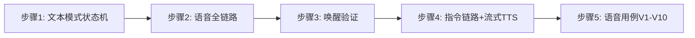

#### 步骤1：文本模式验证状态机（约90min）

**操作步骤**：

1. `python3 apps/track_app.py --video /home/iflytek/ros2_ws/src/xflz_eai_car1/vision/07_multi_object_tracking/test.mp4 --text`。
2. 输入 `小飞小飞` → `[文本] 唤醒` → `开始聆听（mode=DIALOG）`；次行输入 `追踪红色皮卡` → LLM→（描述）→ VLM 选车；`你好` → 闲聊；`清除` → 解除。
3. 理解 `--text` 与音频走同一 VoiceLoop 状态机（`feed_text` 复用回调）。

```bash
cd ~/ros2_ws/src/xflz_eai_car1/app/object_tracking
python3 apps/track_app.py --video /home/iflytek/ros2_ws/src/xflz_eai_car1/vision/07_multi_object_tracking/test.mp4 --text
# 先输入：小飞小飞 → 开始聆听
# 再输入：追踪红色皮卡 / 你好 / 清除
```

**易错点**：

- ⚠️ 文本模式 stdin 首行唤醒词才进入 DIALOG；需要你依次喂入。KWS/硬件唤醒关（text_mode=true 关 KWS 音频）。

**知识储备补充**：
- **同一状态机（--text 与音频同链）**：文本与语音共用 `VoiceLoop`（speech/voice_loop.py）单状态机：`feed_text()`（L164-196）与音频块消费走同一 `_start_listening → _handle_listening → _invoke_dialog` 回调链，`--text` 只把录音线程换成 stdin 逐行喂入。`_merge_args`（apps/track_app.py L74-93）在 `--text` 时置 `cfg["speech"]["text_mode"]=True` 并关 `kws.enabled`/`hardware_wakeup.enabled`——纯文本不启音频 KWS。
- **状态机三态**：IDLE 等待唤醒（KWS 检测/硬件 XFM 事件）→ LISTENING（ASR 识别，mode=DIALOG）→ SPEAKING（TTS 播报，唤醒词可打断，播完双次排空防回声回 IDLE）。状态机是唯一时序控制点，无 set_enabled/active 等多门叠加。
- **无话超时（DIALOG 10s）**：开听后若 10s 无 partial 识别结果 → `_close_stream()` 关窗回 IDLE（`_handle_listening` L361-367），防止录音线程空转与误触发。
- **参考资源**：讯飞 AIUI 开发文档（六麦阵列硬件唤醒与串口协议）；sherpa-onnx 在线识别示例（online ASR + KWS 多流 demo）。

#### 步骤2：启动语音全链路 --camera --mjpeg（约60min）

**操作步骤**：

1. 清理残留（pkill -9 aplay; pkill -f llm_server），启动 ROS 相机（`depth_camera.launch.py`）。
2. `python3 apps/track_app.py --camera --mjpeg`。
3. 观察：`录音线程: plughw:4,0（Recording started）`、`开始聆听`、MJPEG 出流。

```bash
cd ~/ros2_ws/src/xflz_eai_car1/app/object_tracking
pkill -9 aplay; pkill -f llm_server
# 另终端启动相机:
source /opt/ros/humble/setup.bash && source ~/ros2_ws/install/setup.bash
ros2 launch car1_peripherals depth_camera.launch.py
python3 apps/track_app.py --camera --mjpeg     # 语音全链路
```

**易错点**：

- ⚠️ 覆盖 XFM 串口 /dev/ttyACM0 需先停固件 log_server，否则唤醒不触发。

**⚠️ 现象：`xfm_wake] XFM 串口无响应（第N轮，已发 2 个唤醒词设置）→ 硬件唤醒暂未就绪（后台自愈探测，稍后自动接管）`**

> 这是 XFM 六麦**设备冷启动/固件未就绪**的常见现象（设备上电后固件需几秒~几分钟才完成握手），`track_app` 会**后台持续探测，设备就绪后自动接管**，通常**不需要人工干预**。按顺序排查：

```bash
# ① 先等几分钟（后台自愈，日志停止报"串口无响应"即就绪）。若等后仍无响应，继续 ②③
sleep 120 && grep -n "XFM\|xfm_wake" runs/logs/track_app.log   # 看是否已自动就绪

# ② 用独立脚本手动探测固件（不经过 track_app，验证串口/固件本身是否正常）：
#   正常输出: 成功打开设备: /dev/ttyACM0 → 讯飞麦克风阵列通信已启动 → 喊"小飞小飞"收到 aiui_event
python /home/iflytek/ros2_ws/src/xflz_eai_car1/interaction/car1_speech/tools/xf_mic_array.py

# ③ 若脚本也连不上：停 log_server 释放串口，重插 USB，再试
pkill -f log_server; ls -l /dev/ttyACM0    # 确认 USB 枚举(VID:PID=1a86:55d4→/dev/ttyACM0)
```

- 有应答但 track_app 仍报"无响应"：多为**串口被 log_server 占用**（文档前述），停 log 后重跑。
- 脚本正常收到唤醒（`'aiui_event'` 含 `detected 唤醒`）而 track_app 没有 → 是 track_app 侧时序/占用，重启 track_app 复验。

**知识储备补充**：
- **XFM 硬件唤醒时序（先唤醒后开录音）**：XFM 六麦阵列通过串口 `/dev/ttyACM0` 上报 aiui 唤醒事件。`notify_wake()`（speech/voice_loop.py L149-158）里才调用 `_ensure_capture()` 打开 ALSA——XFM 在唤醒事件后才出可用音频流，提前常开会把设备停在监听态稀疏流、唤醒后也不恢复（asr_test 实测时序）。因此"录音线程在硬件唤醒后才启动"不是简化而是硬约束。
- **双路径唤醒**：无 XFM 硬件唤醒（纯软件 KWS/普通麦克风）时 `run()` 无 `hardware_wake` 分支直接 `_ensure_capture()` 常开录音——IDLE 态把同一队列音频块喂给 KWS（`_handle_idle` L321-331）。两种路径最终都进 `_start_listening(DIALOG)` 同一状态机。
- **XFM 词表与防抖**：`config_schema.py` 的 `speech.kws.hardware_wakeup` 段 `port=/dev/ttyACM0`、`wake_words=["小飞小飞","小飞同学"]`；XfMicArray 内 3s 防抖。AIUI 事件 `{'type':'aiui_event'}` → `on_wake` 回调（speech/xfm_wake.py L195）。
- **plughw:4,0 定址**：`capture_device` 默认 `plughw:4,0` 是 ALSA 的 card 4、device 0 插件名；USB 插拔后 card 号可能漂移，XFM 声卡检测（common/xfm_detect.py）可动态探测回退，实验若换 USB 口需确认仍指向 XFM。
- **参考资源**：讯飞 AIUI 串口协议文档；ALSA `arecord -l` 设备定址说明；sherpa-onnx KWS 文档（KeywordSpotter 参数）。

#### 步骤3：喊"小飞"验证唤醒→录音→聆听（约70min）

**操作步骤**：

1. 喊"小飞小飞"（软件 KWS 或 XFM 硬件唤醒）→ `检测到唤醒` → 录音线程（plughw:4,0）→ 提示音 → `开始聆听`。
2. 若用 KWS 软件：确认 `kws.enabled=true` 与 `kws.threshold`（0.25 正常）。
3. 观察 `[ASR 实时]` 逐字回显判定麦克风健康；`[diag] 录音 X 帧/5s`（X≈50 正常，≈10 自愈）。

```bash
cd ~/ros2_ws/src/xflz_eai_car1/app/object_tracking
python3 apps/track_app.py --video /home/iflytek/ros2_ws/src/xflz_eai_car1/vision/07_multi_object_tracking/test.mp4 --text
# 运行中念"小飞小飞"，观察唤醒/录音
grep -n "kws.enabled\|threshold" config/track_config.yaml
```

**易错点**：

- ⚠️ 录音低帧自愈（≤30 帧重开，≤3 次）；若 X≈10 持续，查 ASR 线程或设备；`[diag] 队列 0`=ASR 消费正常。
- ⚠️ 喊"小飞小飞"无反应但串口已开 → **XFM 冷启动自愈中**：`track_app` 后台探测稍后自动接管，等 1~2 分钟再喊；若持续无响应按步骤2 排障（手动 `xf_mic_array.py` 探测）。

**知识储备补充**：
- **流式 ASR 增量解码（zipformer_onnx）**：sherpa_onnx `OnlineRecognizer` 外部驱动：`create_stream()` 建识别流（speech/asr.py L84-86），每帧 0.1s@16k 音频 `feed()` 增量解码（L88-90），返回 `(partial, final)`。partial 是未定稿的中间结果（`[ASR 实时]` 逐字回显的来源），final 是端点判定后的定稿。端点检测由识别器内置：rule1=4.5s 静音 / rule2=1.5s / rule3=300ms——说明"话说完了"由静音时长分层判定，不是等固定时长。
- **帧率健康判定公式**：录音线程每次 `read(1600)` 取 0.1s 音频（`_capture_loop`，speech/voice_loop.py L214-225），5s 窗口期望帧数：

  $$
  F = \frac{5.0\text{ s}}{0.1\text{ s/帧}} = 50 \text{ 帧}
  $$

  其中 0.1s = 1600 samples / 16000 Hz。`[diag] 录音 X 帧/5s` 的 X≈50 正常；`HEALTH_LOW_FPS=30`（speech/voice_loop.py L38）为失步阈值，连续 2 窗口（`HEALTH_BEATS=2`，L39）触发重开 ALSA，上限 3 次、冷却 30s（`HEALTH_REOPEN_MAX/COOLDOWN` L40-41）。X≈10 说明只有 ~500ms/5s 有数据，设备已失步。
- **KWS 阈值与误报机理**：`WakeWordDetector`（speech/kws.py）`threshold=0.25`（config_schema 默认）是命中关键词的判定门槛，`score=1.5` 是关键词偏移分；阈值越低越容易误触发（把近似发音判成唤醒），调高到 0.4 降低误报但可能漏唤醒——这是检测器置信度阈值的基本权衡。
- **调试自修（队列深度）**：`[diag] 队列 0` 表示 ASR 消费速度 ≥ 录音生产速度（队列无积压）；队列 maxsize=100（0.1s/帧×100≈10s 缓冲），若持续积压说明 ASR 解码过慢，会丢帧（满时丢旧留新）。
- **参考资源**：sherpa-onnx OnlineRecognizer 文档与端点点检测参数说明；zipformer 论文《Zipformer: A Faster and Better Online Neural Transducer》；ALSA 帧/采样率换算说明。

#### 步骤4：说"追踪红色皮卡"验证 ASR→LLM→TTS（约90min）

**操作步骤**：

1. `[ASR 结果] 追踪红色皮卡` → `[cmd] track_vlm`（描述带色无 id → VLM 网格选车）→ 锁定绝对 ID → 流式 TTS"好的"。
2. 验证**流式 TTS**：`[tts]` 合成/播放，首句即出声（不等整段合成完）。
3. 验证播报互斥 `playback_event`：播报期间不开 ASR 窗口，防回声；打断丢弃（新唤醒 → epoch+1 → 旧回复丢弃）。

```bash
cd ~/ros2_ws/src/xflz_eai_car1/app/object_tracking
python3 apps/track_app.py --video /home/iflytek/ros2_ws/src/xflz_eai_car1/vision/07_multi_object_tracking/test.mp4 --text
# 先输入：小飞小飞
# 再输入：追踪红色皮卡 → 观察 ASR→VLM→TTS 流式
```

**易错点**：

- ⚠️ 播报被识别进用户话 → playback_event 未生效；重启 track_app 复验。
- ⚠️ 流式 TTS 打断用 epoch：SPEAKING 中新唤醒 → epoch+1 → LLM worker 发现 epoch 变化即丢。

**知识储备补充**：
- **流式 TTS 分句合成（首句即播）**：`Speaker.say_stream_chunk()`（speech/tts.py）维护 `_stream_buffer`，用 `_SENTENCE_RE = ([。！？;，、!]|[.?!,](?=\s|$))` 切句，每句立即 `generate` 合成（Matcha-TTS 声学模型 + Vocos 声码器）入播放队列——LLM 边出 token 边切句边播，首句在 LLM 输出几句后即出声，不等整段。`OfflineTtsConfig(max_num_sentences=1)` 单句合成保证低延迟。调度链路：CommandWorker `_emit_stream_reply`（apps/track_app.py）按同款正则切句 → `on_stream_sentence`（接 `say_stream_chunk`）。
- **播报互斥 playback_event**：装配层创建共享 `threading.Event`（apps/track_app.py `_build_speech` L105-115）同时传给 Speaker 与 VoiceLoop。TTS 播报期间 event 置位 → VoiceLoop SPEAKING 态不喂 ASR（主循环在 `_handle_speaking` 中只做打断检测+等播完），防扬声器声音被麦克风重新识别（回声）；`interrupt()` 清 event 释放互斥。
- **epoch 打断丢弃**：`_interrupt()`（speech/voice_loop.py L398-404）`self._epoch += 1` 并 `Playback.interrupt()` 杀 aplay 清队列。SPEAKING 中新唤醒 → 打断 → `_start_listening` 新 DIALOG；worker 持入场时的 epoch，CommandWorker `_handle` 在应用副作用前校验 `epoch_getter() != ep` → 丢弃迟到回复（apps/track_app.py L256-259，"epoch 已变，丢弃迟到指令"）——保证旧 LLM 回复不迟到播报/执行。
- **参考资源**：Matcha-TTS 论文（Conditional Flow Matching 声学模型）；sherpa-onnx OfflineTts 文档；Vocos 声码器源码（ICLR 2024）。

#### 步骤5：按 docs/07 执行唤醒/打断/流式用例（约70min）

**操作步骤**：

1. 执行 V1 唤醒 / V2 天气（流式 TTS）/ V3「追踪一百号目标」找不到 / V4 描述选车 / V5 清除 / V6 闲聊 / V7 无话 10s 超时 / V8 打断 / V9 录音健康。
2. 调 `kws.threshold`（0.25 → 0.4）观察误报下降；确认热词 in beam_search（greedy 不支持热词）。

```bash
cd ~/ros2_ws/src/xflz_eai_car1/app/object_tracking
cp config/track_config.yaml /tmp/tc.bak
sed -i 's/kws.threshold: 0.25/kws.threshold: 0.4/' config/track_config.yaml
python3 apps/track_app.py --camera --mjpeg      # 重跑统计误报
# 确认热词解码方法（greedy_search 下热词不生效）
grep -n "decoding_method\|hotwords" config/track_config.yaml
cp /tmp/tc.bak config/track_config.yaml
```

**易错点**：

- ⚠️ `config/hotwords.txt` 热词在 greedy_search 下不生效，需 `modified_beam_search` + garbage_score；观察识别偏差时先确认解码方法。

**知识储备补充**：
- **热词与解码方法**：sherpa-onnx 热词仅在 `modified_beam_search` 解码下生效（speech/asr.py L36-37）：`decoding_method != "greedy_search"` 时才把 `hotwords_file` 传给识别器（L58-59），配置默认是 `greedy_search`（config_schema.py）——所以实验要先确认解码方法再谈热词。`hotwords_score=2.0` 是热词加分，词表 `config/hotwords.txt` 需 CJK 单字空格分隔。
- **调参观察方法**：`kws.threshold`（0.25→0.4）是单一变量实验——固定同一唤醒词与场景（噪声水平一致），录制 N 次唤醒尝试统计：误报率 = 未唤醒时误触发次数 / 总时长，漏报率 = 唤醒词未触发次数 / N。阈值升高 → 误报下降、漏报上升，取业务可接受交点。这类"阈值-误差权衡"是检测系统通用调参范式。
- **V 用例分层设计**：V1-V9 从单点（唤醒/识别）到链路（指令→TTS）、异常（无话超时/打断/低帧）逐层覆盖，对应"先部件后集成后异常"的测试方法论；V3「追踪一百号」验证 fail-closed 门控（id 不对齐直接回"未找到"，不走 VLM）——语音用例表本身就是语音链路的验收清单。
- **参考资源**：sherpa-onnx 热词（hotwords）文档；KeywordSpotter 参数官方说明。

**参考模板**（语音状态机，stateDiagram-v2）：

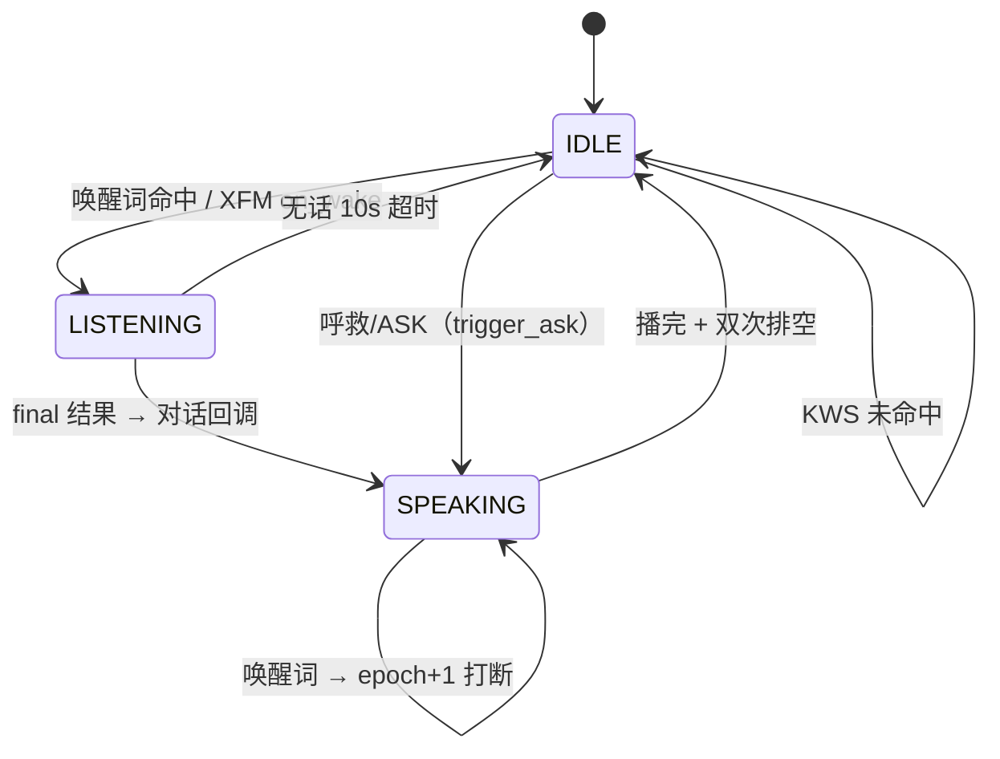

### 7.7 注意事项

- ⚠️ 音频模式需麦克风/扬声器；`--text` 无硬件也可驱动同一状态机。
- ⚠️ 先 `pkill -9 aplay` 清残留；XFM 硬件唤醒要停 log_server 防串口冲突。
- ⚠️ 低帧自愈：录音 <30 帧/5s 触发重开（≤3 次）；持续低帧查输入设备与 ASR。
- ⚠️ 流式 TTS 打断依赖 epoch 丢弃；勿把播报硬件占用与指令混淆。

### 7.8 实验总结

**完成成果**: 唤醒→录音→ASR→TTS 语音链路日志；流式 TTS 逐句播报 + 打断丢弃观察；kws 调参记录；V1-V10 语音用例执行表。

**技能收获**:

- 技能1：XFM 硬件唤醒 + KWS 软件唤醒双路径
- 技能2：流式 ASR 增量解码 + 端点检测
- 技能3：流式 TTS 按句 + 播报互斥/打断

**常见问题与解决**:

| 问题 | 原因 | 解决 |
|------|------|------|
| `XFM 串口无响应（第N轮...）硬件唤醒暂未就绪` | XFM 固件冷启动/未就绪，track_app 后台自愈 | 等待几分钟自动接管；或手动探测 `python .../car1_speech/tools/xf_mic_array.py` 验证固件 |
| 唤醒后无录音 | XFM 事件未到 / ttyACM0 占用 | 停 log_server，查串口 |
| ASR 无实时 | ASR 模型/线程 | 文本模式确认 ASR 模型文件 |
| 播报无声 | aplay 被占用 | pkill -9 aplay；查串口冲突 |
| 播报被识别 | playback 互斥失效 | 重启 track_app 复验 |
| 误报多 | kws 阈值低 | 调高 kws.threshold（0.4） |

### 7.9 实验报告要求

**思考题**:

1. 为什么录音线程要在硬件唤醒后才启动（XFM 时序）？若常驻持续上送音频会有什么问题？
2. 流式 TTS 如何实现"首句即播、边出边播"？打断丢弃（epoch+1）如何保证旧回复不迟到播报？
3. KWS 热词为何在 greedy 下无效? 什么时候该切 beam_search？

**评分标准**:

- 文本模式状态机（20 分）
- 语音全链路（30 分）：唤醒→录音→ASR→TTS 闭环
- 流式 TTS 与打断（20 分）
- V 用例执行表 + KWS 调试（30 分）= 100 分。

---

## 更新日志

| 版本 | 日期 | 说明 |
|------|------|------|
| v1.0 | 2026-09-07 | 初始版本，基于 EXP006b 源码与文档生成 |
| v2.0 | 2026-09-07 | 知识储备增强 |
---
# 实验8：事件日志与故障降级集成测试（6h）


### 8.1 关联知识点

- 6.1.1 events.jsonl 追加记录（lost/unlock_all/command/camera_stall/pause_timeout）（前置：1.1.1）
- 6.1.2 fail-closed 降级原则（任何「不确定锁谁」分支不产副作用）（前置：4.3.2）
- 6.1.3 故障注入降级（断网 ReID / 相机 / aplay / 无 VLM）（前置：6.1.2）

### 8.2 实验目标

1. **掌握**事件日志记录与事后追责（events.jsonl 各 kind）。
2. **理解** fail-closed 降级不崩线程的一致性（任何异常收敛、不挂起）。
3. **完成**故障注入测试（断网 ReID / 相机断流 / aplay 被杀 / 无 VLM）。
4. **掌握** CLI>config 覆盖在调试中的使用。
5. **迁移**：把"事件日志 + fail-closed 降级"的健壮性设计迁移到其他边缘 AI 运维。

### 8.3 实验环境

| 类别 | 内容 |
|------|------|
| 硬件 | 具身智能实验箱B2 / 具身智能机器人小车C1（需板端；事件日志在 runs/logs/） |
| OS | Ubuntu 22.04 + ROS 2 Humble |
| Python | 3.10 |
| 核心库 | 同前（RKNN/ReID/LLM） |
| 命令 | `tail -f runs/logs/events.jsonl`、`python3 apps/track_app.py --video /home/iflytek/ros2_ws/src/xflz_eai_car1/vision/07_multi_object_tracking/test.mp4 --text` |
| 文档 | docs/09_事件与故障测试用例.md |

### 8.4 实验难度

- 难度: ⭐⭐⭐（综合性）
- 重点：事件日志（lost/unlock_all/command/camera_stall/pause_timeout）记录与事后追责；fail-closed 降级为主。
- 难点：故障注入设计（断网 ReID/相机/aplay/无 VLM）并验证主循环不崩、日志完整。

### 8.5 实验现象

**快速验证流程**：

```bash
cd ~/ros2_ws/src/xflz_eai_car1/app/object_tracking

# 文本模式触发 lost / unlock_all / command
python3 apps/track_app.py --video /home/iflytek/ros2_ws/src/xflz_eai_car1/vision/07_multi_object_tracking/test.mp4 --text
# 先输入：小飞小飞
# 在输入对话：追踪 id3 的车
# 再输入：清除

# 观察事件日志追加
tail -f runs/logs/events.jsonl
```

预期：`runs/logs/events.jsonl` 追加 command（追踪）、lost（id3 消失）、unlock_all（清除/丢失解锁）；`pause_timeout` 在 LLM 挂死时出现（异常）；`camera_stall` 在相机断流时出现。

### 8.6 实验步骤

#### 整体流程图

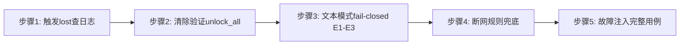

#### 步骤1：触发 lost 事件，检查 events.jsonl（约70min）

**操作步骤**：

1. 文本模式追踪 `id3`，待目标出画/消失 → 观察 lost 事件（`{"ids":[...]}` → TTS"idX 已消失"）。
2. `tail -f runs/logs/events.jsonl` 逐条核对 `command`、`lost`。
3. 理解 lost 由 engine 主循环 `on_event` 触发（`tracking/events.py` append_event_log）。

```bash
cd ~/ros2_ws/src/xflz_eai_car1/app/object_tracking
python3 apps/track_app.py --video /home/iflytek/ros2_ws/src/xflz_eai_car1/vision/07_multi_object_tracking/test.mp4 --text --mjpeg
# 先输入：小飞小飞
# 再输入：追踪 id3
# 待目标出画 → 查事件
tail -f runs/logs/events.jsonl
```

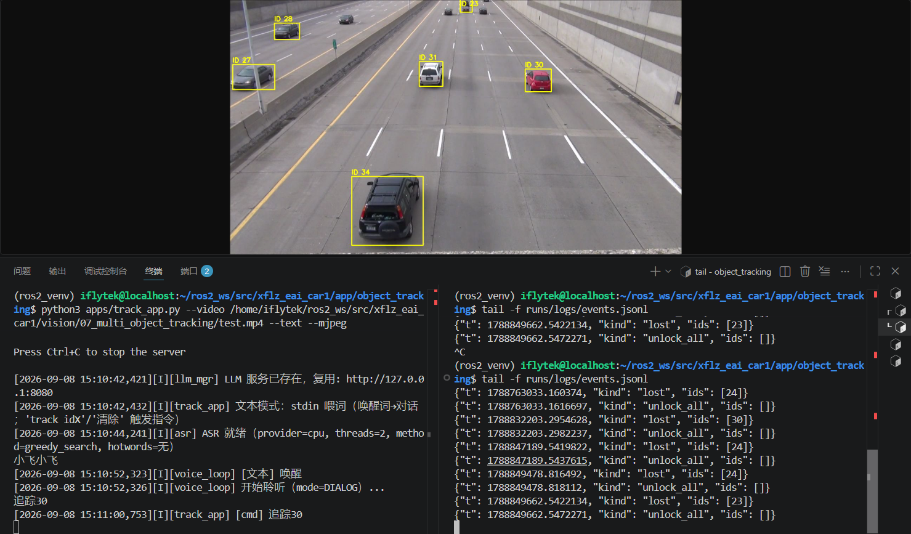

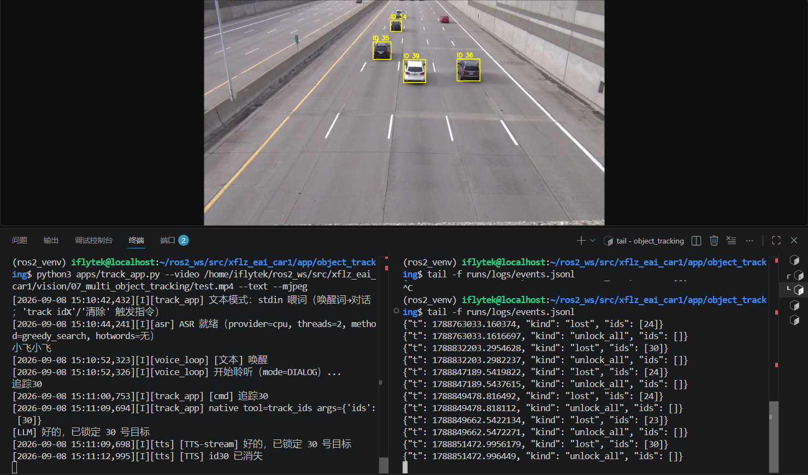

**易错点**：

- ⚠️ lost 只在 follow 目标从 confirmed 消失时触发；纯视觉 video 若无 follow 则不产生 lost。

**知识储备补充**：
- **事件日志格式（JSONL）**：`append_event_log()`（tracking/events.py L7-18）每事件一行 JSON：`{"t": 时间戳, "kind": 事件类型, ...payload}`，追加写入 `runs/logs/events.jsonl`（`log.dir` 可配置）。JSONL 每行独立、可 `tail -f` 增量观察、可被 jq/日志平台逐行解析——比整块 JSON 数组更适合追加写与流式消费；写失败只吞异常不阻断主循环（日志不反噬系统）。
- **lost 触发条件（差分语义）**：engine 主循环每帧计算 `prev_ids - cur_ids` 差集（tracking/engine.py L131-145），仅当**被 follow 的目标**从 confirmed 列表消失才触发 `lost` 事件（`on_track_lost` 移除 follow 记录）。DeepSORT confirmed 目标在 max_age=70 帧内不出现仍存活，所以"消失"判定用帧间 confirmed 集合差分，不能看单帧检测缺失。
- **lost 事件的数据价值**：`{"ids":[...]}` 记录的是"盯丢了谁"——事后追责可回答"目标何时出画/被遮挡、跟踪器是否提前丢掉"，结合 TTS"idX 已消失"（apps/track_app.py `_handle_event` L797-800）形成可回放的事件流。
- **参考资源**：JSON Lines 规范（jsonlines.org）；jq 手册（`jq 'select(.kind=="lost")' events.jsonl`）；DeepSORT 论文中 confirmed/max_age 轨迹状态说明。

#### 步骤2：触发清除验证 unlock_all（约1h30m）

**操作步骤**：

1. 追踪后输入 `清除` → `unlock_all` 事件（`{"ids":[...]}`）。
2. 验证 unlock_on_loss=true 时全丢恢复全显示 → `unlock_all`。
3. 理解 unlock_all 区分：清除语义 clear_track / 丢失解锁 unlock_on_loss 两路径。

```bash
cd ~/ros2_ws/src/xflz_eai_car1/app/object_tracking
python3 apps/track_app.py --video /home/iflytek/ros2_ws/src/xflz_eai_car1/vision/07_multi_object_tracking/test.mp4 --text
# 先输入：小飞小飞
# 再输入：追踪 id3
# 运行中输入：清除 → 看 unlock_all
tail -f runs/logs/events.jsonl
```

**易错点**：

- ⚠️ unlock_all 事件在"全部解锁"（clear 或 unlock_on_loss）时写；仅部分丢失不写。

**知识储备补充**：
- **两条解锁路径**：`unlock_all` 由两条不同链路产生

  ① 用户清除指令：`clear_track` → `submit_effect(None)` → 引擎 `_apply_effect` 清空 follow；

  ② `unlock_on_loss=true`：被追踪目标丢失后 `on_track_lost` 清空 follow（tracking/engine.py L142-144）且 follow 集合为空 → 写 `unlock_all`。两者语义都是"全部解锁"，事件合并记录便于追责"系统为何放弃了锁定"。

- **部分丢失不写**：仅部分目标丢失（follow 集合仍非空）时只写 `lost`（带 ids），不写 `unlock_all`——事件粒度与"锁状态是否清空"一一对应，不会用 unlock_all 掩盖部分丢失的事实。

- **clear_track 的来源**：`_native_gate`（apps/track_app.py L320-337）先按 clear_words（清除/解除/取消/停/不追/恢复全/不跟）拦截，无论 LLM 吐什么 tool 都强制 `clear_track`——防 0.8B 模型把"清除"误吐成 track_ids 锁错目标。这也是 fail-closed 的语义护栏。

- **参考资源**：DeepTrack/TrackSession 锁定语义文档（docs/05_流程与安全.md）；事件驱动日志设计模式（Event Sourcing 导读）。

**参考模板**（事件时序，sequenceDiagram）：

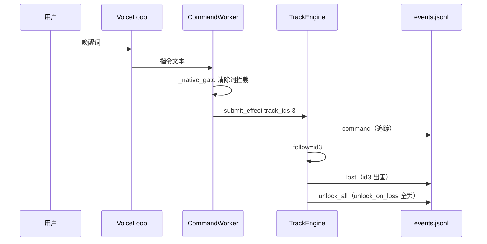

#### 步骤3：文本模式验证 fail-closed 用例 E1-E3（约 1h30min）

**操作步骤**：

1. E1 `追踪一百号目标` → `track_ids 数值不对齐 {100}` → `未找到该 ID 目标`，不锁、不 VLM grid dump。
2. E2 `追踪红色皮卡`（无红车）→ `[track_vlm] 无法识别` → 引导，不锁。
3. E3 `清除` → `清除语义指令，执行 clear_track` → 解锁。
4. E5 `追踪 id999` → `未找到该 ID 目标`；E6 指令队列满丢弃最旧。

```bash
cd ~/ros2_ws/src/xflz_eai_car1/app/object_tracking
python3 apps/track_app.py --video /home/iflytek/ros2_ws/src/xflz_eai_car1/vision/07_multi_object_tracking/test.mp4 --text --mjpeg
# 先输入：小飞小飞
# 依次输入：E1 追踪一百号目标 → 未找到该 ID 目标
# 再输入：E2 追踪蓝色皮卡（无蓝车）→ 引导不锁
# 再输入：E3 清除 → 清除语义指令，执行 clear_track
# 再输入：E5 追踪 id999 → 未找到该 ID 目标
```

**易错点**：

- ⚠️ fail-closed 目的在于不生副作用：任何"不确定锁谁"（id 不对齐/VLM 无果）都不 submit_effect，只回引导/兜底。

**知识储备补充**：
- **fail-closed 降级原则**：任何"不确定锁谁"的分支都不产副作用——`_native_gate` 三道闸：

  ① 清除语义强制 clear_track（L320-337）；

  ② `track_ids` 无 id→按是否有描述决定 VLM/引导，有 id 但数值不对齐（`expect ∩ got` 为空）→ 只回「未找到该 ID 目标」，**绝不**走 VLM 猜车（L365-375 附近）；

  ③ track_vlm 视觉选车失败/返 None → `_vlm_none()` 引导语，同样不锁。所有 fail 分支的共同点：**不调用 `engine.submit_effect()`**——锁是副作用，副作用只发生在完全确定时。

- **为什么不空 submit（思考题2的原理）**：若空集合也能 submit，`submit_effect(set())` 会清空当前锁定——用户问"追踪一百号"系统却把已锁定的 id3 解锁，产生"误导误锁"状态翻转；错误 id 则会锁一个与用户意图无关的目标。fail-closed 保证"不确定 → 维持现状 + 引导"，把错误状态转移的概率压到零。

- **E 用例映射到源码分支**：E1（id 不对齐）→ gate ③；E2（描述无果）→ `_vlm_select_locked` 里 `not confirmed`/`built is None`/`chosen` 为空三处都落 `_vlm_none()`；E3（清除）→ clear_words 拦截。E6（队列满丢最旧）：`CommandWorker.q` maxsize=8（apps/track_app.py L220），`push` 用 `put_nowait` 满了丢弃（L247-250）——有界队列 + 丢弃策略保证 LLM 风暴也不撑爆内存。

- **参考资源**：fail-closed vs fail-open 安全设计对比资料；有界队列背压（bounded queue backpressure）并发编程模式。

#### 步骤4：模拟断网验证规则兜底（约1h30m）

**操作步骤**：

1. 断网（LLM 不可达）或 `llm.enabled=false`：观察 `chat fallback failed` → `_rule_fallback`。
2. 验证追踪/清除仍可（parse_instruction 规则兜底）；闲聊不可（无 LLM）。
3. ReID 故障注入：reid_pool 全 worker 崩 → extract 超时 → features=None 纯 IoU，主循环不挂死。

```bash
cd ~/ros2_ws/src/xflz_eai_car1/app/object_tracking
pkill -f llm_server        # 断网/停服务模拟
# 或 config 关 llm.enabled=false 后重跑 track_app
python3 apps/track_app.py --video /home/iflytek/ros2_ws/src/xflz_eai_car1/vision/07_multi_object_tracking/test.mp4 --text --mjpeg
# 先输入：小飞小飞
# 再输入：追踪 id3 → 规则兜底仍可追踪/清除
```

**易错点**：

- ⚠️ `_rule_fallback` 只覆盖追踪/清除/截图；闲聊需 LLM，无 LLM 时回引导"没听懂"。

**知识储备补充**：
- **规则兜底 `_rule_fallback`**（apps/track_app.py L620-628）：唯一兜底入口，`parse_instruction(text)` 无 LLM 也能解析"追踪 idX / 清除"指令并 `registry.call` 执行，解析失败回「没听懂」。三类调用方共用：native 工具路径失败、`_chat_reply` 异常、外层 except（L275/284/299/313/316/547）——任何 LLM 异常都收敛到规则层，主循环不挂。
- **闲聊不可为**：闲聊（你好/天气）没有规则可兜——`_rule_fallback` 对非指令回「没听懂」。`llm.enabled=false` 时 `_chat_reply` 也会因 client 不可用回落规则，所以断网后"追踪/清除可用、闲聊不可"是设计预期，不是缺陷。
- **ReID 超时降级纯 IoU**：`ReIDPool.extract`（tracking/reidpool.py L37-47）对每个 crop 提交后 `get(timeout=10)`，超时（worker 全挂/饿死）→ 中断并返回全零特征；pipeline（tracking/pipeline.py L33-36、L44-52）把 `features is None` 或长度 ≠ dets 数都归零降级为**纯 IoU 匹配**（`tracker.update(dets, features=None)`），主循环不断流。约束 12 的设计：ReID 是"外观增强"，挂了退回几何匹配。
- **降级链全景**：断网 → LLM 失败 → `_rule_fallback`（追踪/清除仍全功能）；ReID 崩 → features=None 纯 IoU（ID 可能短暂跳变但跟踪不崩）；aplay 死 → `Playback._restart_playback` 重启（失败置 `_failed` 丢弃音频打印降级）；VLM 无 → `_vlm_none()` 引导。每层故障都有对应收敛策略——这是"任何异常都收敛、不挂起"的工程实现。
- **参考资源**：错误处理/降级设计（Graceful Degradation）资料；ReID+IoU 组合匹配的 DeepSORT 原论文。

#### 步骤5：按 docs/09 执行事件与故障用例（约90min）

**操作**：

1. 执行 E2E 脚本化验收：`小飞小飞` → 唤醒；`追踪红色皮卡` → VLM 锁；`追踪不存在的id` → 未找到；`清除` → 解锁；`你好` → 闲聊流式。
2. 验证 `runs/logs/events.jsonl` 对应 command/lost/unlock_all 条目齐全（完整性）。
3. 相机拔线 → `camera_stall` 事件 + 暂停重试；aplay 被杀 → 播放线程重启或降级打印。

```bash
cd ~/ros2_ws/src/xflz_eai_car1/app/object_tracking
python3 apps/track_app.py --video /home/iflytek/ros2_ws/src/xflz_eai_car1/vision/07_multi_object_tracking/test.mp4 --text --mjpeg
# 先输入：小飞小飞
# 再输入：追踪红色皮卡 → VLM 锁
# 再输入：追踪不存在的id → 未找到
# 再输入：清除 → 解锁
# 再输入：你好 → 闲聊流式
# 另终端：kill -9 $(pgrep aplay) → 观察播放降级
tail -f runs/logs/events.jsonl
```

**易错点**：

- ⚠️ 事件"完整性"指所有产生的事件都追加写道 jsonl；若某 kind 缺失（如 pause_timeout 永不出现）说明未触发该异常，属正常。

**知识储备补充**：
- **camera_stall 看门狗**：engine 主循环（tracking/engine.py L115-122）相机模式读帧失败连续 30 次（`_cam_fail >= 30`）→ 发 `camera_stall` 事件 + 暂停 1s，其余失败 sleep 0.2s 重试；`_handle_event`（apps/track_app.py L805-806）记 WARN 日志不落 jsonl。设计意图：断流是"相机节点挂了/线松"，要周期性探测重连而不是无限空转忙等。
- **pause_timeout 看门狗**：`pause_wait=true` 时 LLM 指令处理期间主循环暂停读帧；若 `pending` 持续超 `pause_timeout`（默认 30.0s，tracking/engine.py L101-107）→ 清 pending + 发 `pause_timeout` 事件（只记日志）——防 LLM 挂死冻结画面。这是"外部依赖卡死不冻结主循环"的看门狗模式。
- **完整性=全部追加**：`append_event_log` 每次 open("a") 追加 + flush 由解释器行缓冲（写失败吞异常），因此"事件完整性"指每产生一种事件就有一行；某 kind 不出现只说明该异常未触发（如没拔相机就不会有 camera_stall），排查时先区分"未触发"与"丢了日志"。
- **aplay 被杀降级**：`Playback._restart_playback` 终止旧 aplay → 重开；持续失败置 `_failed`，后续 `write()` 返回 False 丢弃音频（speech/tts.py），VoiceLoop 用 `playback_event` 释放互斥回到 IDLE——播报降级为打印，语音状态机不卡 SPEAKING。
- **参考资源**：看门狗定时器（watchdog timer）设计模式；进程树清理与设备释放检查清单（docs/09_事件与故障测试用例.md）。

**参考模板**（故障降级全链路，graph TD）：

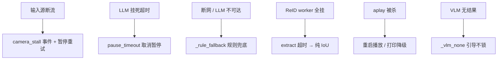

### 8.7 注意事项

- ⚠️ 需板端；事件日志在 `runs/logs/`，`log.dir` 可配置；实验前清空 `events.jsonl` 便于判定新增。
- ⚠️ 故障注入（断网/拔相机/杀 aplay）会短暂影响实机，务必在安全环境执行并按要求恢复。
- ⚠️ fail-closed 降级的一致性：任何分支都不崩线程、不挂起、不 submit 空/错副作用。

### 8.8 实验总结

**完成成果**: lost/unlock_all/command 事件日志截图 + jsonl 片段；E1-E3 fail-closed 用例执行表；故障注入降级观察记录；E2E 验收 + 日志完整性检查。

**技能收获**:

- 技能1：事件日志设计与事后追责
- 技能2：fail-closed 降级一致性（不崩线程）
- 技能3：故障注入测试方法

**常见问题与解决**:

| 问题 | 原因 | 解决 |
|------|------|------|
| lost 事件缺失 | 无论 follow（无追踪） | 先追踪目标再出画 |
| unlock_all 缺失 | 无清除/丢失 | 激活清除或 unlock_on_loss |
| LLM 挂死冻结 | pause_timeout 异常 | 看 pause_timeout 事件，查 LLM |
| 断网后追踪不可 | _rule_fallback 生效 | 确认 rules/tools 可用 |

### 8.9 实验报告要求

**思考题**:

1. lost / unlock_all / command / camera_stall / pause_timeout 各在什么条件下触发？分别对事后追责有什么价值？
2. fail-closed 降级为什么"不给空/错 id 下清锁"？如果空 submit 会把系统带到什么错误状态？
3. 事件日志完整性与"故障不崩线程"如何共同保障系统长期运行的健壮性？

**评分标准**:

- lost/unlock_all 触发与日志（25 分）
- fail-closed E1-E3（30 分）
- 故障注入降级（30 分）
- 日志完整性（15 分）= 100 分。

---

## 更新日志

| 版本 | 日期 | 说明 |
|------|------|------|
| v1.0 | 2026-09-07 | 初始版本，基于 EXP006b 源码与文档生成 |
| v2.0 | 2026-09-07 | 知识储备增强 |
---
# 实验9：通用目标追踪全功能验证（8h）


### 9.1 关联知识点

- 6.2.1 三模式入口 --video/--image/--camera（前置：1.1.3）
- 6.2.2 实时摄像头（需 ROS 相机节点）+ MJPEG :8088/track.mjpg（前置：1.2.2）
- 6.2.3 全链路故障排查 + 事件日志/标注帧完整性（前置：6.1.1）

### 9.2 实验目标

1. **掌握** track_app 三模式启动方法（--video/--image/--camera）与文本→语音→摄像头三级开发模式。
2. **完成**唤醒→追踪→指令→选车→清除→事件日志全链路验证（离线视频 + 实时摄像头）。
3. **掌握**故障排查（微小化复现、日志诊断）与资源清理（pkill 残留进程 / ReID / LLM）。
4. **独立完成** MJPEG 推流验证与 `pytest` 全量回归确认。
5. **迁移**：把"文本→语音→摄像头 + 三级开发 + 全链路验收"的部署方法论迁移到其他具身智能项目。

### 9.3 实验环境

| 类别 | 内容 |
|------|------|
| 硬件 | 具身智能实验箱B2 / 具身智能机器人小车C1 + 深度相机 HP60C（实时） |
| OS | Ubuntu 22.04 + ROS 2 Humble |
| Python | 3.10 |
| 核心库 | RKNN（YOLO/ReID）、RKLLM（LLM/VLM）、sherpa_onnx（ASR/KWS）、Matcha-TTS |
| 命令 | `python3 -m pytest tests/ -v`、`python3 apps/track_app.py --video .../test.mp4 --text`（交互式：先`小飞小飞`唤醒再输指令）、`ros2 launch car1_peripherals depth_camera.launch.py`、`track_app --camera --mjpeg` |
| 文档 | README（常用命令）/ docs/03_开发模式与验证.md |

### 9.4 实验难度

- 难度: ⭐⭐⭐（综合性）
- 重点：三模式入口与全链路验证；MJPEG 推流；事件日志/标注帧完整性；pytest 回归。
- 难点：摄像头实时模式（ROS 相机会话）与残留进程清理；全链路故障排查。

### 9.5 实验现象

**快速验证流程**：

```bash
cd ~/ros2_ws/src/xflz_eai_car1/app/object_tracking

# 1. 纯逻辑回归
python3 -m pytest tests/ -v

# 2. 离线文本全链路
python3 apps/track_app.py --video /home/iflytek/ros2_ws/src/xflz_eai_car1/vision/07_multi_object_tracking/test.mp4 --text --mjpeg
# 先输入：小飞小飞
# 在输入对话：追踪 id3

# 3. 实时摄像头 + MJPEG
source /opt/ros/humble/setup.bash && source ~/ros2_ws/install/setup.bash
ros2 launch car1_peripherals depth_camera.launch.py    # 另一终端
python3 apps/track_app.py --camera --mjpeg              # 浏览器 http://<IP>:8088/track.mjpg
```

预期：pytest 全绿；离线全链路完成"追踪 id3 → 解除"；实时摄像头目标 ID 稳定、MJPEG 出流（浏览器可见），全链路（唤醒→追踪→指令→选车→清除→日志）闭环。

### 9.6 实验步骤

#### 整体流程图

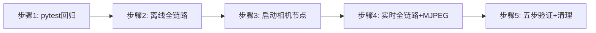

#### 步骤1：pytest 全量回归（约1h30m）

**操作步骤**：

1. `python3 -m pytest tests/ -v` 确认全部通过（TDD，x86 可跑）。
2. 覆盖 tools/门控/VLM 虚测/单帧 pipeline/录音自愈等。确认无回归。

```bash
cd ~/ros2_ws/src/xflz_eai_car1/app/object_tracking
python3 -m pytest tests/ -v
```

**易错点**：

- ⚠️ 全功能验证前的 regression 必须全绿，否则后续故障排查会把框架缺陷混入功能问题。

**知识储备补充**：
- **回归测试定位**：pytest 套件覆盖 tools/门控/VLM 虚测/单帧 pipeline/录音自愈等纯逻辑层（tests/ 目录），x86 可跑、无 RKNN/ROS 依赖——回归全绿是后续实机验证的基线：实机出问题时先复跑回归，把"框架缺陷"与"环境/硬件问题"分开。
- **虚测（fake）与真实实现解耦**：`tools/vlm_fake.py` 是 VLM 的假实现（固定返回 `fake_result_id=3`），跟 `tools/vlm_real.py` 真模型共用同一 select_crops 契约——测试可在无模型环境验证门控/选车逻辑，真实模型只影响精度不影响行为契约。
- **单帧 pipeline 是核心可测件**：`tracking/pipeline.py` 的 `process(frame, detector, tracker, session)` 是单帧处理的纯函数式入口（detector/tracker 可注入 fake），engine 主循环只在它外面做读帧/事件/发布——所以大部分逻辑可用合成输入单测，无需整机。
- **参考资源**：pytest 文档（fixture/monkeypatch）；依赖注入（DI）在测试替身中的应用。

#### 步骤2：文本全链路（离线视频，三模式之一 --video）（约 1h30min）

**操作步骤**：

1. `python3 apps/track_app.py --video /home/iflytek/ros2_ws/src/xflz_eai_car1/vision/07_multi_object_tracking/test.mp4 --text`，先输入`小飞小飞`唤醒，再输入`追踪 id3`。
2. 观察：唤醒 → 追踪锁定 → 目标消失 lost 事件 → 清除 unlock_all → 事件日志完整。
3. 验证 `--text` 与音频同一状态机（`feed_text` 复用回调）。

```bash
cd ~/ros2_ws/src/xflz_eai_car1/app/object_tracking
python3 apps/track_app.py --video /home/iflytek/ros2_ws/src/xflz_eai_car1/vision/07_multi_object_tracking/test.mp4 --text --
# 先输入：小飞小飞
# 再输入：追踪 id3
```

**易错点**：

- ⚠️ stdin 首行唤醒词才进入 DIALOG；文本模式关 KWS/硬件唤醒。

**知识储备补充**：
- **三模式入口**：`--video/--image/--camera` 映射到 `cfg["source"]["mode"]`（apps/track_app.py `_merge_args` L74-93）：`FrameSource`（common/source.py L34-80）统一 read() 接口——image/video 用 OpenCV 直读（完全无 ROS），camera 用 `Ros2Camera` 订阅话题（`/ascamera_hp60c/camera_publisher/rgb0/image`，rclpy 惰性导入）。三种模式只换输入源，下游 engine/pipeline/门控全复用。
- **三级开发模式（文本→语音→摄像头）**：文本模式用 stdin 逐行喂 `feed_text`，与音频同一状态机（共用回调链），无需麦克风/扬声器；语音模式加录音/播放硬件；摄像头模式加相机话题——每一级只叠加一层硬件依赖，前一级全部可回归。这是"分层解除硬件依赖"的部署方法论：逻辑先行，硬件后置。
- **输入源契约**：`source.read()` 返回 `(ok, frame)`，EOF/断流返回 `(False, None)`；engine 主循环"只读一帧、成功才进 pipeline"，None 帧绝不流入 pipeline（tracking/engine.py L88-95），这是输入层与算法层的隔离边界。
- **参考资源**：OpenCV VideoCapture 文档；ROS 2 rclpy 话题订阅指南；docs/03_开发模式与验证.md。

#### 步骤4：实时摄像头 + MJPEG（全链路 + ROS 相机）（约 2h30m）

**操作步骤**：

1. 另终端 `source /opt/ros/humble/setup.bash && source ~/ros2_ws/install/setup.bash && ros2 launch car1_peripherals depth_camera.launch.py`（提供相机话题）。
2. 主终端 `python3 apps/track_app.py --camera --mjpeg`。
3. 浏览器打开 `http://<IP>:8088/track.mjpg` 观察实时推流；目标 ID 稳定（min_confidence=0.3 + [car]）。
4. 语音链路：喊"小飞小飞" → 唤醒 → 追踪红色皮卡 → 解除 → 恢复全显示。

```bash
cd ~/ros2_ws/src/xflz_eai_car1/app/object_tracking
# 另终端:
source /opt/ros/humble/setup.bash && source ~/ros2_ws/install/setup.bash
ros2 launch car1_peripherals depth_camera.launch.py
python3 apps/track_app.py --camera --mjpeg    # 浏览器 http://<IP>:8088/track.mjpg
```

**易错点**：

- ⚠️ `--camera` 需相机话题在线（ascamera_hp60c/rgb0/image 惰性 rclpy）；MJPEG 端口 8088 与 stream_name。
- ⚠️ headless 板端 `display.show` 默认关，无需 X11，大幅提升吞吐。

**知识储备补充**：
- **MJPEG 推流原理**：MjpegServer（vision/yolo/mjpeg_server.py）把最新 BGR 帧 JPEG 编码成 Motion JPEG 流，`http://<IP>:8088/track.mjpg` 是**持续 MJPEG 流**（不是静态图片）——浏览器收到一帧帧 JPEG 连续渲染成视频。engine 每帧 `_publish` 调 `mjpeg.set_frame(frame)`（tracking/engine.py L84-85）推最新帧；`stream_name` 默认 `track.mjpg`，库按 name 路由（name 不带 `.mjpg` 时自动补全，config_schema L63 `server.stream_name="track.mjpg"`）。
- **为什么实时推流不可替代**：离线视频是固定样本，只能验证"算法层"；实时模式验证的是全链路实时性——相机话题延迟、跟踪实时性、推流吞吐、语音与视觉并发，是"离线视频不可替代"的验证手段。MJPEG 用 HTTP 长连接多客户可看，无需 X11 显卡，正好适配 headless 板端。
- **ID 稳定与 min_confidence**：实时噪声帧（运动模糊/遮挡）会产生低分检测，`min_confidence=0.3`（config track_config.yaml）只放行 ≥0.3 的检测进 tracker，配合 `class_filter: [car]` 过滤非车类别——双因素压制 ID 跳变；调低会引入噪声 ID，调高会漏检小车。
- **headless 意义**：`display.show` 默认关 → 不创建 X11 窗口，帧绘制仍走 MJPEG 输出；板端无显示器场景（SSH 远程）也能完整验证，且省去窗口合成开销。
- **参考资源**：MJPEG over HTTP 规范说明；mjpeg_streamer 库文档；ROS 2 `ros2 topic echo` 验证相机话题。

#### 步骤4：全链路故障排查 + 事件日志/标注帧完整性（约 1h）

**操作步骤**：

1. 用 `--save` 落盘标注帧（`runs/out`），验证完整性。
2. 排查：`[diag] 录音 50 帧/5s` 正常；`[ASR 实时]`；`[cmd]` 逐分支；事件 jsonl 条目齐全。
3. 若出现异常：缩小、复现、用日志注释定位（如 pause_timeout 查 LLM、camera_stall 查相机）。

```bash
cd ~/ros2_ws/src/xflz_eai_car1/app/object_tracking
python3 apps/track_app.py --camera --mjpeg --save
# 核对 runs/out 标注帧与 runs/logs/events.jsonl 条目
```

**易错点**：

- ⚠️ 事件日志/标注帧完整性是验收关键：所有产生的事件都追加写入，标注帧带 follow 过滤不空。

**知识储备补充**：
- **标注帧完整性（--save）**：`--save` 置 `cfg["save"]["enabled"]=True`（_merge_args L88-89），engine 挂 `on_publish` 回调把标注帧落盘 `runs/out`（config_schema L65 `fps=10`）。"带 follow 过滤不空"指 `_compute_draw`（tracking/engine.py L65-79）按锁定语义过滤：有 follow 只画被锁定 ID，无 follow 决定画全部/不画——落盘帧应与锁定状态一致，若某帧 follow 目标没画出来说明过滤链路出错。
- **故障排查方法论（缩小→复现→日志定位）**：异常出现时先缩到最小复现（单一模式/单一指令），再用分层日志定位——`[diag] 录音 50 帧/5s`（音频层）、`[ASR 实时]`（识别层）、`[cmd] 逐分支`（指令层）、事件 jsonl（状态层）。例：pause_timeout 查 LLM（pending 卡死超过 30s）、camera_stall 查相机（30 次读帧失败）。每层有专属日志锚点，是"日志注释定位"的实践。
- **事件 vs 日志分工**：事件 jsonl 记录**状态变化**（lost/unlock_all/command 等，结构化、可追责）；INFO/WARN 日志记录**过程行为**（[diag]/[cmd] 等，供实时排查）。排查先看 jsonl 确认"发生了什么状态变化"，再按时间戳回看日志确认"为什么"。
- **参考资源**：日志/事件分层设计（docs/02_架构设计.md）；IEEE 故障排查（debugging）方法论资料。

**参考模板**（全链路，graph LR）：

```mermaid
graph LR
    A["唤醒"] --> B["ASR 识别"]
    B --> C["LLM 指令门控"]
    C --> D["VLM 选车锁定"]
    D --> E["DeepTrack 追踪"]
    E --> F["事件日志 + 标注帧"]
```

#### 步骤5：按 docs/03 五步验证并清理残留进程（约 1h）

**操作步骤**：

1. 按 `docs/03_开发模式与验证.md` 五步（Step1-5）逐项核对。
2. 清理：`pkill -f llm_server`、`pkill -9 aplay`；确认无残留进程占用串口/设备。
3. 收尾：事件日志完整性最终确认。

```bash
cd ~/ros2_ws/src/xflz_eai_car1/app/object_tracking
pkill -f llm_server; pkill -9 aplay
ps aux | grep -E "track_app|llm_server|aplay" | grep -v grep   # 确认无残留
```

**易错点**：

- ⚠️ 常驻 LLM 子进程（8080）与 aplay 需清理，否则占用端口/播放设备影响下次实验；回滚前 `git revert` 本次 commit 亦需要先 pkill。

**知识储备补充**：
- **五步验证（docs/03 Step1-5）**：以回归→离线→相机→实时链路→清理的递进顺序做全功能核对，每步有明确通过判据（pytest 全绿/日志闭环/MJPEG 出流/事件完整/无残留进程）——这是"完整链路闭环 + 日志帧完整"验收的项目管理方法，任何一步失败回退到上一步排查。
- **资源清理的必要性（端口/设备独占）**：LLM 子进程占用 8080 端口、aplay 占用播放设备（plughw:3,0）、XFM 占用串口 /dev/ttyACM0——这些都是**独占资源**，不清理会直接导致下次实验启动失败（MJPEG 端口预检：端口被占 → 明确报错退出，vision/yolo/mjpeg_server.py）。`pkill -f llm_server`、`pkill -9 aplay` 是标准收尾。
- **回滚前先清理**：`git revert` 恢复代码前也必须先 pkill——旧版本进程用旧代码逻辑运行，会与回滚后的新代码状态不一致，混淆排查（如旧 llm_server 继续占 8080 让新代码连不上）。
- **参考资源**：Linux 进程管理与资源清理（pkill/ps 检查）手册；docs/10_程序参数详解.md（--save/--mjpeg 等参数语义）。

### 9.7 注意事项

- ⚠️ 实时模式需深度相机 HP60C 与 ROS 相机节点；无相机则用视频模式完整验证逻辑。
- ⚠️ 残留进程（llm_server/aplay/相机节点）在实验结束必须清理，防占用影响后续。
- ⚠️ headless 无 X11 时 display.show 默认关，用 --mjpeg 观察；别强开 --show。
- ⚠️ 全功能验证以"完整链路闭环 + 日志/帧完整"为准，任何故障先回归再修。

### 9.8 实验总结

**完成成果**: pytest 全绿回归证明；离线文本全链路日志；实时摄像头 MJPEG 推流截图；五步验证核对表；清理后进程/tmp 检查记录。

**技能收获**:

- 技能1：三模式部署与三级开发（文本→语音→摄像头）
- 技能2：MJPEG 实时推流与远程监控
- 技能3：整机全链路验证与故障排查、资源清理

**常见问题与解决**:

| 问题 | 原因 | 解决 |
|------|------|------|
| 实时无推流 | 相机话题未起 / 端口占用 | 起 depth_camera.launch.py；查 8088 |
| ID 跳变 | 实时噪声（min_confidence） | 恢复 0.3/[car] 实机 tuned |
| 唤醒无录音 | XFM 串口占用 | 停 log_server 防冲突 |
| 推流卡死 | pause_timeout 未解除 | 查 LLM；看 pause_timeout 事件 |
| 残留进程 | 常驻 LLM/aplay | pkill -f llm_server / pkill -9 aplay |

### 9.9 实验报告要求

**思考题**:

1. 三模式入口（--video/--image/--camera）与三级开发模式（文本→语音→摄像头）如何分层解除硬件依赖、保证逻辑回归？
2. MJPEG 实时推流为何是"离线视频不可替代"的验证手段？headless 下 display.show 关闭的意义？
3. 从 exp01 需求到 exp09 全功能，梳理事件链路中至少三个 fail-closed 节点如何共同保障系统不致误导误锁。

**评分标准**:

- pytest 回归（20 分）
- 离线全链路（25 分）：追踪/指令/选车/清除/日志闭环
- 实时摄像头 + MJPEG（35 分）：推流正常、ID 稳定、全链路
- 五步验证与清理（20 分）= 100 分。

---

## 更新日志

| 版本 | 日期 | 说明 |
|------|------|------|
| v1.0 | 2026-09-07 | 初始版本，基于 EXP006b 源码与文档生成 |
| v2.0 | 2026-09-07 | 知识储备增强 |