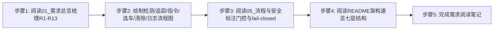
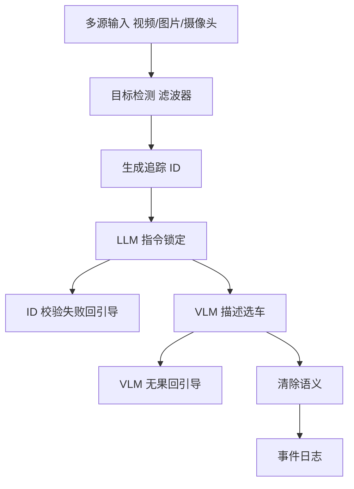
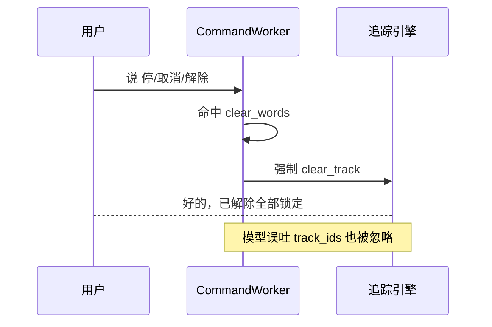

# 实验1：通用目标追踪--项目需求分析（4h）


### 1.1 关联知识点

- 1.1.1 R1-R13 功能需求体系（前置：无；项目所有后续实验的基础）
- 1.1.2 检测→追踪ID→LLM指令锁定→描述选车→清除→事件日志全流程（前置：1.1.1，需先理解 R1-R13 需求条款）
- 1.1.3 多源输入统一（视频/静态图/摄像头ROS话题）（前置：无，理解输入层约束）

### 1.2 实验目标

1. **理解**通用目标追踪项目 R1-R13 全部功能需求，能逐条复述每个需求的约束要点（输入源类型、检测算法、追踪方法、LLM 指令、VLM 选车、清除语义、语音、日志等）。
2. **掌握**检测→追踪 ID→LLM 指令锁定→描述选车→清除→事件日志的完整状态流转时序，能独立绘制包含输入、检测、追踪、指令、VLM 选车、清除、日志全节点的流程图。
3. **理解**门控防呆与 fail-closed 断言逻辑（清除语义强制 clear_track、ID 数值不对齐回引导、VLM 不确定不锁车）的设计原理与触发条件。
4. **独立完成**一份结构化需求阅读笔记，能标注文档真实行号引用，梳理"需求编号→实现模块→关键约束"的三层映射。
5. **迁移**：把"需求总览→流程梳理→门控安全"的需求分析方法迁移到其他具身智能/大模型综合项目场景。

### 1.3 实验环境

| 类别 | 内容 |
|------|------|
| 硬件 | 具身智能实验箱B2 / 具身智能机器人小车C1（本实验仅阅读文档，无需上电） |
| OS | Ubuntu 22.04 + ROS 2 Humble |
| Python | 3.10（本实验仅需阅读，不执行 Python） |
| 文档对象 | `ros2_ws/src/xflz_eai_car1/app/object_tracking/docs/01_需求总览.md`、`docs/05_流程与安全.md`、`README.md` |
| 辅助工具 | 文本编辑器或笔记软件（用于撰写需求阅读笔记和流程图） |

### 1.4 实验难度

- 难度: ⭐（验证性）
- 重点：R1-R13 需求条款的逐条梳理与要点归纳；检测→追踪→指令→选车→清除→日志全流程时序理解；门控防呆与 fail-closed 三层语义。
- 难点：R3 多目标追踪与 R5 LLM 指令的接口关系（追踪底座为 LLM 指令提供 ID 语义）；R7/R8 描述选车与 fail-closed 关系（绝不锁错目标）；R9 清除语义的强制优先级。

### 1.5 实验现象

**快速验证流程**（纯文档类实验，以下为快速阅读清单）：

```bash
# 在 object_tracking 包目录下
cd ~/ros2_ws/src/xflz_eai_car1/app/object_tracking

ls docs/
grep -n "R[0-9]" docs/01_需求总览.md          # 快速定位 R1-R13 各条款行号
grep -n "门控\|fail-closed\|清除\|防呆" docs/05_流程与安全.md  # 定位门控防呆章节
head -60 README.md                             # 架构速览与关键决策
```

**预期效果描述**：

- 能列出 R1-R13 每一条的一句话要点，并能说出"哪几条属于输入/检测、哪几条属于追踪/ReID、哪几条属于指令/门控、哪几条属于语音/日志、哪几条属于调试/运维"。
- 能画出 `多源输入 → 目标检测 → 追踪ID → LLM指令锁定 → 描述选车(VLM) → 清除 → 事件日志` 的完整时序图，并标注每个状态转换的触发条件与门控 fail-closed 节点。
- 能说出门控防呆至少三个要点（清除词强制 clear_track、非指令回落闲聊、ID 数值不对齐回引导、VLM 无果不锁车）。

### 1.6 实验步骤

#### 整体流程图



#### 步骤1：通读需求总览，梳理 R1-R13（90min）

**知识点讲解**：

**1.1.1 R1-R13 功能需求体系**

- **原理**：需求体系回答"系统要做什么、边界是什么"。R1-R3 定义输入层（多源统一、目标检测、多目标追踪），R4 定义外观重识别（ReID），R5-R6 定义 LLM 指令解析（结构化 JSON 工具调用 + 原生 FunctionCall 双路径），R7-R8 定义描述选车（VLM 视觉 + fail-closed 铁律），R9 定义清除语义，R10 定义门口词路由，R11 定义流式 TTS 播报，R12 定义事件日志，R13 定义调试运维（文本模式、MJPEG）。梳理时建议按"输入→检测→追踪→指令→选车→清除→日志→调试"八个维度分组，逐条标注"可量化约束"（如 class_filter=[car]、min_box_w/h=32、max_stale=15、min_confidence=0.3、pause_timeout=30.0、cell_cap=16）。R13 的文本调试模式特别重要——`--text` 与音频模式走同一状态机，是后续所有实验的基础调试路径。
- **源码对应**：`docs/01_需求总览.md L1-L25（需求清单表格 R1-R13）与 L28（非目标范围边界）`

```markdown
### R1. 多源输入统一
- 本地视频 / 静态图片 / 实时摄像头（ROS 话题）三种输入源，config 或 CLI 切换，业务代码零改动
### R3. 多目标追踪
- DeepSORT 结构（卡尔曼预测 + IoU/外观关联 + 确认框），生成并维护稳定 track id
### R5. LLM FunctionCall
- 自然语言指令 → LLM 输出结构化 JSON 工具调用（track_ids/clear_track），秒级推理在独立线程不卡帧
### R9. 清除语义
- 清除/解除/取消/停/不追/恢复全/不跟 → 强制解除全部锁定（0.8B 对"清除"误吐 track_ids 时也强制 clear_track，不解错）
```

**知识储备补充**：

- **需求体系设计动机**：R1-R13 把"感知→决策→执行→运维"闭环拆成独立编号（R1-R4 输入/检测/追踪/ReID 底座，R5-R9 指令/选车/清除/路由，R10-R13 语音/日志/调试），使每条需求都可被测试与断言；"可量化约束"（class_filter、min_box、max_stale、pause_timeout、cell_cap）正是把需求翻译成代码参数的关键。

- **检测进入追踪的量化判定**：一个检测候选框能否进入追踪由置信度与尺寸约束同时决定：

  $$
  \text{keep}(b) = \mathbb{1}\,[\, c_b \ge \theta_c \;\wedge\; w_b \ge \theta_w \;\wedge\; h_b \ge \theta_h \,]
  $$

  其中 $b$ 为检测框，$c_b$ 为其置信度，$w_b$、$h_b$ 为框宽、高，$\theta_c = \min\_confidence = 0.3$、$\theta_w = \theta_h = \min\_box\_w/h = 32$（min_box_w、min_box_h 两阈同值 32）。数值示例：$c_b = 0.25 < 0.3$ → 不满足 → 该框不进入追踪；$w_b = 48 \ge 32$ 且 $c_b = 0.9$ → 满足。该约束对应 `tracking/tracker.py` 的 confirmed/filter 阶段（过滤 `min_confidence`、`min_box_w`、`min_box_h`）。

- **fail-closed 门控语义（R8/R9）**：图像场景"不确定锁谁"的分支全部回引导而不动作——VLM 无返回值/返回 99、ID 数值不对齐、工具解析失败均属此列（docs/05_流程与安全.md L23-L33）；R9 清除语义由 clear_words 词表驱动，命中即强制 clear_track，忽略模型 tool 输出（0.8B 误吐 track_id 也强制解除），这是"宁可不清、不可错清"的对称设计。

- **参考资源**：`docs/01_需求总览.md`（R1-R13 清单）、`docs/05_流程与安全.md`（门控防呆表与 fail-closed 小节）、`README.md`（架构速览）；目标检测基础见 Ultralytics YOLOv8 文档；多目标追踪关联原理见 SORT 论文（arXiv:1602.00763）与 DeepSORT 论文（arXiv:1703.07402）。

**易错点**：

- ⚠️ 误以为追踪 ID 由 LLM 生成 → **解决**：追踪 ID 由 DeepTrack（R3, 追踪底座）实时生成维护，LLM 只负责理解"哪辆车"并把 id 传回；LLM 不产生也不分配 ID。
- ⚠️ 认为 fail-closed 只在 VLM 失效时触发 → **解决**：fail-closed 覆盖所有"不确定锁谁"的分支：非空 ID 数值不对齐、VLM 无果/返回 99、工具解析失败，都只回引导不动作。

#### 步骤2：绘制检测/追踪ID/指令锁定/描述选车/清除/事件日志完整流程图（约90min）

**操作步骤**：

1. 用流程图工具绘制完整时序：多源输入 →（R2-R3）检测 → 追踪 ID →（R5）LLM 指令锁定 →（R7）描述选车（VLM）→（R9）清除 →（R12）事件日志。
2. 检测→追踪流：YOLO 检测（class_filter=[car]）→ 卡尔曼预测 → IoU/外观级联关联 → 确认框 → follow 绘制。
3. 指令流：LLM 独立线程 → track_ids/clear_track → submit_effect 入队 → 主循环 apply。
4. 清除必须打通 R9：`clear_words` 命中强制 clear_track，忽略模型 tool 输出。
5. 事件日志必须打通 R12：lost/unlock_all/command/camera_stall/pause_timeout 落 events.jsonl。

**易错点**：

- ⚠️ 流程图漏掉触发 LLM 前的"存在性校验"ID → **解决**：追踪 ID 存在性校验在 CommandWorker._native_gate，ID 数值不对齐直接回「未找到该 ID 目标」，绝不 VLM 猜车。

**知识储备补充**（1.1.2 全流程视角）：

- **流程即函数复合**：完整追踪链路可看作对输入帧 $I$ 的一串有向变换，整体效果是函数复合：

  $$
  E = \mathrm{Log} \circ \mathrm{Clear} \circ \mathrm{Lock}_{LLM} \circ \mathrm{Track} \circ \mathrm{Detect}(I)
  $$

  其中 $\mathrm{Detect}$ 为检测、$\mathrm{Track}$ 为追踪（生成/维护 ID）、$\mathrm{Lock}_{LLM}$ 为 LLM 指令锁定、$\mathrm{Clear}$ 为清除语义（R9）、$\mathrm{Log}$ 为事件落盘（R12）。数值示例：输入帧 $I$ 经 $\mathrm{Detect}$ 检出车框，$\mathrm{Track}$ 分配 $id=5$，指令「追踪 id 5 的车」经 $\mathrm{Lock}_{LLM}$ 锁定 $follow=\{5\}$，VLM 描述确认后 $\mathrm{Clear}$（说「停」）解除，$\mathrm{Log}$ 追加 `command` 事件到 events.jsonl。

- **门控与 fail-closed 节点**：链路上每个"不确定锁谁"的节点都是分流点——存在性校验失败回引导、VLM 无返回值/返回 99/无匹配回引导，绝不让不确定的 ID 进入 $\mathrm{Lock}$。绘制时应把门控画成条件菱形而不只是直连箭头。

- **参考资源**：本实验 `docs/05_流程与安全.md`（追踪时序 L1-L21、门控防呆表 L23-L33）；DeepSORT 论文 arXiv:1703.07402（track ID 维护原理）；Mermaid sequenceDiagram 官方文档（绘制时序图语法）。

**参考模板**（完整流程图，可对照绘制；追踪/门控只画到事件日志的纵向主线，fail-closed 分支用虚线退出）：



#### 步骤3：阅读流程与安全文档，标注门控防呆与 fail-closed（约60min）

**操作步骤**：

1. 在 `docs/05_流程与安全.md` 中"门控防呆（fail-closed 层级）"小节逐条阅读并在笔记标注（L1-L21 追踪时序、L23-L33 门控防呆表、L35-L42 并发锁、L44-L50 异常/安全）。
2. 标注五个防呆点：闲聊防误触工具、非空清除强制、ID 数值不对齐不 VLM、VLM 不可用/99/无匹配回引导、指令队列满丢弃不阻塞。
3. 用时序图表示 clear_words 短路后续分支（模型误吐 track_ids 时仍强制 clear_track）。

**参考模板**（clear_words 短路时序，可对照绘制）：



**知识储备补充**（1.1.3 clear_words 短路与全流程门控）：

- **清除短路优先级**：R9/R10 把清除做成**词表短路**——命中 `interaction.clear_words` 即强制 `clear_track` 并忽略模型 tool 输出（0.8B 误吐 track_ids 也强制解除），因此优先级高于 LLM 输出、高于存在性校验，是"不解错"的最强防线。

- **事件日志五类**：R12 把丢目标（lost）、解锁（unlock_all）、指令（command）、摄像头故障（camera_stall）、暂停超时（pause_timeout）五类事件统一追加到 events.jsonl，供回放与调参分析。

- **参考资源**：`docs/05_流程与安全.md`（门控防呆表 L23-L33）；Mermaid sequenceDiagram 官方文档。

**易错点**：

- ⚠️ 混淆"清除"（clear_track）与"解除 VLM 错误锁定" → **解决**：清除是用户显式语义（R9/R10 词表），VLM 错误锁定的回退是 fail-closed 自动回滚（R8），两种路径触发源不同。

#### 步骤4：阅读 README 架构速览，理解七层结构与关键决策（约30min）

**操作步骤**：

1. 通读 `README.md` 的架构速览（ASCII 图/数据流）与常用命令部分。
2. 记录七层模块：apps（入口）/common（输入源/配置）/tracking（自研核心）/tools（工具注册表/门控）/speech（复用 elderly）/llm（复用 elderly）/config。
3. 特别关注依赖方向严格单向：`common ← vision/tracking ← tools ← apps`、`speech/llm 独立`。

**易错点**：

- ⚠️ 把 speech/llm 当作 tracking 的子模块 → **解决**：speech/llm 复用 elderly 的独立模块，接口对接点在 apps 装配层（`track_app`），tracking 不依赖它们。

**知识储备补充**（七层结构与依赖方向）：

- **依赖方向定义**：依赖方向"单向"指**谁可以 import 谁**——底层模块（tracking 追踪核心）不 import 上层（tools 工具注册表），上层 tools/apps 依赖下层；speech/llm 复用 elderly 独立包，通过 apps 装配层（`track_app.build_engines`）对接。这样修改追踪算法不影响工具注册表，改 LLM 客户端不影响追踪引擎。

- **开发/生产配置分离**：config 中 `train.*` 与 `rknn.*` 为 PC 侧重（训练/转换用），板端运行只消费 `infer/source/server` 等段——配置按运行环境切分，减少上板误配。

- **参考资源**：`README.md`（架构速览、模块映射）；领域分层架构参考《Clean Architecture》（R. Martin），依赖方向是其核心。

#### 步骤5：完成需求阅读笔记（约30min）

**操作步骤**：

1. 汇总前四步产出，按"输入/检测/追踪/指令/选车/清除/语音/日志/调试"九节撰写。
2. 每节附文档行号引用与关键约束摘录。
3. 自检：能否不看文档说清 R1-R13 要点；能否画出完整流程图；能否说清门控防呆与 fail-closed 至少三个防呆节点的触发条件。

**易错点**：

- ⚠️ 笔记只抄条款不做归纳 → **解决**：每条需求必须提炼"可量化约束"（class_filter、min_box、max_stale、pause_timeout、cell_cap）和"门控含义"。

### 1.7 注意事项

- ⚠️ 本实验为**纯文档阅读，无硬件操作**，不需要给底盘/STM32 上电，不需要启动 ROS 节点。
- ⚠️ 文档路径 `ros2_ws/src/xflz_eai_car1/app/object_tracking/` 为板端实机路径，若在工程机外阅读需注意路径映射。
- ⚠️ R9 清除语义用词表（clear_words）实现强制，调实时无需改代码，只改 `interaction.clear_words`。
- ⚠️ fail-closed 门控是安全核心，任何"不确定锁谁"的描述都应回引导而不是猜，实验 5/6 会重点验证。

### 1.8 实验总结

**完成成果**: 一份 R1-R13 需求梳理表（含量化约束、实现模块、门控语义）；检测→追踪→追踪→清除→日志完整流程图；门控防呆与 fail-closed 要点笔记；"需求→模块→关键约束"三层映射表。

**技能收获**:

- 技能1：需求文档结构化梳理方法（分组→量化约束→实现映射）
- 技能2：多目标追踪/LLM 指令全流程时序图绘制（显式标注 fail-closed 节点）
- 技能3：大模型对话系统中的门控安全策略分析（fail-closed 与语义路由）

**常见问题与解决**:

| 问题 | 原因 | 解决方法 |
|------|------|----------|
| 把 LLM 当 ID 分配者 | L3 是 DeepTrack 生成的 | 追踪 ID 来自 Kalman+ReID 追踪器，LLM 只转发/解析 |
| R5 vs R6 混淆 | 两条 LLM 指令路径 | R5 是结构化 JSON（tool_dispatch）；R6 是 rkllm 原生 FunctionCall（native_client），双路径 |
| 清除语义误解 | R9 是词表驱动 | clear_words 命中强制 clear_track，ignore 模型 tool 输出，这是不解错的核心 |

### 1.9 实验报告要求

**思考题**:

1. R3 多目标追踪为 R5 LLM 指令提供什么核心数据？为什么 LLM 不能自己分配追踪 ID？
2. 门控中"清除语义强制 clear_track"（R9）与"ID 数值不对齐回引导"（R8 fail-closed）解决哪两类不同故障？如果省去它们，可能锁错什么？
3. R1 多源输入（视频/图/摄像头）与 R13 文本调试模式如何共同降低硬件依赖，让纯逻辑可先验证？

**评分标准**:

- 需求梳理表完整准确（35 分）：R1-R13 逐条覆盖、量化约束正确、实现与门控映射准确
- 完整流程图（30 分）：检测/追踪/指令/选车/清除/日志流程正确、fail-closed 节点标注
- 门控与 fail-closed 分析（25 分）：三个防呆节点的触发条件与设计理由清晰
- 笔记规范与行号引用（10 分）：引用真实文档行号，结构完整 = 100 分。

---

## 更新日志

| 版本 | 日期 | 说明 |
|------|------|------|
| v1.0 | 2026-09-07 | 初始版本，基于 EXP006b 源码与文档生成 |
| v2.0 | 2026-09-07 | 知识储备增强 |