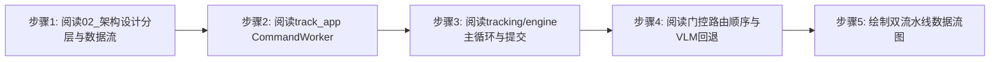
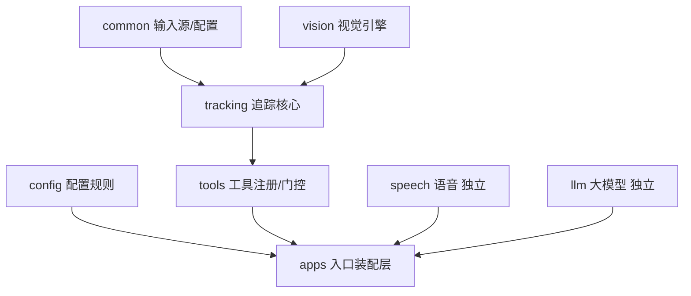
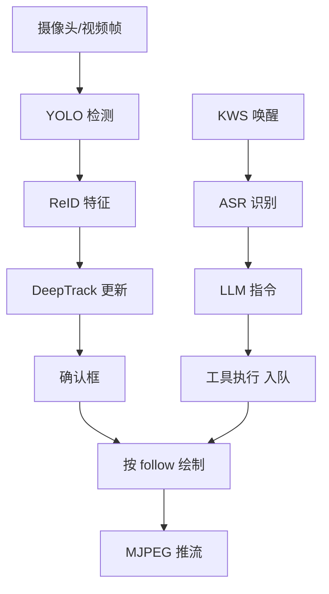

# 实验2：通用目标检测与追踪底座--系统架构设计（4h）


### 2.1 关联知识点

- 1.2.1 七层模块划分与依赖方向（前置：1.1.1，先理解需求到模块映射）
- 1.2.2 视觉流水线 YOLO→ReID→DeepTrack→确认框（前置：1.2.1）
- 1.2.3 CommandWorker 独立线程不回卡帧（前置：1.1.2，需理解指令与主循环解耦）
- 1.3.1 pending 暂停等待看门狗（前置：1.2.3）
- 1.3.2 ID 锁定 TrackSession.follow_ids（前置：1.2.2）
- 1.3.3 _native_gate 门控路由顺序（前置：1.2.3）

### 2.2 实验目标

1. **理解**七层模块结构（apps/common/tracking/tools/speech/llm/vision/config）与依赖方向严格单向设计。
2. **掌握**视觉流水线（YOLO→ReID→DeepTrack→确认框→按follow绘制→MJPEG）与 TrackEngine 单状态机主循环。
3. **掌握**CommandWorker 独立线程 + submit_effect 入队回填主循环的不卡帧设计，以及 pending 暂停等待 + pause_timeout 看门狗语义。
4. **独立完成**视觉与语音双流水线数据流图，理解 LLM 在下达追踪/清除指令时的路由优先级（_native_gate）与 fail-closed 回退。
5. **迁移**：把"队列驱动单状态机 + 独立推理线程 + 副作用入队"的架构模式迁移到其他机器人实时视觉系统。

### 2.3 实验环境

| 类别 | 内容 |
|------|------|
| 硬件 | 具身智能实验箱B2 / 具身智能机器人小车C1（本实验仅阅读源码，无需上电） |
| OS | Ubuntu 22.04 + ROS 2 Humble |
| Python | 3.10（本实验仅需阅读，不执行 Python） |
| 源码对象 | `apps/track_app.py`、`tracking/engine.py`、`tracking/session.py`、`tools/tool_dispatch.py`、`docs/02_架构设计.md` |
| 辅助工具 | 文本编辑器 + mermaid/绘图工具 |

### 2.4 实验难度

- 难度: ⭐⭐（设计性）
- 重点：七层模块职责划分；视觉流水线与 TrackEngine 单状态机主循环；CommandWorker 不卡框解耦；ID 锁定语义。
- 难点：pending 暂停等待与 LLM 异步消费的解耦；_native_gate 路由优先级（清除短路/非指令回落/VLM 回退）；队列驱动主循环如何保证帧率。

### 2.5 实验现象

**快速验证流程**（纯源码阅读，无硬件）：

```bash
cd ~/ros2_ws/src/xflz_eai_car1/app/object_tracking

# 架构速览与数据流
cat docs/02_架构设计.md

# CommandWorker 线程与门控
grep -n "class CommandWorker\|_native_gate\|submit_effect\|pending\|epoch" apps/track_app.py

# 主循环与命令队列
grep -n "def run\|def submit_effect\|def _drain_commands\|def _compute_draw\|cmds" tracking/engine.py
```

**预期效果描述**：

- 能画出七层模块依赖图，标出 tracking/tools/apps 依赖方向。
- 能画出视觉流水线（YOLO→ReID→DeepTrack→确认框→按 follow 绘制）与语音/指令流水线（唤醒→ASR→LLM→工具执行→submit_effect）。
- 能说出三个关键时序约定：队列驱动主循环；LLM 秒级推理独立线程不卡框；pending 暂停 + pause_timeout 看门狗。

### 2.6 实验步骤

#### 整体流程图



#### 步骤1：阅读架构设计文档，理解分层与依赖方向（约55min）

**知识点讲解**：

**1.2.1 七层模块架构与依赖方向**

- **原理**：模块分层的核心目标是**依赖单向 + 接口解耦**。架构图把系统分成七层部件，依赖方向严格单向：`common ← (vision/tracking) ← tools ← apps`，而 `speech/llm 独立`（复用 elderly 模块，通过 apps 装配层对接）。所谓"依赖方向"即"谁可以 import 谁"——底层模块（tracking 追踪核心）不 import 上层（tools 工具注册表），上层 tools/apps 依赖下层。这样修改追踪算法不影响工具注册表，改 LLM 客户端不影响追踪引擎。接口对接点集中在 apps 装配层（`track_app.build_engines` 组装引擎 + 注册工具 + 绑定语音）。`README.md` 给出模块映射：apps（入口）、common（输入源/配置）、tracking（自研核心）、tools（工具注册/门控）、speech/llm（复用 elderly）、config（配置）。
- **源码对应**：`docs/02_架构设计.md L3-L18（分层结构 ASCII 图 + 依赖方向说明）`

**操作步骤**：

1. 阅读 `docs/02_架构设计.md` 的分层结构小节（L3-L18）。
2. 在笔记中绘制七层依赖图，标出"tracking→tools→apps"依赖箭头与"speech/llm 独立"。

**易错点**：

- ⚠️ 把 speech/llm 当 tracking 子模块 → **解决**：speech/llm 是复用 elderly 的独立包，tracking 不 import 它们，接口对接在 apps 装配层。

**知识储备补充**（1.2.1 依赖方向量化）：

- **依赖即边集**：七层模块可看作有向图 $G=(V,E)$，顶点集 $V=\{apps, common, tracking, vision, tools, speech, llm, config\}$，边 $a \to b$ 表示"$a$ 依赖 $b$"。关键边：$tracking \to common$、$tools \to tracking$、$apps \to tools$、$vision \to tracking$、$speech \to apps$、$llm \to apps$。**单向性**要求图中不存在环：若同时有 $x \to y$ 与 $y \to x$，则修改 $x$ 会级联影响 $y$、又反向波及 $x$，失去模块边界。

- **为何 speech/llm 独立**：speech/llm 是复用 elderly 的独立包，tracking 不 import 它们，接口对接点在 apps 装配层（`track_app.build_engines` 组装引擎 + 注册工具 + 绑定语音）。这样替换语音方案（如换 ASR 引擎）不动追踪核心，追踪升级也不影响语音模块。

- **参考资源**：`docs/02_架构设计.md L3-L24`（分层 ASCII 图 + 依赖方向说明）；`README.md`（模块映射）；分层架构经典《Clean Architecture》（R. Martin，依赖方向是其核心）。

**参考模板**（七层依赖图，可对照绘制；箭头指向依赖方，speech/llm 画成独立分支）：



#### 步骤2：阅读 apps/track_app.py 的 CommandWorker，理解 LLM 异步消费（约50min）

**操作步骤**：

1. 阅读 `CommandWorker`（`apps/track_app.py L196-235`）：继承 threading.Thread，从有界队列 `queue.Queue(maxsize=8)` 取命令（L219-226），`push()` 用 put_nowait（L232-236）满丢新命令不阻塞。
2. 理解 `_handle()`（L246-269）：①pending.set()（L247）主循环暂停读帧；②epoch 迟到丢弃（L249-251）；③拼接 scene 上下文（L255-256）；④调 LLM（native 分支 / 非 native ask_stream）→ tool_dispatch/registry → on_reply。

**易错点**：

- ⚠️ 误以为 LLM 在主线程执行 → **解决**：CommandWorker 是独立 daemon 线程，LLM 秒级推理不阻塞主循环读帧；命令经有界队列 + submit_effect 入队回填，请求处理中主循环暂停读帧（pending）。

**知识储备补充**（1.2.3 CommandWorker 异步消费）：

- **为何要独立线程**：LLM 推理是秒级（数百 ms~数 s）的不可控延迟，若串行进主循环，帧率将被 LLM 拉低到 ~1 FPS。独立线程 + 有界队列（`queue.Queue(maxsize=8)`）+ `submit_effect` 入队回填，使 LLM 慢不丢帧、不影响主循环采样节奏。

- **有界队列的背压语义**：有界队列 $Q$ 容量 $N = 8$，`push()` 用 `put_nowait`——满时**丢弃新命令**（而非阻塞生产者）。数值示例：$N=8$ 时队列满，第 9 条命令被丢弃——这是"慢生产者不拖垮消费端"的既有设计（指令偶尔丢可接受，帧率/画面不能卡）。

- **pending 与命令消费解耦**：`engine.pending.set()` 只让主循环暂停**读帧**（`pause_wait=true`），帧停在最后标注帧；`pause_timeout` 看门狗（默认 30.0s）超时强制解暂停，防 LLM 挂死冻结画面。命令消费（`_drain_commands`）不与读帧绑死，故暂停不丢命令。

- **参考资源**：`apps/track_app.py L196-269`（CommandWorker 线程+队列+_handle）；Python `queue.Queue` 官方文档（有界队列/put_nowait）。

#### 步骤3：阅读 tracking/engine.py 的 run 单状态机主循环与 pending 暂停（约230min）

**知识点讲解**：

**1.2.2 视觉流水线与 TrackEngine 单状态机主循环**

- **原理**：TrackEngine.run 是**单状态机主循环**（`tracking/engine.py` L89-93），每轮只读一帧，成功后才进入 pipeline。pipeline.process（`tracking/pipeline.py` L14-16）完成"检测 → ReID特征 → tracker.update → 过滤 confirmed/尺寸/stale"整条视觉链路。Tracker.update（`tracking/tracker.py` L72-75）按 DeepTrack 语义（卡尔曼预测 + IoU/外观级联 + 确认框）维护 track id。主循环后半段：`_drain_commands()`（L52）消费命令队列（bounded，LLM 线程 submit），`_compute_draw()`（L56）按锁定语义算本帧绘制（只画被锁 ID），`_publish`（L63）发布/MJPEG。这样"读帧—检测—追踪—绘制—消费命令"循环是一个有界工作队列驱动的确定性主动循环，帧率稳定。

**源码对应**：`tracking/engine.py L38-54（submit_effect/_apply_effect/命令队）、L56-66（_compute_draw）、L89-98（run 主循环）`；`tracking/session.py L12-25（set_follow/visible_ids/clear）`

**1.3.1 pending 暂停等待 + pause_timeout 看门狗**

- **原理**：指令处理期间，CommandWorker 将 `engine.pending.set()`，主循环下一轮检测 pending 时暂停读帧（`pause_wait=true`），画面停在最后标注帧；LLM 完成/effect 回填后 finally `pending.clear()` 恢复。`pause_timeout` 看门狗防 LLM 挂死冻结画面，超时强制解暂停。

**2 视觉流水线数据流（Core）**

```
FrameSource.read → TrackEngine.run（每帧）
  ├─ YOLO 检测（detector.detect, class_filter=[car] 过滤）
  ├─ [可选 ReID] 裁 crop → reid_pool.extract 提取外观特征（失败降级纯 IoU）
  ├─ pipeline.process → Tracker.update（卡尔曼预测 + 级联关联）
  ├─ 小框/超龄剔除：min_box_w/h 与 max_stale 过滤 → confirmed
  ├─ session.visible_ids 过滤 → 按 follow 绘制 / MjpegServer / VideoWriter / imshow
  └─ 丢失检测：follow 目标消失 → lost 事件 + TTS 播报；全丢 unlock_on_loss 恢复全显示
```

**1.3.2 ID 锁定（TrackSession.follow_ids）**

- **原理**：TrackSession 保存 `follow_ids`（`tracking/session.py` L12-13 set_follow）。某命令锁定后 follow={3}，visible 过滤只绘制该 ID；`_compute_draw`（engine L56-66）按锁定语义算本帧要绘制目标（有 follow 只画锁定，无 follow 按 show_all 全画）。目标消失时触发 lost 事件，unlock_on_loss 全丢后恢复全显示。

**操作步骤**：

1. 阅读 `tracking/engine.py` 主循环（`run`，L87-106）、`submit_effect`/`_apply`（L38-45）、`_drain_command`（L69）、`_compute_draw`（L79-9X）——结合你的 grep 输出记录行号。
2. 阅读 `tracking/session.py`（set_follow/visible_ids）。
3. 阅读 `tracking/pipeline.py` 的 `process()`（L14-54）理解单帧流水线返回值组装。

**易错点**：

- ⚠️ 误以为"暂停"会丢帧 → **解决**：`pause_wait=true` 只暂停**读帧**，不暂停命令消费；frame 停在最后标注帧，配合 `pause_timeout` 看门狗防挂死。这是队驱动主循环的时序纪律。

**知识储备补充**（1.2.2/1.3.1 单状态机与 Kalman 预测）：

- **单状态机主循环**：`TrackEngine.run` 每轮只读一帧，成功后才进入 `pipeline.process`（检测→ReID→tracker.update→过滤）。主循环后半段依次 `_drain_commands()`、`_compute_draw()`（按锁定语义画）、`_publish`（MJPEG/发布）。"读帧—检测—追踪—绘制—消费命令"是有界工作队列驱动的**确定性主动循环**，帧率稳定。

- **卡尔曼预测（时间更新）**：追踪器对每个 track 的状态做匀速运动预测——DeepTrack 采用 8 维状态 $[cx, cy, aspect, height, vx, vy, va, vh]$（`tracking/kalman.py` L29-65），其中 $cx, cy$ 为框中心，$aspect$ 为宽高比，$height$ 为高，$vx, vy, va, vh$ 为对应速度，预测方程为：

  $$
  \hat{x}_{k|k-1} = F_k\,\hat{x}_{k-1|k-1}
  $$

  其中 $\hat{x}_{k|k-1}$ 为第 $k$ 帧先验估计（8×1 向量）、$F_k$ 为状态转移矩阵（匀速模型，把上一帧后验 $\hat{x}_{k-1|k-1}$ 外推一帧）、$k$ 为帧序号。数值示例：若上一帧 $cx=320$、$vx=2$，预测帧 $cx$ 变为 $320+2=322$（同段 `kalman.py`：$F$ 中 $cx$ 行 = $[1,0,0,0,1,0,0,0]$）。

- **门控与距离度量**：CHI2INV95 门控（95% 卡方逆）决定候选关联是否合规，超出门限的检测不进入匹配；级联关联用**马氏距离/余弦距离**混合价格矩阵（DeepSORT 论文定义为 $d^{(1)}$ 马氏运动 + $d^{(2)}$ 外观余弦距离，融合价格 $C = \lambda d^{(1)} + (1-\lambda) d^{(2)}$）。本实验只要求理解语义，不写实现。

- **pending 暂停语义**：`engine.pending.set()` 只暂停**读帧**，不暂停命令消费；帧停在最后标注帧，配合 `pause_timeout` 看门狗（默认 30.0s）防 LLM 挂死冻结画面。

- **参考资源**：`docs/02_架构设计.md`（主循环/流水线）；DeepSORT 论文 arXiv:1703.07402（Kalman 递推定义、CHI2 门控、置信度级联——确认框：Tentative→Confirmed(hits ≥ n_init)→Deleted）；SORT 论文 arXiv:1602.00763（Kalman 单目标预测起源）。

#### 步骤4：CommandWorker._native_gate，理解清除/追踪优先级与 VLM 回退顺序（约190min）

**操作步骤**：

1. 阅读 `CommandWorker._native_gate`（`apps/track_app.py` L320-366），顺序写死：
   - 清除词短路（L336-340）：原文含 `clear_words`（停/取消/解除/不追/恢复全/不跟/清除）→ 强制 `clear_track`，忽略模型 tool，回「好的，已解除全部锁定」。
   - 非指令回落 → 非追踪指令（is_instruction=false 且无视视觉指令）→ 回落闲聊对话（_chat_reply），绝不执行工具。
   - ID 无 id → 含描述 -> VLM；否则回引导「请告诉我目标 id 例如追踪 id53」。
   - ID 有 id → 存在性/数值对齐校验 → registry.track_ids；不对齐回「未找到该 ID 目标」。
   - track_vlm → VLM 视觉选车。
   - else（save/clear 非 track）→ 放行执行。
2. 理解 VLM 回退顺序（R8 fail-closed）：VLM 不可用/返 None/99/无匹配 → 引导不锁；绝不空 id 清锁。
3. 绘制数据流图时分清"指令链路"与"视觉链路"两条主通道。

**易错点**：

- ⚠️ 以为 VLM 是任何"追踪"的先导 → **解决**：当 id 存在时直接锁定（存在性优先），绝不调视觉；VLM 只在"无 id 带描述"时介入，fail-closed 兜底。

**知识储备补充**（1.3.3 _native_gate 路由优先级）：

- **门控顺序即优先级**：`_native_gate`（`apps/track_app.py` L320-366）是**顺序短路**流水线，命中即返回，未命中才继续下一分支。按位序：①清除词短路 →（忽略一切 tool/描述）；②非指令回落闲聊 → 绝不执行工具；③ `track_id` 存在性/数值对齐校验 → 不对齐回「未找到该 ID 目标」；④ 无 id 带描述 → VLM 选车（fail-closed：不可用/None/99/无匹配 → 引导不锁，绝不空 id 清锁）；⑤ else（save/clear 非 track）→ 放行执行。顺序即优先级——清除 > 闲聊回落 > 存在性 > VLM > 放行。

- **fail-closed 的穷举语义**：VLM 不可用/返 None/返回 99/无匹配 → 引导不锁；绝不空 id 清锁。"编号不存在"与"无编号"都只回引导，不一刀切放行——这是命令安全的关键。

- **参考资源**：`apps/track_app.py L320-366`（_native_gate 全表）；`tools/tool_registry.py` / `tools/tool_dispatch.py`（注册与分发）；fail-closed 设计模式见 NIST 安全设计指南。

#### 步骤5：绘制视觉与语音双流水线数据流图（约30min）

**操作步骤**：

1. 绘制**视觉流水线**（YOLO→ReID→Track→帧→follow 绘制→MJPEG）。
2. 绘制**语音/指令流水线**（苏醒→ASR→LLM 独立线程→工具→submit_effect 入队→主循环 apply→TTS 播报）。
3. 标注两条流水线的松耦合点（submit_effect 入队 / on_dialog_text 回调）与对象事件点（lost/unlock 回调）。

**易错点**：

- ⚠️ 把两条流水线画成单线程 → **解决**：视觉主循环与 CommandWorker 是两个线程，通过 `submit_effect` 命令队 + `on_event` 回调解耦，画图要显式标出两个执行体与交换通道。

**参考模板**（双流水线数据流图，可对照绘制；两条并行主线各自纵向展开）：



**知识储备补充**（双流水线解耦点）：

- **两个执行体**：视觉主线程（TrackEngine.run）与语音/指令线程（CommandWorker）是两个执行体，通过 `submit_effect` 命令队列（有界、put_nowait 满丢）交换；指令处理期间 `pending` 暂停读帧但不阻塞命令消费。

- **松耦合点**：`submit_effect` 入队（指令生效回填主循环）与 `on_reply` 回调（TTS 播报/文本回复）是两条流水线的唯一交换点；`lost` / `unlock_all` 事件通过 `on_event` 回调通知语音播报。画图要标出这两个交换通道。

- **参考资源**：`apps/track_app.py`（耦合点实现）；`tracking/engine.py`（主循环消费侧）；本实验 `docs/02_架构设计.md`。

### 2.7 注意事项

- ⚠️ 本实验**无硬件操作**，仅源码阅读，不需要上电/启动 ROS。
- ⚠️ 追踪 ID 由 DeepTrack（第 3 层）生成，LLM 只负责转发/解释，不要在架构上把 ID 分配画给 LLM。
- ⚠️ fail-closed 门禁顺序写死在 `_native_gate`，顺序改动会影响语义，实验 5/6 会验证；本实验只理解不修改。

### 2.8 实验总结

**完成成果**: 一张七层模块依赖图；一张 TrackEngine 单状态机主循环流程图；一张 CommandWorker 异步线程 + submit_effect 解耦图；一张双流水线（视觉 + 语音/指令）数据流图。

**技能收获**:

- 技能1：分层架构与依赖方向设计
- 技能2：队列驱动 + 单线程主循环 + 独立推理线程的实时系统解耦
- 技能3：门控路由（fail-closed）语义设计

**常见问题与解决**:

| 问题 | 原因 | 解决方法 |
|------|------|----------|
| 误认为 ID 由 LLM 分配 | 未读 track/追踪模块 | track id 由 DeepTrack 生成，LLM 只转发 id |
| 误认为 pending 丢帧 | 未读 engine | pending 只暂停读帧（停最后帧），不丢命令 |
| 误认为 VLM 是通用选车先导 | 未读 _native_gate | 存在 id 优先锁，VLM 只在无 id 带描述时 active |

### 2.9 实验报告要求

**思考题**:

1. CommandWorker 独立线程 + submit_effect 入队的设计如何保证"LLM 慢不丢帧、不改帧率采样"？如果原成串行执行会有什么问题？
2. pending 暂停 + pause_timeout 看门狗如何防止 LLM 挂死冻结画面？为什么要"暂停而非继续处理"？
3. _native_gate 中"清除语义强制 clear_track"与"ID 数值不对齐回引导"各防哪个故障？为什么 VLM 不是每条指令的先导？

**评分标准**:

- 七层架构依赖图（20 分）：依赖方向正确、speech/llm 独立标注
- TrackEngine 主循环流程（30 分）：读帧/检测/追踪/绘制/消费命令时序正确、pending/pause_timeout 与丢失检测标注
- CommandWorker 解耦（30 分）：LLM 独立线程、submit_effect 入队、不卡帧
- 双数据流与门控（20 分）：视觉与语音两链路正确、_native_gate 路由顺序与 VLM 回退标注 = 100 分。

---

## 更新日志

| 版本 | 日期 | 说明 |
|------|------|------|
| v1.0 | 2026-09-07 | 初始版本，基于 EXP006b 源码与文档生成 |
| v2.0 | 2026-09-07 | 知识储备增强 |