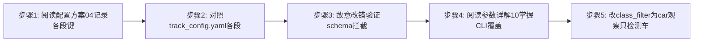

# 实验3：追踪配置与接口设计（4h）


### 3.1 关联知识点

- 2.1.1 track_config.yaml 全键配置（前置：1.2.1）
- 2.1.2 config_schema 强制 REQUIRED 键校验（前置：2.1.1）
- 2.1.3 CLI 传参与配置覆盖规则（前置：2.1.1）
- 2.2.1 三级开发模式与 --text 统一状态机（前置：1.1.3）
- 2.2.2 纯逻辑 pytest（x86 可跑）（前置：2.1.1）
- 2.2.3 组件级容错降级（ReID/TTS 降级文本）（前置：1.2.2）

### 3.2 实验目标

1. **掌握** track_config.yaml 各段配置（llm/vlm/detect/tracker/tracking/interaction/speech/server）含义与调参方法。
2. **理解** config_schema.py 强制 REQUIRED 键校验与类型检查，能通过故意改错验证拦截。
3. **掌握** CLI 参数（--video/--image/--camera/--mjpeg/--text 等）覆盖规则（CLI > yaml）。
4. **独立完成**配置接口设计任务：改 `detect.class_filter` 为 car 观察只检测车；改 `tracker.min_confidence` 观察 ID 变化。
5. **迁移**：把"单一配置文件 + schema 校验 + CLI 覆盖"的配置模式迁移到其他边缘 AI 项目。

### 3.3 实验环境

| 类别 | 内容 |
|------|------|
| 硬件 | 具身智能实验箱B2 / 具身智能机器人小车C1（本实验需板端 Python 3.10+ 环境，可仅跑 config_schema 校验） |
| OS | Ubuntu 22.04 + ROS 2 Humble |
| Python | 3.10 |
| 核心配置 | `config/track_config.yaml`（全键）、`config/config_schema.py` |
| 文档 | `docs/04_配置方案.md`、`docs/10_程序参数详解.md` |

### 3.4 实验难度

- 难度: ⭐⭐（设计性）
- 重点：track_config.yaml 各段配置含义；config_schema 校验机制；CLI 覆盖规则（CLI > yaml）。
- 难点：detect/tracker vlm 段的联动调参语义；function_call.native / vlm.fake_result_id 开关的作用与使用时机。

### 3.5 实验现象

**快速验证流程**（含板端可运行步骤）：

```bash
cd ~/ros2_ws/src/xflz_eai_car1/app/object_tracking

# 故意改错一个键，验证 schema 拦截
python3 config/config_schema.py          # 正常（REQUIRED 齐全）
sed -i 's/min_confidence: 0.3/min_confidence: 0.3x/' config/track_config.yaml
python3 config/config_schema.py          # 应报 config error: 类型不符
sed -i 's/min_confidence: 0.3x/min_confidence: 0.3/' config/track_config.yaml  # 恢复
```

**预期效果描述**：

- 能说出 track_config.yaml 各段键名与调参方法（detect/tracker/lm/vlm/interaction/speech/server）。
- 能在 config_schema 拦截下发现键名拼写错误（config error: 提示缺失/类型不符）。
- 能说出 CLI 参数覆盖规则（--video 改 source.mode、--mjpeg 开 server、--text 关 KWS）与"不新增键"约束。

### 3.6 实验步骤

#### 整体流程图



#### 步骤1：阅读配置方案文档，记录各配置段键（约50min）

**操作步骤**：

1. 阅读 `docs/04_配置方案.md`（全文）。
2. 记录顶层键表：llm/vlm/detect/tracker/tracking/source/session/interaction/speech/server/display/save/log。
3. 特别记录 `llm.function_call.native`（原生 FC 开关）与 `vlm.fake_result_id`（无真实模型回退）两个开关的语义。

**易错点**：

- ⚠️ 以为改配置后无需校验 → **解决**：所有键校验由 `config_schema.py` REQUIRED 兜底，改键必须同步 schema；不新增键。

**知识储备补充**（2.1.1 配置方案整体）：

- **配置即"参数化需求"**：`track_config.yaml` 把 R1-R13 的可量化约束集中声明（detect/tracker/tracking/interaction/speech/server 等段），比散落代码常量更易调参审计；REQUIRED 键缺失时启动即报错，防止"改键即失效"在运行时才暴露。

- **顶层段拓扑**：llm/vlm 决定对话与选车语义，detect/tracker 决定感知质量，tracking 决定暂停/看门狗时序，interaction 定义词表路由，speech 定义唤醒/识别/合成，server 定义 MJPEG 推流。修改检测阈值会影响追踪 ID 稳定性，修改 interaction 词表会改变指令路由——段与段存在联动。

- **参考资源**：`docs/04_配置方案.md`（键表）；`config/track_config.yaml`（默认值）；YAML 规范（yaml.org）。

#### 步骤2：对照 track_config.yaml 各段（约60min）

**操作步骤**：

1. 阅读 `config/track_config.yaml`，对照 detect（score_thr=0.25/iou_thr=0.45/class_filter=[car]）、tracker（use_reid=true/min_confidence=0.3/min_box_w/h=32/max_stale=15）、tracking（pause_wait=true/pause_timeout=30.0）、interaction（clear_words/track_words/desc_words）、speech（kws/asr/tts）、server（port=8088/stream_name=track.mjpg）各段。
2. 记录"实机 tuned 值"（min_confidence=0.3、class_filter=[car]）与变更注意（勿随意改低/扩类，否则 ID 跳变）。
3. 记录 interaction 门口词四类：clear_words（清除）/track_words（追踪动词）/instruct_words/color_words/desc_words。

**易错点**：

- ⚠️ class_filter 随意扩类 → 跨类外观混淆降 ID 稳定；改为 [car] 是实机 tuned；若需任意类别，确认描述词扩展入 desc_words 并重新验证。

**知识储备补充**（2.1.1 各段键语义量化）：

- **detect 段（检测器阈值）**：`score_thr=0.25` 为置信度门限、`iou_thr=0.45` 为 NMS 的 IoU 门限，其中 IoU 定义为两候选框 $A, B$ 的交并比：

  $$
  IoU(A, B) = \frac{|A \cap B|}{|A \cup B|}
  $$

  其中 $|A \cap B|$ 为两框交集面积、$|A \cup B|$ 为两框并集面积，$IoU$ 越大表示两框越重叠（$IoU=1$ 完全重合）；`class_filter=[car]` 限定只在车辆类别上检测，可调低/扩类但会引入类间外观干扰（见步骤 5）。

- **tracker 段（追踪 ID 稳定三闸）**：`min_confidence=0.3` 过滤低置信框、`min_box_w/h=32` 过滤过小框、`max_stale=15` 丢弃超过 15 帧未关联的轨迹——三者都是**身份保持**的闸门，放宽会导致短命/噪声轨迹挤占 ID 名额（ID 跳变根因之一）。

- **speech 段（语音四要素）**：kws（唤醒词，如"小飞小飞"）→ asr（识别）→ tts（合成播报）三段链路；`server` 段 `port=8088`、`stream_name=track.mjpg` 提供 MJPEG 推流（stream_name 不带 `.mjpg`，库自动补）。

- **数值示例（min_confidence 含义）**：检测框置信度 $c_b$ 与阈值 $\theta = 0.3$ 比较：$c_b \ge \theta$ 保留进追踪，$c_b < \theta$ 丢弃。示例：$c_b=0.45 \ge 0.3$ → 保留；$c_b=0.25 < 0.3$ → 丢弃。实机 tuned 值 0.3 保证召回与精度的平衡。

- **参考资源**：`config/track_config.yaml`（默认值清单）；`config/config_schema.py`（REQUIRED 键表）。

#### 步骤3：故意改错一个键，运行 config_schema 验证拦截（约40min）

**操作步骤**：

1. 用 sed 把 `detect.imgsz` 改成 `detect.imgsz: 640x`（字符串），运行 `python3 config/config_schema.py`，观察 `config error: 类型不符`。
2. 或删掉一个 REQUIRED 键（如 `tracking.pause_wait`）运行，观察 `config error: 缺失`。
3. 恢复后用 diff 确认回到原样。

**易错点**：

- ⚠️ schema 校验只在 config_schema 显式调用或启动时执行 → 改键后务必重跑 schema 或 track_app 一次确认配置合法，否则运行时无效配置静默。

**知识储备补充**（2.1.2 config_schema 校验机制）：

- **REQUIRED 即契约**：`config_schema.py` 用 REQUIRED 白名单声明"合法键全集 + 必填键"——缺失必填键报 `config error: 缺失`，类型不符报 `config error: 类型不符`。这相当于编译期类型检查的配置层版本，把"拼写/类型错误"拦截在启动前而非运行中。

- **YAML 类型映射**：`[car]` 是列表、`0.3` 是浮点、`true` 是布尔、`8088` 是整数。数值示例：把 `min_confidence: 0.3` 改成 `0.3x` → 浮点变字符串 → 类型校验失败；把 `pause_wait: true` 删除 → 缺失校验失败。两者都是 schema 拦截的典型演示。

- **参考资源**：`config/config_schema.py`（REQUIRED 定义与校验函数）；`docs/04_配置方案.md`（键表与类型说明）；Python `yaml.safe_load` 官方文档。

#### 步骤4：阅读程序参数详解，掌握全部入口 CLI 参数与覆盖规则（约60min）

**操作步骤**：

1. 阅读 `docs/10_程序参数详解.md`：track_app `--config/--video/--image/--camera/--mjpeg/--text/--show/--save/--list`。
2. 掌握覆盖规则：CLI 显式参数 > config 文件值；`--camera` 仅改 mode，不重置 video_path。
3. 文本模式 stdin 协议：首行唤醒词进入 DIALOG，随后每行 = 指令/闲聊（与音频同一 VoiceLoop 回调链）。

**易错点**：

- ⚠️ 认为 CLI 参数全部重置所有键 → **解决**：`_merge_args` 只改 CLI 显式给的键，未给的保留文件值（如 `--camera` 不改 video_path 文件值因为 mode 已切）。

**知识储备补充**（2.1.3 CLI 覆盖规则）：

- **覆盖优先级与"只改显式键"**：合并规则为 CLI 显式参数 > config 文件值，且 `_merge_args` **只改 CLI 显式给出的键**，未给的保留文件值。数值示例：config 中 `source.mode: video`、`source.video_path: a.mp4`，命令行 `--camera` 只把 mode 改成 camera 且不重置 video_path——因为 `--camera` 未显式给 `video_path`。这样 CLI 是"增量覆盖"而非"整体替换"，避免误清其他键。

- **入口参数表**：`--config`（指定 yaml）、`--video/--image/--camera`（三源）、`--mjpeg`（开推流）、`--text`（关 KWS 走 stdin 文本）、`--show/--save/--list`。文本模式 stdin 协议：首行唤醒词进 DIALOG，随后每行 = 指令/闲聊，与音频同一 VoiceLoop 回调链。

- **参考资源**：`docs/10_程序参数详解.md`（全部入口参数）；`apps/track_app.py`（argparse + _merge_args）。

#### 步骤5：修改 det.class_filter 为 car，观察只检测车（约70min）

**操作步骤**：

1. 确认 `detect.class_filter: [car]`（默认均已调优）。
2. 用文本模式离线视频跑全链路观察只绘制汽车框（R2/R4）：
   ```bash
   printf '小飞小飞\n追踪 id3 的车\n' | python3 apps/track_app.py --video /path/test.mp4 --text
   ```
3. 临时改成 `class_filter: []`（全类）观察误检/ID 变化，最后恢复 [car]。

**易错点**：

- ⚠️ 改 class_filter 后 ReID 跨类互相 distract → **解决**：[car] 过滤只留车避免跨分类外观混淆；调回实机 tuned 值。

**知识储备补充**（2.2.1-2.2.3 调参联动）：

- **class_filter 扩类的代价（量化）**：检测召回类别从 $\{car\}$ 扩到全类后，ReID 特征池同时容纳车/人/其他目标，跨类外观差异（余弦距离）变小：

  $$
  d_{cos}(a, b) = 1 - \frac{a \cdot b}{\lVert a \rVert \lVert b \rVert}
  $$

  其中 $a, b$ 为两目标的外观特征向量、$a \cdot b$ 为内积、$\lVert a \rVert$ 为向量的 L2 范数，$d_{cos} \in [0,2]$ 越小表示越相似（DeepSORT 级联用此作为关联代价）。相似外观跨类出现 → 错误关联概率上升 → ID 跳变。实机 tuned 值 `[car]` 把搜索空间收窄到单类，最稳。

- **min_confidence 与 ID 生命周期**：`min_confidence` 抬高会使低置信框不被确认（Tentative），ID 存活率下降；降低则引入噪声轨迹抢 ID。实机 tuned `0.3` 是召回/精度平衡点（本实验步骤 3 演示 schema 拦截，步骤 5 观察两处联动）。

- **多区段联动示范**：`use_reid=true` 时 ReID 特征参与级联关联；`vlm.fake_result_id` 无真模型时固定回退，`vlm.enabled=false` 直接关 VLM。修改 `detect.class_filter` 与 `tracker.min_confidence` 都只影响感知层，不改 `interaction` 词表与 `_native_gate` 顺序（命令安全由后者独立保障）。

- **参考资源**：`docs/04_配置方案.md`（detect/tracker 段键表）；DeepSORT 论文 arXiv:1703.07402（外观距离与级联）；Ultralytics 文档（class_filter/置信度门限）。

### 3.7 注意事项

- ⚠️ config_schema 校验是**必需**步：改任意键后必须重跑 schema/启动一次确认，否则配置无效静默。
- ⚠️ `min_confidence` 与 `class_filter` 是实机 tuned（0.3 / [car]），勿随意改低/扩字段，否则 ID 跳变。
- ⚠️ 清理：实验后 pkill -f llm_server、恢复 config 原值。
- ⚠️ 本实验若在板端运行需 Python 3.10+ 环境；未上板时步骤5 可在任意 x86 跑纯逻辑（无 LLM/相机）验证 config loading。

### 3.8 实验总结

**完成成果**: 一张 track_config.yaml 各段键值表（含 tuned 值和变更注意），一次 schema 校验拦截演示，一张 CLI 覆盖规则示例表，一份 class_filter 调参笔记。

**技能收获**:

- 技能1：YAML 配置设计与 schema 校验
- 技能2：CLI 覆盖规则的工程设计
- 技能3：边缘 AI 参数调优（ID 稳定性的根因分析）

**常见问题与解决**:

| 问题 | 原因 | 解决方法 |
|------|------|----------|
| schema 校验报缺失 | 键删/拼写错 | 对照 docs/04 逐键核对 REQUIRED |
| 改 key 后 ID 跳变 | min_confidence 降低或 class_filter 扩类 | 恢复实机 tuned 值（0.3 / [car]） |
| CLI 参数没生效 | 覆盖规则理解 | 只改 CLI 显式键，未给的保留文件值 |
| VLM 回退不出现 | 无真模型 | vlm.fake_result_id 调试 + vlm.enabled=false 回退 |

### 3.9 实验报告要求

**思考题**:

1. `config_schema` 的 REQUIRED 校验如何保护"改键即失效"的隐患？如果只有注释没有 schema，会有什么风险？
2. CLI > config 覆盖规则：`_merge_args` 只改显式键，为什么 `--camera` 不重置 video_path？
3. `vlm.fake_result_id` 与 `vlm.enabled=false` 分别用于什么调试场景？fake 固定返回 id 的缺陷是什么？

**评分标准**:

- 配置键值表（30 分）：全键覆盖、实机 tuned 值标注、变更注意清晰
- schema 校验演示（20 分）：故意改错后拦截正确
- CLI 覆盖示例（30 分）：覆盖规则表述正确
- class_filter 调参（20 分）：现象与原因分析 = 100 分。

---

## 更新日志

| 版本 | 日期 | 说明 |
|------|------|------|
| v1.0 | 2026-09-07 | 初始版本，基于 EXP006b 源码与文档生成 |
| v2.0 | 2026-09-07 | 知识储备增强 |