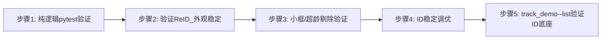
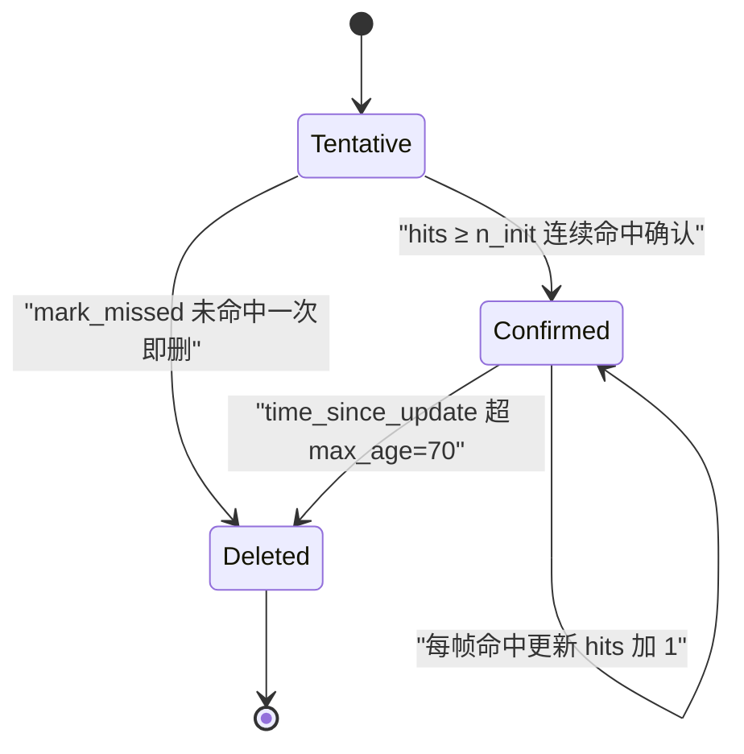

# 实验4：多目标追踪底座集成测试（8h）


### 4.1 关联知识点

- 3.1.1 DeepSORT 结构：卡尔曼预测+IoU/外观级联关联+确认框（前置：1.2.2）
- 3.1.2 卡尔曼常速模型（8维均值+4维协方差，按框高缩放噪声，CHI2INV95 门控）（前置：3.1.1）
- 3.1.3 min_box_w/h=32 小框剔除 + max_stale=15 超龄剔除（前置：3.1.1）
- 3.2.1 deepsort.rknn 外观特征（64x128 ImageNet 归一化）消除单帧漏检换 ID（前置：3.1.1）
- 3.2.2 ReIDPool 多线程异步特征池，extract 超时哨兵（前置：3.2.1）
- 3.2.3 min_confidence=0.3 与 ID 稳定性调参（前置：3.1.1）
- 3.3.1 class_filter=[car]，COCO 80 类通用（前置：1.1.1）
- 3.3.2 track_demo --list/--text 验证 ID 底座（前置：3.2.3）
- 3.3.3 遮挡丢失后同 ID 恢复验证 ReID，unlock_on_loss（前置：3.2.1）

### 4.2 实验目标

1. **掌握**卡尔曼预测+级联关联的多目标追踪原理（DeepSORT 结构、8维常速模型）。
2. **理解**ReID 外观重识别如何消除"单帧漏检换 ID"，以及 ReID 降级纯 IoU 不崩。
3. **掌握** min_box/max_stale 过滤与 ID 稳定性调参（调低 min_confidence 观察 ID 跳变）。
4. **独立完成** `python3 -m pytest tests/ -v` 纯逻辑回归 + `track_demo --list` 验证 ID 底座。
5. **迁移**：把 DeepTrack（卡尔曼+ReID）追踪模式迁移到其他多目标场景（车/人/箱）。

### 4.3 实验环境

| 类别 | 内容 |
|------|------|
| 硬件 | 具身智能实验箱B2 / 具身智能机器人小车C1 + 深度相机（实时模式，可选） |
| OS | Ubuntu 22.04 + ROS 2 Humble |
| Python | 3.10 |
| 核心库 | numpy（追踪核心纯 numpy，零新增依赖） |
| 模型 | yolov8n.rknn / deepsort.rknn / coco_classes.json（板端） |
| 测试 | pytest（纯逻辑 x86 可跑） |
| 命令 | `python3 -m pytest tests/ -v`、`python3 apps/track_demo.py --video /home/iflytek/ros2_ws/src/xflz_eai_car1/vision/07_multi_object_tracking/test.mp4 --text --list` |

### 4.4 实验难度

- 难度: ⭐⭐⭐（综合性）
- 重点：卡尔曼预测 + 级联关联的多目标追踪；ReID 外观消除单帧漏检换 ID；ID 稳定性调参。
- 难点：ReID 在独立 worker 线程池的异步特征提取；min_box/max_stale 过滤交互；遮挡场景调参观察。

### 4.5 实验现象

**快速验证流程**：

```bash
cd ~/ros2_ws/src/xflz_eai_car1/app/object_tracking

# 1. 纯逻辑测试（x86 可跑，无 RKNN/ROS 依赖）
python3 -m pytest tests/ -v
#   test_tracker_session.py     追踪 ID 分配 / follow 过滤 / 显隐
#   test_reid_tracking.py       use_reid=true 保留遮挡目标原 ID vs false 新建
#   test_pipeline_tracker.py    小框 min_box 剔除 / stale 超龄剔除

# 2. 纯视觉 ID 底座（无 LLM，stdin 直达 engine）
printf '追踪 id3\n' | python3 apps/track_demo.py --video /home/iflytek/ros2_ws/src/xflz_eai_car1/vision/07_multi_object_tracking/test.mp4 --text --list --mjpeg
```

**预期效果描述**：

- pytest 全绿（TDD），验证追踪 ID 分配 / follow 过滤 / 显隐 / 小框剔除 / stale 剔除。
- track_demo --list 打印当前跟踪目标 ID 列表，验证 ID 底座稳定性（不随帧跳）。
- 遮挡场景验证 ReID：遮挡后同 ID 恢复（而非新建 ID）。
- 调低 min_confidence 观察 ID 跳变（噪声进入 tracker）。

```bash
(ros2_venv) iflytek@localhost:~/ros2_ws/src/xflz_eai_car1/app/object_tracking$ python3 -m pytest tests/ -v
===================================== test session starts =====================================
platform linux -- Python 3.10.12, pytest-6.2.5, py-1.10.0, pluggy-0.13.0 -- /home/iflytek/ros2_venv/bin/python3
cachedir: .pytest_cache
rootdir: /home/iflytek/ros2_ws/src/xflz_eai_car1/app/object_tracking
plugins: ament-xmllint-0.12.15, launch-testing-1.0.14, ament-flake8-0.12.15, ament-pep257-0.12.15, ament-lint-0.12.15, ament-copyright-0.12.15, launch-testing-ros-0.19.13, colcon-core-0.20.1, cov-3.0.0
collected 97 items                                                                            

tests/test_chat_prompt.py::test_chat_reply_uses_relaxed_prompt PASSED                   [  1%]
tests/test_chat_prompt.py::test_chat_reply_fallback_on_error PASSED                     [  2%]
tests/test_chat_reply_clean.py::test_chat_reply_clean_request_only_system_and_user PASSED [  3%]
tests/test_chat_reply_clean.py::test_chat_reply_strips_tool_markup_and_json_residue PASSED [  4%]
tests/test_chat_reply_clean.py::test_chat_reply_degrades_tiny_reply PASSED              [  5%]
tests/test_chat_reply_clean.py::test_fallback_chat_reply_is_topic_sensitive PASSED      [  6%]
tests/test_chat_reply_clean.py::test_chat_reply_isolated_from_history PASSED            [  7%]
tests/test_chat_reply_clean.py::test_chat_reply_streams_sentences PASSED                [  8%]
tests/test_chat_reply_clean.py::test_chat_reply_streams_keeps_strip_and_guard PASSED    [  9%]
...略
```

```bash
[命令] 追踪 id3
当前目标： （当前无确认目标）
id3 已消失
全部跟随目标已消失，恢复全显示
```


### 4.6 实验步骤

#### 整体流程图



#### 步骤1：运行 pytest 验证纯逻辑测试全绿（约90min）

**操作步骤**：

1. 运行 `python3 -m pytest tests/ -v`，确认全部通过。测试文件覆盖：
   - `test_tracker_session.py`：追踪 ID 分配 / follow 过滤 / 显隐。
   - `test_reid_tracking.py`：use_reid=true 保留遮挡目标原 ID vs false 新建。
   - `test_reid_crop_heal.py`：越界 crop 不喂错特征 / extract 超时零哨兵不挂死。
   - `test_pipeline_tracker.py`：小框 min_box 剔除 / stale 超龄剔除。
   - `test_native_wiring.py`：门控路由 id 对齐 / 不对齐回「未找到」/ 清除强制 / 描述走 VLM / 闲聊回落。
   - `test_voice_loop_capture_health.py`：录音低帧自愈判定。

```bash
python3 -m pytest tests/ -v
```

**易错点**：

- ⚠️ 勿把 pytest 当"贴代码证明"——它验证的是追踪逻辑正确性（ID 分配/剔除/ReID 恢复），是后续所有实验的基础。

#### 步骤2：理解卡尔曼预测 + 级联关联（约150min）

**知识点讲解**：

**3.1.1 DeepSORT：卡尔曼预测 + IoU/外观级联关联 + 确认框**

- **原理**：DeepSORT（Deep Association Metric Tracking）在 SORT（仅 IoU 关联）基础上引入**外观特征 + 级联匹配**。目标被建模为 `Track`，生命周期 Tentative→Confirmed（hits≥n_init）→Deleted（`tracking/track.py`）。跟踪器 `Tracker.update()`（`tracking/tracker.py` L72-75）每帧做三步：

  ①卡尔曼预测每个已确认 track；

  ②对 detection 做级联匹配（先按 `time_since_update` 排序，优先级给最近更新的 track，避免被长期遮挡的 track 抢占匹配）；

  ③剩余 detection 与未确认 track 做 IoU 匹配；最后分配新旧确认框。

**4 卡尔曼门控**

- `tracking/kalman.py`：状态均值为 8 维（`np.r_[measurement, zeros(4)]` L29-31），协方差按框高缩放（`std` 语义），用 `CHI2INV95` 做马氏距离门控——只有落在 95% 置信椭圆内的匹配才接受，从而避免远距误关联。预测用常速马尔可夫模型 `x' = F x`。

**知识储备补充**：

- **背景与动机**：SORT（Simple Online and Realtime Tracking）只用 IoU 关联相邻帧检测框，速度快但目标被遮挡几帧后 IoU 归零，轨迹即断、换新 ID。DeepSORT 在 SORT 之上补两项：

  ①用卡尔曼常速模型预测"目标下一帧在哪"；

  ②用 ReID 外观特征弥补 IoU 失效。本实验的 `tracker.py` 是 deep_sort 标准结构的纯 numpy 自实现（`tracking/kalman.py`、`tracking/matching.py` 对照 vendor DeepSORT 的 BSD 参考实现），零新增依赖。

- **8 维状态向量与常速模型**：状态 $x = [cx, cy, a, h, vx, vy, va, vh]^\mathsf{T}$，前 4 维是观测（中心横/纵坐标、宽高比 aspect、高），后 4 维是它们的速度。常速（constant velocity）预测即一步线性映射：

  $$
  x' = F x = \begin{bmatrix} I_4 & I_4 \cdot \Delta t \\ 0_4 & I_4 \end{bmatrix} x, \qquad \Delta t = 1
  $$

  其中 $I_4$ 为 $4\times4$ 单位阵、$0_4$ 为 $4\times4$ 零阵；$\Delta t=1$ 表示"每帧推进一步"。实现见 `tracking/kalman.py` 的 `predict`（L36-48）：`F = np.eye(8); F[0:4, 4:] = np.eye(4)`（L45-46），即 "位置 += 速度"：$cx' = cx + vx$，$h' = h + vh$，其余同理。注意 aspect 速度 $va$ 与 aspect 噪声权重极小（1e-5），因为宽高比几乎不变，扰动主要来自 $h$。

- **按框高缩放的噪声**：DeepSORT 的关键经验是"过程/观测噪声随目标高度缩放"——大目标运动噪声大、小目标小。预测步（`kalman.py` `predict` L36-48）先按当前框高 h 计算各维标准差再平方成过程噪声协方差 $Q$：

  $$
  Q = \operatorname{diag}\left( (\sigma_{pos} h)^2,\ (\sigma_{pos} h)^2,\ 10^{-4},\ (\sigma_{pos} h)^2,\ (\sigma_{vel} h)^2,\ (\sigma_{vel} h)^2,\ 10^{-10},\ (\sigma_{vel} h)^2 \right)
  $$

  其中 $\sigma_{pos} = \frac{1}{20}$、$\sigma_{vel} = \frac{1}{160}$（L18-19）为位置/速度噪声权重，h 为当前框高（像素）；aspect 维固定用极小值（1e-2 标准差→1e-4 方差、1e-5→1e-10），因为宽高比几乎不变。数值示例：h=100 像素时位置噪声标准差 $=\frac{1}{20}\times100=5$ 像素，速度噪声标准差 $=\frac{1}{160}\times100=0.625$ 像素/帧。新建 track 时（`initiate` L29-34）不确定性更大：位置标准差 $2\sigma_{pos}h=10$ 像素、速度标准差 $10\sigma_{vel}h=6.25$ 像素/帧——首帧速度完全未知，所以初值协方差放得比稳态预测更大。

- **马氏距离门控（CHI2INV95）**：级联匹配先算马氏距离（观测空间，含缩放），检测 $z$ 与预测投影 $z'=Hx'$ 之间的马氏距离平方为：
  $$
  d_M^2(z) = (z - z')^\mathsf{T} S^{-1} (z - z')
  $$
  
  其中 $S=H P H^\mathsf{T} + R$ 是投影协方差加观测噪声、$(z-z')$ 是"检测与预测框的残差"。$d_M^2$ 服从自由度为 2（仅位置 cx,cy）或 4 的卡方分布，`CHI2INV95`（`kalman.py` L13）给出各自 95% 分位阈值：自由度 2→5.9915、4→9.4877。`gate_cost_matrix`（`tracking/matching.py` L45-51）把超过阈值的代价置为 1e5 大值，匈牙利算法就不会选中它——只有落在 95% 置信椭圆内的匹配才被接受，远距误关联被排除。
  
- **级联匹配顺序**：`Tracker._cascade`（`tracker.py` L107-127）按 `time_since_update` 从 1 到 max_age 逐层分配——刚更新过的 track（time_since_update=1）优先匹配，长期遮挡的 track（time_since_update 大）排后。这是因为一个被遮挡很久的陈旧 track 其预测位置误差已不可信，若与 IoU 全量比，会侵占本该属于新目标的检测。`_appearance_cost`（L129-150）以外观 cosine 距离为代价矩阵，再经 `gate_cost_matrix` 用马氏位置门限把超阈值项置 1e5 大值，最后 `min_cost_matching` 做门限内匈牙利指派。

- **参考资源**：DeepSORT 论文《Simple Online and Realtime Tracking with a Deep Association Metric》（Bewley 等，2017）；`nwojke/deep_sort` 官方实现（`kalman_filter.py`/`tracker.py`）；scikit-learn 的 `linear_sum_assignment` 文档（`tracking/matching.py` L26-31 调用）；马氏距离与卡方门控理论图解（卡方分布自由度与 95% 分位表）。

**操作步骤**：

1. 阅读 `tracking/kalman.py`（L29-65）、`tracking/track.py`（生命周期 predict/update）。
2. 阅读 `tracking/tracker.py` update/predict（L68-90）。
3. 记录 8 维状态向量 = `[cx, cy, aspect, height, vx, vy, va, vh]`，与常速马尔可夫模型 `x' = F x`。

**参考模板**（Track 生命周期状态图，学生绘制时可对照）：



**易错点**：

- ⚠️ 试图用手工 IoU 替代级联 → **解决**：级联（time_since_update 优先）保证长期遮挡 track 不夺走新目标的匹配；纯 IoU 会让长时遮挡后误关联。

#### 步骤3：理解 ReID 外观重识别（约100min）

**操作步骤**：

1. 阅读 `tracking/reid.py`（ReIDBackend RKNN-deepsort 64x128 ImageNet 归一化）与 `tracking/reidpool.py`。
2. 阅读 `test_reid_tracking.py`（use_reid=true 保留遮挡目标原 ID vs false 新建）。
3. 理解"单帧漏检 → 外观特征保持同 ID"的定义：遮挡后 Kalman 只有预测框无特征，匹配靠 ReID 外观向量（deepsort.rknn 64x128），cosine 距离 < max_dist=0.2。
4. 理解 ReIDPool 多 worker：`reidpool.extract`（L38）逐 crop 提交，重排序；超时或异常整帧 features=None（纯 IoU），主循环不挂死。

**知识储备补充**：

- **背景与动机**：ReID（Re-Identification，行人/目标重识别）解决"外观匹配"问题——IoU 只在目标连续可见时有效；目标被挡几帧后 Kalman 预测框仍存在但无真实检测，等它重新出现时，纯 IoU 无法把"旧目标"与"新检测"对上，只能开新 ID。ReID 用深度网络对每个检测框 crop 提取 128 维外观向量，遮挡前后用向量相似度把同一目标串起来，从而保持 ID 不换。


- **外观特征提取流程**：`tracking/reid.py` 的 `preprocess_crop`（L20-29）做四个步骤：cv2.resize 到 64x128 → /255 归一化到 $[0,1]$ → BGR 转 RGB（`im[..., ::-1]` L27）→ 按 ImageNet 均值/方差标准化（L16-17：$\mu=[0.485,0.456,0.406]$、$\sigma=[0.229,0.224,0.225]$）→ 转 CHW 并加 batch 维成 `[1,3,128,64]`。最后 RKNN 推理输出特征向量（通常 128 维，由模型决定：`reidpool.dim` 以首个成功行长度为准）。64×128 是深度排序官方对"行人框"的约定输入尺寸——它保留细粒度外观，同时把输入统一到固定张量形状。


- **余弦距离公式**：两个特征向量 $a,b$ 的余弦距离（1 减余弦相似度）为：

$$
d_{cos}(a,b) = 1 - \frac{a \cdot b}{\|a\| \|b\|} = 1 - \cos\theta
$$

其中 $a\cdot b$ 为内积、$\|a\|=\sqrt{\sum_i a_i^2}$ 为 L2 范数。取值 $[0,2]$，越接近 0 越相似。`tracking/tracker.py` 的 `_cosine_dist`（L47-49）先按行 L2 归一化再做矩阵乘（等价于余弦），返回 $1 - \frac{feat \cdot target^T}{\|feat\|\|target\|}$。数值示例：两向量完全一样 → 距离 0；正交 → 距离 1；反向 → 距离 2。`max_dist=0.2`（`track_config.yaml` L47）为匹配阈值——只有距离 ≤0.2 的外观才接受入匹配（对应相似度 ≥0.8）。特征库用 `np.mean(features, axis=0)` 取 track 累计外观向量的均值（`_appearance_cost` L140-141），即"历史平均外观"而非单帧快照，抗单帧噪声。

- **ReIDPool 异步池与超时降级**：真实 RKNN 推理慢（每帧 N 个 crop 串行推理会拖住主循环），故 `reidpool.ReIDPool`（`tracking/reidpool.py` L24-67）用 N 个 worker 线程、每个线程独立 RKNN 实例（RKNN 非线程安全），提交时携带序号 (idx, crop)，`extract`（L38-66）按序号排序还原帧内顺序。容错契约（评审 P2-故障路径）：extract 不抛异常——get 超时（timeout=10，L56-59）时置空列表走纯 IoU；失败的 crop 用零向量哨兵补齐保持与输入等长（L61-66）；最终由 `pipeline.process` 检查 `len(features) != len(dets)` 再降级（`tracking/pipeline.py` L42-44）——任何一步失败都回到纯 IoU，主循环绝不挂死。

- **关键参数**：`use_reid`（config `tracker.use_reid`，默认 true）；`reid_path=deepsort.rknn`；`reid_workers=4`；`max_dist=0.2`（cosine 阈值）；`max_iou_distance=0.8`（IoU 匹配阈值，级联完剩的未确认 track 用）。调参影响：max_dist 调大 → 外观不同也接受 → 易错配裸换 ID；调小 → 外观稍变就无法关联。目标外观剧烈变化（背转面）时 ReID 特征差异大，`max_dist` 兜不住，需 `max_stale` 配合剔除真消失目标（步骤4）。

- **参考资源**：DeepSORT 论文（同步骤2）；ReID 经典综述《Deep Learning for Person Re-identification: A Survey and Outlook》；scikit-learn 余弦相似度文档；ImageNet 归一化均值/方差来源（PyTorch torchvision transforms 文档）。

**易错点**：

- ⚠️ ReID 不是万能 → **解决**：reid.py 用 64x128 ImageNet 归一化；目标外观剧烈变化（背转面）ReID 力有不逮，需 `max_stale` 配合剔除真消失目标。

#### 步骤4：小框/超龄剔除 + ID 稳定性调参（约90min）

**操作步骤**：

1. 阅读 `test_pipeline_tracker.py`：min_box 剔除（宽/高 <32 判定为噪点，不跟踪不绘制）、max_stale 剔除（连续未命中 >15 帧只剩预测框）。
2. 在 track_config.yaml 把 `tracker.min_confidence` 从 0.3 调低（如 0.1），观察 ID 跳变（噪声检测加深追踪）。
3. 改回 0.3，验证 ID 稳定。

```bash
cp config/track_config.yaml /tmp/tc.bak
sed -i 's/min_confidence: 0.3 /min_confidence: 0.1 /' config/track_config.yaml
python3 apps/track_demo.py --video /home/iflytek/ros2_ws/src/xflz_eai_car1/vision/07_multi_object_tracking/test.mp4 --text --list --mjpeg   # 观察 ID 跳变
cp /tmp/tc.bak config/track_config.yaml
```

**知识储备补充**：

- **min_box_w/h 小框剔除**：`pipeline.process`（`tracking/pipeline.py` L53-60）对每个 confirmed track 取预测宽 $w = aspect \times h$（`to_xyah` L45-48），若 $w < min\_box\_w$ 或 $h < min\_box\_h$（默认 32，`track_config.yaml` L52-53）则从可见列表剔除。物理含义：目标远去/缩小时检测框很小，多半是噪点或目标已消失只剩残影，继续画框/参与 VLM 会误导。宽度由高和宽高比算出：$w = a \cdot h$。

- **max_stale 超龄剔除**：Kalman 在目标丢失后仍持续预测（只剩预测框、无真实检测），`time_since_update` 每帧 +1。`max_stale=15`（L54）表示连续 15 帧未命中即判定目标真消失，剔除（`pipeline.py` L61-62：`time_since_update <= max_stale` 保留）。与 `max_age=70`（`track.py` L18、`Tracker` L55，deep_sort 内参）区分：max_age 是轨道生命周期上限（超 70 帧未更新直接 DELETED），max_stale 是"不画但保留轨道"的软阈值——两者配合：短期内丢失可以靠它保留候选，长期丢失彻底删除。

- **min_confidence 与 ID 稳定**：`pipeline.py` L20-21 在检测后按 `d.score >= min_confidence` 过滤，把低置信噪声挡在 tracker 之外。min_confidence 调低（0.3→0.1）会让类噪声检测也进 tracker，新建大量临时 Tentative track，ID 频繁跳变；调高则漏检真车。实机 tuned 值 0.3（可接受范围 0.25–0.6），与 `detect.score_thr=0.25`（config `detect` 段）配合构成两级置信过滤。本实验调参后务必恢复 0.3。

- **参考资源**：DeepSORT 参数说明（`nwojke/deep_sort` README 中 max_age/n_init/nn_budget）；本模块 `tests/test_pipeline_tracker.py` 中 min_box/stale 用例（L32-59）是行为基线；OpenCV 目标追踪教程（框/尺寸概念）。

**易错点**：

- ⚠️ 过度调低 min_confidence → 低置信噪声进 tracker，ID 频繁跳变；这是"ID 稳定根因"（实机 tuned 0.25–0.6 之间，勿乱改）。

#### 步骤5：track_demo --list/--text 验证 ID 底座（约80min）

**操作步骤**：

1. `printf '追踪 id3\n' | python3 apps/track_demo.py --video /home/iflytek/ros2_ws/src/xflz_eai_car1/vision/07_multi_object_tracking/test.mp4 --text --list --mjpeg`
2. 观察 stdin 直连 engine（无 VoiceLoop/无 LLM），`--list` 每帧打印 scene_summary（当前确认目标）。
3. 验证：追踪 id3 后，仅绘制该 ID；目标消失 → lost；unlock_on_loss 恢复全显示。
4. 按 `docs/08_视觉测试用例.md` 执行 O2（多车 ID 稳定）/O3（遮挡 ReID 恢复）/O4（小框剔除）。

```bash
printf '追踪 id3\n' | python3 apps/track_demo.py --video /home/iflytek/ros2_ws/src/xflz_eai_car1/vision/07_multi_object_tracking/test.mp4 --text --list --mjpeg
```

**易错点**：

- ⚠️ `track_demo` 无 VoiceLoop，stdin 直达 engine，无唤醒词；`--list` 是验证 ID 底座的核心调试开关。

### 4.7 注意事项

- ⚠️ pytest 纯逻辑 x86 可跑（无需 rknn/rclpy），先于任何硬件验证。
- ⚠️ 改 `min_confidence` / `class_filter` 会显著影响 ID 稳定，实验结束后恢复实机 tuned 值。
- ⚠️ ReID / Kalman 核心是纯 numpy，勿引入额外 GPU/torch 依赖。

### 4.8 实验总结

**完成成果**: pytest 全绿运行证明；一张卡尔曼+级联关联示意图；一张 ReID 外观恢复观察记录；min_box/max_stale 调参笔记；track_demo ID 底座验证结果。

**技能收获**:

- 技能1：多目标追踪算法（卡尔曼+级联+ReID）实现理解
- 技能2：track_demo/pytest 离线调试
- 技能3：ID 稳定性参数调优方法论

**常见问题与解决**:

| 问题 | 原因 | 解决 |
|------|------|------|
| 追踪 ID 跳变 | min_confidence 过低 / class_filter 扩类 | 恢复 0.3/[car] tuned |
| 长遮挡后新 ID | 无外观特征（use_reid=false） | 开启 use_reid + ReID 特征 |
| 小目标乱画 | min_box_w/h 过低 | 32 阈值剔除噪点 |
| pytest 失败 | 改默认值 | 检查 tests 断言与配置基线 |

### 4.9 实验报告要求

**思考题**:

1. 卡尔曼常速模型如何用 8 维状态 + 框高缩放噪声预测下一帧？级联匹配如何保障长遮挡 track 不覆盖新目标？
2. ReID 外观特征如何消除"单帧漏检换 ID"？为什么 extract 超时要降级纯 IoU 而非抛异常崩线程？
3. min_box / max_stale 剔除掉哪些目标? 调低 min_confidence 为什么导致 ID 跳变？

**评分标准**:

- pytest 全绿（20 分）
- 追踪原理讲解（25 分）：卡尔曼/级联/确认框
- ReID 分析与遮挡实验（25 分）：原 ID 恢复、降级 IOu
- 调参与底座验证（30 分）：min_box/max_stale 剔除、ID 稳定性调参、track_demo 结果 = 100 分。

---

## 更新日志

| 版本 | 日期 | 说明 |
|------|------|------|
| v1.0 | 2026-09-07 | 初始版本，基于 EXP006b 源码与文档生成 |
| v2.0 | 2026-09-07 | 知识储备增强 |
