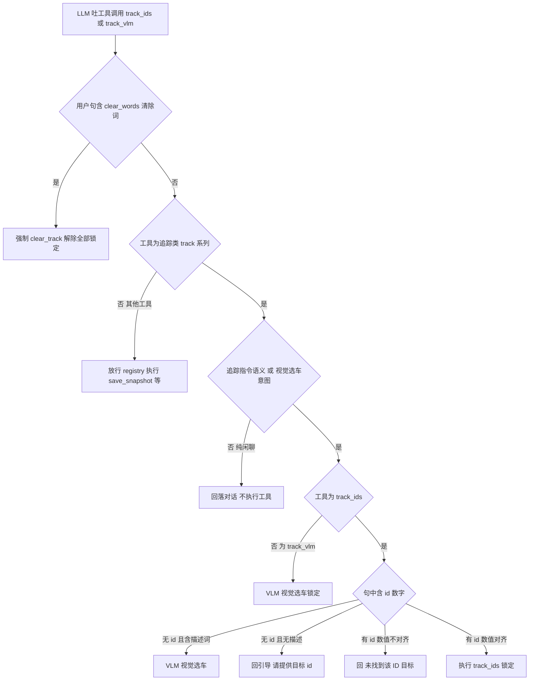

# 实验5：LLM指令与门控集成测试（4h）


### 5.1 关联知识点

- 4.1.1 LLM Function Call 工具调用（track_ids/clear_track）独立线程不卡帧（前置：1.2.3, 4.1 依赖 overview）
- 4.1.2 原生 rkllm FunctionCall 与结构化 JSON 双路径（前置：4.1.1）
- 4.1.3 rules 兜底 parse_instruction（前置：4.1.1）
- 4.2.1 _native_gate 门控路由顺序（前置：1.3.3）
- 4.2.2 clear_words 触发 clear_track 强制解除（前置：4.2.1）
- 4.2.3 ID 数值不对齐回引导（前置：4.2.1）

### 5.2 实验目标

1. **掌握** CommandWorker 门控路由（_native_gate）与 fail-closed 语义。
2. **理解**清除语义强制 clear_track 与闲聊回落（不执行工具）的差异。
3. **掌握** LLM 子进程常驻管理（server_manager，端口 8080）与规则兜底。
4. **独立完成**文本全链路验证（`printf '小飞小飞\n追踪 id3 的车' | track_app --text`）与门控用例。
5. **迁移**：理解大模型 FunctionCall 在机器人指令场景的门控安全设计。

### 5.3 实验环境

| 类别 | 内容 |
|------|------|
| 硬件 | 具身智能实验箱B2 / 具身智能机器人小车C1（文本模式无需语音硬件） |
| OS | Ubuntu 22.04 + ROS 2 Humble |
| Python | 3.10 |
| 核心库 | RKLLM（非 native 用 ask_stream 通过 HTTP 到 RKLLM 服务 8080） |
| 命令 | `python3 -m pytest tests/ -q -k not test_real`、`printf '小飞小飞\n追踪 id3 的车\n' \| python3 apps/track_app.py --video test.mp4 --text` |

### 5.4 实验难度

- 难度: ⭐⭐⭐（综合性）
- 重点：CommandWorker 门控路由（_native_gate 顺序）；clear 强制 clear_track；闲聊干净请求（不执行工具）。
- 难点：fail-closed 语义（模型误触指令拦截）；LLM 子进程生命周期与规则兜底。

### 5.5 实验现象

**快速验证流程**：

```bash
cd ~/ros2_ws/src/xflz_eai_car1/app/object_tracking

# 1. 纯逻辑门控用例（x86，无真实 LLM）
python3 -m pytest tests/ -q -k "not test_real"      # 覆盖 _native_gate/test_native_wiring/闲聊

# 2. 文本全链路（LLM FunctionCall + 门控）
printf '小飞小飞\n追踪 id3 的车\n' | python3 apps/track_app.py --video /path/test.mp4 --text
# 3. 清除
printf '小飞小飞\n清除\n' | python3 apps/track_app.py --video /path/test.mp4 --text
```

预期：追踪 id3 的车 → `[cmd] track_ids {3}` → 锁车并播报"好的，只追踪 id3"；`清除` → `[cmd] 清除语义指令，执行 clear_track` → 播报"好的，已解除全部锁定"；闲聊"你好" → LLM 自然回复，无工具执行。

### 5.6 实验步骤

#### 整体流程图


#### 步骤1：运行 pytest 门控用例（约60min）

**操作步骤**：

1. `python3 -m pytest tests/ -q -k "not test_real"` 验证 gate/thread 用例。
2. 关键文件：`test_native_wiring.py`（门控路由 id 对齐/不对齐/清除/描述/闲聊）、`test_native_client.py`、`test_native_parser.py`、`test_chat_reply_*.py`。
3. 理解断言：闲聊回落干净请求，无 `<tool_call>` 残留。

**易错点**：

- ⚠️ `-k "not test_real"` 跳过真模型用例（需板端 LLM）。纯逻辑 x86 可跑。

#### 步骤2：CommandWorker 门控路由 理解（约100min）

**操作步骤**：

1. 阅读 `apps/track_app.py` `CommandWorker._native_gate`（L320-366）路由顺序：
   - 清除词短路 → 原文含 clear_words 表 → 强制 clear_track。
   - 非指令回落对话（is_instruction=false → 闲聊）。
   - ID 无 id+描述 → VLM。
   - ID 数值不对齐 → 回「未找到该 ID 目标」。
   - track_vlm → VLM。
   - else（save_snapshot/clear_track）→ 执行。
2. 理解 fail-closed：任何"不确定锁谁"分支不 submit_effect，只回引导。

**参考模板**（_native_gate 门控路由图，学生绘制时可对照）：



**知识储备补充**：

- **Function Call 与门控的关系**：LLM 不直接执行任何动作——它只"吐"工具调用（原生 rkllm 标签串或 JSON），真正执行的是本地 `CommandWorker._handle`（`track_app.py` L253-318）：`_native_chat` 带 `NATIVE_TOOLS`（L29-41 定义 schema：track_ids / clear_track / save_snapshot 三个函数）请求 → `parse_native` 解析 → `_native_gate` 门控 → 通过才 `registry.call`。因此安全边界在 Python 侧：模型误吐 `track_ids` 不代表会锁车，门控不点头就执行不了——这就是"模型可幻觉、代码可兜底"的信任模型。

- **消息传递解码**：`CommandWorker` 是生产者-消费者（`run` L248-251 死循环从队列 get 再 `_handle`），不阻塞主循环（`_handle` 入口 `engine.pending.set()` 暂停读帧等，L254）。LLM 慢（0.8B 推理秒级）但主循环照常应帧；副作用统一经 `engine.submit_effect(ids, text)` 入主循环事件队列，单线程消费——避免并发修改 session 状态。

- **清理词/复原词与门控短路**：第 ① 分支"清除语义"匹配词表 `config.interaction.clear_words`（清除/解除/取消/停/不追/恢复全/不跟，`track_config.yaml` L76），一旦命中即强制走 `clear_track`（`registry.call("clear_track")`），即使模型吐出的是 `track_ids` 也忽略（`track_app.py` L325-335 注释记录 0.8B 对「清除」误吐 track_ids 的实测）。原因：清除语义是安全操作，宁可多解也不能锁错。此分支与 `parse_instruction` 的 clear 分支词表一致。

- **fail-closed 语义**：门控每个"不确定锁谁"分支（id 不存在 / 数值不对齐 / 闲聊 / VLM 无果）**都不调用 `submit_effect`**，只回引导语（未找到/无法识别类回复由 `_rule_fallback` 或 `_vlm_none`（`track_app.py` L402-405）产出）。fail-closed 是"宁可不动作，也不动作错"——机器人锁车是危险副作用（锁定后即便目标消失也不跟别的车），误锁成本远高于不动作。

- **参考资源**：OpenAI 工具调用（function calling）官方文档；rkllm 原生工具调用说明（`llm_server.py` set_function_tools）；本模块 `tests/test_native_wiring.py`（门控路由 id 对齐/不对齐/清除强制/描述走 VLM/闲聊回落，L18-113）是行为基线。

**易错点**：

- ⚠️ 模型把闲聊误吐成 track_ids → 门控回落对话，不执行工具。这是 fail-closed 的关键安全。

#### 步骤3：文本全链路 + 清除强制 + 闲聊回落（约90min）

**操作步骤**：

1. 文本全链路：`printf '小飞小飞\n追踪 id3 的车\n' | python3 apps/track_app.py --video test.mp4 --text`。
2. 观察 `[cmd] track_ids {3}` → 播报"好的，只追踪 id3"。
3. 输入 `清除`：观察 `[cmd] 清除语义指令，执行 clear_track` → 解除锁定。验证 clear_words 命中强制 clear_track（R9）。
4. 输入 `你好`：观察 `[LLM] <自然回复>`，且 `[cmd] 不存在`——不执行工具（闲聊回落干净请求）。

**易错点**：

- ⚠️ 闲聊回落用干净请求（不写 llm_chat.history），避免工具轮串进闲聊上下文。

#### 步骤4：理解 LLM 子进程常驻（server_manager）与 rules 兜底（约50min）

**操作步骤**：

1. 阅读 `llm/server_manager.py`：auto_start=true 自动拉起 Flask 子进程（常驻 8080），同项目复用。
2. 阅读 `tools/tools.py` 的 parse_instruction（L45-68）规则兜底（无 LLM 也能追踪/清除）。
3. 模拟断网/无 LLM：服务不可达 → `_rule_fallback`，追踪/清除仍可，闲聊不可 → 理解 rules 兜底不崩线程。

**知识储备补充**：

- **LLM 子进程生命周期**：`llm/server_manager.py`（复用 elderly_companion/llm）的 `LLMServerManager` 职责：端口预检 → 按需拉起子进程 → 就绪轮询（GET /v1/models）→ 退出清理。`ensure_running`（L55-111）：先探测 `llm.server.port`（默认 8080，0=自动选空闲）是否已监听且响应 /v1/models——已就绪则复用外部服务，否则按 `auto_start=true` 拉起 Flask 子进程并轮询等就绪（超 120s 抛错）。`stop`（L113-117）只终止自己拉起的子进程，复用外部服务不动。同一进程内多个实验共享 8080，`pkill -f llm_server` 是清理残留的标准动作（`track_app.py` main 的 finally 也调 `llm_mgr.stop()`）。

- **规则兜底 parse_instruction**：`tools/tools.py` 的 `parse_instruction`（L46-77）是无 LLM 时的规则解析器，按固定顺序：①颜色词 + 车类词（红/蓝/…/车/卡车/轿车）→ `{"tool":"track_vlm","args":{"color":...}}`（L55-57）；②阿拉伯/中文数字 → track_ids（L58-70，中文数字经 `_zh_to_num` L13-37 转 int，如"六十九"→69）；③清除词 → clear_track（L70-72）。返回 None 表示非指令。核心约束：追踪但 id 无法解析时返回 None（L67），**绝不产空 submit 清当前锁**（评审 P0-2：防误清锁）。

- **中文数字解析公式**：`_zh_to_num`（`tools.py` L13-15）把中文数字串按"低位数字 + 十百千单位"求和：

  $$
  v = \sum_{i} \big(\text{低位数字}_i + \text{单位}_i \times \text{系数}_i\big),\quad \text{单位}\in\{十:10,\ 百:100,\ 千:1000\}
  $$

  其中"十/百/千"前无数字时隐式 1（"十六"→16，"三十二"→32），逐位累加：六十九 = 6×10 + 9 = 69。该函数只认 万/亿 以下层级（docstring L13-15），超出返回 None——边界是设计取舍，不是 bug。

- **fail-closed 与兜底的层次**：正常 LLM → 门控+execution；LLM 失败/超时/误触 → `_rule_fallback`（`track_app.py` L618-626：`parse_instruction` → 执行或回"没听懂"）。兜底只支持追踪/清除/列目标，不支持闲聊（闲聊无规则可匹配 → "没听懂"，`test_chat_reply_clean.py` L206-217 断言）。三层防线：FunctionCall 解析 → 门控 → 规则兜底，任一层失败都向更保守层退。

- **参考资源**：Flask 官方文档（`llm_server.py` 提供 /v1/models 的 HTTP 服务）；rkllm 官方 SDK（set_function_tools）；`tests/test_tools.py` 中文数字/规则用例；本实验 `docs/09_事件与故障测试用例.md` 内的故障注入用例。

**易错点**：

- ⚠️ 关闭 LLM `enabled=false` → 规则兜底仅支持追踪/清除/列目标，无闲聊；重启注意 pkill -f llm_server 清理。

### 5.7 注意事项

- ⚠️ 本实验文本模式 `--text` 无需语音硬件；但 LLM 服务需板端（自动起 8080）。
- ⚠️ 实验后 pkill -f llm_server 清理常驻 LLM 子进程。
- ⚠️ fail-closed 是安全核心：任何「不确定锁谁」都不执行工具；不要自行放宽门控。

### 5.8 实验总结

**完成成果**: pytest 门控用例全绿证明；一张 _native_gate 路由顺序图；文本全链路验证日志（追踪/清除/闲聊）；rules 兜底测试记录。

**技能收获**:

- 技能1：LLM FunctionCall 工具调用解析（JSON + 原生标签）
- 技能2：门控路由与 fail-closed 安全设计
- 技能3：LLM 子进程常驻管理与 rules 兜底

**常见问题与解决**:

| 问题 | 原因 | 解决 |
|------|------|------|
| 模型误触工具 | 0.8B 对非指令误吐 track_ids | 非指令回落对话（fail-closed） |
| 「清除」仍锁 | clear_words 未命中 | 补 clear_words；模型误导时强制以 clear_words 短路 |
| 无闲聊 | LLM 关闭 | 回退规则兜底（仅追踪/清除） |
| LLM 子进程占用 | server_manager 常驻 8080 | pkill -f llm_server |

### 5.9 实验报告要求

**思考题**:

1. _native_gate 路由顺序为什么"清除>非指令回落>id>描述VLM>放行"？如果颠倒顺序会带来什么安全风险？
2. "闲聊回落"为什么用干净请求（不写 history）？若不如此会怎样污染指令上下文？
3. 什么时候启用规则兜底（parse_instruction）？它对 fail-closed 的意义

**评分标准**:

- pytest 门控用例（20 分）
- 门控路由图（25 分）：顺序正确、fail-closed 标注
- 文本全链路验证（35 分）：追踪/清除/闲聊三例
- LLM 进程与兜底语义（20 分）= 100 分。

---

## 更新日志

| 版本 | 日期 | 说明 |
|------|------|------|
| v1.0 | 2026-09-07 | 初始版本，基于 EXP006b 源码与文档生成 |
| v2.0 | 2026-09-07 | 知识储备增强 |
