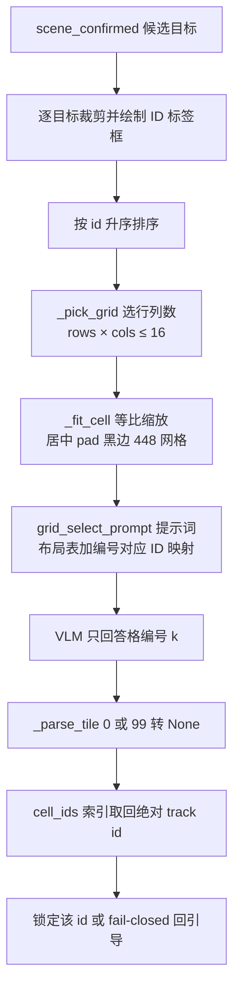

# 实验6：VLM描述选目标集成测试（4h）


### 6.1 关联知识点

- 4.3.1 VLM 视觉选目标：网格构图→绝对 track id（前置：4.1.1）
- 4.3.2 VLM fail-closed（不确定/99/无匹配回引导，绝不锁错）（前置：4.3.1）
- 4.3.3 vlm.fake_result_id 调试 + cell_cap=16 候选上限（前置：4.3.1）

### 6.2 实验目标

1. **掌握**描述选车 VLM 网格构图与选目标原理（crops→grid→编号→绝对 id）。
2. **理解** VLM fail-closed 铁律（绝不锁错目标）：不确定/99/无匹配回引导。
3. **掌握** fake_result_id 与真实 VLM 回退切换以及 cell_cap=16 候选上限。
4. **独立完成** test_vlm_select 颜色选车 + 文本模式描述选车 + 未找到目标 fail-closed 验证。
5. **迁移**：把"网格构图 + 视觉选择 + fail-closed"模式迁移到任意目标描述（人/箱/车）场景。

### 6.3 实验环境

| 类别 | 内容 |
|------|------|
| 硬件 | 具身智能实验箱B2 / 具身智能机器人小车C1（VLM 需板端 RKLLM 视觉模型；无真模型可用 fake） |
| OS | Ubuntu 22.04 + ROS 2 Humble |
| Python | 3.10 |
| 模型 | Qwen3.5-0.8B_vision_rk3576.rknn（VLM 视觉，板端） |
| 命令 | `python3 apps/test_vlm_select.py --image runs/vlm_frames/grid_f200.jpg --json runs/vlm_frames/grid_f200.json --color 红` |
| 文档 | `docs/08_视觉测试用例.md` O7 用例 |

### 6.4 实验难度

- 难度: ⭐⭐⭐（综合性）
- 重点：VLM 网格构图原理（crops→grid→编号→绝对 track id）；fail-closed 铁律。
- 难点：VLM 泛化边界（车辆类别限制）；fake_result_id 调试的正确使用；故障注入（无 VLM 模型回退）。

### 6.5 实验现象

**快速验证流程**：

```bash
cd ~/ros2_ws/src/xflz_eai_car1/app/object_tracking

# 1. 断言颜色选车（板端或 fake）
python3 apps/test_vlm_select.py --image runs/vlm_frames/grid_f200.jpg --json runs/vlm_frames/grid_f200.json --color 红

# 2. 文本模式描述选车
printf '小飞小飞\n追踪红色皮卡\n' | python3 apps/track_app.py --video /path/test.mp4 --text --mjpeg
```

预期：test_vlm_select 返回匹配绝对 track id（红车）；描述选车在画面有红车时锁定该 id；无匹配/没找到走 fail-closed 回引导，不锁不空 submit。

### 6.6 实验步骤

#### 整体流程图


#### 步骤1：运行颜色选车（约70min）

**操作步骤**：

1. 确认 runs/vlm_frames/grid_f200.jpg + grid_f200.json 存在（dump_track_grids 产生）。
2. `python3 apps/test_vlm_select.py --image runs/vlm_frames/grid_f200.jpg --json runs/vlm_frames/grid_f200.json --color 红`。
3. 观察 VLM 返回绝对 track id；--desc '红色小轿车' 亦可。

**易错点**：

- ⚠️ json 需与 image 对齐（runs/vlm_frames 产生的构图），描述词未与词表匹配时直接无果。

#### 步骤2：读 vlm_real.py，理解网格构图返回绝对 id（约90min）

**操作步骤**：

1. 读 `tools/vlm_real.py`：`build_grid`（L175-213，按 id 升序排成标准化网格）、`grid_select_prompt`（L215-240，给 VLM 布局表 + "编号 i+1={cell_ids[i]}"）、`_parse_tile`（L241-260，1..n 返 int，0/99→None）、`RKLMColorSelect`（L280-497 select_crops→绝对 id）。
2. 理解编号→绝对 id 映射：VLM 只答编号数字，`select_crops` 用 `cell_ids[k-1]` 映回绝对 track id。
3. 理解候选上限：cell_cap=16 超则不锁。

**参考模板**（VLM 网格构图与编号映射原理图，学生绘制时可对照）：



**知识储备补充**：

- **背景与动机**：多模态模型（VLM）能"看图说话"，但直接问"哪辆是红车"模型只能答"左边那辆/框里那个"这类位置描述，无法直接给出可执行的 track id——因为 track id 是 Python 侧动态分配的，模型不知道。解决方案是"网格画像"：把每个候选目标裁成小图、按 id 升序拼成标准网格、在提示词里显式给出"第 k 格 = 绝对 id X"的布局表，让 VLM 只回答格编号（1..n 的数字），再由 Python 把编号映射回绝对 id。模型回答从"自由文本"收敛为"单个枚举数字"，幻觉面大幅缩小。

- **网格构图 build_grid**：`tools/vlm_real.py` `build_grid`（L187-213）做四件事：①输入 `crops`（每格目标 BGR 裁剪）与 `ids`（对应绝对 track id），按 id 升序配对（L193 `sorted(zip(ids, crops))`）；②过滤空裁剪（`size>0`，L194-196）；③`_pick_grid`（L170-185）从 448 的整除因子里选 (rows, cols)，约束 $rows \times cols \le cell\_cap$ 且 $\ge n$（候选数），排序键是 (方形度 |r-c|, 格子数, min(r,c), r)——**方形优先于格子数少**：例如 3 个候选时选 2×2（4 格、|r-c|=0），5 个候选时选 4×4（16 格、|r-c|=0）而不是 2×4（8 格但 |r-c|=2）；④每个 crop 经 `_fit_cell`（L151-167）等比缩放到 `cell_px = 448 // max(rows,cols)`、居中黑边 pad（不拉伸破坏宽高比），按行优先填入网格。返回 `(grid_bgr, cell_ids, (rows,cols))`；无候选或超出 cell_cap → None（上层 fail-closed）。

- **布局表与编号对应**：`grid_select_prompt`（L215-240）生成提示词：先给"图像是 R 行 C 列网格，行优先编号 1..R*C"，再贴布局表（每格填绝对 id、空位用 ·，L224-227）、"编号对应 ID：i+1 = cell_ids[i]"映射块（L228-231），最后问"用户要追踪的描述是 X，找符合描述的格子编号，只答数字（1..R*C），找不到答 0"。关键设计：**不提供"不确定/99"逃逸口**（L218 注释）——0.8B 见到 escape 会直接答不确定而偷懒；无匹配的唯一合法输出是 0。

- **编号→绝对 id 映射与 _parse_tile**：`_parse_tile`（L248-263）从 VLM 回复中正则提取数字：1≤k≤n 返 k（格编号），0 与 99 都→None（无选择契约，L256-258），其他→None。`select_crops`（L433-473）最后用 `int(cell_ids[k-1])` 把格编号映回**绝对 track id**（L471）。数值示例：cell_ids=[3,7,15]（3 号、7 号、15 号车），VLM 答 "2" → k=2 → cell_ids[1]=7 → 锁定 id 7。若把编号当 id 直接用（锁 2），就会锁错目标——这正是实验易错点的根源。

- **网格单元尺寸与编号公式**：448px 网格被切分为 rows×cols 个单元，单元边长与"行优先编号→绝对 id"映射关系为：

  $$
  cell\_px = \left\lfloor \frac{448}{\max(rows,\ cols)} \right\rfloor, \qquad k = r \times cols + c + 1, \qquad id = cell\_ids[k-1]
  $$

  其中 $rows, cols$ 为 `_pick_grid`（L170-185）选出的行列数、$k$ 为行优先编号（第 $r$ 行第 $c$ 列，均从 0 起）、$cell\_ids[k-1]$ 为编号 $k$ 对应的绝对 track id。数值示例：3 个候选（ids=[3,7,15]）选 2×2 网格，$cell_{px}=\lfloor448/2\rfloor=224$；布局按行优先为 cell_ids=[3,7,15,·]（第 4 格空位），编号 1→id3、2→id7、3→id15。VLM 答 "2" → 锁 id7。

- **cell_cap=16 候选上限**：`_pick_grid` 约束 $rows \times cols \le cell\_cap$（默认 16，`config/track_config.yaml` L35-36 vlm.grid.cell_cap）。原因：网格越大，VLM 视觉分辨率越差（448px 网格、4×4 时每格仅 112px），容易误判；格子太多提示词也更长。超过 16 个候选 → `build_grid` 返回 None → `_vlm_none` 回引导不锁（fail-closed）。

- **参考资源**：Qwen-VL 系列视觉模型文档（RKLLM 多模态接口）；rkllm 多模态输入（img_width/img_height/n_image_tokens，`vlm_real.py` L303-310）；`tests/test_vlm_grid.py`/`test_vlm_real.py` 网格边界用例（超容量/无候选→None）。

**易错点**：

- ⚠️ VLM 返回的是编号（无量纲），绝对 id 是 `cell_ids` 数组映射；若直接当 id 用会锁错目标。

#### 步骤3：文本模式输入"追踪红色皮卡"观察 VLM 选车锁定（约60min）

**操作步骤**：

1. `printf '小飞小飞\n追踪红色皮卡\n' | python3 apps/track_app.py --video /path/test.mp4 --text`。
2. 有红车：`[track_vlm] dump 网格` → `锁定目标 ID X`（X 在当前画面）。
3. 无红车：`[track_vlm] 无法识别该描述目标` → 引导。

**易错点**：

- ⚠️ VLM 候选来自 scene_confirmed → 锁的必在当前画面；若描述无视觉特征（如"那个人"）→ 不确定 → 引导。

#### 步骤4：输入未找到目标描述，验证 fail-closed 回引导不锁（约50min）

**操作步骤**：

1. 输入 `追踪蓝色轿车`（画面无蓝车）→ 观察 `[track_vlm] 无法识别` 回引导，不锁车。
2. 验证 0/99/无匹配 → `_vlm_none`，绝不 submit 空/错 id。
3. 思考 fail-closed 铁律的意义：绝不锁错目标（R8）。

**知识储备补充**：

- **fail-closed 的定义域**：fail-closed（失效即关闭/保守）指"任何无法确定锁哪个目标的路径都不得产生副作用"。本实验具体三条：①VLM 不可用（懒加载失败 `self._loaded=False`）→ `select`/`select_crops` 返回 None（`vlm_real.py` L417-431/L442-462 的 try/except 全程兜底）；②VLM 回复解析不出合法编号（0 / 99 / 非数字 / 越界）→ `_parse_tile` 返回 None；③候选超 cell_cap=16 → `build_grid` 返回 None。三条路径最终都汇入 `CommandWorker._vlm_none`（`track_app.py` L402-405）：只 WARN + 回引导语"暂时无法识别该目标，请描述更具体（颜色/车型）或告诉我目标编号"，**绝不调用 `submit_effect`**——因为 submit_effect(None) 会把当前锁定清空（副作用），submit_effect(错 id) 会锁错车（更危险）。

- **为什么 99 与 0 都要拒绝**：`_parse_tile`（L248-263）把 0 和 99 都→None。0 是提示词约定的"找不到"输出；99 是历史模型版本会输出的"不确定"逃逸码（现版本提示词已删掉逃逸口，但解析器保留 99 兜底兼容旧模型输出）。两者含义都是"VLM 无法确定"，必须同等对待为无结果——即使画面"看起来显然只有一辆"，也不允许猜，因为 VLM 可能看漏了画面角落里的第二辆（低置信但真实存在）。ReID 的目标是"不丢 ID"，VLM 的目标是"不锁错"，后者优先级更高。

- **fail-closed 与 fake 调试的关系**：`vlm.fake_result_id=3`（`track_config.yaml` L33）让 `FakeVLMSelect.select_crops`（`vlm_fake.py` L14-18）固定返回 id 3——它绕过真 VLM（无模型也能跑通文本链路），但**固定返回值不代表真实推理**。正确用法：先用 fake 验证链路（构图→提示词→映射→锁定）不再挂死；再切换真 VLM（配置 vision/llm 模型路径）验证语义正确性。若把 fake 当真，会误以为"VLM 永远选 3 号车"，掩盖真实模型的 0/99/幻觉问题（`test_vlm_fake.py` 断言 fake 固定返回配置 id 是契约）。

- **参考资源**：fail-closed 设计模式（安全系统不默认可变语义）；`docs/01_需求总览.md` R8（VLM fail-closed 铁律）；`docs/09_事件与故障测试用例.md`（不锁空/错 id 故障注入）；`tests/test_vlm_real.py` 正例（真模型在场锁红车 id65）与反例（失败回退）。

**易错点**：

- ⚠️ 不要关掉 fail-closed 让它"猜一猜"：VLM 返回 99/0/无匹配都→None→引导。这是防误锁的核心。

#### 步骤5：按 docs/08 的 O7 用例 + VLM 泛化（约50min）

**操作步骤**：

1. 执行 O7：画面有红车锁定 / 无红车回引导 / 候选超上限回引导 / 数值 id 直锁（不走 VLM）。
2. 讨论 VLM 泛化边界：desc_words 主要面向车辆（颜色/车型/车），任意类别需扩展词表（追加进 desc_words）并重新验证。

**易错点**：

- ⚠️ fake（vlm.fake_result_id）固定返回 id3，不代表真实 VLM；真 VLM（RKLMColorSelect）懒加载失败返回 None 回退引导。

### 6.7 注意事项

- ⚠️ VLM/LLM 模型需板端（Qwen3.5 vision/llm）；无真实模型用 fake_result_id 调真，但务必认清 fake 是固定 id 调试。
- ⚠️ fail-closed 是铁律，不得因"画面显然只有一辆"而手动省去。任何不确定锁谁 → 引导。
- ⚠️ 保留 runs/vlm_frames 现场；实验后 pkill -f llm_server。

### 6.8 实验总结

**完成成果**: 颜色选车断言结果（绝对 track id）；网格构图原理图；文本模式红车锁定日志；未找到目标 fail-closed 日志。

**技能收获**:

- 技能1：VLM 网格构图 + 绝对 id 映射原理
- 技能2：多模态选目标 fail-closed 设计
- 技能3：fake/真实 VLM 回退调试

**常见问题与解决**:

| 问题 | 原因 | 解决 |
|------|------|------|
| VLM 返回 99 不锁 | fail-closed 铁律 | 回引导，不猜 |
| 描述未命中 | desc_words/color_words 未覆盖 | 扩展词表（车/色）重新验证 |
| cell_cap 超限不锁 | 候选过多（>16） | 优化画面或提高 cell_cap |
| fake 锁 id=3 | fake_result_id 固定 | 仅调试；切真实 VLM 验证 |

### 6.9 实验报告要求

**思考题**:

1. VLM 网格为何把块编号映射为绝对 track id？直接返回索引会有什么数据竞态风险？
2. VLM fail-closed（99/0/无匹配回引导）解决哪类故障？如果放宽让它猜，最严重后果？
3. 什么时候该用 fake_result_id，什么时候用真实 VLM？fake 固定返回 id 的局限是什么？

**评分标准**:

- 颜色选车断言（20 分）
- 网格构图原理（30 分）：build_grid/编号→绝对 id/cell_cap
- 文本模式锁定 + fail-closed（35 分）：红车锁定、未命中引导
- O7 用例与泛化分析（15 分）= 100 分。

---

## 更新日志

| 版本 | 日期 | 说明 |
|------|------|------|
| v1.0 | 2026-09-07 | 初始版本，基于 EXP006b 源码与文档生成 |
| v2.0 | 2026-09-07 | 知识储备增强 |
