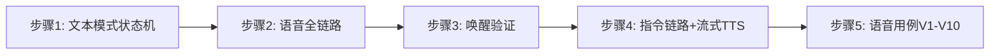
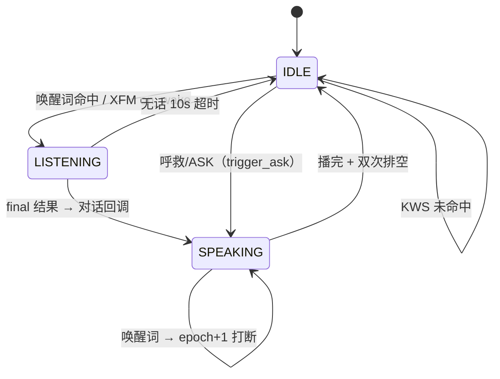

# 实验7：语音交互集成测试（6h）


### 7.1 关联知识点

- 5.1.1 唤醒词（软件 KWS / XFM 六麦 aiui 串口）→ 录音线程启动（plughw:4,0）（前置：无）
- 5.1.2 流式 ASR（zipformer_onnx）增量解码 + 端点检测 → partial → ASR 结果（前置：5.1.1）
- 5.1.3 流式 TTS 按句合成播放 + 播报互斥 playback_event + 打断丢弃 epoch+1（前置：5.1.2）

### 7.2 实验目标

1. **掌握**语音链路唤醒→ASR→LLM 对话/指令→TTS 流式播报全流程（V1-V10 用例）。
2. **理解**录音线程在硬件唤醒后才启动的原因（XFM 时序）、播报互斥 playback_event 与打断丢弃（epoch）。
3. **完成**语音测试用例（唤醒/打断/流式 TTS/无话超时/热词）。
4. **独立完成**对 kws.threshold 调整观察误报变化。
5. **迁移**：文本模式（--text）驱动同一状态机，无硬件先验证的调试方法论。

### 7.3 实验环境

| 类别 | 内容 |
|------|------|
| 硬件 | 具身智能实验箱B2 / 具身智能机器人小车C1 + 讯飞六麦阵列 XFM + 扬声器 |
| OS | Ubuntu 22.04 + ROS 2 Humble |
| Python | 3.10 |
| 核心库 | sherpa_onnx（ASR/KWS）、Matcha-TTS（TTS）、RKLLM |
| 模型 | /home/iflytek/models/{zipformer_kws, zipformer_onnx, tts}（板端） |
| 命令 | `python3 apps/track_app.py --video /home/iflytek/ros2_ws/src/xflz_eai_car1/vision/07_multi_object_tracking/test.mp4 --text`（文本模式）/ `--camera --mjpeg`（语音全链路） |
| 文档 | docs/07_语音测试用例.md |

### 7.4 实验难度

- 难度: ⭐⭐⭐（综合性）
- 重点：语音链路唤醒→ASR→LLM→TTS 流式播报全流程；录音线程在硬件唤醒后启动；播报互斥与打断丢弃。
- 难点：XFM 时序（先停 log_server）、流式合成按句播报、热词表（beam_search 生效）。

### 7.5 实验现象

**快速验证流程**：

```bash
cd ~/ros2_ws/src/xflz_eai_car1/app/object_tracking

# 0. 清理（占用播放/串口/LLM 端口）
pkill -9 aplay; pkill -f llm_server

# 1. 文本模式状态机（无需麦克风）
python3 apps/track_app.py --video /home/iflytek/ros2_ws/src/xflz_eai_car1/vision/07_multi_object_tracking/test.mp4 --text   # 输入小飞小飞→唤醒

# 2. 语音全链路（板端）— 前提：先启动 ROS 相机（另开一终端）
source /opt/ros/humble/setup.bash && source ~/ros2_ws/install/setup.bash
ros2 launch car1_peripherals depth_camera.launch.py        # 终端2：启动相机，提供 /ascamera_hp60c/camera_publisher/rgb0/image
python3 apps/track_app.py --camera --mjpeg                # 终端1：喊 小飞小飞 → 唤醒→录音
```

预期：喊"小飞小飞"→ `检测到唤醒` → `录音线程: plughw:4,0` → 提示音 + `开始聆听（mode=DIALOG）`；说"追踪红色皮卡" → `[ASR 结果]` → `[cmd] track_vlm` → TTS 流式"好的"；说"解除" → `[cmd] 清除语义指令` → 恢复全显示。

### 7.6 实验步骤

#### 整体流程图



#### 步骤1：文本模式验证状态机（约90min）

**操作步骤**：

1. `python3 apps/track_app.py --video /home/iflytek/ros2_ws/src/xflz_eai_car1/vision/07_multi_object_tracking/test.mp4 --text`。
2. 输入 `小飞小飞` → `[文本] 唤醒` → `开始聆听（mode=DIALOG）`；次行输入 `追踪红色皮卡` → LLM→（描述）→ VLM 选车；`你好` → 闲聊；`清除` → 解除。
3. 理解 `--text` 与音频走同一 VoiceLoop 状态机（`feed_text` 复用回调）。

```bash
cd ~/ros2_ws/src/xflz_eai_car1/app/object_tracking
python3 apps/track_app.py --video /home/iflytek/ros2_ws/src/xflz_eai_car1/vision/07_multi_object_tracking/test.mp4 --text
# 先输入：小飞小飞 → 开始聆听
# 再输入：追踪红色皮卡 / 你好 / 清除
```

**易错点**：

- ⚠️ 文本模式 stdin 首行唤醒词才进入 DIALOG；需要你依次喂入。KWS/硬件唤醒关（text_mode=true 关 KWS 音频）。

**知识储备补充**：
- **同一状态机（--text 与音频同链）**：文本与语音共用 `VoiceLoop`（speech/voice_loop.py）单状态机：`feed_text()`（L164-196）与音频块消费走同一 `_start_listening → _handle_listening → _invoke_dialog` 回调链，`--text` 只把录音线程换成 stdin 逐行喂入。`_merge_args`（apps/track_app.py L74-93）在 `--text` 时置 `cfg["speech"]["text_mode"]=True` 并关 `kws.enabled`/`hardware_wakeup.enabled`——纯文本不启音频 KWS。
- **状态机三态**：IDLE 等待唤醒（KWS 检测/硬件 XFM 事件）→ LISTENING（ASR 识别，mode=DIALOG）→ SPEAKING（TTS 播报，唤醒词可打断，播完双次排空防回声回 IDLE）。状态机是唯一时序控制点，无 set_enabled/active 等多门叠加。
- **无话超时（DIALOG 10s）**：开听后若 10s 无 partial 识别结果 → `_close_stream()` 关窗回 IDLE（`_handle_listening` L361-367），防止录音线程空转与误触发。
- **参考资源**：讯飞 AIUI 开发文档（六麦阵列硬件唤醒与串口协议）；sherpa-onnx 在线识别示例（online ASR + KWS 多流 demo）。

#### 步骤2：启动语音全链路 --camera --mjpeg（约60min）

**操作步骤**：

1. 清理残留（pkill -9 aplay; pkill -f llm_server），启动 ROS 相机（`depth_camera.launch.py`）。
2. `python3 apps/track_app.py --camera --mjpeg`。
3. 观察：`录音线程: plughw:4,0（Recording started）`、`开始聆听`、MJPEG 出流。

```bash
cd ~/ros2_ws/src/xflz_eai_car1/app/object_tracking
pkill -9 aplay; pkill -f llm_server
# 另终端启动相机:
source /opt/ros/humble/setup.bash && source ~/ros2_ws/install/setup.bash
ros2 launch car1_peripherals depth_camera.launch.py
python3 apps/track_app.py --camera --mjpeg     # 语音全链路
```

**易错点**：

- ⚠️ 覆盖 XFM 串口 /dev/ttyACM0 需先停固件 log_server，否则唤醒不触发。

**⚠️ 现象：`xfm_wake] XFM 串口无响应（第N轮，已发 2 个唤醒词设置）→ 硬件唤醒暂未就绪（后台自愈探测，稍后自动接管）`**

> 这是 XFM 六麦**设备冷启动/固件未就绪**的常见现象（设备上电后固件需几秒~几分钟才完成握手），`track_app` 会**后台持续探测，设备就绪后自动接管**，通常**不需要人工干预**。按顺序排查：

```bash
# ① 先等几分钟（后台自愈，日志停止报"串口无响应"即就绪）。若等后仍无响应，继续 ②③
sleep 120 && grep -n "XFM\|xfm_wake" runs/logs/track_app.log   # 看是否已自动就绪

# ② 用独立脚本手动探测固件（不经过 track_app，验证串口/固件本身是否正常）：
#   正常输出: 成功打开设备: /dev/ttyACM0 → 讯飞麦克风阵列通信已启动 → 喊"小飞小飞"收到 aiui_event
python /home/iflytek/ros2_ws/src/xflz_eai_car1/interaction/car1_speech/tools/xf_mic_array.py

# ③ 若脚本也连不上：停 log_server 释放串口，重插 USB，再试
pkill -f log_server; ls -l /dev/ttyACM0    # 确认 USB 枚举(VID:PID=1a86:55d4→/dev/ttyACM0)
```

- 有应答但 track_app 仍报"无响应"：多为**串口被 log_server 占用**（文档前述），停 log 后重跑。
- 脚本正常收到唤醒（`'aiui_event'` 含 `detected 唤醒`）而 track_app 没有 → 是 track_app 侧时序/占用，重启 track_app 复验。

**知识储备补充**：
- **XFM 硬件唤醒时序（先唤醒后开录音）**：XFM 六麦阵列通过串口 `/dev/ttyACM0` 上报 aiui 唤醒事件。`notify_wake()`（speech/voice_loop.py L149-158）里才调用 `_ensure_capture()` 打开 ALSA——XFM 在唤醒事件后才出可用音频流，提前常开会把设备停在监听态稀疏流、唤醒后也不恢复（asr_test 实测时序）。因此"录音线程在硬件唤醒后才启动"不是简化而是硬约束。
- **双路径唤醒**：无 XFM 硬件唤醒（纯软件 KWS/普通麦克风）时 `run()` 无 `hardware_wake` 分支直接 `_ensure_capture()` 常开录音——IDLE 态把同一队列音频块喂给 KWS（`_handle_idle` L321-331）。两种路径最终都进 `_start_listening(DIALOG)` 同一状态机。
- **XFM 词表与防抖**：`config_schema.py` 的 `speech.kws.hardware_wakeup` 段 `port=/dev/ttyACM0`、`wake_words=["小飞小飞","小飞同学"]`；XfMicArray 内 3s 防抖。AIUI 事件 `{'type':'aiui_event'}` → `on_wake` 回调（speech/xfm_wake.py L195）。
- **plughw:4,0 定址**：`capture_device` 默认 `plughw:4,0` 是 ALSA 的 card 4、device 0 插件名；USB 插拔后 card 号可能漂移，XFM 声卡检测（common/xfm_detect.py）可动态探测回退，实验若换 USB 口需确认仍指向 XFM。
- **参考资源**：讯飞 AIUI 串口协议文档；ALSA `arecord -l` 设备定址说明；sherpa-onnx KWS 文档（KeywordSpotter 参数）。

#### 步骤3：喊"小飞"验证唤醒→录音→聆听（约70min）

**操作步骤**：

1. 喊"小飞小飞"（软件 KWS 或 XFM 硬件唤醒）→ `检测到唤醒` → 录音线程（plughw:4,0）→ 提示音 → `开始聆听`。
2. 若用 KWS 软件：确认 `kws.enabled=true` 与 `kws.threshold`（0.25 正常）。
3. 观察 `[ASR 实时]` 逐字回显判定麦克风健康；`[diag] 录音 X 帧/5s`（X≈50 正常，≈10 自愈）。

```bash
cd ~/ros2_ws/src/xflz_eai_car1/app/object_tracking
python3 apps/track_app.py --video /home/iflytek/ros2_ws/src/xflz_eai_car1/vision/07_multi_object_tracking/test.mp4 --text
# 运行中念"小飞小飞"，观察唤醒/录音
grep -n "kws.enabled\|threshold" config/track_config.yaml
```

**易错点**：

- ⚠️ 录音低帧自愈（≤30 帧重开，≤3 次）；若 X≈10 持续，查 ASR 线程或设备；`[diag] 队列 0`=ASR 消费正常。
- ⚠️ 喊"小飞小飞"无反应但串口已开 → **XFM 冷启动自愈中**：`track_app` 后台探测稍后自动接管，等 1~2 分钟再喊；若持续无响应按步骤2 排障（手动 `xf_mic_array.py` 探测）。

**知识储备补充**：
- **流式 ASR 增量解码（zipformer_onnx）**：sherpa_onnx `OnlineRecognizer` 外部驱动：`create_stream()` 建识别流（speech/asr.py L84-86），每帧 0.1s@16k 音频 `feed()` 增量解码（L88-90），返回 `(partial, final)`。partial 是未定稿的中间结果（`[ASR 实时]` 逐字回显的来源），final 是端点判定后的定稿。端点检测由识别器内置：rule1=4.5s 静音 / rule2=1.5s / rule3=300ms——说明"话说完了"由静音时长分层判定，不是等固定时长。
- **帧率健康判定公式**：录音线程每次 `read(1600)` 取 0.1s 音频（`_capture_loop`，speech/voice_loop.py L214-225），5s 窗口期望帧数：

  $$
  F = \frac{5.0\text{ s}}{0.1\text{ s/帧}} = 50 \text{ 帧}
  $$

  其中 0.1s = 1600 samples / 16000 Hz。`[diag] 录音 X 帧/5s` 的 X≈50 正常；`HEALTH_LOW_FPS=30`（speech/voice_loop.py L38）为失步阈值，连续 2 窗口（`HEALTH_BEATS=2`，L39）触发重开 ALSA，上限 3 次、冷却 30s（`HEALTH_REOPEN_MAX/COOLDOWN` L40-41）。X≈10 说明只有 ~500ms/5s 有数据，设备已失步。
- **KWS 阈值与误报机理**：`WakeWordDetector`（speech/kws.py）`threshold=0.25`（config_schema 默认）是命中关键词的判定门槛，`score=1.5` 是关键词偏移分；阈值越低越容易误触发（把近似发音判成唤醒），调高到 0.4 降低误报但可能漏唤醒——这是检测器置信度阈值的基本权衡。
- **调试自修（队列深度）**：`[diag] 队列 0` 表示 ASR 消费速度 ≥ 录音生产速度（队列无积压）；队列 maxsize=100（0.1s/帧×100≈10s 缓冲），若持续积压说明 ASR 解码过慢，会丢帧（满时丢旧留新）。
- **参考资源**：sherpa-onnx OnlineRecognizer 文档与端点点检测参数说明；zipformer 论文《Zipformer: A Faster and Better Online Neural Transducer》；ALSA 帧/采样率换算说明。

#### 步骤4：说"追踪红色皮卡"验证 ASR→LLM→TTS（约90min）

**操作步骤**：

1. `[ASR 结果] 追踪红色皮卡` → `[cmd] track_vlm`（描述带色无 id → VLM 网格选车）→ 锁定绝对 ID → 流式 TTS"好的"。
2. 验证**流式 TTS**：`[tts]` 合成/播放，首句即出声（不等整段合成完）。
3. 验证播报互斥 `playback_event`：播报期间不开 ASR 窗口，防回声；打断丢弃（新唤醒 → epoch+1 → 旧回复丢弃）。

```bash
cd ~/ros2_ws/src/xflz_eai_car1/app/object_tracking
python3 apps/track_app.py --video /home/iflytek/ros2_ws/src/xflz_eai_car1/vision/07_multi_object_tracking/test.mp4 --text
# 先输入：小飞小飞
# 再输入：追踪红色皮卡 → 观察 ASR→VLM→TTS 流式
```

**易错点**：

- ⚠️ 播报被识别进用户话 → playback_event 未生效；重启 track_app 复验。
- ⚠️ 流式 TTS 打断用 epoch：SPEAKING 中新唤醒 → epoch+1 → LLM worker 发现 epoch 变化即丢。

**知识储备补充**：
- **流式 TTS 分句合成（首句即播）**：`Speaker.say_stream_chunk()`（speech/tts.py）维护 `_stream_buffer`，用 `_SENTENCE_RE = ([。！？;，、!]|[.?!,](?=\s|$))` 切句，每句立即 `generate` 合成（Matcha-TTS 声学模型 + Vocos 声码器）入播放队列——LLM 边出 token 边切句边播，首句在 LLM 输出几句后即出声，不等整段。`OfflineTtsConfig(max_num_sentences=1)` 单句合成保证低延迟。调度链路：CommandWorker `_emit_stream_reply`（apps/track_app.py）按同款正则切句 → `on_stream_sentence`（接 `say_stream_chunk`）。
- **播报互斥 playback_event**：装配层创建共享 `threading.Event`（apps/track_app.py `_build_speech` L105-115）同时传给 Speaker 与 VoiceLoop。TTS 播报期间 event 置位 → VoiceLoop SPEAKING 态不喂 ASR（主循环在 `_handle_speaking` 中只做打断检测+等播完），防扬声器声音被麦克风重新识别（回声）；`interrupt()` 清 event 释放互斥。
- **epoch 打断丢弃**：`_interrupt()`（speech/voice_loop.py L398-404）`self._epoch += 1` 并 `Playback.interrupt()` 杀 aplay 清队列。SPEAKING 中新唤醒 → 打断 → `_start_listening` 新 DIALOG；worker 持入场时的 epoch，CommandWorker `_handle` 在应用副作用前校验 `epoch_getter() != ep` → 丢弃迟到回复（apps/track_app.py L256-259，"epoch 已变，丢弃迟到指令"）——保证旧 LLM 回复不迟到播报/执行。
- **参考资源**：Matcha-TTS 论文（Conditional Flow Matching 声学模型）；sherpa-onnx OfflineTts 文档；Vocos 声码器源码（ICLR 2024）。

#### 步骤5：按 docs/07 执行唤醒/打断/流式用例（约70min）

**操作步骤**：

1. 执行 V1 唤醒 / V2 天气（流式 TTS）/ V3「追踪一百号目标」找不到 / V4 描述选车 / V5 清除 / V6 闲聊 / V7 无话 10s 超时 / V8 打断 / V9 录音健康。
2. 调 `kws.threshold`（0.25 → 0.4）观察误报下降；确认热词 in beam_search（greedy 不支持热词）。

```bash
cd ~/ros2_ws/src/xflz_eai_car1/app/object_tracking
cp config/track_config.yaml /tmp/tc.bak
sed -i 's/kws.threshold: 0.25/kws.threshold: 0.4/' config/track_config.yaml
python3 apps/track_app.py --camera --mjpeg      # 重跑统计误报
# 确认热词解码方法（greedy_search 下热词不生效）
grep -n "decoding_method\|hotwords" config/track_config.yaml
cp /tmp/tc.bak config/track_config.yaml
```

**易错点**：

- ⚠️ `config/hotwords.txt` 热词在 greedy_search 下不生效，需 `modified_beam_search` + garbage_score；观察识别偏差时先确认解码方法。

**知识储备补充**：
- **热词与解码方法**：sherpa-onnx 热词仅在 `modified_beam_search` 解码下生效（speech/asr.py L36-37）：`decoding_method != "greedy_search"` 时才把 `hotwords_file` 传给识别器（L58-59），配置默认是 `greedy_search`（config_schema.py）——所以实验要先确认解码方法再谈热词。`hotwords_score=2.0` 是热词加分，词表 `config/hotwords.txt` 需 CJK 单字空格分隔。
- **调参观察方法**：`kws.threshold`（0.25→0.4）是单一变量实验——固定同一唤醒词与场景（噪声水平一致），录制 N 次唤醒尝试统计：误报率 = 未唤醒时误触发次数 / 总时长，漏报率 = 唤醒词未触发次数 / N。阈值升高 → 误报下降、漏报上升，取业务可接受交点。这类"阈值-误差权衡"是检测系统通用调参范式。
- **V 用例分层设计**：V1-V9 从单点（唤醒/识别）到链路（指令→TTS）、异常（无话超时/打断/低帧）逐层覆盖，对应"先部件后集成后异常"的测试方法论；V3「追踪一百号」验证 fail-closed 门控（id 不对齐直接回"未找到"，不走 VLM）——语音用例表本身就是语音链路的验收清单。
- **参考资源**：sherpa-onnx 热词（hotwords）文档；KeywordSpotter 参数官方说明。

**参考模板**（语音状态机，stateDiagram-v2）：



### 7.7 注意事项

- ⚠️ 音频模式需麦克风/扬声器；`--text` 无硬件也可驱动同一状态机。
- ⚠️ 先 `pkill -9 aplay` 清残留；XFM 硬件唤醒要停 log_server 防串口冲突。
- ⚠️ 低帧自愈：录音 <30 帧/5s 触发重开（≤3 次）；持续低帧查输入设备与 ASR。
- ⚠️ 流式 TTS 打断依赖 epoch 丢弃；勿把播报硬件占用与指令混淆。

### 7.8 实验总结

**完成成果**: 唤醒→录音→ASR→TTS 语音链路日志；流式 TTS 逐句播报 + 打断丢弃观察；kws 调参记录；V1-V10 语音用例执行表。

**技能收获**:

- 技能1：XFM 硬件唤醒 + KWS 软件唤醒双路径
- 技能2：流式 ASR 增量解码 + 端点检测
- 技能3：流式 TTS 按句 + 播报互斥/打断

**常见问题与解决**:

| 问题 | 原因 | 解决 |
|------|------|------|
| `XFM 串口无响应（第N轮...）硬件唤醒暂未就绪` | XFM 固件冷启动/未就绪，track_app 后台自愈 | 等待几分钟自动接管；或手动探测 `python .../car1_speech/tools/xf_mic_array.py` 验证固件 |
| 唤醒后无录音 | XFM 事件未到 / ttyACM0 占用 | 停 log_server，查串口 |
| ASR 无实时 | ASR 模型/线程 | 文本模式确认 ASR 模型文件 |
| 播报无声 | aplay 被占用 | pkill -9 aplay；查串口冲突 |
| 播报被识别 | playback 互斥失效 | 重启 track_app 复验 |
| 误报多 | kws 阈值低 | 调高 kws.threshold（0.4） |

### 7.9 实验报告要求

**思考题**:

1. 为什么录音线程要在硬件唤醒后才启动（XFM 时序）？若常驻持续上送音频会有什么问题？
2. 流式 TTS 如何实现"首句即播、边出边播"？打断丢弃（epoch+1）如何保证旧回复不迟到播报？
3. KWS 热词为何在 greedy 下无效? 什么时候该切 beam_search？

**评分标准**:

- 文本模式状态机（20 分）
- 语音全链路（30 分）：唤醒→录音→ASR→TTS 闭环
- 流式 TTS 与打断（20 分）
- V 用例执行表 + KWS 调试（30 分）= 100 分。

---

## 更新日志

| 版本 | 日期 | 说明 |
|------|------|------|
| v1.0 | 2026-09-07 | 初始版本，基于 EXP006b 源码与文档生成 |
| v2.0 | 2026-09-07 | 知识储备增强 |