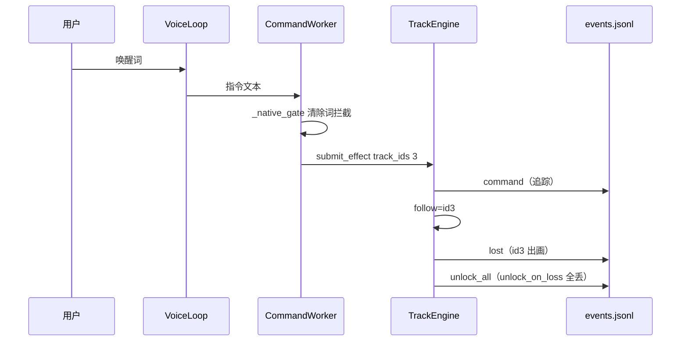
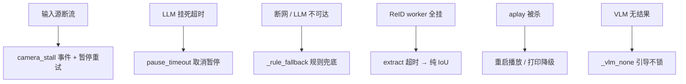

# 实验8：事件日志与故障降级集成测试（6h）


### 8.1 关联知识点

- 6.1.1 events.jsonl 追加记录（lost/unlock_all/command/camera_stall/pause_timeout）（前置：1.1.1）
- 6.1.2 fail-closed 降级原则（任何「不确定锁谁」分支不产副作用）（前置：4.3.2）
- 6.1.3 故障注入降级（断网 ReID / 相机 / aplay / 无 VLM）（前置：6.1.2）

### 8.2 实验目标

1. **掌握**事件日志记录与事后追责（events.jsonl 各 kind）。
2. **理解** fail-closed 降级不崩线程的一致性（任何异常收敛、不挂起）。
3. **完成**故障注入测试（断网 ReID / 相机断流 / aplay 被杀 / 无 VLM）。
4. **掌握** CLI>config 覆盖在调试中的使用。
5. **迁移**：把"事件日志 + fail-closed 降级"的健壮性设计迁移到其他边缘 AI 运维。

### 8.3 实验环境

| 类别 | 内容 |
|------|------|
| 硬件 | 具身智能实验箱B2 / 具身智能机器人小车C1（需板端；事件日志在 runs/logs/） |
| OS | Ubuntu 22.04 + ROS 2 Humble |
| Python | 3.10 |
| 核心库 | 同前（RKNN/ReID/LLM） |
| 命令 | `tail -f runs/logs/events.jsonl`、`python3 apps/track_app.py --video test.mp4 --text` |
| 文档 | docs/09_事件与故障测试用例.md |

### 8.4 实验难度

- 难度: ⭐⭐⭐（综合性）
- 重点：事件日志（lost/unlock_all/command/camera_stall/pause_timeout）记录与事后追责；fail-closed 降级为主。
- 难点：故障注入设计（断网 ReID/相机/aplay/无 VLM）并验证主循环不崩、日志完整。

### 8.5 实验现象

**快速验证流程**：

```bash
cd ~/ros2_ws/src/xflz_eai_car1/app/object_tracking

# 文本模式触发 lost / unlock_all / command
printf '小飞小飞\n追踪 id3 的车\n清除\n' | python3 apps/track_app.py --video /path/test.mp4 --text

# 观察事件日志追加
tail -f runs/logs/events.jsonl
```

预期：`runs/logs/events.jsonl` 追加 command（追踪）、lost（id3 消失）、unlock_all（清除/丢失解锁）；`pause_timeout` 在 LLM 挂死时出现（异常）；`camera_stall` 在相机断流时出现。

### 8.6 实验步骤

#### 整体流程图


#### 步骤1：触发 lost 事件，检查 events.jsonl（约70min）

**操作步骤**：

1. 文本模式追踪 `id3`，待目标出画/消失 → 观察 lost 事件（`{"ids":[...]}` → TTS"idX 已消失"）。
2. `tail -f runs/logs/events.jsonl` 逐条核对 `command`、`lost`。
3. 理解 lost 由 engine 主循环 `on_event` 触发（`tracking/events.py` append_event_log）。

**易错点**：

- ⚠️ lost 只在 follow 目标从 confirmed 消失时触发；纯视觉 video 若无 follow 则不产生 lost。

**知识储备补充**：
- **事件日志格式（JSONL）**：`append_event_log()`（tracking/events.py L7-18）每事件一行 JSON：`{"t": 时间戳, "kind": 事件类型, ...payload}`，追加写入 `runs/logs/events.jsonl`（`log.dir` 可配置）。JSONL 每行独立、可 `tail -f` 增量观察、可被 jq/日志平台逐行解析——比整块 JSON 数组更适合追加写与流式消费；写失败只吞异常不阻断主循环（日志不反噬系统）。
- **lost 触发条件（差分语义）**：engine 主循环每帧计算 `prev_ids - cur_ids` 差集（tracking/engine.py L131-145），仅当**被 follow 的目标**从 confirmed 列表消失才触发 `lost` 事件（`on_track_lost` 移除 follow 记录）。DeepSORT confirmed 目标在 max_age=70 帧内不出现仍存活，所以"消失"判定用帧间 confirmed 集合差分，不能看单帧检测缺失。
- **lost 事件的数据价值**：`{"ids":[...]}` 记录的是"盯丢了谁"——事后追责可回答"目标何时出画/被遮挡、跟踪器是否提前丢掉"，结合 TTS"idX 已消失"（apps/track_app.py `_handle_event` L797-800）形成可回放的事件流。
- **参考资源**：JSON Lines 规范（jsonlines.org）；jq 手册（`jq 'select(.kind=="lost")' events.jsonl`）；DeepSORT 论文中 confirmed/max_age 轨迹状态说明。

#### 步骤2：触发清除验证 unlock_all（约1h30m）

**操作步骤**：

1. 追踪后输入 `清除` → `unlock_all` 事件（`{"ids":[...]}`）。
2. 验证 unlock_on_loss=true 时全丢恢复全显示 → `unlock_all`。
3. 理解 unlock_all 区分：清除语义 clear_track / 丢失解锁 unlock_on_loss 两路径。

**易错点**：

- ⚠️ unlock_all 事件在"全部解锁"（clear 或 unlock_on_loss）时写；仅部分丢失不写。

**知识储备补充**：
- **两条解锁路径**：`unlock_all` 由两条不同链路产生——① 用户清除指令：`clear_track` → `submit_effect(None)` → 引擎 `_apply_effect` 清空 follow；② `unlock_on_loss=true`：被追踪目标丢失后 `on_track_lost` 清空 follow（tracking/engine.py L142-144）且 follow 集合为空 → 写 `unlock_all`。两者语义都是"全部解锁"，事件合并记录便于追责"系统为何放弃了锁定"。
- **部分丢失不写**：仅部分目标丢失（follow 集合仍非空）时只写 `lost`（带 ids），不写 `unlock_all`——事件粒度与"锁状态是否清空"一一对应，不会用 unlock_all 掩盖部分丢失的事实。
- **clear_track 的来源**：`_native_gate`（apps/track_app.py L320-337）先按 clear_words（清除/解除/取消/停/不追/恢复全/不跟）拦截，无论 LLM 吐什么 tool 都强制 `clear_track`——防 0.8B 模型把"清除"误吐成 track_ids 锁错目标。这也是 fail-closed 的语义护栏。
- **参考资源**：DeepTrack/TrackSession 锁定语义文档（docs/05_流程与安全.md）；事件驱动日志设计模式（Event Sourcing 导读）。

**参考模板**（事件时序，sequenceDiagram）：



#### 步骤3：文本模式验证 fail-closed 用例 E1-E3（约 1h30min）

**操作步骤**：

1. E1 `追踪一百号目标` → `track_ids 数值不对齐 {100}` → `未找到该 ID 目标`，不锁、不 VLM grid dump。
2. E2 `追踪红色皮卡`（无红车）→ `[track_vlm] 无法识别` → 引导，不锁。
3. E3 `清除` → `清除语义指令，执行 clear_track` → 解锁。
4. E5 `追踪 id999` → `未找到该 ID 目标`；E6 指令队列满丢弃最旧。

**易错点**：

- ⚠️ fail-closed 目的在于不生副作用：任何"不确定锁谁"（id 不对齐/VLM 无果）都不 submit_effect，只回引导/兜底。

**知识储备补充**：
- **fail-closed 降级原则**：任何"不确定锁谁"的分支都不产副作用——`_native_gate` 三道闸：① 清除语义强制 clear_track（L320-337）；② `track_ids` 无 id→按是否有描述决定 VLM/引导，有 id 但数值不对齐（`expect ∩ got` 为空）→ 只回「未找到该 ID 目标」，**绝不**走 VLM 猜车（L365-375 附近）；③ track_vlm 视觉选车失败/返 None → `_vlm_none()` 引导语，同样不锁。所有 fail 分支的共同点：**不调用 `engine.submit_effect()`**——锁是副作用，副作用只发生在完全确定时。
- **为什么不空 submit（思考题2的原理）**：若空集合也能 submit，`submit_effect(set())` 会清空当前锁定——用户问"追踪一百号"系统却把已锁定的 id3 解锁，产生"误导误锁"状态翻转；错误 id 则会锁一个与用户意图无关的目标。fail-closed 保证"不确定 → 维持现状 + 引导"，把错误状态转移的概率压到零。
- **E 用例映射到源码分支**：E1（id 不对齐）→ gate ③；E2（描述无果）→ `_vlm_select_locked` 里 `not confirmed`/`built is None`/`chosen` 为空三处都落 `_vlm_none()`；E3（清除）→ clear_words 拦截。E6（队列满丢最旧）：`CommandWorker.q` maxsize=8（apps/track_app.py L220），`push` 用 `put_nowait` 满了丢弃（L247-250）——有界队列 + 丢弃策略保证 LLM 风暴也不撑爆内存。
- **参考资源**：fail-closed vs fail-open 安全设计对比资料；有界队列背压（bounded queue backpressure）并发编程模式。

#### 步骤4：模拟断网验证规则兜底（约1h30m）

**操作步骤**：

1. 断网（LLM 不可达）或 `llm.enabled=false`：观察 `chat fallback failed` → `_rule_fallback`。
2. 验证追踪/清除仍可（parse_instruction 规则兜底）；闲聊不可（无 LLM）。
3. ReID 故障注入：reid_pool 全 worker 崩 → extract 超时 → features=None 纯 IoU，主循环不挂死。

**易错点**：

- ⚠️ `_rule_fallback` 只覆盖追踪/清除/截图；闲聊需 LLM，无 LLM 时回引导"没听懂"。

**知识储备补充**：
- **规则兜底 `_rule_fallback`**（apps/track_app.py L620-628）：唯一兜底入口，`parse_instruction(text)` 无 LLM 也能解析"追踪 idX / 清除"指令并 `registry.call` 执行，解析失败回「没听懂」。三类调用方共用：native 工具路径失败、`_chat_reply` 异常、外层 except（L275/284/299/313/316/547）——任何 LLM 异常都收敛到规则层，主循环不挂。
- **闲聊不可为**：闲聊（你好/天气）没有规则可兜——`_rule_fallback` 对非指令回「没听懂」。`llm.enabled=false` 时 `_chat_reply` 也会因 client 不可用回落规则，所以断网后"追踪/清除可用、闲聊不可"是设计预期，不是缺陷。
- **ReID 超时降级纯 IoU**：`ReIDPool.extract`（tracking/reidpool.py L37-47）对每个 crop 提交后 `get(timeout=10)`，超时（worker 全挂/饿死）→ 中断并返回全零特征；pipeline（tracking/pipeline.py L33-36、L44-52）把 `features is None` 或长度 ≠ dets 数都归零降级为**纯 IoU 匹配**（`tracker.update(dets, features=None)`），主循环不断流。约束 12 的设计：ReID 是"外观增强"，挂了退回几何匹配。
- **降级链全景**：断网 → LLM 失败 → `_rule_fallback`（追踪/清除仍全功能）；ReID 崩 → features=None 纯 IoU（ID 可能短暂跳变但跟踪不崩）；aplay 死 → `Playback._restart_playback` 重启（失败置 `_failed` 丢弃音频打印降级）；VLM 无 → `_vlm_none()` 引导。每层故障都有对应收敛策略——这是"任何异常都收敛、不挂起"的工程实现。
- **参考资源**：错误处理/降级设计（Graceful Degradation）资料；ReID+IoU 组合匹配的 DeepSORT 原论文。

#### 步骤5：按 docs/09 执行事件与故障用例（约90min）

**操作**：

1. 执行 E2E 脚本化验收：`小飞小飞` → 唤醒；`追踪红色皮卡` → VLM 锁；`追踪不存在的id` → 未找到；`清除` → 解锁；`你好` → 闲聊流式。
2. 验证 `runs/logs/events.jsonl` 对应 command/lost/unlock_all 条目齐全（完整性）。
3. 相机拔线 → `camera_stall` 事件 + 暂停重试；aplay 被杀 → 播放线程重启或降级打印。

**易错点**：

- ⚠️ 事件"完整性"指所有产生的事件都追加写道 jsonl；若某 kind 缺失（如 pause_timeout 永不出现）说明未触发该异常，属正常。

**知识储备补充**：
- **camera_stall 看门狗**：engine 主循环（tracking/engine.py L115-122）相机模式读帧失败连续 30 次（`_cam_fail >= 30`）→ 发 `camera_stall` 事件 + 暂停 1s，其余失败 sleep 0.2s 重试；`_handle_event`（apps/track_app.py L805-806）记 WARN 日志不落 jsonl。设计意图：断流是"相机节点挂了/线松"，要周期性探测重连而不是无限空转忙等。
- **pause_timeout 看门狗**：`pause_wait=true` 时 LLM 指令处理期间主循环暂停读帧；若 `pending` 持续超 `pause_timeout`（默认 30.0s，tracking/engine.py L101-107）→ 清 pending + 发 `pause_timeout` 事件（只记日志）——防 LLM 挂死冻结画面。这是"外部依赖卡死不冻结主循环"的看门狗模式。
- **完整性=全部追加**：`append_event_log` 每次 open("a") 追加 + flush 由解释器行缓冲（写失败吞异常），因此"事件完整性"指每产生一种事件就有一行；某 kind 不出现只说明该异常未触发（如没拔相机就不会有 camera_stall），排查时先区分"未触发"与"丢了日志"。
- **aplay 被杀降级**：`Playback._restart_playback` 终止旧 aplay → 重开；持续失败置 `_failed`，后续 `write()` 返回 False 丢弃音频（speech/tts.py），VoiceLoop 用 `playback_event` 释放互斥回到 IDLE——播报降级为打印，语音状态机不卡 SPEAKING。
- **参考资源**：看门狗定时器（watchdog timer）设计模式；进程树清理与设备释放检查清单（docs/09_事件与故障测试用例.md）。

**参考模板**（故障降级全链路，graph TD）：



### 8.7 注意事项

- ⚠️ 需板端；事件日志在 `runs/logs/`，`log.dir` 可配置；实验前清空 `events.jsonl` 便于判定新增。
- ⚠️ 故障注入（断网/拔相机/杀 aplay）会短暂影响实机，务必在安全环境执行并按要求恢复。
- ⚠️ fail-closed 降级的一致性：任何分支都不崩线程、不挂起、不 submit 空/错副作用。

### 8.8 实验总结

**完成成果**: lost/unlock_all/command 事件日志截图 + jsonl 片段；E1-E3 fail-closed 用例执行表；故障注入降级观察记录；E2E 验收 + 日志完整性检查。

**技能收获**:

- 技能1：事件日志设计与事后追责
- 技能2：fail-closed 降级一致性（不崩线程）
- 技能3：故障注入测试方法

**常见问题与解决**:

| 问题 | 原因 | 解决 |
|------|------|------|
| lost 事件缺失 | 无论 follow（无追踪） | 先追踪目标再出画 |
| unlock_all 缺失 | 无清除/丢失 | 激活清除或 unlock_on_loss |
| LLM 挂死冻结 | pause_timeout 异常 | 看 pause_timeout 事件，查 LLM |
| 断网后追踪不可 | _rule_fallback 生效 | 确认 rules/tools 可用 |

### 8.9 实验报告要求

**思考题**:

1. lost / unlock_all / command / camera_stall / pause_timeout 各在什么条件下触发？分别对事后追责有什么价值？
2. fail-closed 降级为什么"不给空/错 id 下清锁"？如果空 submit 会把系统带到什么错误状态？
3. 事件日志完整性与"故障不崩线程"如何共同保障系统长期运行的健壮性？

**评分标准**:

- lost/unlock_all 触发与日志（25 分）
- fail-closed E1-E3（30 分）
- 故障注入降级（30 分）
- 日志完整性（15 分）= 100 分。

---

## 更新日志

| 版本 | 日期 | 说明 |
|------|------|------|
| v1.0 | 2026-09-07 | 初始版本，基于 EXP006b 源码与文档生成 |
| v2.0 | 2026-09-07 | 知识储备增强 |