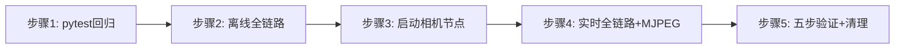

# 实验9：通用目标追踪全功能验证（8h）


### 9.1 关联知识点

- 6.2.1 三模式入口 --video/--image/--camera（前置：1.1.3）
- 6.2.2 实时摄像头（需 ROS 相机节点）+ MJPEG :8088/track.mjpg（前置：1.2.2）
- 6.2.3 全链路故障排查 + 事件日志/标注帧完整性（前置：6.1.1）

### 9.2 实验目标

1. **掌握** track_app 三模式启动方法（--video/--image/--camera）与文本→语音→摄像头三级开发模式。
2. **完成**唤醒→追踪→指令→选车→清除→事件日志全链路验证（离线视频 + 实时摄像头）。
3. **掌握**故障排查（微小化复现、日志诊断）与资源清理（pkill 残留进程 / ReID / LLM）。
4. **独立完成** MJPEG 推流验证与 `pytest` 全量回归确认。
5. **迁移**：把"文本→语音→摄像头 + 三级开发 + 全链路验收"的部署方法论迁移到其他具身智能项目。

### 9.3 实验环境

| 类别 | 内容 |
|------|------|
| 硬件 | 具身智能实验箱B2 / 具身智能机器人小车C1 + 深度相机 HP60C（实时） |
| OS | Ubuntu 22.04 + ROS 2 Humble |
| Python | 3.10 |
| 核心库 | RKNN（YOLO/ReID）、RKLLM（LLM/VLM）、sherpa_onnx（ASR/KWS）、Matcha-TTS |
| 命令 | `python3 -m pytest tests/ -v`、`python3 apps/track_app.py --video .../test.mp4 --text`（交互式：先`小飞小飞`唤醒再输指令）、`ros2 launch car1_peripherals depth_camera.launch.py`、`track_app --camera --mjpeg` |
| 文档 | README（常用命令）/ docs/03_开发模式与验证.md |

### 9.4 实验难度

- 难度: ⭐⭐⭐（综合性）
- 重点：三模式入口与全链路验证；MJPEG 推流；事件日志/标注帧完整性；pytest 回归。
- 难点：摄像头实时模式（ROS 相机会话）与残留进程清理；全链路故障排查。

### 9.5 实验现象

**快速验证流程**：

```bash
cd ~/ros2_ws/src/xflz_eai_car1/app/object_tracking

# 1. 纯逻辑回归
python3 -m pytest tests/ -v

# 2. 离线文本全链路
python3 apps/track_app.py --video /home/iflytek/ros2_ws/src/xflz_eai_car1/vision/07_multi_object_tracking/test.mp4 --text --mjpeg
# 先输入：小飞小飞
# 在输入对话：追踪 id3

# 3. 实时摄像头 + MJPEG
source /opt/ros/humble/setup.bash && source ~/ros2_ws/install/setup.bash
ros2 launch car1_peripherals depth_camera.launch.py    # 另一终端
python3 apps/track_app.py --camera --mjpeg              # 浏览器 http://<IP>:8088/track.mjpg
```

预期：pytest 全绿；离线全链路完成"追踪 id3 → 解除"；实时摄像头目标 ID 稳定、MJPEG 出流（浏览器可见），全链路（唤醒→追踪→指令→选车→清除→日志）闭环。

### 9.6 实验步骤

#### 整体流程图



#### 步骤1：pytest 全量回归（约1h30m）

**操作步骤**：

1. `python3 -m pytest tests/ -v` 确认全部通过（TDD，x86 可跑）。
2. 覆盖 tools/门控/VLM 虚测/单帧 pipeline/录音自愈等。确认无回归。

```bash
cd ~/ros2_ws/src/xflz_eai_car1/app/object_tracking
python3 -m pytest tests/ -v
```

**易错点**：

- ⚠️ 全功能验证前的 regression 必须全绿，否则后续故障排查会把框架缺陷混入功能问题。

**知识储备补充**：
- **回归测试定位**：pytest 套件覆盖 tools/门控/VLM 虚测/单帧 pipeline/录音自愈等纯逻辑层（tests/ 目录），x86 可跑、无 RKNN/ROS 依赖——回归全绿是后续实机验证的基线：实机出问题时先复跑回归，把"框架缺陷"与"环境/硬件问题"分开。
- **虚测（fake）与真实实现解耦**：`tools/vlm_fake.py` 是 VLM 的假实现（固定返回 `fake_result_id=3`），跟 `tools/vlm_real.py` 真模型共用同一 select_crops 契约——测试可在无模型环境验证门控/选车逻辑，真实模型只影响精度不影响行为契约。
- **单帧 pipeline 是核心可测件**：`tracking/pipeline.py` 的 `process(frame, detector, tracker, session)` 是单帧处理的纯函数式入口（detector/tracker 可注入 fake），engine 主循环只在它外面做读帧/事件/发布——所以大部分逻辑可用合成输入单测，无需整机。
- **参考资源**：pytest 文档（fixture/monkeypatch）；依赖注入（DI）在测试替身中的应用。

#### 步骤2：文本全链路（离线视频，三模式之一 --video）（约 1h30min）

**操作步骤**：

1. `python3 apps/track_app.py --video /home/iflytek/ros2_ws/src/xflz_eai_car1/vision/07_multi_object_tracking/test.mp4 --text`，先输入`小飞小飞`唤醒，再输入`追踪 id3`。
2. 观察：唤醒 → 追踪锁定 → 目标消失 lost 事件 → 清除 unlock_all → 事件日志完整。
3. 验证 `--text` 与音频同一状态机（`feed_text` 复用回调）。

```bash
cd ~/ros2_ws/src/xflz_eai_car1/app/object_tracking
python3 apps/track_app.py --video /home/iflytek/ros2_ws/src/xflz_eai_car1/vision/07_multi_object_tracking/test.mp4 --text --
# 先输入：小飞小飞
# 再输入：追踪 id3
```

**易错点**：

- ⚠️ stdin 首行唤醒词才进入 DIALOG；文本模式关 KWS/硬件唤醒。

**知识储备补充**：
- **三模式入口**：`--video/--image/--camera` 映射到 `cfg["source"]["mode"]`（apps/track_app.py `_merge_args` L74-93）：`FrameSource`（common/source.py L34-80）统一 read() 接口——image/video 用 OpenCV 直读（完全无 ROS），camera 用 `Ros2Camera` 订阅话题（`/ascamera_hp60c/camera_publisher/rgb0/image`，rclpy 惰性导入）。三种模式只换输入源，下游 engine/pipeline/门控全复用。
- **三级开发模式（文本→语音→摄像头）**：文本模式用 stdin 逐行喂 `feed_text`，与音频同一状态机（共用回调链），无需麦克风/扬声器；语音模式加录音/播放硬件；摄像头模式加相机话题——每一级只叠加一层硬件依赖，前一级全部可回归。这是"分层解除硬件依赖"的部署方法论：逻辑先行，硬件后置。
- **输入源契约**：`source.read()` 返回 `(ok, frame)`，EOF/断流返回 `(False, None)`；engine 主循环"只读一帧、成功才进 pipeline"，None 帧绝不流入 pipeline（tracking/engine.py L88-95），这是输入层与算法层的隔离边界。
- **参考资源**：OpenCV VideoCapture 文档；ROS 2 rclpy 话题订阅指南；docs/03_开发模式与验证.md。

#### 步骤4：实时摄像头 + MJPEG（全链路 + ROS 相机）（约 2h30m）

**操作步骤**：

1. 另终端 `source /opt/ros/humble/setup.bash && source ~/ros2_ws/install/setup.bash && ros2 launch car1_peripherals depth_camera.launch.py`（提供相机话题）。
2. 主终端 `python3 apps/track_app.py --camera --mjpeg`。
3. 浏览器打开 `http://<IP>:8088/track.mjpg` 观察实时推流；目标 ID 稳定（min_confidence=0.3 + [car]）。
4. 语音链路：喊"小飞小飞" → 唤醒 → 追踪红色皮卡 → 解除 → 恢复全显示。

```bash
cd ~/ros2_ws/src/xflz_eai_car1/app/object_tracking
# 另终端:
source /opt/ros/humble/setup.bash && source ~/ros2_ws/install/setup.bash
ros2 launch car1_peripherals depth_camera.launch.py
python3 apps/track_app.py --camera --mjpeg    # 浏览器 http://<IP>:8088/track.mjpg
```

**易错点**：

- ⚠️ `--camera` 需相机话题在线（ascamera_hp60c/rgb0/image 惰性 rclpy）；MJPEG 端口 8088 与 stream_name。
- ⚠️ headless 板端 `display.show` 默认关，无需 X11，大幅提升吞吐。

**知识储备补充**：
- **MJPEG 推流原理**：MjpegServer（vision/yolo/mjpeg_server.py）把最新 BGR 帧 JPEG 编码成 Motion JPEG 流，`http://<IP>:8088/track.mjpg` 是**持续 MJPEG 流**（不是静态图片）——浏览器收到一帧帧 JPEG 连续渲染成视频。engine 每帧 `_publish` 调 `mjpeg.set_frame(frame)`（tracking/engine.py L84-85）推最新帧；`stream_name` 默认 `track.mjpg`，库按 name 路由（name 不带 `.mjpg` 时自动补全，config_schema L63 `server.stream_name="track.mjpg"`）。
- **为什么实时推流不可替代**：离线视频是固定样本，只能验证"算法层"；实时模式验证的是全链路实时性——相机话题延迟、跟踪实时性、推流吞吐、语音与视觉并发，是"离线视频不可替代"的验证手段。MJPEG 用 HTTP 长连接多客户可看，无需 X11 显卡，正好适配 headless 板端。
- **ID 稳定与 min_confidence**：实时噪声帧（运动模糊/遮挡）会产生低分检测，`min_confidence=0.3`（config track_config.yaml）只放行 ≥0.3 的检测进 tracker，配合 `class_filter: [car]` 过滤非车类别——双因素压制 ID 跳变；调低会引入噪声 ID，调高会漏检小车。
- **headless 意义**：`display.show` 默认关 → 不创建 X11 窗口，帧绘制仍走 MJPEG 输出；板端无显示器场景（SSH 远程）也能完整验证，且省去窗口合成开销。
- **参考资源**：MJPEG over HTTP 规范说明；mjpeg_streamer 库文档；ROS 2 `ros2 topic echo` 验证相机话题。

#### 步骤4：全链路故障排查 + 事件日志/标注帧完整性（约 1h）

**操作步骤**：

1. 用 `--save` 落盘标注帧（`runs/out`），验证完整性。
2. 排查：`[diag] 录音 50 帧/5s` 正常；`[ASR 实时]`；`[cmd]` 逐分支；事件 jsonl 条目齐全。
3. 若出现异常：缩小、复现、用日志注释定位（如 pause_timeout 查 LLM、camera_stall 查相机）。

```bash
cd ~/ros2_ws/src/xflz_eai_car1/app/object_tracking
python3 apps/track_app.py --camera --mjpeg --save
# 核对 runs/out 标注帧与 runs/logs/events.jsonl 条目
```

**易错点**：

- ⚠️ 事件日志/标注帧完整性是验收关键：所有产生的事件都追加写入，标注帧带 follow 过滤不空。

**知识储备补充**：
- **标注帧完整性（--save）**：`--save` 置 `cfg["save"]["enabled"]=True`（_merge_args L88-89），engine 挂 `on_publish` 回调把标注帧落盘 `runs/out`（config_schema L65 `fps=10`）。"带 follow 过滤不空"指 `_compute_draw`（tracking/engine.py L65-79）按锁定语义过滤：有 follow 只画被锁定 ID，无 follow 决定画全部/不画——落盘帧应与锁定状态一致，若某帧 follow 目标没画出来说明过滤链路出错。
- **故障排查方法论（缩小→复现→日志定位）**：异常出现时先缩到最小复现（单一模式/单一指令），再用分层日志定位——`[diag] 录音 50 帧/5s`（音频层）、`[ASR 实时]`（识别层）、`[cmd] 逐分支`（指令层）、事件 jsonl（状态层）。例：pause_timeout 查 LLM（pending 卡死超过 30s）、camera_stall 查相机（30 次读帧失败）。每层有专属日志锚点，是"日志注释定位"的实践。
- **事件 vs 日志分工**：事件 jsonl 记录**状态变化**（lost/unlock_all/command 等，结构化、可追责）；INFO/WARN 日志记录**过程行为**（[diag]/[cmd] 等，供实时排查）。排查先看 jsonl 确认"发生了什么状态变化"，再按时间戳回看日志确认"为什么"。
- **参考资源**：日志/事件分层设计（docs/02_架构设计.md）；IEEE 故障排查（debugging）方法论资料。

**参考模板**（全链路，graph LR）：


#### 步骤5：按 docs/03 五步验证并清理残留进程（约 1h）

**操作步骤**：

1. 按 `docs/03_开发模式与验证.md` 五步（Step1-5）逐项核对。
2. 清理：`pkill -f llm_server`、`pkill -9 aplay`；确认无残留进程占用串口/设备。
3. 收尾：事件日志完整性最终确认。

```bash
cd ~/ros2_ws/src/xflz_eai_car1/app/object_tracking
pkill -f llm_server; pkill -9 aplay
ps aux | grep -E "track_app|llm_server|aplay" | grep -v grep   # 确认无残留
```

**易错点**：

- ⚠️ 常驻 LLM 子进程（8080）与 aplay 需清理，否则占用端口/播放设备影响下次实验；回滚前 `git revert` 本次 commit 亦需要先 pkill。

**知识储备补充**：
- **五步验证（docs/03 Step1-5）**：以回归→离线→相机→实时链路→清理的递进顺序做全功能核对，每步有明确通过判据（pytest 全绿/日志闭环/MJPEG 出流/事件完整/无残留进程）——这是"完整链路闭环 + 日志帧完整"验收的项目管理方法，任何一步失败回退到上一步排查。
- **资源清理的必要性（端口/设备独占）**：LLM 子进程占用 8080 端口、aplay 占用播放设备（plughw:3,0）、XFM 占用串口 /dev/ttyACM0——这些都是**独占资源**，不清理会直接导致下次实验启动失败（MJPEG 端口预检：端口被占 → 明确报错退出，vision/yolo/mjpeg_server.py）。`pkill -f llm_server`、`pkill -9 aplay` 是标准收尾。
- **回滚前先清理**：`git revert` 恢复代码前也必须先 pkill——旧版本进程用旧代码逻辑运行，会与回滚后的新代码状态不一致，混淆排查（如旧 llm_server 继续占 8080 让新代码连不上）。
- **参考资源**：Linux 进程管理与资源清理（pkill/ps 检查）手册；docs/10_程序参数详解.md（--save/--mjpeg 等参数语义）。

### 9.7 注意事项

- ⚠️ 实时模式需深度相机 HP60C 与 ROS 相机节点；无相机则用视频模式完整验证逻辑。
- ⚠️ 残留进程（llm_server/aplay/相机节点）在实验结束必须清理，防占用影响后续。
- ⚠️ headless 无 X11 时 display.show 默认关，用 --mjpeg 观察；别强开 --show。
- ⚠️ 全功能验证以"完整链路闭环 + 日志/帧完整"为准，任何故障先回归再修。

### 9.8 实验总结

**完成成果**: pytest 全绿回归证明；离线文本全链路日志；实时摄像头 MJPEG 推流截图；五步验证核对表；清理后进程/tmp 检查记录。

**技能收获**:

- 技能1：三模式部署与三级开发（文本→语音→摄像头）
- 技能2：MJPEG 实时推流与远程监控
- 技能3：整机全链路验证与故障排查、资源清理

**常见问题与解决**:

| 问题 | 原因 | 解决 |
|------|------|------|
| 实时无推流 | 相机话题未起 / 端口占用 | 起 depth_camera.launch.py；查 8088 |
| ID 跳变 | 实时噪声（min_confidence） | 恢复 0.3/[car] 实机 tuned |
| 唤醒无录音 | XFM 串口占用 | 停 log_server 防冲突 |
| 推流卡死 | pause_timeout 未解除 | 查 LLM；看 pause_timeout 事件 |
| 残留进程 | 常驻 LLM/aplay | pkill -f llm_server / pkill -9 aplay |

### 9.9 实验报告要求

**思考题**:

1. 三模式入口（--video/--image/--camera）与三级开发模式（文本→语音→摄像头）如何分层解除硬件依赖、保证逻辑回归？
2. MJPEG 实时推流为何是"离线视频不可替代"的验证手段？headless 下 display.show 关闭的意义？
3. 从 exp01 需求到 exp09 全功能，梳理事件链路中至少三个 fail-closed 节点如何共同保障系统不致误导误锁。

**评分标准**:

- pytest 回归（20 分）
- 离线全链路（25 分）：追踪/指令/选车/清除/日志闭环
- 实时摄像头 + MJPEG（35 分）：推流正常、ID 稳定、全链路
- 五步验证与清理（20 分）= 100 分。

---

## 更新日志

| 版本 | 日期 | 说明 |
|------|------|------|
| v1.0 | 2026-09-07 | 初始版本，基于 EXP006b 源码与文档生成 |
| v2.0 | 2026-09-07 | 知识储备增强 |