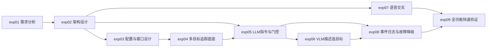

# 机器人大模型综合应用开发（通用目标追踪） 实验指导书（合并版）

> 课程代码: EXP006b
> 总学时: 48
> 实验数: 9
> 适用对象: 人工智能/机器人工程/智能科学与技术 本科高年级
> 制定日期: 2026-09-07
> 模式: human_waiver（源码位于 ROS2 工作空间 src/，未复制到 source-codes/EXP006b/）

---

## 目录

1. [实验1：通用目标追踪--项目需求分析](#实验1通用目标追踪--项目需求分析4h)
2. [实验2：通用目标检测与追踪底座--系统架构设计](#实验2通用目标检测与追踪底座--系统架构设计4h)
3. [实验3：追踪配置与接口设计](#实验3追踪配置与接口设计4h)
4. [实验4：多目标追踪底座集成测试](#实验4多目标追踪底座集成测试8h)
5. [实验5：LLM指令与门控集成测试](#实验5llm指令与门控集成测试4h)
6. [实验6：VLM描述选目标集成测试](#实验6vlm描述选目标集成测试4h)
7. [实验7：语音交互集成测试](#实验7语音交互集成测试6h)
8. [实验8：事件日志与故障降级集成测试](#实验8事件日志与故障降级集成测试6h)
9. [实验9：通用目标追踪全功能验证](#实验9通用目标追踪全功能验证8h)

---

## 实验总览

| 编号 | 名称 | 学时 | 类型 | 难度 | 源码路径 |
|------|------|------|------|------|----------|
| exp01 | 通用目标追踪--项目需求分析 | 4h | 验证性 | ⭐ | `ros2_ws/src/xflz_eai_car1/app/object_tracking/` |
| exp02 | 通用目标检测与追踪底座--系统架构设计 | 4h | 设计性 | ⭐⭐ | `ros2_ws/src/xflz_eai_car1/app/object_tracking/` |
| exp03 | 追踪配置与接口设计 | 4h | 设计性 | ⭐⭐ | `ros2_ws/src/xflz_eai_car1/app/object_tracking/` |
| exp04 | 多目标追踪底座集成测试 | 8h | 综合性 | ⭐⭐⭐ | `ros2_ws/src/xflz_eai_car1/app/object_tracking/` |
| exp05 | LLM指令与门控集成测试 | 4h | 综合性 | ⭐⭐⭐ | `ros2_ws/src/xflz_eai_car1/app/object_tracking/` |
| exp06 | VLM描述选目标集成测试 | 4h | 综合性 | ⭐⭐⭐ | `ros2_ws/src/xflz_eai_car1/app/object_tracking/` |
| exp07 | 语音交互集成测试 | 6h | 综合性 | ⭐⭐⭐ | `ros2_ws/src/xflz_eai_car1/app/object_tracking/` |
| exp08 | 事件日志与故障降级集成测试 | 6h | 综合性 | ⭐⭐⭐ | `ros2_ws/src/xflz_eai_car1/app/object_tracking/` |
| exp09 | 通用目标追踪全功能验证 | 8h | 综合性 | ⭐⭐⭐ | `ros2_ws/src/xflz_eai_car1/app/object_tracking/` |

**学时合计**: 4+4+4+8+4+4+6+6+8 = **48h**

**类型分布**: 验证性 1 个 + 设计性 2 个 + 综合性 6 个

**难度分布**: ⭐ 1 个 + ⭐⭐ 2 个 + ⭐⭐⭐ 6 个

---

## 跨实验知识脉络

