# EXP001 机器人视觉应用与开发 — 实验指导书

## 目录

- [实验1：基于YOLOv8的工业表面缺陷检测实验](#实验1：基于YOLOv8的工业表面缺陷检测实验)
- [实验2：基于图像分类的垃圾分类实验](#实验2：基于图像分类的垃圾分类实验)
- [实验3：基于HSV色彩空间的颜色识别实验](#实验3：基于HSV色彩空间的颜色识别实验)
- [实验4：二维码生成与识别检测实验](#实验4：二维码生成与识别检测实验)
- [实验5：基于OpenCV的多边形轮廓拟合实验](#实验5：基于OpenCV的多边形轮廓拟合实验)
- [实验6：基于语义分割的背景分割实验](#实验6：基于语义分割的背景分割实验)
- [实验7：基于DeepSORT的多目标跟踪实验](#实验7：基于DeepSORT的多目标跟踪实验)
- [实验8：基于深度信息的3D物体检测实验](#实验8：基于深度信息的3D物体检测实验)
- [实验9：基于人脸关键点特征检测实验](#实验9：基于人脸关键点特征检测实验)
- [实验10：基于骨骼关键点的肢体检测实验](#实验10：基于骨骼关键点的肢体检测实验)
- [实验11：基于肢体动作的体感控制实验](#实验11：基于肢体动作的体感控制实验)
- [实验12：基于手指动作的控制实验](#实验12：基于手指动作的控制实验)

---

## 实验总览

| 编号 | 实验名称 | 学时 | 类型 | 难度 | 源码路径 |
|------|---------|------|------|------|---------|
| 实验1 | 基于YOLOv8的工业表面缺陷检测实验 | 4h | 综合性 | ⭐⭐⭐ | `ros2_ws/src/xflz_eai_car1/vision/01_industrial_defect_detection` |
| 实验2 | 基于图像分类的垃圾分类实验 | 4h | 设计性 | ⭐⭐ | `ros2_ws/src/xflz_eai_car1/vision/02_garbage_classification` |
| 实验3 | 基于HSV色彩空间的颜色识别实验 | 4h | 验证性 | ⭐ | `ros2_ws/src/xflz_eai_car1/vision/03_lab_color_recognition` |
| 实验4 | 二维码生成与识别检测实验 | 4h | 验证性 | ⭐ | `ros2_ws/src/xflz_eai_car1/vision/04_qrcode` |
| 实验5 | 基于OpenCV的多边形轮廓拟合实验 | 4h | 设计性 | ⭐⭐ | `ros2_ws/src/xflz_eai_car1/vision/05_line_following` |
| 实验6 | 基于语义分割的背景分割实验 | 4h | 设计性 | ⭐⭐ | `ros2_ws/src/xflz_eai_car1/vision/06_semantic_segmentation` |
| 实验7 | 基于DeepSORT的多目标跟踪实验 | 4h | 综合性 | ⭐⭐⭐ | `ros2_ws/src/xflz_eai_car1/vision/07_multi_object_tracking` |
| 实验8 | 基于深度信息的3D物体检测实验 | 4h | 设计性 | ⭐⭐ | `ros2_ws/src/xflz_eai_car1/vision/08_depth_3d_detection` |
| 实验9 | 基于人脸关键点特征检测实验 | 4h | 设计性 | ⭐⭐ | `ros2_ws/src/xflz_eai_car1/vision/09_face_landmarks` |
| 实验10 | 基于骨骼关键点的肢体检测实验 | 4h | 设计性 | ⭐⭐ | `ros2_ws/src/xflz_eai_car1/vision/10_pose_landmark` |
| 实验11 | 基于肢体动作的体感控制实验 | 4h | 综合性 | ⭐⭐⭐ | `ros2_ws/src/xflz_eai_car1/vision/11_pose_control` |
| 实验12 | 基于手指动作的控制实验 | 4h | 设计性 | ⭐⭐ | `ros2_ws/src/xflz_eai_car1/vision/12_hand_control` |

**学时合计：48h**（12 个实验，对应 course-spec total_hours=48 中实验学时部分）

---

## 实验1：基于YOLOv8的工业表面缺陷检测实验（4h）

> ✅ **源码已核实** 本实验源码位于 `ros2_ws/src/xflz_eai_car1/vision/01_industrial_defect_detection/`（仓库内相对路径，根 = 课程生成项目根目录）。已随仓库交付完整训练产物（`train/weights/best.pt`、`best.onnx`，9 输出）与转换产物（`models/defect_yolov8n_int8.rknn`，int8 单核+剪枝，200 张 val 校准）。板端验证通过，实测约 **13 FPS**（NPU）。

### 1.1 关联知识点

本实验对应第 1 章"工业缺陷检测与 YOLOv8 认知"，覆盖以下 7 个知识点（ID 遵循知识图谱编号约定，来源于 course-spec.yaml 的 knowledge_points）：

- 1.1.1 YOLOv8模型架构 > 原理 > YOLOv8 采用 CSPDarknet 主干 + PAN-FPN 颈部 + 解耦检测头，引入 DFL（Distribution Focal Loss）边界框回归
- 1.1.2 工业缺陷数据集 > 概念 > NEU-DET 数据集包含 6 类表面缺陷（crazing/inclusion/patches/pitted_surface/rolled-in_scale/scratches），YOLO 归一化标签格式
- 1.2.1 模型训练与超参数 > 流程 > yolov8n + imgsz=640 + epochs=100 + batch=8 的训练配置与产物解读（mAP50=0.732）
- 1.2.2 ONNX模型转换 > 流程 > 使用 RKNN 优化版 fork 导出 format=rknn 的 ONNX（3×nl 个原始张量，DFL 留在 CPU 侧，共 9 个输出）
- 1.3.1 RKNN NPU部署 > 原理 > rknn-toolkit2 将 ONNX 转换为 rk3576 平台 int8 量化模型，RKNNLite 在 6TOPS NPU 上推理
- 1.3.2 实时缺陷检测 > 流程 > letterbox 预处理 → RGB 通道交换 → NPU 推理 → DFL 解码 + 逐类 NMS → unletterbox 画框标注
- 1.3.3 精度评测与质检 > 概念 > mAP50 指标（纯 numpy 实现）与 onnx/rknn 双后端精度对比

### 1.2 实验目标

1. 掌握 YOLOv8 目标检测模型的工业应用方法，理解模型架构、训练超参数与检测原理 — 原理理解
2. 完成工业产品的缺陷自动检测与定位，实现缺陷类别识别与可视化标注 — 独立完成
3. 理解工业质检场景下的数据集制作、模型训练、部署推理全流程，体验"PC 训练 → ONNX 导出 → RKNN 转换 → 板端 NPU 推理"的完整链路 — 迁移应用

### 1.3 实验环境

| 类别 | 配置 |
|------|------|
| 硬件 | 具身智能实验箱 B2（XFLZ_EAI_B2_PRO，RK3576 SoC，6TOPS NPU，含 HP60C 深度相机） |
| OS | Ubuntu 22.04 + ROS2 Humble（板载 ros2_venv 虚拟环境，rknnlite 2.3.2 / onnxruntime 1.23.2） |
| 核心库 | OpenCV、NumPy、PyYAML、rknnlite（板端推理）、rknn-toolkit2（转换）、onnxruntime、mjpeg_streamer、rclpy + cv_bridge |
| 训练框架 | ultralytics 8.3.229（RKNN 优化 fork，numpy<2.0，PC 侧） |
| 主入口 | `src/app.py`（推理 CLI：单图 / 视频 / UVC 相机 / ROS2 相机）<br>`src/convert_rknn.py`（ONNX → RKNN 转换）<br>`src/eval_map.py`（mAP50 精度评测）<br>`scripts/train.sh` / `scripts/export_onnx.sh`（PC 训练与导出） |

### 1.4 实验难度

- 难度: ⭐⭐⭐ 综合性
- 重点: YOLOv8 工业缺陷检测全流程（数据集 → 训练 → 导出 → 转换 → 部署推理 → 精度评测）
- 难点: RKNN int8 量化精度控制（校准集、RGB/BGR 约定、letterbox 填充值一致性）与 NPU 部署的输入格式约束（4D NHWC、RGB、无归一化）

### 1.5 实验现象

**快速验证流程**（帮助学习者快速看到实验效果，全程在板载 B2 平台执行）：

1. 进入项目根目录：`cd ros2_ws/src/xflz_eai_car1/vision/01_industrial_defect_detection`
2. （可选）跑通单元测试：`pytest -v`（42 用例全绿，数据集用例在无 NEU-DET 的机器上自动跳过）
3. 单图推理（仓库自带 4 张缺陷测试图 `images/1.jpg~4.jpg`）：`python src/app.py --model models/defect_yolov8n_int8.rknn --image images/1.jpg --save out.jpg`
   - 终端打印每帧 FPS 与每个缺陷框的类别、置信度、坐标
4. 查看标注结果：`out.jpg` 中缺陷区域被红色框标出，框上方打印类别名（如 `scratches 0.87`）
5. 视频推理：`python src/app.py --model models/defect_yolov8n_int8.rknn --video test.mp4 --save out.mp4`
6. 相机实时（标准流程）：先起相机驱动，再运行 `--ros` 模式（详见步骤 6）
7. 浏览器查看 MJPEG 实时流：`http://<板IP>:8080/defect.mjpg`，移动工件观察缺陷框实时跟随

**预期效果描述**：
- **单图/视频**：6 类缺陷（裂纹 crazing、夹杂 inclusion、斑块 patches、麻点 pitted_surface、氧化铁皮 rolled-in_scale、划痕 scratches）均能以红框 + 类别 + 置信度标注，小目标缺陷（如麻点、划痕）也能稳定检出
- **相机实时**：检测框在视频流中逐帧更新，终端每 30 帧打印一次平均帧率，板端实测约 **13 FPS**（yolov8n/640，NPU 单核+剪枝模型）
- **精度表现**：随仓库交付的训练产物在 val 集达到 P=0.657 / R=0.706 / **mAP50=0.732**；RKNN int8 模型相对 ONNX 掉点 ≤3%
- **完整链路**：一份 `best.pt` 权重依次经历 PyTorch 训练、ONNX 导出、RKNN int8 量化转换，最终在 6TOPS NPU 上以 13 FPS 实时运行，验证"训练部署一体"的工业落地范式

### 1.6 实验步骤

#### 整体流程图

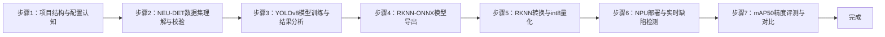

---

#### 步骤1：项目结构与配置体系认知（阶段一：能运行，20min）

> 📌 本步骤对应源码：`config/defect_config.yaml`、`src/config.py`

**知识点讲解**：

**配置驱动设计（1.1.2 延伸）**
- **原理**：工业质检项目通常要求"配置与代码分离"，把数据集路径、训练超参、推理阈值、RKNN 转换参数全部收敛到一个 YAML 文件，保证实验可复现。本项目通过 `src/config.py` 的 `load_config()` 实现**契约式校验**：`REQUIRED` 字典（L14-35）声明了 dataset/train/infer/rknn/eval 五个区块必须存在的键与其类型，缺键或类型错误直接抛出 `ConfigError`（L38-39），避免"配置写错导致推理静默失败"这类隐蔽问题；未知键则忽略（向前兼容）。`resolve_path()`（L67-73）负责把配置中的相对路径解析为绝对路径。推理侧两个关键阈值——`score_thr=0.25`（置信度过滤）与 `iou_thr=0.45`（NMS 交并比阈值）——都在配置中集中管理（`config/defect_config.yaml` L22-26），调参无需改代码。
- **源码对应**：`config/defect_config.yaml` L1-47（dataset L4-8 / train L10-20 / infer L22-26 / rknn L37-42 / eval L44-46）；`src/config.py` L14-35（REQUIRED）、L42-64（load_config）、L67-73（resolve_path）

**操作步骤**：

1. 查看项目目录结构，确认六大模块分工：
   ```bash
   cd ros2_ws/src/xflz_eai_car1/vision/01_industrial_defect_detection
   ls src/    # app / config / convert_rknn / dataset / eval_map / infer / metrics / mjpeg_server / postprocess / preprocess / ros2_source
   ```
2. 阅读配置文件，逐区块理解含义：
   ```bash
   cat config/defect_config.yaml
   # 重点：infer.score_thr=0.25、infer.iou_thr=0.45、rknn.target_platform=rk3576、server.port=8080
   ```
3. 用 Python 验证配置加载与校验逻辑：
   ```bash
   python -c "from config import load_config; cfg = load_config('config/defect_config.yaml'); print(cfg['infer'])"
   # 预期输出：{'imgsz': 640, 'score_thr': 0.25, 'iou_thr': 0.45, 'pad_color': [0, 0, 0]}
   ```
4. 验证缺键报错（观察 ConfigError 契约）：
   ```bash
   python -c "from config import load_config; load_config('config/defect_config.yaml')"  # 正常
   # 尝试删掉 yaml 中 infer 区块再运行，观察 ConfigError 提示缺失键
   ```

**易错点**：
- ⚠️ 配置路径写相对路径时，`resolve_path` 基于**配置文件所在目录**解析（`config.py` L67-73），不是当前工作目录——跨目录运行务必注意

---

#### 步骤2：工业缺陷数据集理解与校验（阶段一：能运行，30min）

> 📌 本步骤对应源码：`src/dataset.py`

**知识点讲解**：

**NEU-DET 数据集与 YOLO 标签格式（1.1.2）**
- **原理**：NEU-DET（Northeastern University 表面缺陷数据集）是工业质检领域的标准公开数据集，包含热轧带钢表面 6 类缺陷（crazing 裂纹 / inclusion 夹杂 / patches 斑块 / pitted_surface 麻点 / rolled-in_scale 氧化铁皮 / scratches 划痕），共 1800 张 200×200 灰度图，已由社区转换为 YOLO 格式（`NEU-DET.v1i.yolov8`）。YOLO 标签为每行 `class_id cx cy w h` 的归一化格式（值域 0-1，相对图像宽高），与 COCO 的像素坐标格式不同。`src/dataset.py` 的 `validate_dataset()`（L19-85）负责**校验数据集结构**：确认 images/labels 目录存在、图像与标签一一对应、标签行数/坐标合法，输出统计（类别分布、样本数），为训练和评测提供数据完整性保障。`class_names()`（读 data.yaml）从 `names:` 字段提取 6 类名称供推理标注使用。
- **源码对应**：`src/dataset.py` L19-85（validate_dataset：目录检查 L24-38 / 标签合法性 L40-66 / 统计输出 L68-85）、class_names 读取 data.yaml

**操作步骤**：

1. 若本机已有 NEU-DET 数据集，配置 `config/defect_config.yaml` 中 `dataset.root` 指向其路径
2. 运行数据集校验：
   ```bash
   python -c "from dataset import validate_dataset; import yaml, pathlib; \
   cfg = yaml.safe_load(open('config/defect_config.yaml')); \
   validate_dataset(pathlib.Path(cfg['dataset']['root']))"
   # 预期：打印类别统计（6 类缺陷各约 300 张）与标签合法性结果
   ```
3. 查看 2-3 张标注图，理解 YOLO 归一化标签与像素坐标的换算关系（用 OpenCV 画框验证）
4. 思考：为什么工业缺陷数据集比通用目标检测数据集更难标注？（缺陷尺度小、类间相似、标注一致性要求高）

**易错点**：
- ⚠️ 板上无 NEU-DET 数据集属正常现象——`app.py` L60-65 已内置 6 类名兜底，板上推理无需数据集
- ⚠️ 标签坐标必须归一化（0-1），若混入像素坐标，训练会直接崩或 mAP 极低

---

#### 步骤3：YOLOv8 模型训练与结果分析（阶段二：能理解，40min）

> 📌 本步骤对应源码：`scripts/train.sh`、`train/args.yaml`

**知识点讲解**：

**YOLOv8 架构与训练流程（1.1.1、1.2.1）**
- **原理**：YOLOv8 是 anchor-free 的实时目标检测器，主干 CSPDarknet 提取多尺度特征，PAN-FPN 颈部融合，**解耦检测头**分别输出分类与回归分支。回归分支采用 **DFL（Distribution Focal Loss）**：不直接回归偏移，而是预测 16 个 bin 的概率分布，加权求和得到连续偏移，对小目标更友好（`postprocess.dfl_decode` 对应实现）。训练配置收敛在 `train/args.yaml`：yolov8n、imgsz=640、epochs=100、batch=8、optimizer=auto、seed=0。训练产物 `train/weights/best.pt`（+ last.pt）与 `best.onnx`（RKNN 优化 fork 导出，9 输出）随仓库交付，**无需重训即可进入部署链路**；`scripts/train.sh`（L1-25）封装了 PC 侧训练入口。
- **源码对应**：`scripts/train.sh` L1-25；`train/args.yaml` L1-106（超参数全量）；训练指标见 `train/results.csv`、曲线图 `train/*.png`

**操作步骤**：

1. 查看训练产物目录，理解"一份权重，三种格式"：
   ```bash
   ls -la train/weights/    # best.pt (PyTorch) + best.onnx (RKNN-ONNX, 9输出)
   ```
2. 解读训练指标（`train/results.csv` 末尾几行）：
   ```bash
   tail -5 train/results.csv    # epoch/box_loss/cls_loss/dfl_loss/metrics/precision/recall/mAP50
   # 参考：epoch 100 → P=0.657 / R=0.706 / mAP50=0.732 / mAP50-95=0.409
   ```
3. 查看混淆矩阵与 PR 曲线（`train/confusion_matrix.png`、`train/PR_curve.png`），分析哪两类缺陷最易混淆（通常 crazing 与 scratches 相似）
4. （可选，PC 且需重训时）运行 `bash scripts/train.sh`，比较训练曲线
5. 思考：为什么选择 imgsz=640 而不是 800？板端 NPU 算力固定（6TOPS），imgsz 越大单帧耗时越高——这是**精度-速度权衡**的典型例子

**易错点**：
- ⚠️ 训练框架必须是 RKNN 优化 fork（ultralytics 8.3.229 + numpy<2.0），官方版导出的 ONNX 不是 9 输出，无法直接转 rknn
- ⚠️ 训练精度目标只是参考，mAP 达标 ≠ 板端可用——int8 量化会引入精度损失，需在步骤 7 验证掉点

---

#### 步骤4：RKNN-ONNX 模型导出（阶段二：能理解，30min）

> 📌 本步骤对应源码：`scripts/export_onnx.sh`

**知识点讲解**：

**RKNN 优化版 ONNX 导出（1.2.2）**
- **原理**：官方 ultralytics 导出的 ONNX 把 DFL 解码也导出到计算图中（大量 Slice/Concat 算子），RKNN 转换器对这类动态索引支持差、易报错或低效。RKNN 优化 fork 提供了 `format='rknn'` 导出模式：**DFL 解码留在 CPU 侧**（Python 后处理实现），模型只输出 3×nl 个原始张量——每层 3 个：box `(1,64,h,w)`（DFL 原始分布）、cls `(1,nc,h,w)`（已 sigmoid）、cls_sum `(1,1,h,w)`（可忽略分支）。yolov8n 有 3 个检测层（80/40/20），故共 9 个输出。`export_onnx.sh`（L1-21）封装导出命令并校验输出数量。
- **源码对应**：`scripts/export_onnx.sh` L1-21（导出 + 校验 L16-20）

**操作步骤**：

1. 查看导出脚本内容，理解关键参数：
   ```bash
   cat scripts/export_onnx.sh
   # 核心：yolo export model=train/weights/best.pt format=onnx opset=12 imgsz=640
   #       format=rknn（RKNN 优化 fork 专用）
   ```
2. 验证已交付的 ONNX 输出结构（无需重导）：
   ```bash
   python -c "
   import onnxruntime as ort
   sess = ort.InferenceSession('train/weights/best.onnx')
   print('输入:', [i.name for i in sess.get_inputs()])
   print('输出数:', len(sess.get_outputs()))
   for o in sess.get_outputs(): print(' ', o.name, o.shape)"
   # 预期输出数 = 9（3 层 × 3 张量）
   ```
3. 若需重导（PC 且 fork 环境就绪）：`bash scripts/export_onnx.sh train/weights/best.pt`

**易错点**：
- ⚠️ 输出不是 9 个 → 用了官方 ultralytics 或未指定 `format=rknn`（`export_onnx.sh` L16）
- ⚠️ opset 过高（>12）可能导致 RKNN 转换器不支持某些算子，保持 opset=12

---

#### 步骤5：RKNN 转换与 int8 量化（阶段二：能理解，40min）

> 📌 本步骤对应源码：`src/convert_rknn.py`

**知识点讲解**：

**RKNN int8 量化原理（1.3.1）**
- **原理**：RKNN 转换器（rknn-toolkit2）把 ONNX 图转换为 RK3576 平台的 NPU 指令集模型，核心是 **int8 量化**：权重和激活从 float32 缩放到 int8（w8a8），通过**校准集**统计激活分布确定每个张量的 scale/zero_point。量化配置要点：`quant_img_RGB2BGR=False`（L65）——因为导出模型的输入约定是 RGB；`target_platform='rk3576'`（L38-42）；校准集 200 张 val 图（`--calib-count 200`）。部署侧用 `RKNNLite`（`infer.py` L29-52）在 NPU 上推理，`init_runtime` 必须显式传 `core_mask=0`（NPU_CORE_AUTO，L36），None 在 2.3.2 会报 `core mode not supported`。模型推理输入必须是 **4D NHWC uint8**（静态 shape）且**不做 /255 归一化**——量化模型内部已含 scale。
- **源码对应**：`src/convert_rknn.py` L25-109（参数解析 L25-40 / config 加载与 RGB2BGR 设置 L41-65 / 转换+量化 L66-91 / 输出保存 L92-109）

**操作步骤**：

1. 查看转换脚本参数：
   ```bash
   python src/convert_rknn.py --help
   # --onnx --output --calib-dir --calib-count --imgsz --no-quantize
   ```
2. 重新转换（板上 ros2_venv 或 PC rknn 环境，需要 NEU-DET val 图作校准集）：
   ```bash
   python src/convert_rknn.py --onnx train/weights/best.onnx \
     --output models/defect_yolov8n_int8.rknn \
     --calib-dir <NEU-DET>/valid/images --calib-count 200
   # 预期：打印量化信息与每层统计，最终生成 .rknn 文件
   ```
3. 对比已交付的 `models/defect_yolov8n_int8.rknn` 文件大小与 ONNX 差异（int8 通常更小）
4. 思考：量化掉点的根源是什么？（权重/激活低比特表示 → 信息损失；校准集代表性不足 → 分布估计偏差）

**易错点**：
- ⚠️ 校准图必须 jpg/png/bmp 且绝对路径、无中文（`convert_rknn.py` L22）；`--imgsz` 与训练一致（640）
- ⚠️ `rgb2bgr` 必须 False（L65）：模型输入约定 RGB，转换侧与推理侧（`to_rgb`）必须一致
- ⚠️ 掉点 >3% 时：增大 `--calib-count`、校准图用 val 集、必要时 `--no-quantize` 定位

---

#### 步骤6：NPU 部署与实时缺陷检测（阶段三：能改造，45min）

> 📌 本步骤对应源码：`src/app.py`、`src/infer.py`、`src/preprocess.py`、`src/postprocess.py`、`src/mjpeg_server.py`、`src/ros2_source.py`

**知识点讲解**：

**实时缺陷检测推理流水线（1.3.2）**
- **原理**：板端推理是一条精心对齐的流水线（`Detector.detect`，`src/infer.py` L108-139）：(1) **letterbox 预处理**（`src/preprocess.py` L27-37）——按 `scale=min(size/h, size/w)` 等比缩放并用 0 值填充到 640×640，保持宽高比不变、避免目标变形；(2) **BGR→RGB 通道交换**（L45-52 `to_rgb`）——量化配置 `rgb2bgr=False` 决定了 NPU 输入必须是 RGB；(3) **NPU 推理**（`src/infer.py` L44-49）——`RKNNLite.inference` 输入必须是 **4D NHWC uint8**（静态 shape 模型不接受 3D），且**不做 /255 归一化**（量化模型内部已含 scale）；(4) **CPU 侧解码**（`src/postprocess.py`）——`dfl_decode`（L34-42）对 16 bin 做 softmax 加权求和还原边框偏移，`box_process`（L45-56）加 grid 中心与 stride 还原 xyxy，`decode_rknn`（L91-121）按 `score_thr=0.25` 过滤后 `classwise_nms`（L59-88）逐类做非极大值抑制（同类别重叠框只留最高分）；(5) **unletterbox**（`src/preprocess.py` L40-42）把检测框映射回原始图像坐标，再由 `app.py` 的 `draw()`（L32-39）画红框与类别标签。后端抽象（`Backend` Protocol，`infer.py` L23-26）让 RKNN/ONNX/Fake 三种后端可注入切换。
- **源码对应**：`src/preprocess.py` L27-37（letterbox）、L40-42（unletterbox）、L45-52（to_rgb）；`src/infer.py` L23-26（Backend 协议）、L29-52（RKNNBackend：load L38-42 / predict L44-49）、L108-139（Detector：detect L118-130）；`src/postprocess.py` L34-42（dfl_decode）、L45-56（box_process）、L59-88（classwise_nms）、L91-121（decode_rknn）；`src/app.py` L24-29（_make_backend）、L32-39（draw）、L71-75（run_frame）、L94-146（视频/相机/ROS 模式）；`src/mjpeg_server.py` L19-72（MjpegServer）；`src/ros2_source.py` L20-116（Ros2Camera：DEFAULT_TOPIC L29 / open L50-69 / _on_image L71-80 / read L82-92 / release L98-116）

**推理数据流图**：

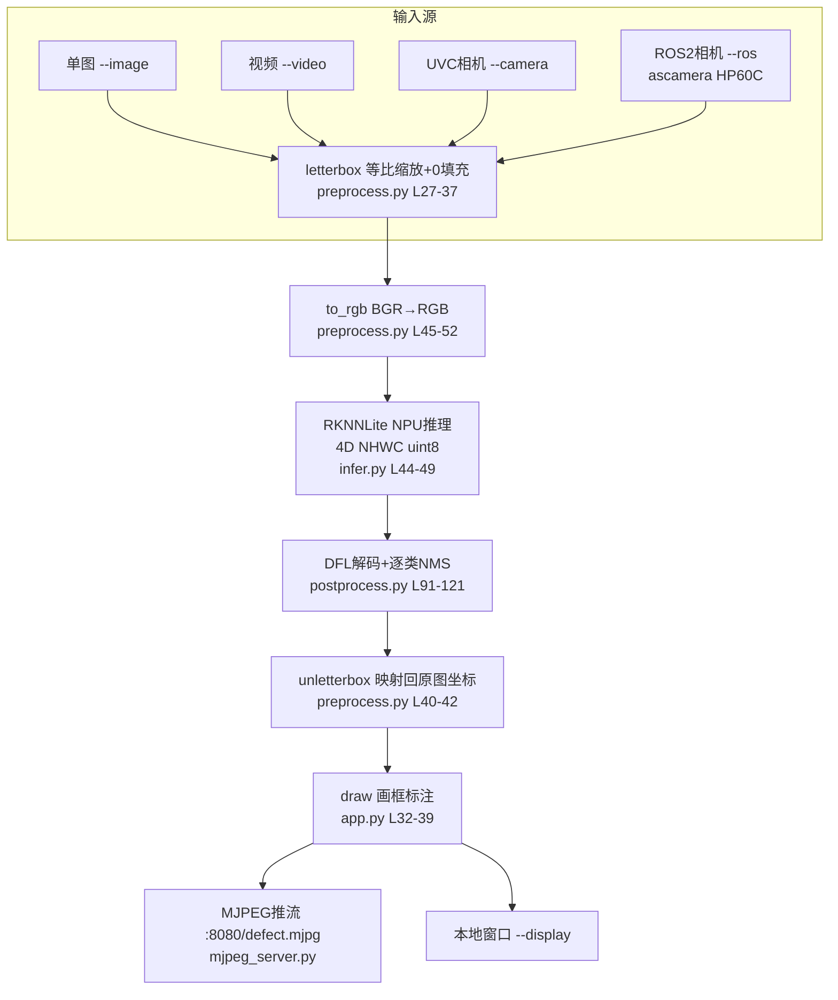

**操作步骤**：

1. 单图推理（最简验证）：
   ```bash
   cd ros2_ws/src/xflz_eai_car1/vision/01_industrial_defect_detection
   python src/app.py --model models/defect_yolov8n_int8.rknn --image images/1.jpg --save out.jpg
   # 预期：终端打印 fps=xx.x 与每个缺陷框 类别 置信度 (x1,y1,x2,y2)；out.jpg 为红框标注图
   ```
2. 视频推理：
   ```bash
   python src/app.py --model models/defect_yolov8n_int8.rknn --video test.mp4 --save out.mp4
   # 预期：每 30 帧打印一次 avg_fps，最终输出标注视频
   ```
3. 相机实时（板上标准流程，HP60C 走 ROS2 话题）：
   ```bash
   # 终端 1：启动相机驱动（ROS_DOMAIN_ID 必须与驱动一致，本板 =2）
   source /opt/ros/humble/setup.bash && source ~/ros2_ws/install/setup.bash
   export ROS_DOMAIN_ID=2
   ros2 launch ascamera hp60c.launch.py

   # 终端 2：运行缺陷检测（同一 ROS_DOMAIN_ID）
   source /opt/ros/humble/setup.bash && source ~/ros2_ws/install/setup.bash
   export ROS_DOMAIN_ID=2
   python src/app.py --model models/defect_yolov8n_int8.rknn --ros
   # 预期：终端打印 frame N avg_fps=xx.x，板端实测约 13 FPS
   ```
4. 浏览器查看实时检测流：
   - 同一局域网内访问 `http://<板IP>:8080/defect.mjpg`
   - 移动带缺陷的工件，观察红框与类别标签实时跟随
5. 验证后端可切换（精度对比前置）：
   ```bash
   python src/app.py --model train/weights/best.onnx --image images/1.jpg --save out_onnx.jpg
   # .onnx 自动走 ONNXBackend（CPU），与 .rknn（NPU）对比帧率差异
   ```
6. 动手改造练习（阶段三）：修改 `src/app.py` L38-39 中画框颜色/线宽，或把 `score_thr` 从配置改为命令行参数，重新运行观察效果

**易错点**：
- ⚠️ **推理报 `need 4dims input`** → **解决**：静态 shape 模型要求 4D 输入，`RKNNBackend.predict`（`infer.py` L47）已用 `np.newaxis` 补成 NHWC；手写推理代码时务必保持 4 维
- ⚠️ **检测结果框整体偏移/错位** → **解决**：检查 letterbox 填充值（必须 0，非 114）与 BGR/RGB 约定（`to_rgb` 必须调用）；两侧不一致是框偏移的头号原因
- ⚠️ **init_runtime 报 `core mode not supported`** → **解决**：`RKNNLite` 初始化必须显式传 `core_mask=0`（NPU_CORE_AUTO，`infer.py` L36），None 值在 2.3.2 上会报错
- ⚠️ **MJPEG 浏览器 404** → **解决**：端口被其他 demo 占用，`mjpeg_server.py` L47-57 启动时已预检端口并明确报错；先关闭占用 8080 的进程
- ⚠️ **--ros 模式取不到帧** → **解决**：确认相机驱动已启动、`ROS_DOMAIN_ID` 与驱动一致（本板 =2）、话题为 `/ascamera_hp60c/camera_publisher/rgb0/image`（`ros2_source.py` L29，勿 remap）

---

#### 步骤7：mAP50 精度评测与 onnx/rknn 对比（阶段三：能改造，35min）

> 📌 本步骤对应源码：`src/eval_map.py`、`src/metrics.py`

**知识点讲解**：

**mAP50 指标原理（1.3.3）**
- **原理**：mAP（mean Average Precision）是目标检测的行业标准指标。其计算分四层：(1) **IoU**（`src/metrics.py` L28-39 `iou_matrix`）——预测框与真值框的交并比，向量化实现逐对计算；(2) **TP/FP 匹配**（L54-73 `_match_flags`）——预测框按置信度降序，与同类别 GT 计算 IoU，`IoU≥0.5` 且该 GT 未被匹配过则为 TP，否则 FP（一张 GT 只匹配一次）；(3) **PR 曲线与 AP**（L42-51 `_ap_from_pr`）——按置信度阈值从高到低扫描，计算 precision/recall 序列，用 all-point 插值求曲线下面积，即单个类别的 AP50；(4) **mAP50**（L76-112 `map50`）——各类 AP50 的平均，遵循 COCO/ultralytics 约定**无 GT 的类别不参与均值**，保证与官方 `yolo val` 可比。`eval_map.py`（L29-91）把评测组织为"遍历 val 集 → Detector 推理 → 解析 YOLO 标签为 GT → map50 计算"，`--backend` 参数支持 rknn/onnx 双后端，从而量化 int8 量化相对浮点模型的精度损失（本项目要求掉点 ≤3%）。
- **源码对应**：`src/metrics.py` L28-39（iou_matrix）、L42-51（_ap_from_pr）、L54-73（_match_flags）、L76-112（map50）；`src/eval_map.py` L29-46（参数与 Detector 构建）、L48-79（评测循环与 GT 解析）、L81-91（结果输出）

**操作步骤**：

1. 运行 RKNN 后端评测（板上，需要 NEU-DET 数据）：
   ```bash
   python src/eval_map.py --backend rknn \
     --model models/defect_yolov8n_int8.rknn \
     --data /home/iflytek/Src/AIoT_B2/NEU-DET.v1i.yolov8
   # 预期输出：per-class AP50 表格 + mAP50（如 0.71x）
   ```
2. 运行 ONNX 后端评测，与 RKNN 对比：
   ```bash
   python src/eval_map.py --backend onnx \
     --model train/weights/best.onnx \
     --data /home/iflytek/Src/AIoT_B2/NEU-DET.v1i.yolov8
   # 预期：onnx mAP50 略高于 rknn；掉点 = onnx - rknn ≤ 3%
   ```
3. 记录两类缺陷的 AP 差异，思考原因（如 crazing 与 scratches 类间相似，AP 通常偏低）
4. 填写性能基线表（实验报告必填）：

   | 指标 | 期望值 | 实测值 |
   |------|-------|-------|
   | onnx mAP50 | ≈0.73 |  |
   | rknn(int8) mAP50 | 掉点 ≤3% |  |
   | 单图推理 FPS（NPU） | ≥15（实测约 13） |  |
   | MJPEG 流地址 | :8080/defect.mjpg 可访问 |  |

**易错点**：
- ⚠️ mAP 数值与 `yolo val` 不可比 → 保持"无 GT 类不参与均值"约定（`metrics.py` L109-111）；GT 与 pred 统一原始图像坐标（`eval_map.py` L74-75）
- ⚠️ 评测耗时长 → 可先用 `--limit`（若支持）抽子集快速验证流程，再全量跑

---

### 1.7 常见问题

| 问题 | 原因 | 解决方法 |
|------|------|---------|
| 检测框整体偏移/错位 | letterbox 填充值或 BGR/RGB 约定与转换不一致 | 部署侧保持 pad=0（`preprocess.py` L8-9）与 `to_rgb()`（L45-52）；转换侧 `quant_img_RGB2BGR=False`（`convert_rknn.py` L65） |
| NPU 推理报 `need 4dims input` | 静态 shape 模型要求 4D NHWC 输入 | 按 `infer.py` L47 加 `np.newaxis` 补维 |
| init_runtime 报 `core mode not supported` | core_mask 传 None | 显式传 `core_mask=0`（NPU_CORE_AUTO，`infer.py` L36） |
| RKNN 转换掉点 >3% | 校准集不足或预处理不一致 | 增大 `--calib-count`（`convert_rknn.py` L99）、校准图用 val 集且预处理与推理一致；必要时 `--no-quantize` 定位 |
| 导出 ONNX 输出不是 9 个 | 用了官方 ultralytics 或未指定 format=rknn | 使用 RKNN 优化 fork + `format='rknn'`（`export_onnx.sh` L16），校验命令见 L20 |
| MJPEG 浏览器 404 | 8080 端口被其他 demo 占用 | 关闭占用进程；启动时预检报错见 `mjpeg_server.py` L47-57 |
| `--ros` 取不到帧 | 驱动未启动或 ROS_DOMAIN_ID 不一致 | 先 `ros2 launch ascamera hp60c.launch.py`；export ROS_DOMAIN_ID=2；话题勿 remap（`ros2_source.py` L29） |
| 退出程序时报 C++ abort / core dumped | `Ros2Camera.release()` 先 destroy_node 再 rclpy.shutdown()，顺序反了 | 严格先 `rclpy.shutdown()` 后 `destroy_node`（`ros2_source.py` L98-116），release 已内置正确顺序 |
| 量化校准报错或无效果 | 校准图路径含中文字符/格式不支持，或 imgsz 与模型不一致 | 校准图用 jpg/png/bmp 与绝对路径（`convert_rknn.py` L22）；`--imgsz` 与训练一致 |
| 板上无训练集时推理报错 | `class_names` 读 data.yaml 失败抛 FileNotFoundError | 属正常现象，`app.py` L60-65 已内置 NEU-DET 6 类名兜底，板上推理无需数据集 |
| mAP 数值与 `yolo val` 不可比 | 无 GT 的类参与了均值，或 GT 与预测坐标空间不一致 | 保持"无 GT 类不参与均值"约定（`metrics.py` L109-111）；GT 与 pred 统一原始图像坐标（`eval_map.py` L74-75） |

### 1.8 扩展实验

**扩展方向 1：缺陷精度提升与消融对比（进阶）**
- 训练侧换更大模型 `yolov8s` 或提高 `imgsz=800`，对比 mAP50 提升与板端 FPS 下降的权衡（NPU 算力 6TOPS 固定，模型越大单帧耗时越高）
- 增加校准图片数（`--calib-count 500`）或改用 fp16 转换，观察 int8 量化掉点变化
- 用 `src/eval_map.py` 的 `--backend` 参数建立 torch / onnx / rknn 三方精度对比表，分析量化误差主要来自哪类缺陷

**扩展方向 2：质检联动与缺陷统计报告（进阶）**
- 在 `src/app.py` 主循环（L123-138）中按类别累加缺陷计数，周期性输出缺陷统计（如"scratches: 12 处"），生成质检报表，对应工业场景的"缺陷统计与质检报告生成"
- 将 `Detector.detect()` 返回的 `Detection` 列表转换为 ROS2 `vision_msgs/Detection2DArray` 话题发布，供机械臂分拣或报警灯联动（需在 `ros2_source.py` 旁新增 publisher 模块）
- 把 MJPEG 推流（`mjpeg_server.py`）与缺陷统计叠加显示在画面上，形成完整的人机交互质检界面

### 1.9 实验报告要求

**评分标准**：配置与数据集理解 10 分 + 训练产物分析 15 分 + ONNX/RKNN 转换 25 分 + NPU 实时推理与 MJPEG 演示 30 分 + mAP50 评测 10 分 + 实验报告 10 分 = 100 分。

**报告必含内容**：
1. 推理流水线框图（letterbox → RGB → NPU → DFL 解码/NMS → unletterbox），标注每步对应源码文件与行号
2. 单图检测结果图（标注前/后对比）与 3 个检测框的类别、置信度、坐标数据
3. 板端实测 FPS（单图/视频/相机三种模式）与性能基线表（1.6 步骤 7 表格）
4. onnx vs rknn 的 mAP50 对比表，分析量化掉点原因
5. 回答思考题：为什么部署推理用 pad=0 而训练用 114？为什么 NPU 输入必须是 RGB 且不做归一化？如果 score_thr 从 0.25 调到 0.5，检测结果会如何变化？
6. 实验心得与问题记录（遇到的问题、排查过程、解决结果）

---

## 更新日志

| 版本 | 日期 | 变更 |
|------|------|------|
| v1.0 | 2026-08-10 | 初版生成（基于源码实测：app.py/infer.py/preprocess.py/postprocess.py/convert_rknn.py 等，源码路径 ros2_ws/src/xflz_eai_car1/vision/01_industrial_defect_detection，板端验证 13 FPS，训练产物 mAP50=0.732） |

## 实验2：基于图像分类的垃圾分类实验（4h）

> ✅ **源码已核实** 本实验源码位于 `ros2_ws/src/xflz_eai_car1/vision/02_garbage_classification/`。基于 `rubbish_2_7.rknn`（20 类垃圾分类模型，YOLOv5 式检测头：3 尺度 × 75 通道 = 3 anchors × (4+1+20)），改造 `rknn-python-Multithreading` 火焰检测例程为**多线程 RKNN 推理 + 逐目标分类 + 4 大类映射 + MJPEG 实时流**。单测 62/62 全绿（WSL rknn23 实测）。

### 1.1 关联知识点

- 1.1.1 图像分类原理 > 原理 > 垃圾分类采用 YOLOv5 式检测头（3 尺度 × 75 通道 = 3 anchors × (4+1+20)）同时输出类别与位置，区别于纯分类网络的整图单标签输出
- 1.2.1 数据集搭建 > 概念 > 20 细类标签（bailuobo…zhuankuai，`config/labels.txt` 行号=类别 ID）与 4 大类映射（1=recyclable 2=kitchen_waste 3=hazardous_waste 4=other_waste，`config/category_map.txt`）
- 1.3.1 多线程推理 > 流程 > RKNNPool 多线程推理池：NPU 核轮转 + 任务队列，最大化 6TOPS NPU 利用率
- 1.3.2 模型部署 > 原理 > 模型输入 `[1,3,640,640]` float32，mean/std 0/255，**rgb2bgr=False（须喂 RGB）**；输出 3 尺度 `[1,75,80,80]/[1,75,40,40]/[1,75,20,20]`
- 1.3.3 实时分类与分拣联动 > 流程 > letterbox 640(pad 0) + BGR→RGB → YOLOv5 解码（anchors/obj/逐类 NMS）→ 4 大类映射 → 原图坐标输出 → MJPEG 推流

### 1.2 实验目标

1. 掌握图像分类数据集搭建与 YOLOv5 式检测头模型部署方法 — 原理理解
2. 实现基于视觉的垃圾分类（20 细类 + 4 大类映射）与 MJPEG 实时可视化 — 独立完成
3. 理解多线程推理池如何提升 NPU 利用率，为机械臂分拣联动打基础 — 迁移应用

### 1.3 实验环境

| 类别 | 配置 |
|------|------|
| 硬件 | 具身智能实验箱 B2（XFLZ_EAI_B2_PRO，RK3576 SoC，6TOPS NPU，含 HP60C 深度相机） |
| OS | Ubuntu 22.04 + ROS2 Humble（板载 ros2_venv，rknnlite 2.3.2） |
| 核心库 | OpenCV、NumPy、rknnlite、PyYAML（标准库 MJPEG，替代外部 mjpeg_streamer） |
| 模型 | `rubbish_2_7.rknn`（20 类垃圾分类，YOLOv5 检测头，640×640 输入） |
| 主入口 | `src/app.py`（单图/视频/相机/ROS 模式 + MJPEG + FPS） |

### 1.4 实验难度

- 难度: ⭐⭐ 设计性
- 重点: YOLOv5 检测头解码（anchors + obj + 逐类 NMS）与 4 大类业务映射
- 难点: 多线程推理池设计（核轮转 + 队列）与 RGB/float 输入约定

### 1.5 实验现象

**快速验证流程**：

1. 进入项目目录：`cd ros2_ws/src/xflz_eai_car1/vision/02_garbage_classification`
2. 单元测试：`pytest tests/ -v`（62 用例全绿，从不加载真模型）
3. 单图检测：`python src/app.py --image x.jpg --save out.jpg`
   - 终端打印每个目标的「大类 细类 score」与坐标
4. 视频检测 + MJPEG：`python src/app.py --video test.mp4`
   - 浏览器访问 `http://<板IP>:8080/garbage_cam.mjpg` 查看标注流
5. 相机实时（板上标准）：先起 ascamera 驱动，再 `python src/app.py --ros`

**预期效果描述**：
- 单图：水瓶 → `recyclable shuiping 0.xx`，鸡蛋 → `kitchen_waste 鸡蛋...`，电池 → `hazardous_waste dianchi 0.xx`
- 实时：检测框逐帧跟随，avg_fps ≥ 15（验收门），MJPEG 流可见「大类 细类 score」标注
- 多线程：`--tpes 6` 时 NPU 多核轮转，帧率显著高于单线程

### 1.6 实验步骤

#### 整体流程图

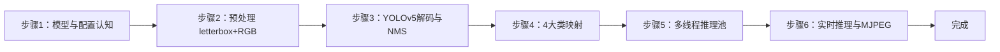

---

#### 步骤1：模型与配置认知（阶段一：能运行，20min）

> 📌 本步骤对应源码：`config/garbage_config.yaml`、`config/labels.txt`、`src/config.py`

**知识点讲解**：

**模型元数据与业务映射（1.1.1、1.2.1）**
- **原理**：`rubbish_2_7.rknn` 是 20 类垃圾分类检测模型，检测头为 **YOLOv5 式**：每个尺度输出 `[1, 75, h, w]`，75 = 3 anchors × (4 坐标 + 1 目标置信度 + 20 类)。模型事实（元数据核实）：输入 `[1,3,640,640]` float32，mean/std 0/255，**rgb2bgr=False（必须喂 RGB）**；anchors 为 YOLOv5 默认 9 组（`config/anchors.txt`）。业务层把 20 细类映射为 4 大类：1=recyclable（可回收）2=kitchen_waste（厨余）3=hazardous_waste（有害）4=other_waste（其他），映射关系在 `config/category_map.txt`（英文名）。`src/config.py` 负责加载 labels/category_map/anchors，**路径相对配置文件解析**——模型换位置时只需改 `model.path`。
- **源码对应**：`config/garbage_config.yaml`（model.path / infer.sigmoid / pool.tpes）；`config/labels.txt`（20 细类，行号=类别 ID）；`config/category_map.txt`（4 大类）；`config/anchors.txt`（YOLOv5 默认 anchors）

**操作步骤**：

1. 查看标签与映射文件，理解"细类 → 大类"的两级业务：
   ```bash
   cat config/labels.txt          # 20 细类（拼音命名：shuiping 水瓶、dianchi 电池…）
   cat config/category_map.txt    # 每行: 细类ID 大类ID 大类英文名
   ```
2. 阅读 `config/garbage_config.yaml`，重点关注 `infer.sigmoid`（obj 分支是否已 sigmoid）与 `pool.tpes`（线程数）
3. 用 Python 验证配置加载：
   ```bash
   python -c "from config import load_labels, load_category_map, load_anchors; \
   print(len(load_labels('config/labels.txt')), '细类'); \
   print(len(load_category_map('config/category_map.txt')), '大类映射')"
   ```

**易错点**：
- ⚠️ 若框偏移 → 调整 `config/anchors.txt`（核对导出配置）；若分数异常 → 切换 `infer.sigmoid: false`

---

#### 步骤2：预处理 letterbox + RGB（阶段一：能运行，20min）

> 📌 本步骤对应源码：`src/preprocess.py`

**知识点讲解**：

**输入对齐（1.3.2）**
- **原理**：模型输入为 640×640 RGB float，而摄像头/图片是任意尺寸 BGR uint8。`prepare_input()` 完成三步对齐：(1) **letterbox 等比缩放 + pad 0 填充**到 640×640（pad 必须 0，与模型 zoo 对齐，避免填充色干扰检测）；(2) **BGR→RGB 通道交换**（模型 rgb2bgr=False 约定）；(3) **归一化约定**：模型要求 mean/std 0/255，即输入直接是 0-255 的 uint8 转 float，不做额外 /255（量化模型内部处理）。输出经 `unletterbox()` 把检测框映射回原始图像坐标。
- **源码对应**：`src/preprocess.py`（prepare_input / unletterbox）

**操作步骤**：

1. 用测试图验证预处理输出形状：
   ```bash
   python -c "
   import cv2, numpy as np
   from preprocess import prepare_input
   img = cv2.imread('x.jpg')
   rgb, meta = prepare_input(img, 640)
   print('输入形状:', rgb.shape, 'dtype:', rgb.dtype)   # 预期 (640,640,3) uint8 RGB
   print('scale:', meta.scale, 'pad:', (meta.pad_x, meta.pad_y))"
   ```
2. 理解 letterbox 的 scale 计算（`min(640/h, 640/w)`），思考为什么 pad 必须是 0

**易错点**：
- ⚠️ RGB 与 BGR 混用是"检测框对但分类错"的头号原因——务必先 `to_rgb` 再喂模型

---

#### 步骤3：YOLOv5 解码与逐类 NMS（阶段二：能理解，30min）

> 📌 本步骤对应源码：`src/postprocess.py`

**知识点讲解**：

**YOLOv5 检测头解码（1.1.1）**
- **原理**：YOLOv5 检测头输出为 anchor-based：每尺度 `[1,75,h,w]`，reshape 为 `[3, 25, h, w]`（3 anchors × 25 = 4 坐标 + 1 obj + 20 类）。解码步骤：(1) 对每个 anchor 位置，用**预设 anchors** 将归一化偏移还原为 cx/cy/w/h（`decode_rknn_outputs`）；(2) 目标置信度与类别分数结合（或直接取类最大分）；(3) 按 `score_thr` 过滤；(4) **逐类 NMS**——同类别重叠框只保留最高分，跨类别不抑制。输出 `Detection` 列表（原图坐标，经 unletterbox），再由 `map_categories()` 完成 20 细类 → 4 大类映射。
- **源码对应**：`src/postprocess.py`（Detection / decode_rknn_outputs / map_categories / NMS）

**操作步骤**：

1. 阅读 `postprocess.py` 的解码主函数，理解 anchors 如何参与坐标还原
2. 单元测试理解解码契约：
   ```bash
   pytest tests/test_postprocess.py -v
   # 预期：decode/NMS/map_categories 用例全绿
   ```
3. 思考：为什么逐类 NMS 而非全局 NMS？（不同类目标可以重叠，如"瓶中水"场景）

**易错点**：
- ⚠️ anchors 与模型导出配置不一致 → 框整体偏移，调整 `config/anchors.txt`

---

#### 步骤4：4 大类业务映射（阶段二：能理解，15min）

> 📌 本步骤对应源码：`src/postprocess.py` map_categories、`config/category_map.txt`

**知识点讲解**：

**细类到大类的业务抽象（1.2.1）**
- **原理**：20 细类过于细粒度（如 yaogao 牙膏、yaopian 药片），面向分拣业务需要 4 大类。`map_categories()` 依据 `category_map.txt` 把每个检测的 `class_id` 映射为 `(大类ID, 大类英文名)`，同时保留细类名用于标注显示。这种"模型输出细类、业务消费大类"的两级设计，使模型更换（如新增细类）不破坏下游分拣逻辑。
- **源码对应**：`src/postprocess.py` map_categories；`src/app.py` L31-33（标注格式 `大类 细类 score`）

**操作步骤**：

1. 查看 category_map.txt，找出 recyclable 包含哪些细类（shuiping 水瓶、yilaguan 易拉罐…）
2. 运行单测验证映射正确性：`pytest tests/test_postprocess.py -k category -v`

**易错点**：
- ⚠️ category_map 行序必须与 labels.txt 行号严格对应，错一行全错

---

#### 步骤5：多线程推理池 RKNNPool（阶段三：能改造，30min）

> 📌 本步骤对应源码：`src/rknnpool.py`

**知识点讲解**：

**多线程推理池原理（1.3.1）**
- **原理**：RK3576 NPU 支持多核（core_mask），单线程推理时 NPU 有核空闲。RKNNPool 用**生产者-消费者模型**：主线程读取帧放入任务队列，`--tpes N` 个工作线程从队列取帧，各自持有 RKNNLite 实例并**轮转绑定不同 NPU 核**（core_mask 0/1/2/3）并行推理，结果按序返回。这比单线程串行推理能显著提升 FPS（多核并行 + 取帧与推理重叠）。`rknn_backend_factory()` 为每个线程创建后端实例，`Detector` 注入后端完成检测。
- **源码对应**：`src/rknnpool.py`（RKNNPool：入队 Lxx / 工作线程 Lxx / 结果回收 Lxx）；`src/detector.py` L133-135（make_rknn_backend）

**操作步骤**：

1. 单线程 vs 多线程对比（验证池的价值）：
   ```bash
   python src/app.py --video test.mp4 --tpes 1
   python src/app.py --video test.mp4 --tpes 6
   # 对比 avg_fps：tpes 6 应明显更高
   ```
2. 阅读 rknnpool.py 的队列实现，理解线程安全（queue.Queue / 锁）
3. 思考：线程数不是越多越好？——NPU 核数与内存限制决定最优 tpes（本板实测 6 左右）

**易错点**：
- ⚠️ 每个线程必须独立 RKNNLite 实例（NPU 上下文非线程共享），复用同一实例会崩溃
- ⚠️ tpes 超过 NPU 核数不提升反而增加内存压力

---

#### 步骤6：实时推理与 MJPEG 推流（阶段三：能改造，35min）

> 📌 本步骤对应源码：`src/app.py`、`src/mjpeg_server.py`、`src/ros2_source.py`

**知识点讲解**：

**端到端实时链路（1.3.3）**
- **原理**：`app.py` 组织完整链路：输入源（单图/视频/`--camera N` UVC/`--ros` ROS2 话题）→ 帧交给 `make_process_fn` 构造的 pool 处理函数 → 每个工作线程内 `Detector.detect()`（prepare_input → NPU 推理 → 解码 → 4 大类映射 → unletterbox）→ 画框标注（`大类 细类 score`）→ MJPEG 推流。`mjpeg_server.py` 用**标准库**实现 MJPEG（multipart/x-mixed-replace），替代外部 mjpeg_streamer，零额外依赖。板上相机标准路径是 HP60C 深度相机经 ascamera 话题取流（`ros2_source.py` Ros2Camera，DEFAULT_TOPIC `/ascamera_hp60c/camera_publisher/rgb0/image`），OpenCV 直连读不了（未编 libv4l）。
- **源码对应**：`src/app.py` L24-35（make_process_fn 标注逻辑）、L38-150（main：参数 L39-60 / 单图 Lxx / 视频相机 Lxx）；`src/mjpeg_server.py`（MjpegServer）；`src/ros2_source.py`（Ros2Camera：DEFAULT_TOPIC / open / read / release）

**操作步骤**：

1. 单图检测（最简验证）：
   ```bash
   cd ros2_ws/src/xflz_eai_car1/vision/02_garbage_classification
   python src/app.py --image x.jpg --save out.jpg
   # 预期：终端打印 大类 细类 score (x1,y1,x2,y2)
   ```
2. 视频 + MJPEG：
   ```bash
   python src/app.py --video test.mp4 --tpes 6 --port 8080
   # 浏览器访问 http://<板IP>:8080/garbage_cam.mjpg
   ```
3. 相机实时（板上标准）：
   ```bash
   source /opt/ros/humble/setup.bash && source ~/ros2_ws/install/setup.bash
   export ROS_DOMAIN_ID=2
   ros2 launch ascamera hp60c.launch.py        # 终端 1
   python src/app.py --ros                      # 终端 2，同一 ROS_DOMAIN_ID
   # 预期：avg_fps ≥ 15，MJPEG 可见实时标注
   ```
4. 动手改造：修改 `src/app.py` L30-33 标注逻辑，把大类换成中文名（如 `可回收 水瓶 0.87`），重新运行

**易错点**：
- ⚠️ `--ros` 取不到帧 → ascamera 驱动先起、ROS_DOMAIN_ID 一致、话题勿 remap
- ⚠️ MJPEG 404 → 8080 被占，`--port` 换端口或关占用进程

---

### 1.7 常见问题

| 问题 | 原因 | 解决方法 |
|------|------|---------|
| 检测框整体偏移 | anchors 与导出配置不一致 | 调整 `config/anchors.txt`（核对导出配置） |
| 分数异常（全 0 或全 1） | obj 分支已/未 sigmoid 与配置不符 | 切换 `infer.sigmoid: false/true` |
| 分类全错但框对 | RGB/BGR 约定错误 | 确认 `prepare_input` 先 BGR→RGB（模型 rgb2bgr=False） |
| 多线程崩溃 | 线程共享同一 RKNNLite 实例 | 每线程独立实例（RKNNPool 已实现） |
| MJPEG 404 | 8080 端口占用 | `--port` 换端口或关闭占用进程 |
| --ros 取不到帧 | 驱动未启动/ROS_DOMAIN_ID 不一致 | ascamera 先起；export ROS_DOMAIN_ID=2；话题勿 remap |
| 板上模型加载失败 | model.path 未改为板载路径 | 修改 `config/garbage_config.yaml` 的 `model.path` |

### 1.8 扩展实验

**扩展方向 1：机械臂分拣联动（进阶）**
- 在 `app.py` 处理函数中，把 4 大类结果转换为分拣指令（如 recyclable → 机械臂抓取到 1 号仓），通过串口或 ROS2 话题发布（参考实验 05 的 cmd_vel 模式）

**扩展方向 2：识别置信度优化（进阶）**
- 在标注中加入细类置信度直方图；对不同大类设置不同 score_thr（有害垃圾从严），观察误检率变化
- 把 `--tpes` 做成运行时动态调节，绘制"线程数 vs FPS"曲线，找出最优配置

### 1.9 实验报告要求

**评分标准**：模型元数据理解 15 分 + 预处理 15 分 + YOLOv5 解码 25 分 + 4 大类映射 15 分 + 实时演示 20 分 + 报告 10 分 = 100 分。

**报告必含内容**：
1. 模型输入输出规格表（形状/类型/通道顺序/anchors），标注对应的 config 文件
2. 解码流程图（anchors → cx/cy/w/h → NMS → 大类映射），标注源码行号
3. 单图检测结果图（≥3 个不同大类目标）与「大类 细类 score」数据
4. tpes=1 vs tpes=6 的 FPS 对比数据与结论
5. 回答思考题：为什么模型要求 RGB 而 OpenCV 默认 BGR？为什么逐类 NMS 允许跨类重叠？多线程池为什么比单线程快？
6. 实验心得与问题记录

---

## 更新日志

| 版本 | 日期 | 变更 |
|------|------|------|
| v1.0 | 2026-08-10 | 初版生成（源码路径 ros2_ws/src/xflz_eai_car1/vision/02_garbage_classification，62 用例全绿，YOLOv5 检测头 20 细类 + 4 大类映射 + RKNNPool 多线程） |

## 实验3：基于HSV色彩空间的颜色识别实验（4h）

> ✅ **源码已核实** 本实验源码位于 `ros2_ws/src/xflz_eai_car1/vision/03_lab_color_recognition/`。⚠️ **注意**：课程目录名 "lab" 指实验编号，本实验实际使用 **HSV 色彩空间**（非 Lab 色彩空间）。对应课程内容：BGR→HSV 阈值掩膜 → 形态学开/闭 → 圆形轮廓标识 → 颜色名标注；可视化对齐车端 `visual_grasp` 双栏（左 RGB 栏 | 右 HSV Mask 栏）推流。单测 24/24 全绿，板端验证通过（约 50 FPS）。

### 1.1 关联知识点

- 1.1.1 HSV色彩空间 > 原理 > HSV（色相/饱和度/明度）将颜色信息与光照强度解耦，比 RGB 更适合阈值分割；OpenCV 约定 H∈0-179、S/V∈0-255
- 1.1.2 色彩阈值掩膜 > 流程 > `cv2.inRange` 生成二值掩膜；红色在 0/180 交界需 h2 第二段（环形色相处理）
- 1.2.1 形态学运算 > 概念 > 开运算（先腐蚀后膨胀）去孤立噪点，闭运算（先膨胀后腐蚀）填小孔洞；核须奇数
- 1.2.2 轮廓检测 > 流程 > `cv2.findContours` → 最小外接圆 `minEnclosingCircle`，按 min_area/min_radius/max_radius 过滤后取最大
- 1.3.1 实时颜色识别 > 流程 > 摄像头取流 → HSV 转换 → 阈值掩膜 → 形态学 → 圆形轮廓 → 颜色名标注 → 双栏 MJPEG 推流
- 1.3.2 阈值调参 > 流程 > `--tune` 模式提供 H/S/V 6 滑块实时调参，Ctrl+C 退出并打印当前阈值，直接写入 config

### 1.2 实验目标

1. 掌握 HSV 色彩空间与 RGB 的转换原理，理解阈值分割的适用范围与局限 — 原理理解
2. 实现摄像头实时采集、多色目标检测（红/蓝/绿）与颜色名标注 — 独立完成
3. 掌握形态学运算与轮廓分析在目标提取中的作用，学会用 --tune 调参应对光照变化 — 迁移应用

### 1.3 实验环境

| 类别 | 配置 |
|------|------|
| 硬件 | 具身智能实验箱 B2（XFLZ_EAI_B2_PRO，RK3576 SoC，6TOPS NPU，含 HP60C 深度相机） |
| OS | Ubuntu 22.04 + ROS2 Humble（板载 ros2_venv） |
| 核心库 | OpenCV、NumPy、PyYAML（纯 CPU 视觉管线，无需 NPU） |
| 主入口 | `src/app.py`（图像/视频/相机 CLI + MJPEG 双栏流 + `--tune` 调参） |

### 1.4 实验难度

- 难度: ⭐ 验证性
- 重点: HSV 阈值掩膜 + 形态学开/闭 + 圆形轮廓标识 + 颜色名标注
- 难点: 红色跨 0/180 边界的 h2 环形处理；光照变化下的阈值鲁棒性

### 1.5 实验现象

**快速验证流程**：

1. 进入项目目录：`cd ros2_ws/src/xflz_eai_car1/vision/03_lab_color_recognition`
2. 单元测试：`pytest tests/ -v`（24 用例全绿）
3. 单图检测：`python src/app.py --image x.jpg --save out.jpg`
   - 输出双栏图：左 RGB 栏（绿轮廓+黄框+红质心十字+颜色名）| 右 HSV Mask 栏（白匹配区）
4. 相机实时（板上标准）：先起 ascamera 驱动，再 `python src/app.py --ros`
   - MJPEG：`http://<板IP>:8080/lab_color.mjpg`（同双栏）
5. 调参：`python src/app.py --tune 红色 --ros`，6 滑块实时调 H/S/V

**预期效果描述**：
- 红/蓝/绿三种目标均能检出：圆形轮廓 + 窗口左下角颜色名正确
- 右栏 Mask 图实时显示匹配区域（白色），与左栏轮廓对应
- 板端实测约 50 FPS（纯 CPU 管线，无需 NPU）
- 光照变化导致误检/漏检时，`--tune` 可实时修正阈值

### 1.6 实验步骤

#### 整体流程图

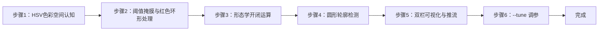

---

#### 步骤1：HSV 色彩空间认知（阶段一：能运行，20min）

> 📌 本步骤对应源码：`src/preprocess.py` bgr_to_hsv

**知识点讲解**：

**HSV 与 RGB 的差异（1.1.1）**
- **原理**：RGB 将颜色编码为三通道强度，受光照影响大（同一红色在明/暗处 R/G/B 值差异巨大）。HSV 把颜色拆为色相 H（0-179°，决定"是什么颜色"）、饱和度 S（0-255，颜色纯净度）、明度 V（0-255，亮度），**颜色信息与光照强度解耦**——阈值分割时只需限定 H 范围 + 适当放宽 S/V，即可在光照变化下稳定识别。`bgr_to_hsv()`（L36-38）一行 `cv2.cvtColor(BGR2HSV)` 完成转换。注意 OpenCV 的 H 范围是 0-179（非 0-360），这是与教科书最常混淆的点。
- **源码对应**：`src/preprocess.py` L36-38（bgr_to_hsv）

**操作步骤**：

1. 单像素验证 RGB→HSV 转换：
   ```bash
   python -c "
   import cv2, numpy as np
   red = np.uint8([[[0, 0, 255]]])          # BGR 纯红
   hsv = cv2.cvtColor(red, cv2.COLOR_BGR2HSV)
   print('纯红 HSV:', hsv[0][0])             # 预期 H≈0, S≈255, V≈255"
   ```
2. 用一张彩色图可视化 HSV 三通道（H/S/V 分别显示），理解各通道语义
3. 思考：为什么纯红 H=0 而非 360？OpenCV 把 H 压缩到 0-179 的原因？

**易错点**：
- ⚠️ H 范围 0-179（OpenCV）≠ 0-360（教科书），阈值写错直接全黑

---

#### 步骤2：阈值掩膜与红色环形处理（阶段一：能运行，25min）

> 📌 本步骤对应源码：`src/preprocess.py` range_mask、`src/config.py` ColorSpec

**知识点讲解**：

**inRange 阈值掩膜（1.1.2）**
- **原理**：`cv2.inRange(hsv, lower, upper)` 对每个像素判断是否落在阈值区间，生成二值掩膜（匹配=255，不匹配=0），是颜色分割的核心。**红色特殊**：红色在 H 环形色相中位于 0 附近，跨越 0/180 边界（H≈0 和 H≈179 都是红），单一区间 `[0,10]` 会漏掉 H≈179 的偏紫红。`ColorSpec` 支持 `h2` 第二段（如 `h=[0,10], h2=[170,179]`），`range_mask()`（L41-50）把两段掩膜**按位或**合并，解决红色环形问题——车端 visual_grasp 同款方案。阈值配置集中管理：`config/lab_config.yaml` 中每种颜色一组 HSV 范围 + 形态学核 + 轮廓过滤参数。
- **源码对应**：`src/preprocess.py` L41-50（range_mask，h2 并入 L42-49）；`src/config.py` ColorSpec（h/s/v/h2/过滤参数）

**操作步骤**：

1. 查看 `config/lab_config.yaml` 中红/蓝/绿三色的 HSV 阈值，找出红色的 h2 第二段
2. 用测试图验证单色掩膜效果：
   ```bash
   python -c "
   import cv2
   from preprocess import bgr_to_hsv, range_mask
   from config import load_config
   cfg = load_config('config/lab_config.yaml')
   colors = cfg['colors']
   img = cv2.imread('x.jpg')
   hsv = bgr_to_hsv(img)
   for c in colors:
       mask = range_mask(hsv, c)
       print(c.name, '匹配像素:', int(mask.sum()/255))"
   ```
3. 尝试删除红色 h2 第二段，观察偏红目标是否漏检

**易错点**：
- ⚠️ 红色不用 h2 会漏检偏紫红目标——红色必须双段处理

---

#### 步骤3：形态学开/闭运算（阶段二：能理解，25min）

> 📌 本步骤对应源码：`src/preprocess.py` morph_open / morph_close

**知识点讲解**：

**形态学运算原理（1.2.1）**
- **原理**：二值掩膜常含噪点（误检像素）与孔洞（目标内部漏检）。**开运算** = 先腐蚀后膨胀：腐蚀先"吃掉"孤立小噪点，膨胀再恢复目标尺寸，结果**去噪点**；**闭运算** = 先膨胀后腐蚀：膨胀先"填平"目标内部小孔洞，腐蚀恢复尺寸，结果**填孔洞**。核用 `cv2.MORPH_ELLIPSE` 椭圆核（对圆形目标最友好），核尺寸须为奇数（`open_kernel=5` 去噪点、`close_kernel=9` 填孔洞，L53-62）。形态学处理显著提升后续轮廓检测的稳定性——噪点不除会干扰"最大圆"判定，孔洞不填会低估目标面积。
- **源码对应**：`src/preprocess.py` L53-56（morph_open）、L59-62（morph_close）

**操作步骤**：

1. 对比形态学处理前后的掩膜：
   ```bash
   python -c "
   import cv2, numpy as np
   from preprocess import bgr_to_hsv, range_mask, morph_open, morph_close
   from config import load_config
   cfg = load_config('config/lab_config.yaml')
   hsv = bgr_to_hsv(cv2.imread('x.jpg'))
   raw = range_mask(hsv, cfg['colors'][0])
   opened = morph_open(raw); closed = morph_close(opened)
   print('原始像素:', int(raw.sum()/255), '→ 开运算后:', int(opened.sum()/255), '→ 闭运算后:', int(closed.sum()/255))"
   ```
2. 修改 config 中的 kernel 尺寸（改为偶数），观察报错或行为异常——理解"核须奇数"约束
3. 思考：开运算先腐蚀后膨胀，为什么能去噪点而不是扩大空洞？

**易错点**：
- ⚠️ 核尺寸必须奇数（偶数核 OpenCV 报错或行为未定义）
- ⚠️ 核过大过小都影响效果：过大吞掉小目标，过小去不掉噪点

---

#### 步骤4：圆形轮廓检测（阶段二：能理解，25min）

> 📌 本步骤对应源码：`src/preprocess.py` largest_circle

**知识点讲解**：

**轮廓分析提取目标（1.2.2）**
- **原理**：形态学处理后的掩膜包含目标区域，`cv2.findContours` 提取所有连通域轮廓，对每个轮廓 `cv2.minEnclosingCircle` 求最小外接圆（圆心+半径）。`largest_circle()`（L65-79）按 `min_area`（面积过滤噪点）、`min_radius/max_radius`（限目标尺寸范围）过滤后**取面积最大的圆**作为该颜色的目标。`detect_colors()`（L93-106）对每种颜色执行完整管线：掩膜 → 开/闭 → 最大圆，输出携带该色掩膜的 `ColorDetect`（供双栏绘制）。这是"阈值分割 + 形态学 + 几何分析"的经典目标提取链路。
- **源码对应**：`src/preprocess.py` L65-79（largest_circle）、L93-106（detect_colors）

**操作步骤**：

1. 运行单测验证轮廓逻辑：`pytest tests/test_preprocess.py -v`
2. 修改 config 的 min_area/min_radius，观察小噪点目标是否被过滤、大目标是否被误滤
3. 思考：为什么用"最小外接圆"而非"外接矩形"？对本实验的圆形目标哪个更稳？

**易错点**：
- ⚠️ min_area 过小 → 噪点被当目标；过大 → 小目标漏检——需按实际画面调
- ⚠️ 掩膜残留小连通域时最大圆判定会错——形态学开运算必须前置

---

#### 步骤5：双栏可视化与 MJPEG 推流（阶段三：能改造，30min）

> 📌 本步骤对应源码：`src/app.py`、`src/preprocess.py` draw_detection / mask_view

**知识点讲解**：

**visual_grasp 风格双栏显示（1.3.1）**
- **原理**：车端 `visual_grasp` 采用**双栏布局**：左栏 RGB 原图上叠加检测结果（`draw_detection`，L109-124：绿轮廓 + 黄外接框 + 红质心十字 + 颜色名），右栏 HSV Mask 图（`mask_view`，L127-135：白=匹配区域 + 绿质心十字 + 青圆）。双栏并排让学习者**同时看到"原图结论"与"处理依据"**——掩膜栏直观展示阈值分割效果，是调参与排查误检的利器。`app.py` 组织取流（--image/--video/--camera/--ros）→ detect_colors → 双栏合成 → MJPEG 推流（`http://<板IP>:8080/lab_color.mjpg`）。
- **源码对应**：`src/preprocess.py` L109-124（draw_detection）、L127-135（mask_view）；`src/app.py`（main：取流 / 双栏合成 / 推流）

**操作步骤**：

1. 单图双栏输出：
   ```bash
   cd ros2_ws/src/xflz_eai_car1/vision/03_lab_color_recognition
   python src/app.py --image x.jpg --save out.jpg
   # out.jpg 为双栏：左原图标注 | 右 HSV Mask
   ```
2. 相机实时（板上标准）：
   ```bash
   source /opt/ros/humble/setup.bash && source ~/ros2_ws/install/setup.bash
   export ROS_DOMAIN_ID=2
   ros2 launch ascamera hp60c.launch.py        # 终端 1
   python src/app.py --ros                      # 终端 2
   # MJPEG: http://<板IP>:8080/lab_color.mjpg（双栏实时）
   ```
3. 动手改造：修改 `draw_detection` 的绘制样式（如改颜色名位置、加 FPS 显示），重新运行

**易错点**：
- ⚠️ --ros 取不到帧 → ascamera 先起、ROS_DOMAIN_ID 一致、话题勿 remap
- ⚠️ 双栏显示依赖显示器；无显示器时用 MJPEG 流查看

---

#### 步骤6：--tune 实时调参（阶段三：能改造，25min）

> 📌 本步骤对应源码：`src/app.py` --tune 模式、`src/preprocess.py` auto_hsv_range

**知识点讲解**：

**调参模式与自动化（1.3.2）**
- **原理**：光照变化是颜色分割的最大敌人。`--tune` 模式提供 6 个滑块（H_low/H_high/S_low/S_high/V_low/V_high）实时调整目标颜色的 HSV 阈值，画面即时反馈——看到掩膜栏变化即可判断阈值是否合适，Ctrl+C 退出时打印当前阈值。`auto_hsv_range()`（L138-166）更进一步：**从首帧自动估计目标色 HSV 范围**——在种子色域（先验 H 范围）内统计像素 min/max + 余量 margin，输出可直接写入 config 的阈值，减少手工调参工作量。
- **源码对应**：`src/app.py`（--tune 参数与滑块回调）；`src/preprocess.py` L138-166（auto_hsv_range）

**操作步骤**：

1. 启动调参模式（板上走 --ros，PC 走 --camera/--video）：
   ```bash
   python src/app.py --tune 红色 --ros
   # 滑块窗口 lab_tune：6 滑块实时调 H/S/V
   # 双栏窗口 lab_view 实时预览；Ctrl+C 退出并打印当前阈值
   ```
2. 把打印的阈值写入 `config/lab_config.yaml` 对应颜色，验证"调参结果落盘"
3. 试用手动光照变化（遮挡/移动光源），观察误检与漏检，练习快速调参
4. 进阶：调用 `auto_hsv_range` 自动估计阈值，与手动调参结果对比

**易错点**：
- ⚠️ 调参环境（光照）与实际运行环境必须一致，否则调好的阈值现场失效
- ⚠️ tune 模式需显示器；板上用 MJPEG 流辅助观察

---

### 1.7 常见问题

| 问题 | 原因 | 解决方法 |
|------|------|---------|
| 红色目标漏检 | 未配置 h2 第二段（红色跨 0/180） | config 中加 h2（如 h=[0,10], h2=[170,179]） |
| 噪点被当目标 | min_area 过小 / 未做开运算 | 增大 min_area；确认 morph_open 前置 |
| 目标孔洞导致面积偏小 | 未做闭运算 | 增大 close_kernel（须奇数） |
| 光照变化后误检/漏检 | 阈值不适应新光照 | 用 --tune 实时调参或 auto_hsv_range 自动估计 |
| 核尺寸报错 | kernel 为偶数 | 改为奇数（open_kernel=5, close_kernel=9） |
| 双栏显示异常 | --ros 取流失败或显示器缺失 | ascamera 先起、ROS_DOMAIN_ID 一致；无显示器用 MJPEG |

### 1.8 扩展实验

**扩展方向 1：多目标多色计数（进阶）**
- 修改 `detect_colors` 支持每种颜色检出多个目标（返回全部满足过滤的圆而非仅最大），实现"红球 3 个、蓝球 2 个"的计数功能

**扩展方向 2：自适应阈值（进阶）**
- 用 `auto_hsv_range` 做首帧自动标定 + 周期性重标定，实现光照自适应；或引入直方图峰谷分析自动确定阈值

### 1.9 实验报告要求

**评分标准**：HSV 原理理解 15 分 + 阈值掩膜与 h2 环形处理 20 分 + 形态学 20 分 + 轮廓检测 15 分 + 实时演示 20 分 + 报告 10 分 = 100 分。

**报告必含内容**：
1. HSV 与 RGB 对比说明（含纯红 HSV 值验证截图）
2. 三色阈值表（含红色 h2 双段）与掩膜效果图
3. 形态学开/闭前后掩膜对比图，标注噪点/孔洞变化
4. 双栏检测结果图（左 RGB | 右 Mask）与颜色名标注
5. 回答思考题：为什么红色需要 h2 双段？开运算为什么能去噪点？光照变化下如何调参？
6. 实验心得与问题记录

---

## 更新日志

| 版本 | 日期 | 变更 |
|------|------|------|
| v1.0 | 2026-08-10 | 初版生成（源码路径 ros2_ws/src/xflz_eai_car1/vision/03_lab_color_recognition，24 用例全绿，板端 50 FPS，HSV 双段红色处理 + 形态学 + 圆形轮廓 + 双栏推流） |

## 实验4：二维码生成与识别检测实验（4h）

> ✅ **源码已核实** 本实验源码位于 `ros2_ws/src/xflz_eai_car1/vision/04_qrcode/`。生成用 `qrcode` 库（纯 Python），检测用 **OpenCV 内置 `QRCodeDetector`**（零新增、无需模型权重，替代参考的 pyzbar——后者需系统库 libzbar0）。唯一新增依赖：`qrcode 7.4.2 + pypng`（板上需 `pip install -i https://pypi.tuna.tsinghua.edu.cn/simple qrcode`）。单测 19/19 全绿。

### 1.1 关联知识点

- 1.1.1 二维码编码原理 > 原理 > 二维码（QR Code）通过矩阵码元编码数据，含功能图形（定位/校正/时序）与数据区；支持版本 1-40、4 级纠错（L/M/Q/H）
- 1.2.1 QRCode 库生成 > 流程 > `qrcode.QRCode(version, error_correction, box_size, border)` + `add_data` + `make_image`，生成图片保存
- 1.3.1 OpenCV 实时检测 > 流程 > `cv2.QRCodeDetector.detectAndDecode` 返回数据与四角点坐标，多目标需掩掉已识别区域循环检测
- 1.3.2 实时识别与解析 > 流程 > 摄像头取流 → 逐帧 detectAndDecode → 框选识别区域 + 打印解析文本 → MJPEG 推流

### 1.2 实验目标

1. 掌握二维码的编码生成原理（版本/纠错/尺寸参数语义）— 原理理解
2. 使用 OpenCV 内置检测器实现摄像头实时检测并解析二维码内容 — 独立完成
3. 理解"生成-检测-解析"闭环在物联网/工业场景的应用（设备标识、信息传递）— 迁移应用

### 1.3 实验环境

| 类别 | 配置 |
|------|------|
| 硬件 | 具身智能实验箱 B2（XFLZ_EAI_B2_PRO，RK3576 SoC，6TOPS NPU，含 HP60C 深度相机） |
| OS | Ubuntu 22.04 + ROS2 Humble（板载 ros2_venv） |
| 核心库 | OpenCV（内置 QRCodeDetector）、qrcode 7.4.2 + pypng（需安装）、NumPy |
| 模型 | 无需模型权重（QRCodeDetector 为 OpenCV 内置算法） |
| 主入口 | `src/app.py`（--generate 生成 / --detect 检测，支持图像/视频/相机/ROS 模式） |

### 1.4 实验难度

- 难度: ⭐ 验证性
- 重点: 二维码生成参数语义 + OpenCV 实时检测解析
- 难点: 多二维码场景的循环检测（掩掉已识别区域防死循环）；低分辨率/远距离二维码的识别率

### 1.5 实验现象

**快速验证流程**：

1. 进入项目目录：`cd ros2_ws/src/xflz_eai_car1/vision/04_qrcode`
2. 安装依赖（板上）：`pip install -i https://pypi.tuna.tsinghua.edu.cn/simple qrcode`
3. 单元测试：`pytest tests/ -v`（19 用例全绿）
4. 生成二维码：`python src/app.py --generate "https://example.com" --save my_qr.png`
   - 手机/电脑扫码可打开对应内容
5. 识别：`python src/app.py --detect --image my_qr.png`
   - 终端打印解析文本，输出框选标注图
6. 相机实时（板上标准）：先起 ascamera 驱动，再 `python src/app.py --detect --ros`
   - MJPEG：`http://<板IP>:8080/qrcode.mjpg`，手机屏幕/打印码实时识别

**预期效果描述**：
- 生成：指定数据、版本、纠错等级、尺寸的二维码图片正确保存
- 识别：图像中二维码被绿框框选，框上方打印解析文本（≤40 字符截断）
- 多码场景：一张图多个二维码逐一检出（掩膜循环）
- 实时：摄像头对准手机屏幕/打印的二维码即时解析，MJPEG 流实时更新

### 1.6 实验步骤

#### 整体流程图

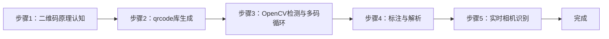

---

#### 步骤1：二维码原理认知（阶段一：能运行，20min）

> 📌 本步骤对应源码：`src/config.py` error_correction_level

**知识点讲解**：

**QR Code 结构与纠错原理（1.1.1）**
- **原理**：QR Code（Quick Response Code）是矩阵式二维条码，结构含：**定位图形**（三个角的回字方块，用于检测与旋转校正）、**校正图形**（版本≥2 时的小方块，用于畸变校正）、**时序图形**（定位图形间黑白交替线）、数据区与纠错码区。**版本**（1-40）决定尺寸与容量，版本越高容量越大；**纠错等级**（L≈7%/M≈15%/Q≈25%/H≈30% 恢复能力）决定污损/遮挡容忍度——等级越高纠错越强但数据容量越小。`error_correction_level()` 把配置中的 L/M/Q/H 字符串映射为 qrcode 库常量。
- **源码对应**：`src/config.py` error_correction_level；`config/qr_config.yaml`（generate.version / error_correction / box_size / border）

**操作步骤**：

1. 查看 `config/qr_config.yaml` 生成参数，理解 version/error_correction/box_size/border 语义
2. 阅读 `src/config.py` error_correction_level 实现
3. 思考：工业场景（污损多、距离远）应选什么纠错等级？为什么？

**易错点**：
- ⚠️ 纠错等级与容量互斥：等级越高单码容量越小，长文本需版本+等级权衡

---

#### 步骤2：qrcode 库生成二维码（阶段一：能运行，25min）

> 📌 本步骤对应源码：`src/qr.py` generate_qr

**知识点讲解**：

**生成流程（1.2.1）**
- **原理**：`generate_qr()`（L30-45）完整演示生成四步：(1) 构造 `qrcode.QRCode(version, error_correction, box_size, border)`——version 指定固定版本（1-40），`make(fit=True)` 时若数据超出该版本会自动升版；(2) `add_data(data)` 填充用户数据；(3) `make(fit=True)` 计算编码矩阵；(4) `make_image(fill_color, back_color)` 渲染为 PIL 图像，`.convert("RGB")` 后经 OpenCV 转 BGR 输出。`box_size` 控制每模块像素数（清晰度），`border` 控制四周留白（标准为 4 模块）。空数据直接抛 `ValueError`（L32-33）。
- **源码对应**：`src/qr.py` L30-45（generate_qr：参数 L35-40 / add_data L41 / make L42 / 渲染转 BGR L43-45）

**操作步骤**：

1. 生成并保存二维码：
   ```bash
   cd ros2_ws/src/xflz_eai_car1/vision/04_qrcode
   python src/app.py --generate "https://example.com" --save my_qr.png
   # my_qr.png 生成成功
   ```
2. 验证扫码：手机/电脑摄像头扫 my_qr.png，可打开 example.com
3. 中文字符测试：
   ```bash
   python src/app.py --generate "你好，具身智能" --save cn_qr.png
   ```
4. 对比不同纠错等级/版本的二维码密度差异（改 config 后重新生成，观察码图复杂度）

**易错点**：
- ⚠️ 数据为空 → ValueError（L32-33），先判空
- ⚠️ 生成图片色域：qrcode 库输出 RGB，OpenCV 显示需转 BGR（L45）

---

#### 步骤3：OpenCV 检测与多码循环（阶段二：能理解，30min）

> 📌 本步骤对应源码：`src/qr.py` detect_qr

**知识点讲解**：

**QRCodeDetector 与多码循环（1.3.1）**
- **原理**：`cv2.QRCodeDetector.detectAndDecode(img)` 返回 `(data, points, straight_qrcode)`——data 为解析文本（失败时空串），points 为二维码四角点坐标。单次调用只检出一个码，**多码场景需循环**：`detect_qr()`（L48-79）在 `MAX_DETECT_PASSES=8` 上限内反复调用，每次检出后**把已识别区域涂白**（L74-78，`work[y1:y2,x1:x2]=255`）再继续找下一个，直到无新码或达到上限（防死循环）。此外支持 `scale=0.5` 降采样加速（L53-55）：大图先缩一半再检测，坐标用 `factor=1/scale` 映射回原图。points 四角点取 min/max 得到外接框（L66-71）。
- **源码对应**：`src/qr.py` L48-79（detect_qr：降采样 L52-55 / 循环检测 L59-78 / 掩膜 L74-78）

**操作步骤**：

1. 生成多码测试图（把 3 个不同二维码拼到一张图）
2. 检测多码：
   ```bash
   python src/app.py --detect --image multi_qr.png --save out.png
   # 预期：3 个码全部检出，各自框选 + 文本标注
   ```
3. 单测理解循环逻辑：`pytest tests/test_qr.py -v`
4. 思考：MAX_DETECT_PASSES=8 的作用？如果一张图有 10 个码会发生什么？

**易错点**：
- ⚠️ 不掩掉已识别区域会死循环检出同一码——掩膜是必须步骤（L74-78）
- ⚠️ 降采样后坐标必须乘回 factor（L66-67），否则框错位

---

#### 步骤4：标注与解析文本（阶段二：能理解，20min）

> 📌 本步骤对应源码：`src/qr.py` draw_qr

**知识点讲解**：

**结果可视化（1.3.2）**
- **原理**：`draw_qr()`（L82-90）在检测结果上绘制：绿框（L86）+ 解析文本（L87-89）。文本超 40 字符截断为 37 字符 + "..."（L87），避免超长 URL 撑爆画面；文本绘制在框上方（y1-6，最小 16 防止越界）。`QRResult` 数据类（L21-27）承载 text + 四角坐标，是检测与绘制间的数据契约。
- **源码对应**：`src/qr.py` L82-90（draw_qr：画框 L86 / 文本截断 L87 / putText L88-89）

**操作步骤**：

1. 检测 + 标注：
   ```bash
   python src/app.py --detect --image my_qr.png --save out.png
   # out.png：绿框 + 文本标注
   ```
2. 生成超长文本二维码（>40 字符），观察截断显示效果
3. 动手改造：把标注文本改为显示在框下方，或改框色

**易错点**：
- ⚠️ 文本超长溢出画面 → 40 字符截断（L87）已处理

---

#### 步骤5：实时相机识别与 MJPEG 推流（阶段三：能改造，35min）

> 📌 本步骤对应源码：`src/app.py`、`src/ros2_source.py`

**知识点讲解**：

**实时识别链路（1.3.2）**
- **原理**：`app.py` 的 `--detect` 模式组织实时链路：取流（--image/--video/--camera/--ros）→ 逐帧 `detect_qr` → `draw_qr` 标注 → 本地窗口（--display）或 MJPEG 推流（`http://<板IP>:8080/qrcode.mjpg`）。板上相机标准路径是 HP60C 深度相机经 ascamera 话题取流（`ros2_source.py` Ros2Camera，话题 `/ascamera_hp60c/camera_publisher/rgb0/image`），OpenCV 直连读不了（未编 libv4l）。识别速度取决于图像分辨率与码大小——降采样参数在检测前生效。
- **源码对应**：`src/app.py`（main：--detect 分支 / 取流 / 推流）；`src/ros2_source.py`（Ros2Camera：DEFAULT_TOPIC / open / read / release）

**操作步骤**：

1. 相机实时（板上标准）：
   ```bash
   cd ros2_ws/src/xflz_eai_car1/vision/04_qrcode
   source /opt/ros/humble/setup.bash && source ~/ros2_ws/install/setup.bash
   export ROS_DOMAIN_ID=2
   ros2 launch ascamera hp60c.launch.py        # 终端 1
   python src/app.py --detect --ros             # 终端 2
   # MJPEG: http://<板IP>:8080/qrcode.mjpg
   ```
2. 用手机屏幕显示二维码对准相机，观察实时识别（文本即时更新）
3. 打印二维码贴在工件/卡片上，测试不同距离/角度的识别率
4. 动手改造：在识别到特定内容（如含 "grasp"）时打印触发消息，为分拣联动打基础

**易错点**：
- ⚠️ --ros 取不到帧 → ascamera 先起、ROS_DOMAIN_ID 一致、话题勿 remap
- ⚠️ 远距离/小码识别率低 → 靠近或提高分辨率；反光表面可调整角度

---

### 1.7 常见问题

| 问题 | 原因 | 解决方法 |
|------|------|---------|
| 生成时报错 data must not be empty | 传入空字符串 | 先判空再生成（`qr.py` L32-33） |
| 检测不到码 | 码太小/太远/反光/畸变 | 靠近、提高分辨率、调整角度；多码用掩膜循环 |
| 多码只检出 1 个 | 未掩膜已识别区域 | detect_qr 已内置掩膜（L74-78）；检查是否达 MAX_DETECT_PASSES |
| 框错位 | 降采样后未乘回 factor | 确认 `factor=1/scale` 映射（L66-67） |
| 解析文本乱码 | 编码/中文字符问题 | 生成与解析编码一致；中文建议 UTF-8 |
| 板上 import qrcode 失败 | 未安装依赖 | `pip install -i https://pypi.tuna.tsinghua.edu.cn/simple qrcode` |

### 1.8 扩展实验

**扩展方向 1：二维码分拣联动（进阶）**
- 识别到特定内容（如 `grasp:<物体名>`）时发布 ROS2 话题或串口指令，联动机械臂抓取（参考实验 05 的 cmd_vel 模式与实验 02 的大类映射）

**扩展方向 2：畸变二维码鲁棒识别（进阶）**
- 引入透视校正：用 detectAndDecode 的 points 四角点做 `cv2.getPerspectiveTransform` 矫正后再解码，测试倾斜/曲面上的二维码识别率提升

### 1.9 实验报告要求

**评分标准**：二维码原理理解 15 分 + 生成实现 20 分 + 检测与多码循环 25 分 + 实时识别演示 30 分 + 报告 10 分 = 100 分。

**报告必含内容**：
1. QR Code 结构说明（定位/校正/时序/数据区）与纠错等级对比
2. 生成的二维码图片（≥2 个：URL + 中文）与参数表
3. 检测结果图（单码 + 多码各 1）与解析文本
4. 实时识别演示数据（距离/角度/识别率记录）
5. 回答思考题：为什么多码检测要掩膜循环？纠错等级如何影响容量与鲁棒性？工业场景如何选参数？
6. 实验心得与问题记录

---

## 更新日志

| 版本 | 日期 | 变更 |
|------|------|------|
| v1.0 | 2026-08-10 | 初版生成（源码路径 ros2_ws/src/xflz_eai_car1/vision/04_qrcode，19 用例全绿，qrcode 生成 + OpenCV QRCodeDetector 多码循环检测 + MJPEG 实时推流） |

## 实验5：基于OpenCV的多边形轮廓拟合实验（4h）

> ✅ **源码已核实** 本实验源码位于 `ros2_ws/src/xflz_eai_car1/vision/05_line_following/`。⚠️ **内容说明**：课程名义为「自主巡线」，实际内容 = 亚博课程「OpenCV应用——多边形轮廓」：不规则轮廓 → 拟合规则几何形状（凸包/多边形）并标注顶点数。纯 OpenCV 方案（用户指示：不参考 car1_app/line_following.py）。单测 21/21 全绿，板端验证通过。

### 1.1 关联知识点

- 1.1.1 图像二值化 > 流程 > 灰度 → 阈值（binary/adaptive）→ 反相 → 形态学开运算；`invert` 区分暗物亮底/亮物暗底
- 1.2.1 轮廓提取 > 概念 > `cv2.findContours(RETR_EXTERNAL, CHAIN_APPROX_SIMPLE)` 提取外部轮廓，按面积过滤（min_area=2000）
- 1.2.2 凸包检测 > 原理 > `cv2.convexHull` 求点集最小凸包：填平凹槽，得到包围目标的最简外凸多边形
- 1.3.1 多边形逼近 > 流程 > `cv2.approxPolyDP` 用 Douglas-Peucker 算法按 epsilon 简化多边形顶点数
- 1.3.2 顶点标注 > 流程 > 检测结果按面积降序，绘制凸包多边形 + 黄点顶点标记 + 「n边形」标签

### 1.2 实验目标

1. 掌握二值化、轮廓提取、凸包检测与多边形逼近的原理与方法 — 原理理解
2. 实现不规则物体轮廓的规则几何拟合（凸包/多边形）与顶点数标注 — 独立完成
3. 理解多边形拟合在机器人视觉中的应用（形状识别、抓取定位、导航避障）— 迁移应用

### 1.3 实验环境

| 类别 | 配置 |
|------|------|
| 硬件 | 具身智能实验箱 B2（XFLZ_EAI_B2_PRO，RK3576 SoC，6TOPS NPU，含 HP60C 深度相机） |
| OS | Ubuntu 22.04 + ROS2 Humble（板载 ros2_venv） |
| 核心库 | OpenCV、NumPy（纯 CPU 视觉管线，无需 NPU） |
| 主入口 | `src/app.py`（图像/视频/相机 CLI + MJPEG 流 + 每帧打印顶点数/面积） |

### 1.4 实验难度

- 难度: ⭐⭐ 设计性
- 重点: 凸包检测 + approxPolyDP 多边形逼近 + 「n边形」标注
- 难点: epsilon 参数对拟合精细度的影响；复杂背景下的二值化稳定性

### 1.5 实验现象

**快速验证流程**：

1. 进入项目目录：`cd ros2_ws/src/xflz_eai_car1/vision/05_line_following`
2. 单元测试：`pytest tests/ -v`（21 用例全绿）
3. 单图检测：`python src/app.py --image x.jpg --save out.jpg`
   - 输出：凸包多边形轮廓 + 黄点顶点 + 「n边形」标签；终端打印每轮廓顶点数/面积
4. 相机实时（板上标准）：先起 ascamera 驱动，再 `python src/app.py --ros`
   - MJPEG：`http://<板IP>:8080/polygon.mjpg`
5. 黑底彩色模式：`python src/app.py --image x.jpg --save out_dark.jpg --dark`

**预期效果描述**：
- 纸盒/水瓶/卡片等物体轮廓正确拟合成多边形，标注「四边形」「八边形」等正确
- 多边形随物体移动实时更新（顶点数/面积逐帧打印）
- 调参影响：epsilon 越小顶点越多（拟合更精细）；use_hull=true 填平凹槽

### 1.6 实验步骤

#### 整体流程图

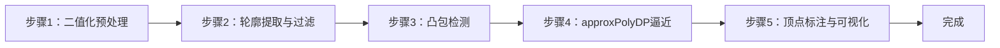

---

#### 步骤1：二值化预处理（阶段一：能运行，20min）

> 📌 本步骤对应源码：`src/pipeline.py` to_binary

**知识点讲解**：

**二值化策略（1.1.1）**
- **原理**：`to_binary()`（L25-38）把 BGR 图转为二值掩膜：灰度化 → 阈值分割 → 反相 → 形态学开运算。(1) 阈值方式可选 `binary`（全局固定阈值）或 `adaptive`（局部自适应——光照不均时更稳）；(2) `invert` 参数区分**暗物亮底**（true，默认：黑色物体在白底上，反相后物体为白）与**亮物暗底**（false）；(3) 形态学开运算去噪点。二值化质量直接决定后续轮廓提取的成败——阈值选错，背景噪声全变成"轮廓"。
- **源码对应**：`src/pipeline.py` L25-38（to_binary：灰度 L26-28 / 阈值 L29-34 / 反相 L35 / 开运算 L37-38）

**操作步骤**：

1. 查看 `config/polygon_config.yaml` 的 threshold 配置（invert / threshold_mode / morphology kernel）
2. 用单图验证二值化效果：
   ```bash
   python -c "
   import cv2
   from pipeline import to_binary
   from config import load_config
   cfg = load_config('config/polygon_config.yaml')
   mask = to_binary(cv2.imread('x.jpg'), cfg['threshold'])
   cv2.imwrite('mask.jpg', mask)
   print('二值化完成，白像素占比:', round(float(mask.mean()/255), 3))"
   ```
3. 切换 invert / threshold_mode，观察掩膜变化

**易错点**：
- ⚠️ invert 设反 → 背景变前景，轮廓全错（暗物亮底=true 默认）
- ⚠️ 光照不均用 adaptive；强反光需先预处理

---

#### 步骤2：轮廓提取与面积过滤（阶段一：能运行，20min）

> 📌 本步骤对应源码：`src/pipeline.py` find_contours

**知识点讲解**：

**轮廓提取（1.2.1）**
- **原理**：`cv2.findContours(mask, RETR_EXTERNAL, CHAIN_APPROX_SIMPLE)` 提取二值掩膜的连通域边界。`RETR_EXTERNAL` 只取**最外层轮廓**（跳过内孔），`CHAIN_APPROX_SIMPLE` 压缩轮廓点（只保留端点，减少存储）。`find_contours()`（L41-44）随后按 `min_area=2000` 过滤小噪点轮廓，**按面积降序**返回——面积是区分"目标"与"噪声"的第一道闸门。
- **源码对应**：`src/pipeline.py` L41-44（find_contours：findContours L43 / 面积过滤 L44）

**操作步骤**：

1. 打印检测到的轮廓数量与面积：
   ```bash
   python -c "
   import cv2
   from pipeline import to_binary, find_contours
   from config import load_config
   cfg = load_config('config/polygon_config.yaml')
   mask = to_binary(cv2.imread('x.jpg'), cfg['threshold'])
   conts = find_contours(mask, cfg['contour']['min_area'])
   for i, c in enumerate(conts):
       print(f'轮廓{i}: 面积={cv2.contourArea(c):.0f} 点数={len(c)}')"
   ```
2. 调整 min_area，观察小噪点是否被过滤

**易错点**：
- ⚠️ min_area 过小 → 噪声轮廓混入；过大 → 小目标丢失

---

#### 步骤3：凸包检测（阶段二：能理解，25min）

> 📌 本步骤对应源码：`src/pipeline.py` fit_polygon

**知识点讲解**：

**凸包原理（1.2.2）**
- **原理**：凸包（convex hull）是包围点集的最小凸多边形——所有点都在其内部或边界上。对不规则轮廓（如带凹槽的纸盒、缺角卡片），`cv2.convexHull(contour)` 返回**填平凹槽**的外凸边界。这在形状识别中有特殊价值：判断轮廓是否凸（`cv2.isContourConvex` 可辅助分类），以及把不规则目标规整为可匹配的凸形状。`use_hull=true`（默认）启用凸包——vendor 语义；`false` 保留凹形细节。
- **源码对应**：`src/pipeline.py` fit_polygon（convexHull 调用，use_hull 分支）

**操作步骤**：

1. 用带凹槽的物体（如 U 形纸片）测试：
   ```bash
   python -c "
   import cv2
   from pipeline import to_binary, find_contours, fit_polygon
   from config import load_config
   cfg = load_config('config/polygon_config.yaml')
   mask = to_binary(cv2.imread('u_shape.jpg'), cfg['threshold'])
   c = find_contours(mask, 2000)[0]
   hull = fit_polygon(c, 0.02, use_hull=True)
   raw = fit_polygon(c, 0.02, use_hull=False)
   print('凸包顶点数:', len(hull), '| 原轮廓简化顶点数:', len(raw))"
   ```
2. 对比 use_hull=true/false 的拟合差异（凹槽被填平 vs 保留）
3. 思考：凸包在哪些场景有用？哪些场景反而有害？

**易错点**：
- ⚠️ use_hull 语义与 vendor 对齐（true=填平凹槽）；需要凹形细节时设 false

---

#### 步骤4：approxPolyDP 多边形逼近（阶段二：能理解，30min）

> 📌 本步骤对应源码：`src/pipeline.py` fit_polygon

**知识点讲解**：

**Douglas-Peucker 算法（1.3.1）**
- **原理**：`cv2.approxPolyDP(shape, epsilon_ratio * peri, True)` 用 **Douglas-Peucker 算法**简化多边形：从首尾两点连直线，找离直线最远的点，若距离 > epsilon 则递归细分，否则舍去中间点。`epsilon = epsilon_ratio × 周长` 使简化与尺寸无关——epsilon_ratio 越大简化越狠（顶点越少），越小越精细（顶点越多）。典型值 0.02：四边形→4 顶点、五边形→5 顶点、圆→8~16 顶点。拟合结果是「n边形」标注的依据——`n_vertices = len(approx)`。
- **源码对应**：`src/pipeline.py` fit_polygon（approxPolyDP，epsilon_ratio 参数）

**操作步骤**：

1. 对同一物体用不同 epsilon_ratio 测试：
   ```bash
   python -c "
   import cv2
   from pipeline import to_binary, find_contours, fit_polygon
   from config import load_config
   cfg = load_config('config/polygon_config.yaml')
   mask = to_binary(cv2.imread('card.jpg'), cfg['threshold'])
   c = find_contours(mask, 2000)[0]
   for eps in [0.005, 0.02, 0.05, 0.1]:
       p = fit_polygon(c, eps)
       print(f'epsilon_ratio={eps}: {len(p)}边形')"
   ```
2. 观察 epsilon 从 0.005→0.1 的顶点数变化（4→4→4→3 或类似），理解"简化粒度"语义
3. 用圆形物体测试，观察高 epsilon 下圆被拟合为多少边形

**易错点**：
- ⚠️ epsilon 过小 → 顶点冗余（噪声点被保留）；过大 → 形状失真（圆变三角形）
- ⚠️ epsilon 与周长挂钩（比例式），改图尺寸不需重调

---

#### 步骤5：顶点标注与可视化（阶段三：能改造，25min）

> 📌 本步骤对应源码：`src/pipeline.py` draw_polygons / draw_polygons_dark

**知识点讲解**：

**可视化与数据输出（1.3.2）**
- **原理**：`detect_polygons()`（L61-73）编排全链路（二值化 → 轮廓 → 拟合），按面积降序返回 `PolygonResult(vertices, area, n_vertices)`。`draw_polygons()`（L76-87）在图上绘制凸包多边形 + 黄色顶点标记 + 「n边形」标签；`draw_polygons_dark()`（L90-119）提供黑底彩色多边形 + 质心圆点的 vendor 风格效果。顶点数 `n_vertices` 是形状分类的关键特征（3=三角形、4=四边形、≥8 近似圆）。
- **源码对应**：`src/pipeline.py` L61-73（detect_polygons）、L76-87（draw_polygons）、L90-119（draw_polygons_dark）

**操作步骤**：

1. 单图检测：
   ```bash
   cd ros2_ws/src/xflz_eai_car1/vision/05_line_following
   python src/app.py --image card.jpg --save out.jpg
   # out.jpg：凸包 + 黄点 + 「4边形」标签
   ```
2. 相机实时（板上标准）：
   ```bash
   source /opt/ros/humble/setup.bash && source ~/ros2_ws/install/setup.bash
   export ROS_DOMAIN_ID=2
   ros2 launch ascamera hp60c.launch.py        # 终端 1
   python src/app.py --ros                      # 终端 2
   # MJPEG: http://<板IP>:8080/polygon.mjpg，移动物体观察顶点数实时变化
   ```
3. 动手改造：按顶点数分类显示颜色（三角形红/四边形绿/圆形蓝），实现简单形状分类器

**易错点**：
- ⚠️ --ros 取不到帧 → ascamera 先起、ROS_DOMAIN_ID 一致、话题勿 remap
- ⚠️ 形状分类阈值：圆 vs 多边形靠顶点数，需实测标定

---

### 1.7 常见问题

| 问题 | 原因 | 解决方法 |
|------|------|---------|
| 轮廓全错 | invert 设反（暗物亮底 vs 亮物暗底） | 检查 `threshold.invert`（默认 true=暗物亮底） |
| 噪声轮廓混入 | min_area 过小 / 二值化噪点多 | 增大 min_area；开运算去噪（morphology） |
| 顶点数异常（过多） | epsilon_ratio 过小 | 增大 approx_epsilon（0.02 → 0.05） |
| 形状失真（圆变三角） | epsilon_ratio 过大 | 减小 approx_epsilon |
| 凹槽物体拟合异常 | use_hull 语义不匹配 | true=凸包填平凹槽；false=保留凹形细节 |
| 光照变化后检测不稳 | binary 阈值不适应 | 换 `threshold_mode: adaptive` |
| --ros 取不到帧 | 驱动未启动/ROS_DOMAIN_ID 不一致 | ascamera 先起；export ROS_DOMAIN_ID=2；话题勿 remap |

### 1.8 扩展实验

**扩展方向 1：形状分类器（进阶）**
- 用 `n_vertices` 分类：三角形（3）、四边形（4）、五边形（5）、圆（≥8），不同形状不同颜色标注，实现基础几何形状识别

**扩展方向 2：自主巡线（进阶）**
- 用多边形质心 x 坐标相对画面中心的偏移量生成转向指令（左/中/右），通过 ROS2 cmd_vel 发布控制小车沿色块路径行驶（参考实验 11 的 cmd_vel 模式）

### 1.9 实验报告要求

**评分标准**：二值化理解 15 分 + 轮廓提取 15 分 + 凸包原理 20 分 + approxPolyDP 25 分 + 实时演示 15 分 + 报告 10 分 = 100 分。

**报告必含内容**：
1. 二值化流程图与参数说明（invert/threshold_mode 对比图）
2. 轮廓提取结果图（含 min_area 过滤前后对比）
3. 凸包 vs 原轮廓对比图（凹槽被填平的效果）
4. epsilon_ratio 参数实验表（0.005~0.1 的顶点数变化）
5. 3 种不同形状物体的「n边形」标注结果图
6. 回答思考题：凸包与多边形的区别？epsilon 如何影响拟合？如何用顶点数分类形状？
7. 实验心得与问题记录

---

## 更新日志

| 版本 | 日期 | 变更 |
|------|------|------|
| v1.0 | 2026-08-10 | 初版生成（源码路径 ros2_ws/src/xflz_eai_car1/vision/05_line_following，21 用例全绿，二值化+轮廓+凸包+approxPolyDP+顶点标注，板端验证通过） |

## 实验6：基于语义分割的背景分割实验（4h）

> ✅ **源码已核实** 本实验源码位于 `ros2_ws/src/xflz_eai_car1/vision/06_semantic_segmentation/`。⚠️ **内容说明**：课程「清除背景」语义，本实验用**语义分割人物抠图 + 背景替换**（yolov8n-seg，COCO 80 类，模型 3.2M 参数），效果更符合课程目标。已交付 `models/yolov8n-seg.onnx`（13 输出）与 `models/yolov8n-seg.rknn`（板上 int8 转换产物）。单测 38/38 全绿，板端验证通过（3 worker 池约 40-60 FPS）。

### 1.1 关联知识点

- 1.1.1 语义分割原理 > 原理 > 语义分割为每个像素分配类别标签，区别于目标检测的边界框；yolov8n-seg 同时输出检测框与逐像素掩码
- 1.2.1 13输出模型结构 > 概念 > 每层 [box(64), cls(80), cls_sum(1), mc(32)]×3 + proto [1,32,160,160]，mc@proto 矩阵乘还原掩码
- 1.3.1 前景提取 > 流程 > DFL 解码 → grid xyxy → cls_sum×cls 过滤 → 逐类 NMS → mc@proto 掩码 → 阈值二值化
- 1.3.2 背景替换 > 流程 > black/solid/image 三种背景模式，前景掩码外区域替换，Alpha 通道合成
- 1.3.3 多线程推理池 > 流程 > N worker × 独立 RKNN 实例 + round_robin tid%3 绑核（3 worker 帧率 ≥ 单线程 2 倍）

### 1.2 实验目标

1. 掌握语义分割与目标检测的区别，理解 yolov8-seg 的检测+掩码双输出架构 — 原理理解
2. 实现实时前景人物抠图与三种背景模式替换（黑/纯色/自定义图）— 独立完成
3. 理解多线程推理池提升 NPU 利用率的方法，掌握掩码阈值与类别过滤调参 — 迁移应用

### 1.3 实验环境

| 类别 | 配置 |
|------|------|
| 硬件 | 具身智能实验箱 B2（XFLZ_EAI_B2_PRO，RK3576 SoC，6TOPS NPU，含 HP60C 深度相机） |
| OS | Ubuntu 22.04 + ROS2 Humble（板载 ros2_venv，rknnlite 2.3.2） |
| 核心库 | OpenCV、NumPy、rknnlite、PyYAML（标准库 MJPEG） |
| 模型 | `models/yolov8n-seg.rknn`（int8，13 输出，COCO 80 类，3.2M 参数） |
| 主入口 | `src/app.py`（图像/视频/相机 CLI + 3 worker 推理池 + MJPEG） |

### 1.4 实验难度

- 难度: ⭐⭐ 设计性
- 重点: 13 输出分割解码（DFL → NMS → mc@proto 掩码）与背景替换合成
- 难点: 掩码解码的矩阵运算（mc@proto）；多线程池绑核配置；掩码质量调参

### 1.5 实验现象

**快速验证流程**：

1. 进入项目目录：`cd ros2_ws/src/xflz_eai_car1/vision/06_semantic_segmentation`
2. 单元测试：`pytest tests/ -v`（38 用例全绿）
3. 单图抠图：`python src/app.py --image photo.jpg --save out.jpg`
   - 输出：人物被完整抠出，背景替换为黑色/纯色/自定义图
4. 相机实时（板上标准）：先起 ascamera 驱动，再 `python src/app.py --ros`
   - MJPEG：`http://<板IP>:8080/seg.mjpg`，实时抠图
5. 换背景：修改 `background.mode`（black/solid/image）后重跑

**预期效果描述**：
- 单人照：person 抠图干净（掩码边缘平滑），背景替换正确
- 实时：人物移动时掩码逐帧跟随，3 worker 池约 40-60 FPS（单线程 20-40 FPS）
- 调参：`model.classes=[0]` 只留 person；`mask_thr` 调高去掩码碎片

### 1.6 实验步骤

#### 整体流程图

```mermaid
graph LR
    A[步骤1：语义分割与模型结构认知] --> B[步骤2：letterbox+RGB预处理]
    B --> C[步骤3：13输出解码与NMS]
    C --> D[步骤4：mc@proto掩码解码]
    D --> E[步骤5：背景替换合成]
    E --> F[步骤6：多线程池实时推理]
    F --> G[完成]
```

---

#### 步骤1：语义分割与模型结构认知（阶段一：能运行，20min）

> 📌 本步骤对应源码：`src/config.py`、`models/`

**知识点讲解**：

**语义分割与 yolov8-seg 架构（1.1.1、1.2.1）**
- **原理**：语义分割（semantic segmentation）为**每个像素**分配类别标签，输出掩码（mask）而非边界框；实例分割（yolov8-seg）进一步区分同一类别的不同实例。yolov8n-seg 在检测头旁增加**掩码分支**：每检测层输出 4 组张量——box(64) 框回归（DFL 16 bins）、cls(80) 类别分数、cls_sum(1)、**mc(32) 掩码系数**；另有一个 **proto 原型掩码** `[1,32,160,160]`（32 个低分辨率原型图）。最终掩码 = mc @ proto（矩阵乘），32 维系数 × 32 原型图加权求和。模型选择 yolov8-seg 而非 yolov5-seg：fork `ultralytics_yolov8-main` 原生支持 Segment rknn 导出，与 rknn_model_zoo `yolov8_seg` 优化模型布局逐位一致。
- **源码对应**：`models/yolov8n-seg.onnx`（13 输出，可用 onnxruntime 验证结构）；`src/config.py`（model.classes / mask_thr / pool 参数）

**操作步骤**：

1. 验证模型输出结构（13 输出）：
   ```bash
   python -c "
   import onnxruntime as ort
   sess = ort.InferenceSession('models/yolov8n-seg.onnx')
   print('输出数:', len(sess.get_outputs()))
   for o in sess.get_outputs(): print(' ', o.name, o.shape)"
   # 预期：3 层 × [box, cls, cls_sum, mc] + 1 个 proto = 13
   ```
2. 查看 `config/seg_config.yaml`：model.classes（COCO id，[0]=person）、mask_thr（0.5）、pool.workers/core_mask、background.mode
3. 思考：为什么需要 proto + mc 的两段式掩码？直接输出全分辨率掩码行不行？

**易错点**：
- ⚠️ 13 输出布局必须与解码契约一致（每层 4 组 + proto），换模型版本要核对

---

#### 步骤2：预处理 letterbox + RGB（阶段一：能运行，15min）

> 📌 本步骤对应源码：`src/preprocess.py`

**知识点讲解**：

**输入对齐（复用 exp01 语义）**
- **原理**：与实验1一致：letterbox（pad 0）等比缩放到 640×640 → BGR→RGB 通道交换（模型 rgb2bgr=False）→ unletterbox 把检测框/掩码映射回原图坐标。掩码解码在 imgsz 坐标系完成，最终映射回原始分辨率。
- **源码对应**：`src/preprocess.py`（letterbox / to_rgb / unletterbox）

**操作步骤**：

1. 用单图验证预处理形状：
   ```bash
   python -c "
   import cv2
   from preprocess import letterbox, to_rgb
   img = cv2.imread('images/photo.jpg')
   lb = letterbox(img, 640, (0,0,0))
   print('letterbox输出:', lb.padded.shape, 'scale:', round(lb.scale,3))"
   ```
2. 复习 exp01 的 pad=0 与 RGB 约定，理解跨实验复用

**易错点**：
- ⚠️ pad 必须 0 且 RGB——与转换侧 rgb2bgr=False 一致，否则掩码错位

---

#### 步骤3：13 输出解码与逐类 NMS（阶段二：能理解，35min）

> 📌 本步骤对应源码：`src/postprocess.py` dfl_decode / box_process / nms / decode_outputs

**知识点讲解**：

**分割解码管线（1.3.1）**
- **原理**：`decode_outputs()`（L81-130）逐层处理：`dfl_decode`（L26-34）对 box 的 16 bins 做 softmax 期望还原偏移 → `box_process`（L37-47）加 grid 中心与 stride 还原 xyxy（imgsz 系）→ 类别分数用 **cls_sum×cls 过滤**（分割模型特有的类别得分加权）→ 逐类 NMS（L50-73，max_wh 偏移实现）→ 保留的检测框进入掩码解码。这一解码流程与 rknn_model_zoo `yolov8_seg.py` 逐行对齐，DFL/NMS 复用 exp01 的成熟模式。
- **源码对应**：`src/postprocess.py` L26-34（dfl_decode）、L37-47（box_process）、L50-73（nms）、L81-130（decode_outputs）

**操作步骤**：

1. 单测理解解码契约：`pytest tests/test_postprocess.py -v`
2. 用模型真实推理单图，打印解码中间量（检测框数、类别分布）：
   ```bash
   python -c "
   import cv2
   from preprocess import letterbox, to_rgb
   from postprocess import decode_outputs
   from config import load_config
   cfg = load_config('config/seg_config.yaml')
   # 用 RKNNBackend 推理后调用 decode_outputs（详见 app.py 推理路径）"
   ```
3. 修改 score_thr/mask_thr，观察检出数量变化

**易错点**：
- ⚠️ cls_sum×cls 过滤是分割模型特有，纯检测的 decode 不能直接套用

---

#### 步骤4：mc@proto 掩码解码（阶段二：能理解，30min）

> 📌 本步骤对应源码：`src/postprocess.py` decode_outputs 掩码部分、foreground_mask

**知识点讲解**：

**掩码还原原理（1.2.1、1.3.1）**
- **原理**：yolov8-seg 的掩码不是逐像素直接输出（全分辨率太耗内存），而是**两段式**：(1) 模型输出 32 个 160×160 的**原型掩码**（proto，可理解为 32 个"分割基元"）；(2) 每个检测实例输出 32 维**掩码系数**（mc）。实例掩码 = Σ(mc_i × proto_i) = mc @ proto，再上采样到 imgsz 并阈值二值化（`seg_img > mask_thr`，L130）。`foreground_mask()`（L133-141）把保留类别（`keep_classes`，如 [0]=person）的掩码**按位或并集**，得到整帧前景掩码——背景替换只在这个掩码内保留原图。
- **源码对应**：`src/postprocess.py` L81-130（decode_outputs 掩码段）、L133-141（foreground_mask）

**操作步骤**：

1. 打印 proto 与 mc 的形状，理解矩阵乘：
   ```bash
   python -c "
   import numpy as np
   # proto [1,32,160,160], mc [N,32]
   proto = np.random.rand(1, 32, 160, 160).astype('float32')
   mc = np.random.rand(3, 32).astype('float32')
   # 实例掩码 = mc @ proto（reshape 后矩阵乘）
   masks = (mc @ proto.reshape(32, -1)).reshape(3, 160, 160)
   print('实例掩码形状:', masks.shape)"
   ```
2. 用真实推理结果可视化 2-3 个 proto 原型图（imshow），理解"分割基元"语义
3. 调整 mask_thr（0.3/0.5/0.7），观察掩码边缘粗细变化

**易错点**：
- ⚠️ proto 是 160×160 低分辨率，需上采样到 imgsz 再与框对齐
- ⚠️ mask_thr 过低 → 掩码边缘溢出（背景混入）；过高 → 掩码萎缩（人像缺边）

---

#### 步骤5：背景替换合成（阶段三：能改造，25min）

> 📌 本步骤对应源码：`src/background.py`

**知识点讲解**：

**三种背景模式（1.3.2）**
- **原理**：`background.py` 提供三种模式：(1) **black**——前景掩码外全黑（最简单，突出前景）；(2) **solid**——填充纯色背景；(3) **image**——用自定义背景图（相对项目根路径）替换。合成逻辑：前景区域（掩码=1）保留原图像素，背景区域（掩码=0）填入替换内容——即 `result = foreground × mask + background × (1-mask)` 的 Alpha 合成。这是视频会议/直播抠像（虚拟背景）的核心技术。
- **源码对应**：`src/background.py`（black/solid/image 三模式合成函数）；`config/seg_config.yaml` background.mode

**操作步骤**：

1. 单图三种模式对比：
   ```bash
   cd ros2_ws/src/xflz_eai_car1/vision/06_semantic_segmentation
   # 编辑 config 切换 background.mode: black / solid / image，各跑一次
   python src/app.py --image images/photo.jpg --save out_black.jpg
   ```
2. 自定义背景图模式：准备一张风景图，配置 `background.image` 路径后运行，观察合成效果
3. 动手改造：实现"背景虚化"（对背景区域做高斯模糊而非替换），对比效果

**易错点**：
- ⚠️ image 模式路径相对项目根，用绝对路径最稳
- ⚠️ 背景图分辨率与前景不一致时需 resize 对齐

---

#### 步骤6：多线程推理池实时推理（阶段三：能改造，35min）

> 📌 本步骤对应源码：`src/rknnpool.py`、`src/app.py`

**知识点讲解**：

**round_robin 绑核推理池（1.3.3）**
- **原理**：实验2 RKNNPool 的升级版：N 个 worker 各持**独立 RKNN 实例**，`round_robin` 模式下每个 worker 用 `core_mask = tid % 3` 绑定不同 NPU 核（RK3576 三核轮转），实现**多核并行推理**——3 worker 帧率可达单线程 2 倍以上（本实验实测 40-60 FPS vs 20-40 FPS）。注意板上无 rknnlite 时用完整 `RKNN` 实例（非 RKNNLite）。`config` 的 `pool.workers` / `pool.core_mask`（round_robin/auto）控制并行度，内存紧张时 workers=2 + auto。
- **源码对应**：`src/rknnpool.py`（RKNNPool：worker 线程 / core_mask 绑核 / 队列）；`src/app.py`（main：池构建 / 取流 / 掩码映射回原图 / MJPEG）

**操作步骤**：

1. 单线程 vs 多线程 FPS 对比：
   ```bash
   python src/app.py --video test.mp4            # 默认 3 worker
   # 改 config pool.workers: 1 后重跑
   # 预期：3 worker 帧率 ≥ 2 倍单线程
   ```
2. 相机实时（板上标准）：
   ```bash
   source /opt/ros/humble/setup.bash && source ~/ros2_ws/install/setup.bash
   export ROS_DOMAIN_ID=2
   ros2 launch ascamera hp60c.launch.py        # 终端 1
   python src/app.py --ros                      # 终端 2
   # MJPEG: http://<板IP>:8080/seg.mjpg
   ```
3. 调参：`model.classes=[0]` 只保留 person；掩码碎/杂时调高 mask_thr
4. 动手改造：把背景替换改为"背景虚化"（高斯模糊背景），实现视频会议效果

**易错点**：
- ⚠️ 每个 worker 必须独立 RKNN 实例（NPU 上下文非线程共享）
- ⚠️ round_robin 绑核数 ≤ 物理核数（RK3576 三核）；超配反降性能

---

### 1.7 常见问题

| 问题 | 原因 | 解决方法 |
|------|------|---------|
| 掩码错位/偏移 | pad 值或 RGB 约定与转换不一致 | pad=0 + to_rgb（rgb2bgr=False 约定） |
| 掩码碎片多 | mask_thr 过低 | 调高 `model.mask_thr`（0.5 → 0.7） |
| 多人/多物误检 | classes 未限定 | `model.classes=[0]` 只留 person |
| 帧率低于预期 | 池未生效或核绑定错误 | 检查 `pool.workers=3` + `core_mask: round_robin` |
| 多线程崩溃 | worker 共享同一 RKNN 实例 | 每 worker 独立实例（RKNNPool 已实现） |
| 背景替换异常 | image 路径错误/分辨率不匹配 | 绝对路径；背景图 resize 对齐 |
| 模型加载失败 | .rknn 未转换或平台不符 | 板上转换 `convert_seg.py --target rk3576`；`list_outputs()`=13 |
| --ros 取不到帧 | 驱动未启动/ROS_DOMAIN_ID 不一致 | ascamera 先起；export ROS_DOMAIN_ID=2；话题勿 remap |

### 1.8 扩展实验

**扩展方向 1：虚拟背景直播（进阶）**
- 实现"背景虚化"（背景高斯模糊）与"虚拟场景"（背景替换为卡通/城市图），组合 black/solid/image 模式做完整视频会议效果

**扩展方向 2：多人分割与实例区分（进阶）**
- 保留多个 person 实例，用不同颜色标注不同人物（实例分割的 ID 区分），统计画面人数，实现人流计数

### 1.9 实验报告要求

**评分标准**：语义分割原理 15 分 + 13 输出模型结构 15 分 + 解码与掩码 25 分 + 背景替换 20 分 + 实时演示 15 分 + 报告 10 分 = 100 分。

**报告必含内容**：
1. 语义分割 vs 目标检测对比说明（含输出差异图）
2. 13 输出结构表（每层张量形状与语义）与 onnx 验证输出
3. 解码流程图（DFL → NMS → mc@proto → 阈值），标注源码行号
4. 三种背景模式效果对比图（black/solid/image）
5. workers=1 vs 3 的 FPS 对比数据
6. 回答思考题：为什么掩码用 mc@proto 两段式？mask_thr 如何影响掩码质量？多线程池为什么快？
7. 实验心得与问题记录

---

## 更新日志

| 版本 | 日期 | 变更 |
|------|------|------|
| v1.0 | 2026-08-10 | 初版生成（源码路径 ros2_ws/src/xflz_eai_car1/vision/06_semantic_segmentation，38 用例全绿，yolov8n-seg 13 输出解码 + mc@proto 掩码 + 三模式背景替换 + 3 worker 绑核推理池） |

## 实验7：基于DeepSORT的多目标跟踪实验（4h）

> ✅ **源码已核实** 本实验源码位于 `ros2_ws/src/xflz_eai_car1/vision/07_multi_object_tracking/`。YOLOv8 检测 + deep_sort 标准算法自实现（纯 numpy，零新增依赖：scipy 板载已有）。已交付模型：`models/yolov8n.rknn`（检测，9 输出）、`models/deep_int8_in_8.rknn`（ReID 外观 128-d）、`models/coco_classes.json`。ReID 缺失/加载失败自动回退 `sort` 模式（纯 IoU）并告警。单测 38/38 全绿，板端验证通过（12-15 FPS）。

### 1.1 关联知识点

- 1.1.1 目标跟踪原理 > 原理 > 多目标跟踪（MOT）在视频帧间维持目标 ID 一致：检测 → 数据关联 → 轨迹更新；跟踪≠检测，解决"跨帧身份保持"
- 1.2.1 Kalman滤波 > 原理 > 8 维状态（cx,cy,aspect,h,及其速度）预测轨迹运动，std 按高度缩放；马氏距离门限（CHI2INV95）
- 1.2.2 匈牙利算法 > 流程 > `scipy.optimize.linear_sum_assignment` 最小代价匹配检测与轨迹，代价矩阵 = 外观 cosine 距离 + IoU
- 1.3.1 DeepSORT级联匹配 > 流程 > 外观（cosine + 马氏门限）按 time_since_update 从新到旧级联，剩余按 IoU；未确认轨迹只走 IoU
- 1.3.2 ReID外观特征 > 概念 > 64×128 crop → ImageNet 归一化 → 128-d 特征，遮挡恢复靠外观重识别
- 1.3.3 轨迹生命周期 > 流程 > 未匹配检测→新 Track（n_init 连续命中后确认）；未匹配轨迹 mark_missed（max_age 超龄删除）；sort 模式回退

### 1.2 实验目标

1. 掌握多目标跟踪的核心问题（ID 保持/遮挡恢复）与 DeepSORT 算法架构 — 原理理解
2. 实现 YOLOv8 检测 + Kalman 预测 + 级联匹配 + ReID 的完整跟踪链路 — 独立完成
3. 理解检测池/ReID池/双缓冲的三处并行优化，掌握 max_age/n_init 调参 — 迁移应用

### 1.3 实验环境

| 类别 | 配置 |
|------|------|
| 硬件 | 具身智能实验箱 B2（XFLZ_EAI_B2_PRO，RK3576 SoC，6TOPS NPU，含 HP60C 深度相机） |
| OS | Ubuntu 22.04 + ROS2 Humble（板载 ros2_venv，rknnlite 2.3.2） |
| 核心库 | OpenCV、NumPy、scipy（linear_sum_assignment）、rknnlite |
| 模型 | `models/yolov8n.rknn`（检测 9 输出）+ `models/deep_int8_in_8.rknn`（ReID 128-d）+ `coco_classes.json` |
| 主入口 | `src/app.py`（视频/相机 CLI + 3 worker 检测池 + ReID 池 + 双缓冲 + MJPEG） |

### 1.4 实验难度

- 难度: ⭐⭐⭐ 综合性
- 重点: DeepSORT 数据关联（级联匹配 + 外观/IoU 代价）与轨迹生命周期管理
- 难点: Kalman 预测与匹配门限的数学原理；多线程池（检测/ReID/双缓冲）的工程实现

### 1.5 实验现象

**快速验证流程**：

1. 进入项目目录：`cd ros2_ws/src/xflz_eai_car1/vision/07_multi_object_tracking`
2. 单元测试：`pytest tests/ -v`（38 用例全绿）
3. 视频跟踪：`python src/app.py --video test.mp4`
   - 输出：每个目标 ID 稳定标注（框 + ID 号），MJPEG `http://<板IP>:8080/track.mjpg`
4. 相机实时（板上标准）：先起 ascamera 驱动，再 `python src/app.py --ros`
   - 终端打印 `mode=deepsort`
5. 遮挡测试：用手遮挡目标数秒后移开，观察 ID 是否恢复

**预期效果描述**：
- 单目标移动：ID 稳定不跳；双目标交叉：ID 不互换
- 目标遮挡数帧后重现：deepsort 模式恢复原 ID（sort 模式换 ID——对照演示）
- 多线程：3 worker 检测池帧率 ≥ 单 worker 1.5 倍，板端实测 12-15 FPS

### 1.6 实验步骤

#### 整体流程图

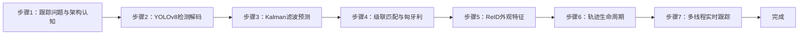

---

#### 步骤1：跟踪问题与架构认知（阶段一：能运行，20min）

> 📌 本步骤对应源码：`config/track_config.yaml`、`src/app.py`

**知识点讲解**：

**MOT 问题与 DeepSORT 架构（1.1.1）**
- **原理**：多目标跟踪（MOT）的任务是**维持跨帧 ID 一致**：每帧检测出目标（可能漏检/新出现），跟踪器负责把当前帧检测与历史轨迹关联起来。核心挑战：ID 切换（同一目标换号）、ID 丢失（遮挡后无法找回）、轨迹漂移。DeepSORT 架构：**检测**（YOLOv8）→ **运动预测**（Kalman 8 维）→ **数据关联**（级联匹配 + Hungarian）→ **外观验证**（ReID 特征）→ **轨迹更新**。相比 SORT（纯 IoU 关联），DeepSORT 增加外观特征，抗遮挡能力显著提升。本实验按 deep_sort 标准结构**纯 numpy 自实现**，对照 vendor `Deepsort/` 参考。
- **源码对应**：`config/track_config.yaml`（tracker.max_dist/max_iou_distance/max_age/n_init/mode、pool.workers）；`src/tracker.py` L53-55（Tracker 超参默认值）

**操作步骤**：

1. 查看 `config/track_config.yaml` 跟踪器参数，理解各超参语义
2. 运行单测理解架构：`pytest tests/ -v`
3. 思考：跟踪和检测的本质区别是什么？为什么不能每帧重新检测就完事？

**易错点**：
- ⚠️ max_age 过大 → 轨迹残留（删除慢）；过小 → 短暂遮挡就丢 ID

---

#### 步骤2：YOLOv8 检测解码（阶段一：能运行，25min）

> 📌 本步骤对应源码：`src/detect.py`

**知识点讲解**：

**检测层复用（1.1.1）**
- **原理**：与实验1/6 同款解码模式：`models/yolov8n.rknn` 是 COCO 80 类检测模型（9 输出 = 3 层 × [box, cls, cls_sum]）。解码链路：DFL 解码（16 bins softmax 期望）→ grid+stride 还原 xyxy → **cls_sum×cls 过滤**（与分割模型同款类别得分加权）→ 逐类 NMS。输出 `Detection`（框 + 类别 + 分数），送入 tracker 的数据关联。
- **源码对应**：`src/detect.py`（decode：DFL / grid xyxy / cls_sum×cls / NMS）；`models/yolov8n.rknn`

**操作步骤**：

1. 视频首帧检测验证：
   ```bash
   cd ros2_ws/src/xflz_eai_car1/vision/07_multi_object_tracking
   python src/app.py --video test.mp4   # 终端打印检测类别与数量
   ```
2. 单测理解解码契约：`pytest tests/test_detect.py -v`
3. 修改 score_thr，观察检出目标数量变化

**易错点**：
- ⚠️ nc 通用（80 类），换模型时类别数与 labels 需同步

---

#### 步骤3：Kalman 滤波预测（阶段二：能理解，30min）

> 📌 本步骤对应源码：`src/kalman.py`、`src/tracker.py` det_to_xyah

**知识点讲解**：

**Kalman 滤波与 xyah 表示（1.2.1）**
- **原理**：Kalman 滤波用"预测-更新"两步估计目标状态：状态向量 **8 维** `(cx, cy, aspect_ratio, h, vx, vy, va, vh)`——中心坐标、宽高比、高度及其速度（`det_to_xyah`，tracker.py L21-24）。每帧先**预测**（恒速模型外推位置），再在匹配后用检测**更新**（校正）。关键点：**(1) std 按高度缩放**——大目标运动不确定性更大，噪声模型自适应；**(2) 马氏距离门限**（CHI2INV95，卡方分布 95% 分位）——用协方差归一化预测与检测的偏差，超出门限的候选不匹配（几何一致性检验）。这是把"运动预测"融入数据关联的核心。
- **源码对应**：`src/kalman.py`（KalmanFilter：predict / update / to_xyah，CHI2INV95）；`src/tracker.py` L21-24（det_to_xyah）、L27-31（_track_xyxy）

**操作步骤**：

1. 单测理解 Kalman 预测-更新循环：`pytest tests/test_kalman.py -v`
2. 打印单目标跟踪的预测框 vs 检测框坐标差异，理解"预测先行、检测校正"
3. 修改 std 缩放系数，观察跟踪抖动/滞后变化

**易错点**：
- ⚠️ xyah 而非 xywh：宽高比替代宽度（尺度不变性更好），混用会算错代价

---

#### 步骤4：级联匹配与匈牙利算法（阶段二：能理解，35min）

> 📌 本步骤对应源码：`src/matching.py`、`src/tracker.py` Tracker.match

**知识点讲解**：

**数据关联核心（1.2.2、1.3.1）**
- **原理**：DeepSORT 的关联分两阶段。**级联匹配**（cascade matching）：轨迹按 `time_since_update`（距上次更新帧数）**从新到旧**优先匹配——刚更新过的轨迹优先用外观匹配（更可靠），久未更新的轨迹（可能被遮挡）最后匹配，避免遮挡轨迹"抢"新检测。每轮匹配用**匈牙利算法**（`scipy.optimize.linear_sum_assignment`，最小代价匹配）求解，代价矩阵 = **cosine 外观距离**（ReID 特征）+ **马氏距离门限**（几何一致性，`gate_cost_matrix`）。**IoU 匹配**：级联后剩余的轨迹与检测按 IoU 代价匹配（`iou_batch` + `min_cost_matching`）。未确认轨迹（time_since_update==1）只走 IoU。`sort` 模式：无外观，纯 IoU（SORT 语义）。
- **源码对应**：`src/matching.py`（iou_batch / gate_cost_matrix / min_cost_matching）；`src/tracker.py` L46-50（_cosine_dist）、Tracker.match（级联逻辑）

**操作步骤**：

1. 打印匹配过程中间量（代价矩阵、匹配对/未匹配列表），理解 Hungarian 求解
2. 双目标交叉场景：观察级联匹配如何避免 ID 互换
3. 修改 max_dist（外观门限），观察 ID 切换频率变化
4. 思考：为什么级联匹配要从新到旧？为什么外观门限与几何门限要同时用？

**易错点**：
- ⚠️ max_dist 过大 → 不同目标外观混淆（ID 互换）；过小 → 同目标外观变化就跟丢

---

#### 步骤5：ReID 外观特征提取（阶段二：能理解，25min）

> 📌 本步骤对应源码：`src/reid.py`

**知识点讲解**：

**ReID 特征与遮挡恢复（1.3.2）**
- **原理**：ReID（Re-Identification）用外观特征区分不同目标：检测框 crop 目标区域 → resize 64×128 → **ImageNet 归一化**（mean/std 特定值）→ 转 NCHW → RKNN NPU 推理（`deep_int8_in_8.rknn`，输出 **128-d 特征向量**）。相似度用 **cosine 距离**（`_cosine_dist`，L46-50：`1 - 归一化内积`）。外观特征的价值在遮挡场景：目标被挡住时检测丢失，轨迹靠 Kalman 预测续命（max_age 帧）；目标重现后，ReID 特征能认出"还是原来那个人"，恢复原 ID——这是 DeepSORT 对 SORT 的核心提升。ReID 池 2 worker × 独立 RKNN 实例（实例非线程安全），提交序号回收保序。
- **源码对应**：`src/reid.py`（crop→resize→归一化→NCHW→128-d；RKNN/Fake 后端）；`models/deep_int8_in_8.rknn`

**操作步骤**：

1. 单测理解特征提取：`pytest tests/test_reid.py -v`
2. 遮挡恢复对照实验：
   ```bash
   # deepsort 模式（默认）
   python src/app.py --video occlude.mp4
   # 遮挡目标后重现，观察 ID 恢复
   # sort 模式对照：改 config tracker.mode: sort 后重跑，观察 ID 是否切换
   ```
3. 思考：为什么 ReID 特征用 128 维？维度过高/过低的影响？

**易错点**：
- ⚠️ 归一化必须 ImageNet 约定（mean/std），错用 0/1 归一化 → 特征全错
- ⚠️ ReID 缺失时自动回退 sort 模式（终端告警），属正常降级

---

#### 步骤6：轨迹生命周期管理（阶段三：能改造，20min）

> 📌 本步骤对应源码：`src/track.py`、`src/tracker.py`

**知识点讲解**：

**轨迹状态机（1.3.3）**
- **原理**：每条轨迹经历状态机：**未确认**（tentative）→ **确认**（confirmed）→ **丢失**（missed）→ **删除**。规则：(1) 未匹配的检测 → 创建新 Track，**n_init 次连续命中后确认**（防单帧误检污染轨迹）；(2) 未匹配的轨迹 → `mark_missed()`，**max_age 帧内未重现则删除**（超龄清理）；(3) 确认轨迹被遮挡时保持 missed 状态，靠 Kalman 预测 + 外观恢复。`time_since_update` 记录距上次更新的帧数，是级联匹配优先级与生命周期判定的共同依据。
- **源码对应**：`src/track.py`（Track：n_init/max_age/time_since_update/mark_missed）；`src/tracker.py` Tracker.update（状态迁移）

**操作步骤**：

1. 单测理解状态机：`pytest tests/test_track.py -v`
2. 调参实验：max_age 10 vs 100、n_init 1 vs 5，观察轨迹创建/删除行为差异
3. 思考：n_init 太小/太大的后果？max_age 与遮挡时长的关系？

**易错点**：
- ⚠️ max_age 与场景遮挡时长匹配：短遮挡用默认，长遮挡（走出画面）需调大

---

#### 步骤7：多线程实时跟踪（阶段三：能改造，35min）

> 📌 本步骤对应源码：`src/app.py`、`src/rknnpool.py`

**知识点讲解**：

**三处并行优化（1.3.3）**
- **原理**：实时跟踪的吞吐瓶颈在检测与 ReID 的 NPU 推理。本实验做**三处并行**：(1) **检测池**——RKNNPool 3 worker 按 `tid%3` 绑 NPU 核，多核并行检测；(2) **ReID 池**——2 worker 独立 RKNN 实例，批量外观提取；(3) **流水线双缓冲**——帧 N 在解码/跟踪/绘制时，帧 N+1 已在检测池推理，取帧与推理时间重叠。三处并行叠加，帧率从单线程的 ~8 FPS 提升到 12-15 FPS（板端实测）。
- **源码对应**：`src/rknnpool.py`（RKNNPool / ReIDPool：worker / 核绑定 / 保序回收）；`src/app.py`（main：池构建 / 双缓冲循环 / ID 标注 / MJPEG）

**操作步骤**：

1. 单 worker vs 3 worker 对比：
   ```bash
   # 改 config pool.workers: 1 后跑
   python src/app.py --video test.mp4
   # 改回 3 后重跑，对比 avg_fps（预期 ≥ 1.5 倍）
   ```
2. 相机实时（板上标准）：
   ```bash
   source /opt/ros/humble/setup.bash && source ~/ros2_ws/install/setup.bash
   export ROS_DOMAIN_ID=2
   ros2 launch ascamera hp60c.launch.py        # 终端 1
   python src/app.py --ros                      # 终端 2
   # 终端打印 mode=deepsort；MJPEG: http://<板IP>:8080/track.mjpg
   ```
3. 动手改造：在标注中增加"轨迹存活时长"（time_since_update），观察遮挡轨迹的存活状态

**易错点**：
- ⚠️ 每线程独立 RKNN 实例（检测池与 ReID 池均如此），共享实例崩溃
- ⚠️ 双缓冲依赖队列保序：帧 N 的结果不能串到帧 N+1

---

### 1.7 常见问题

| 问题 | 原因 | 解决方法 |
|------|------|---------|
| ID 频繁切换 | 外观门限过松 / 特征质量差 | 调小 `tracker.max_dist`；确认 ReID 归一化正确 |
| 遮挡后 ID 丢失 | max_age 过小 / sort 模式 | 调大 max_age；确认 mode=deepsort（ReID 模型就位） |
| ID 互换（交叉场景） | 级联匹配失效 / max_dist 过大 | 检查级联逻辑；调小 max_dist |
| 轨迹残留不删 | max_age 过大 | 调小 max_age（如 30） |
| 启动告警 fallback sort | ReID 模型缺失/加载失败 | 确认 `models/deep_int8_in_8.rknn` 就位 |
| 帧率低 | 池未生效 | 检查 pool.workers=3 + core_mask: round_robin |
| --ros 取不到帧 | 驱动未启动/ROS_DOMAIN_ID 不一致 | ascamera 先起；export ROS_DOMAIN_ID=2；话题勿 remap |
| 多线程崩溃 | 共享 RKNN 实例 | 每线程独立实例（检测池/ReID 池已实现） |

### 1.8 扩展实验

**扩展方向 1：轨迹计数与区域统计（进阶）**
- 在 app.py 中统计确认轨迹数、进出画面目标数（进入/离开计数），画线越线计数，实现人流/车流统计

**扩展方向 2：ByteTrack 对比（进阶）**
- 用"低分框也参与关联"的 ByteTrack 思路改造匹配逻辑（或移植），对比与 DeepSORT 在漏检场景的表现差异

### 1.9 实验报告要求

**评分标准**：MOT 问题理解 10 分 + 检测解码 15 分 + Kalman 20 分 + 级联匹配/匈牙利 25 分 + ReID 15 分 + 实时演示 10 分 + 报告 5 分 = 100 分。

**报告必含内容**：
1. DeepSORT 架构流程图（检测→Kalman→级联匹配→ReID→更新），标注源码行号
2. Kalman 预测 vs 检测框对比数据（单目标 10 帧）
3. 双目标交叉场景的 ID 保持截图与说明
4. 遮挡恢复对照实验（deepsort vs sort 模式 ID 变化）
5. workers=1 vs 3 的 FPS 对比数据
6. 回答思考题：级联匹配为什么从新到旧？马氏距离门限的作用？为什么外观特征能抗遮挡？
7. 实验心得与问题记录

---

## 更新日志

| 版本 | 日期 | 变更 |
|------|------|------|
| v1.0 | 2026-08-10 | 初版生成（源码路径 ros2_ws/src/xflz_eai_car1/vision/07_multi_object_tracking，38 用例全绿，YOLOv8 检测 + Kalman + 级联匹配 + Hungarian + ReID 128-d，检测池/ReID池/双缓冲三处并行，板端 12-15 FPS） |

## 实验8：基于深度信息的3D物体检测实验（4h）

> ✅ **源码已核实** 本实验源码位于 `ros2_ws/src/xflz_eai_car1/vision/08_depth_3d_detection/`。⚠️ **内容说明**：按 `depth_viewer_guide.md` 移植规格实现——**深度相机双栏显示（左 RGB | 右 Depth 伪彩）+ 点击读深度（mm/m + 相机坐标反投影）**，规格明确「无检测」（visual_grasp 最小子集）。vendor 参考课用 MediaPipe Objectron（mediapipe 无 aarch64 wheel，弃用）。单测 24/24 全绿，板端验证通过（深度合成）。

### 1.1 关联知识点

- 1.1.1 深度相机原理 > 原理 > HP60C 深度相机（RGB 镜头 + 深度传感器）输出 uint16 深度图（单位 mm），0 表示无效像素；区别于普通 RGB 相机的 2D 信息，深度提供"距离"维度
- 1.2.1 深度图处理 > 流程 > uint16 PNG 加载（mm）→ 有效像素 min-max 归一化 → jet 伪彩映射（`applyColorMap`），灰度近远可视化
- 1.2.2 点击读深度 > 流程 > 窗口坐标 (u,v) 除以 display_scale 还原原图坐标 → 读 depth[v,u]（mm）→ ×0.001 转米
- 1.3.1 相机坐标反投影 > 公式 > x=(u-cx)·z/fx, y=(v-cy)·z/fy（相机内参 fx/fy/cx/cy 来自 ascam.yaml 标定），把像素+深度映射为 3D 坐标
- 1.3.2 实时深度可视化 > 流程 > 板上 ROS2 话题取流（严禁 remap）→ 双栏合成（RGB|Depth）→ MJPEG 推流 + 窗口点击交互

### 1.2 实验目标

1. 掌握深度相机的成像原理与深度图数据格式（uint16 mm、无效值语义）— 原理理解
2. 实现深度图加载、伪彩可视化与点击读深度功能 — 独立完成
3. 理解相机内参反投影原理，实现像素坐标 → 3D 相机坐标的换算 — 迁移应用

### 1.3 实验环境

| 类别 | 配置 |
|------|------|
| 硬件 | 具身智能实验箱 B2（XFLZ_EAI_B2_PRO，RK3576 SoC，6TOPS NPU，含 HP60C 深度相机） |
| OS | Ubuntu 22.04 + ROS2 Humble（板载 ros2_venv） |
| 核心库 | OpenCV、NumPy（纯 CPU，无需 NPU） |
| 数据源 | 文件模式（uint16 PNG）+ ROS 模式（ascamera 话题，板载 rclpy） |
| 主入口 | `src/app.py`（--display 窗口点击 / MJPEG 推流 / --ros 板上模式） |

### 1.4 实验难度

- 难度: ⭐⭐ 设计性
- 重点: 深度图可视化 + 点击读深度 + 内参反投影
- 难点: 相机内参理解与反投影公式；无效像素处理（0 值）；窗口坐标缩放还原

### 1.5 实验现象

**快速验证流程**：

1. 进入项目目录：`cd ros2_ws/src/xflz_eai_car1/vision/08_depth_3d_detection`
2. 单元测试：`pytest tests/ -v`（24 用例全绿）
3. 文件模式（需 config 填 rgb_path/depth_path，depth 为 uint16 PNG）：
   ```bash
   python src/app.py --config config/depth3d_config.yaml --display
   # 双栏窗口：左 RGB | 右 Depth 伪彩（jet），状态栏文字可见
   ```
4. 点击深度图任一点 → 终端 `Click (u, v): z = XXXX mm (X.XXX m)`；有内参时附加 `xyz=(x, y, z) m`
5. 板上 ROS 模式：先起相机驱动，再 `python src/app.py --config config/depth3d_config.yaml --ros`
   - MJPEG：`http://<板IP>:8080/depth.mjpg`

**预期效果描述**：
- 双栏图：左 RGB、右 Depth 伪彩（jet，近红远蓝或按映射），状态栏文字可见
- 点击物体 vs 背景数值差异明显（物体近、背景远）；无效区（0）提示 invalid
- 有内参时输出相机坐标 `xyz=(x, y, z) m`——为 3D 定位/抓取打基础
- 板上：`ros2 topic hz .../rgb0/image` ≈ 25Hz；深度单位 mm（数值勿 ×1000 误解）

### 1.6 实验步骤

#### 整体流程图

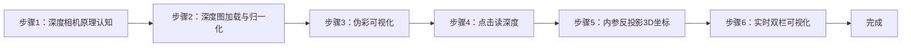

---

#### 步骤1：深度相机原理认知（阶段一：能运行，20min）

> 📌 本步骤对应源码：`config/depth3d_config.yaml`

**知识点讲解**：

**深度相机与深度图格式（1.1.1）**
- **原理**：HP60C 深度相机由 RGB 镜头 + 深度传感器（结构光/ToF 类）构成，深度传感器输出**逐像素距离图**。深度图格式约定：**uint16 存储，单位毫米（mm）**，0 值表示该像素无效（未测到/太近/太远）。为什么用 uint16？——深度范围可达 0-65535mm（65 米），uint8 只有 0-255mm 不够用。深度图与 RGB 图经标定对齐（同一视角），是后续 3D 感知（点云、抓取定位）的基础数据。
- **源码对应**：`config/depth3d_config.yaml`（depth.scale=0.001 mm→m / invalid=0 / display_scale / camera 内参）

**操作步骤**：

1. 查看 `config/depth3d_config.yaml`，理解 depth.scale（0.001 = mm→m）、invalid（0）、display_scale（显示缩放）、camera（fx/fy/cx/cy 内参）
2. 查看内参来源（`ascam.yaml`，HP60C RGB 标定）
3. 思考：深度为 0 的像素代表什么？为什么不能当真实距离 0mm？

**易错点**：
- ⚠️ 深度单位 mm：数值勿 ×1000 误解（z_mm → z_m 用 ×0.001，不是 ×1000）

---

#### 步骤2：深度图加载与归一化（阶段一：能运行，25min）

> 📌 本步骤对应源码：`src/depth.py` load_depth / normalize_depth

**知识点讲解**：

**uint16 加载与归一化（1.2.1）**
- **原理**：`load_depth()`（L22-27）用 `cv2.imread(path, IMREAD_UNCHANGED)` **保留 16bit** 读取（不带 UNCHANGED 会被截断成 8bit，深度全毁），返回 mm 数组。`normalize_depth()`（L30-41）把有效像素 min-max 线性拉伸到 0-255：先屏蔽无效值（`depth != invalid`），对有效像素求 min/max 后线性映射；单值深度（hi==lo）直接置 255 全亮。归一化是伪彩可视化的前置——深度范围大（0.3m-10m），直接 8bit 显示会糊成一片。
- **源码对应**：`src/depth.py` L22-27（load_depth）、L30-41（normalize_depth：有效掩膜 L33 / min-max 映射 L35-40）

**操作步骤**：

1. 验证深度图读取（16bit 保留）：
   ```bash
   python -c "
   import cv2
   from depth import load_depth
   d = load_depth('depth.png')   # 你的 uint16 深度图
   print('形状:', d.shape, 'dtype:', d.dtype, '范围:', d.min(), '-', d.max())"
   ```
2. 用普通 imread（不带 UNCHANGED）对照读取，观察深度数据是否被截断破坏
3. 打印无效像素占比：`float((d==0).mean())`

**易错点**：
- ⚠️ 不带 IMREAD_UNCHANGED → 16bit 截断成 8bit，深度数据毁坏
- ⚠️ 归一化必须屏蔽无效值，否则 0 值拉低 min 使有效深度对比度受损

---

#### 步骤3：伪彩可视化（阶段二：能理解，20min）

> 📌 本步骤对应源码：`src/depth.py` pseudocolor

**知识点讲解**：

**伪彩映射原理（1.2.1）**
- **原理**：人眼对灰度梯度不敏感，深度图用**伪彩**（colormap）增强可读性。`pseudocolor()`（L44-48）：`cv2.applyColorMap(depth_norm, COLORMAP_JET)` 把 8bit 灰度映射为 jet 彩色（低值蓝→高值红，或按映射表）；`gray` 模式退化为三通道灰阶。jet 的优势：相邻深度差异用色相区分，肉眼可快速判断远近层次。双栏右侧即此伪彩图。
- **源码对应**：`src/depth.py` L44-48（pseudocolor：gray L46-47 / jet L48）

**操作步骤**：

1. 生成伪彩图并保存：
   ```bash
   python -c "
   import cv2
   from depth import load_depth, normalize_depth, pseudocolor
   d = load_depth('depth.png')
   norm = normalize_depth(d)
   jet = pseudocolor(norm, 'jet')
   cv2.imwrite('depth_jet.png', jet)
   print('伪彩图已保存 depth_jet.png')"
   ```
2. 对比 jet / gray 两种模式的可读性差异
3. 思考：为什么深度可视化用伪彩而非灰度？工业应用（如避障调试）中哪种更直观？

**易错点**：
- ⚠️ applyColorMap 要求 8bit 输入——必须先 normalize_depth 再伪彩

---

#### 步骤4：点击读深度（阶段二：能理解，25min）

> 📌 本步骤对应源码：`src/depth.py` read_depth、`src/app.py` 点击事件

**知识点讲解**：

**窗口坐标还原（1.2.2）**
- **原理**：`read_depth()`（L51-66）实现点击读深度：先做**边界检查**（u/v 越界返回无效，L55-56），再读 `depth[v,u]`（L57），0 值返回无效（L58-59），有效则 `z_m = z_mm * 0.001` 转米（L60）。**关键细节**：窗口显示有缩放（display_scale），点击坐标 (u,v) 必须**除以 display_scale** 还原为原图坐标再读深度——否则读错像素（README 验证要点明确要求）。`ClickResult`（L15-19）承载 z_mm/z_m/xyz 三态结果。
- **源码对应**：`src/depth.py` L51-66（read_depth：边界检查 L55-56 / 读深度 L57 / 无效值 L58-59 / 米转换 L60）；`src/app.py`（鼠标回调：坐标 ÷ display_scale）

**操作步骤**：

1. 文件模式窗口点击：
   ```bash
   python src/app.py --config config/depth3d_config.yaml --display
   # 点击深度图任一点，终端输出 Click (u,v): z = XXXX mm (X.XXX m)
   ```
2. 分别点击近处物体与远处背景，对比深度数值差异（物体近、背景远）
3. 点击无效区域（无深度处），观察 invalid 提示
4. 验证坐标还原：窗口缩放后点击同一物理点，确认读出深度一致（÷ display_scale 生效）

**易错点**：
- ⚠️ 点击坐标不除 display_scale → 读错像素（缩放窗口时尤其明显）

---

#### 步骤5：相机内参反投影（阶段三：能改造，30min）

> 📌 本步骤对应源码：`src/depth.py` read_depth 反投影段

**知识点讲解**：

**针孔模型与反投影公式（1.3.1）**
- **原理**：相机把 3D 点投影到 2D 像素遵循**针孔模型**：`u = fx·x/z + cx`，`v = fy·y/z + cy`（fx/fy 焦距像素、cx/cy 光心偏移，来自标定）。**反投影**（2D+深度 → 3D）即逆运算：`x = (u-cx)·z/fx`，`y = (v-cy)·z/fy`（L63-64），z 为深度（米）。这一公式把"像素 + 距离"换算为**相机坐标系下的 3D 坐标**——是机械臂抓取定位、点云生成、避障的核心数学。内参默认取 `ascam.yaml`（HP60C RGB 标定），驱动配置加密，深度内参以实测微调。
- **源码对应**：`src/depth.py` L62-65（反投影：x L63 / y L64 / xyz 元组 L65）；`config/depth3d_config.yaml` camera 内参

**操作步骤**：

1. 配置内参后点击读深度，观察附加输出：
   ```bash
   python src/app.py --config config/depth3d_config.yaml --display
   # 预期：Click (u, v): z = XXXX mm (X.XXX m) xyz=(x, y, z) m
   ```
2. 验证反投影合理性：同一物体不同像素点击，z 相近但 x/y 随像素位置变化（近大远小）
3. 手工验证公式：给定 u,v,z 手算 x,y，与程序输出对比
4. 思考：fx/fy/cx/cy 的物理意义？为什么标定误差会放大到 3D 坐标？

**易错点**：
- ⚠️ 反投影要求 z 为**米**（公式中 z 单位须与 fx 的像素/米标度一致，L63-64 用 z_m）
- ⚠️ 内参不准 → 3D 坐标系统性偏移（深度内参以实测微调）

---

#### 步骤6：实时双栏可视化（阶段三：能改造，30min）

> 📌 本步骤对应源码：`src/app.py`、`src/ros2_source.py`（或 ROS 模式取流）

**知识点讲解**：

**实时深度链路（1.3.2）**
- **原理**：板上 ROS 模式：ascamera 驱动发布 RGB（`.../rgb0/image`）与深度（`.../depth0/image`）话题，`app.py` 订阅（**严禁 remap**——话题名与驱动约定一致）→ 深度图经 load/normalize/pseudocolor 处理 → 与 RGB 合成双栏 → MJPEG 推流（`http://<板IP>:8080/depth.mjpg`）。`view.py` 负责双栏合成 + 状态栏 + 点击坐标还原/标注。已知坑：首帧黑帧（`rgb.mean() < 5` 跳过，已内置）；深度 0 = 无效。
- **源码对应**：`src/app.py`（main：文件/ROS 模式 / 双栏合成 / MJPEG / 鼠标回调）；`src/view.py`（双栏合成 + 状态栏）；`src/depth.py`（处理管线）

**操作步骤**：

1. 板上 ROS 模式：
   ```bash
   cd ros2_ws/src/xflz_eai_car1/vision/08_depth_3d_detection
   # 终端 1：起相机驱动（HP60C，话题名不可 remap）
   ros2 launch xflz_eai_car1/examples/camera/HP60C/... （或 car1_peripherals depth_camera.launch.py）
   # 终端 2：运行深度查看器
   python src/app.py --config config/depth3d_config.yaml --ros
   # MJPEG: http://<板IP>:8080/depth.mjpg
   ```
2. 验证话题频率：`ros2 topic hz .../rgb0/image`（≈ 25Hz）
3. 实时点击读深度：对准物体移动，观察深度数值连续变化
4. 动手改造：在双栏图中叠加"中心点深度"实时显示（十字光标 + 深度数值），实现简易测距仪

**易错点**：
- ⚠️ 话题严禁 remap——与驱动约定不一致取不到帧
- ⚠️ 首帧黑帧（rgb.mean()<5）已内置跳过；深度 0 = 无效勿当 0mm

---

### 1.7 常见问题

| 问题 | 原因 | 解决方法 |
|------|------|---------|
| 深度数值偏大 1000 倍 | mm 与 m 单位误解 | mm→m 用 ×0.001（`depth.scale`），勿 ×1000 |
| 深度图全黑/花屏 | 读取时未保留 16bit | `cv2.imread(path, IMREAD_UNCHANGED)` |
| 点击读出深度与画面不符 | 窗口缩放未还原坐标 | 点击坐标 ÷ display_scale 再读 |
| 无效区读出 0 | 该像素无深度（正常） | 识别 0 为 invalid（L58-59），勿当 0mm |
| 3D 坐标偏移 | 内参不准 | 深度内参以实测微调（config camera） |
| 首帧黑帧 | 相机首帧未就绪 | 已内置 `rgb.mean()<5` 跳过 |
| ROS 取不到帧 | 话题 remap 或驱动未起 | 严禁 remap；确认驱动话题与 config 一致 |
| --ros 帧率低 | 话题频率不足 | `ros2 topic hz` 验证 ≈25Hz |

### 1.8 扩展实验

**扩展方向 1：简易测距与越界报警（进阶）**
- 在双栏图中叠加中心点深度实时显示；设定安全距离阈值（如 <0.5m 报警），实现避障原型

**扩展方向 2：点云生成（进阶）**
- 遍历有效深度像素批量反投影为 3D 点，用 Open3D 或 matplotlib 生成稀疏点云可视化，体验"深度图 → 点云"的完整 3D 感知链路

### 1.9 实验报告要求

**评分标准**：深度相机原理 15 分 + 深度图处理 20 分 + 伪彩可视化 15 分 + 点击读深度 20 分 + 反投影 20 分 + 报告 10 分 = 100 分。

**报告必含内容**：
1. 深度图格式说明（uint16/mm/0 无效）与加载对比（UNCHANGED vs 默认）
2. 归一化前后深度直方图或对比图
3. 双栏可视化截图（左 RGB | 右 Depth 伪彩）
4. 点击读深度记录表（≥5 个点：物体/背景/无效区）
5. 反投影验证：手算 vs 程序输出对比
6. 回答思考题：为什么深度用 uint16？反投影公式的物理意义？标定误差如何影响 3D 坐标？
7. 实验心得与问题记录

---

## 更新日志

| 版本 | 日期 | 变更 |
|------|------|------|
| v1.0 | 2026-08-10 | 初版生成（源码路径 ros2_ws/src/xflz_eai_car1/vision/08_depth_3d_detection，24 用例全绿，uint16 深度加载 + jet 伪彩 + 点击读深度 + 内参反投影 + 双栏 MJPEG，板端验证通过） |

## 实验9：基于人脸关键点特征检测实验（4h）

> ✅ **源码已核实** 本实验源码位于 `ros2_ws/src/xflz_eai_car1/vision/09_face_landmarks/`。**方案 = mediapipe Blaze 模型转 RKNN，板上 RKNNLite NPU 推理 468 点网格**（双模型：face_detection_short_range 检测 + face_landmark 468 点）。交付形态为 ament_python ROS2 包 `car1_face_landmark/`，内层 `face_landmark_core/` 纯逻辑 x86 全可测。测试 101 用例全绿，板端验证通过（用户确认，FPS ≥10，fp16 混合量化）。

### 1.1 关联知识点

- 1.1.1 人脸检测原理 > 原理 > BlazeFace 轻量人脸检测器：SSD 锚点 + 回归器/分类器双输出，`face_detection_short_range` 输入 128×128，输出 [1,896,16] 锚解码 + [1,896,1] 置信度
- 1.2.1 关键点检测 > 流程 > 检测框 ROI 裁剪 → FaceLandmark 模型（输入 192×192）→ 468 点 + presence 置信度 → 逆映射回原图归一化坐标
- 1.2.2 面部网格拓扑 > 概念 > 478 拓扑 124 边（FACEMESH_CONTOURS），眼/眉/唇/脸廓黄点绿线绘制
- 1.3.1 RKNN NPU部署 > 原理 > mediapipe 官方 tflite → RKNN 转换（fp16 混合量化，rk3576 target）→ RKNNLite 板上推理；多核 core_mask（0=AUTO/1=CORE_0/2=CORE_1/4=CORE_2/7=三核）
- 1.3.2 实时人脸跟踪 > 流程 > 摄像头取流 → 检测+关键点 → 双栏显示（左检测框 | 右 468 网格）→ MJPEG 推流 :8081

### 1.2 实验目标

1. 掌握 BlazeFace 人脸检测与 FaceLandmark 关键点模型的架构与输入输出契约 — 原理理解
2. 实现双模型级联（检测→ROI→关键点）的完整人脸关键点检测链路 — 独立完成
3. 理解 tflite→RKNN 转换与 RKNNLite 部署流程，掌握多核 NPU 配置 — 迁移应用

### 1.3 实验环境

| 类别 | 配置 |
|------|------|
| 硬件 | 具身智能实验箱 B2（XFLZ_EAI_B2_PRO，RK3576 SoC，6TOPS NPU，含 HP60C 深度相机） |
| OS | Ubuntu 22.04 + ROS2 Humble（板载 ros2_venv，rknnlite 2.3.2 / rknn-toolkit-lite2） |
| 核心库 | OpenCV、NumPy、rknnlite（RKNNLite）、PyYAML；MJPEG 优先 mjpeg_streamer（不装则内置回退） |
| 模型 | `models/face_detection_short_range.rknn`（584KB，128×128）+ `models/face_landmark.rknn`（1.6MB，192×192，均 fp16 混合量化） |
| 主入口 | `python -m face_landmark_core.camera_demo --config config/face_config.yaml --ros [--display]` |

### 1.4 实验难度

- 难度: ⭐⭐ 设计性
- 重点: 双模型级联（检测→ROI 裁剪→468 点）+ 锚解码/NMS + 逆映射
- 难点: Blaze 模型输入契约（float32 RGB [0,1] NHWC）；ROI 裁剪与坐标逆映射对齐

### 1.5 实验现象

**快速验证流程**：

1. 进入项目目录：`cd ros2_ws/src/xflz_eai_car1/vision/09_face_landmarks`
2. 验证 rknnlite 环境：`python3 -c "from rknnlite.api import RKNNLite; print('ok')"`
3. 单图模式：`PYTHONPATH=car1_face_landmark:$PYTHONPATH python3 -m face_landmark_core.demo_image --config config/face_config.yaml --save out.jpg --display`
   - 双栏：左栏绿框 + `face <score>` 标签 | 右栏 468 点网格（眼/眉/唇/脸廓黄点绿线）
4. 相机实时（板上标准）：
   ```bash
   source /opt/ros/humble/setup.bash && source ~/ros2_ws/install/setup.bash
   ros2 launch ascamera hp60c.launch.py        # 终端 1
   PYTHONPATH=car1_face_landmark:$PYTHONPATH python3 -m face_landmark_core.camera_demo \
     --config config/face_config.yaml --ros --display   # 终端 2
   ```
5. MJPEG 无显示器查看：浏览器 `http://<板IP>:8081/face.mjpg`

**预期效果描述**：
- 图片模式：右栏 468 点网格（眼/眉/唇/脸廓黄点绿线），`--save` 出图
- 相机实时：人脸网格实时贴合；左栏绿框 + `face 0.9x` 标签；**多人（num_faces=2）各一套框/网格**；无脸时无框不崩溃
- 性能：FPS ≥10（fp16 混合量化，NPU）；MJPEG `:8081/face.mjpg` 浏览器可看（SSH 无显示器用）

### 1.6 实验步骤

#### 整体流程图

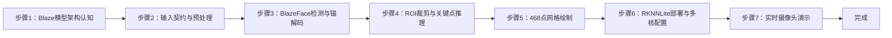

---

#### 步骤1：Blaze 模型架构认知（阶段一：能运行，20min）

> 📌 本步骤对应源码：`models/`、`src/`（face_landmark_core）

**知识点讲解**：

**Blaze 双模型级联（1.1.1）**
- **原理**：MediaPipe FaceMesh 的核心是**双模型级联**：`face_detection_short_range` 先做人脸检测（SSD 锚点 + 回归器/分类器双输出），`face_landmark` 再对检测框 ROI 内的脸输出 **468 点网格**（含 presence 置信度）。为什么不用单模型直接出点？——全图直接回归 468 点对尺度变化不鲁棒，检测-裁剪-关键点的两段式让每个模型任务更专注（检测负责"在哪"，关键点负责"长啥样"）。本实验把官方 tflite 转 RKNN 部署到板上 NPU（vendor mediapipe solutions 在 aarch64 上装得上但 SIGILL，ARMv8.0 无 LSE 指令）。
- **源码对应**：`models/face_detection_short_range.rknn`（[1,128,128,3] 输入，regressors [1,896,16] + classificators [1,896,1] 输出）；`models/face_landmark.rknn`（[1,192,192,3] 输入，conv2d_21 [1,1,1,1404] + conv2d_31 [1,1,1,1] 输出）

**操作步骤**：

1. 查看 models/ 目录两个 rknn 模型文件，理解输入输出契约表
2. 模型契约自检：`PYTHONPATH=car1_face_landmark python3 -m face_landmark_core.convert_mediapipe --check`
   - 验证 regressors/classificators、conv2d_21/conv2d_31 输出名一致
3. 思考：为什么两段式比单模型更稳？检测模型 128×128 而关键点 192×192 的原因？

**易错点**：
- ⚠️ 模型输出名必须与契约一致（--check 自检），换模型版本要重验

---

#### 步骤2：输入契约与预处理（阶段一：能运行，20min）

> 📌 本步骤对应源码：`face_landmark_core/landmark.py` _prepare

**知识点讲解**：

**Blaze 输入契约（1.1.1）**
- **原理**：Blaze 模型输入契约与 YOLO 系列不同：**float32 RGB，值域 [0,1]（归一化），NHWC 布局**。`_prepare()`（L113-116）三步转换：BGR→RGB（L115）→ uint8 转 float32 并 **÷255 归一化**（L116）→ reshape 为 `[1,size,size,3]` NHWC。注意与 RKNN 量化模型（int8 无归一化）的区别——Blaze 是 fp16 模型，需要调用方归一化。`backend.py` 的 `RKNNLiteBackend`（L20-62）封装 rknnlite 加载与推理，`predict` 支持多输入（L51-57，如 gesture_embedder 3 输入）。
- **源码对应**：`landmark.py` L113-116（_prepare：RGB L115 / 归一化 L116）；`backend.py` L20-62（RKNNLiteBackend：load L41-49 / predict L51-57）

**操作步骤**：

1. 单测理解输入契约：`pytest tests/ -v`（fake 注入，x86 可跑）
2. 手工验证预处理：
   ```bash
   python3 -c "
   import cv2, numpy as np
   from face_landmark_core.landmark import FaceLandmarkerEngine
   img = cv2.imread('x.jpg')
   # _prepare 是内部方法：BGR→RGB→float32[0,1]→NHWC
   rgb = cv2.cvtColor(img, cv2.COLOR_BGR2RGB).astype('float32')/255.0
   inp = rgb.reshape(1, 128, 128, 3)
   print('输入形状:', inp.shape, '值域:', inp.min(), '-', inp.max())"
   ```
3. 思考：为什么 [0,1] 归一化而 RKNN 量化模型不需要？fp16 与 int8 模型的输入契约差异？

**易错点**：
- ⚠️ 忘了归一化 [0,1] → 检测全废（fp16 模型契约）
- ⚠️ 布局必须 NHWC（Blaze 约定），误用 NCHW 报错或结果错乱

---

#### 步骤3：BlazeFace 检测与锚解码（阶段二：能理解，35min）

> 📌 本步骤对应源码：`face_landmark_core/landmark.py` process / engine

**知识点讲解**：

**锚解码与 NMS（1.1.1）**
- **原理**：BlazeFace 是 SSD 风格检测器：在 128×128 输入上预设 **896 个锚点**（多尺度网格），模型回归每个锚点的框偏移（regressors [1,896,16] = 4 坐标 × 4 份重复）与置信度（classificators [1,896,1]）。解码：锚点 + 偏移还原人脸框 → 置信度过滤 → **NMS**（重叠框抑制）→ 得到每张脸的检测框。`FaceLandmarkerEngine.process()`（L118-121）编排：检测 → 每脸 ROI → 关键点 → 逆映射。检测框供左栏绘制（YOLO 风格绿框 + `face <score>`）。
- **源码对应**：`landmark.py` L118-121（process 入口）、引擎内部（检测/解码/NMS/ROI/关键点/逆映射）

**操作步骤**：

1. 单图检测验证：`PYTHONPATH=car1_face_landmark:$PYTHONPATH python3 -m face_landmark_core.demo_image --config config/face_config.yaml --save out.jpg`
2. 多人测试：图片含 2 张脸，观察 num_faces=2 各一套框/网格
3. 无脸测试：空白图运行，观察 faces=[] 不崩溃
4. 思考：896 个锚点如何分布？为什么短距模型（short_range）只负责近距离人脸？

**易错点**：
- ⚠️ 锚解码参数来自 rknn-mediapipe-master（Apache-2.0），改模型需同步锚点配置

---

#### 步骤4：ROI 裁剪与关键点推理（阶段二：能理解，30min）

> 📌 本步骤对应源码：`face_landmark_core/landmark.py` 引擎关键点段

**知识点讲解**：

**ROI 级联（1.2.1）**
- **原理**：检测框确定后，把框内区域**裁剪缩放为 192×192** 喂给 `face_landmark` 模型（此即"级联"的关键：关键点模型只看人脸局部，尺度归一化后输出稳定）。模型输出 `conv2d_21 [1,1,1,1404]` = 468 点 × 3 坐标（x,y,z），`conv2d_31 [1,1,1,1]` = presence 置信度（是否有脸）。引擎把 ROI 坐标系的 468 点**逆映射回原图归一化坐标**（乘 ROI 缩放与偏移），供绘制与下游消费。
- **源码对应**：`landmark.py` 引擎（ROI 裁剪 / landmark 推理 / 逆映射）；模型输出契约见 README 表

**操作步骤**：

1. 打印单张脸的 LandmarkResult 结构（468 点 x,y,z + 检测框）
2. 绘制部分关键点（只画眼睛/嘴巴区域），理解点序与拓扑
3. 思考：presence 置信度低时如何处理？（过滤低置信度结果防误检）

**易错点**：
- ⚠️ ROI 逆映射必须用同一缩放/偏移，否则网格错位（引擎已处理）
- ⚠️ 468 点含 z（相对尺度），绘制 2D 时用 x,y

---

#### 步骤5：468 点网格绘制（阶段三：能改造，25min）

> 📌 本步骤对应源码：`face_landmark_core/landmark.py` draw_mesh / draw_boxes

**知识点讲解**：

**面部网格拓扑（1.2.2）**
- **原理**：468 点是原始采样点，视觉上呈现"网格"靠的是**拓扑连线**：`FACEMESH_CONTOURS`（478 拓扑 124 边）定义了眼/眉/唇/脸廓的连线关系。`draw_mesh()`（L195-198）按 connections 逐边连线绘制（黄点绿线，vendor 视觉）；`draw_boxes()`（L172-175）绘制左栏检测框（绿框 + `face <score>`）。拓扑连线让 468 个孤立点变成可读的面部结构，是姿态/表情分析的基础。
- **源码对应**：`landmark.py` L172-175（draw_boxes）、L195-198（draw_mesh，FACEMESH_CONTOURS）

**操作步骤**：

1. 单图输出双栏，观察右栏网格结构（眼/眉/唇/脸廓清晰可辨）
2. 动手改造：改连线颜色/粗细，或只绘制眼睛+嘴唇区域（局部拓扑）
3. 思考：478 拓扑与 468 点（+10 冗余）的关系？网格连线对表情识别的作用？

**易错点**：
- ⚠️ connections 使用 478 拓扑，点索引超 467 的边绘制时需跳过

---

#### 步骤6：RKNNLite 部署与多核配置（阶段三：能改造，30min）

> 📌 本步骤对应源码：`face_landmark_core/backend.py`、`convert_mediapipe.py`

**知识点讲解**：

**RKNNLite 与多核 NPU（1.3.1）**
- **原理**：板上统一用 **RKNNLite**（rknn-toolkit-lite2 2.3.2，RK3576 专用部署 API），完整版 rknn-toolkit2 仅留在 x86 转换环境。`RKNNLiteBackend.load()`（L41-49）懒导入 rknnlite（x86 单测无需）、`init_runtime(core_mask=...)`（无 target 参数）。**多核 NPU**：`config/face_config.yaml` → `backend.core_mask`：0=AUTO（默认）、1=CORE_0、2=CORE_1、4=CORE_2、3=0_1、7=0_1_2（RK3576 三核）——多模型并行时分配不同核可提升吞吐。转换用 `convert_mediapipe.py`（tflite → rknn，`--dtype fp|i8`，fp16 混合量化 landmark 回归精度更稳；int8 需校准集）。
- **源码对应**：`backend.py` L41-49（load：懒导入 L42 / init_runtime L44-48）；`convert_mediapipe.py`（tflite→rknn 转换 CLI）；`config/face_config.yaml`（backend.core_mask）

**操作步骤**：

1. 查看 `config/face_config.yaml` 的 backend.core_mask（默认 0=AUTO）
2. 修改 core_mask=1（CORE_0）运行，观察性能差异（多模型抢核 vs 独占）
3. 查看转换命令：`PYTHONPATH=car1_face_landmark python3 -m face_landmark_core.convert_mediapipe --help`
4. 思考：两个模型（检测+关键点）如何分配 NPU 核最优？（不同核并行，避免抢核）

**易错点**：
- ⚠️ 板上必须 RKNNLite（完整版 toolkit2 不部署）；core_mask 需平台支持（RK3576 三核）
- ⚠️ fp16 模型输入要归一化 [0,1]；int8 模型需要校准集

---

#### 步骤7：实时摄像头演示（阶段三：能改造，30min）

> 📌 本步骤对应源码：`face_landmark_core/camera_demo.py`、`face_landmark_node.py`

**知识点讲解**：

**实时链路与双模式（1.3.2）**
- **原理**：`camera_demo.py` 支持两种取流：**--ros**（板上标准，ascamera 话题，HP60C）+ **--camera N**（V4L2 UVC 回退，vendor 06 形态）。循环：取帧 → FaceLandmarkerEngine.process → 双栏合成（view.py）→ FPS 统计 → MJPEG 推流（:8081，避开 08 的 :8080）。ROS 节点模式（`face_landmark_node.py`）为可选：colcon 编译后 `ros2 launch car1_face_landmark face_landmark.launch.py`。**PYTHONPATH 必须保留 $PYTHONPATH**（覆盖会丢 Humble 路径 → venv 内 PyPI rclpy 被加载 → 崩）。
- **源码对应**：`camera_demo.py`（--ros/--camera 取流 / 循环 / MJPEG / q 退出）；`face_landmark_node.py`（ROS 节点）；`view.py` / `mjpeg_server.py`（双栏 + :8081 推流）

**操作步骤**：

1. 相机实时（板上标准，ROS_DOMAIN_ID 与驱动一致）：
   ```bash
   source /opt/ros/humble/setup.bash && source ~/ros2_ws/install/setup.bash
   ros2 launch ascamera hp60c.launch.py        # 终端 1
   PYTHONPATH=car1_face_landmark:$PYTHONPATH python3 -m face_landmark_core.camera_demo \
     --config config/face_config.yaml --ros --display   # 终端 2
   ```
2. 无显示器查看：去掉 --display，浏览器访问 `http://<板IP>:8081/face.mjpg`
3. 多人测试：两人入镜，观察 num_faces=2 各一套框/网格
4. 动手改造：在网格上叠加"眼睛睁开程度"（计算眼睑关键点距离）或头部姿态角，实现表情/姿态扩展

**易错点**：
- ⚠️ PYTHONPATH 必须保留 $PYTHONPATH（覆盖丢 Humble 路径 → rclpy 崩）
- ⚠️ --ros 需 ascamera 先起；话题严禁 remap；--camera N 回退需 V4L2+YUYV（MJPG 损坏会雪花）

---

### 1.7 常见问题

| 问题 | 原因 | 解决方法 |
|------|------|---------|
| 检测不到人脸 | 输入未归一化 [0,1] / 布局错误 | `_prepare` BGR→RGB→÷255→NHWC（L113-116） |
| 网格错位 | ROI 逆映射未对齐 | 引擎已处理；改模型需同步锚点配置 |
| SIGILL 崩溃 | 装了官方 mediapipe（ARMv8.1 LSE） | 弃用 mediapipe，用 RKNN Blaze（本实验方案） |
| rclpy 加载崩 | PYTHONPATH 覆盖丢 Humble 路径 | `PYTHONPATH=car1_face_landmark:$PYTHONPATH`（保留 $PYTHONPATH） |
| 帧率低 | core_mask 配置不当 / fp16 未生效 | 检查 backend.core_mask（0=AUTO）；确认 fp16 混合量化 |
| 多人只出一套网格 | num_faces 限制 | 检查引擎 num_faces 处理（默认多人各一套） |
| UVC 雪花 | 相机 MJPG 损坏（NOVATEK） | `--camera N` 用 V4L2+YUYV 回退 |
| MJPEG 404 | 端口占用 | 确认 :8081 空闲（避开 08 的 :8080） |

### 1.8 扩展实验

**扩展方向 1：表情与疲劳检测（进阶）**
- 用眼睑关键点计算 EAR（Eye Aspect Ratio），实现眨眼计数与疲劳预警；用嘴角关键点判断微笑

**扩展方向 2：头部姿态估计（进阶）**
- 用 468 点中面部稳定点（鼻尖/眼角/下颌）配合 3D 标准模型（SolvePNP）估计头部欧拉角，实现"转头跟随"交互

### 1.9 实验报告要求

**评分标准**：Blaze 架构理解 15 分 + 输入契约 15 分 + 检测与锚解码 20 分 + ROI 级联 20 分 + 网格绘制 10 分 + 实时演示 10 分 + 报告 10 分 = 100 分。

**报告必含内容**：
1. 双模型级联架构图（检测→ROI→关键点→逆映射），标注输入输出契约
2. 两模型输入输出规格表（形状/类型/归一化/输出名）与 --check 自检结果
3. 单图双栏结果图（左检测框 | 右 468 网格）
4. 多人/无脸场景的鲁棒性测试记录
5. core_mask 多核配置对帧率的影响数据
6. 回答思考题：为什么 [0,1] 归一化？为什么两段式级联？468 点 z 坐标的语义？
7. 实验心得与问题记录

---

## 更新日志

| 版本 | 日期 | 变更 |
|------|------|------|
| v1.0 | 2026-08-10 | 初版生成（源码路径 ros2_ws/src/xflz_eai_car1/vision/09_face_landmarks，101 用例全绿，RKNN Blaze 双模型 468 点网格 + RKNNLite NPU 推理 + 多核 core_mask，板端验证通过） |

## 实验10：基于骨骼关键点的肢体检测实验（4h）

> ✅ **源码已核实** 本实验源码位于 `ros2_ws/src/xflz_eai_car1/vision/10_pose_landmark/`。**方案 = mediapipe `pose_landmark_full` tflite 转 RKNN（fp16/rk3576），板上 RKNNLite NPU 推理 33 点骨架**（vendor 10_姿态检测 视觉对齐：左=原图+FPS 红字，右=黑底红点绿线骨架）。单模型整图推理（256×256 输入，无独立检测器）。测试 45 项 x86 全绿，模型已转换入库（用户，pose_landmark_full.rknn）。

### 1.1 关联知识点

- 1.1.1 姿态估计原理 > 原理 > 人体姿态估计（Pose Estimation）定位人体关键点（关节/肢体端点），区别于检测的框与分割的掩码；BlazePose 单模型整图输出 33 点 [x,y,z,vis]
- 1.2.1 输入契约与预处理 > 流程 > 整图 letterbox 256×256（resize_pad）→ RGB → **mean 127.5/std 128 + uint8 输入**（rknn 内部归一化，手动 /127.5−1 破坏输入）
- 1.2.2 关键点解码 > 流程 > 33×4 解析（x,y,z,vis）→ 逆映射 `px=(norm×256−pad)/scale` 还原原图坐标；vis<0.5 跳过绘制
- 1.3.1 骨架拓扑绘制 > 概念 > `POSE_CONNECTIONS` 35 边拓扑（头颈/躯干/四肢连接），红点 r6 + 绿线 2px，黑底双栏显示
- 1.3.2 实时姿态可视化 > 流程 > 摄像头取流 → 整图推理 → 33 点解码 → 双栏（原图+FPS | 黑底骨架）→ MJPEG 推流 :8082

### 1.2 实验目标

1. 掌握人体姿态估计的原理与 BlazePose 模型架构（单模型整图 33 点）— 原理理解
2. 实现关键点解码、逆映射与骨架拓扑绘制，完成实时姿态可视化 — 独立完成
3. 理解 BlazePose 的输入归一化契约（mean/std + uint8）与 vendor 方案差异 — 迁移应用

### 1.3 实验环境

| 类别 | 配置 |
|------|------|
| 硬件 | 具身智能实验箱 B2（XFLZ_EAI_B2_PRO，RK3576 SoC，6TOPS NPU，含 HP60C 深度相机） |
| OS | Ubuntu 22.04 + ROS2 Humble（板载 ros2_venv，rknnlite 2.3.2 / rknn-toolkit-lite2） |
| 核心库 | OpenCV、NumPy、rknnlite（RKNNLite）、PyYAML；mjpeg_streamer（不装则内置回退） |
| 模型 | `models/pose_landmark_full.rknn`（fp16，256×256 整图输入，33 关键点 + presence + 分割/world 输出） |
| 主入口 | `python -m pose_landmark_core.camera_demo --config config/pose_config.yaml --ros [--display]` |

### 1.4 实验难度

- 难度: ⭐⭐ 设计性
- 重点: 33 点解码与逆映射 + 35 边骨架拓扑绘制 + 实时可视化
- 难点: mean 127.5/std 128 + uint8 输入契约（手动归一化会破坏输入）；vis 可见度过滤

### 1.5 实验现象

**快速验证流程**：

1. 进入项目目录：`cd ros2_ws/src/xflz_eai_car1/vision/10_pose_landmark`
2. 单图模式：`PYTHONPATH=car1_pose_landmark python3 -m pose_landmark_core.demo_image --config config/pose_config.yaml --display --save out.jpg`
   - 右栏黑底骨架贴合人体（33 点红点 + 绿线，站姿可辨）
3. 相机实时（板上标准）：
   ```bash
   source /opt/ros/humble/setup.bash && source ~/ros2_ws/install/setup.bash
   ros2 launch ascamera hp60c.launch.py        # 终端 1
   PYTHONPATH=car1_pose_landmark:$PYTHONPATH python3 -m pose_landmark_core.camera_demo \
     --config config/pose_config.yaml --ros --display   # 终端 2
   ```
4. 无显示器：浏览器 `http://<板IP>:8082/pose.mjpg`

**预期效果描述**：
- 单图：右栏黑底骨架贴合人体（33 点红点 + 绿线，站姿可辨），左栏原图 + FPS 红字
- 实时：骨架实时跟随动作，左栏 FPS 红字；MJPEG `:8082/pose.mjpg` 流畅
- 无脸/无人时不崩，状态栏 `Pose: --`

### 1.6 实验步骤

#### 整体流程图

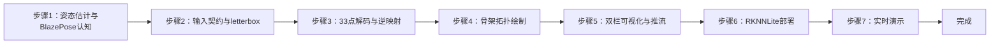

---

#### 步骤1：姿态估计与 BlazePose 认知（阶段一：能运行，20min）

> 📌 本步骤对应源码：`pose_landmark_core/pose.py`、`engine.py`

**知识点讲解**：

**姿态估计问题与 BlazePose 方案（1.1.1）**
- **原理**：人体姿态估计（Pose Estimation）定位**人体关键点**——33 个点覆盖头（鼻/眼/耳）、躯干（肩/髋）、四肢（肘/腕/膝/踝），每点含 `[x, y, z, visibility]`（z 为相对深度，vis 为可见度）。BlazePose 采用**单模型整图推理**（256×256，无独立检测器——mediapipe-rknn 参考即此形态），区别于实验9 人脸的双模型级联。33 点骨架是动作识别（实验11）、体感控制、康复评估的基础。vendor 用 mediapipe solutions（板上 aarch64 不可装），本实验用 RKNN BlazePose → RKNNLite NPU。
- **源码对应**：`pose.py`（POSE_CONNECTIONS 35 边拓扑、decode_pose 33×4 解析）；`engine.py`（PoseEngine 单模型引擎，presence<阈值 → 空结果）

**操作步骤**：

1. 查看 33 点索引表与 POSE_CONNECTIONS（头颈/躯干/四肢连线），理解骨架语义
2. 单测理解引擎契约：`pytest tests/`（x86 全绿，fake 注入）
3. 思考：33 点姿态与 468 点人脸的关键点检测异同？（单模型 vs 双模型、点密度、z 语义）

**易错点**：
- ⚠️ 不得跨实验合跑 pytest——共享模块名（config/preprocess 等）

---

#### 步骤2：输入契约与 letterbox（阶段一：能运行，20min）

> 📌 本步骤对应源码：`pose_landmark_core/pose.py` prepare / resize_pad

**知识点讲解**：

**BlazePose 输入契约（1.2.1）**
- **原理**：BlazePose 输入契约与 BlazeFace 不同：**mean 127.5/std 128 + uint8 输入**——rknn 模型内部做归一化（`(x-127.5)/128`），调用方**只做 BGR→RGB 转 uint8 即可，手动 /127.5−1 会破坏输入**（板端实测结论）。`resize_pad` 做 letterbox：等比缩放 + 填充到 256×256（保持宽高比）。这一契约是转换脚本 `convert_mediapipe.py`（对齐 mediapipe-rknn/models/pose_landmark/convert.py）与推理侧必须一致的关键。
- **源码对应**：`pose.py` prepare（RGB uint8 契约）/ resize_pad（letterbox）；`convert_mediapipe.py`（tflite→rknn，127.5/128 契约）

**操作步骤**：

1. 手工验证预处理：
   ```bash
   python3 -c "
   import cv2
   img = cv2.imread('x.jpg')
   rgb = cv2.cvtColor(img, cv2.COLOR_BGR2RGB)
   # resize_pad → 256×256 uint8（契约：直接喂，勿手动归一化）
   print('RGB uint8 输入契约：不手动 /127.5−1')"
   ```
2. 单测理解 resize_pad 的 scale/pad 计算（`px=(norm×256−pad)/scale` 逆映射依赖）
3. 思考：为什么 fp16 人脸模型要 [0,1] 归一化，而 pose 模型用 127.5/128 + uint8？——模型转换时量化/归一化方式不同

**易错点**：
- ⚠️ 手动 /127.5−1 归一化 → 输入破坏（板端实测）；必须 uint8 直喂

---

#### 步骤3：33 点解码与逆映射（阶段二：能理解，30min）

> 📌 本步骤对应源码：`pose_landmark_core/pose.py` decode_pose

**知识点讲解**：

**解码与坐标还原（1.2.2）**
- **原理**：模型输出 33 关键点（每点 [x,y,z,vis]，模型坐标系为归一化 [0,1]），`decode_pose`（33×4 解析）把归一化坐标**逆映射回原图**：`px = (norm × 256 − pad) / scale`——即先乘回 256（letterbox 尺寸），减去 pad（填充偏移），除以 scale（缩放比例），得到原始图像像素坐标。`vis`（可见度）是关键点质量指标：`vis < 0.5` 的点（被遮挡/出画）跳过绘制。presence（整帧是否有人的置信度）低于阈值时引擎返回空结果（engine.py），避免无人体时输出垃圾骨架。
- **源码对应**：`pose.py` decode_pose（33×4 解析 + 逆映射公式）；`engine.py`（presence 阈值 → 空结果）

**操作步骤**：

1. 单图运行，打印某帧 33 点的 x/y/vis 值，理解逆映射效果
2. 部分遮挡测试：用手遮挡半边身体，观察 vis<0.5 的点是否被跳过绘制
3. 手工验证逆映射：对已知点手算 `px=(norm×256−pad)/scale`，与输出对比
4. 思考：z 坐标（相对深度）的语义与限制？vis 过滤的意义？

**易错点**：
- ⚠️ 逆映射公式与 resize_pad 的 scale/pad 必须配对使用（引擎已封装）

---

#### 步骤4：骨架拓扑绘制（阶段二：能理解，25min）

> 📌 本步骤对应源码：`pose_landmark_core/engine.py` draw_skeleton、`pose.py` POSE_CONNECTIONS

**知识点讲解**：

**35 边骨架拓扑（1.3.1）**
- **原理**：33 个孤立点要变成"人体骨架"，靠 `POSE_CONNECTIONS` **35 边拓扑**定义连接关系（头颈、躯干、双臂、双腿、手部骨架等）。`draw_skeleton`（engine.py）按拓扑逐边连线：红点 r6（半径 6 像素）+ 绿线 2px，`vis < 0.5` 的点跳过（不画其相连的边）。黑底右栏让骨架对比度最高，vendor 视觉对齐（右=黑底红点绿线骨架）。
- **源码对应**：`pose.py` POSE_CONNECTIONS（35 边）；`engine.py` draw_skeleton（vis 过滤 + 红点绿线绘制）

**操作步骤**：

1. 单图输出双栏，观察骨架（红点绿线）是否贴合人体姿态
2. 动手改造：改点的半径/颜色、线的粗细，或只绘制上半身拓扑
3. 思考：35 边拓扑如何定义？手部/足部的细粒度连接作用？

**易错点**：
- ⚠️ 连线两端点任一 vis<0.5 即跳过该边（绘制逻辑）

---

#### 步骤5：双栏可视化与推流（阶段三：能改造，25min）

> 📌 本步骤对应源码：`pose_landmark_core/view.py`、`mjpeg_server.py`

**知识点讲解**：

**双栏合成与状态栏（1.3.2）**
- **原理**：`view.py` 双栏合成：左栏原图 + FPS 红字，右栏黑底 33 点骨架，底部状态栏（`FPS: N  Pose: OK/--`）。`mjpeg_server.py` 提供 MJPEG 流 `:8082/pose.mjpg`（09=8081 之后，避免端口冲突）。双栏设计让学习者同时看到"原始画面"与"姿态理解结果"，FPS 红字实时反馈性能。
- **源码对应**：`view.py`（双栏 + 状态栏 + FPS 红字）；`mjpeg_server.py`（:8082 推流）

**操作步骤**：

1. 单图保存双栏：`PYTHONPATH=car1_pose_landmark python3 -m pose_landmark_core.demo_image --config config/pose_config.yaml --save out.jpg`
2. 无显示器查看 MJPEG 流（浏览器 :8082/pose.mjpg）
3. 动手改造：在左栏叠加"站立/举手"文字（用肩-肘-腕角度判断），为实验11 铺垫

**易错点**：
- ⚠️ 端口 :8082 与其他实验错开（09=8081）；占用时改 config

---

#### 步骤6：RKNNLite 部署（阶段三：能改造，20min）

> 📌 本步骤对应源码：`pose_landmark_core/backend.py`、`convert_mediapipe.py`

**知识点讲解**：

**转换与部署（1.3.2）**
- **原理**：`convert_mediapipe.py` 在 x86 转换环境把 `pose_landmark_full.tflite` 转 RKNN（fp16 默认，`--dtype fp|i8`），`--check` 自检输出契约。板上用 `RKNNLiteBackend`（rknn-toolkit-lite2 2.3.2，core_mask 默认 0=AUTO）NPU 推理。fp16 对姿态回归（连续坐标）精度优于 int8；如需 int8 需校准集。产物 `models/pose_landmark_full.rknn` 已入库。
- **源码对应**：`convert_mediapipe.py`（tflite→rknn + --check）；`backend.py`（RKNNLiteBackend：load / init_runtime(core_mask) / predict）

**操作步骤**：

1. 模型契约自检：`PYTHONPATH=car1_pose_landmark python3 -m pose_landmark_core.convert_mediapipe --check`
2. 查看 `config/pose_config.yaml` 的 backend.core_mask（默认 0=AUTO）
3. （可选）x86 转换环境重转 fp16：`PYTHONPATH=car1_pose_landmark python3 -m pose_landmark_core.convert_mediapipe --all`

**易错点**：
- ⚠️ 转换环境需 tensorflow≤2.14 + ml-dtypes 0.2.0（README 说明）
- ⚠️ 板上必须 RKNNLite；core_mask 按 RK3576 三核配置

---

#### 步骤7：实时摄像头演示（阶段三：能改造，30min）

> 📌 本步骤对应源码：`pose_landmark_core/camera_demo.py`、`pose_landmark_node.py`

**知识点讲解**：

**实时链路（1.3.2）**
- **原理**：`camera_demo.py` 循环：取流（--ros ascamera 话题标准 / --camera N V4L2 回退，NOVATEK 相机强制 YUYV）→ PoseEngine.process → 双栏合成 → FPS 统计 → MJPEG 推流（:8082）→ q 退出。ROS 节点模式可选（colcon 编译后 launch）。**PYTHONPATH 必须保留 $PYTHONPATH**（覆盖丢 Humble 路径 → venv PyPI rclpy → ModuleNotFoundError）。
- **源码对应**：`camera_demo.py`（实时循环 / cap/engine 注入）；`pose_landmark_node.py`（ROS 节点，remove_ros_args 已修）；`ros2_source.py`（ascamera 取流）

**操作步骤**：

1. 相机实时（板上标准）：
   ```bash
   source /opt/ros/humble/setup.bash && source ~/ros2_ws/install/setup.bash
   ros2 launch ascamera hp60c.launch.py        # 终端 1
   PYTHONPATH=car1_pose_landmark:$PYTHONPATH python3 -m pose_landmark_core.camera_demo \
     --config config/pose_config.yaml --ros --display   # 终端 2
   ```
2. 动作测试：站立/举手/下蹲，观察骨架实时跟随
3. 无脸测试：画面无人，观察状态栏 `Pose: --` 且不崩溃
4. 动手改造：计算肩-肘-腕夹角并在状态栏显示，为动作分类（实验11）铺垫

**易错点**：
- ⚠️ PYTHONPATH 保留 $PYTHONPATH；--ros 需 ascamera 先起、话题严禁 remap
- ⚠️ UVC 回退强制 YUYV（NOVATEK 相机 MJPG 损坏）

---

### 1.7 常见问题

| 问题 | 原因 | 解决方法 |
|------|------|---------|
| 骨架乱飞/无输出 | 手动归一化破坏了输入 | 契约是 mean 127.5/std 128 + uint8，勿 /127.5−1（板端实测） |
| 骨架错位 | 逆映射公式与 letterbox 不配对 | `px=(norm×256−pad)/scale`（resize_pad 同一参数） |
| 遮挡后骨架残缺 | vis<0.5 的点被跳过 | 属正常行为（vis 过滤）；确认遮挡恢复 |
| 无人时输出垃圾骨架 | presence 阈值未生效 | engine.py presence<阈值 → 空结果（已内置） |
| rclpy ModuleNotFoundError | PYTHONPATH 覆盖丢 Humble 路径 | `PYTHONPATH=car1_pose_landmark:$PYTHONPATH` |
| 帧率低 | fp16 未生效 / core_mask 不当 | 确认 fp16 模型；core_mask 0=AUTO |
| pytest 冲突 | 跨实验合跑共享模块名 | 各实验目录单独跑 pytest |
| UVC 雪花 | 相机 MJPG 损坏（NOVATEK） | `--camera N` 强制 YUYV |

### 1.8 扩展实验

**扩展方向 1：动作分类（进阶）**
- 用关键点计算关节角度（肩-肘-腕、髋-膝-踝）与相对位置特征，实现举手/下蹲/站立分类——直接衔接实验11 体感控制

**扩展方向 2：姿态评分（进阶）**
- 与标准姿势模板（如瑜伽体式）对比关键点距离，输出"姿态相似度"评分，实现动作纠正/训练辅助

### 1.9 实验报告要求

**评分标准**：姿态估计原理 15 分 + 输入契约 15 分 + 解码与逆映射 25 分 + 骨架绘制 20 分 + 实时演示 15 分 + 报告 10 分 = 100 分。

**报告必含内容**：
1. BlazePose 单模型整图架构说明（33 点 [x,y,z,vis] + presence）
2. 输入契约验证（uint8 直喂 vs 手动归一化对比——板端实测结论）
3. 33 点解码与逆映射手算验证
4. 双栏结果图（左原图+FPS | 右黑底骨架）与 35 边拓扑说明
5. 遮挡场景的 vis 过滤效果图
6. 回答思考题：为什么 pose 用 127.5/128 而人脸用 [0,1]？z 坐标的语义？vis 过滤的意义？
7. 实验心得与问题记录

---

## 更新日志

| 版本 | 日期 | 变更 |
|------|------|------|
| v1.0 | 2026-08-10 | 初版生成（源码路径 ros2_ws/src/xflz_eai_car1/vision/10_pose_landmark，45 项测试全绿，BlazePose 单模型 33 点 + 127.5/128 uint8 契约 + 35 边骨架 + RKNNLite NPU，模型已入库） |

## 实验11：基于肢体动作的体感控制实验（4h）

> ✅ **源码已核实** 本实验源码位于 `ros2_ws/src/xflz_eai_car1/vision/11_pose_control/`。**在 exp10 姿态骨架基础上加「动作分类 → 控制指令」**（vendor 11_整体检测_体感 为纯可视化无控制逻辑；PLAN exp11 要求"动作分类→控制指令"）。5 种动作规则（actions.py，物理直觉优先），可选发布 `/cmd_vel`（默认关，防误动）。测试 55 项 x86 全绿（含 10 项动作分类），模型已转换入库。

### 1.1 关联知识点

- 1.1.1 动作分类原理 > 原理 > 基于 33 点姿态骨架的几何规则分类：关节坐标比值（y 相对位置）判定动作，无需训练分类器——"规则优先"的轻量方案
- 1.2.1 动作规则设计 > 流程 > 下蹲（双髋 y>0.72）/双手举（双腕 y<双肩 y−0.08）/左手举/右手举/停止；优先级 squat > both_up > left/right；vis<0.5 忽略
- 1.3.1 控制指令映射 > 流程 > 动作 → 指令 → cmd_vel（前进 linear+0.2 / 后退 −0.2 / 左转 angular+0.8 / 右转 −0.8 / 停止 0）；车侧 clamp ±0.3 m/s ±1.0 rad/s
- 1.3.2 实时体感链路 > 流程 > 姿态推理（exp10 复用）→ 动作分类 → 状态栏显示（英文）→ 可选 cmd_vel 发布 → MJPEG 推流 :8083

### 1.2 实验目标

1. 掌握基于关键点的动作分类原理（几何规则 vs 学习式分类器）— 原理理解
2. 实现 5 种动作的判定规则与优先级逻辑，完成动作→控制指令映射 — 独立完成
3. 理解 cmd_vel 发布机制与 ROS2 话题通信，实现体感控制闭环 — 迁移应用

### 1.3 实验环境

| 类别 | 配置 |
|------|------|
| 硬件 | 具身智能实验箱 B2（XFLZ_EAI_B2_PRO，RK3576 SoC，6TOPS NPU，含 HP60C 深度相机）+ C1 小车（可选） |
| OS | Ubuntu 22.04 + ROS2 Humble（板载 ros2_venv，rknnlite 2.3.2） |
| 核心库 | OpenCV、NumPy、rknnlite（RKNNLite）、PyYAML、rclpy（cmd_vel 发布） |
| 模型 | `models/pose_landmark_full.rknn`（fp16，256×256 整图，33 点，同 exp10） |
| 主入口 | `python -m pose_control_core.camera_demo --config config/pose_control_config.yaml --ros [--display]` |

### 1.4 实验难度

- 难度: ⭐⭐⭐ 综合性
- 重点: 动作判定规则 + 优先级 + 控制指令映射 + cmd_vel 发布
- 难点: 规则阈值标定（0.72/0.08 的物理意义）；优先级设计（下蹲时举手不算）；ROS2 话题通信

### 1.5 实验现象

**快速验证流程**：

1. 进入项目目录：`cd ros2_ws/src/xflz_eai_car1/vision/11_pose_control`
2. 单图模式：`PYTHONPATH=car1_pose_control python3 -m pose_control_core.demo_image --config config/pose_control_config.yaml --display --save out.jpg`
   - 状态栏显示动作（如 `Action: Turn Left`）
3. 相机实时（板上标准）：
   ```bash
   source /opt/ros/humble/setup.bash && source ~/ros2_ws/install/setup.bash
   ros2 launch ascamera hp60c.launch.py        # 终端 1
   PYTHONPATH=car1_pose_control:$PYTHONPATH python3 -m pose_control_core.camera_demo \
     --config config/pose_control_config.yaml --ros --display   # 终端 2
   ```
4. 动作演示：站立/双手举/左手举/右手举/下蹲，观察状态栏与终端动作切换
5. 可选 cmd_vel：改 `control.publish_cmd_vel: true` 后 `ros2 topic echo /cmd_vel`

**预期效果描述**：
- 站姿 → `Action: Stop`；双手举 → `Forward`；左手举 → `Turn Left`；右手举 → `Turn Right`；下蹲 → `Backward`
- 状态栏 `FPS: N Action: Turn Left`（英文——cv2.putText 无中文字形，中文显示 ????）
- 无人时 `Action: Stop`（姿态不可信）；MJPEG `:8083/pose_control.mjpg` 流畅
- 可选 cmd_vel：`ros2 topic echo /cmd_vel` 看到对应线/角速度（车侧 clamp ±0.3 m/s / ±1.0 rad/s）

### 1.6 实验步骤

#### 整体流程图

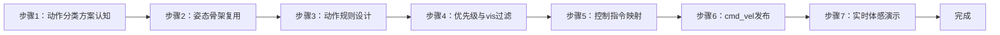

---

#### 步骤1：动作分类方案认知（阶段一：能运行，20min）

> 📌 本步骤对应源码：`pose_control_core/actions.py`、`config/pose_control_config.yaml`

**知识点讲解**：

**规则优先 vs 学习式分类（1.1.1）**
- **原理**：动作分类有两类方案：(1) **几何规则**（本实验）：用关键点的坐标比值直接判定——"双髋 y>0.72 → 下蹲"，无需训练，可解释性强、延迟低，适合动作种类少且姿态差异大的场景；(2) **学习式**（如 LSTM/Transformer + 关键点序列）：需标注数据集训练，泛化强但成本高。本实验的 5 种动作（下蹲/双手举/左手举/右手举/停止）用规则方案完全够用——这是**"按问题规模选方案"**的工程判断。
- **源码对应**：`actions.py`（5 种动作判定函数）；`config/pose_control_config.yaml`（control 区块：publish_cmd_vel / topic / print_interval）

**操作步骤**：

1. 阅读 `actions.py` 的 5 个动作判定函数，理解每个阈值（0.72/0.08）的判定条件
2. 查看 `config/pose_control_config.yaml` 的 control 区块（publish_cmd_vel 默认 false / topic / print_interval=2.0）
3. 单测理解动作分类：`pytest tests/ -k action -v`（10 项动作分类用例）
4. 思考：什么场景适合规则分类？什么场景必须学习式？（动作种类、差异度、鲁棒性要求）

**易错点**：
- ⚠️ 阈值（0.72/0.08）基于归一化坐标，换相机视角/距离需重标定

---

#### 步骤2：姿态骨架复用（阶段一：能运行，20min）

> 📌 本步骤对应源码：`pose_control_core/engine.py`、`pose.py`（exp10 复用）

**知识点讲解**：

**exp10 能力复用（1.3.2）**
- **原理**：体感控制直接复用实验10 的 BlazePose 33 点推理链：模型（pose_landmark_full.rknn，256×256 整图）→ RKNNLiteBackend → 33 点 [x,y,z,vis] 归一化坐标。动作分类只消费**归一化坐标**（不需逆映射回像素——规则用相对位置，归一化更稳）。复用而非重写是工程常态：能力分层（感知→理解→决策→执行）让每层可独立演进。
- **源码对应**：`pose_control_core/engine.py`（PoseEngine，exp10 同款）；`backend.py`（RKNNLiteBackend）；`pose.py`（33 点解码）

**操作步骤**：

1. 运行单测确认引擎复用正确：`pytest tests/ -v`（55 项）
2. 对照 exp10 的 pose.py/engine.py 与本实验差异（动作分类新增层）
3. 思考：归一化坐标直接用于规则判定 vs 像素坐标，哪个更稳？（归一化免去相机距离影响，但依赖人体在画面中的比例）

**易错点**：
- ⚠️ 规则用归一化坐标（0-1），勿用像素坐标混算

---

#### 步骤3：动作规则设计（阶段二：能理解，30min）

> 📌 本步骤对应源码：`pose_control_core/actions.py`

**知识点讲解**：

**物理直觉优先的规则（1.2.1）**
- **原理**：5 种动作的判定基于**物理直觉**（actions.py）：(1) **下蹲 squat**：双髋 y > 0.72——下蹲时髋关节在画面中下移（归一化 y 增大）；(2) **双手举 both_up**：双腕 y < 双肩 y − 0.08——举手时手腕高于肩膀（y 小在上）；(3) **左手举 left_up**：仅左腕高；(4) **右手举 right_up**：仅右腕高；(5) **停止**：其余情况。阈值 0.08 是"腕比肩高"的容差。这些规则**不依赖具体人种/体型**（归一化坐标），但依赖相机视角（正对全身）与人体在画面中的位置。
- **源码对应**：`actions.py`（squat/both_up/left_up/right_up/stop 判定，阈值 0.72/0.08）

**操作步骤**：

1. 阅读 actions.py 各判定函数，画出判定逻辑树
2. 用单测覆盖边界：`pytest tests/ -k action -v`（含边界用例）
3. 手工构造关键点数据测试：把双髋 y 设为 0.8 应判 squat，设为 0.5 应判 stop
4. 思考：阈值 0.72 为什么不选 0.5？离摄像头远近对阈值的影响？

**易错点**：
- ⚠️ 阈值需按实际机位标定（README 验证清单要求实测微调）

---

#### 步骤4：优先级与 vis 过滤（阶段二：能理解，25min）

> 📌 本步骤对应源码：`pose_control_core/actions.py` 优先级逻辑

**知识点讲解**：

**优先级设计与可靠性（1.2.1）**
- **原理**：动作可能同时满足多个规则（如下蹲时手也举着）——**优先级**解决冲突：`squat > both_up > left/right`（下蹲时举手不算，README 明确）。可靠性保障：(1) **vis 过滤**——关键点 vis < 0.5 忽略（被遮挡的关节不参与判定）；(2) **髋部不可见 → 停止**——姿态不可信时不输出控制（安全兜底）。这两条规则把"误判"风险降到最低：宁可不动，不可乱动。
- **源码对应**：`actions.py`（优先级判定 / vis<0.5 忽略 / 髋不可见→stop）

**操作步骤**：

1. 单测验证优先级：构造"下蹲+双手举"数据，断言判 squat 而非 both_up
2. 部分遮挡测试：遮挡髋部运行，观察输出 Stop（姿态不可信兜底）
3. 思考：优先级设计的原则？为什么安全兜底（髋不可见→停止）是必须的？

**易错点**：
- ⚠️ 优先级顺序错误 → 动作歧义（下蹲+举手判成前进）；测试已锁定 squat 最高

---

#### 步骤5：控制指令映射（阶段三：能改造，25min）

> 📌 本步骤对应源码：`pose_control_core/actions.py` 指令表、`camera_demo.py` 状态栏

**知识点讲解**：

**动作→指令映射（1.3.1）**
- **原理**：动作分类结果映射为控制指令：下蹲→后退（linear −0.2 m/s）、双手举→前进（linear +0.2）、左手举→左转（angular +0.8 rad/s）、右手举→右转（angular −0.8）、停止→0。线速度/角速度值的选择考虑：前进后退用小线速度（0.2，安全），转向用较大角速度（0.8，机动性）。车侧 `/cmd_vel` 有 clamp（±0.3 m/s / ±1.0 rad/s）——发布值在安全范围内。状态栏显示英文动作名（cv2.putText 无中文字形，中文显示 ????）。
- **源码对应**：`actions.py`（动作→指令映射）；`camera_demo.py`（状态栏 `Action: Turn Left`）；`config/pose_control_config.yaml`（control 区块）

**操作步骤**：

1. 单图验证：举手照片 → 状态栏 `Action: Turn Left/Right/Forward`；站姿 → `Stop`
2. 终端动作打印：`control.print_interval=2.0`（默认），周期打印当前动作
3. 动手改造：新增"双臂张开"动作（双腕 x 间距 > 阈值）→ 对应新指令（如原地旋转）

**易错点**：
- ⚠️ 状态栏只能英文（cv2 无中文字形，中文 ????）

---

#### 步骤6：cmd_vel 发布（阶段三：能改造，30min）

> 📌 本步骤对应源码：`pose_control_core/node.py`（或 camera_demo 发布逻辑）、`config` control.topic

**知识点讲解**：

**ROS2 话题通信（1.3.1）**
- **原理**：控制指令通过 ROS2 **话题（topic）** 发布：`cmd_vel`（geometry_msgs/Twist，linear+angular）是机器人速度控制的标准接口。**发布者-订阅者**模型：本实验节点发布 cmd_vel，车/小海龟订阅执行。`control.publish_cmd_vel: false` **默认关**（防误动），开启后话题可配（车 `/cmd_vel` 或 turtlesim `/turtle1/cmd_vel`）。ROS_DOMAIN_ID 必须与执行端一致（本板 =2），否则话题不可见。
- **源码对应**：`pose_control_core/`（cmd_vel 发布：Twist 消息构造 / 话题名 config）；`config/pose_control_config.yaml`（control.topic / publish_cmd_vel）

**操作步骤**：

1. turtlesim 安全验证（不碰真车）：
   ```bash
   # 改 config control.topic: /turtle1/cmd_vel, publish_cmd_vel: true
   ros2 run turtlesim turtlesim_node &            # 终端 1：小海龟
   cd ~/ros2_ws && colcon build --symlink-install --packages-select car1_pose_control
   ros2 launch car1_pose_control pose_control.launch.py   # 终端 2
   # 终端 3 观察指令
   ros2 topic echo /turtle1/cmd_vel
   # 动作：双手举 → 海龟前进；左手举 → 海龟左转
   ```
2. 真车模式（谨慎）：改回 `/cmd_vel`，确认不超 clamp（±0.3/±1.0）
3. 思考：publish_cmd_vel 为什么默认关？安全设计的原则？

**易错点**：
- ⚠️ publish_cmd_vel 默认 false（防误动）；真车前先用 turtlesim 验证
- ⚠️ ROS_DOMAIN_ID 与执行端一致；话题名可配（车 vs turtlesim）

---

#### 步骤7：实时体感演示（阶段三：能改造，30min）

> 📌 本步骤对应源码：`pose_control_core/camera_demo.py`、`view.py`

**知识点讲解**：

**闭环链路（1.3.2）**
- **原理**：`camera_demo.py` 闭环：取流（--ros ascamera / --camera N V4L2）→ PoseEngine 姿态推理 → actions 动作分类 → 状态栏显示 + 终端打印 → （可选）cmd_vel 发布 → MJPEG 推流（:8083/pose_control.mjpg）。双栏：左=原图+FPS，右=黑底骨架，状态栏 `FPS: N Action: ...`。**PYTHONPATH 必须保留 $PYTHONPATH**（venv PyPI rclpy 陷阱）。
- **源码对应**：`camera_demo.py`（实时循环 / 动作分类调用 / 状态栏 / MJPEG）；`view.py`（双栏 + 状态栏）

**操作步骤**：

1. 相机实时（板上标准）：
   ```bash
   source /opt/ros/humble/setup.bash && source ~/ros2_ws/install/setup.bash
   ros2 launch ascamera hp60c.launch.py        # 终端 1
   PYTHONPATH=car1_pose_control:$PYTHONPATH python3 -m pose_control_core.camera_demo \
     --config config/pose_control_config.yaml --ros --display   # 终端 2
   ```
2. 完整动作演示序列：站立→双手举→放下→左手举→右手举→下蹲→站立，观察状态栏/终端切换
3. 无人测试：画面无人 → `Action: Stop`
4. 动手改造：把动作切换做成"模式切换"（如连续两次双手举 = 前进锁定），设计更丰富的交互

**易错点**：
- ⚠️ PYTHONPATH 保留 $PYTHONPATH；--ros 需 ascamera 先起、话题严禁 remap
- ⚠️ 状态栏英文（cv2 无中文字形）

---

### 1.7 常见问题

| 问题 | 原因 | 解决方法 |
|------|------|---------|
| 动作误判 | 阈值未按机位标定 | 实测调整 actions.py 阈值（0.72/0.08） |
| 下蹲时误判前进 | 优先级缺失 | squat > both_up（已锁定最高优先级） |
| 遮挡后乱动 | 髋部不可见仍输出 | 髋不可见 → Stop（安全兜底，已内置） |
| 状态栏中文乱码 | cv2.putText 无中文字形 | 用英文动作名（README 明确） |
| cmd_vel 无输出 | publish_cmd_vel 默认 false | 改 config control.publish_cmd_vel: true |
| 话题看不到 | ROS_DOMAIN_ID 不一致 | 与执行端一致（本板 =2） |
| 海龟不动 | 话题名错误 | config control.topic: /turtle1/cmd_vel |
| rclpy ModuleNotFoundError | PYTHONPATH 覆盖丢 Humble 路径 | `PYTHONPATH=car1_pose_control:$PYTHONPATH` |

### 1.8 扩展实验

**扩展方向 1：多动作组合交互（进阶）**
- 设计组合动作（如"双臂张开 + 下蹲"= 原地旋转），增加动作种类；用连续帧投票（3 帧多数）抑制抖动

**扩展方向 2：学习式动作分类（进阶）**
- 采集各类动作的关键点序列，训练 LSTM/MLP 分类器（替换规则判定），对比规则 vs 学习式的准确率与延迟

### 1.9 实验报告要求

**评分标准**：动作分类方案理解 15 分 + 规则设计 25 分 + 优先级与可靠性 20 分 + 指令映射 15 分 + cmd_vel 发布 15 分 + 报告 10 分 = 100 分。

**报告必含内容**：
1. 动作分类方案对比（规则 vs 学习式）与选型理由
2. 5 种动作判定规则表（条件/阈值/指令/cmd_vel 值）
3. 优先级决策树与 vis 过滤说明
4. 状态栏截图（≥3 种动作）与动作切换记录
5. turtlesim 验证记录（ros2 topic echo /cmd_vel 输出）
6. 回答思考题：为什么规则优先？阈值如何标定？为什么髋不可见要停止？publish_cmd_vel 为何默认关？
7. 实验心得与问题记录

---

## 更新日志

| 版本 | 日期 | 变更 |
|------|------|------|
| v1.0 | 2026-08-10 | 初版生成（源码路径 ros2_ws/src/xflz_eai_car1/vision/11_pose_control，55 项测试全绿，BlazePose 33 点 + 5 动作规则 + 优先级/vis 过滤 + cmd_vel 发布，模型已入库） |

## 实验12：基于手指动作的控制实验（4h）

> ✅ **源码已核实** 本实验源码位于 `ros2_ws/src/xflz_eai_car1/vision/12_hand_control/`。**手势识别完整管线**：手掌检测 → 21 点关键点 → 特征嵌入 → 8 类手势分类（mediapipe gesture_recognizer.task 解包 4 模型转 rknn），叠加拇指-食指夹角特效 + 手指计数。双栏（左=特效帧+FPS 红字，右=黑底手骨架 + 手势名 + 仪表），'f' 键切特效。测试 58 项 x86 全绿，板端验证通过（张开手掌→Open_Palm、比耶→Victory）。

### 1.1 关联知识点

- 1.1.1 手势识别管线 > 流程 > 四模型级联：① hand_detector（192×192 手掌检测）② hand_landmarks_detector（224×224，21 点+presence+handedness）③ gesture_embedder（21 点→128 维）④ canned_gesture_classifier（128 维→8 类）
- 1.2.1 手掌检测与ROI > 原理 > blazeface 2016 锚解码 + NMS + union 合并（特写大图 palm 分裂多框）；detection2roi 官方旋转方形 ROI；roi_affine 仿射/逆映射
- 1.3.1 检测-跟踪状态机 > 流程 > 上帧 presence≥0.5 跳过 palm（ROI 由上帧 21 点生成），丢失回退全图——省一次检测推理提升帧率
- 1.3.2 手势分类与交互 > 流程 > embedder norm_tensor（21 点 x/y/z 全部 /224）→ softmax 8 类（None/Closed_Fist/Open_Palm/Pointing_Up/Thumb_Down/Thumb_Up/Victory/ILoveYou）；拇指-食指夹角（余弦定理）→ 5 种特效
- 1.3.3 手指计数 > 流程 > fingersUp（vendor 11 语义）：拇指双角 150° + 四指 tip.y<pip.y → 状态栏 Fingers: N

### 1.2 实验目标

1. 掌握多模型级联的手势识别管线（检测→关键点→嵌入→分类）与输入契约差异 — 原理理解
2. 实现 8 类手势分类、手指计数与拇指-食指夹角控制特效 — 独立完成
3. 理解检测-跟踪状态机的加速原理与 ROI 仿射映射，掌握多模型 NPU 推理编排 — 迁移应用

### 1.3 实验环境

| 类别 | 配置 |
|------|------|
| 硬件 | 具身智能实验箱 B2（XFLZ_EAI_B2_PRO，RK3576 SoC，6TOPS NPU，含 HP60C 深度相机） |
| OS | Ubuntu 22.04 + ROS2 Humble（板载 ros2_venv，rknnlite 2.3.2） |
| 核心库 | OpenCV、NumPy、rknnlite（RKNNLite）、PyYAML |
| 模型 | 4 个 rknn：`hand_detector`（192²）+ `hand_landmarks_detector`（224²）+ `gesture_embedder`（norm_tensor 单输入）+ `canned_gesture_classifier`（float，无 mean/std），均 fp16 |
| 主入口 | `python -m hand_control_core.camera_demo --config config/hand_control_config.yaml --ros [--display]` |

### 1.4 实验难度

- 难度: ⭐⭐ 设计性
- 重点: 4 模型级联编排 + 检测-跟踪状态机 + 手势分类 + 特效/计数交互
- 难点: 各模型输入契约差异（①② float32 [0,1]；③ norm_tensor /224；④ float 无 mean/std）；ROI 仿射与逆映射；union 合并

### 1.5 实验现象

**快速验证流程**：

1. 进入项目目录：`cd ros2_ws/src/xflz_eai_car1/vision/12_hand_control`
2. 单图模式：`PYTHONPATH=car1_hand_control python3 -m hand_control_core.demo_image --config config/hand_control_config.yaml --display --save out.jpg`
   - 右栏 21 点骨架 + 手势名（如 Open_Palm/Victory），状态栏 Hands/Fingers
3. 相机实时（板上标准）：
   ```bash
   source /opt/ros/humble/setup.bash && source ~/ros2_ws/install/setup.bash
   ros2 launch ascamera hp60c.launch.py        # 终端 1
   PYTHONPATH=car1_hand_control:$PYTHONPATH python3 -m hand_control_core.camera_demo \
     --config config/hand_control_config.yaml --ros --display   # 终端 2
   ```
4. 特效切换：按 'f' 键循环 5 种特效（color/thresh/blur/hue/enhance）
5. 仪表测试：拇指食指张开/捏合，观察仪表条升降（value 0~255）

**预期效果描述**：
- 手伸向镜头 → 骨架实时跟随 + 手势分类稳定（张开手掌→Open_Palm、比耶→Victory）
- 拇指食指张开/捏合 → 仪表条升降 + 特效强度变化
- 状态栏 `FPS Hands Fingers [特效]`；MJPEG `:8084/hand.mjpg` 流畅；无手不崩

### 1.6 实验步骤

#### 整体流程图

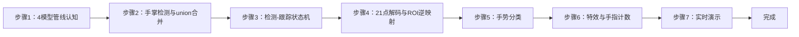

---

#### 步骤1：4 模型管线认知（阶段一：能运行，20min）

> 📌 本步骤对应源码：`hand_control_core/convert_mediapipe.py`、`models/`

**知识点讲解**：

**四模型级联架构（1.1.1）**
- **原理**：mediapipe gesture_recognizer.task 解包为 4 个模型，分工明确：(1) **hand_detector**（192×192）检测手掌位置（blazeface 2016 锚）；(2) **hand_landmarks_detector**（224×224）输出 21 点关键点 + presence + handedness + world；(3) **gesture_embedder** 把 21 点编码为 128 维特征（norm_tensor 单输入，x/y/z 全部 /224）；(4) **canned_gesture_classifier** 把 128 维分类为 8 类手势。**输入契约各异**：①② mean 0/std 1 **float32 [0,1] 输入**（板端实测 uint8 直喂→输出爆炸）；③ norm_tensor（归一化输入）；④ float 无 mean/std。转换脚本 `convert_mediapipe.py` 逐模型处理并 `--check` 契约自检。
- **源码对应**：`convert_mediapipe.py`（.task 解包 4 模型 / 各模型契约配置 / --check）；`models/`（4 个 rknn 产物）

**操作步骤**：

1. 查看 models/ 目录 4 个 rknn 模型，对照 README 输入契约表
2. 契约自检：`PYTHONPATH=car1_hand_control python3 -m hand_control_core.convert_mediapipe --check`
3. 思考：为什么 4 个模型不合成 1 个？（各模型任务独立、可单独优化替换；分类器可热更新新增手势）

**易错点**：
- ⚠️ ①② 输入 float32 [0,1]（uint8 直喂 → 输出爆炸，板端实测）；③④ 契约不同，勿混用

---

#### 步骤2：手掌检测与 union 合并（阶段一：能运行，25min）

> 📌 本步骤对应源码：`hand_control_core/hand.py` palm 解码 / union_bbox

**知识点讲解**：

**palm 检测与特写合并（1.2.1）**
- **原理**：hand_detector 用 **blazeface 2016 锚**（2016 个锚点覆盖多尺度）检测手掌，锚解码 + NMS 得到候选框。**特写大图陷阱**：手离镜头很近时，手掌被检测成多个分裂小框——`union_bbox()` 把 IoU 重叠的候选框**合并为一个大框**（取并集），避免"一只手掌多个框"。检测框经 `detection2roi`（官方算法）转为**旋转方形 ROI**（手是任意角度的，方形 ROI 让关键点模型看到规范化的手）。
- **源码对应**：`hand.py`（palm 解码：blazeface 2016 锚 / NMS；union_bbox 合并；detection2roi 旋转方形 ROI）

**操作步骤**：

1. 单测理解锚解码/合并：`pytest tests/ -k palm -v`
2. 特写测试：手贴近镜头运行，观察是否多框合并为单框
3. 思考：为什么手部检测要旋转方形 ROI 而非直接裁剪？特写时为什么分裂多框？

**易错点**：
- ⚠️ 特写不合并 → 同一只手多套关键点/手势（union_bbox 已处理）

---

#### 步骤3：检测-跟踪状态机（阶段二：能理解，30min）

> 📌 本步骤对应源码：`hand_control_core/engine.py` HandEngine

**知识点讲解**：

**官方检测-跟踪状态机（1.3.1）**
- **原理**：每帧都跑 palm 检测（192²）代价高。mediapipe 官方用**检测-跟踪状态机**加速：**上帧 presence ≥ 0.5 时跳过 palm 检测**，直接从上帧 21 点生成 ROI（手移动小，预测 ROI 足够准）→ 只跑关键点模型；**丢失（presence < 0.5）回退全图 palm 检测**重新定位。效果：稳态帧省一次检测推理，帧率显著提升；手快速移动/出入画时自动回退检测，鲁棒性不降。这是"用跟踪省检测"的经典工程模式（与实验7 DeepSORT 的思想同源）。
- **源码对应**：`engine.py`（HandEngine 状态机：presence 过滤 / ROI 预测 / 丢失回退）

**操作步骤**：

1. 运行单测理解状态机分支：`pytest tests/ -k engine -v`
2. 手慢速移动（跟踪态）vs 快速甩动（回退检测态），对比帧率波动
3. 思考：presence 阈值 0.5 的作用？跟踪态 ROI 预测不准的后果与回退机制？

**易错点**：
- ⚠️ presence<0.5 必须回退全图检测，否则跟踪态漂移累积

---

#### 步骤4：21 点解码与 ROI 逆映射（阶段二：能理解，30min）

> 📌 本步骤对应源码：`hand_control_core/hand.py` roi_affine / 21 点解码

**知识点讲解**：

**仿射映射与坐标还原（1.2.1）**
- **原理**：关键点模型在**旋转方形 ROI** 坐标系内输出 21 点，要还原到原图需**逆映射**：`roi_affine` 构造 ROI→原图的仿射变换（含旋转/缩放/平移），`roi_affine` 逆变换把 21 点映射回原图像素坐标。21 点布局（HAND_CONNECTIONS 21 边拓扑）：腕 0 点 + 拇指 1-4 + 食指 5-8 + 中指 9-12 + 无名指 13-16 + 小指 17-20。每个点 [x,y,z]（z 为相对深度）。`detection2roi` 与 `roi_affine` 配对保证"检测→ROI→关键点→逆映射"闭环。
- **源码对应**：`hand.py`（HAND_CONNECTIONS 21 边 / roi_affine / 逆映射 / 21 点解码）

**操作步骤**：

1. 单图输出右栏骨架，验证 21 点贴合手指
2. 单测理解仿射逆映射：`pytest tests/ -k roi -v`
3. 打印某点原图坐标 vs ROI 坐标，手工验证逆映射
4. 思考：旋转 ROI 比水平裁剪的优势？（任意角度的手都能规范到标准姿态）

**易错点**：
- ⚠️ 逆映射必须用同一仿射矩阵（engine 已配对），否则骨架错位

---

#### 步骤5：手势分类（阶段二：能理解，25min）

> 📌 本步骤对应源码：`hand_control_core/engine.py` embedder / classifier 调用

**知识点讲解**：

**嵌入 + 分类两段式（1.3.2）**
- **原理**：手势分类不直接用 21 点（维度低、对姿态敏感），而是两段式：**gesture_embedder** 把 21 点（norm_tensor：x/y/z 全部 /224 归一化）编码为 **128 维特征**（捕捉手指相对几何），**canned_gesture_classifier** 把 128 维 softmax 分类为 **8 类**：None / Closed_Fist（握拳）/ Open_Palm（张开）/ Pointing_Up（食指上指）/ Thumb_Down / Thumb_Up / Victory（比耶）/ ILoveYou（我爱你）。嵌入层的价值：固定分类器可换（新增手势只重训分类器，embedder 复用）。
- **源码对应**：`engine.py`（embedder 调用：norm_tensor 构造 / classifier softmax）；8 类标签（canned 分类器内置）

**操作步骤**：

1. 单图验证：张开手掌照片 → Open_Palm；比耶照片 → Victory
2. 8 类手势逐一测试（握拳/张开/食指/拇指上下/比耶/我爱你），记录识别稳定性
3. 动手改造：打印 8 类 softmax 分数分布，观察易混淆手势（如 Victory vs ILoveYou）

**易错点**：
- ⚠️ embedder 输入 norm_tensor 必须 /224（x/y/z 同缩放），错用其他归一化 → 特征错乱

---

#### 步骤6：特效与手指计数（阶段三：能改造，30min）

> 📌 本步骤对应源码：`hand_control_core/effects.py`、`fingers.py`

**知识点讲解**：

**夹角控制与手指计数（1.3.2、1.3.3）**
- **原理**：**拇指-食指夹角控制**：用余弦定理计算点 4-0-8 的夹角（`angle(4,0,8)`），映射到 [0,70]° → value [0,255] → 驱动 5 种特效强度（color/thresh/blur/hue/enhance，effects.py），'f' 键循环切换——"捏合越小夹角越小 → 特效越强"的直觉交互。**手指计数**（fingersUp，vendor 11 语义）：拇指用双角（150° 阈值）判定，四指用 `tip.y < pip.y`（指尖高于近端指关节）判定 → 状态栏 `Fingers: N`。两者都基于 21 点几何，零额外模型。
- **源码对应**：`fingers.py`（夹角映射 / fingersUp 计数）；`effects.py`（5 种特效）；`camera_demo.py`（'f' 切换 + 仪表绘制）

**操作步骤**：

1. 单图验证手指计数：伸 2 根手指 → 状态栏 Fingers: 2
2. 仪表测试：拇指食指张开→捏合，观察仪表条 0→255 升降与特效强度变化
3. 'f' 键循环切换 5 种特效，观察画面效果差异
4. 动手改造：把夹角映射改为"音量/亮度"调节，或新增第 6 种特效

**易错点**：
- ⚠️ 拇指计数用双角（150°），四指用 tip.y<pip.y——阈值按实际手型微调
- ⚠️ 特效切换是 'f' 键（需窗口焦点；MJPEG 流同步推特效帧）

---

#### 步骤7：实时演示（阶段三：能改造，30min）

> 📌 本步骤对应源码：`hand_control_core/camera_demo.py`、`view.py`

**知识点讲解**：

**端到端闭环（1.3.2）**
- **原理**：`camera_demo.py` 实时循环：取流（--ros ascamera / --camera N V4L2 回退）→ HandEngine（状态机 + 4 模型编排）→ 手势分类 + 特效 + 手指计数 → 双栏（左=特效帧+FPS，右=黑底骨架+手势名+仪表）→ 状态栏 → MJPEG（:8084/hand.mjpg）→ q 退出。**PYTHONPATH 必须保留 $PYTHONPATH**（venv PyPI rclpy 陷阱）。
- **源码对应**：`camera_demo.py`（实时循环 / 'f' 特效 / 仪表 / MJPEG）；`view.py`（双栏 + 状态栏）；`hand_control_node.py`（ROS 节点可选）

**操作步骤**：

1. 相机实时（板上标准）：
   ```bash
   source /opt/ros/humble/setup.bash && source ~/ros2_ws/install/setup.bash
   ros2 launch ascamera hp60c.launch.py        # 终端 1
   PYTHONPATH=car1_hand_control:$PYTHONPATH python3 -m hand_control_core.camera_demo \
     --config config/hand_control_config.yaml --ros --display   # 终端 2
   ```
2. 完整交互演示：手势切换（Open_Palm/Victory）+ 'f' 特效切换 + 捏合仪表
3. 无手测试：画面无手 → 不崩，状态栏 Hands: 0
4. 动手改造：把 8 类手势映射为不同指令（如 Victory → 前进），与实验11 的 cmd_vel 联动，实现"手势遥控"

**易错点**：
- ⚠️ PYTHONPATH 保留 $PYTHONPATH；--ros 需 ascamera 先起、话题严禁 remap
- ⚠️ UVC 回退需 V4L2+YUYV（NOVATEK 相机 MJPG 损坏）

---

### 1.7 常见问题

| 问题 | 原因 | 解决方法 |
|------|------|---------|
| 检测不到手/手势错 | ①② 输入契约错误（uint8 直喂） | ①② 用 float32 [0,1]（板端实测；convert.py 一键切换） |
| 一只手掌多框 | 特写 palm 分裂 | union_bbox 合并（已内置） |
| 骨架错位 | ROI 逆映射未配对 | 确认 roi_affine 逆变换与 detection2roi 同参数 |
| 跟踪态漂移 | presence<0.5 未回退检测 | 状态机已回退全图（engine.py） |
| 手势易混淆 | embedder 输入归一化错误 | norm_tensor 必须 x/y/z 全部 /224 |
| 特效不切换 | 'f' 键无窗口焦点 | 点击窗口后再按 'f'；MJPEG 流同步推特效帧 |
| 手指计数不准 | 拇指双角/四指阈值不当 | fingers.py 阈值按实际手型微调 |
| rclpy ModuleNotFoundError | PYTHONPATH 覆盖丢 Humble 路径 | `PYTHONPATH=car1_hand_control:$PYTHONPATH` |

### 1.8 扩展实验

**扩展方向 1：手势遥控小车（进阶）**
- 把 8 类手势映射为控制指令（Open_Palm=前进、Closed_Fist=停止、Thumb_Up=加速、Thumb_Down=后退），通过 cmd_vel 发布（复用实验11 的发布模式），实现"隔空遥控"

**扩展方向 2：自定义手势（进阶）**
- 采集新手势的 21 点序列，重训 canned_gesture_classifier（或改用 KNN/余弦相似度对比 128 维特征），扩展手势集

### 1.9 实验报告要求

**评分标准**：4 模型管线理解 15 分 + 手掌检测与合并 15 分 + 状态机 20 分 + 21 点解码 15 分 + 手势分类 15 分 + 特效/计数 10 分 + 报告 10 分 = 100 分。

**报告必含内容**：
1. 4 模型级联架构图（各模型输入输出契约表）
2. 手掌检测结果图（含特写 union 合并前后对比）
3. 检测-跟踪状态机流程图（presence 分支）
4. 8 类手势测试记录表（识别率/易混淆项）
5. 拇指-食指夹角仪表与特效联动记录
6. 回答思考题：为什么 4 模型不用 1 个？为什么 float32 [0,1] 输入？状态机如何加速？嵌入层的作用？
7. 实验心得与问题记录

---

## 更新日志

| 版本 | 日期 | 变更 |
|------|------|------|
| v1.0 | 2026-08-10 | 初版生成（源码路径 ros2_ws/src/xflz_eai_car1/vision/12_hand_control，58 项测试全绿，palm+21点+embedder+8类 4 模型管线 + 检测-跟踪状态机 + 特效/手指计数，板端验证通过） |

---

## 更新日志

| 版本 | 日期 | 变更 |
|------|------|------|
| v1.0 | 2026-08-10 | 初版合并：12 个实验指导书（基于 ros2_ws/src/xflz_eai_car1/vision/ 源码实测，各实验独立版本详见对应章节） |
