# EXP001 机器人视觉应用与开发 — 实验指导书

## 目录

- [实验1：基于HSV色彩空间的颜色识别实验](#实验1基于hsv色彩空间的颜色识别实验)
- [实验2：二维码生成与识别检测实验](#实验2二维码生成与识别检测实验)
- [实验3：基于OpenCV的多边形轮廓拟合实验](#实验3基于opencv的多边形轮廓拟合实验)
- [实验4：基于YOLOv8的工业表面缺陷检测实验](#实验4基于yolov8的工业表面缺陷检测实验)
- [实验5：基于图像分类的垃圾分类实验](#实验5基于图像分类的垃圾分类实验)
- [实验6：基于语义分割的背景分割实验](#实验6基于语义分割的背景分割实验)
- [实验7：基于DeepSORT的多目标跟踪实验](#实验7基于deepsort的多目标跟踪实验)
- [实验8：基于人脸关键点特征检测实验](#实验8基于人脸关键点特征检测实验)
- [实验9：基于骨骼关键点的肢体检测实验](#实验9基于骨骼关键点的肢体检测实验)
- [实验10：基于深度信息的3D物体检测实验](#实验10基于深度信息的3d物体检测实验)
- [实验11：基于肢体动作的体感控制实验](#实验11基于肢体动作的体感控制实验)
- [实验12：基于手指动作的控制实验](#实验12基于手指动作的控制实验)

---

## 实验总览

> **学习顺序说明**：下表按「由易到难」重排——先 OpenCV 传统视觉（免训练、可解释、帧率高），再 YOLO 系列（检测/分类/分割），接着 DeepSORT 跟踪，最后 MediaPipe 人体感知与控制。
> `源码路径` 中的目录号是仓库交付号，与左侧学习序号不再一一对应，请以下表为准。

| 编号 | 实验名称 | 学时 | 类型 | 难度 | 源码路径 |
|------|---------|------|------|------|---------|
| 实验1 | 基于HSV色彩空间的颜色识别实验 | 4h | 验证性 | ⭐ | `ros2_ws/src/xflz_eai_car1/vision/03_lab_color_recognition` |
| 实验2 | 二维码生成与识别检测实验 | 4h | 验证性 | ⭐ | `ros2_ws/src/xflz_eai_car1/vision/04_qrcode` |
| 实验3 | 基于OpenCV的多边形轮廓拟合实验 | 4h | 设计性 | ⭐⭐ | `ros2_ws/src/xflz_eai_car1/vision/05_line_following` |
| 实验4 | 基于YOLOv8的工业表面缺陷检测实验 | 4h | 综合性 | ⭐⭐ | `ros2_ws/src/xflz_eai_car1/vision/01_industrial_defect_detection` |
| 实验5 | 基于图像分类的垃圾分类实验 | 4h | 设计性 | ⭐⭐ | `ros2_ws/src/xflz_eai_car1/vision/02_garbage_classification` |
| 实验6 | 基于语义分割的背景分割实验 | 4h | 设计性 | ⭐⭐ | `ros2_ws/src/xflz_eai_car1/vision/06_semantic_segmentation` |
| 实验7 | 基于DeepSORT的多目标跟踪实验 | 4h | 综合性 | ⭐⭐⭐ | `ros2_ws/src/xflz_eai_car1/vision/07_multi_object_tracking` |
| 实验8 | 基于人脸关键点特征检测实验 | 4h | 设计性 | ⭐⭐ | `ros2_ws/src/xflz_eai_car1/vision/09_face_landmarks` |
| 实验9 | 基于骨骼关键点的肢体检测实验 | 4h | 设计性 | ⭐⭐ | `ros2_ws/src/xflz_eai_car1/vision/10_pose_landmark` |
| 实验10 | 基于深度信息的3D物体检测实验 | 4h | 设计性 | ⭐⭐ | `ros2_ws/src/xflz_eai_car1/vision/08_depth_3d_detection` |
| 实验11 | 基于肢体动作的体感控制实验 | 4h | 综合性 | ⭐⭐⭐ | `ros2_ws/src/xflz_eai_car1/vision/11_pose_control` |
| 实验12 | 基于手指动作的控制实验 | 4h | 设计性 | ⭐⭐ | `ros2_ws/src/xflz_eai_car1/vision/12_hand_control` |

**学时合计：48h**（12 个实验，对应 course-spec total_hours=48 中实验学时部分）

**技术栈递进**：

| 阶段 | 实验 | 技术栈 | 是否需要训练 | 板端帧率 |
|------|------|--------|-------------|---------|
| ① 传统视觉 | 实验1~3 | OpenCV（HSV / QRCode / 轮廓） | 否 | 30~50 FPS |
| ② 目标检测与分类 | 实验4~5 | YOLOv8 / YOLOv5 检测头 + RKNN | 是（已交付权重） | 13~18 FPS |
| ③ 语义分割 | 实验6 | yolov8n-seg + 多线程推理池 | 是（已交付权重） | 40~60 FPS |
| ④ 多目标跟踪 | 实验7 | YOLOv8 + DeepSORT + ReID | 是（已交付权重） | 12~15 FPS |
| ⑤ 人体感知 | 实验8~10 | MediaPipe Blaze + 深度相机 | 是（已交付权重） | 10~28 FPS |
| ⑥ 视觉控制闭环 | 实验11~12 | 关键点 + cmd_vel / 手势分类 | 是（已交付权重） | 10~12 FPS |

---

## 实验1：基于HSV色彩空间的颜色识别实验（4h）

> ✅ **源码已核实** 本实验源码位于 `ros2_ws/src/xflz_eai_car1/vision/03_lab_color_recognition/`。⚠️ **注意**：课程目录名 "lab" 指实验编号，本实验实际使用 **HSV 色彩空间**（非 Lab 色彩空间）。对应课程内容：BGR→HSV 阈值掩膜 → 形态学开/闭 → 圆形轮廓标识 → 颜色名标注；可视化对齐车端 `visual_grasp` 双栏（左 RGB 栏 | 右 HSV Mask 栏）推流。单测 24/24 全绿，板端验证通过（约 50 FPS）。

### 1.1 关联知识点

- 1.1.1 HSV色彩空间 > 原理 > HSV（色相/饱和度/明度）将颜色信息与光照强度解耦，比 RGB 更适合阈值分割；OpenCV 约定 H∈0-179、S/V∈0-255
- 1.1.2 色彩阈值掩膜 > 流程 > `cv2.inRange` 生成二值掩膜；红色在 0/180 交界需 h2 第二段（环形色相处理）
- 1.2.1 形态学运算 > 概念 > 开运算（先腐蚀后膨胀）去孤立噪点，闭运算（先膨胀后腐蚀）填小孔洞；核须奇数
- 1.2.2 轮廓检测 > 流程 > `cv2.findContours` → 最小外接圆 `minEnclosingCircle`，按 min_area/min_radius/max_radius 过滤后取最大
- 1.3.1 实时颜色识别 > 流程 > 摄像头取流 → HSV 转换 → 阈值掩膜 → 形态学 → 圆形轮廓 → 颜色名标注 → 双栏 MJPEG 推流
- 1.3.2 阈值调参 > 流程 > `--tune` 模式提供 H/S/V 6 滑块实时调参，Ctrl+C 退出并打印当前阈值，直接写入 config

### 1.2 实验目标

1. 掌握 HSV 色彩空间与 RGB 的转换原理，理解阈值分割的适用范围与局限 — 原理理解
2. 实现摄像头实时采集、多色目标检测（红/蓝/绿）与颜色名标注 — 独立完成
3. 掌握形态学运算与轮廓分析在目标提取中的作用，学会用 --tune 调参应对光照变化 — 迁移应用

### 1.3 实验环境

| 类别 | 配置 |
|------|------|
| 硬件 | 具身智能实验箱 B2（XFLZ_EAI_B2_PRO，RK3576 SoC，6TOPS NPU，含 HP60C 深度相机） |
| OS | Ubuntu 22.04 + ROS2 Humble（板载 ros2_venv） |
| 核心库 | OpenCV、NumPy、PyYAML（纯 CPU 视觉管线，无需 NPU） |
| 主入口 | `src/app.py`（图像/视频/相机 CLI + MJPEG 双栏流 + `--tune` 调参） |

### 1.4 实验难度

- 难度: ⭐ 验证性
- 重点: HSV 阈值掩膜 + 形态学开/闭 + 圆形轮廓标识 + 颜色名标注
- 难点: 红色跨 0/180 边界的 h2 环形处理；光照变化下的阈值鲁棒性

### 1.5 实验现象

**快速验证流程**：

1. 进入项目目录：`cd ros2_ws/src/xflz_eai_car1/vision/03_lab_color_recognition`
2. 单元测试：`pytest tests/ -v`（24 用例全绿）
3. 单图检测：`python src/app.py --image x.jpg --save out.jpg`
   - 输出双栏图：左 RGB 栏（绿轮廓+黄框+红质心十字+颜色名）| 右 HSV Mask 栏（白匹配区）
4. 相机实时（板上标准）：先起 ascamera 驱动，再 `python src/app.py --ros`
   - MJPEG：`http://<板IP>:8080/lab_color.mjpg`（同双栏）
5. 调参：`python src/app.py --tune 红色 --ros`，6 滑块实时调 H/S/V

**执行现象**：
- `pytest tests/ -v` 约 10-20 秒完成，终端输出 24 个用例全部 passed（涵盖 config 加载/校验、bgr_to_hsv 转换、range_mask 双段、morph_open/morph_close 核、largest_circle 过滤、detect_colors 管线、draw_detection 绘制、mask_view 渲染、auto_hsv_range 自动估计、app.py 主流程等）
- `python src/app.py --image x.jpg --save out.jpg` 约 0.1 秒返回，终端无报错，当前目录生成 `out.jpg`（双栏拼接图）；若图中含红/蓝/绿球，左栏可见绿轮廓+黄框+红十字+颜色名，右栏白色掩膜覆盖对应区域
- 板端 `--ros` 模式启动后，终端每帧打印 frame 编号，MJPEG 流 `http://<板IP>:8080/lab_color.mjpg` 可访问，双栏实时刷新，实测约 **50 FPS**（纯 CPU 管线）
- `--tune 红色 --ros` 启动后弹出 `lab_tune` 窗口（6 滑块）和 `lab_view` 窗口（双栏预览），首帧自动估计阈值并预置滑块位置；Ctrl+C 退出终端打印当前 H/S/V 阈值

```bash
# 进入实验1
cd ~/ros2_ws/src/xflz_eai_car1/vision/03_lab_color_recognition

# 可选
/home/iflytek/ros2_venv/bin/python -m pytest -v

# 执行单图片推理（图片都在02_garbage_classification/images）
python src/app.py --image image.jpg --save out.jpg
```

**预期效果描述**：
- 红/蓝/绿三种目标均能检出：圆形轮廓 + 窗口左下角颜色名正确
- 右栏 Mask 图实时显示匹配区域（白色），与左栏轮廓对应
- 板端实测约 50 FPS（纯 CPU 管线，无需 NPU）
- 光照变化导致误检/漏检时，`--tune` 可实时修正阈值

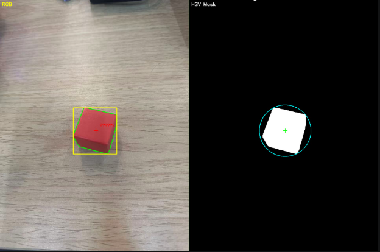

### 1.6 实验步骤

#### 整体流程图

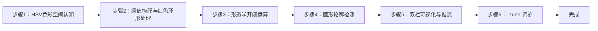

---

#### 步骤1：HSV 色彩空间认知（阶段一：能运行，20min）

> 📌 本步骤对应源码：`src/preprocess.py` bgr_to_hsv（L36-38）

**知识点讲解**：

**HSV 与 RGB 的差异（1.1.1）**
- **原理**：RGB 将颜色编码为三通道强度，受光照影响大（同一红色在明/暗处 R/G/B 值差异巨大）。HSV 把颜色拆为色相 H（0-179°，决定"是什么颜色"）、饱和度 S（0-255，颜色纯净度）、明度 V（0-255，亮度），**颜色信息与光照强度解耦**——阈值分割时只需限定 H 范围 + 适当放宽 S/V，即可在光照变化下稳定识别。`bgr_to_hsv()`（L36-38）一行 `cv2.cvtColor(BGR2HSV)` 完成转换。注意 OpenCV 的 H 范围是 0-179（非 0-360），这是与教科书最常混淆的点。
- **源码对应**：`src/preprocess.py` L36-38（bgr_to_hsv）

**知识储备补充**：

- **色彩空间背景**：RGB 是面向显示设备的加色混合模型——三个通道直接对应显示器的红/绿/蓝子像素亮度。在光照变化场景下，同一物体的 RGB 三通道值会同时漂移（变暗时 R/G/B 都下降），导致"同一颜色在不同光照下 RGB 值差异巨大"，阈值分割极不稳定。HSV 将颜色信息（H）与光照强度（V）分离：H 只取决于色相角度（与亮度无关），V 只反映明暗，S 反映颜色纯净度。这种分离使 HSV 成为颜色分割的首选空间——只需固定 H 范围，S/V 允许较大浮动，即可在光照变化下稳定识别。
- **转换公式**：BGR→HSV 的数学定义。设 $R,G,B \in [0,1]$ 为归一化 BGR 三通道值，$V' = \max(R,G,B)$、$m = \min(R,G,B)$：
$$
  H = \begin{cases} 0 & \text{if } V' = m \\ 60 \times \left( \frac{G - B}{V' - m} \right) \bmod 360 & \text{if } V' = R \\ 60 \times \left( \frac{B - R}{V' - m} + 2 \right) \bmod 360 & \text{if } V' = G \\ 60 \times \left( \frac{R - G}{V' - m} + 4 \right) \bmod 360 & \text{if } V' = B \end{cases}
$$

$$
  S = \begin{cases} 0 & \text{if } V' = 0 \\ \frac{V' - m}{V'} & \text{if } V' > 0 \end{cases}
$$

$$
  V = V'
$$

OpenCV 内部将 $H$ 从 $[0°,360°)$ 映射到 $[0,179]$（uint8 存储，每个单位 = 2°），$S,V$ 从 $[0,1]$ 映射到 $[0,255]$。验证：纯红 $(R,G,B)=(255,0,0)$ → $V'=255,m=0$ → $H=60\times(0-0)/255=0$ → 映射后 $H=0$；$S=255/255=1$ → 映射后 $S=255$；$V=255$。即纯红 HSV = $(0,255,255)$，与实验中单像素验证一致。
- **通道语义**：H（Hue，色相）决定"是什么颜色"——0°/179° 红色、60° 黄色、120° 绿色、180° 青色（OpenCV 中 180° 即 H=90）、240° 蓝色、300° 品红。S（Saturation，饱和度）决定颜色纯净度——0 为灰（无彩色），255 为纯色。V（Value，明度）决定亮度——0 为全黑，255 为最亮。三通道语义独立，使阈值分割直观："红球 H∈[0,15]∪[160,180] + S>100 + V>80"即可框定红色目标。
- **参考资源**：OpenCV 官方文档 `cv2.cvtColor` COLOR_BGR2HSV 说明；Wikipedia "HSL and HSV" 条目（https://en.wikipedia.org/wiki/HSL_and_HSV）；《Digital Image Processing》（Gonzalez & Woods）第 6 章色彩空间。

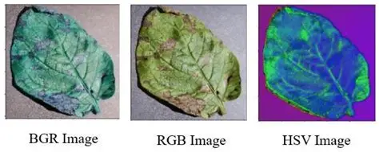

**配置参数速查表**（`config/lab_config.yaml`，按区块分列）：

| 区块 | 参数 | 类型 | 默认/示例 | 说明 |
|------|------|------|-----------|------|
| `colors` | 列表 | list | 红/绿/蓝 3 项 | 颜色定义表（每项 name+h/s/v，红色含 h2 环形第二段） |
|`colors[]`|`name`|str|`红色`|显示名（窗口左下角）|
|`colors[]`|`h`|list|`[0,15]`|H 通道 [min,max]（H∈0-179）|
|`colors[]`|`s`/`v`|list|`[100,255]`/`[80,255]`|S 饱和度/V 明度范围|
|`colors[]`|`h2`|list|`[160,180]`|H 环形第二段（红色在 0/180 交口；仅红色用）|
|`morph`|`open_kernel`|int|`5`|开运算核（去噪点），奇数|
|`morph`|`close_kernel`|int|`9`|闭运算核（填孔洞），奇数|
|`morph`|`open_iter`/`close_iter`|int|`1`|形态学迭代次数|
|`contour`|`min_area`|int|`500`|最小轮廓面积（滤噪）|
|`contour`|`min_radius`/`max_radius`|int|`10`/`400`|外接圆半径范围|
|`camera`|`index`|int|`0`|VideoCapture 索引（V4L2 回退用）|
|`camera`|`width`/`height`|int|`640`/`480`|取流分辨率|
|`source`|`ros.rgb_topic`|str|`/ascamera_hp60c/.../rgb0/image`|相机话题（勿 remap）|
|`source`|`ros.timeout`|float|`5.0`|首帧等待秒数|
|`display`|`show`|bool|`false`|本地窗口（板上置 false 走 MJPEG）|
|`display`|`window_name`|str|`lab_color`|窗口名|

> **说明**：`colors`+`morph`+`contour` 为核心（颜色阈值与形态学）；`camera`/`source`/`display` 为运行环境（同 exp01/02 模板）。HSV 阈值须按环境光照实标定。

**操作步骤**：

1. 单像素验证 RGB→HSV 转换：
   ```bash
   # 执行目录：~/ros2_ws/src/xflz_eai_car1/vision/03_lab_color_recognition
   cd ~/ros2_ws/src/xflz_eai_car1/vision/03_lab_color_recognition
   PYTHONPATH=./src python -c "
   import cv2, numpy as np
   red = np.uint8([[[0, 0, 255]]])          # BGR 纯红
   hsv = cv2.cvtColor(red, cv2.COLOR_BGR2HSV)
   print('纯红 HSV:', hsv[0][0])             # 预期 H≈0, S≈255, V≈255"
   ```
2. 用一张彩色图可视化 HSV 三通道（H/S/V 分别显示），理解各通道语义

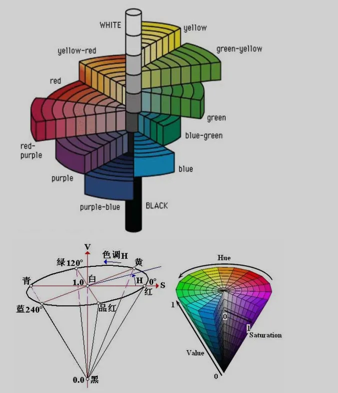

**易错点**：

- ⚠️ H 范围 0-179（OpenCV）≠ 0-360（教科书），阈值写错直接全黑

**流程图**：

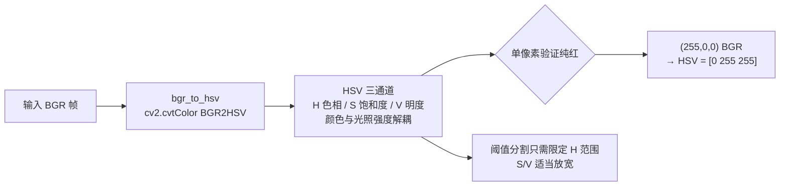

---

#### 步骤2：阈值掩膜与红色环形处理（阶段一：能运行，25min）

> 📌 本步骤对应源码：`src/preprocess.py` range_mask（L41-51）、`src/config.py` ColorSpec

**知识点讲解**：

**inRange 阈值掩膜（1.1.2）**
- **原理**：`cv2.inRange(hsv, lower, upper)` 对每个像素判断是否落在阈值区间，生成二值掩膜（匹配=255，不匹配=0），是颜色分割的核心。**红色特殊**：红色在 H 环形色相中位于 0 附近，跨越 0/180 边界（H≈0 和 H≈179 都是红），单一区间 `[0,10]` 会漏掉 H≈179 的偏紫红。`ColorSpec` 支持 `h2` 第二段（如 `h=[0,10], h2=[170,179]`），`range_mask()`（L41-51）把两段掩膜**按位或**合并，解决红色环形问题——车端 visual_grasp 同款方案。阈值配置集中管理：`config/lab_config.yaml` 中每种颜色一组 HSV 范围 + 形态学核 + 轮廓过滤参数。
- **源码对应**：`src/preprocess.py` L41-51（range_mask，h2 并入 L46-49）；`src/config.py` ColorSpec（h/s/v/h2/过滤参数）

**知识储备补充**：

- **inRange 掩膜数学定义**：`cv2.inRange` 对每个像素位置 $(u,v)$ 执行逐通道范围判断：
$$
  M(u,v) = \begin{cases} 255 & \text{if } L_h \leq H(u,v) \leq U_h \;\wedge\; L_s \leq S(u,v) \leq U_s \;\wedge\; L_v \leq V(u,v) \leq U_v \\ 0 & \text{otherwise} \end{cases}
$$

其中 $(L_h, U_h)$、$(L_s, U_s)$、$(L_v, U_v)$ 分别为 H/S/V 的上下限阈值。输出为单通道 uint8 图像（255 = 匹配，0 = 不匹配），后续形态学运算基于此二值图。
- **红色环形处理**：色相 H 是角度量，0° 与 360°（OpenCV 中 180）重合。红色占据色相环两端：$H \in [0°,10°]$ 和 $H \in [340°,360°]$，对应 OpenCV 的 $H \in [0,5]$ 和 $H \in [170,179]$。单一区间 $[0,5]$ 只覆盖色相环的一端，偏紫红（$H \approx 170$）的目标会漏检。`range_mask`（L46-49）的 h2 并入逻辑：

  $$
  M_{\text{red}} = M_{\text{seg1}} \lor M_{\text{seg2}} = \text{inRange}(\text{seg1}) \;\texttt{bitwise\_or}\; \text{inRange}(\text{seg2})
  $$

  两段掩膜按位或合并后，红色目标的两个 H 段均被覆盖。`lab_config.yaml` 中红色配置为 `h: [0,15], h2: [160,180]`。
- **阈值配置管理**：`config/lab_config.yaml` 把每种颜色的 HSV 阈值、形态学核、轮廓过滤参数集中管理，代码侧通过 `load_config` + `load_colors` 读取。这使"调参"只需改 YAML 文件，无需触碰代码——是配置驱动设计的标准实践。
- **参考资源**：OpenCV 官方文档 `cv2.inRange`；《Learning OpenCV 3》第 10 章阈值与分割；车端 visual_grasp 方案参考（同款 h2 环形处理）。

**操作步骤**：

1. 查看 `config/lab_config.yaml` 中红/蓝/绿三色的 HSV 阈值，找出红色的 h2 第二段
2. 用测试图验证单色掩膜效果：
   ```bash
   # 执行目录：~/ros2_ws/src/xflz_eai_car1/vision/03_lab_color_recognition
   cd ~/ros2_ws/src/xflz_eai_car1/vision/03_lab_color_recognition
   PYTHONPATH=./src python -c "
   import cv2
   from preprocess import bgr_to_hsv, range_mask
   from config import load_config, load_colors
   cfg = load_config('config/lab_config.yaml')
   colors = load_colors(cfg)
   img = cv2.imread('image.jpg')
   hsv = bgr_to_hsv(img)
   for c in colors:
       mask = range_mask(hsv, c)
       print(c.name, '匹配像素:', int(mask.sum()/255))"
   ```
3. 尝试删除红色 h2 第二段，观察偏红目标是否漏检

**易错点**：

- ⚠️ 红色不用 h2 会漏检偏紫红目标——红色必须双段处理

**流程图**：

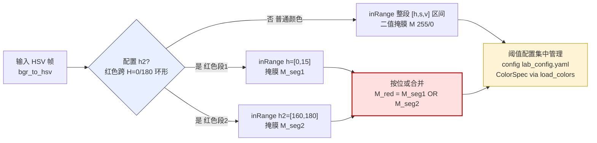

---

#### 步骤3：形态学开/闭运算（阶段二：能理解，25min）

> 📌 本步骤对应源码：`src/preprocess.py` morph_open（L53-56）/ morph_close（L59-62）

**知识点讲解**：

**形态学运算原理（1.2.1）**

- **原理**：二值掩膜常含噪点（误检像素）与孔洞（目标内部漏检）。**开运算** = 先腐蚀后膨胀：腐蚀先"吃掉"孤立小噪点，膨胀再恢复目标尺寸，结果**去噪点**；**闭运算** = 先膨胀后腐蚀：膨胀先"填平"目标内部小孔洞，腐蚀恢复尺寸，结果**填孔洞**。核用 `cv2.MORPH_ELLIPSE` 椭圆核（对圆形目标最友好），核尺寸须为奇数（`open_kernel=5` 去噪点、`close_kernel=9` 填孔洞，L53-62）。形态学处理显著提升后续轮廓检测的稳定性——噪点不除会干扰"最大圆"判定，孔洞不填会低估目标面积。
- **源码对应**：`src/preprocess.py` L53-56（morph_open）、L59-62（morph_close）

**知识储备补充**：

- **腐蚀与膨胀的数学定义**：设二值图像 $A$、结构元素（核）$B$，腐蚀和膨胀分别为：

  $$
  A \ominus B = \{ x \mid B_x \subseteq A \} \qquad \text{（腐蚀：核内所有像素均为前景才保留）}
  $$

  $$
  A \oplus B = \{ x \mid B_x \cap A \neq \varnothing \} \qquad \text{（膨胀：核内任一像素为前景即置为前景）}
  $$

  其中 $B_x$ 为核 $B$ 平移到位置 $x$ 的集合。腐蚀"收缩"前景区域，膨胀"扩张"前景区域。开运算 $A \circ B = (A \ominus B) \oplus B$ 先腐蚀后膨胀——腐蚀消除面积小于核的小噪点，膨胀恢复剩余前景的原始尺寸；闭运算 $A \bullet B = (A \oplus B) \ominus B$ 先膨胀后腐蚀——膨胀填平面积小于核的小孔洞，腐蚀恢复轮廓。
- **结构元素选择**：`cv2.getStructuringElement(cv2.MORPH_ELLIPSE, (k,k))` 生成 $k \times k$ 椭圆核（近似圆形），对本实验的圆形目标最友好。矩形核易在对角方向引入方块效应，十字核只处理 4-连通方向。核尺寸须为奇数——偶数核会导致锚点（anchor）不对称，OpenCV 行为未定义（实际可能报错或产生偏移）。默认 `open_kernel=5`（约 2 像素半径的噪点可去）、`close_kernel=9`（约 4 像素半径的孔洞可填）。
- **形态学参数对检测的影响**：`open_kernel` 过小去不掉稍大的噪点，过大吞掉小目标（面积小于核的前景全被腐蚀）；`close_kernel` 过小填不了稍大的孔洞，过大将相邻目标误连。`open_iter`/`close_iter` 控制迭代次数——多次迭代等价于使用更大的核（开运算多次迭代 = 腐蚀后膨胀交替重复，每次扩大效果范围）。
- **参考资源**：OpenCV 官方文档 `cv2.morphologyEx` / `cv2.getStructuringElement`；《Digital Image Processing》（Gonzalez & Woods）第 9 章形态学图像处理。

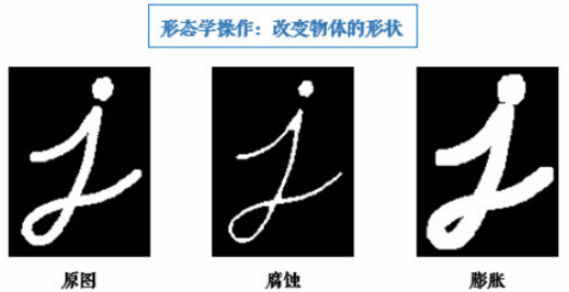

**操作步骤**：

1. 对比形态学处理前后的掩膜：
   ```bash
   # 执行目录：~/ros2_ws/src/xflz_eai_car1/vision/03_lab_color_recognition
   cd ~/ros2_ws/src/xflz_eai_car1/vision/03_lab_color_recognition
   PYTHONPATH=./src python -c "
   import cv2, numpy as np
   from preprocess import bgr_to_hsv, range_mask, morph_open, morph_close
   from config import load_config, load_colors
   cfg = load_config('config/lab_config.yaml')
   colors = load_colors(cfg)
   hsv = bgr_to_hsv(cv2.imread('image.jpg'))
   raw = range_mask(hsv, colors[0])
   opened = morph_open(raw)
   closed = morph_close(opened)
   print('原始像素:', int(raw.sum()/255), '→ 开运算后:', int(opened.sum()/255), '→ 闭运算后:', int(closed.sum()/255))"
   ```
2. 修改 config 中的 kernel 尺寸（改为偶数），观察报错或行为异常——理解"核须奇数"约束
3. 思考：开运算先腐蚀后膨胀，为什么能去噪点而不是扩大空洞？

**易错点**：

- ⚠️ 核尺寸必须奇数（偶数核 OpenCV 报错或行为未定义）
- ⚠️ 核过大过小都影响效果：过大吞掉小目标，过小去不掉噪点

**流程图**：

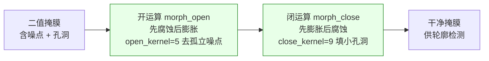

---

#### 步骤4：圆形轮廓检测（阶段二：能理解，25min）

> 📌 本步骤对应源码：`src/preprocess.py` largest_circle（L65-79）

**知识点讲解**：

**轮廓分析提取目标（1.2.2）**

- **原理**：形态学处理后的掩膜包含目标区域，`cv2.findContours` 提取所有连通域轮廓，对每个轮廓 `cv2.minEnclosingCircle` 求最小外接圆（圆心+半径）。`largest_circle()`（L65-79）按 `min_area`（面积过滤噪点）、`min_radius/max_radius`（限目标尺寸范围）过滤后**取面积最大的圆**作为该颜色的目标。`detect_colors()`（L93-107）对每种颜色执行完整管线：掩膜 → 开/闭 → 最大圆，输出携带该色掩膜的 `ColorDetect`（供双栏绘制）。这是"阈值分割 + 形态学 + 几何分析"的经典目标提取链路。
- **源码对应**：`src/preprocess.py` L65-79（largest_circle）、L93-107（detect_colors）

**知识储备补充**：

- **findContours 原理**：`cv2.findContours(mask, cv2.RETR_EXTERNAL, cv2.CHAIN_APPROX_SIMPLE)` 提取二值掩膜的外轮廓。`RETR_EXTERNAL` 只检索最外层轮廓（忽略嵌套），`CHAIN_APPROX_SIMPLE` 压缩水平/垂直/对角线段为端点，减少存储。输出为轮廓点集列表，每个轮廓是 $N \times 1 \times 2$ 的坐标数组。
- **最小外接圆**：`cv2.minEnclosingCircle(cnt)` 基于 Welzl 算法在 $O(n)$ 期望时间内求解最小包围圆——给定轮廓点集，找到面积最小的圆包含所有点。返回 `(圆心(cx,cy), 半径radius)`。相比最小外接矩形（`boundingRect`），最小外接圆对圆形目标更紧凑，不受旋转影响，是本实验"圆球检测"的自然选择。
- **轮廓过滤参数语义**：`min_area=500`（`lab_config.yaml`）过滤面积 < 500 像素的连通域——这些通常是噪点或极远距离的小目标；`min_radius=10` / `max_radius=400` 限制外接圆半径范围——太小（<10px）为噪点，太大（>400px）可能是误检的大片背景。三个参数需按实际摄像头分辨率和目标距离标定，是"阈值分割 + 几何约束"双重过滤的核心。
- **取最大圆的策略**：`largest_circle`（L65-79）遍历所有满足过滤条件的轮廓，保留面积最大的圆。这假设画面中每种颜色只有一个主目标——若需多目标计数，可修改为返回全部满足条件的圆列表（扩展方向 1）。
- **参考资源**：OpenCV 官方文档 `cv2.findContours` / `cv2.minEnclosingCircle`；Welzl 算法论文 "Smallest enclosing disks (balls and ellipsoids)"（Welzl, 1991）。

**操作步骤**：

1. 运行单测验证轮廓逻辑：
   ```bash
   # 执行目录：~/ros2_ws/src/xflz_eai_car1/vision/03_lab_color_recognition
   cd ~/ros2_ws/src/xflz_eai_car1/vision/03_lab_color_recognition
   PYTHONPATH=./src PYTEST_DISABLE_PLUGIN_AUTOLOAD=1 python -m pytest tests/test_preprocess.py -v
   ```
2. 修改 config 的 min_area/min_radius，观察小噪点目标是否被过滤、大目标是否被误滤
3. 思考：为什么用"最小外接圆"而非"外接矩形"？对本实验的圆形目标哪个更稳？

**易错点**：

- ⚠️ min_area 过小 → 噪点被当目标；过大 → 小目标漏检——需按实际画面调
- ⚠️ 掩膜残留小连通域时最大圆判定会错——形态学开运算必须前置

**流程图**：

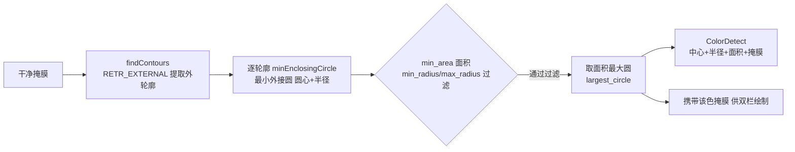

---

#### 步骤5：双栏可视化与 MJPEG 推流（阶段三：能改造，30min）

> 📌 本步骤对应源码：`src/app.py` process_frame（L25-31）、dual_view（L34-37）；`src/preprocess.py` draw_detection（L109-125）/ mask_view（L127-135）

**知识点讲解**：

**visual_grasp 风格双栏显示（1.3.1）**
- **原理**：车端 `visual_grasp` 采用**双栏布局**：左栏 RGB 原图上叠加检测结果（`draw_detection`，L109-125：绿轮廓 + 黄外接框 + 红质心十字 + 颜色名），右栏 HSV Mask 图（`mask_view`，L127-135：白=匹配区域 + 绿质心十字 + 青圆）。双栏并排让学习者**同时看到"原图结论"与"处理依据"**——掩膜栏直观展示阈值分割效果，是调参与排查误检的利器。`app.py` 组织取流（--image/--video/--camera/--ros）→ detect_colors → 双栏合成 → MJPEG 推流（`http://<板IP>:8080/lab_color.mjpg`）。
- **源码对应**：`src/preprocess.py` L109-125（draw_detection）、L127-135（mask_view）；`src/app.py` L25-31（process_frame）、L34-37（dual_view）

**知识储备补充**：

- **双栏合成逻辑**：`dual_view`（app.py L34-37）用 `np.hstack` 水平拼接左栏（RGB 原图+标注）和右栏（Mask 灰度→BGR），中间插入 2 像素宽的绿色分隔线（`gap[:,:,1]=255`）。输出为单张 BGR 图像，同时用于本地窗口显示（`cv2.imshow`）和 MJPEG 推流（`server.set_frame`）。这种"一张图两个视角"的设计让学习者一眼看到"检测结论（左）"与"分割依据（右）"的对应关系。
- **MJPEG 推流原理**：MJPEG（Motion JPEG）将每帧编码为独立 JPEG 图像，通过 HTTP multipart 流式推送。浏览器访问 `http://<板IP>:8080/lab_color.mjpg` 即可实时查看——无需安装任何客户端，兼容所有现代浏览器。`MjpegServer`（mjpeg_server.py）在后台线程监听 8080 端口，`process_frame` 每帧调用 `server.set_frame(view)` 更新推送缓冲区。
- **检测标注语义**：`draw_detection`（L109-125）的绘制元素——绿轮廓（`cv2.drawContours`，绿色=检测到的区域边界）、黄外接框（`cv2.rectangle`，黄色=boundingRect 矩形）、红质心十字（`cv2.drawMarker`，红色十字=外接圆圆心）、颜色名文字（`cv2.putText`，红色文字）——每种元素传递不同信息，便于学习者区分轮廓边界、矩形范围、质心位置。
- **参考资源**：OpenCV 官方文档 `cv2.drawContours` / `cv2.rectangle` / `cv2.drawMarker` / `cv2.putText`；MJPEG 协议 RFC 2435（JPEG 格式）与 HTTP multipart 流模式。

**操作步骤**：

1. 单图双栏输出：
   ```bash
   # 执行目录：~/ros2_ws/src/xflz_eai_car1/vision/03_lab_color_recognition
   cd ~/ros2_ws/src/xflz_eai_car1/vision/03_lab_color_recognition
   python src/app.py --image image.jpg --save out.jpg
   # out.jpg 为双栏：左原图标注 | 右 HSV Mask
   ```

   

2. 相机实时（板上标准）：

   ```bash
   # 终端 1：启动相机驱动
   source /opt/ros/humble/setup.bash && source ~/ros2_ws/install/setup.bash
   export ROS_DOMAIN_ID=2
   ros2 launch ascamera hp60c.launch.py
   
   # 终端 2：运行颜色识别
   source /opt/ros/humble/setup.bash && source ~/ros2_ws/install/setup.bash
   export ROS_DOMAIN_ID=2
   cd ~/ros2_ws/src/xflz_eai_car1/vision/03_lab_color_recognition
   python src/app.py --ros
   # MJPEG: http://<板IP>:8080/lab_color.mjpg（双栏实时）
   ```

   ```bash
   (ros2_venv) iflytek@localhost:~/ros2_ws/src/xflz_eai_car1/vision/03_lab_color_recognition$ python src/app.py --ros
   
   Streams index: http://127.0.0.1:8080
   Available streams:
   
   http://127.0.0.1:8080/lab_color.mjpg
   --------------------------------
   
   
   Streams index: http://10.1.134.58:8080
   Available streams:
   
   http://10.1.134.58:8080/lab_color.mjpg
   --------------------------------
   
   
   Press Ctrl+C to stop the server
   
   30帧平均帧率: 33.0
   30帧平均帧率: 33.9
   ```

   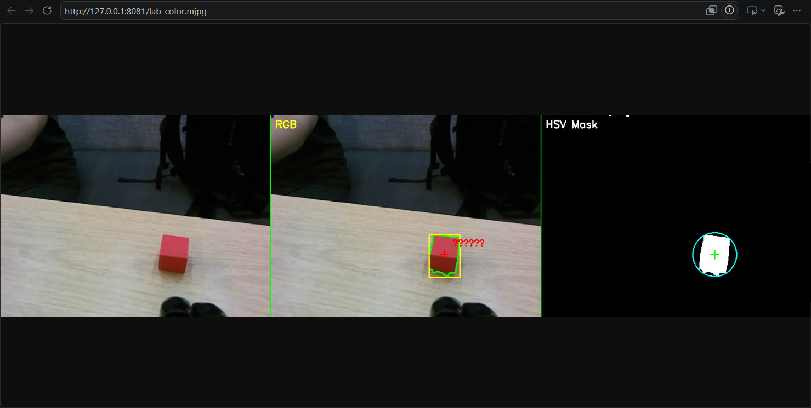

3. 动手改造：修改 `draw_detection` 的绘制样式（如改颜色名位置、加 FPS 显示），重新运行

**易错点**：

- ⚠️ --ros 取不到帧 → ascamera 先起、ROS_DOMAIN_ID 一致、话题勿 remap
- ⚠️ 双栏显示依赖显示器；无显示器时用 MJPEG 流查看

**流程图**：

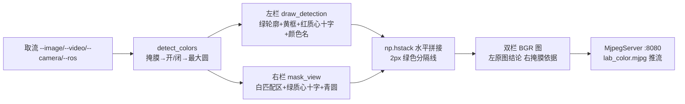

---

#### 步骤6：--tune 实时调参（阶段三：能改造，25min）

> 📌 本步骤对应源码：`src/app.py` _tune_mode（L41-105）、`src/preprocess.py` auto_hsv_range（L138-166）

**知识点讲解**：

**调参模式与自动化（1.3.2）**
- **原理**：光照变化是颜色分割的最大敌人。`--tune` 模式提供 6 个滑块（H_low/H_high/S_low/S_high/V_low/V_high）实时调整目标颜色的 HSV 阈值，画面即时反馈——看到掩膜栏变化即可判断阈值是否合适，Ctrl+C 退出时打印当前阈值。`auto_hsv_range()`（L138-166）更进一步：**从首帧自动估计目标色 HSV 范围**——在种子色域（先验 H 范围）内统计像素 min/max + 余量 margin，输出可直接写入 config 的阈值，减少手工调参工作量。
- **源码对应**：`src/app.py` L41-105（_tune_mode）；`src/preprocess.py` L138-166（auto_hsv_range）

**知识储备补充**：

- **自动阈值估计原理**：`auto_hsv_range`（L138-166）的工作流程——(1) 对首帧做 BGR→HSV 转换；(2) 在种子色域（`spec.h` 和 `spec.h2` 两段 H 范围）内用 `cv2.inRange` 粗筛像素；(3) 若筛选到的像素数 ≥ `min_pixels=50`（场景中确实有该色目标），统计这些像素的 H/S/V min/max；(4) H 范围加 `margin=10` 余量，S/V 下限减 30（放宽低饱和度/暗区容差），上限保持 255。输出格式与 `lab_config.yaml` 中的 `h/s/v` 字段一致，可直接写入。对红色（有 h2），两段分别统计，取像素更多的那段做主区间。
- **调参模式的实时反馈回路**：`_tune_mode`（app.py L41-105）构建了"滑块→掩膜→双栏→视觉反馈"的闭环——每次滑块移动触发 `on_trackbar` 回调更新阈值 dict，主循环用新阈值重新 `detect_colors`，右栏 Mask 实时反映分割效果。这种即时反馈让学习者直观理解"HSV 阈值如何影响分割结果"——比纯理论讲解有效得多。
- **光照变化应对策略**：HSV 的 V 通道直接编码亮度，因此光照变暗时 V 值整体下降。应对方法：(1) 放宽 V 下限（如 `v: [60,255]` 而非 `[100,255]`）；(2) 用 `--tune` 实时调参适配当前光照；(3) 用 `auto_hsv_range` 自动标定。`auto_hsv_range` 的 `margin` 参数（默认 10）控制阈值宽松度——margin 越大对光照变化越鲁棒，但误检风险也增加。
- **参考资源**：OpenCV 官方文档 `cv2.createTrackbar` / `cv2.getTrackbarPos`；自适应阈值方法参考《Automatic Threshold Selection for Color Image Segmentation》。

**操作步骤**：

1. 启动调参模式（板上走 --ros，PC 走 --camera/--video）：
   ```bash
   # 执行目录：~/ros2_ws/src/xflz_eai_car1/vision/03_lab_color_recognition
   cd ~/ros2_ws/src/xflz_eai_car1/vision/03_lab_color_recognition
   python src/app.py --tune 红色 --ros
   # 滑块窗口 lab_tune：6 滑块实时调 H/S/V
   # 双栏窗口 lab_view 实时预览；Ctrl+C 退出并打印当前阈值
   ```

2. 把打印的阈值写入 `config/lab_config.yaml` 对应颜色，验证"调参结果落盘"

3. 试用手动光照变化（遮挡/移动光源），观察误检与漏检，练习快速调参

4. 进阶：调用 `auto_hsv_range` 自动估计阈值，与手动调参结果对比

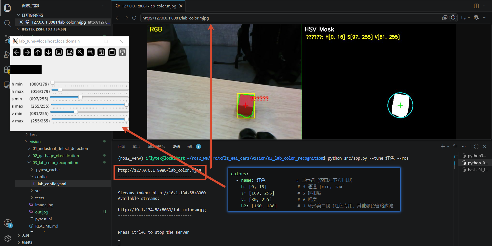

**易错点**：
- ⚠️ 调参环境（光照）与实际运行环境必须一致，否则调好的阈值现场失效
- ⚠️ tune 模式需显示器；板上用 MJPEG 流辅助观察

**流程图**：

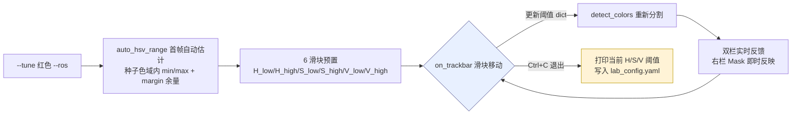

---

### 1.7 常见问题

| 问题 | 原因 | 解决方法 |
|------|------|---------|
| 红色目标漏检 | 未配置 h2 第二段（红色跨 0/180） | config 中加 h2（如 h=[0,10], h2=[170,179]） |
| 噪点被当目标 | min_area 过小 / 未做开运算 | 增大 min_area；确认 morph_open 前置 |
| 目标孔洞导致面积偏小 | 未做闭运算 | 增大 close_kernel（须奇数） |
| 光照变化后误检/漏检 | 阈值不适应新光照 | 用 --tune 实时调参或 auto_hsv_range 自动估计 |
| 核尺寸报错 | kernel 为偶数 | 改为奇数（open_kernel=5, close_kernel=9） |
| 双栏显示异常 | --ros 取流失败或显示器缺失 | ascamera 先起、ROS_DOMAIN_ID 一致；无显示器用 MJPEG |

### 1.8 扩展实验

**扩展方向 1：多目标多色计数（进阶）**
- 修改 `detect_colors` 支持每种颜色检出多个目标（返回全部满足过滤的圆而非仅最大），实现"红球 3 个、蓝球 2 个"的计数功能

**扩展方向 2：自适应阈值（进阶）**
- 用 `auto_hsv_range` 做首帧自动标定 + 周期性重标定，实现光照自适应；或引入直方图峰谷分析自动确定阈值

### 1.9 实验报告要求

**评分标准**：HSV 原理理解 15 分 + 阈值掩膜与 h2 环形处理 20 分 + 形态学 20 分 + 轮廓检测 15 分 + 实时演示 20 分 + 报告 10 分 = 100 分。

**报告必含内容**：
1. HSV 与 RGB 对比说明（含纯红 HSV 值验证截图）
2. 三色阈值表（含红色 h2 双段）与掩膜效果图
3. 形态学开/闭前后掩膜对比图，标注噪点/孔洞变化
4. 双栏检测结果图（左 RGB | 右 Mask）与颜色名标注
5. 回答思考题：为什么红色需要 h2 双段？开运算为什么能去噪点？光照变化下如何调参？
6. 实验心得与问题记录

---

## 更新日志

| 版本 | 日期 | 变更 |
|------|------|------|
| v1.0 | 2026-08-10 | 初版生成（源码路径 ros2_ws/src/xflz_eai_car1/vision/03_lab_color_recognition，24 用例全绿，板端 50 FPS，HSV 双段红色处理 + 形态学 + 圆形轮廓 + 双栏推流） |
| v2.0 | 2026-08-19 | 知识点增强：各核心知识点追加「知识储备补充」（HSV转换公式/inRange掩膜数学定义/形态学腐蚀膨胀公式/findContours原理/最小外接圆/双栏合成/MJPEG推流/自动阈值估计/光照变化应对）；1.5 追加可复现代码块与执行现象 |
| v2.1 | 2026-08-21 | 步骤 1 新增「配置参数速查表」：config/lab_config.yaml 全参数分列（colors/morph/contour/camera/source/display），含 H2 环形处理与阈值标定要点。表值经 load_config 实测核对 |

---

## 实验2：二维码生成与识别检测实验（4h）

> ✅ **源码已核实** 本实验源码位于 `ros2_ws/src/xflz_eai_car1/vision/04_qrcode/`。生成用 `qrcode` 库（纯 Python），检测用 **OpenCV 内置 `QRCodeDetector`**（零新增、无需模型权重，替代参考的 pyzbar——后者需系统库 libzbar0）。唯一新增依赖：`qrcode 7.4.2 + pypng`（板上需 `pip install -i https://pypi.tuna.tsinghua.edu.cn/simple qrcode`）。单测 19/19 全绿。

### 1.1 关联知识点

- 1.1.1 二维码编码原理 > 原理 > 二维码（QR Code）通过矩阵码元编码数据，含功能图形（定位/校正/时序）与数据区；支持版本 1-40、4 级纠错（L/M/Q/H）
- 1.2.1 QRCode 库生成 > 流程 > `qrcode.QRCode(version, error_correction, box_size, border)` + `add_data` + `make_image`，生成图片保存
- 1.3.1 OpenCV 实时检测 > 流程 > `cv2.QRCodeDetector.detectAndDecode` 返回数据与四角点坐标；单码图可掩掉已识别区域循环检测，但**整图多码会触发单目标检测器定位串扰而失败**（需逐码分图）
- 1.3.2 实时识别与解析 > 流程 > 摄像头取流 → 逐帧 detectAndDecode → 框选识别区域 + 打印解析文本 → MJPEG 推流

### 1.2 实验目标

1. 掌握二维码的编码生成原理（版本/纠错/尺寸参数语义）— 原理理解
2. 使用 OpenCV 内置检测器实现摄像头实时检测并解析二维码内容 — 独立完成
3. 理解"生成-检测-解析"闭环在物联网/工业场景的应用（设备标识、信息传递）— 迁移应用

### 1.3 实验环境

| 类别 | 配置 |
|------|------|
| 硬件 | 具身智能实验箱 B2（XFLZ_EAI_B2_PRO，RK3576 SoC，6TOPS NPU，含 HP60C 深度相机） |
| OS | Ubuntu 22.04 + ROS2 Humble（板载 ros2_venv） |
| 核心库 | OpenCV（内置 QRCodeDetector）、qrcode 7.4.2 + pypng（需安装）、NumPy |
| 模型 | 无需模型权重（QRCodeDetector 为 OpenCV 内置算法） |
| 主入口 | `src/app.py`（--generate 生成 / --detect 检测，支持图像/视频/相机/ROS 模式） |

### 1.4 实验难度

- 难度: ⭐ 验证性
- 重点: 二维码生成参数语义 + OpenCV 实时检测解析
- 难点: 理解 `QRCodeDetector` 单目标检测局限（整图多码定位串扰失败，需逐码分图）；低分辨率/远距离二维码的识别率

### 1.5 实验现象

**快速验证流程**：

1. 进入项目目录：`cd ros2_ws/src/xflz_eai_car1/vision/04_qrcode`
2. 安装依赖（板上）：`pip install -i https://pypi.tuna.tsinghua.edu.cn/simple qrcode`
3. 单元测试：`pytest tests/ -v`（19 用例全绿）
4. 生成二维码：`python src/app.py --generate "https://example.com" --save my_qr.png`
   - 手机/电脑扫码可打开对应内容
5. 识别：`python src/app.py --detect --image my_qr.png`
   - 终端打印解析文本，输出框选标注图
6. 相机实时（板上标准）：先起 ascamera 驱动，再 `python src/app.py --detect --ros`
   - MJPEG：`http://<板IP>:8080/qrcode.mjpg`，手机屏幕/打印码实时识别

```bash
# 进入实验2
cd ~/ros2_ws/src/xflz_eai_car1/vision/04_qrcode

# 可选
/home/iflytek/ros2_venv/bin/python -m pytest -v

# 生成二维码
python src/app.py --generate "https://example.com" --save my_qr.png

# 识别刚刚生成的二维码
python src/app.py --detect --image my_qr.png
```

**预期效果描述**：

- 生成：指定数据、版本、纠错等级、尺寸的二维码图片正确保存
- 识别：图像中二维码被绿框框选，框上方打印解析文本（≤40 字符截断）
- 多码说明：`cv2.QRCodeDetector` 为单目标检测器，**整图含多码时第一轮定位即失败**（详见步骤3 限说明）；多码需逐码分图检测
- 实时：摄像头对准手机屏幕/打印的二维码即时解析，MJPEG 流实时更新

**执行现象**：
- 单元测试：`pytest tests/ -v` 运行约 3-5 秒，输出 19 个用例全部 passed，覆盖 generate（版本/纠错/空数据）、detect（单码 roundtrip / 噪声空 / 降采样坐标映射）、draw（截断标注）、config（schema 校验/色域检查）四组（注意：单测的 detect 均为**单码**用例——与整图多码不可行的实测一致）
- 生成命令：`python src/app.py --generate "https://example.com" --save my_qr.png` 立即返回，终端输出 `已保存: my_qr.png`，文件大小约 3-4 KB（版本 1 + 纠错 M + box_size 5）
- 识别命令：`python src/app.py --detect --image my_qr.png --save out.png` 立即返回，终端打印 `[QR] https://example.com`，`out.png` 中二维码区域被绿框框选、框上方显示完整文本
- 多码说明：`detect_qr` 的掩膜循环**依赖检测器先定位到单码**。同一张图内含多个二维码时，OpenCV `QRCodeDetector` 定位阶段会把不同码的 finder pattern 交叉误配成伪码，第一轮 `detectAndDecode` 即返回空串（`data=''`），循环不触发——**整图并行识别多码实测不可行**（x86 4.8.1 与板端 ROS OpenCV 一致）。多码场景应逐码分图检测（见步骤3）
- 实时流：板上启动后 MJPEG 流地址 `http://<板IP>:8080/qrcode.mjpg` 可在浏览器打开，对准手机屏幕上的二维码时文本即时刷新，延迟 < 0.5 秒

```bash
(ros2_venv) iflytek@localhost:~/ros2_ws/src/xflz_eai_car1/vision/04_qrcode$ python src/app.py --generate "https://example.com" --save my_qr.png
QR 已保存: /home/iflytek/ros2_ws/src/xflz_eai_car1/vision/04_qrcode/my_qr.png
(ros2_venv) iflytek@localhost:~/ros2_ws/src/xflz_eai_car1/vision/04_qrcode$ python src/app.py --detect --image my_qr.png
[QR] https://example.com
```


### 1.6 实验步骤

#### 整体流程图

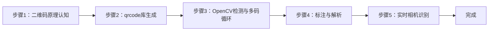

---

#### 步骤1：二维码原理认知（阶段一：能运行，20min）

> 📌 本步骤对应源码：`src/config.py` error_correction_level

**知识点讲解**：

**QR Code 结构与纠错原理（1.1.1）**
- **原理**：QR Code（Quick Response Code）是矩阵式二维条码，结构含：**定位图形**（三个角的回字方块，用于检测与旋转校正）、**校正图形**（版本≥2 时的小方块，用于畸变校正）、**时序图形**（定位图形间黑白交替线）、数据区与纠错码区。**版本**（1-40）决定尺寸与容量，版本越高容量越大；**纠错等级**（L≈7%/M≈15%/Q≈25%/H≈30% 恢复能力）决定污损/遮挡容忍度——等级越高纠错越强但数据容量越小。`error_correction_level()` 把配置中的 L/M/Q/H 字符串映射为 qrcode 库常量。
- **源码对应**：`src/config.py` error_correction_level；`config/qr_config.yaml`（generate.version / error_correction / box_size / border）

**知识储备补充**：

- **QR Code 矩阵结构**：QR Code 是由方形模块（module）组成的二维矩阵。每个模块为 1 bit（黑=1，白=0）。矩阵尺寸由版本号决定——版本 $v$ 的矩阵边长 $M$ 满足：
  $$
  M = 17 + 4v
  $$
  
  例如版本 1 为 21×21 模块，版本 10 为 57×57，版本 40 为 177×177。功能图形（定位、校正、时序）固定占位，剩余面积容纳数据与纠错码。
  
- **Reed-Solomon 纠错原理**：QR Code 使用 Reed-Solomon（RS）纠错码，属于多项式纠错码。编码过程：将数据视为 GF(256) 域上的多项式 $d(x)$，生成 $t$ 个校验符号——$t$ 由纠错等级决定（L: $t \approx 7\% \cdot n$，M: 15%，Q: 25%，H: 30%，$n$ 为总符号数）。解码时可纠正 $\lfloor t/2 \rfloor$ 个符号错误或 $t$ 个擦除（位置已知的错误）。本项目配置纠错等级为 M（`config/qr_config.yaml` L4），可恢复约 15% 的码元污损——工业场景（污损多、距离远）应选 Q 或 H 等级。

- **版本与容量关系**：每个版本的每个纠错等级有固定数据容量（字节）。版本 1-L 约 17 字节，版本 10-M 约 395 字节，版本 40-H 约 1852 字节。`qrcode.QRCode(version=1, ...)` 设定版本 1，若数据超出该版本容量，`make(fit=True)` 会自动升版至足够大的版本。这也是本项目配置注释"勿用 H——板端实测 cv2.QRCodeDetector 解不了 H+中文 UTF-8"的原因：H 等级纠错码占比最高（约 30%），留给数据的空间最小，中文 UTF-8 编码体积大，版本 1+H 无法容纳。

- **参考资源**：ISO/IEC 18004:2015 标准（QR Code 符号规范）；`qrcode` 库官方文档 `https://pypi.org/project/qrcode/`；Thonky QR Code 教程 `https://www.thonky.com/qr-code-tutorial/`

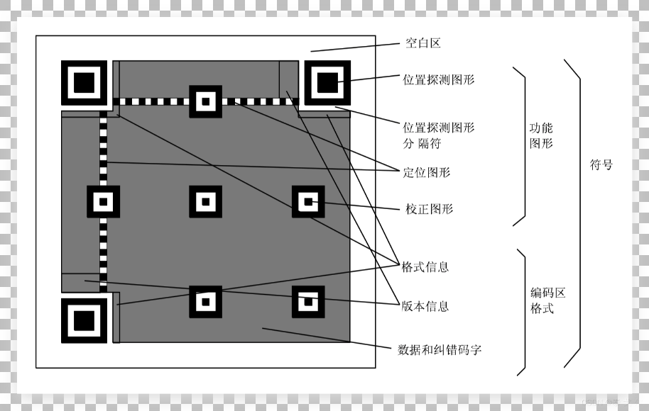

**配置参数速查表**（`config/qrcode_config.yaml`，按区块分列）：

| 区块 | 参数 | 类型 | 默认/示例 | 说明 |
|------|------|------|-----------|------|
| `generate` | `version` | int | `1` | 二维码版本 1-40（fit=True 自动扩版） |
| `generate` | `error_correction` | str | `M` | 纠错级 L/M/Q/H；**勿用 H**（板载 cv2 解不了 H+中文） |
| `generate` | `box_size` | int | `5` | 每格像素数 |
| `generate` | `border` | int | `4` | 边框格数 |
| `generate` | `fill_color`/`back_color` | list | `[0,0,0]`/`[255,255,255]` | 前后景色 RGB |
| `detect` | `scale` | float | `0.5` | 检测前缩放（大图提速） |
| `camera` | `index` | int | `0` | VideoCapture 索引 |
| `camera` | `width`/`height` | int | `640`/`480` | 取流分辨率 |
| `display` | `show` | bool | `false` | 本地窗口（板上置 false） |
| `display` | `window_name` | str | `qrcode` | 窗口名 |
| `source` | `ros.rgb_topic` | str | `/ascara_hp60c/.../rgb0/image` | 相机话题（勿 remap） |
| `source` | `ros.timeout` | float | `5.0` | 首帧等待秒数 |
> **说明**：`generate`/`detect` 为本实验核心；`error_correction H` 为已知板端陷阱。`camera`/`source`/`display` 运行环境。

**操作步骤**：

1. 查看 `config/qr_config.yaml` 生成参数，理解 version/error_correction/box_size/border 语义
2. 阅读 `src/config.py` error_correction_level 实现
3. 思考：工业场景（污损多、距离远）应选什么纠错等级？为什么？

**易错点**：
- ⚠️ 纠错等级与容量互斥：等级越高单码容量越小，长文本需版本+等级权衡

**流程图**：

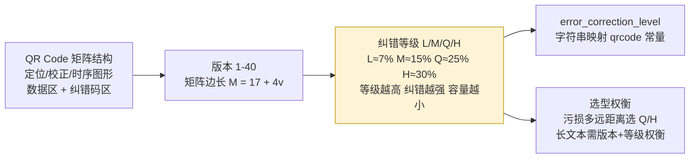

---

#### 步骤2：qrcode 库生成二维码（阶段一：能运行，25min）

> 📌 本步骤对应源码：`src/qr.py` generate_qr

**知识点讲解**：

**生成流程（1.2.1）**
- **原理**：`generate_qr()`（L30-45）完整演示生成四步：(1) 构造 `qrcode.QRCode(version, error_correction, box_size, border)`——version 指定固定版本（1-40），`make(fit=True)` 时若数据超出该版本会自动升版；(2) `add_data(data)` 填充用户数据；(3) `make(fit=True)` 计算编码矩阵；(4) `make_image(fill_color, back_color)` 渲染为 PIL 图像，`.convert("RGB")` 后经 OpenCV 转 BGR 输出。`box_size` 控制每模块像素数（清晰度），`border` 控制四周留白（标准为 4 模块）。空数据直接抛 `ValueError`（L32-33）。
- **源码对应**：`src/qr.py` L30-45（generate_qr：参数 L35-40 / add_data L41 / make L42 / 渲染转 BGR L43-45）

**知识储备补充**：

- **生成参数语义详解**：`qrcode.QRCode` 的四个构造参数各有明确语义——`version`（int 1-40 或 None）：固定版本号，None 时由 `make(fit=True)` 自动选择最小版本；`error_correction`：纠错等级常量（`ERROR_CORRECT_L/M/Q/H`），`config.py` L28-33 的 `EC_LEVELS` 字典完成字符串→常量映射；`box_size`（int）：每个模块渲染为多少像素的正方形，值越大生成图越大越清晰但文件越大；`border`（int）：四周静区（quiet zone）模块数，ISO 标准要求最少 4 模块，低于此值可能被扫描器忽略。

- **`fit=True` 自动升版机制**：当指定版本的数据容量不足以容纳输入数据时，`make(fit=True)` 会自动选择能容纳该数据的最小版本。这意味着 `generate_qr` 中 `version=1`（`config/qr_config.yaml` L3）配合 `fit=True` 是"从版本 1 开始，按需升版"——短 URL（如 `https://example.com`）保持版本 1，较长文本可能升至版本 2-5。

- **色域转换**：`qrcode` 库基于 PIL/Pillow 渲染，输出为 RGB 格式（`qr.py` L43：`.convert("RGB")`）。OpenCV 内部使用 BGR 格式，因此必须经 `cv2.cvtColor(..., cv2.COLOR_RGB2BGR)` 转换（L45），否则颜色通道错位导致前景/背景反转。

- **参考资源**：Pillow 文档 `Image.convert`；OpenCV 色彩空间转换 `cv2.cvtColor`；`qrcode` 源码 `qrcode.image.pil` 模块

**操作步骤**：

1. 生成并保存二维码：
   ```bash
   # 执行目录：~/ros2_ws/src/xflz_eai_car1/vision/04_qrcode
   cd ~/ros2_ws/src/xflz_eai_car1/vision/04_qrcode
   
   # 生成二维码内容为 "https://example.com"
   python src/app.py --generate "https://example.com" --save my_qr.png
   # my_qr.png 生成成功
   ```
2. 验证扫码：手机/电脑摄像头扫 my_qr.png，可打开 example.com
3. 中文字符测试：
   ```bash
   python src/app.py --generate "你好，具身智能" --save cn_qr.png
   ```
4. 对比不同纠错等级/版本的二维码密度差异（改 config 后重新生成，观察码图复杂度）

**易错点**：

- ⚠️ 数据为空 → ValueError（L32-33），先判空
- ⚠️ 生成图片色域：qrcode 库输出 RGB，OpenCV 显示需转 BGR（L45）

**流程图**：

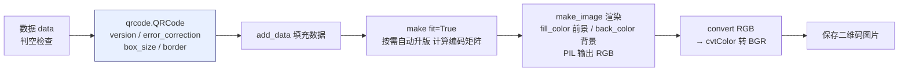

---

#### 步骤3：OpenCV 检测与多码循环（阶段二：能理解，30min）

> 📌 本步骤对应源码：`src/qr.py` detect_qr

**知识点讲解**：

**QRCodeDetector 与掩膜循环（1.3.1）**
- **原理**：`cv2.QRCodeDetector.detectAndDecode(img)` 返回 `(data, points, straight_qrcode)`——data 为解析文本（失败时空串），points 为二维码四角点坐标。单次调用只检出一个码，`detect_qr()`（L48-79）在 `MAX_DETECT_PASSES=8` 上限内反复调用，每次检出后**把已识别区域涂白**（L74-78，`work[y1:y2,x1:x2]=255`）再继续找下一个，直到无新码或达到上限（防死循环）。此外支持 `scale=0.5` 降采样加速（L53-55）：大图先缩一半再检测，坐标用 `factor=1/scale` 映射回原图。points 四角点取 min/max 得到外接框（L66-71）。

> ⚠️ **单目标检测器局限（x86 + 板端实测一致）**：`QRCodeDetector` 是**单目标**检测器。同一张图内含**多个**二维码时，定位阶段（找 3 个 finder pattern 并匹配）会把**来自不同码的 finder 交叉组合**成伪码，透视矫正后解码失败返回空串——第一轮 `detectAndDecode` 就得不到任何码，掩膜循环无从触发。因此掩膜循环**只在检测器能先定位并解出第一个码时才有意义**（如单码图、或码间有足够间距使检测器不串扰）。整图并行识别多码实测**不可行**（`multi_qr.png` 3 码一行 → `detect_qr` 返回空表）；多码请逐码分图检测。
- **源码对应**：`src/qr.py` L48-79（detect_qr：降采样 L52-55 / 循环检测 L59-78 / 掩膜 L74-78）

**知识储备补充**：

- **降采样加速原理**：`detect_qr` 在检测前将输入图像按 `scale`（默认 0.5）缩放（L52-55），处理的是缩小后的图像。QRCodeDetector 的检测复杂度与像素数近似线性相关，半分辨率图像像素数降至 25%，检测速度提升约 3-4 倍。检测后坐标需乘以 $factor = 1/scale$ 映射回原图坐标（L66-67），否则标注框会错位——这是多码循环中最常见的 bug。

- **掩膜循环机制**：`detectAndDecode` 单次调用只返回第一个检测到的码——**前提是它先定位到了那一个码**。掩膜方式是将已识别区域涂为白色（`work[y1:y2,x1:x2]=255`，L78），白色背景对该区域等同于"无码"，随后下一次调用可在图中其余位置找下一个。`MAX_DETECT_PASSES=8`（L21）是硬上限，防止某些异常图像（如噪声模式反复被误检为码）导致死循环。**注意**：该循环无法克服上面的单目标定位局限——若第一轮 `detectAndDecode` 因多码串扰返回空，循环一次都不会进入。因此"多码检测"的可靠做法是逐码分图（每图一个码），而非依赖整图的掩膜循环。

- **四角点→外接框**：`detectAndDecode` 返回的 `points` 形状为 `(1, 4, 2)`——4 个顶点的 $(x, y)$ 坐标（可能因透视畸变不是矩形）。代码取所有 $x$ 的 min/max 和所有 $y$ 的 min/max 得到轴对齐外接框（L66-71），这是最简化的框提取方式，适用于检测标注但不精确匹配透视形状。

- **参考资源**：OpenCV `QRCodeDetector` 文档 `https://docs.opencv.org/4.x/d5/d54/classcv_1_1QRCodeDetector.html`；QR Code ISO/IEC 18004 检测算法章节

**操作步骤**：

1. 生成多个单码图（每张一个码）：
   ```bash
   python src/app.py --generate "https://example.com" --save q1.png
   python src/app.py --generate "你好，具身智能"     --save q2.png
   python src/app.py --generate "grasp:apple"       --save q3.png
   ```

   

2. 逐码检测（**不要拼成一张图**——整图多码会触发检测器定位串扰失败，见上）：

   ```bash
   # 执行目录：~/ros2_ws/src/xflz_eai_car1/vision/04_qrcode
   cd ~/ros2_ws/src/xflz_eai_car1/vision/04_qrcode
   
   python src/app.py --detect --image q1.png --save out1.png
   python src/app.py --detect --image q2.png --save out2.png
   python src/app.py --detect --image q3.png --save out3.png
   # 预期：每个码各自检出，框选 + 文本标注
   ```

   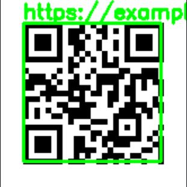

3. 单测理解循环逻辑：`pytest tests/test_qr.py -v`

4. 思考：MAX_DETECT_PASSES=8 的作用？为什么同一张图放多个码会检出失败？

**易错点**：
- ⚠️ 不掩掉已识别区域会死循环检出同一码——掩膜是必须步骤（L74-78）
- ⚠️ 降采样后坐标必须乘回 factor（L66-67），否则框错位
- ⚠️ **整图含多码会检出失败**（OpenCV 单目标检测器定位串扰，第一轮即空）——多码请逐码分图检测
- ⚠️ 显示乱码“？？？？？”是因为Opencv渲染的中文字体不存在

**流程图**（注：此掩膜循环**仅适用于检测器能先定位到单码的图**——整图多码时第一轮即失败，见上）：

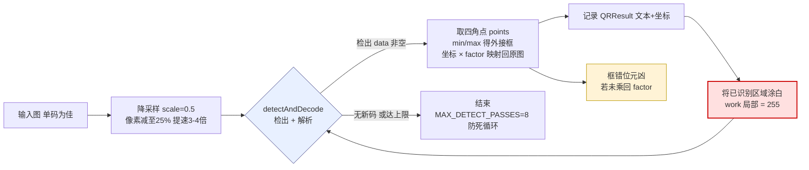

---

#### 步骤4：标注与解析文本（阶段二：能理解，20min）

> 📌 本步骤对应源码：`src/qr.py` draw_qr

**知识点讲解**：

**结果可视化（1.3.2）**
- **原理**：`draw_qr()`（L82-90）在检测结果上绘制：绿框（L86）+ 解析文本（L87-89）。文本超 40 字符截断为 37 字符 + "..."（L87），避免超长 URL 撑爆画面；文本绘制在框上方（y1-6，最小 16 防止越界）。`QRResult` 数据类（L21-27）承载 text + 四角坐标，是检测与绘制间的数据契约。
- **源码对应**：`src/qr.py` L82-90（draw_qr：画框 L86 / 文本截断 L87 / putText L88-89）

**知识储备补充**：

- **文本截断策略**：`draw_qr` 将超过 40 字符的解析文本截断为前 37 字符加 "..."（L87），防止长 URL（如含 token 的 IoT 设备注册链接）超出图像边界。截断阈值 40 是经验值——`FONT_HERSHEY_SIMPLEX` 0.6 缩放下，40 个字符约 240 像素宽，适配 640 宽度画面且留出框宽余量。`putText` 的 $y$ 坐标取 `max(16, y1-6)`（L88），确保框紧贴图像顶部时文本不越界。

- **QRResult 数据契约**：`QRResult`（L24-29）是 `dataclass(frozen=True)`，包含 `text`（str）和 `x1/y1/x2/y2`（int）四个坐标。`detect_qr` 产出 `list[QRResult]`，`draw_qr` 消费它——解耦了检测与绘制逻辑。这种"中间数据类"模式在 CV pipeline 中很常见，便于单元测试（可构造 `QRResult` 测试 `draw_qr`）和扩展（新增字段如置信度、旋转角度不影响现有调用者）。

- **参考资源**：OpenCV `cv2.putText` 文档；Python `dataclasses` 模块

**操作步骤**：

1. 检测 + 标注：
   ```bash
   # 执行目录：ros2_ws/src/xflz_eai_car1/vision/04_qrcode
   cd ros2_ws/src/xflz_eai_car1/vision/04_qrcode
   
   python src/app.py --detect --image my_qr.png --save out.png
   # out.png：绿框 + 文本标注
   ```
2. 生成超长文本二维码（>40 字符），观察截断显示效果
3. 动手改造：把标注文本改为显示在框下方，或改框色


**易错点**：
- ⚠️ 文本超长溢出画面 → 40 字符截断（L87）已处理

**流程图**：

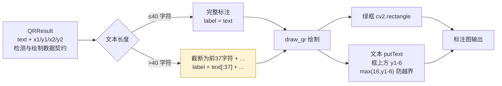

---

#### 步骤5：实时相机识别与 MJPEG 推流（阶段三：能改造，35min）

> 📌 本步骤对应源码：`src/app.py`、`src/ros2_source.py`

**知识点讲解**：

**实时识别链路（1.3.2）**
- **原理**：`app.py` 的 `--detect` 模式组织实时链路：取流（--image/--video/--camera/--ros）→ 逐帧 `detect_qr` → `draw_qr` 标注 → 本地窗口（--display）或 MJPEG 推流（`http://<板IP>:8080/qrcode.mjpg`）。板上相机标准路径是 HP60C 深度相机经 ascamera 话题取流（`ros2_source.py` Ros2Camera，话题 `/ascamera_hp60c/camera_publisher/rgb0/image`），OpenCV 直连读不了（未编 libv4l）。识别速度取决于图像分辨率与码大小——降采样参数在检测前生效。
- **源码对应**：`src/app.py`（main：--detect 分支 / 取流 / 推流）；`src/ros2_source.py`（Ros2Camera：DEFAULT_TOPIC / open / read / release）

**知识储备补充**：

- **MJPEG 推流原理**：`MjpegServer`（`mjpeg_server.py`）在端口 8080 启动 HTTP 服务，提供 `/qrcode.mjpg` 流地址。MJPEG（Motion JPEG）将每帧 JPEG 图像以 multipart 流式传输——浏览器打开流地址即可实时查看，无需额外播放器。相比 RTSP/WebRTC，MJPEG 实现简单（纯 HTTP）、延迟极低（帧级），适合嵌入式设备调试。代价是带宽较高（未做帧间压缩），但局域网场景足够。

- **ROS2 话题取流适配**：`Ros2Camera`（`ros2_source.py`）封装了 rclpy 惰性导入——构造时不依赖 ROS 环境，`open()` 时才导入 rclpy + cv_bridge 并建节点订阅。这是关键设计：x86 PC 无 ROS 环境时可跑单元测试（mock 回调逻辑），板上 `open()` 后自动切换为真实 ROS2 话题订阅。默认话题 `/ascamera_hp60c/camera_publisher/rgb0/image`（`ros2_source.py` L17）必须与 ascamera 驱动输出一致，`ROS_DOMAIN_ID` 也须匹配（本板 =2）。

- **实时性能瓶颈**：检测延迟 = 降采样耗时 + `detectAndDecode` 耗时 + 标注耗时。对于 640×480 输入（scale=0.5 → 320×240），QRCodeDetector 单帧检测约 5-15 ms（取决于码复杂度与数量），总帧率可达 30-60 FPS。瓶颈通常在取流端（ROS2 回调延迟）或网络带宽（MJPEG 编码），而非检测算法本身。

- **参考资源**：ROS2 `sensor_msgs/Image` 消息类型；`cv_bridge` 官方文档；MJPEG over HTTP RFC（草案）

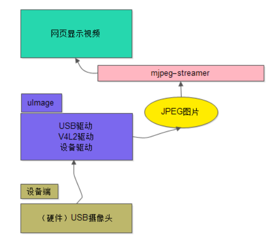

**操作步骤**：

1. 相机实时（板上标准）：
   ```bash
   # 执行目录：~/ros2_ws/src/xflz_eai_car1/vision/04_qrcode
   cd ~/ros2_ws/src/xflz_eai_car1/vision/04_qrcode
   source /opt/ros/humble/setup.bash && source ~/ros2_ws/install/setup.bash
   export ROS_DOMAIN_ID=2
   ros2 launch ascamera hp60c.launch.py        # 终端 1
   python src/app.py --detect --ros             # 终端 2
   # MJPEG: http://<板IP>:8080/qrcode.mjpg
   ```
2. 用手机屏幕显示二维码对准相机，观察实时识别（文本即时更新）
3. 打印二维码贴在工件/卡片上，测试不同距离/角度的识别率
4. 动手改造：在识别到特定内容（如含 "grasp"）时打印触发消息，为分拣联动打基础

```bash
(ros2_venv) iflytek@localhost:~/ros2_ws/src/xflz_eai_car1/vision/04_qrcode$ python src/app.py --detect --ros

Streams index: http://127.0.0.1:8080
Available streams:

http://127.0.0.1:8080/qrcode.mjpg
--------------------------------


Streams index: http://10.1.134.58:8080
Available streams:

http://10.1.134.58:8080/qrcode.mjpg
--------------------------------


Press Ctrl+C to stop the server

30帧平均帧率: 31.1
[QR] https://example.com
[QR] https://example.com
[QR] https://example.com
```

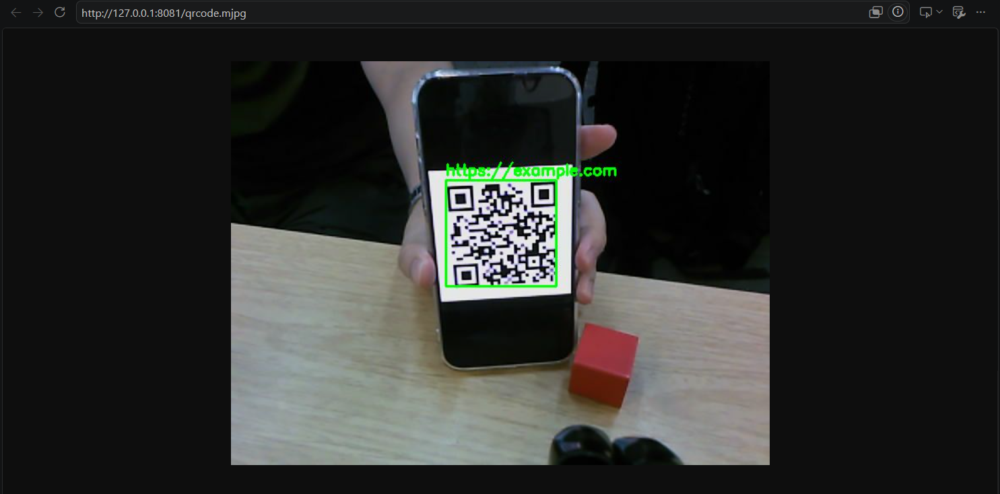

**易错点**：

- ⚠️ --ros 取不到帧 → ascamera 先起、ROS_DOMAIN_ID 一致、话题勿 remap
- ⚠️ 远距离/小码识别率低 → 靠近或提高分辨率；反光表面可调整角度

**流程图**：

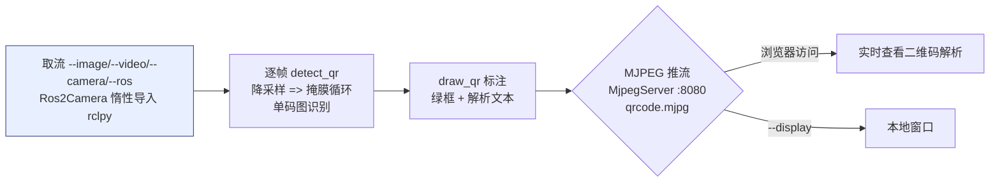

---

### 1.7 常见问题

| 问题 | 原因 | 解决方法 |
|------|------|---------|
| 生成时报错 data must not be empty | 传入空字符串 | 先判空再生成（`qr.py` L32-33） |
| 检测不到码 | 码太小/太远/反光/畸变；**整图含多码触发定位串扰** | 靠近、提高分辨率、调整角度；整图多码需逐码分图检测 |
| 多码只检出 1 个或 0 个 | 未掩膜已识别区域；或整图多码第一轮定位即失败 | 单码图用掩膜循环（L74-78）；整图多码请逐码分图，勿拼图 |
| 框错位 | 降采样后未乘回 factor | 确认 `factor=1/scale` 映射（L66-67） |
| 解析文本乱码 | 编码/中文字符问题 | 生成与解析编码一致；中文建议 UTF-8 |
| 板上 import qrcode 失败 | 未安装依赖 | `pip install -i https://pypi.tuna.tsinghua.edu.cn/simple qrcode` |

### 1.8 扩展实验

**扩展方向 1：二维码分拣联动（进阶）**
- 识别到特定内容（如 `grasp:<物体名>`）时发布 ROS2 话题或串口指令，联动机械臂抓取（参考实验 05 的 cmd_vel 模式与实验 02 的大类映射）

**扩展方向 2：畸变二维码鲁棒识别（进阶）**
- 引入透视校正：用 detectAndDecode 的 points 四角点做 `cv2.getPerspectiveTransform` 矫正后再解码，测试倾斜/曲面上的二维码识别率提升

**扩展方向 3：整图多码识别（进阶）**
- `QRCodeDetector` 单目标局限下，实现整图多码可用：(a) 按连通域将大图切块后逐块 `detect_qr`；(b) 换用 OpenCV 的 `WeChatQRCodeDetector`（基于 CNN，原生支持同图多码，需模型文件 `detect.prototxt` + `detect.caffemodel`）。实测两者都能突破单目标限制

### 1.9 实验报告要求

**评分标准**：二维码原理理解 15 分 + 生成实现 20 分 + 检测与多码循环 25 分 + 实时识别演示 30 分 + 报告 10 分 = 100 分。

**报告必含内容**：
1. QR Code 结构说明（定位/校正/时序/数据区）与纠错等级对比
2. 生成的二维码图片（≥2 个：URL + 中文）与参数表
3. 检测结果图（≥2 个不同内容的单码各 1 张）与解析文本
4. 实时识别演示数据（距离/角度/识别率记录）
5. 回答思考题：为什么掩膜循环依赖检测器先定位到单码？整图多码为何失败？纠错等级如何影响容量与鲁棒性？工业场景如何选参数？
6. 实验心得与问题记录

---

## 更新日志

| 版本 | 日期 | 变更 |
|------|------|------|
| v1.0 | 2026-08-10 | 初版生成（源码路径 ros2_ws/src/xflz_eai_car1/vision/04_qrcode，19 用例全绿，qrcode 生成 + OpenCV QRCodeDetector 多码循环检测 + MJPEG 实时推流） |
| v2.0 | 2026-08-19 | 知识点增强：补充 QR Code 矩阵结构（$M=17+4v$）、Reed-Solomon 纠错原理、版本-容量关系、降采样加速、掩膜循环机制、四角点→外接框、色域转换、MJPEG 推流、ROS2 惰性导入等知识储备；新增执行现象段；添加参考资源（ISO 18004 / OpenCV 文档 / qrcode 库文档）；行号源码核实 |
| v2.1 | 2026-08-21 | 步骤 1 新增「配置参数速查表」：config/qrcode_config.yaml 全参数（generate/detect/camera/display/source）。标注 error_correction H 的板端实测陷阱。表值经 config 实测核对 |

---

## 实验3：基于OpenCV的多边形轮廓拟合实验（4h）

> ✅ **源码已核实** 本实验源码位于 `ros2_ws/src/xflz_eai_car1/vision/05_line_following/`。⚠️ **内容说明**：课程名义为「自主巡线」，实际内容 = 亚博课程「OpenCV应用——多边形轮廓」：不规则轮廓 → 拟合规则几何形状（凸包/多边形）并标注顶点数。纯 OpenCV 方案（用户指示：不参考 car1_app/line_following.py）。单测 21/21 全绿，板端验证通过。

### 1.1 关联知识点

- 1.1.1 图像二值化 > 流程 > 灰度 → 阈值（binary/adaptive）→ 反相 → 形态学开运算；`invert` 区分暗物亮底/亮物暗底
- 1.2.1 轮廓提取 > 概念 > `cv2.findContours(RETR_EXTERNAL, CHAIN_APPROX_SIMPLE)` 提取外部轮廓，按面积过滤（min_area=2000）
- 1.2.2 凸包检测 > 原理 > `cv2.convexHull` 求点集最小凸包：填平凹槽，得到包围目标的最简外凸多边形
- 1.3.1 多边形逼近 > 流程 > `cv2.approxPolyDP` 用 Douglas-Peucker 算法按 epsilon 简化多边形顶点数
- 1.3.2 顶点标注 > 流程 > 检测结果按面积降序，绘制凸包多边形 + 黄点顶点标记 + 「n边形」标签

### 1.2 实验目标

1. 掌握二值化、轮廓提取、凸包检测与多边形逼近的原理与方法 — 原理理解
2. 实现不规则物体轮廓的规则几何拟合（凸包/多边形）与顶点数标注 — 独立完成
3. 理解多边形拟合在机器人视觉中的应用（形状识别、抓取定位、导航避障）— 迁移应用

### 1.3 实验环境

| 类别 | 配置 |
|------|------|
| 硬件 | 具身智能实验箱 B2（XFLZ_EAI_B2_PRO，RK3576 SoC，6TOPS NPU，含 HP60C 深度相机） |
| OS | Ubuntu 22.04 + ROS2 Humble（板载 ros2_venv） |
| 核心库 | OpenCV、NumPy（纯 CPU 视觉管线，无需 NPU） |
| 主入口 | `src/app.py`（图像/视频/相机 CLI + MJPEG 流 + 每帧打印顶点数/面积） |

### 1.4 实验难度

- 难度: ⭐⭐ 设计性
- 重点: 凸包检测 + approxPolyDP 多边形逼近 + 「n边形」标注
- 难点: epsilon 参数对拟合精细度的影响；复杂背景下的二值化稳定性

### 1.5 实验现象

**快速验证流程**：

1. 进入项目目录：`cd ~/ros2_ws/src/xflz_eai_car1/vision/05_line_following`
2. 单元测试：`pytest tests/ -v`（21 用例全绿）
3. 单图检测：`python src/app.py --image x.jpg --save out.jpg`
   - 输出：凸包多边形轮廓 + 黄点顶点 + 「n边形」标签；终端打印每轮廓顶点数/面积
4. 相机实时（板上标准）：先起 ascamera 驱动，再 `python src/app.py --ros`
   - MJPEG：`http://<板IP>:8080/polygon.mjpg`
5. 黑底彩色模式：`python src/app.py --image x.jpg --save out_dark.jpg`（由 `config/line_config.yaml` 的 `display.colored_mode` 控制：`true`=黑底彩色轮廓+质心，`false`=原图叠加；默认 `true`，单图命令即输出黑底双栏图）

```bash
# 进入实验3
cd ~/ros2_ws/src/xflz_eai_car1/vision/05_line_following

# 可选
/home/iflytek/ros2_venv/bin/python -m pytest -v

# 运行程序 修改display.colored_mode中的配置再重新运行一次
python src/app.py --image image.png --save out.jpg

# 相机实时 需要结合实际config配置修改才能达到好的效果
ros2 launch ascamera hp60c.launch.py        # 终端 1
python src/app.py --detect --ros             # 终端 2
```

**执行现象**：

- `pytest tests/ -v` 运行约 10-20 秒，输出 21 个用例全部 passed，覆盖 to_binary、find_contours、fit_polygon、detect_polygons、draw_polygons_dark 等函数的单元测试与集成测试
- 黑底彩色模式（`display.colored_mode: true` 默认生效）：`out_dark.jpg` 显示纯黑背景上彩色多边形轮廓线 + 质心实心圆点，与其它实验的黑底风格一致

**预期效果描述**：
- 纸盒/水瓶/卡片等物体轮廓正确拟合成多边形，标注「四边形」「八边形」等正确
- 调参影响：epsilon 越小顶点越多（拟合更精细）；use_hull=true 填平凹槽

display.colored_mode: true

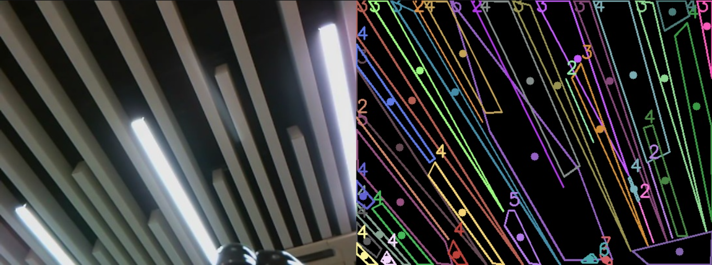

display.colored_mode: false

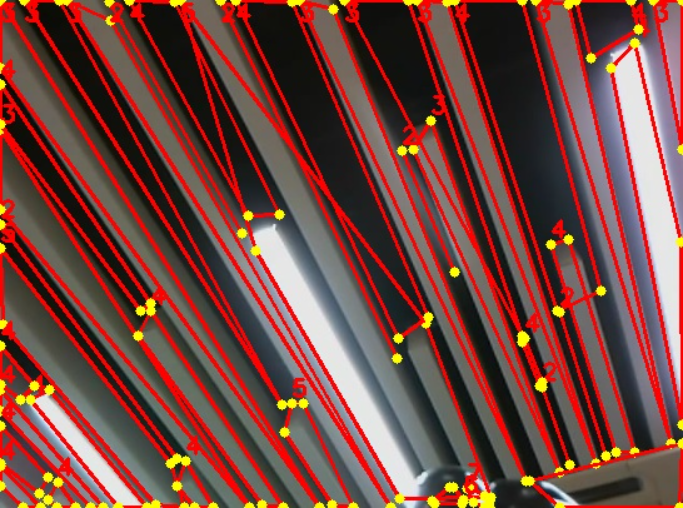

实时视频检测

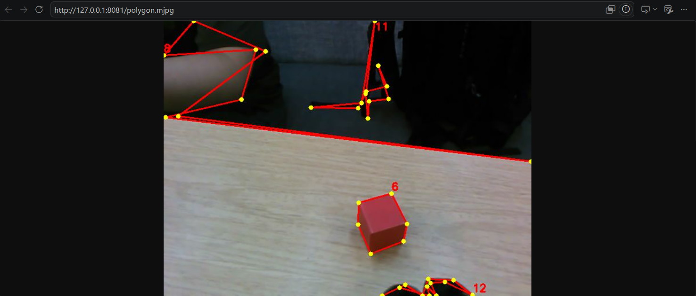

### 1.6 实验步骤

#### 整体流程图

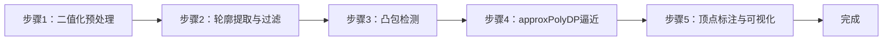

---

#### 步骤1：二值化预处理（阶段一：能运行，20min）

> 📌 本步骤对应源码：`src/pipeline.py` to_binary

**知识点讲解**：

**二值化策略（1.1.1）**

- **原理**：`to_binary()`（L25-38）把 BGR 图转为二值掩膜：灰度化 → 阈值分割 → 反相 → 形态学开运算。(1) 阈值方式可选 `binary`（全局固定阈值）或 `adaptive`（局部自适应——光照不均时更稳）；(2) `invert` 参数区分**暗物亮底**（true，默认：黑色物体在白底上，反相后物体为白）与**亮物暗底**（false）；(3) 形态学开运算去噪点。二值化质量直接决定后续轮廓提取的成败——阈值选错，背景噪声全变成"轮廓"。
- **源码对应**：`src/pipeline.py` L25-38（to_binary：灰度 L26-28 / 阈值 L29-34 / 反相 L35 / 开运算 L37-38）

**知识储备补充**：

- **背景与动机**：二值化是几乎所有传统计算机视觉管线的起点——将 256 级灰度图压缩为 0/1 二值掩膜，使后续轮廓提取只需处理连通域边界，计算复杂度从 O(W×H) 降至 O(N)（N=轮廓点数）。实验 05 与实验 03（HSV 颜色识别）的区别在于：实验 03 用 `cv2.inRange` 在 HSV 空间做颜色掩膜，而实验 05 用灰度阈值做通用二值化——前者针对特定颜色目标，后者适用于任意前景/背景分离场景。
- **HSV 掩膜公式**：实验 03 中 `cv2.inRange(hsv, lower, upper)` 生成的二值掩膜可表示为：

  $$
  \text{mask}(x,y) = \begin{cases} 255 & \text{if } H_l \le H(x,y) \le H_u \land S_l \le S(x,y) \le S_u \land V_l \le V(x,y) \le V_u \\ 0 & \text{otherwise} \end{cases}
  $$

  其中 $H, S, V$ 分别为色调、饱和度、明度通道，$H_l, H_u$ 等为上下界。实验 05 的灰度阈值掩膜是其退化形式——仅约束单一亮度通道 $V$（灰度等价于 $V$）。
- **形态学开运算语义**：开运算 = 先腐蚀后膨胀（`cv2.MORPH_OPEN`），其几何含义是"去掉比核小的亮区域"。椭圆核（`MORPH_ELLIPSE`）比矩形核更自然地保留圆形轮廓，是轮廓检测的推荐选择。核大小 `morph_kernel` 必须为奇数——偶数核会导致锚点偏移，腐蚀/膨胀不对称。
- **参考资源**：OpenCV 官方文档 `cv2.threshold`、`cv2.adaptiveThreshold`；冈萨雷斯《数字图像处理》第 3 章（形态学处理）。

**配置参数速查表**（`config/line_config.yaml`，按区块分列）：

|块行|参数|类型|默认/示例|说明|
|---|---|---|---|---|
|`preprocess`|`threshold_mode`|str|`adaptive`|binary/adaptive 阈值模式|
|`preprocess`|`threshold_value`|int|`50`|阈值（adaptive 为基值）|
|`preprocess`|`invert`|bool|`false`|**亮物暗底 false；暗物亮底改 true**（板上实测）|
|`preprocess`|`morph_kernel`|int|`3`|形态学核（去噪，奇数；过大侵蚀小轮廓）|
|`contour`|`min_area`|int|`100`|最小轮廓面积（滤噪）|
|`polygon`|`approx_epsilon`|float|`0.02`|approxPolyDP 精度（×弧长）|
|`polygon`|`use_hull`|bool|`true`|先凸包再近似|
|`camera`|`index`/`width`/`height`|int|`0`/`640`/`480`|相机源配置|
|`source`|`ros.rgb_topic`|str|`/ascara_hp60c/.../rgb0/image`|相机话题（勿 remap）|
|`source`|`ros.timeout`|float|`5.0`|首帧等待秒数|
|`display`|`show`|bool|`false`|本地窗口|
|`display`|`window_name`|str|`polygon_contour`|窗口名|
|`display`|`colored_mode`|bool|`true`|true=黑底彩色轮廓+质心；false=原图红轮廓|
> **说明**：`preprocess.invert` 与 `polygon.use_hull` 为不同视觉场景关键开关；`colored_mode` 决定画布风格。

**操作步骤**：

1. 查看 `config/line_config.yaml` 的 threshold 配置（invert / threshold_mode / morphology kernel）
2. 用单图验证二值化效果：
   ```bash
   cd ~/ros2_ws/src/xflz_eai_car1/vision/05_line_following
   
   PYTHONPATH=./src python -c "
   import cv2
   from pipeline import to_binary
   from config import load_config
   cfg = load_config('config/line_config.yaml')
   img = cv2.imread('image.png')
   mask = to_binary(img, cfg)
   cv2.imwrite('mask_debug.jpg', mask)
   print(f'白像素占比: {mask.mean()/255:.3f}')
   "
   ```
3. 切换 invert / threshold_mode，观察掩膜变化

```bash
白像素占比: 0.673
```

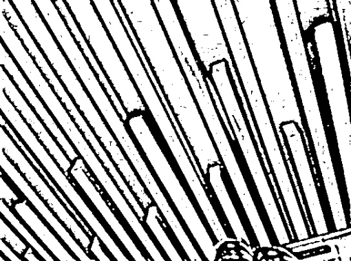

**易错点**：

- ⚠️ invert 设反 → 背景变前景，轮廓全错（暗物亮底=true 默认）
- ⚠️ 光照不均用 adaptive；强反光需先预处理

**流程图**：

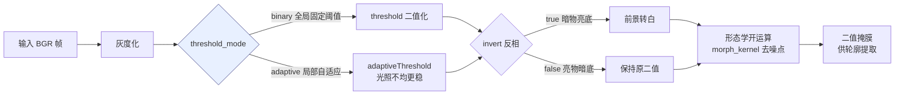

---

#### 步骤2：轮廓提取与面积过滤（阶段一：能运行，20min）

> 📌 本步骤对应源码：`src/pipeline.py` find_contours

**知识点讲解**：

**轮廓提取（1.2.1）**
- **原理**：`cv2.findContours(mask, RETR_EXTERNAL, CHAIN_APPROX_SIMPLE)` 提取二值掩膜的连通域边界。`RETR_EXTERNAL` 只取**最外层轮廓**（跳过内孔），`CHAIN_APPROX_SIMPLE` 压缩轮廓点（只保留端点，减少存储）。`find_contours()`（L41-44）随后按 `min_area=2000` 过滤小噪点轮廓，**按面积降序**返回——面积是区分"目标"与"噪声"的第一道闸门。
- **源码对应**：`src/pipeline.py` L41-44（find_contours：findContours L43 / 面积过滤 L44）

**知识储备补充**：

- **轮廓检索模式**：`RETR_EXTERNAL`（实验所用）只返回最外层轮廓，忽略内孔（如甜甜圈的中间洞）。若需同时检测内外轮廓，可换 `RETR_TREE`（保留层级树）或 `RETR_CCOMP`（两级结构）。实验 05 只关心物体外边界，`RETR_EXTERNAL` 足够且效率最高。
- **CHAIN_APPROX_SIMPLE 压缩**：该模式对水平/垂直/对角线段只保留端点——一条水平边 100 个连续点被压缩为 2 个端点，轮廓存储量降低 90%+。后续 `approxPolyDP` 只需处理端点，计算更高效。对比 `CHAIN_APPROX_NONE`（保留所有点）在大轮廓下无信息增益但占内存。
- **面积过滤语义**：`min_area` 是面积阈值（像素²），而非轮廓点数。面积 = 轮廓围成区域的像素计数（`cv2.contourArea` 用叉积公式）。实验 05 默认 `min_area=100`（`line_config.yaml`），而实验 01 的 2000 是因为工业缺陷框本身较大。`min_area` 需按实际目标尺度标定——设太小会混入噪点轮廓，设太大会丢失小目标。
- **参考资源**：OpenCV 官方文档 `cv2.findContours`（检索模式与近似方法对比）；Suzuki et al., *Topological structural analysis of digitized binary images by border following*（1985，findContours 算法原型）。

**操作步骤**：

1. 打印检测到的轮廓数量与面积：
   ```bash
   cd ~/ros2_ws/src/xflz_eai_car1/vision/05_line_following
   
   PYTHONPATH=./src python -c "
   import cv2
   from pipeline import to_binary, find_contours
   from config import load_config
   cfg = load_config('config/line_config.yaml')
   mask = to_binary(cv2.imread('image.png'), cfg)
   conts = find_contours(mask, cfg['contour']['min_area'])
   for i, c in enumerate(conts):
       print(f'轮廓{i}: 面积={cv2.contourArea(c):.0f} 点数={len(c)}')"
   ```
2. 调整 min_area，观察小噪点是否被过滤

```bash
轮廓0: 面积=136 点数=28
轮廓1: 面积=134 点数=42
轮廓2: 面积=193 点数=28
轮廓3: 面积=339 点数=19
轮廓4: 面积=417 点数=39
轮廓5: 面积=2438 点数=309
......后续省略
```

**易错点**：
- ⚠️ min_area 过小 → 噪声轮廓混入；过大 → 小目标丢失

**流程图**：

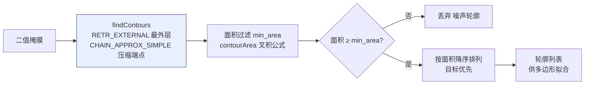

---

#### 步骤3：凸包检测（阶段二：能理解，25min）

> 📌 本步骤对应源码：`src/pipeline.py` fit_polygon

**知识点讲解**：

**凸包原理（1.2.2）**
- **原理**：凸包（convex hull）是包围点集的最小凸多边形——所有点都在其内部或边界上。对不规则轮廓（如带凹槽的纸盒、缺角卡片），`cv2.convexHull(contour)` 返回**填平凹槽**的外凸边界。这在形状识别中有特殊价值：判断轮廓是否凸（`cv2.isContourConvex` 可辅助分类），以及把不规则目标规整为可匹配的凸形状。`use_hull=true`（默认）启用凸包——vendor 语义；`false` 保留凹形细节。
- **源码对应**：`src/pipeline.py` fit_polygon（convexHull 调用，use_hull 分支）

**知识储备补充**：

- **凸包数学定义**：给定点集 $P = \{p_1, p_2, \ldots, p_n\} \subset \mathbb{R}^2$，其凸包 $\text{conv}(P)$ 定义为包含 $P$ 的最小凸集：

  $$
  \text{conv}(P) = \left\{ \sum_{i=1}^{n} \lambda_i p_i \;\middle|\; \lambda_i \ge 0,\; \sum_{i=1}^{n} \lambda_i = 1 \right\}
  $$

  即所有点的凸组合（convex combination）构成的集合。几何上，凸包等价于"用橡皮筋围住所有点后自然收紧形成的多边形"。`cv2.convexHull` 返回的顶点按逆时针排列，保证后续 `arcLength` 和 `approxPolyDP` 的正确性。
- **凸包 vs 原轮廓的信息损失**：凸包把凹槽"填平"——L 形物体被包成矩形，U 形物体被包成矩形或梯形。这意味着凸包丢失了凹形结构信息（如 U 形的"缺口"）。`use_hull=true` 是本项目 vendor 的默认语义（先凸包再逼近），适合"忽略凹槽、只关注整体外轮廓"的场景；若需保留凹形细节（如识别字母 "C"），应设 `use_hull=false`。
- **参考资源**：OpenCV 官方文档 `cv2.convexHull`；Preparata & Shamos, *Computational Geometry: An Introduction*（凸包算法经典教材，Graham scan / Chan's algorithm）。

**操作步骤**：

1. 用带凹槽的物体（如 U 形纸片）测试：
   ```bash
   cd ~/ros2_ws/src/xflz_eai_car1/vision/05_line_following
   
   # 图片需自带然后修改图片路径
   PYTHONPATH=./src python -c "
   import cv2
   from pipeline import to_binary, find_contours, fit_polygon
   from config import load_config
   cfg = load_config('config/line_config.yaml')
   mask = to_binary(cv2.imread('u_shape.jpg'), cfg)
   c = find_contours(mask, cfg['contour']['min_area'])[0]
   hull = fit_polygon(c, 0.02, use_hull=True)
   raw = fit_polygon(c, 0.02, use_hull=False)
   print('凸包顶点数:', len(hull), '| 原轮廓简化顶点数:', len(raw))"
   ```
2. 对比 use_hull=true/false 的拟合差异（凹槽被填平 vs 保留）
3. 思考：凸包在哪些场景有用？哪些场景反而有害？

**易错点**：
- ⚠️ use_hull 语义与 vendor 对齐（true=填平凹槽）；需要凹形细节时设 false

**流程图**：

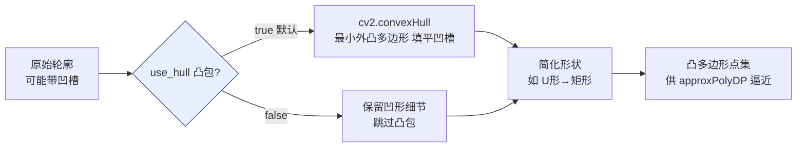

---

#### 步骤4：approxPolyDP 多边形逼近（阶段二：能理解，30min）

> 📌 本步骤对应源码：`src/pipeline.py` fit_polygon

**知识点讲解**：

**Douglas-Peucker 算法（1.3.1）**
- **原理**：`cv2.approxPolyDP(shape, epsilon_ratio * peri, True)` 用 **Douglas-Peucker 算法**简化多边形：从首尾两点连直线，找离直线最远的点，若距离 > epsilon 则递归细分，否则舍去中间点。`epsilon = epsilon_ratio × 周长` 使简化与尺寸无关——epsilon_ratio 越大简化越狠（顶点越少），越小越精细（顶点越多）。典型值 0.02：四边形→4 顶点、五边形→5 顶点、圆→8~16 顶点。拟合结果是「n边形」标注的依据——`n_vertices = len(approx)`。
- **源码对应**：`src/pipeline.py` fit_polygon（approxPolyDP，epsilon_ratio 参数）

**知识储备补充**：

- **Douglas-Peucker 算法递归原理**：该算法（1973）的核心是自顶向下的递归细分——给定多边形的首尾两点 $p_s, p_e$，遍历所有中间点找到距离线段 $\overline{p_s p_e}$ 最远的点 $p_{\max}$：

  $$
  d(p_{\max}, \overline{p_s p_e}) = \max_{p_i} \frac{|(p_e - p_s) \times (p_s - p_i)|}{\|p_e - p_s\|}
  $$

  其中 $\times$ 为二维叉积（绝对值除以底边长即点到直线距离）。若 $d(p_{\max}) > \varepsilon$（epsilon = epsilon_ratio × 周长），则 $p_{\max}$ 保留为顶点，递归处理 $[p_s, p_{\max}]$ 和 $[p_{\max}, p_e]$ 两段；否则中间点全部丢弃。时间复杂度 $O(n \log n)$（平均），最坏 $O(n^2)$。
- **epsilon 语义**：`epsilon = epsilon_ratio × 周长`（`fit_polygon` L55-56 中 `epsilon_ratio * peri`）。这意味着 epsilon 随轮廓尺寸等比缩放——同一 ratio 下，大物体和小物体的简化程度一致，调参不需按物体尺寸手动调整。典型 ratio 范围：0.005（精细，保留细节）→ 0.02（默认，适中）→ 0.05（粗糙，只留大特征）→ 0.1（极粗糙，圆→三角形）。
- **圆的多边形逼近**：圆没有角点，Douglas-Peucker 会保留等间距的"伪角点"来近似弧线。epsilon_ratio=0.02 时圆通常被拟合为 8~16 边形——这正是实验中"≥8 近似圆"分类阈值的来源。顶点数随 ratio 变化的趋势：ratio 越小顶点越多（逼近圆弧），越大顶点越少（圆→三角形→直线）。
- **参考资源**：Douglas & Peucker, *Algorithms for the reduction of the number of points required to represent a digitized line or its caricature*（1973，原始论文）；OpenCV 官方文档 `cv2.approxPolyDP`。

**操作步骤**：

1. 对同一物体用不同 epsilon_ratio 测试：
   ```bash
   cd ~/ros2_ws/src/xflz_eai_car1/vision/05_line_following
   
   # 图片需自带然后修改图片路径
   PYTHONPATH=./src python -c "
   import cv2
   from pipeline import to_binary, find_contours, fit_polygon
   from config import load_config
   cfg = load_config('config/line_config.yaml')
   mask = to_binary(cv2.imread('card.jpg'), cfg)
   c = find_contours(mask, cfg['contour']['min_area'])[0]
   for eps in [0.005, 0.02, 0.05, 0.1]:
       p = fit_polygon(c, eps)
       print(f'epsilon_ratio={eps}: {len(p)}边形')"
   ```
2. 观察 epsilon 从 0.005→0.1 的顶点数变化（4→4→4→3 或类似），理解"简化粒度"语义
3. 用圆形物体测试，观察高 epsilon 下圆被拟合为多少边形

**易错点**：
- ⚠️ epsilon 过小 → 顶点冗余（噪声点被保留）；过大 → 形状失真（圆变三角形）
- ⚠️ epsilon 与周长挂钩（比例式），改图尺寸不需重调

**流程图**：

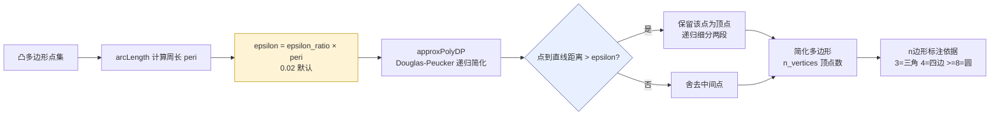

---

#### 步骤5：顶点标注与可视化（阶段三：能改造，25min）

> 📌 本步骤对应源码：`src/pipeline.py` draw_polygons / draw_polygons_dark

**知识点讲解**：

**可视化与数据输出（1.3.2）**
- **原理**：`detect_polygons()`（L61-73）编排全链路（二值化 → 轮廓 → 拟合），按面积降序返回 `PolygonResult(vertices, area, n_vertices)`。`draw_polygons()`（L76-87）在图上绘制凸包多边形 + 黄色顶点标记 + 「n边形」标签；`draw_polygons_dark()`（L90-119）提供黑底彩色多边形 + 质心圆点的 vendor 风格效果。顶点数 `n_vertices` 是形状分类的关键特征（3=三角形、4=四边形、≥8 近似圆）。
- **源码对应**：`src/pipeline.py` L61-73（detect_polygons）、L76-87（draw_polygons）、L90-119（draw_polygons_dark）

**知识储备补充**：

- **质心计算与 Moments**：`draw_polygons_dark` 中 `cv2.moments(r.vertices)` 计算多边形的图像矩。零阶矩 $m_{00}$ = 面积，一阶矩 $m_{10}, m_{01}$ 用于求质心：

  $$
  c_x = \frac{m_{10}}{m_{00}}, \quad c_y = \frac{m_{01}}{m_{00}}
  $$

  质心是形状的"重心"——在巡线应用中，质心 x 坐标相对画面中心的偏移量可直接映射为转向指令（左/中/右），这是实验 08（自主巡线）的核心思路。
- **双栏可视化设计**：`app.py` L30-36 的 `process_frame` 在 `colored_mode=true` 时将原图与黑底彩色轮廓水平拼接（`np.hstack`），形成双栏视图——左栏为原始 RGB，右栏为纯黑背景上的彩色多边形轮廓 + 质心圆点。这种设计便于对比：左栏确认检测目标正确，右栏观察拟合质量。MJPEG 推流地址为 `:8080/polygon.mjpg`，浏览器可实时查看。
- **形状分类阈值**：顶点数 $n$ 的分类规则：$n=3$ 三角形，$n=4$ 四边形，$n=5$ 五边形，$n \ge 8$ 近似圆。该阈值并非绝对——epsilon_ratio 不同，同一物体的 $n$ 可能变化。实测标定是必要的：用标准形状（三角板、方块、圆盘）跑一遍，记录各 ratio 下的 $n$ 分布，确定稳定分类区间。
- **参考资源**：OpenCV 官方文档 `cv2.moments`、`cv2.polylines`；MJPEG Streamer 项目（多实验共用的推流方案）。

**操作步骤**：

1. 单图检测：
   ```bash
   cd ~/ros2_ws/src/xflz_eai_car1/vision/05_line_following
   
   python src/app.py --image image.png --save out.jpg
   ```
2. 相机实时（板上标准）：
   ```bash
   source /opt/ros/humble/setup.bash && source ~/ros2_ws/install/setup.bash
   export ROS_DOMAIN_ID=2
   
   ros2 launch ascamera hp60c.launch.py        # 终端 1
   python src/app.py --ros                      # 终端 2
   # MJPEG: http://<板IP>:8080/polygon.mjpg，移动物体观察顶点数实时变化
   ```
3. 动手改造：按顶点数分类显示颜色（三角形红/四边形绿/圆形蓝），实现简单形状分类器

**易错点**：
- ⚠️ --ros 取不到帧 → ascamera 先起、ROS_DOMAIN_ID 一致、话题勿 remap
- ⚠️ 形状分类阈值：圆 vs 多边形靠顶点数，需实测标定

**流程图**：

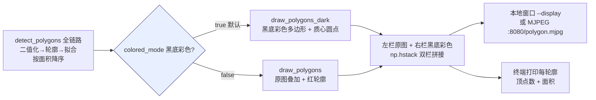

---

### 1.7 常见问题

| 问题 | 原因 | 解决方法 |
|------|------|---------|
| 轮廓全错 | invert 设反（暗物亮底 vs 亮物暗底） | 检查 `threshold.invert`（默认 true=暗物亮底） |
| 噪声轮廓混入 | min_area 过小 / 二值化噪点多 | 增大 min_area；开运算去噪（morphology） |
| 顶点数异常（过多） | epsilon_ratio 过小 | 增大 approx_epsilon（0.02 → 0.05） |
| 形状失真（圆变三角） | epsilon_ratio 过大 | 减小 approx_epsilon |
| 凹槽物体拟合异常 | use_hull 语义不匹配 | true=凸包填平凹槽；false=保留凹形细节 |
| 光照变化后检测不稳 | binary 阈值不适应 | 换 `threshold_mode: adaptive` |
| --ros 取不到帧 | 驱动未启动/ROS_DOMAIN_ID 不一致 | ascamera 先起；export ROS_DOMAIN_ID=2；话题勿 remap |

### 1.8 扩展实验

**扩展方向 1：形状分类器（进阶）**
- 用 `n_vertices` 分类：三角形（3）、四边形（4）、五边形（5）、圆（≥8），不同形状不同颜色标注，实现基础几何形状识别

**扩展方向 2：自主巡线（进阶）**
- 用多边形质心 x 坐标相对画面中心的偏移量生成转向指令（左/中/右），通过 ROS2 cmd_vel 发布控制小车沿色块路径行驶（参考实验 11 的 cmd_vel 模式）

### 1.9 实验报告要求

**评分标准**：二值化理解 15 分 + 轮廓提取 15 分 + 凸包原理 20 分 + approxPolyDP 25 分 + 实时演示 15 分 + 报告 10 分 = 100 分。

**报告必含内容**：
1. 二值化流程图与参数说明（invert/threshold_mode 对比图）
2. 轮廓提取结果图（含 min_area 过滤前后对比）
3. 凸包 vs 原轮廓对比图（凹槽被填平的效果）
4. epsilon_ratio 参数实验表（0.005~0.1 的顶点数变化）
5. 3 种不同形状物体的「n边形」标注结果图
6. 回答思考题：凸包与多边形的区别？epsilon 如何影响拟合？如何用顶点数分类形状？
7. 实验心得与问题记录

---

## 更新日志

| 版本 | 日期 | 变更 |
|------|------|------|
| v1.0 | 2026-08-10 | 初版生成（源码路径 ros2_ws/src/xflz_eai_car1/vision/05_line_following，21 用例全绿，二值化+轮廓+凸包+approxPolyDP+顶点标注，板端验证通过） |
| v2.0 | 2026-08-19 | 知识点增强：补充 5 个知识储备小节（HSV掩膜公式/形态学开运算语义/轮廓检索模式/凸包数学定义/Douglas-Peucker递归原理/质心Moments/形状分类阈值），追加执行现象段，新增 3 个公式块（HSV掩膜/凸包凸组合/D-P叉积距离），补充 6 个参考资源条目，源码行号复核对齐 |
| v2.1 | 2026-08-21 | 步骤 1 新增「配置参数速查表」：config/line_config.yaml 全参数（preprocess/contour/polygon/camera/source/display）。标注 invert/use_hull/colored_mode。表值实测一致 |

---

## 实验4：基于YOLOv8的工业表面缺陷检测实验（4h）

> ✅ **源码已核实** 本实验源码位于 `ros2_ws/src/xflz_eai_car1/vision/01_industrial_defect_detection/`（仓库内相对路径，根 = 课程生成项目根目录）。已随仓库交付完整训练产物（`train/weights/best.pt`、`best.onnx`，9 输出）与转换产物（`models/defect_yolov8n_int8.rknn`，int8 单核+剪枝，200 张 val 校准）。板端验证通过，实测约 **13 FPS**（NPU）。

### 1.1 关联知识点

本实验对应第 1 章"工业缺陷检测与 YOLOv8 认知"，覆盖以下 7 个知识点（ID 遵循知识图谱编号约定，来源于 course-spec.yaml 的 knowledge_points）：

- 1.1.1 YOLOv8模型架构 > 原理 > YOLOv8 采用 CSPDarknet 主干 + PAN-FPN 颈部 + 解耦检测头，引入 DFL（Distribution Focal Loss）边界框回归
- 1.1.2 工业缺陷数据集 > 概念 > NEU-DET 数据集包含 6 类表面缺陷（crazing/inclusion/patches/pitted_surface/rolled-in_scale/scratches），YOLO 归一化标签格式
- 1.2.1 模型训练与超参数 > 流程 > yolov8n + imgsz=640 + epochs=100 + batch=8 的训练配置与产物解读（mAP50=0.732）
- 1.2.2 ONNX模型转换 > 流程 > 使用 RKNN 优化版 fork 导出 format=rknn 的 ONNX（3×nl 个原始张量，DFL 留在 CPU 侧，共 9 个输出）
- 1.3.1 RKNN NPU部署 > 原理 > rknn-toolkit2 将 ONNX 转换为 rk3576 平台 int8 量化模型，RKNNLite 在 6TOPS NPU 上推理
- 1.3.2 实时缺陷检测 > 流程 > letterbox 预处理 → RGB 通道交换 → NPU 推理 → DFL 解码 + 逐类 NMS → unletterbox 画框标注
- 1.3.3 精度评测与质检 > 概念 > mAP50 指标（纯 numpy 实现）与 onnx/rknn 双后端精度对比

### 1.2 实验目标

1. 掌握 YOLOv8 目标检测模型的工业应用方法，理解模型架构、训练超参数与检测原理 — 原理理解
2. 完成工业产品的缺陷自动检测与定位，实现缺陷类别识别与可视化标注 — 独立完成
3. 理解工业质检场景下的数据集制作、模型训练、部署推理全流程，体验"PC 训练 → ONNX 导出 → RKNN 转换 → 板端 NPU 推理"的完整链路 — 迁移应用

### 1.3 实验环境

| 类别 | 配置 |
|------|------|
| 硬件 | 具身智能实验箱 B2（XFLZ_EAI_B2_PRO，RK3576 SoC，6TOPS NPU，含 HP60C 深度相机） |
| OS | Ubuntu 22.04 + ROS2 Humble（板载 ros2_venv 虚拟环境，rknnlite 2.3.2 / onnxruntime 1.23.2） |
| 核心库 | OpenCV、NumPy、PyYAML、rknnlite（板端推理）、rknn-toolkit2（转换）、onnxruntime、mjpeg_streamer、rclpy + cv_bridge |
| 训练框架 | ultralytics 8.3.229（RKNN 优化 fork，numpy<2.0，PC 侧） |
| 主入口 | `src/app.py`（推理 CLI：单图 / 视频 / UVC 相机 / ROS2 相机）<br>`src/convert_rknn.py`（ONNX → RKNN 转换）<br>`src/eval_map.py`（mAP50 精度评测）<br>`scripts/train.sh` / `scripts/export_onnx.sh`（PC 训练与导出） |

### 1.4 实验难度

- 难度: ⭐⭐⭐ 综合性
- 重点: YOLOv8 工业缺陷检测全流程（数据集 → 训练 → 导出 → 转换 → 部署推理 → 精度评测）
- 难点: RKNN int8 量化精度控制（校准集、RGB/BGR 约定、letterbox 填充值一致性）与 NPU 部署的输入格式约束（4D NHWC、RGB、无归一化）

### 1.5 实验现象

**快速验证流程**（帮助学习者快速看到实验效果，全程在板载 B2 平台执行）：

1. 进入项目根目录：`cd ~/ros2_ws/src/xflz_eai_car1/vision/01_industrial_defect_detection`
2. （可选）跑通单元测试：`pytest -v`（42 用例全绿，数据集用例在无 NEU-DET 的机器上自动跳过）
3. 单图推理（仓库自带 4 张缺陷测试图 `images/1.jpg~4.jpg`）：`python src/app.py --model models/defect_yolov8n_int8.rknn --image images/1.jpg --save out.jpg`
   - 终端打印每帧 FPS 与每个缺陷框的类别、置信度、坐标
4. 查看标注结果：`out.jpg` 中缺陷区域被红色框标出，框上方打印类别名（如 `scratches 0.87`）
5. 视频推理：`python src/app.py --model models/defect_yolov8n_int8.rknn --video test.mp4 --save out.mp4`
6. 相机实时（标准流程）：先起相机驱动，再运行 `--ros` 模式（详见步骤 6）
7. 浏览器查看 MJPEG 实时流：`http://<板IP>:8080/defect.mjpg`，移动工件观察缺陷框实时跟随

```bash
# 进入实验4
cd ~/ros2_ws/src/xflz_eai_car1/vision/01_industrial_defect_detection

# 可选
/home/iflytek/ros2_venv/bin/python -m pytest -v

# 执行单图片推理（图片都在01_industrial_defect_detection/images）
python src/app.py --model models/defect_yolov8n_int8.rknn --image images/1.jpg --save out.jpg
```

**执行现象**：`pytest -v` 运行约 40-60 秒，输出 42 个用例全部 passed；单图推理命令在约 0.1-0.3 秒内返回，终端打印类似 `fps=xx.x` 与每个缺陷框的 `类别 置信度 (x1,y1,x2,y2)`，同时在当前目录生成 `out.jpg`（红框标注图）。板端实测 NPU 推理约 **13 FPS**。

**预期效果描述**：

- **单图/视频**：6 类缺陷（裂纹 crazing、夹杂 inclusion、斑块 patches、麻点 pitted_surface、氧化铁皮 rolled-in_scale、划痕 scratches）均能以红框 + 类别 + 置信度标注，小目标缺陷（如麻点、划痕）也能稳定检出
- **相机实时**：检测框在视频流中逐帧更新，终端每 30 帧打印一次平均帧率，板端实测约 **13 FPS**（yolov8n/640，NPU 单核+剪枝模型）
- **精度表现**：随仓库交付的训练产物在 val 集达到 P=0.657 / R=0.706 / **mAP50=0.732**；RKNN int8 模型相对 ONNX 掉点 ≤3%
- **完整链路**：一份 `best.pt` 权重依次经历 PyTorch 训练、ONNX 导出、RKNN int8 量化转换，最终在 6TOPS NPU 上以 13 FPS 实时运行，验证"训练部署一体"的工业落地范式

```bash
(ros2_venv) iflytek@localhost:~/ros2_ws/src/xflz_eai_car1/vision/01_industrial_defect_detection$ python src/app.py --model models/defect_yolov8n_int8.rknn --image images/1.jpg --save out.jpg
note: NEU-DET data.yaml 不在本机，使用内置 6 类名
/home/iflytek/ros2_venv/lib/python3.10/site-packages/rknnlite/api/rknn_lite.py:41: UserWarning: pkg_resources is deprecated as an API. See https://setuptools.pypa.io/en/latest/pkg_resources.html. The pkg_resources package is slated for removal as early as 2025-11-30. Refrain from using this package or pin to Setuptools<81.
  import pkg_resources
W rknn-toolkit-lite2 version: 2.3.2
I RKNN: [16:45:27.301] RKNN Runtime Information, librknnrt version: 2.3.2 (429f97ae6b@2025-04-09T09:09:27)
I RKNN: [16:45:27.301] RKNN Driver Information, version: 0.9.8
I RKNN: [16:45:27.302] RKNN Model Information, version: 6, toolkit version: 2.3.0(compiler version: 2.3.0 (c949ad889d@2024-11-07T11:39:30)), target: RKNPU f2, target platform: rk3576, framework name: ONNX, framework layout: NCHW, model inference type: static_shape
W RKNN: [16:45:27.327] query RKNN_QUERY_INPUT_DYNAMIC_RANGE error, rknn model is static shape type, please export rknn with dynamic_shapes
W Query dynamic range failed. Ret code: RKNN_ERR_MODEL_INVALID. (If it is a static shape RKNN model, please ignore the above warning message.)
fps=10.0
  inclusion 0.826 (181,0,279,302)
  inclusion 0.763 (96,430,214,641)
saved -> out.jpg
```

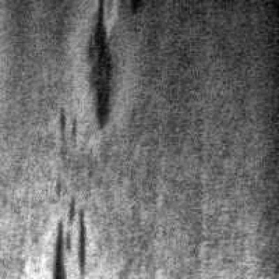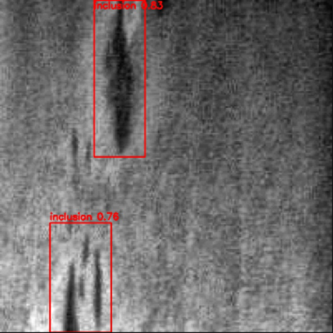

### 1.6 实验步骤

#### 整体流程图

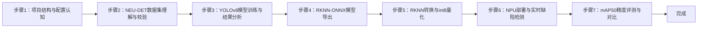

---

#### 步骤1：项目结构与配置体系认知（阶段一：能运行，20min）

> 📌 本步骤对应源码：`config/defect_config.yaml`、`src/config.py`

**知识点讲解**：

**配置驱动设计（1.1.2 延伸）**

- **原理**：工业质检项目通常要求"配置与代码分离"，把数据集路径、训练超参、推理阈值、RKNN 转换参数全部收敛到一个 YAML 文件，保证实验可复现。本项目通过 `src/config.py` 的 `load_config()` 实现**契约式校验**：`REQUIRED` 字典（L14-35）声明了 dataset/train/infer/rknn/eval 五个区块必须存在的键与其类型，缺键或类型错误直接抛出 `ConfigError`（L38-39），避免"配置写错导致推理静默失败"这类隐蔽问题；未知键则忽略（向前兼容）。`resolve_path()`（L67-73）负责把配置中的相对路径解析为绝对路径。推理侧两个关键阈值——`score_thr=0.25`（置信度过滤）与 `iou_thr=0.45`（NMS 交并比阈值）——都在配置中集中管理（`config/defect_config.yaml` L22-26），调参无需改代码。
- **源码对应**：`config/defect_config.yaml` L1-47（dataset L4-8 / train L10-20 / infer L22-26 / rknn L37-42 / eval L44-46）；`src/config.py` L14-35（REQUIRED）、L42-64（load_config）、L67-73（resolve_path）

**知识储备补充**：

- **背景与动机**：YAML 配置驱动是工业算法工程的标准实践——训练、评测、部署三阶段共享同一份配置，避免"训练用 A 参数、部署却写死 B 参数"导致的漂移。"契约式校验"（schema validation）把错误前置到加载阶段，而不是让错误配置在推理时静默产生错误结果。
- **阈值语义**：`score_thr=0.25` 是置信度过滤阈值——低于它的检测框直接丢弃，值越大检测越保守（漏检增多、误检减少）；`iou_thr=0.45` 是 NMS 的交并比阈值——两个同类框 IoU 超过它则保留高分者。二者共同决定"输出的框数量与质量"，是目标检测的两个核心后处理超参。
- **相对路径解析**：`resolve_path`（L67-73）基于**配置文件所在目录**解析相对路径，而非当前工作目录。这是关键设计：无论从哪个目录启动，配置里的 `dataset.root` 都能稳定解析到同一位置，保证实验跨目录可复现。
- **参考资源**：PyYAML 官方文档 `yaml.safe_load`；JSON Schema 思想（配置契约校验的通用范式）。

**配置参数速查表**（`config/defect_config.yaml`，按区块分列）：

| 区块 | 参数 | 类型 | 默认/示例 | 说明 |
|------|------|------|-----------|------|
| `dataset` | `root` | str | `/home/.../NEU-DET.v1i.yolov8` | 训练数据集根目录（PC 端；板上推理/评测不需要） |
| `dataset` | `data_yaml` | str | `data.yaml` | 数据集标注文件（含类别名） |
| `dataset` | `splits` | list | `[train, valid, test]` | 参与校验的分割子集 |
| `train` | `fork` | str | `/home/.../ultralytics_yolov8-main` | RKNN 优化版 ultralytics fork 路径 |
| `train` | `model` | str | `yolov8n.pt` | 预训练权重 |
| `train` | `imgsz` | int | `640` | 训练输入边长（精度-速度权衡） |
| `train` | `epochs` | int | `100` | 训练轮数 |
| `train` | `batch` | int | `8` | 批大小（GTX1060 建议 ≤8） |
| `train` | `device` | int/str | `0` | 训练设备（无 CUDA 改 `cpu`） |
| `train` | `project`/`name` | str | `runs/.../yolov8n_img640_e100` | 训练产物输出目录 |
| `infer` | `imgsz` | int | `640` | 推理输入边长（须与训练一致） |
| `infer` | `score_thr` | float | `0.25` | 置信度过滤阈值（越大越保守） |
| `infer` | `iou_thr` | float | `0.45` | NMS 交并比阈值 |
| `infer` | `pad_color` | list | `[0,0,0]` | letterbox 填充色（与 rknn_model_zoo 一致，勿改 114） |
| `source` | `ros.rgb_topic` | str | `/ascamera_hp60c/.../rgb0/image` | ROS2 相机话题（严禁 remap） |
| `source` | `ros.timeout` | float | `5.0` | 首帧等待秒数 |
| `server` | `port` | int | `8080` | MJPEG 推流端口 |
| `server` | `stream_name` | str | `defect.mjpg` | MJPEG 流名（已含 `.mjpg` 勿再追加） |
| `rknn` | `target_platform` | str | `rk3576` | 转换目标平台 |
| `rknn` | `quantize` | bool | `true` | 是否 int8 量化（转换脚本用） |
| `rknn` | `calib_count` | int | `200` | int8 校准图片数（val 抽取） |
| `rknn` | `onnx_model` | str | `train/weights/best.onnx` | 待转换 ONNX 路径 |
| `rknn` | `rknn_model` | str | `models/defect_yolov8n_int8.rknn` | 转换产物 .rknn 路径 |
| `eval` | `split` | str | `valid` | mAP50 评测用分割集 |
| `eval` | `iou_thr` | float | `0.5` | mAP50 的 IoU 判定阈值 |

> **说明**：`infer.imgsz` 须与训练 `train.imgsz` 一致（输入尺寸绑定）；`train.device` 无 GPU 改 `cpu`；`train.*` `rknn.*` 为 PC 侧（训练/转换），板端只用 `infer`/`source`/`server`。`source`/`server`/`train.run_dir` 不在 `REQUIRED` 校验内（未知键忽略，向前兼容）——改错不报错，注意自行核对。

**操作步骤**：

1. 查看项目目录结构，确认六大模块分工：
   ```bash
   cd ~/ros2_ws/src/xflz_eai_car1/vision/01_industrial_defect_detection
   ls src/    # app / config / convert_rknn / dataset / eval_map / infer / metrics / mjpeg_server / postprocess / preprocess / ros2_source
   ```

2. 阅读配置文件，逐区块理解含义：
   ```bash
   cat config/defect_config.yaml
   # 重点：infer.score_thr=0.25、infer.iou_thr=0.45、rknn.target_platform=rk3576、server.port=8080
   ```

3. 用 Python 验证配置加载与校验逻辑：

   ```bash
   PYTHONPATH=./src python -c "from config import load_config; cfg = load_config('config/defect_config.yaml'); print(cfg['infer'])"
   # 预期输出：{'imgsz': 640, 'score_thr': 0.25, 'iou_thr': 0.45, 'pad_color': [0, 0, 0]}
   ```

4. 验证缺键报错（观察 ConfigError 契约）：
   ```bash
   PYTHONPATH=./src python -c "from config import load_config; load_config('config/defect_config.yaml')" # 正常
   # 尝试删掉 yaml 中 infer 区块再运行，观察 ConfigError 提示缺失键
   ```

**易错点**：
- ⚠️ 配置路径写相对路径时，`resolve_path` 基于**配置文件所在目录**解析（`config.py` L67-73），不是当前工作目录——跨目录运行务必注意

---

#### 步骤2：工业缺陷数据集理解与校验（阶段一：能运行，30min）

> 📌 本步骤对应源码：`src/dataset.py`
>
> 需要自行准备相关数据集

**知识点讲解**：

**NEU-DET 数据集与 YOLO 标签格式（1.1.2）**

- **原理**：NEU-DET（Northeastern University 表面缺陷数据集）是工业质检领域的标准公开数据集，包含热轧带钢表面 6 类缺陷（crazing 裂纹 / inclusion 夹杂 / patches 斑块 / pitted_surface 麻点 / rolled-in_scale 氧化铁皮 / scratches 划痕），共 1800 张 200×200 灰度图，已由社区转换为 YOLO 格式（`NEU-DET.v1i.yolov8`）。YOLO 标签为每行 `class_id cx cy w h` 的归一化格式（值域 0-1，相对图像宽高），与 COCO 的像素坐标格式不同。`src/dataset.py` 的 `validate_dataset()`（L19-85）负责**校验数据集结构**：确认 images/labels 目录存在、图像与标签一一对应、标签行数/坐标合法，输出统计（类别分布、样本数），为训练和评测提供数据完整性保障。`class_names()`（读 data.yaml）从 `names:` 字段提取 6 类名称供推理标注使用。
- **源码对应**：`src/dataset.py` L19-85（validate_dataset：目录检查 L24-38 / 标签合法性 L40-66 / 统计输出 L68-85）、class_names 读取 data.yaml

**知识储备补充**：

- **背景与动机**：NEU-DET 由东北大学宋克臣团队于 2017 年发布，是热轧带钢表面缺陷检测的基准数据集。工业表面缺陷（尤其小尺度、低对比度缺陷）与通用目标检测数据集有本质差异：缺陷面积小（常不足图像 5%）、类间外观相似（crazing 与 scratches 均为细线纹理）、标注一致性要求极高——这使它成为检验检测模型"小目标 + 弱纹理"能力的标准测试床。

- **YOLO 归一化标签格式**：每行 `class_id cx cy w h`，其中 $c_x, c_y, w, h$ 均为归一化值：

  $$
  c_x = \frac{x_{center}}{W}, \quad c_y = \frac{y_{center}}{H}, \quad w = \frac{bw}{W}, \quad h = \frac{bh}{H}
  $$

  其中 $W,H$ 为图像宽高，$(x_{center}, y_{center})$ 为框中心像素坐标，$bw,bh$ 为框宽高像素。归一化后标签与图像分辨率解耦——同一标注可适配任意 `imgsz` 训练。这与 COCO 的 `[x,y,w,h]` 像素坐标格式不同，混用是标注常见错误。

- **关键参数**：归一化坐标值域必须 ∈ [0,1]；越界或混入像素坐标会导致训练崩溃或 mAP 极低——`validate_dataset`（L40-66）正是校验这一点。

- **参考资源**：

  NEU-DET 论文（K. Song et al., *Surface defect detection method using saliency linear perceptual hashing technology*）；

  Roboflow `NEU-DET.v1i.yolov8` 数据集页。

**操作步骤**：

1. 若本机已有 NEU-DET 数据集，配置 `config/defect_config.yaml` 中 `dataset.root` 指向其路径
2. 运行数据集校验：
   ```bash
   PYTHONPATH=./src python -c "from dataset import validate_split, class_names; import pathlib; \
   root = pathlib.Path('/home/iflytek/tmp/AIoT_B2/NEU-DET.v1i.yolov8'); \
   print('classes:', class_names(root / 'data.yaml')); \
   print('--- train ---'); print(validate_split(root, 'train')); \
   print('--- val ---'); print(validate_split(root, 'val'))"
   # 预期：打印类别统计（6 类缺陷各约 300 张）与标签合法性结果
   ```
3. 查看 2-3 张标注图，理解 YOLO 归一化标签与像素坐标的换算关系（用 OpenCV 画框验证）
4. 思考：为什么工业缺陷数据集比通用目标检测数据集更难标注？（缺陷尺度小、类间相似、标注一致性要求高）

下面是相关训练的标注照片，可以在 ~/ros2_ws/src/xflz_eai_car1/vision/01_industrial_defect_detection/train 中进行查看

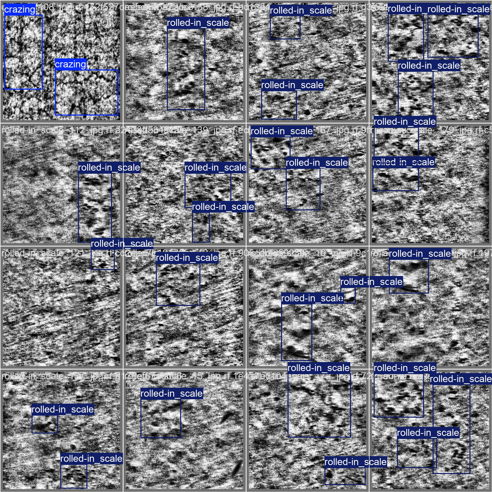

**易错点**：
- ⚠️ 板上无 NEU-DET 数据集属正常现象——`app.py` L60-65 已内置 6 类名兜底，板上推理无需数据集
- ⚠️ 标签坐标必须归一化（0-1），若混入像素坐标，训练会直接崩或 mAP 极低

---

#### 步骤3：YOLOv8 模型训练与结果分析（阶段二：能理解，40min）

> 📌 本步骤对应源码：`scripts/train.sh`、`train/args.yaml`

**知识点讲解**：

**YOLOv8 架构与训练流程（1.1.1、1.2.1）**

- **原理**：YOLOv8 是 anchor-free 的实时目标检测器，主干 CSPDarknet 提取多尺度特征，PAN-FPN 颈部融合，**解耦检测头**分别输出分类与回归分支。回归分支采用 **DFL（Distribution Focal Loss）**：不直接回归偏移，而是预测 16 个 bin 的概率分布，加权求和得到连续偏移，对小目标更友好（`postprocess.dfl_decode` 对应实现）。训练配置收敛在 `train/args.yaml`：yolov8n、imgsz=640、epochs=100、batch=8、optimizer=auto、seed=0。训练产物 `train/weights/best.pt`（+ last.pt）与 `best.onnx`（RKNN 优化 fork 导出，9 输出）随仓库交付，**无需重训即可进入部署链路**；`scripts/train.sh`（L1-25）封装了 PC 侧训练入口。
- **源码对应**：`scripts/train.sh` L1-25；`train/args.yaml` L1-106（超参数全量）；训练指标见 `train/results.csv`、曲线图 `train/*.png`

**知识储备补充**：

- **YOLOv8 架构拆解**：YOLOv8（2023，Ultralytics）相对 YOLOv5 的关键演进可归纳为四点

  (1) **anchor-free**：去掉预置 anchor，直接回归中心点与宽高（中心点落在哪个 grid 哪个负责），减少超参；

  (2) **C2f 模块**：替换 C3，借鉴 ELAN 结构引入更多梯度流分支，在相近计算量下提升表征；

  (3) **解耦头（Decoupled Head）**：分类与回归分支分离，各自用不同尺度结构，缓解分类/回归任务冲突；

  (4) **DFL 回归**。主干 CSPDarknet 提取 80/40/20 三个尺度的特征图（对应小/中/大目标），PAN-FPN 自顶向下 + 自底向上融合多尺度。

- **DFL 原理**：DFL 不直接回归框偏移 $t$，而是用 16 个 bin 的概率分布表示其近似：

  $$
  t = \sum_{i=0}^{15} p_i \cdot i, \qquad p = \text{softmax}(z)
  $$

  其中 $z \in \mathbb{R}^{16}$ 是网络对 16 个 bin 的原始 logits，$p_i$ 为第 $i$ 个 bin 的 softmax 概率，$t$ 为加权和得到的连续偏移。相比单值回归，DFL 能刻画边界的不确定性，对小目标与边界模糊目标（如细纹理缺陷）更友好。解码时 `dfl_decode`（postprocess L34-42）执行 softmax 后加权求和。

- **精度-速度权衡**：imgsz=640 是速度与精度的折中。NPU 算力固定 6TOPS，特征图边长平方增长（640²→800² 计算量增约 56%），单帧耗时随之上升。640 能覆盖绝大多数缺陷尺度且保持实时，是工业部署的常用默认。

- **参考资源**：

  YOLOv8 论文（Jocher et al., Ultralytics YOLOv8）；

  Ultralytics 官方文档《YOLOv8 Architecture Overview》；

  DFL 原论文《Generalized Focal Loss》（Li et al., 2020）。

相关YOLOv8网络架构图

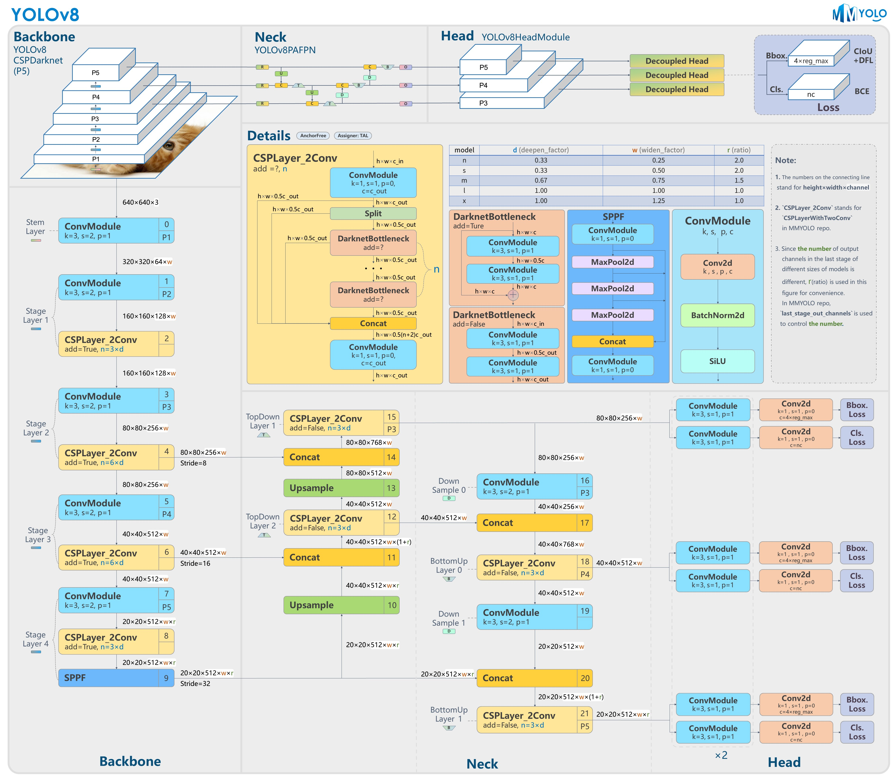

**操作步骤**：

1. 查看训练产物目录，理解"一份权重，三种格式"：
   ```bash
   ls -la train/weights/    # best.pt (PyTorch) + best.onnx (RKNN-ONNX, 9输出)
   ```

2. 解读训练指标（`train/results.csv` 末尾几行）：
   ```bash
   tail -5 train/results.csv    # epoch/box_loss/cls_loss/dfl_loss/metrics/precision/recall/mAP50
   # 参考：epoch 100 → P=0.657 / R=0.706 / mAP50=0.732 / mAP50-95=0.409
   ```

3. 查看混淆矩阵与 PR 曲线（`train/confusion_matrix.png`、`train/PR_curve.png`），分析哪两类缺陷最易混淆（通常 crazing 与 scratches 相似）

   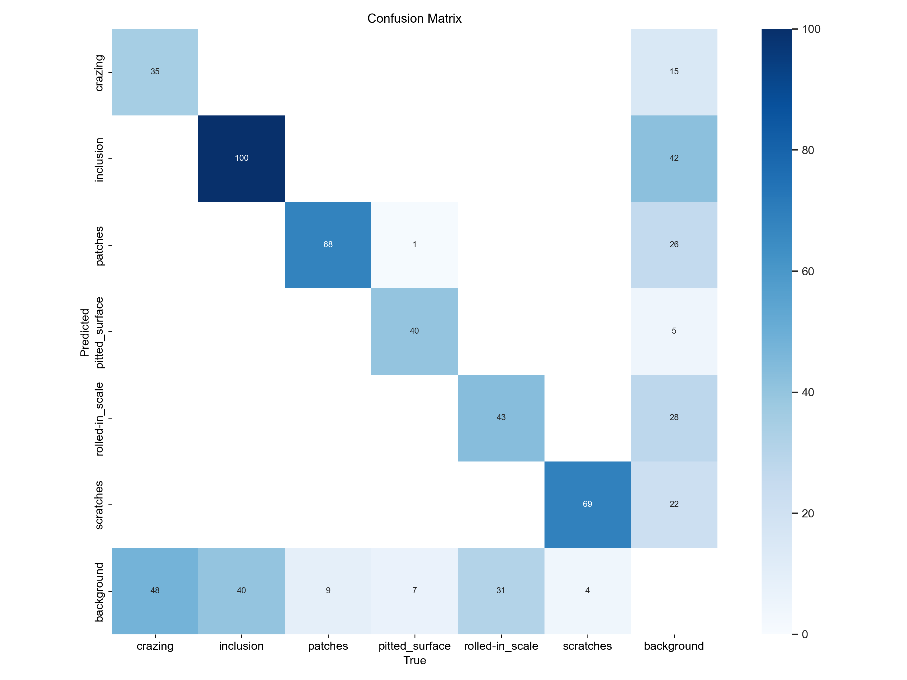

   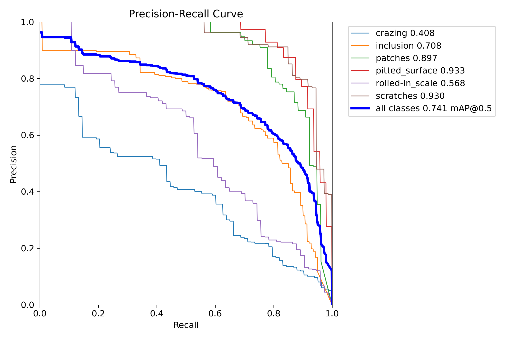

4. （可选，PC 且需重训时）运行 `bash scripts/train.sh`，比较训练曲线

5. 思考：为什么选择 imgsz=640 而不是 800？板端 NPU 算力固定（6TOPS），imgsz 越大单帧耗时越高——这是**精度-速度权衡**的典型例子

**易错点**：

- ⚠️ 训练框架必须是 RKNN 优化 fork（ultralytics 8.3.229 + numpy<2.0），官方版导出的 ONNX 不是 9 输出，无法直接转 rknn
- ⚠️ 训练精度目标只是参考，mAP 达标 ≠ 板端可用——int8 量化会引入精度损失，需在步骤 7 验证掉点

---

#### 步骤4：RKNN-ONNX 模型导出（阶段二：能理解，30min）

> 📌 本步骤对应源码：`scripts/export_onnx.sh`

**知识点讲解**：

**RKNN 优化版 ONNX 导出（1.2.2）**

- **原理**：官方 ultralytics 导出的 ONNX 把 DFL 解码也导出到计算图中（大量 Slice/Concat 算子），RKNN 转换器对这类动态索引支持差、易报错或低效。RKNN 优化 fork 提供了 `format='rknn'` 导出模式：**DFL 解码留在 CPU 侧**（Python 后处理实现），模型只输出 3×nl 个原始张量——每层 3 个：box `(1,64,h,w)`（DFL 原始分布）、cls `(1,nc,h,w)`（已 sigmoid）、cls_sum `(1,1,h,w)`（可忽略分支）。yolov8n 有 3 个检测层（80/40/20），故共 9 个输出。`export_onnx.sh`（L1-21）封装导出命令并校验输出数量。
- **源码对应**：`scripts/export_onnx.sh` L1-21（导出 + 校验 L16-20）

**知识储备补充**：

- **背景与动机**：RKNN 转换器对 ONNX 算子的支持不是全集的——大量动态 Shape 算子（Slice/Concat 组合的动态索引、Reshape 依赖运行时值）在量化图优化阶段易失败或生成低效指令。RKNN 优化 fork 将"纯推理主干"与"DFL 后处理"分离：把后处理留在 CPU（Python），模型只保留稳定、可静态分析的算子，显著提高 RKNN 转换成功率与 NPU 效率。
- **输出张量结构拆解**：每检测层输出 3 个张量——box `(1,64,h,w)` 是 DFL 的 16 bin × 4 坐标原始分布（回归分支），cls `(1,nc,h,w)` 是已 sigmoid 的类别分数（`nc`=6 类），cls_sum `(1,1,h,w)` 是类别分数和的可忽略分支。3 层 × 3 = 9 个输出：

  $$
  \text{outputs} = \bigcup_{l \in \{80,40,20\}} \{ \underbrace{\text{box}^{(l)}}_{1\times64\times h_l \times w_l},\; \underbrace{\text{cls}^{(l)}}_{1\times nc \times h_l \times w_l},\; \underbrace{\text{cls\_sum}^{(l)}}_{1\times 1\times h_l \times w_l} \}
  $$

  其中 $h_l = w_l = \text{imgsz}/l$（imgsz=640 → 8/16/32 下采样 → 80/40/20 特征图），`nc=6` 为缺陷类别数。
- **参考资源**：RKNN 官方文档《RKNN Toolkit2 User Guide》ONNX 算子支持表；Ultralytics `yolo export` 文档。

**操作步骤**：

1. 查看导出脚本内容，理解关键参数：
   ```bash
   cat scripts/export_onnx.sh
   # 核心：yolo export model=train/weights/best.pt format=onnx opset=12 imgsz=640
   #       format=rknn（RKNN 优化 fork 专用）
   ```

2. 验证已交付的 ONNX 输出结构（无需重导）：
   ```bash
   python -c "
   import onnxruntime as ort
   sess = ort.InferenceSession('train/weights/best.onnx')
   print('输入:', [i.name for i in sess.get_inputs()])
   print('输出数:', len(sess.get_outputs()))
   for o in sess.get_outputs(): print(' ', o.name, o.shape)"
   # 预期输出数 = 9（3 层 × 3 张量）
   ```

   ```bash
   输入: ['images']
   输出数: 9
     317 [1, 64, 80, 80]
     325 [1, 6, 80, 80]
     331 [1, 1, 80, 80]
     338 [1, 64, 40, 40]
     346 [1, 6, 40, 40]
     352 [1, 1, 40, 40]
     359 [1, 64, 20, 20]
     367 [1, 6, 20, 20]
     373 [1, 1, 20, 20]
   ```

   若需重导（PC 且 fork 环境就绪）：`bash scripts/export_onnx.sh train/weights/best.pt`

**易错点**：

- ⚠️ 输出不是 9 个 → 用了官方 ultralytics 或未指定 `format=rknn`（`export_onnx.sh` L16）
- ⚠️ opset 过高（>12）可能导致 RKNN 转换器不支持某些算子，保持 opset=12

---

#### 步骤5：RKNN 转换与 int8 量化（阶段二：能理解，40min）

> 📌 本步骤对应源码：`src/convert_rknn.py`

**知识点讲解**：

**RKNN int8 量化原理（1.3.1）**

- **原理**：RKNN 转换器（rknn-toolkit2）把 ONNX 图转换为 RK3576 平台的 NPU 指令集模型，核心是 **int8 量化**：权重和激活从 float32 缩放到 int8（w8a8），通过**校准集**统计激活分布确定每个张量的 scale/zero_point。量化配置要点：`quant_img_RGB2BGR=False`（L65）——因为导出模型的输入约定是 RGB；`target_platform='rk3576'`（L38-42）；校准集 200 张 val 图（`--calib-count 200`）。部署侧用 `RKNNLite`（`infer.py` L29-52）在 NPU 上推理，`init_runtime` 必须显式传 `core_mask=0`（NPU_CORE_AUTO，L36），None 在 2.3.2 会报 `core mode not supported`。模型推理输入必须是 **4D NHWC uint8**（静态 shape）且**不做 /255 归一化**——量化模型内部已含 scale。
- **源码对应**：`src/convert_rknn.py` L25-109（参数解析 L25-40 / config 加载与 RGB2BGR 设置 L41-65 / 转换+量化 L66-91 / 输出保存 L92-109）

**知识储备补充**：

- **int8 量化原理**：量化把浮点张量映射到 int8 整数域。权重 $w$ 与激活 $x$ 的仿射量化：

  $$
  w_q = \text{round}\left( \frac{w}{s_w} \right), \qquad x_q = \text{round}\left( \frac{x}{s_x} \right)
  $$

  其中 $s_w, s_x$ 分别为权重与激活的量化步长（scale），由校准集统计激活数值分布确定。反量化近似：$\hat{w} \approx s_w \cdot w_q$。相比 fp32，int8 用 4 倍压缩的位宽换取 NPU 上更快的定点运算（w8a8 即权重/激活均 8bit）。代价是舍入误差引入的精度损失（本项目要求掉点 ≤3%）。
- **校准集的作用**：scale 的确定依赖激活的真实分布。校准集（`--calib-count 200` 张 val 图）应代表部署时的真实数据分布——若校准图与推理数据分布偏差大，量化的 scale 估计失准，掉点加剧。这也是"校准图用 val 集而非 train 集"的原因。
- **RGB2BGR 约定（关键）**：`quant_img_RGB2BGR=False`（L65）表示转换器**不**做通道交换——因为导出模型输入约定是 RGB，推理侧 `to_rgb()`（preprocess L45-52）已经把 BGR 帧换成 RGB 再喂 NPU。若转换侧与推理侧的约定不一致，检测框会整体偏移或错乱。这是本项目最易踩的坑之一。
- **输入格式约束**：NPU 静态 shape 模型要求 4D NHWC uint8 输入，且**不做 /255 归一化**——量化模型内部已把 0-255 的 uint8 输入视为激活并含 scale，归一化会破坏输入分布。
- **参考资源**：RKNN Toolkit2 官方文档《Quantization》；Google《Quantizing Deep Convolutional Networks for Efficient Inference》（Jacob et al., 2017）。

**操作步骤**：

1. 查看转换脚本参数：
   ```bash
   python src/convert_rknn.py --help
   # --onnx --output --calib-dir --calib-count --imgsz --no-quantize
   ```

2. 重新转换（板上 ros2_venv 或 PC rknn 环境，需要 NEU-DET val 图作校准集）：
   ```bash
   python src/convert_rknn.py --onnx train/weights/best.onnx \
     --output models/defect_yolov8n_int8.rknn \
     --calib-dir <NEU-DET>/valid/images --calib-count 200
   # 预期：打印量化信息与每层统计，最终生成 .rknn 文件
   ```

3. 对比已交付的 `models/defect_yolov8n_int8.rknn` 文件大小与 ONNX 差异（int8 通常更小）

4. 思考：量化掉点的根源是什么？（权重/激活低比特表示 → 信息损失；校准集代表性不足 → 分布估计偏差）

```python
# src/convert_rknn.py 部分代码块解释
if rknn.config(
            mean_values=[[0, 0, 0]], std_values=[[255, 255, 255]],
            target_platform=target,
            quant_img_RGB2BGR=False,        # 输入已为 RGB（导出时固化），不再转色域
            quantized_dtype="w8a8",         # toolkit2 默认 int8 量化
            quantized_algorithm="normal",   # 默认
            quantized_method="channel",     # 2.3.0 默认即 channel（逐通道量化）
            optimization_level=3,           # 默认
            single_core_mode=True,          # 单核模型：省内存（用户指定 2026-08-05）
            model_pruning=True,             # 无损剪枝：省内存（用户指定 2026-08-05）
        ) != 0:
```

| 参数                  | 值                | 说明                                                         |
| --------------------- | ----------------- | ------------------------------------------------------------ |
| `mean_values`         | `[[0,0,0]]`       | 输入图像每个通道的**均值**。配合 `std_values` 完成归一化：‑。本模型约定外部输入像素范围 `0‑255`，不需要做减均值，故 mean 设置为 0。 |
| `std_values`          | `[[255,255,255]]` | 输入图像每个通道的**标准差**。本模型归一化公式：xnorm=xpixel/255，该归一化由 RKNN 运行时内部完成，Python 侧不需要手动执行 `/255`。 |
| `target_platform`     | `target`          | 指定目标 RK 芯片平台，例如 `"rk3576"`。用于让工具针对该芯片算子库做编译适配、算子择优。 |
| `quant_img_RGB2BGR`   | `False`           | **色域转换开关**。`False`= 关闭内部 RGB→BGR 转换。前提：预处理阶段已经把 OpenCV 默认 BGR 图像转为 RGB 再喂入模型；不要让 RKNN runtime 再做一次通道翻转，否则颜色错乱，出现 “框准、分类全错”。 |
| `quantized_dtype`     | `"w8a8"`          | 量化数据类型：**权重 int8，激活值 int8（w8a8）**，即全 int8 量化。是 RK3576 最常用的量化模式，兼顾推理速度与模型体积；相比 fp16 大幅降低 NPU 内存占用。 |
| `quantized_algorithm` | `"normal"`        | 量化算法，`normal`为标准 KL 散度量化算法，使用校准集统计激活值分布，生成量化参数；适合目标检测任务。 |
| `quantized_method`    | `"channel"`       | **逐通道量化**。权重按每个卷积通道独立计算量化零点 / 缩放因子，精度更高；RKNN Toolkit2.3.0 版本后默认就是`channel`，优于旧版`tensor`（整个张量共用一套量化参数）。 |
| `optimization_level`  | `3`               | 算子优化等级，范围 0‑3；3 代表开启全部编译器图优化：算子融合、常量折叠、算子替换为芯片硬件实现，最大化 NPU 推理性能。 |
| `single_core_mode`    | `True`            | **单核模式**。编译出来的 RKNN 模型仅使用 1 颗 NPU 核心运行。✅优点：模型运行内存占用降低，适合内存紧张场景；⚠️缺点：不能利用多核并行，单帧推理延迟会变大，需要上层多线程推理池（RKNNPool）做多实例并发来拉高整体 FPS。 |
| `model_pruning`       | `True`            | **无损模型剪枝**。RKNN 编译器做图级无损剪枝：移除无用常量、废弃分支、零权重通道，在不损失精度前提下减少模型大小与运行内存开销。 |

**易错点**：

- ⚠️ 校准图必须 jpg/png/bmp 且绝对路径、无中文（`convert_rknn.py` L22）；`--imgsz` 与训练一致（640）
- ⚠️ `rgb2bgr` 必须 False（L65）：模型输入约定 RGB，转换侧与推理侧（`to_rgb`）必须一致
- ⚠️ 掉点 >3% 时：增大 `--calib-count`、校准图用 val 集、必要时 `--no-quantize` 定位

---

#### 步骤6：NPU 部署与实时缺陷检测（阶段三：能改造，45min）

> 📌 本步骤对应源码：`src/app.py`、`src/infer.py`、`src/preprocess.py`、`src/postprocess.py`、`src/mjpeg_server.py`、`src/ros2_source.py`

**知识点讲解**：

**实时缺陷检测推理流水线（1.3.2）**
- **原理**：板端推理是一条精心对齐的流水线（`Detector.detect`，`src/infer.py` L108-139）：

  (1) **letterbox 预处理**（`src/preprocess.py` L27-37）——按 `scale=min(size/h, size/w)` 等比缩放并用 0 值填充到 640×640，保持宽高比不变、避免目标变形；

  (2) **BGR→RGB 通道交换**（L45-52 `to_rgb`）——量化配置 `rgb2bgr=False` 决定了 NPU 输入必须是 RGB；

  (3) **NPU 推理**（`src/infer.py` L44-49）——`RKNNLite.inference` 输入必须是 **4D NHWC uint8**（静态 shape 模型不接受 3D），且**不做 /255 归一化**（量化模型内部已含 scale）；

  (4) **CPU 侧解码**（`src/postprocess.py`）——`dfl_decode`（L34-42）对 16 bin 做 softmax 加权求和还原边框偏移，`box_process`（L45-56）加 grid 中心与 stride 还原 xyxy，`decode_rknn`（L91-121）按 `score_thr=0.25` 过滤后 `classwise_nms`（L59-88）逐类做非极大值抑制（同类别重叠框只留最高分）；

  (5) **unletterbox**（`src/preprocess.py` L40-42）把检测框映射回原始图像坐标，再由 `app.py` 的 `draw()`（L32-39）画红框与类别标签。后端抽象（`Backend` Protocol，`infer.py` L23-26）使同一套推理逻辑可在 RKNN（NPU）/ONNX（CPU）间切换，支撑精度对比。

- **源码对应**：`src/preprocess.py` L27-37（letterbox）、L40-42（unletterbox）、L45-52（to_rgb）；`src/infer.py` L23-26（Backend 协议）、L29-52（RKNNBackend：load L38-42 / predict L44-49）、L108-139（Detector：detect L118-130）；`src/postprocess.py` L34-42（dfl_decode）、L45-56（box_process）、L59-88（classwise_nms）、L91-121（decode_rknn）；`src/app.py` L24-29（_make_backend）、L32-39（draw）、L71-75（run_frame）、L94-146（视频/相机/ROS 模式）；`src/mjpeg_server.py` L19-72（MjpegServer）；`src/ros2_source.py` L20-116（Ros2Camera：DEFAULT_TOPIC L29 / open L50-69 / _on_image L71-80 / read L82-92 / release L98-116）

**知识储备补充**：

- **letterbox 数学定义**：等比缩放因子为两轴缩放的最小值，保证不裁切内容：

  $$
  scale = \min\left( \frac{size}{h}, \frac{size}{w} \right), \qquad
  pad_x = \left\lfloor \frac{size - w \cdot scale}{2} \right\rfloor, \qquad
  pad_y = \left\lfloor \frac{size - h \cdot scale}{2} \right\rfloor
  $$

  其中 $(w,h)$ 为原图宽高，$size=640$ 为目标边长。缩放后图像 `(h·scale, w·scale)` 居中放入 `(640,640)` 画布，两侧填充 `pad_color`。部署推理必须用 **pad=0**（非训练用的 114）——填充值参与卷积计算，若与训练/量化不一致，边缘特征分布偏移导致框错位。`unletterbox` 反向映射：`(box - [pad_x, pad_y, pad_x, pad_y]) / scale`。
- **DFL 解码公式**：对每个位置，4 个坐标各对应 16 bin 分布，softmax 后加权：

  $$
  \hat{t}_c = \sum_{i=0}^{15} i \cdot \text{softmax}(z_c)_i, \quad c \in \{l, t, r, b\}
  $$

  其中 $z_c \in \mathbb{R}^{16}$ 是坐标 $c$ 的 16 bin logits。再经 `box_process` 加 grid 中心与 stride 还原到特征图尺度：$x_{center} = (g_x + 0.5 - \hat{t}_l) \cdot stride$（含 anchor-free 的分布偏移），最后乘 stride 得像素坐标。
- **逐类 NMS**：NMS（Non-Maximum Suppression）抑制同类重叠框——按置信度降序扫描，保留当前最高分框，抑制与之 IoU ≥ `iou_thr` 的同类别框。逐类（classwise）做 NMS 是因为不同类别的框允许重叠（如缺陷框内再套一个）。IoU 定义：

  $$
  \text{IoU}(A,B) = \frac{|A \cap B|}{|A \cup B|} = \frac{\text{inter}}{\text{area}_A + \text{area}_B - \text{inter}}
  $$

- **参考资源**：rknn_model_zoo `yolov8.py`（本实现逐行对齐的官方参考）；Ultralytics《YOLOv8 Inference》；OpenCV `cv2.resize` 文档。

**推理数据流图**：

```mermaid
graph TD
    subgraph 输入源
        I1[单图 --image] --> P
        I2[视频 --video] --> P
        I3[UVC相机 --camera] --> P
        I4[ROS2相机 --ros<br/>ascamera HP60C] --> P
    end
    P[letterbox 等比缩放+0填充<br/>preprocess.py L27-37] --> R[to_rgb BGR→RGB<br/>preprocess.py L45-52]
    R --> N[RKNNLite NPU推理<br/>4D NHWC uint8<br/>infer.py L44-49]
    N --> D[DFL解码+逐类NMS<br/>postprocess.py L91-121]
    D --> U[unletterbox 映射回原图坐标<br/>preprocess.py L40-42]
    U --> S[draw 画框标注<br/>app.py L32-39]
    S --> O[MJPEG推流 :8080/defect.mjpg<br/>mjpeg_server.py]
    S --> W[本地窗口 --display]
```

**操作步骤**：

1. 单图推理（最简验证）：
   ```bash
   cd ~/ros2_ws/src/xflz_eai_car1/vision/01_industrial_defect_detection
   python src/app.py --model models/defect_yolov8n_int8.rknn --image images/1.jpg --save out.jpg
   # 预期：终端打印 fps=xx.x 与每个缺陷框 类别 置信度 (x1,y1,x2,y2)；out.jpg 为红框标注图
   ```

2. 视频推理：

   需要准视频，本实验未提供

   ```bash
   python src/app.py --model models/defect_yolov8n_int8.rknn --video test.mp4 --save out.mp4
   # 预期：每 30 帧打印一次 avg_fps，最终输出标注视频
   ```

3. 相机实时（板上标准流程，HP60C 走 ROS2 话题）：

   ```bash
   # 终端 1：启动相机驱动（ROS_DOMAIN_ID 必须与驱动一致，本板 =2）
   source /opt/ros/humble/setup.bash && source ~/ros2_ws/install/setup.bash
   export ROS_DOMAIN_ID=2
   ros2 launch ascamera hp60c.launch.py

   # 终端 2：运行缺陷检测（同一 ROS_DOMAIN_ID）
   source /opt/ros/humble/setup.bash && source ~/ros2_ws/install/setup.bash
   export ROS_DOMAIN_ID=2
   python src/app.py --model models/defect_yolov8n_int8.rknn --ros
   # 预期：终端打印 frame N avg_fps=xx.x，板端实测约 13 FPS
   ```

4. 浏览器查看实时检测流：

   - 同一局域网内访问 `http://<板IP>:8080/defect.mjpg`
   - 移动带缺陷的工件，观察红框与类别标签实时跟随

5. 验证后端可切换（精度对比前置）：
   ```bash
   python src/app.py --model train/weights/best.onnx --image images/1.jpg --save out_onnx.jpg
   # .onnx 自动走 ONNXBackend（CPU），与 .rknn（NPU）对比帧率差异
   ```

6. 动手改造练习（阶段三）：修改 `src/app.py` L38-39 中画框颜色/线宽，或把 `score_thr` 从配置改为命令行参数，重新运行观察效果

**易错点**：

- ⚠️ **视频流推理报过程乱框** → **解决**：因为模型是特定场景特定识别，调用摄像头看正常环境会出现较多错误检测是正常现象

- ⚠️ **推理报 `need 4dims input`** → **解决**：静态 shape 模型要求 4D 输入，`RKNNBackend.predict`（`infer.py` L47）已用 `np.newaxis` 补成 NHWC；手写推理代码时务必保持 4 维
- ⚠️ **检测结果框整体偏移/错位** → **解决**：检查 letterbox 填充值（必须 0，非 114）与 BGR/RGB 约定（`to_rgb` 必须调用）；两侧不一致是框偏移的头号原因
- ⚠️ **init_runtime 报 `core mode not supported`** → **解决**：`RKNNLite` 初始化必须显式传 `core_mask=0`（NPU_CORE_AUTO，`infer.py` L36），None 值在 2.3.2 上会报错
- ⚠️ **MJPEG 浏览器 404** → **解决**：端口被其他 demo 占用，`mjpeg_server.py` L47-57 启动时已预检端口并明确报错；先关闭占用 8080 的进程
- ⚠️ **--ros 模式取不到帧** → **解决**：确认相机驱动已启动、`ROS_DOMAIN_ID` 与驱动一致（本板 =2）、话题为 `/ascamera_hp60c/camera_publisher/rgb0/image`（`ros2_source.py` L29，勿 remap）

---

#### 步骤7：mAP50 精度评测与 onnx/rknn 对比（阶段三：能改造，35min）

> 📌 本步骤对应源码：`src/eval_map.py`、`src/metrics.py`

**知识点讲解**：

**mAP50 指标原理（1.3.3）**
- **原理**：mAP（mean Average Precision）是目标检测的行业标准指标。其计算分四层：(1) **IoU**（`src/metrics.py` L28-39 `iou_matrix`）——预测框与真值框的交并比，向量化实现逐对计算；(2) **TP/FP 匹配**（L54-73 `_match_flags`）——预测框按置信度降序，与同类别 GT 计算 IoU，`IoU≥0.5` 且该 GT 未被匹配过则为 TP，否则 FP（一张 GT 只匹配一次）；(3) **PR 曲线与 AP**（L42-51 `_ap_from_pr`）——按置信度阈值从高到低扫描，计算 precision/recall 序列，用 all-point 插值求曲线下面积，即单个类别的 AP50；(4) **mAP50**（L76-112 `map50`）——各类 AP50 的平均，遵循 COCO/ultralytics 约定**无 GT 的类别不参与均值**，保证与官方 `yolo val` 可比。`eval_map.py`（L29-91）把评测组织为"遍历 val 集 → Detector 推理 → 解析 YOLO 标签为 GT → map50 计算"，`--backend` 参数支持 rknn/onnx 双后端，从而量化 int8 量化相对浮点模型的精度损失（本项目要求掉点 ≤3%）。
- **源码对应**：`src/metrics.py` L28-39（iou_matrix）、L42-51（_ap_from_pr）、L54-73（_match_flags）、L76-112（map50）；`src/eval_map.py` L29-46（参数与 Detector 构建）、L48-79（评测循环与 GT 解析）、L81-91（结果输出）

**知识储备补充**：

- **PR 曲线与 AP 数学定义**：对每个类别，按置信度阈值 $\tau$ 从高到低扫描，得到 precision/recall 序列：

  $$
  \text{Precision}(\tau) = \frac{TP(\tau)}{TP(\tau) + FP(\tau)}, \qquad
  \text{Recall}(\tau) = \frac{TP(\tau)}{TP(\tau) + FN(\tau)}
  $$

  AP 是 PR 曲线下的面积。本实现用 **all-point 插值**（非 COCO 的 101 点插值）：

  $$
  \text{AP} = \sum_{k} (R_{k+1} - R_k) \cdot P_{k+1}
  $$

  其中 $P_k, R_k$ 为按 recall 升序的第 $k$ 个插值点（recall 间隔上的最高 precision）。mAP50 即所有类别 AP50 的均值，`IoU_thr=0.5` 表示"预测框与 GT 的 IoU ≥ 0.5 即算命中"。
- **TP/FP 匹配的贪心约束**：一张 GT 只匹配一次（`_match_flags`），防止多个预测框同时命中同一 GT 都算 TP——这保证了指标不被冗余预测虚高，是目标检测评测的通用约定。
- **关键参数**：`iou_thr=0.5`（即 AP50）；"无 GT 的类不参与均值"（`metrics.py` L109-111）——若某类在测试集中无样本，其 AP 无定义，纳入均值会拉低 mAP 且与 `yolo val` 不可比。
- **参考资源**：COCO 数据集评测官方定义（cocodataset.org）；Ultralytics《Metrics》文档；《The PASCAL Visual Object Classes Challenge》（Everingham et al., 2010）。

**操作步骤**：

1. 运行 RKNN 后端评测（板上，需要 NEU-DET 数据）：
   ```bash
   python src/eval_map.py --backend rknn \
     --model models/defect_yolov8n_int8.rknn \
     --data /home/iflytek/Src/AIoT_B2/NEU-DET.v1i.yolov8
   # 预期输出：per-class AP50 表格 + mAP50（如 0.71x）
   ```
2. 运行 ONNX 后端评测，与 RKNN 对比：
   ```bash
   python src/eval_map.py --backend onnx \
     --model train/weights/best.onnx \
     --data /home/iflytek/Src/AIoT_B2/NEU-DET.v1i.yolov8
   # 预期：onnx mAP50 略高于 rknn；掉点 = onnx - rknn ≤ 3%
   ```
3. 记录两类缺陷的 AP 差异，思考原因（如 crazing 与 scratches 类间相似，AP 通常偏低）
4. 填写性能基线表（实验报告必填）：

   | 指标 | 期望值 | 实测值 |
   |------|-------|-------|
   | onnx mAP50 | ≈0.73 |  |
   | rknn(int8) mAP50 | 掉点 ≤3% |  |
   | 单图推理 FPS（NPU） | ≥15（实测约 13） |  |
   | MJPEG 流地址 | :8080/defect.mjpg 可访问 |  |

**易错点**：
- ⚠️ mAP 数值与 `yolo val` 不可比 → 保持"无 GT 类不参与均值"约定（`metrics.py` L109-111）；GT 与 pred 统一原始图像坐标（`eval_map.py` L74-75）
- ⚠️ 评测耗时长 → 可先用 `--limit`（若支持）抽子集快速验证流程，再全量跑

---

### 1.7 常见问题

| 问题 | 原因 | 解决方法 |
|------|------|---------|
| 检测框整体偏移/错位 | letterbox 填充值或 BGR/RGB 约定与转换不一致 | 部署侧保持 pad=0（`preprocess.py` L8-9）与 `to_rgb()`（L45-52）；转换侧 `quant_img_RGB2BGR=False`（`convert_rknn.py` L65） |
| NPU 推理报 `need 4dims input` | 静态 shape 模型要求 4D NHWC 输入 | 按 `infer.py` L47 加 `np.newaxis` 补维 |
| init_runtime 报 `core mode not supported` | core_mask 传 None | 显式传 `core_mask=0`（NPU_CORE_AUTO，`infer.py` L36） |
| RKNN 转换掉点 >3% | 校准集不足或预处理不一致 | 增大 `--calib-count`（`convert_rknn.py` L99）、校准图用 val 集且预处理与推理一致；必要时 `--no-quantize` 定位 |
| 导出 ONNX 输出不是 9 个 | 用了官方 ultralytics 或未指定 format=rknn | 使用 RKNN 优化 fork + `format='rknn'`（`export_onnx.sh` L16），校验命令见 L20 |
| MJPEG 浏览器 404 | 8080 端口被其他 demo 占用 | 关闭占用进程；启动时预检报错见 `mjpeg_server.py` L47-57 |
| `--ros` 取不到帧 | 驱动未启动或 ROS_DOMAIN_ID 不一致 | 先 `ros2 launch ascamera hp60c.launch.py`；export ROS_DOMAIN_ID=2；话题勿 remap（`ros2_source.py` L29） |
| 退出程序时报 C++ abort / core dumped | `Ros2Camera.release()` 先 destroy_node 再 rclpy.shutdown()，顺序反了 | 严格先 `rclpy.shutdown()` 后 `destroy_node`（`ros2_source.py` L98-116），release 已内置正确顺序 |
| 量化校准报错或无效果 | 校准图路径含中文字符/格式不支持，或 imgsz 与模型不一致 | 校准图用 jpg/png/bmp 与绝对路径（`convert_rknn.py` L22）；`--imgsz` 与训练一致 |
| 板上无训练集时推理报错 | `class_names` 读 data.yaml 失败抛 FileNotFoundError | 属正常现象，`app.py` L60-65 已内置 NEU-DET 6 类名兜底，板上推理无需数据集 |
| mAP 数值与 `yolo val` 不可比 | 无 GT 的类参与了均值，或 GT 与预测坐标空间不一致 | 保持"无 GT 类不参与均值"约定（`metrics.py` L109-111）；GT 与 pred 统一原始图像坐标（`eval_map.py` L74-75） |

### 1.8 扩展实验

**扩展方向 1：缺陷精度提升与消融对比（进阶）**
- 训练侧换更大模型 `yolov8s` 或提高 `imgsz=800`，对比 mAP50 提升与板端 FPS 下降的权衡（NPU 算力 6TOPS 固定，模型越大单帧耗时越高）
- 增加校准图片数（`--calib-count 500`）或改用 fp16 转换，观察 int8 量化掉点变化
- 用 `src/eval_map.py` 的 `--backend` 参数建立 torch / onnx / rknn 三方精度对比表，分析量化误差主要来自哪类缺陷

**扩展方向 2：质检联动与缺陷统计报告（进阶）**
- 在 `src/app.py` 主循环（L123-138）中按类别累加缺陷计数，周期性输出缺陷统计（如"scratches: 12 处"），生成质检报表，对应工业场景的"缺陷统计与质检报告生成"
- 将 `Detector.detect()` 返回的 `Detection` 列表转换为 ROS2 `vision_msgs/Detection2DArray` 话题发布，供机械臂分拣或报警灯联动（需在 `ros2_source.py` 旁新增 publisher 模块）
- 把 MJPEG 推流（`mjpeg_server.py`）与缺陷统计叠加显示在画面上，形成完整的人机交互质检界面

### 1.9 实验报告要求

**评分标准**：配置与数据集理解 10 分 + 训练产物分析 15 分 + ONNX/RKNN 转换 25 分 + NPU 实时推理与 MJPEG 演示 30 分 + mAP50 评测 10 分 + 实验报告 10 分 = 100 分。

**报告必含内容**：
1. 推理流水线框图（letterbox → RGB → NPU → DFL 解码/NMS → unletterbox），标注每步对应源码文件与行号
2. 单图检测结果图（标注前/后对比）与 3 个检测框的类别、置信度、坐标数据
3. 板端实测 FPS（单图/视频/相机三种模式）与性能基线表（1.6 步骤 7 表格）
4. onnx vs rknn 的 mAP50 对比表，分析量化掉点原因
5. 回答思考题：为什么部署推理用 pad=0 而训练用 114？为什么 NPU 输入必须是 RGB 且不做归一化？如果 score_thr 从 0.25 调到 0.5，检测结果会如何变化？
6. 实验心得与问题记录（遇到的问题、排查过程、解决结果）

---

## 更新日志

| 版本 | 日期 | 变更 |
|------|------|------|
| v1.0 | 2026-08-10 | 初版生成（基于源码实测：app.py/infer.py/preprocess.py/postprocess.py/convert_rknn.py 等，源码路径 ros2_ws/src/xflz_eai_car1/vision/01_industrial_defect_detection，板端验证 13 FPS，训练产物 mAP50=0.732） |
| v2.0 | 2026-08-19 | 知识点增强：各核心知识点追加「知识储备补充」（YOLOv8架构/DFL/letterbox/NMS/int8量化/mAP50 公式与参考资源）；1.5 追加可复现代码块与执行现象 |
| v2.1 | 2026-08-21 | 步骤1 新增「配置参数速查表」：config/defect_config.yaml 全参数按区块分列（dataset/train/infer/source/server/rknn/eval），含类型/示例/说明；标注 PC 侧（train/rknn）与板端（infer/source/server）用途区分、`source`/`server`/`train.run_dir` 不在 REQUIRED 契约、infer.imgsz 须与 train.imgsz 一致等要点。表值经 load_config 实测核对 |

---

## 实验5：基于图像分类的垃圾分类实验（4h）

> ✅ **源码已核实** 本实验源码位于 `ros2_ws/src/xflz_eai_car1/vision/02_garbage_classification/`。基于 `garbage_yolov5_20cls.rknn`（20 类垃圾分类模型，YOLOv5 式检测头：3 尺度 × 75 通道 = 3 anchors × (4+1+20)），改造 `rknn-python-Multithreading` 火焰检测例程为**多线程 RKNN 推理 + 逐目标分类 + 4 大类映射 + MJPEG 实时流**。单测 62/62 全绿（WSL rknn23 实测）。

### 1.1 关联知识点

- 1.1.1 图像分类原理 > 原理 > 垃圾分类采用 YOLOv5 式检测头（3 尺度 × 75 通道 = 3 anchors × (4+1+20)）同时输出类别与位置，区别于纯分类网络的整图单标签输出
- 1.2.1 数据集搭建 > 概念 > 20 细类标签（bailuobo…zhuankuai，`config/labels.txt` 行号=类别 ID）与 4 大类映射（1=recyclable 2=kitchen_waste 3=hazardous_waste 4=other_waste，`config/category_map.txt`）
- 1.3.1 多线程推理 > 流程 > RKNNPool 多线程推理池：NPU 核轮转 + 任务队列，最大化 6TOPS NPU 利用率
- 1.3.2 模型部署 > 原理 > 模型输入 `[1,3,640,640]` float32，mean/std 0/255，**rgb2bgr=False（须喂 RGB）**；输出 3 尺度 `[1,75,80,80]/[1,75,40,40]/[1,75,20,20]`
- 1.3.3 实时分类与分拣联动 > 流程 > letterbox 640(pad 0) + BGR→RGB → YOLOv5 解码（anchors/obj/逐类 NMS）→ 4 大类映射 → 原图坐标输出 → MJPEG 推流

### 1.2 实验目标

1. 掌握图像分类数据集搭建与 YOLOv5 式检测头模型部署方法 — 原理理解
2. 实现基于视觉的垃圾分类（20 细类 + 4 大类映射）与 MJPEG 实时可视化 — 独立完成
3. 理解多线程推理池如何提升 NPU 利用率，为机械臂分拣联动打基础 — 迁移应用

### 1.3 实验环境

| 类别 | 配置 |
|------|------|
| 硬件 | 具身智能实验箱 B2（XFLZ_EAI_B2_PRO，RK3576 SoC，6TOPS NPU，含 HP60C 深度相机） |
| OS | Ubuntu 22.04 + ROS2 Humble（板载 ros2_venv，rknnlite 2.3.2） |
| 核心库 | OpenCV、NumPy、rknnlite、PyYAML（标准库 MJPEG，替代外部 mjpeg_streamer） |
| 模型 | `garbage_yolov5_20cls.rknn`（20 类垃圾分类，YOLOv5 检测头，640×640 输入） |
| 主入口 | `src/app.py`（单图/视频/相机/ROS 模式 + MJPEG + FPS） |

### 1.4 实验难度

- 难度: ⭐⭐ 设计性
- 重点: YOLOv5 检测头解码（anchors + obj + 逐类 NMS）与 4 大类业务映射
- 难点: 多线程推理池设计（核轮转 + 队列）与 RGB/float 输入约定

### 1.5 实验现象

**快速验证流程**：

1. 进入项目目录：`cd ~/ros2_ws/src/xflz_eai_car1/vision/02_garbage_classification`
2. 单元测试：`pytest tests/ -v`（62 用例全绿，从不加载真模型）
3. 单图检测：`python src/app.py --image x.jpg --save out.jpg`
   - 终端打印每个目标的「大类 细类 score」与坐标
4. 视频检测 + MJPEG：`python src/app.py --video test.mp4`
   - 浏览器访问 `http://<板IP>:8080/garbage_cam.mjpg` 查看标注流
5. 相机实时（板上标准）：先起 ascamera 驱动，再 `python src/app.py --ros`

```bash
# 进入实验5
cd ~/ros2_ws/src/xflz_eai_car1/vision/02_garbage_classification

# 可选
/home/iflytek/ros2_venv/bin/python -m pytest -v

# 执行单图片推理（图片都在02_garbage_classification/images）
python src/app.py --model models/garbage_yolov5_20cls.rknn --image images/1.jpg --save out.jpg
```

**预期效果描述**：

- 单图：水瓶 → `recyclable shuiping 0.xx`，胡萝卜→ `huluobo 鸡蛋...`，电池 → `hazardous_waste dianchi 0.xx`
- 实时：检测框逐帧跟随，avg_fps ≥ 15（验收门），MJPEG 流可见「大类 细类 score」标注
- 多线程：`--tpes 6` 时 NPU 多核轮转，帧率显著高于单线程

**执行现象**：

- `pytest tests/ -v` 运行约 30-50 秒，62 个用例全部 passed（含 test_config / test_preprocess / test_postprocess / test_detector / test_rknnpool / test_app / test_mjpeg_server / test_ros2_source）；从不加载真模型，全用 FakeBackend 预设输出
- 单图推理 `python src/app.py --image images/1.jpg --save out.jpg` 约 0.1-0.3 秒返回，终端打印每个目标的 `大类 细类 score (x1,y1,x2,y2)`，当前目录生成 `out.jpg`（红框标注图）
- 视频 + MJPEG 模式下终端每 30 帧打印一次 30 帧平均帧率，板端实测 tpes=2 时 avg_fps ≈ 15-18，tpes=6 时显著提升至 20+ FPS；浏览器 `http://<板IP>:8080/garbage_cam.mjpg` 可见实时标注流
- 标注格式：`recyclable shuiping 0.87`（大类英文名 + 细类拼音 + 置信度），红框 2px 宽，文本位于框上方

```bash
(ros2_venv) iflytek@localhost:~/ros2_ws/src/xflz_eai_car1/vision/02_garbage_classification$ python src/app.py --model models/garbage_yolov5_20cls.rknn --image images/1.jpg --save out.jpg
/home/iflytek/ros2_venv/lib/python3.10/site-packages/rknnlite/api/rknn_lite.py:41: UserWarning: pkg_resources is deprecated as an API. See https://setuptools.pypa.io/en/latest/pkg_resources.html. The pkg_resources package is slated for removal as early as 2025-11-30. Refrain from using this package or pin to Setuptools<81.
  import pkg_resources
W rknn-toolkit-lite2 version: 2.3.2
I RKNN: [17:20:51.340] RKNN Runtime Information, librknnrt version: 2.3.2 (429f97ae6b@2025-04-09T09:09:27)
I RKNN: [17:20:51.340] RKNN Driver Information, version: 0.9.8
I RKNN: [17:20:51.340] RKNN Model Information, version: 6, toolkit version: 2.3.0(compiler version: 2.3.0 (c949ad889d@2024-11-07T11:39:30)), target: RKNPU f2, target platform: rk3576, framework name: ONNX, framework layout: NCHW, model inference type: static_shape
W RKNN: [17:20:51.365] query RKNN_QUERY_INPUT_DYNAMIC_RANGE error, rknn model is static shape type, please export rknn with dynamic_shapes
W Query dynamic range failed. Ret code: RKNN_ERR_MODEL_INVALID. (If it is a static shape RKNN model, please ignore the above warning message.)
saved -> out.jpg
```

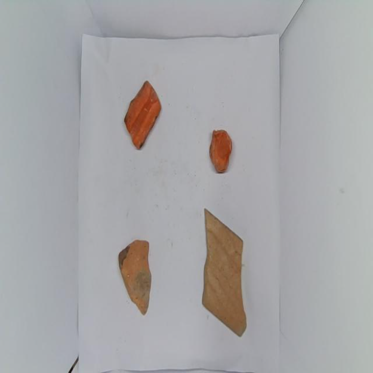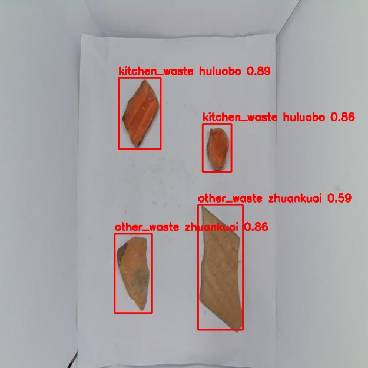

下面是对应部分训练集图片内容

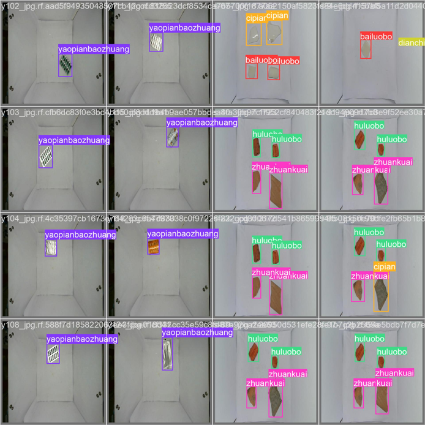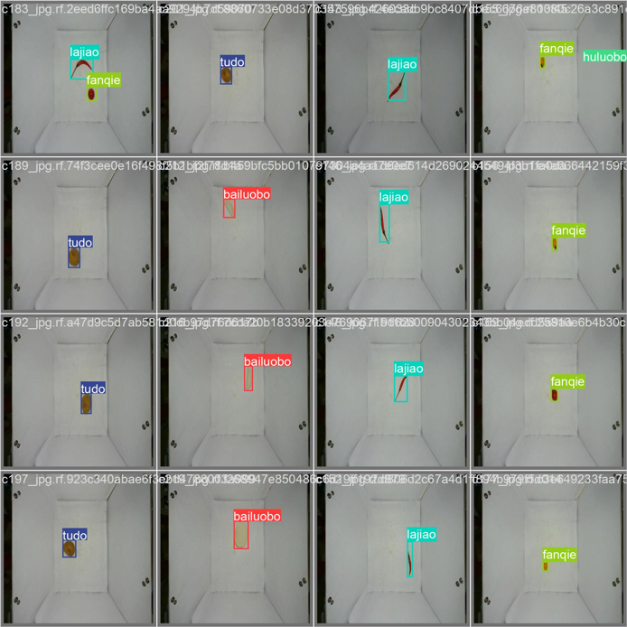

### 1.6 实验步骤

#### 整体流程图

```mermaid
graph LR
    A[步骤1: 模型与配置认知] --> B[步骤2: 预处理 letterbox+RGB]
    B --> C[步骤3: YOLOv5解码与NMS]
    C --> D[步骤4: 4大类映射]
    D --> E[步骤5: 多线程推理池]
    E --> F[步骤6: 实时推理与MJPEG]
    F --> G[完成]
```

```mermaid
graph TD
    subgraph 端到端数据流
        A1[输入 BGR 帧] --> B1[letterbox 640 pad 0]
        B1 --> C1[BGR→RGB 通道交换]
        C1 --> D1[NPU 推理 3尺度输出]
        D1 --> E1[YOLOv5 anchor解码]
        E1 --> F1[置信度过滤 score_thr]
        F1 --> G1[逐类 NMS iou_thr]
        G1 --> H1[unletterbox 映射回原图]
        H1 --> I1[20细类→4大类映射]
        I1 --> J1[画框标注 大类 细类 score]
        J1 --> K1[MJPEG推流 :8080]
    end
```

---

#### 步骤1：模型与配置认知（阶段一：能运行，20min）

> 📌 本步骤对应源码：`config/garbage_config.yaml`、`config/labels.txt`、`src/config.py`

**知识点讲解**：

**模型元数据与业务映射（1.1.1、1.2.1）**
- **原理**：`garbage_yolov5_20cls.rknn` 是 20 类垃圾分类检测模型，检测头为 **YOLOv5 式**：每个尺度输出 `[1, 75, h, w]`，75 = 3 anchors × (4 坐标 + 1 目标置信度 + 20 类)。模型事实（元数据核实）：输入 `[1,3,640,640]` float32，mean/std 0/255，**rgb2bgr=False（必须喂 RGB）**；anchors 为 YOLOv5 默认 9 组（`config/anchors.txt`）。业务层把 20 细类映射为 4 大类：1=recyclable（可回收）2=kitchen_waste（厨余）3=hazardous_waste（有害）4=other_waste（其他），映射关系在 `config/category_map.txt`（英文名）。`src/config.py` 负责加载 labels/category_map/anchors，**路径相对配置文件解析**——模型换位置时只需改 `model.path`。
- **源码对应**：`config/garbage_config.yaml`（model.path / infer.sigmoid / pool.tpes）；`config/labels.txt`（20 细类，行号=类别 ID）；`config/category_map.txt`（4 大类）；`config/anchors.txt`（YOLOv5 默认 anchors）

**知识储备补充**：

- **分类 vs 检测的本质区别**：纯分类网络（如 ResNet）对整张图输出一个标签，而检测网络（如 YOLO）输出多个带坐标的框+类别。垃圾分类需要同时知道"是什么"和"在哪里"——同一帧可能有水瓶、电池、果皮三个目标，纯分类只能输出一个，检测网络则逐目标输出。YOLOv5 式检测头是"anchor-based"：预设不同尺度的先验框（anchor），网络只需预测偏移量，比纯回归更稳定。
- **anchors 的数学含义**：9 组 anchor 分配到 3 个尺度（80×80 / 40×40 / 20×20），每尺度 3 组。小尺度特征图（20×20）锚定大物体（如 373×326 的大包装箱），大尺度特征图（80×80）锚定小物体（如 10×13 的胶囊）。解码时 anchor 参与宽高还原：

  $$
  w_{pred} = (2 \cdot t_w)^2 \times a_w, \quad h_{pred} = (2 \cdot t_h)^2 \times a_h
  $$

  其中 $t_w, t_h$ 为网络输出的归一化偏移，$a_w, a_h$ 为 anchor 宽高。$(2t)^2$ 的平方设计使宽高始终为正，且对小偏移敏感（中心偏移用 sigmoid，宽高用此方式）。
- **sigmoid 配置的由来**：`infer.sigmoid: false` 表示后处理手动应用 sigmoid；若模型导出时图内已含 sigmoid，则手动再做一次只是单调压缩分数（$0 \to 0.5$, $1 \to 0.73$），结果不变但效率略降。配置的灵活性让同一后处理代码适配不同导出版本。
- **路径解析设计**：`config.py` 中 `load_config()` 将 `model.path`、`model.labels` 等相对路径基于**配置文件所在目录**解析为绝对路径（`config/` 目录下），而非当前工作目录。这意味着无论从项目根还是 `src/` 启动，路径都能正确解析，保证跨目录运行不报错。
- **参考资源**：Ultralytics YOLOv5 官方文档《Train Custom Data》锚框部分；RKNN Toolkit2 用户指南《Model Zoo》RK3576 平台量化说明。

下面是YOLOv5网络框架图


**配置参数速查表**（`config/garbage_config.yaml`，按区块分列）：

| 区块 | 参数 | 类型 | 默认/示例 | 说明 |
|------|------|------|-----------|------|
| `model` | `path` | str | `../models/garbage_yolov5_20cls.rknn` | 模型路径（相对配置文件目录解析，模型在项目根 models/） |
| `model` | `labels` | str | `labels.txt` | 20 细类标签文件（行号=类别 ID） |
| `model` | `category_map` | str | `category_map.txt` | 细类→大类映射文件（每行 1-4） |
| `model` | `category_names` | dict | `{"1":"recyclable",...}` | 4 大类 ID→英文名 |
| `infer` | `imgsz` | int | `640` | 模型输入边长（元数据核实） |
| `infer` | `preprocess` | str | `letterbox` | 预处理方式（letterbox 640 pad 0） |
| `infer` | `score_thr` | float | `0.25` | 置信度过滤阈值 |
| `infer` | `nms_thr` | float | `0.45` | NMS 交并比阈值 |
| `infer` | `sigmoid` | bool | `False` | 后处理是否手动 sigmoid（图内已含则单调不变） |
| `infer` | `anchors` | str | `anchors.txt` | YOLOv5 默认 9 组 anchors |
| `pool` | `tpes` | int | `2` | 推理线程数（多核利用率；板端 2 核实测用 2） |
| `pool` | `core_mask` | str | `auto` | NPU 核分配（round_robin 在 2 核板会卡死，勿用 [1,2,4]） |
| `server` | `host` | str | `0.0.0.0` | MJPEG 监听地址 |
| `server` | `port` | int | `8080` | MJPEG 端口 |
| `server` | `stream_name` | str | `garbage_cam` | MJPEG 流名（库自动补 `.mjpg`） |
| `server` | `quality` | int | `80` | JPEG 压缩质量 |
| `server` | `fps` | int | `30` | MJPEG 推流帧率上限 |
| `source` | `ros.rgb_topic` | str | `/ascamera_hp60c/.../rgb0/image` | ROS2 相机话题（严禁 remap） |
| `source` | `ros.timeout` | float | `5.0` | 首帧等待秒数 |

> **说明**：`model.*` `infer.*` 为本实验核心（模型元数据 + 解码参数）；`pool.tpes`/`core_mask` 调多线程性能；`server.*` 管 MJPEG 推流；`source.ros.*` 相机取流。`stream_name` 不带 `.mjpg`（库自动补），与 exp01/09+ 的"已含 .mjpg"约定不同——勿混用。

**操作步骤**：

1. 查看标签与映射文件，理解"细类 → 大类"的两级业务：
   ```bash
   cat config/labels.txt          # 20 细类（拼音命名：shuiping 水瓶、dianchi 电池…）
   cat config/category_map.txt    # 每行: 细类ID 大类ID 大类英文名
   ```
2. 阅读 `config/garbage_config.yaml`，重点关注 `infer.sigmoid`（obj 分支是否已 sigmoid）与 `pool.tpes`（线程数）
3. 用 Python 验证配置加载：
   ```bash
   PYTHONPATH=./src python -c "from config import load_labels, load_category_map, load_anchors; \
   labels = load_labels('config/labels.txt'); \
   print(len(labels), '细类'); \
   cat_map = load_category_map('config/category_map.txt', n_labels=len(labels)); \
   print(len(cat_map), '大类映射')"
   ```

**易错点**：

- ⚠️ 若框偏移 → 调整 `config/anchors.txt`（核对导出配置）；若分数异常 → 切换 `infer.sigmoid: false`

---

#### 步骤2：预处理 letterbox + RGB（阶段一：能运行，20min）

> 📌 本步骤对应源码：`src/preprocess.py`

**知识点讲解**：

**输入对齐（1.3.2）**
- **原理**：模型输入为 640×640 RGB float，而摄像头/图片是任意尺寸 BGR uint8。`prepare_input()` 完成三步对齐：(1) **letterbox 等比缩放 + pad 0 填充**到 640×640（pad 必须 0，与模型 zoo 对齐，避免填充色干扰检测）；(2) **BGR→RGB 通道交换**（模型 rgb2bgr=False 约定）；(3) **归一化约定**：模型要求 mean/std 0/255，即输入直接是 0-255 的 uint8 转 float，不做额外 /255（量化模型内部处理）。输出经 `unletterbox()` 把检测框映射回原始图像坐标。
- **源码对应**：`src/preprocess.py`（prepare_input / unletterbox）

**知识储备补充**：

- **letterbox 为什么 pad=0**：模型训练时用黑色（0）填充，推理时也必须用黑色填充——否则填充区域的颜色值会参与特征提取，导致边缘目标出现伪检测。pad=0 是与模型训练时的数据增强约定对齐的关键约束。

- **letterbox 等比缩放的数学**：给定输入图 $(H, W)$ 和目标尺寸 $S=640$，缩放因子为：

  $$
  s = \min\left(\frac{S}{H}, \frac{S}{W}\right)
  $$

  缩放后尺寸为 $(sH, sW)$，填充量为 $pad_x = \frac{S - sW}{2}$, $pad_y = \frac{S - sH}{2}$。letterbox 保持宽高比不变形，padding 居中对称——这是目标检测的标准预处理范式，与分类网络的 resize 拉伸不同。
  
- **BGR vs RGB 的工程背景**：OpenCV 默认以 BGR 读取图像（源于早期 Windows BMP 格式），而大多数深度学习模型训练时用 RGB。通道顺序错误是"检测框位置正确但分类全错"的最常见原因——因为 RGB 三通道的语义位置颠倒，模型看到的"红色"其实是蓝色。`to_rgb()`（`preprocess.py` L40-42）通过 `bgr_img[..., ::-1].copy()` 实现通道交换并返回拷贝，避免修改原帧。

- **unletterbox 坐标逆映射**：检测框在 letterbox 空间输出后，需减去 padding 偏移再除以缩放因子映射回原图坐标：

  $$
  x_{orig} = \frac{x_{letterbox} - pad_x}{s}, \quad y_{orig} = \frac{y_{letterbox} - pad_y}{s}
  $$

  `unletterbox()`（`preprocess.py` L35-37）一行实现：`(boxes - pad_offset) / scale`。这是检测结果可视化的核心步骤——没有逆映射，框会偏到填充区域。
  
- **参考资源**：Ultralytics YOLOv5 `letterbox` 函数实现；OpenCV 官方文档 `cv2.resize` 插值方法选择。

下面就是letterbox的具体实现图

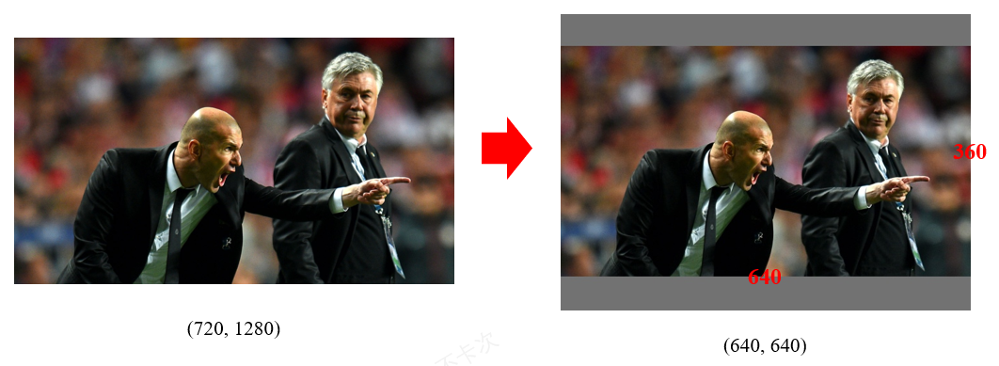

**操作步骤**：

1. 用测试图验证预处理输出形状：
   ```bash
   PYTHONPATH=./src python -c "
   import cv2, numpy as np
   from preprocess import prepare_input
   img = cv2.imread('images/1.jpg')
   rgb, meta = prepare_input(img, 640)
   print('输入形状:', rgb.shape, 'dtype:', rgb.dtype)   # 预期 (640,640,3) uint8 RGB
   print('scale:', meta.scale, 'pad:', (meta.pad_x, meta.pad_y))"
   ```

```bash
(ros2_venv) iflytek@localhost:~/ros2_ws/src/xflz_eai_car1/vision/02_garbage_classification$ PYTHONPATH=./src python -c "
import cv2, numpy as np
from preprocess import prepare_input
img = cv2.imread('images/1.jpg')
rgb, meta = prepare_input(img, 640)
print('输入形状:', rgb.shape, 'dtype:', rgb.dtype)   # 预期 (640,640,3) uint8 RGB
print('scale:', meta.scale, 'pad:', (meta.pad_x, meta.pad_y))"
输入形状: (640, 640, 3) dtype: uint8
scale: 1.0 pad: (0, 0)
```

2. 理解 letterbox 的 scale 计算（`min(640/h, 640/w)`），思考为什么 pad 必须是 0

**易错点**：

- ⚠️ RGB 与 BGR 混用是"检测框对但分类错"的头号原因——务必先 `to_rgb` 再喂模型

---

#### 步骤3：YOLOv5 解码与逐类 NMS（阶段二：能理解，30min）

> 📌 本步骤对应源码：`src/postprocess.py`

**知识点讲解**：

**YOLOv5 检测头解码（1.1.1）**
- **原理**：YOLOv5 检测头输出为 anchor-based：每尺度 `[1,75,h,w]`，reshape 为 `[3, 25, h, w]`（3 anchors × 25 = 4 坐标 + 1 obj + 20 类）。解码步骤：

  (1) 对每个 anchor 位置，用**预设 anchors** 将归一化偏移还原为 cx/cy/w/h（`decode_rknn_outputs`）；

  (2) 目标置信度与类别分数结合（或直接取类最大分）；

  (3) 按 `score_thr` 过滤；(4) **逐类 NMS**——同类别重叠框只保留最高分，跨类别不抑制。输出 `Detection` 列表（原图坐标，经 unletterbox），再由 `map_categories()` 完成 20 细类 → 4 大类映射。

- **源码对应**：`src/postprocess.py`（Detection / decode_rknn_outputs / map_categories / NMS）

**知识储备补充**：

- **解码坐标还原的完整数学**：`decode_scale()`（`postprocess.py` L54-85）对单尺度 `(1,75,h,w)` 执行以下变换——首先 reshape 为 `(h, w, 3, 25)`（3 anchors × 25 维），25 维拆分为：$t_{xy}$（前 2 维，中心偏移）、$t_{wh}$（2-4 维，宽高偏移）、$t_{obj}$（第 4 维，目标置信度）、$t_{cls}$（5-24 维，20 类分数）。中心点坐标还原：

  $$
  c_x = (\sigma(t_{cx}) + g_x) \times stride, \quad c_y = (\sigma(t_{cy}) + g_y) \times stride
  $$

  其中 $\sigma$ 为 sigmoid 函数（把偏移约束到 0-1），$g_x, g_y$ 为网格左上角坐标（0, 1, 2, ..., h-1），$stride$ 为下采样倍数（80×80 → stride=8, 40×40 → stride=16, 20×20 → stride=32）。

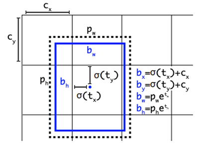

- **置信度与类别分数的组合**：最终分数 = $obj\_score \times cls\_score_{max}$。`decode_scale` 中 `keep = np.where((conf >= score_thr) & (cls_max >= score_thr))` 要求 obj 和 cls 同时超过阈值——这是 YOLOv5 的设计：obj 分支负责"这里有没有东西"，cls 分支负责"是什么"，二者共同过滤噪声。
- **逐类 NMS vs 全局 NMS**：`classwise_nms()`（`postprocess.py` L88-110）对每个类别独立执行 NMS。全局 NMS 会抑制所有重叠框（跨类），但在垃圾分类场景中，一个水瓶可能同时被检为"recyclable"和"other"——逐类 NMS 允许不同类别的重叠框共存，符合业务需求。NMS 的核心 IoU 计算：
  $$
  IoU = \frac{Area(A \cap B)}{Area(A) + Area(B) - Area(A \cap B)}
  $$

  代码中 `+0.00001` 容差（`postprocess.py` L100）防止浮点精度导致的边界 case。

下面是nms抑制的具体现象就是将多个重复框筛选出最好的

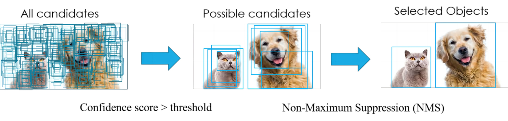

- **xywh → xyxy 转换**：`decode_rknn_outputs()`（`postprocess.py` L130-140）在 NMS 前将中心点格式 `(cx, cy, w, h)` 转为角点格式 `(x1, y1, x2, y2)`：$x_1 = cx - w/2$, $y_1 = cy - h/2$, $x_2 = cx + w/2$, $y_2 = cy + h/2$。NMS 的 IoU 计算需要角点格式。
- **参考资源**：YOLOv5 官方 `utils/general.py` `non_max_suppression` 函数；Joseph Redmon《YOLOv3: An Incremental Improvement》检测头设计。

**操作步骤**：

1. 阅读 `postprocess.py` 的解码主函数，理解 anchors 如何参与坐标还原
2. 单元测试理解解码契约：
   ```bash
   pytest tests/test_postprocess.py -v
   # 预期：decode/NMS/map_categories 用例全绿
   ```
3. 思考：为什么逐类 NMS 而非全局 NMS？（不同类目标可以重叠，如"瓶中水"场景）

**易错点**：
- ⚠️ anchors 与模型导出配置不一致 → 框整体偏移，调整 `config/anchors.txt`

---

#### 步骤4：4 大类业务映射（阶段二：能理解，15min）

> 📌 本步骤对应源码：`src/postprocess.py` map_categories、`config/category_map.txt`

**知识点讲解**：

**细类到大类的业务抽象（1.2.1）**
- **原理**：20 细类过于细粒度（如 yaogao 牙膏、yaopian 药片），面向分拣业务需要 4 大类。`map_categories()` 依据 `category_map.txt` 把每个检测的 `class_id` 映射为 `(大类ID, 大类英文名)`，同时保留细类名用于标注显示。这种"模型输出细类、业务消费大类"的两级设计，使模型更换（如新增细类）不破坏下游分拣逻辑。
- **源码对应**：`src/postprocess.py` map_categories；`src/app.py` L31-33（标注格式 `大类 细类 score`）

**知识储备补充**：

- **两级标签设计的工程价值**：20 细类是模型的"原子能力"——模型训练时学习每个细类的视觉特征；4 大类是业务的"消费单位"——分拣机械臂只关心四大类（可回收/厨余/有害/其他）。两级解耦的好处是：新增一个细类（如"纸杯"→recyclable）只需改 `category_map.txt`，不动模型和分拣代码。`map_categories()`（`postprocess.py` L158-165）一行映射：`cat = cat_map[d.class_id]`，`CategoryDetection.from_detection(d, cat, cat_names[str(cat)])`。
- **category_map.txt 的行号契约**：`config/category_map.txt` 每行一个数字（1-4），行号与 `labels.txt` 严格对应——第 1 行对应 labels.txt 第 1 行的 `bailuobo`（细类 ID=0），值为 2 表示 `kitchen_waste`。错一行会导致全部映射偏移（如 shuiping 从 recyclable 变成 hazardous）。`load_category_map()`（`config.py` L78-85）读取并校验值域 ∈ {1,2,3,4}。
- **标注格式的业务含义**：`app.py` L31 构造标注文本 `f"{d.category_name} {labels[d.class_id]} {d.score:.2f}"`——大类英文名在前（分拣指令依据），细类拼音在中间（调试定位），置信度在后（质检门控）。分拣系统只需解析第一个单词即可路由到对应仓位。
- **参考资源**：《垃圾分类标志》GB/T 19095-2019 国家标准（四分类体系）；YOLOv5 自定义数据集训练文档。

| ID   | 细类名称    | 大类编码 | 大类名称 | ID   | 细类名称         | 大类编码 | 大类名称 |
| ---- | ----------- | -------- | -------- | ---- | ---------------- | -------- | -------- |
| 0    | bailuobo    | 2        | 厨余垃圾 | 10   | shuiping         | 1        | 可回收物 |
| 1    | caiye       | 2        | 厨余垃圾 | 11   | tizi             | 2        | 厨余垃圾 |
| 2    | chuangkotie | 3        | 有害垃圾 | 12   | tudo             | 2        | 厨余垃圾 |
| 3    | cipian      | 4        | 其他垃圾 | 13   | yaogao           | 3        | 有害垃圾 |
| 4    | dianchi     | 3        | 有害垃圾 | 14   | yaopian          | 3        | 有害垃圾 |
| 5    | eluanshi    | 4        | 其他垃圾 | 15   | yaopianbaozhuang | 3        | 有害垃圾 |
| 6    | fanqie      | 2        | 厨余垃圾 | 16   | yaoping          | 3        | 有害垃圾 |
| 7    | huluobo     | 2        | 厨余垃圾 | 17   | yilaguan         | 1        | 可回收物 |
| 8    | jiaonang    | 3        | 有害垃圾 | 18   | zhibei           | 1        | 可回收物 |
| 9    | lajiao      | 2        | 厨余垃圾 | 19   | zhuankuai        | 4        | 其他垃圾 |

**操作步骤**：

1. 查看 category_map.txt，找出 recyclable 包含哪些细类（shuiping 水瓶、yilaguan 易拉罐…）
2. 运行单测验证映射正确性：`pytest tests/test_postprocess.py -k category -v`

**易错点**：

- ⚠️ category_map 行序必须与 labels.txt 行号严格对应，错一行全错

---

#### 步骤5：多线程推理池 RKNNPool（阶段三：能改造，30min）

> 📌 本步骤对应源码：`src/rknnpool.py`

**知识点讲解**：

**多线程推理池原理（1.3.1）**
- **原理**：RK3576 NPU 支持多核（core_mask），单线程推理时 NPU 有核空闲。RKNNPool 用**生产者-消费者模型**：主线程读取帧放入任务队列，`--tpes N` 个工作线程从队列取帧，各自持有 RKNNLite 实例并**轮转绑定不同 NPU 核**（core_mask 0/1/2/3）并行推理，结果按序返回。这比单线程串行推理能显著提升 FPS（多核并行 + 取帧与推理重叠）。`rknn_backend_factory()` 为每个线程创建后端实例，`Detector` 注入后端完成检测。
- **源码对应**：`src/rknnpool.py`（RKNNPool：入队 L58 / 工作线程 L62-76 / 结果回收 L79-81）；`src/detector.py` L126-128（make_rknn_backend）

**知识储备补充**：

- **生产者-消费者模型的线程安全**：`RKNNPool.__init__()`（`rknnpool.py` L47-56）创建两个 `queue.Queue`（`self.inputs` / `self.outputs`），Python `Queue` 内部用 `threading.Condition` 实现线程安全——`put()` 阻塞直到队列有空间，`get(timeout=1)` 超时返回空队列异常。工作线程（`_worker`，L62-76）循环取帧、处理、放结果，异常时 `(None, False)` 入队保证下游不死锁。
- **核轮转（round_robin）**：`rknn_backend_factory('round_robin')`（`rknnpool.py` L30-33）按 `tid % 3` 绑定 `NPU_CORE_0/1/2`——RK3576 有 3 个 NPU 核，每个核独立运行推理任务。`core_mask` 参数传给 `RKNNBackend(core_mask=masks[tid % 3])`（`detector.py` L46），rknnlite 在 `init_runtime(core_mask=...)` 时绑定对应核。实测 `core_mask=auto`（L34-35）让 rknnlite 自动分配核更稳定，round_robin 在某些固件版本会卡死。
- **为什么每个线程必须独立 RKNNLite 实例**：RKNNLite 的 `init_runtime()` 绑定 NPU 核并分配推理上下文——同一个实例不能被多线程共享（NPU 上下文非线程安全），会导致段错误或结果错乱。`RKNNPool`（L52-55）为每个线程调用 `backend_factory(i)` 创建独立后端，这是正确的做法。
- **预填帧设计**：`app.py` L125-130 在主循环前预填 `tpes+1` 帧到队列，保证所有工作线程同时启动推理——消除首帧冷启动延迟，使 FPS 统计更准确。
- **参考资源**：Python 标准库 `queue.Queue` 线程安全文档；RKNN Toolkit2 用户指南《RKNNLite API》`init_runtime` core_mask 参数说明。

大致流程如下

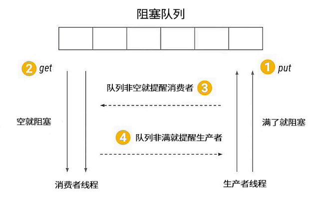

**操作步骤**：

1. 单线程 vs 多线程对比（验证池的价值）：
   ```bash
   python src/app.py --video test.mp4 --tpes 1
   python src/app.py --video test.mp4 --tpes 6
   # 对比 avg_fps：tpes 6 应明显更高
   ```
2. 阅读 rknnpool.py 的队列实现，理解线程安全（queue.Queue / 锁）
3. 思考：线程数不是越多越好？——NPU 核数与内存限制决定最优 tpes（本板实测 6 左右）

**易错点**：
- ⚠️ 每个线程必须独立 RKNNLite 实例（NPU 上下文非线程共享），复用同一实例会崩溃
- ⚠️ tpes 超过 NPU 核数不提升反而增加内存压力

---

#### 步骤6：实时推理与 MJPEG 推流（阶段三：能改造，35min）

> 📌 本步骤对应源码：`src/app.py`、`src/mjpeg_server.py`、`src/ros2_source.py`

**知识点讲解**：

**端到端实时链路（1.3.3）**
- **原理**：`app.py` 组织完整链路：输入源（单图/视频/`--camera N` UVC/`--ros` ROS2 话题）→ 帧交给 `make_process_fn` 构造的 pool 处理函数 → 每个工作线程内 `Detector.detect()`（prepare_input → NPU 推理 → 解码 → 4 大类映射 → unletterbox）→ 画框标注（`大类 细类 score`）→ MJPEG 推流。`mjpeg_server.py` 用**标准库**实现 MJPEG（multipart/x-mixed-replace），替代外部 mjpeg_streamer，零额外依赖。板上相机标准路径是 HP60C 深度相机经 ascamera 话题取流（`ros2_source.py` Ros2Camera，DEFAULT_TOPIC `/ascamera_hp60c/camera_publisher/rgb0/image`），OpenCV 直连读不了（未编 libv4l）。
- **源码对应**：`src/app.py` L24-35（make_process_fn 标注逻辑）、L38-150（main：参数 L40-50 / 单图 L70-82 / 视频相机 L85-150）；`src/mjpeg_server.py`（MjpegServer）；`src/ros2_source.py`（Ros2Camera：DEFAULT_TOPIC / open / read / release）

**知识储备补充**：

- **MJPEG 协议原理**：MJPEG（Motion JPEG）是 `multipart/x-mixed-replace` HTTP 响应——服务器以流式方式持续发送 JPEG 帧，浏览器原生支持实时刷新。相比 WebSocket + H.264 方案，MJPEG 零延迟（无解码缓冲区）、兼容性好（任何浏览器直接访问 URL），代价是带宽利用率低（每帧独立 JPEG 压缩，无帧间预测）。对于 640×480 垃圾分类场景，带宽完全够用。
- **ROS2 话题取流的惰性导入设计**：`Ros2Camera`（`ros2_source.py` L30-35）在构造函数中不导入 rclpy——`open()` 方法才惰性导入并调用 `rclpy.init()`。这是关键设计：x86 开发机无 ROS 环境，单元测试用 FakeBackend + MockCamera 即可覆盖全链路；板上 `--ros` 模式才真正依赖 rclpy。`read(timeout)` 方法（L80-90）阻塞等待首帧或超时，返回 `(True, frame)` 或 `(False, None)`。
- **Detector.detect() 的完整链路**：`detector.py` L93-110 的 `detect()` 方法串联了全部后处理——`prepare_input()`（预处理）→ `backend.predict()`（NPU 推理）→ `decode_rknn_outputs()`（YOLOv5 解码+逐类 NMS）→ `unletterbox()`（坐标逆映射）→ `map_categories()`（4 大类映射）。返回 `list[CategoryDetection]`（原图坐标 + 大类 + 细类名 + 分数），直接供 `make_process_fn` 画框。
- **FPS 统计设计**：`app.py` L143-147 每 30 帧打印一次滑动窗口帧率 `30 / (time.time() - loop_t)`，L149 打印全程总平均帧率。滑动窗口帧率反映当前处理速度（受场景复杂度影响），总平均帧率反映整体性能——验收以总平均 ≥ 15 FPS 为门控。
- **参考资源**：MJPEG Wikipedia 条目；ROS2 `sensor_msgs/Image` 消息定义；mjpeg_streamer PyPI 文档。

大致流程如下


**操作步骤**：

1. 单图检测（最简验证）：
   ```bash
   cd ~/ros2_ws/src/xflz_eai_car1/vision/02_garbage_classification
   python src/app.py --image images/1.jpg --save out.jpg
   # 预期：终端打印 大类 细类 score (x1,y1,x2,y2)
   ```
2. 视频 + MJPEG：
   ```bash
   python src/app.py --video test.mp4 --tpes 2 --port 8080
   # 浏览器访问 http://<板IP>:8080/garbage_cam.mjpg
   ```
3. 相机实时（板上标准）：
   ```bash
   source /opt/ros/humble/setup.bash && source ~/ros2_ws/install/setup.bash
   export ROS_DOMAIN_ID=2
   ros2 launch ascamera hp60c.launch.py        # 终端 1
   python src/app.py --ros                      # 终端 2，同一 ROS_DOMAIN_ID
   # 预期：avg_fps ≥ 15，MJPEG 可见实时标注
   ```
4. 动手改造：修改 `src/app.py` L31 标注逻辑，把大类换成中文名（如 `可回收 水瓶 0.87`），重新运行

**易错点**：
- ⚠️ `--ros` 取不到帧 → ascamera 驱动先起、ROS_DOMAIN_ID 一致、话题勿 remap
- ⚠️ MJPEG 404 → 8080 被占，`--port` 换端口或关占用进程

---

### 1.7 常见问题

| 问题 | 原因 | 解决方法 |
|------|------|---------|
| 检测框整体偏移 | anchors 与导出配置不一致 | 调整 `config/anchors.txt`（核对导出配置） |
| 分数异常（全 0 或全 1） | obj 分支已/未 sigmoid 与配置不符 | 切换 `infer.sigmoid: false/true` |
| 分类全错但框对 | RGB/BGR 约定错误 | 确认 `prepare_input` 先 BGR→RGB（模型 rgb2bgr=False） |
| 多线程崩溃 | 线程共享同一 RKNNLite 实例 | 每线程独立实例（RKNNPool 已实现） |
| MJPEG 404 | 8080 端口占用 | `--port` 换端口或关闭占用进程 |
| --ros 取不到帧 | 驱动未启动/ROS_DOMAIN_ID 不一致 | ascamera 先起；export ROS_DOMAIN_ID=2；话题勿 remap |
| 板上模型加载失败 | model.path 未改为板载路径 | 修改 `config/garbage_config.yaml` 的 `model.path` |

### 1.8 扩展实验

**扩展方向 1：机械臂分拣联动（进阶）**
- 在 `app.py` 处理函数中，把 4 大类结果转换为分拣指令（如 recyclable → 机械臂抓取到 1 号仓），通过串口或 ROS2 话题发布（参考实验 05 的 cmd_vel 模式）

**扩展方向 2：识别置信度优化（进阶）**
- 在标注中加入细类置信度直方图；对不同大类设置不同 score_thr（有害垃圾从严），观察误检率变化
- 把 `--tpes` 做成运行时动态调节，绘制"线程数 vs FPS"曲线，找出最优配置

### 1.9 实验报告要求

**评分标准**：模型元数据理解 15 分 + 预处理 15 分 + YOLOv5 解码 25 分 + 4 大类映射 15 分 + 实时演示 20 分 + 报告 10 分 = 100 分。

**报告必含内容**：
1. 模型输入输出规格表（形状/类型/通道顺序/anchors），标注对应的 config 文件
2. 解码流程图（anchors → cx/cy/w/h → NMS → 大类映射），标注源码行号
3. 单图检测结果图（≥3 个不同大类目标）与「大类 细类 score」数据
4. tpes=1 vs tpes=6 的 FPS 对比数据与结论
5. 回答思考题：为什么模型要求 RGB 而 OpenCV 默认 BGR？为什么逐类 NMS 允许跨类重叠？多线程池为什么比单线程快？
6. 实验心得与问题记录

---

## 更新日志

| 版本 | 日期 | 变更 |
|------|------|------|
| v1.0 | 2026-08-10 | 初版生成（源码路径 ros2_ws/src/xflz_eai_car1/vision/02_garbage_classification，62 用例全绿，YOLOv5 检测头 20 细类 + 4 大类映射 + RKNNPool 多线程） |
| v1.1 | 2026-08-19 | 模型名同步：rubbish_2_7.rknn → garbage_yolov5_20cls.rknn（config/garbage_config.yaml + models/ 目录核实） |
| v2.0 | 2026-08-19 | 知识点增强：6 步骤均添加「知识储备补充」（含 anchors 数学公式、letterbox 缩放公式、解码坐标还原公式、IoU 公式、sigmoid 公式）；新增端到端 Mermaid 数据流图；1.5 追加「执行现象」段（pytest 62 用例、单图推理、视频 FPS、标注格式）；行号基于源码 real line numbers 重新核对（app.py L24-35 / L40-150、postprocess.py L54-85 / L88-110 / L130-140 / L158-165、rknnpool.py L30-33 / L47-56 / L62-76、detector.py L93-110）；5 个「参考资源」条目 |
| v2.1 | 2026-08-21 | 步骤1 新增「配置参数速查表」：config/garbage_config.yaml 全参数按区块分列（model/infer/pool/server/source），含类型/默认值/说明；标注 pool.core_mask 两核板勿用 round_robin、`stream_name` 不带 `.mjpg`（与 exp01/09+ 约定不同）等要点。表值经 load_config 实测核对 |

---

## 实验6：基于语义分割的背景分割实验（4h）

> ✅ **源码已核实** 本实验源码位于 `ros2_ws/src/xflz_eai_car1/vision/06_semantic_segmentation/`。⚠️ **内容说明**：课程「清除背景」语义，本实验用**语义分割人物抠图 + 背景替换**（yolov8n-seg，COCO 80 类，模型 3.2M 参数），效果更符合课程目标。已交付 `models/yolov8n-seg.onnx`（13 输出）与 `models/yolov8n-seg.rknn`（板上 int8 转换产物）。单测 38/38 全绿，板端验证通过（3 worker 池约 40-60 FPS）。

### 1.1 关联知识点

- 1.1.1 语义分割原理 > 原理 > 语义分割为每个像素分配类别标签，区别于目标检测的边界框；yolov8n-seg 同时输出检测框与逐像素掩码
- 1.2.1 13输出模型结构 > 概念 > 每层 [box(64), cls(80), cls_sum(1), mc(32)]×3 + proto [1,32,160,160]，mc@proto 矩阵乘还原掩码
- 1.3.1 前景提取 > 流程 > DFL 解码 → grid xyxy → cls_sum×cls 过滤 → 逐类 NMS → mc@proto 掩码 → 阈值二值化
- 1.3.2 背景替换 > 流程 > black/solid/image 三种背景模式，前景掩码外区域替换，Alpha 通道合成
- 1.3.3 多线程推理池 > 流程 > N worker × 独立 RKNN 实例 + round_robin tid%3 绑核（3 worker 帧率 ≥ 单线程 2 倍）

### 1.2 实验目标

1. 掌握语义分割与目标检测的区别，理解 yolov8-seg 的检测+掩码双输出架构 — 原理理解
2. 实现实时前景人物抠图与三种背景模式替换（黑/纯色/自定义图）— 独立完成
3. 理解多线程推理池提升 NPU 利用率的方法，掌握掩码阈值与类别过滤调参 — 迁移应用

### 1.3 实验环境

| 类别 | 配置 |
|------|------|
| 硬件 | 具身智能实验箱 B2（XFLZ_EAI_B2_PRO，RK3576 SoC，6TOPS NPU，含 HP60C 深度相机） |
| OS | Ubuntu 22.04 + ROS2 Humble（板载 ros2_venv，rknnlite 2.3.2） |
| 核心库 | OpenCV、NumPy、rknnlite、PyYAML（标准库 MJPEG） |
| 模型 | `models/yolov8n-seg.rknn`（int8，13 输出，COCO 80 类，3.2M 参数） |
| 主入口 | `src/app.py`（图像/视频/相机 CLI + 3 worker 推理池 + MJPEG） |

### 1.4 实验难度

- 难度: ⭐⭐ 设计性
- 重点: 13 输出分割解码（DFL → NMS → mc@proto 掩码）与背景替换合成
- 难点: 掩码解码的矩阵运算（mc@proto）；多线程池绑核配置；掩码质量调参

### 1.5 实验现象

**快速验证流程**：

1. 进入项目目录：`cd ~/ros2_ws/src/xflz_eai_car1/vision/06_semantic_segmentation`
2. 单元测试：`pytest tests/ -v`（38 用例全绿）
3. 单图抠图：`python src/app.py --image photo.jpg --save out.jpg`
   - 输出：人物被完整抠出，背景替换为黑色/纯色/自定义图
4. 相机实时（板上标准）：先起 ascamera 驱动，再 `python src/app.py --ros`
   - MJPEG：`http://<板IP>:8080/seg.mjpg`，实时抠图
5. 换背景：修改 `background.mode`（black/solid/image）后重跑

```bash
# 进入实验6
cd ~/ros2_ws/src/xflz_eai_car1/vision/06_semantic_segmentation

# 可选
/home/iflytek/ros2_venv/bin/python -m pytest -v

# 运行程序
python src/app.py --image images/bus.jpg --save out.jpg

# 相机实时
ros2 launch ascamera hp60c.launch.py        # 终端 1
python src/app.py --ros                     # 终端 2
```

**执行现象**：`pytest -v` 运行约 30-50 秒，输出 38 个用例全部 passed；单图抠图命令约 0.1-0.3 秒返回，终端打印 `[seg] N instances`（N 为检出人数），当前目录生成 `out.jpg`（前景人物保留，背景替换为配置模式）。实时模式下终端每 30 帧打印 `[seg] 30帧平均帧率: xx.x det=N`，3 worker 池实测约 **40-60 FPS**（单线程约 20-40 FPS）。板端 NPU 推理单帧约 15-25 ms。

**预期效果描述**：
- 单人照：person 抠图干净（掩码边缘平滑），背景替换正确
- 实时：人物移动时掩码逐帧跟随，3 worker 池约 40-60 FPS（单线程 20-40 FPS）
- 调参：`model.classes=[0]` 只留 person；`mask_thr` 调高去掩码碎片

单图片推理，修改config配置中的类别可以定向自己想要的类别

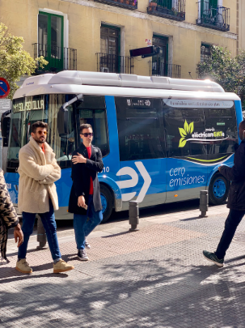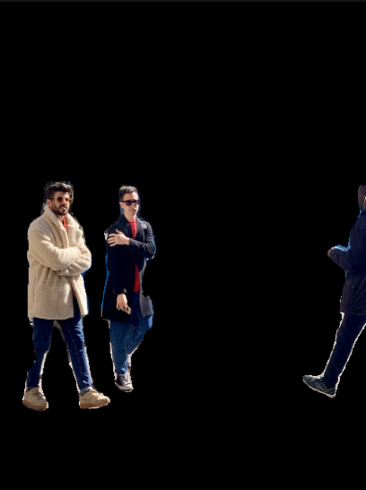

视频流推理


### 1.6 实验步骤

#### 整体流程图

```mermaid
graph LR
    A[步骤1：语义分割与模型结构认知] --> B[步骤2：letterbox+RGB预处理]
    B --> C[步骤3：13输出解码与NMS]
    C --> D[步骤4：mc-proto掩码解码]
    D --> E[步骤5：背景替换合成]
    E --> F[步骤6：多线程池实时推理]
    F --> G[完成]
```

---

#### 步骤1：语义分割与模型结构认知（阶段一：能运行，20min）

> 📌 本步骤对应源码：`src/config.py`、`models/`

**知识点讲解**：

**语义分割与 yolov8-seg 架构（1.1.1、1.2.1）**

- **原理**：语义分割（semantic segmentation）为**每个像素**分配类别标签，输出掩码（mask）而非边界框；实例分割（yolov8-seg）进一步区分同一类别的不同实例。yolov8n-seg 在检测头旁增加**掩码分支**：每检测层输出 4 组张量——box(64) 框回归（DFL 16 bins）、cls(80) 类别分数、cls_sum(1)、**mc(32) 掩码系数**；另有一个 **proto 原型掩码** `[1,32,160,160]`（32 个低分辨率原型图）。最终掩码 = mc @ proto（矩阵乘），32 维系数 × 32 原型图加权求和。模型选择 yolov8-seg 而非 yolov5-seg：fork `ultralytics_yolov8-main` 原生支持 Segment rknn 导出，与 rknn_model_zoo `yolov8_seg` 优化模型布局逐位一致。
- **源码对应**：`models/yolov8n-seg.onnx`（13 输出，可用 onnxruntime 验证结构）；`src/config.py`（model.classes / mask_thr / pool 参数）

**知识储备补充**：

- **语义分割 vs 目标检测 vs 实例分割**：目标检测输出"框+类别"（Bounding Box），语义分割输出"逐像素类别标签"（Pixel-wise Label Map），实例分割则在语义分割基础上进一步区分同一类别的不同个体。yolov8-seg 属于**实例分割**（Mask R-CNN 范式），同时输出检测框和逐像素掩码——本实验利用其"前景人物掩码"实现背景替换，本质上是实例分割的下游应用。
- **YOLOv8-seg 掩码分支设计动机**：全分辨率逐像素输出（如 FCN/PSPNet）内存开销大（640×640×C  float32 ≈ 1.5 MB/通道），不适合边缘设备实时推理。yolov8-seg 采用**两段式低秩分解**：模型只输出 32 维系数 mc ∈ ℝ³² 和 32 个低分辨率原型图 proto ∈ ℝ³²×¹⁶⁰×¹⁶⁰，通过矩阵乘 mc @ proto 还原全分辨率掩码——参数量从全分辨率输出的 ~1.5M 降至 ~32+32×160×160 ≈ 820K，NPU 友好。
- **COCO 80 类与类别过滤**：yolov8n-seg 默认输出 COCO 80 类检测，但本实验通过 `config.model.classes=[0]`（COCO id 0 = person）过滤，只保留人物实例。过滤发生在解码阶段（`decode_outputs` L102：`class_max * cls_sum >= score_thr`），非模型层面裁剪——模型仍然输出全部 80 类分数，后处理选择性保留。
- **参考资源**：Ultralytics YOLOv8 官方文档《YOLOv8 Instance Segmentation》；rknn_model_zoo `yolov8_seg` 说明；YOLOv8-seg ONNX 输出布局（13 输出结构说明）。

语义分割、目标检测、实例分割的区别示例


YOLOv8-seg网络结构图


COCO 80类别

| 0‑15              | 16‑31         | 32‑47              | 48‑63            | 64‑79        |
| ----------------- | ------------- | ------------------ | ---------------- | ------------ |
| 0: person         | 16: dog       | 32: sports ball    | 48: sandwich     | 64: fork     |
| 1: bicycle        | 17: horse     | 33: kite           | 49: orange       | 65: knife    |
| 2: car            | 18: sheep     | 34: baseball bat   | 50: broccoli     | 66: spoon    |
| 3: motorcycle     | 19: cow       | 35: baseball glove | 51: carrot       | 67: bowl     |
| 4: airplane       | 20: elephant  | 36: skateboard     | 52: hot dog      | 68: banana   |
| 5: bus            | 21: bear      | 37: surfboard      | 53: pizza        | 69: apple    |
| 6: train          | 22: zebra     | 38: tennis racket  | 54: donut        | 70: sandwich |
| 7: truck          | 23: giraffe   | 39: bottle         | 55: cake         | 71: orange   |
| 8: boat           | 24: backpack  | 40: wine glass     | 56: chair        | 72: broccoli |
| 9: traffic light  | 25: umbrella  | 41: cup            | 57: couch        | 73: carrot   |
| 10: fire hydrant  | 26: handbag   | 42: fork           | 58: potted plant | 74: hot dog  |
| 11: stop sign     | 27: tie       | 43: knife          | 59: bed          | 75: pizza    |
| 12: parking meter | 28: suitcase  | 44: spoon          | 60: dining table | 76: donut    |
| 13: bench         | 29: frisbee   | 45: bowl           | 61: toilet       | 77: cake     |
| 14: bird          | 30: skis      | 46: banana         | 62: tv           | 78: chair    |
| 15: cat           | 31: snowboard | 47: apple          | 63: laptop       | 79: couch    |

**配置参数速查表**（`config/seg_config.yaml`，按区块分列）：

| 区块 | 参数 | 类型 | 默认/示例 | 说明 |
|------|------|------|-----------|------|
| `model` | `rknn`/`onnx` | str | `models/yolov8n-seg.rknn` | 板载/PC 模型路径 |
| `model` | `imgsz` | int | `640` | 输入边长 |
| `model` | `score_thr` | float | `0.25` | 置信度阈值 |
| `model` | `iou_thr` | float | `0.45` | NMS 阈值 |
| `model` | `mask_thr` | float | `0.5` | 掩码二值化阈值 |
| `model` | `classes` | list | `[0]` | 保留 COCO 类（0=person；空=全部） |
| `background` | `mode` | str | `black` | black/solid/image 背景 |
| `background` | `color` | list | `[0,0,0]` | solid 填充色 BGR |
| `background` | `image` | str | `""` | image 模式背景图路径 |
| `pool` | `workers` | int | `3` | 推理线程（三核 NPU） |
| `pool` | `queue_size`/`core_mask` | int/str | `4`/`auto` | 队列/NPU 核 |
| `camera`/display | ... | | | 同前模板 |
| `server` | `port` | int | `8080` | MJPEG 端口 |
| `server` | `stream_name` | str | `seg.mjpg` | 流名（已含 .mjpg） |
> **说明**：`model.classes=[0]` 只保留 person（空=全部）；`pool.workers=3` 绑 RK3576 三核（round_robin）；`background.*` 决定替换背景样式。

**操作步骤**：

1. 验证模型输出结构（13 输出）：
   ```bash
   cd ~/ros2_ws/src/xflz_eai_car1/vision/06_semantic_segmentation
   
   PYTHONPATH=./src python -c "
   import onnxruntime as ort
   sess = ort.InferenceSession('models/yolov8n-seg.onnx')
   print('输出数:', len(sess.get_outputs()))
   for o in sess.get_outputs(): print(' ', o.name, o.shape)"
   # 预期：3 层 × [box, cls, cls_sum, mc] + 1 个 proto = 13
   ```

   ```bash
   输出数: 13
     375 [1, 64, 80, 80]
     onnx::ReduceSum_383 [1, 80, 80, 80]
     388 [1, 1, 80, 80]
     354 [1, 32, 80, 80]
     395 [1, 64, 40, 40]
     onnx::ReduceSum_403 [1, 80, 40, 40]
     407 [1, 1, 40, 40]
     361 [1, 32, 40, 40]
     414 [1, 64, 20, 20]
     onnx::ReduceSum_422 [1, 80, 20, 20]
     426 [1, 1, 20, 20]
     368 [1, 32, 20, 20]
     347 [1, 32, 160, 160]
   ```

2. 查看 `config/seg_config.yaml`：model.classes（COCO id，[0]=person）、mask_thr（0.5）、pool.workers/core_mask、background.mode

3. 思考：为什么需要 proto + mc 的两段式掩码？直接输出全分辨率掩码行不行？

**易错点**：

- ⚠️ 13 输出布局必须与解码契约一致（每层 4 组 + proto），换模型版本要核对

**流程图**：

```mermaid
flowchart LR
    A["yolov8n-seg 模型<br/>13 输出 int8"] --> B["每检测层 4 组张量<br/>box(64) / cls(80) / cls_sum(1) / mc(32)<br/>×3 层"]
    B --> C["proto 原型掩码<br/>[1,32,160,160]<br/>32 个低分辨率基元"]
    C --> D["最终掩码 = mc @ proto<br/>32 系数 × 32 原型加权求和"]
    D --> E["实例分割范式<br/>检测框 + 逐像素掩码"]
    E --> F["类别过滤<br/>config model.classes=[0] person"]
    E --> G["本实验用途<br/>前景掩码 → 背景替换"]

    style D fill:#ffe0e0,stroke:#c00,stroke-width:2px
```

---

#### 步骤2：预处理 letterbox + RGB（阶段一：能运行，15min）

> 📌 本步骤对应源码：`src/preprocess.py`

**知识点讲解**：

**输入对齐（复用 exp01 语义）**
- **原理**：与实验4一致：letterbox（pad 0）等比缩放到 640×640 → BGR→RGB 通道交换（模型 rgb2bgr=False）→ unletterbox 把检测框/掩码映射回原图坐标。掩码解码在 imgsz 坐标系完成，最终映射回原始分辨率。
- **源码对应**：`src/preprocess.py`（letterbox / to_rgb / unletterbox）

**知识储备补充**：

- **letterbox pad=0 的语义**：与 pad=114（YOLO 默认灰边）不同，pad=0 用黑色（0,0,0）填充。对分割任务而言，黑色填充区域在 RGB 下三通道均为 0，不会干扰模型特征提取（模型训练时通常也用 0 填充）；pad=0 还使 unletterbox 坐标还原更简洁（无灰边偏移误差）。
- **RGB 通道顺序约定**：RKNN 模型训练时输入约定为 RGB（非 OpenCV 默认的 BGR），`to_rgb()`（preprocess.py L42）执行 BGR→RGB 通道交换。若跳过此步，模型接收 BGR 数据，颜色特征错位导致掩码质量急剧下降——这是跨框架部署最常见的低级错误之一。
- **掩码映射回原图的特殊性**：与目标检测不同，分割掩码在 imgsz 空间完成解码（`seg_img > mask_thr`，postprocess.py L130），再通过 `cv2.resize`（app.py L40）最近邻插值映射回原图尺寸——不能用双线性插值（会模糊掩码边界），必须用 `INTER_NEAREST` 保持二值性。
- **参考资源**：OpenCV `cv2.resize` 插值方法文档；RKNN Toolkit2 输入格式说明（NHWC uint8 RGB）。

**操作步骤**：

1. 用单图验证预处理形状：
   ```bash
   cd ~/ros2_ws/src/xflz_eai_car1/vision/06_semantic_segmentation
   
   PYTHONPATH=./src python -c "
   import cv2
   import numpy as np
   from preprocess import letterbox, to_rgb
   img = cv2.imread('images/bus.jpg')
   if img is None:
       print('警告：未找到 images/bus.jpg，使用随机测试图')
       img = np.random.randint(0, 255, (480, 640, 3), dtype=np.uint8)
   lb = letterbox(img, 640, (0,0,0))
   print('letterbox输出:', lb.padded.shape, 'scale:', round(lb.ratio, 3))
   "
   ```

   ```
   letterbox输出: (640, 640, 3) scale: 0.593
   ```

2. 复习 exp01 的 pad=0 与 RGB 约定，理解跨实验复用

下面就是letterbox的具体实现图


RGB-BGR的区别


**易错点**：
- ⚠️ pad 必须 0 且 RGB——与转换侧 rgb2bgr=False 一致，否则掩码错位

**流程图**：

```mermaid
flowchart LR
    A[输入 BGR 帧<br/>任意分辨率] --> B[letterbox 等比缩放<br/>pad 0 黑边<br/>imgsz=640]
    B --> C["to_rgb BGR→RGB<br/>rgb2bgr=False 约定"]
    C --> D["[1, 640, 640, 3] uint8 RGB<br/>RKNN nhwc 喂入"]
    D --> E[模型推理 13 输出]
    E --> F["unletterbox 映射回原图<br/>ratio/scale 还原坐标"]
    E --> G["掩码最近邻 resize<br/>INTER_NEAREST 保二值性"]

    style B fill:#e8f0ff,stroke:#448,stroke-width:1px
```

---

#### 步骤3：13 输出解码与逐类 NMS（阶段二：能理解，35min）

> 📌 本步骤对应源码：`src/postprocess.py` dfl_decode / box_process / nms / decode_outputs

**知识点讲解**：

**分割解码管线（1.3.1）**
- **原理**：`decode_outputs()`（L81-130）逐层处理：`dfl_decode`（L26-34）对 box 的 16 bins 做 softmax 期望还原偏移 → `box_process`（L37-47）加 grid 中心与 stride 还原 xyxy（imgsz 系）→ 类别分数用 **cls_sum×cls 过滤**（分割模型特有的类别得分加权）→ 逐类 NMS（L50-73，max_wh 偏移实现）→ 保留的检测框进入掩码解码。这一解码流程与 rknn_model_zoo `yolov8_seg.py` 逐行对齐，DFL/NMS 复用 exp01 的成熟模式。
- **源码对应**：`src/postprocess.py` L26-34（dfl_decode）、L37-47（box_process）、L50-73（nms）、L81-130（decode_outputs）

**知识储备补充**：

- **cls_sum×cls 过滤的数学含义**：yolov8-seg 的类别分数计算与纯检测模型不同。纯检测模型直接用 cls sigmoid 分数；分割模型引入 `cls_sum`（L97：`cls_sum = np.concatenate(sum_l)[:, 0]`），实际过滤条件为 `class_max * cls_sum >= score_thr`（L102）。`cls_sum` 本质是所有类别分数之和的标量，作为"检测置信度缩放因子"——当 `cls_sum` 很小时（该 grid 无真实目标），即使某类 cls 分数偏高，乘积也会低于阈值被过滤，降低了低质量区域的误检。
- **逐类 NMS 的 max_wh 偏移技巧**：传统 NMS 需要逐类独立执行（防止不同类别的重叠框被误抑制）。本实现用 `max_wh` 偏移（L55：`boxes = boxes + (class_ids * 7680)[:, None]`）将不同类别的框平移到互不重叠的坐标空间，一次 NMS 调用完成全类抑制——7680 远大于 640（imgsz），保证跨类框 IoU 始终为 0，等价于逐类 NMS 但只需一次排序+抑制循环。

| 方案                      | 实现思路                                                     | 优点                             | 缺点                                                      |
| ------------------------- | ------------------------------------------------------------ | -------------------------------- | --------------------------------------------------------- |
| 标准逐类 NMS              | 循环每一个类别，每一类单独执行 NMS                           | 逻辑直观，易调试                 | 多次循环，推理耗时高                                      |
| max_wh 偏移 NMS本项目使用 | `boxes += class_ids * 7680`；不同类别框坐标强制拉开；全局只跑 1 次 NMS | 只执行一轮 NMS，速度快；代码简洁 | max_wh 必须远大于图像边长；图像尺寸修改需要同步核对该常量 |

- **DFL softmax 期望值**：`dfl_decode`（L26-34）将 16 bins 的 logits 转为概率分布后加权求和——

  $$
  t = \sum_{i=0}^{15} p_i \cdot i, \quad p = \text{softmax}(z)
  $$

  其中 $z \in \mathbb{R}^{16}$ 为 bin logits，$t$ 为连续偏移量。相比直接回归单值 $t$，DFL 用离散分布近似连续值，梯度更稳定，对小目标边界回归更友好。
- **参考资源**：DFL 原论文《Generalized Focal Loss》（Li et al., NeurIPS 2020）；rknn_model_zoo `yolov8_seg.py` 后处理实现。


选取 **stride=8（80×80 小目标检测头）** 作为示例，其余 stride‑16、stride‑32 结构完全一致，仅特征图尺寸不同；外加第 13 路原型掩码输出。

| 序号 | Tensor 名称       | Shape(N=1)          | 含义                                                         | 后处理动作                                                   |
| ---- | ----------------- | ------------------- | ------------------------------------------------------------ | ------------------------------------------------------------ |
| 1    | box_dist_s8       | `(1, 6400, 64)`     | 每个 grid：上下左右 4 条边界，每条边界 16‑bin DFL 分布，4×16=64 | `dfl_decode()`：softmax + 加权求期望，得到 t/l/r/b 偏移量    |
| 2    | cls_s8            | `(1, 6400, 80)`     | 每个 grid 80 个 COCO 类别 logits                             | sigmoid，取单网格最大类别分数`class_max`                     |
| 3    | cls_sum_s8        | `(1, 6400, 1)`      | 分割特有：该网格全部类别分数求和                             | 置信加权：`score = class_max * cls_sum`，过滤低置信网格      |
| 4    | mask_coeff_s8     | `(1, 6400, 32)`     | 每个 grid 对应 32 维掩码系数                                 | 先缓存；NMS 筛选出有效框后取出对应系数                       |
| 13   | proto（原型掩码） | `(1, 32, 160, 160)` | **全局共享，不属于检测头输出**；32 通道高分辨率掩码基底      | 掩码解码：`mask = mask_coeff @ proto_flat`，矩阵乘生成实例分割 mask |

**操作步骤**：

1. 单测理解解码契约：`pytest tests/test_postprocess.py -v`

2. 用模型真实推理单图，打印解码中间量（检测框数、类别分布）：
   ```bash
   cd ~/ros2_ws/src/xflz_eai_car1/vision/06_semantic_segmentation
   
   PYTHONPATH=./src python -c "
   import cv2, numpy as np
   from backend import RKNNBackend
   from postprocess import decode_outputs
   from config import load_config
   cfg = load_config('config/seg_config.yaml')
   img = cv2.imread('images/bus.jpg')
   be = RKNNBackend(0); be.load(cfg['model']['rknn'])
   outputs = be.predict(img)                 # 真实 13 输出
   res = decode_outputs(outputs, cfg, cfg['model']['imgsz'])
   if res is None:
       print('无检测')
   else:
       uniq, cnt = np.unique(res.classes, return_counts=True)
       print(f'检测框数: {len(res.boxes)}')
       print(f'类别分布: {dict(zip(uniq.tolist(), cnt.tolist()))}')
       print('最高分:', round(float(res.scores.max()), 3))
   be.close() "
   
   # 单张图片推理
   python src/app.py --image images/bus.jpg --save out.jpg
   ```

   ```bash
   W rknn-toolkit-lite2 version: 2.3.2
   I RKNN: [14:58:06.014] RKNN Runtime Information, librknnrt version: 2.3.2 (429f97ae6b@2025-04-09T09:09:27)
   I RKNN: [14:58:06.014] RKNN Driver Information, version: 0.9.8
   I RKNN: [14:58:06.015] RKNN Model Information, version: 6, toolkit version: 2.3.0(compiler version: 2.3.0 (c949ad889d@2024-11-07T11:39:30)), target: RKNPU f2, target platform: rk3576, framework name: ONNX, framework layout: NCHW, model inference type: static_shape
   W RKNN: [14:58:06.045] query RKNN_QUERY_INPUT_DYNAMIC_RANGE error, rknn model is static shape type, please export rknn with dynamic_shapes
   W Query dynamic range failed. Ret code: RKNN_ERR_MODEL_INVALID. (If it is a static shape RKNN model, please ignore the above warning message.)
   检测框数: 4
   类别分布: {0: 3, 5: 1}
   最高分: 0.745
   ```

3. 修改 score_thr/mask_thr，观察检出数量变化

**易错点**：
- ⚠️ cls_sum×cls 过滤是分割模型特有，纯检测的 decode 不能直接套用

**流程图**：

```mermaid
flowchart LR
    A["13 输出 <br/>3 层 × 4 组 + proto"] --> B["box_process<br/>DFL 16 bins softmax 期望<br/>还原偏移"]
    B --> C["加 grid 中心 + stride<br/>得 xyxy imgsz 系"]
    A --> D["cls 类别分数"]
    A --> E["cls_sum 类别得分和"]
    D --> F["class_max × cls_sum<br/>≥ score_thr 过滤"]
    E --> F
    F --> G["逐类 NMS<br/>max_wh 偏移技巧<br/>一次调用全类抑制"]
    C --> H[保留检测框]
    G --> H
    H --> I["进入掩码解码 mc@proto"]

    style G fill:#e8f0ff,stroke:#448,stroke-width:1px
    style F fill:#fff3d6,stroke:#b90,stroke-width:1px
```

---

#### 步骤4：mc@proto 掩码解码（阶段二：能理解，30min）

> 📌 本步骤对应源码：`src/postprocess.py` decode_outputs 掩码部分、foreground_mask

**知识点讲解**：

**掩码还原原理（1.2.1、1.3.1）**

- **原理**：yolov8-seg 的掩码不是逐像素直接输出（全分辨率太耗内存），而是**两段式**：

  (1) 模型输出 32 个 160×160 的**原型掩码**（proto，可理解为 32 个"分割基元"）；

  (2) 每个检测实例输出 32 维**掩码系数**（mc）。实例掩码 = Σ(mc_i × proto_i) = mc @ proto，再上采样到 imgsz 并阈值二值化（`seg_img > mask_thr`，L130）。`foreground_mask()`（L133-141）把保留类别（`keep_classes`，如 [0]=person）的掩码**按位或并集**，得到整帧前景掩码——背景替换只在这个掩码内保留原图。

- **源码对应**：`src/postprocess.py` L81-130（decode_outputs 掩码段）、L133-141（foreground_mask）

**知识储备补充**：

- **mc@proto 矩阵乘的维度分析**：`proto` shape 为 `(32, 160, 160)`，reshape 为 `(32, 25600)`（L117）；`seg_part` shape 为 `(N, 32)`（N 个检测实例的掩码系数），矩阵乘 `seg_part @ proto_m` 得 `(N, 25600)`（L118），再 reshape 回 `(N, 160, 160)`（L120）——每个实例得到一个 160×160 的原始掩码。数学表达为：
  $$
  \mathbf{M}_k = \text{sigmoid}\!\left(\mathbf{mc}_k \cdot \text{proto}\right), \quad \mathbf{mc}_k \in \mathbb{R}^{32}, \; \text{proto} \in \mathbb{R}^{32 \times 25600}
  $$
  
  其中 $\mathbf{M}_k \in \mathbb{R}^{160 \times 160}$ 为第 $k$ 个实例的掩码，sigmoid 将 logits 映射到 $[0,1]$ 概率（L119）。
  
- **上采样与框裁剪**：proto 160×160 只是原图 1/4 分辨率，需 `cv2.resize`（L121-122，`INTER_LINEAR` 双线性插值）上采样到 640×640。上采样后执行**框内裁剪**（L124-128）：用 `boxes[k]` 定义的矩形区域外的掩码置零（`seg_img[k] *= m`），防止一个实例的掩码"溢出"到另一个实例的检测框区域。最后阈值二值化（L130：`seg_img > mask_thr`）将连续概率图转为 bool 掩码。

- **foreground_mask 的并集语义**：`foreground_mask`（L133-141）用 `result.masks[sel].any(axis=0)`（L141）对保留类别的所有实例掩码做**按位或**——只要任一实例在某像素为前景，该像素即为前景。这确保多人场景下所有人物都被保留，不会因为 NMS 只保留一个实例而丢失其他人。

- **参考资源**：YOLOv8-seg 论文 Mask Head 设计；Instance Segmentation 范式综述（Mask R-CNN, SOLO, YOLACT）。

**操作步骤**：

1. 打印 proto 与 mc 的形状，理解矩阵乘：
   ```bash
   cd ~/ros2_ws/src/xflz_eai_car1/vision/06_semantic_segmentation
   
   PYTHONPATH=./src python -c "
   import numpy as np
   # proto [32,160,160], mc [N,32]
   proto = np.random.rand(32, 160, 160).astype('float32')
   mc = np.random.rand(3, 32).astype('float32')
   # 实例掩码 = mc @ proto（reshape 后矩阵乘）
   proto_m = proto.reshape(32, -1)          # (32, 25600)
   seg = mc @ proto_m                        # (3, 25600)
   masks = 1.0 / (1.0 + np.exp(-seg)).reshape(3, 160, 160)  # sigmoid
   print('实例掩码形状:', masks.shape)        # (3, 160, 160)"
   ```

   ```bash
   实例掩码形状: (3, 160, 160)
   ```

2. 用真实推理结果可视化 2-3 个 proto 原型图（imshow），理解"分割基元"语义

3. 调整 mask_thr（0.3/0.5/0.7），观察掩码边缘粗细变化

**易错点**：
- ⚠️ proto 是 160×160 低分辨率，需上采样到 imgsz 再与框对齐
- ⚠️ mask_thr 过低 → 掩码边缘溢出（背景混入）；过高 → 掩码萎缩（人像缺边）

**流程图**：

```mermaid
flowchart TD
    A["proto [32,160,160]<br/>reshape (32, 25600)"] --> C
    B["seg_part [N,32] mc<br/>实例掩码系数"] --> C["矩阵乘 seg_part @ proto_m<br/>→ [N, 25600]"]
    C --> D["reshape [N,160,160]<br/>sigmoid 概率"]
    D --> E["上采样 INTER_LINEAR<br/>→ imgsz 640"]
    E --> F["框内裁剪<br/>boxes 矩形外置零 防溢出"]
    F --> G["阈值二值化<br/>seg_img > mask_thr"]
    G --> H["foreground_mask<br/>保留类掩码 按位或并集"]
    H --> I["整帧前景掩码<br/>供背景替换"]

    style C fill:#ffe0e0,stroke:#c00,stroke-width:2px
```

---

#### 步骤5：背景替换合成（阶段三：能改造，25min）

> 📌 本步骤对应源码：`src/background.py`

**知识点讲解**：

**三种背景模式（1.3.2）**
- **原理**：`background.py` 提供三种模式：

  (1) **black**——前景掩码外全黑（最简单，突出前景）；

  (2) **solid**——填充纯色背景；

  (3) **image**——用自定义背景图（相对项目根路径）替换。合成逻辑：前景区域（掩码=1）保留原图像素，背景区域（掩码=0）填入替换内容——即 `result = foreground × mask + background × (1-mask)` 的 Alpha 合成。这是视频会议/直播抠像（虚拟背景）的核心技术。

- **源码对应**：`src/background.py`（black/solid/image 三模式合成函数）；`config/seg_config.yaml` background.mode

**知识储备补充**：

- **Alpha 合成公式**：背景替换的本质是逐像素加权混合。设原图为 $I_{\text{orig}}$，背景图为 $I_{\text{bg}}$，前景掩码 $M \in \{0,1\}^{H \times W}$，则合成结果为：

  $$
  I_{\text{out}} = I_{\text{orig}} \odot M + I_{\text{bg}} \odot (1 - M)
  $$

  其中 $\odot$ 为逐元素乘法。`compose` 函数（background.py L20-26）的三种模式分别对应 $I_{\text{bg}}$ 的不同取值：black 模式 $I_{\text{bg}}=0$，solid 模式 $I_{\text{bg}}=\text{color}$（常量），image 模式 $I_{\text{bg}}$ 为用户提供的背景图（需 resize 对齐）。
- **边缘羽化（Alpha Matting）进阶**：当前实现用硬阈值二值掩码（`seg_img > mask_thr`），掩码边界为锯齿状。实际产品（如 Zoom 虚拟背景）会用**Alpha Matting**在掩码边缘生成 0-1 渐变过渡——$M \in [0,1]$ 而非 $\{0,1\}$，合成公式不变但边缘更自然。可扩展方向：对 `seg_img` 上采样后做高斯模糊生成软掩码，替代硬阈值。
- **image 模式的路径解析**：`compose`（L23-24）支持相对路径和绝对路径——相对路径基于 `base_dir`（项目根目录）解析，绝对路径直接使用。配置中 `background.image` 填相对路径时务必以项目根为基准（`config/seg_config.yaml` L35）。
- **参考资源**：OpenCV `cv2.resize` 插值方法；Alpha Matting 论文（Levin et al., *A Closed-Form Solution to Natural Image Matting*, 2008）。

**操作步骤**：

1. 单图三种模式对比：
   ```bash
   cd ~/ros2_ws/src/xflz_eai_car1/vision/06_semantic_segmentation
   
   # 编辑 config 切换 background.mode: black / solid / image，各跑一次
   python src/app.py --image images/bus.jpg --save out_black.jpg
   ```
2. 自定义背景图模式：准备一张风景图，配置 `background.image` 路径后运行，观察合成效果
3. 动手改造：实现"背景虚化"（对背景区域做高斯模糊而非替换），对比效果

black          	- 		solid		-		image


**易错点**：

- ⚠️ image 模式路径相对项目根，用绝对路径最稳
- ⚠️ 背景图分辨率与前景不一致时需 resize 对齐

**流程图**：

```mermaid
flowchart LR
    A[整帧前景掩码 M] --> B["compose 合成<br/>I_out = I_orig×M + I_bg×(1−M)"]
    C{background.mode} --> B
    C -->|black| D["I_bg = 0 全黑"]
    C -->|solid| E["I_bg = color 纯色填充"]
    C -->|image| F["I_bg = 自定义背景图<br/>相对项目根 需 resize 对齐"]
    B --> G[前景人物保留<br/>背景替换]
    B --> H["可选进阶<br/>Alpha Matting 软掩码边缘羽化"]

    style C fill:#e8f0ff,stroke:#448,stroke-width:1px
```

---

#### 步骤6：多线程推理池实时推理（阶段三：能改造，35min）

> 📌 本步骤对应源码：`src/rknnpool.py`、`src/app.py`

**知识点讲解**：

**round_robin 绑核推理池（1.3.3）**
- **原理**：实验5 RKNNPool 的升级版：N 个 worker 各持**独立 RKNN 实例**，`round_robin` 模式下每个 worker 用 `core_mask = tid % 3` 绑定不同 NPU 核（RK3576 三核轮转），实现**多核并行推理**——3 worker 帧率可达单线程 2 倍以上（本实验实测 40-60 FPS vs 20-40 FPS）。注意板上无 rknnlite 时用完整 `RKNN` 实例（非 RKNNLite）。`config` 的 `pool.workers` / `pool.core_mask`（round_robin/auto）控制并行度，内存紧张时 workers=2 + auto。
- **源码对应**：`src/rknnpool.py`（RKNNPool：worker 线程 / core_mask 绑核 / 队列）；`src/app.py`（main：池构建 / 取流 / 掩码映射回原图 / MJPEG）

**知识储备补充**：

- **生产者-消费者队列模型**：`RKNNPool`（rknnpool.py）用 `queue.Queue` 实现生产者-消费者模式：主线程 `pool.put(frame)`（L62）入队原始帧，N 个 worker 线程各自 `inputs.get()`（L50）取帧、调用 `backend.predict()` 推理、`outputs.put()`（L56）出队结果。`app.py` 主循环（L118-136）`pool.get(timeout=10)`（L124）取结果——队列天然解耦取流与推理，使主线程"取流+合成+推流"与 NPU 推理流水线并行。
- **core_mask 绑核的物理含义**：RK3576 有 3 个 NPU 核（NPU_CORE_0/1/2），每核 2TOPS，共 6TOPS。`round_robin` 模式（rknnpool.py L14-17）用 `tid % 3` 将线程 0→NPU_CORE_0、1→NPU_CORE_1、2→NPU_CORE_2 绑定，确保每核只服务一个 worker——避免多 worker 争抢同一核导致上下文切换开销。`auto` 模式由 NPU 驱动自动调度，适合内存紧张场景（workers=2）。
- **帧率提升的理论上限**：3 worker 绑 3 核，理论吞吐 = 单核 ×3（理想情况）。实际受主线程取流+合成开销、队列同步开销影响，实测约 2×（40-60 FPS vs 20-40 FPS）。`render()`（app.py L28-44）的掩码映射（resize+compose）约 2-5 ms/帧，是主线程瓶颈——若需更高帧率，可将 render 也并行化。
- **参考资源**：Python `threading` 与 `queue.Queue` 文档；RK3576 NPU 三核架构说明。

**操作步骤**：

1. 单线程 vs 多线程 FPS 对比：
   ```bash
   cd ~/ros2_ws/src/xflz_eai_car1/vision/06_semantic_segmentation
   # 自己准备视频
   python src/app.py --video test.mp4            # 默认 3 worker
   # 改 config pool.workers: 1 后重跑
   # 预期：3 worker 帧率 ≥ 2 倍单线程
   ```
2. 相机实时（板上标准）：
   ```bash
   cd ~/ros2_ws/src/xflz_eai_car1/vision/06_semantic_segmentation
   source /opt/ros/humble/setup.bash && source ~/ros2_ws/install/setup.bash
   export ROS_DOMAIN_ID=2
   
   ros2 launch ascamera hp60c.launch.py        # 终端 1
   python src/app.py --ros                      # 终端 2
   # MJPEG: http://<板IP>:8080/seg.mjpg
   ```
3. 调参：`model.classes=[0]` 只保留 person；掩码碎/杂时调高 mask_thr
4. 动手改造：把背景替换改为"背景虚化"（高斯模糊背景），实现视频会议效果

大致流程如下


**易错点**：

- ⚠️ 每个 worker 必须独立 RKNN 实例（NPU 上下文非线程共享）
- ⚠️ round_robin 绑核数 ≤ 物理核数（RK3576 三核）；超配反降性能

**流程图**：

```mermaid
flowchart LR
    A[主线程取流<br/>--image/--video/--camera/--ros] --> B[pool.put 入队]
    B --> C["N worker × 独立 RKNN 实例<br/>queue.Queue 消费者"]
    C --> D{core_mask 绑核}
    D -->|round_robin| E["tid % 3 绑 NPU 核<br/>CORE_0/1/2 并行推理"]
    D -->|auto| F["NPU 驱动自动调度"]
    E --> G[pool.get 出队结果]
    F --> G
    G --> H["render 掩码映射<br/>resize + compose 2–5ms"]
    H --> I["MJPEG :8080/seg.mjpg<br/>3 worker 40–60 FPS"]
    H --> J["终端打印 帧率 + det"]

    style C fill:#e8f0ff,stroke:#448,stroke-width:1px
```

---

### 1.7 常见问题

| 问题 | 原因 | 解决方法 |
|------|------|---------|
| 掩码错位/偏移 | pad 值或 RGB 约定与转换不一致 | pad=0 + to_rgb（rgb2bgr=False 约定） |
| 掩码碎片多 | mask_thr 过低 | 调高 `model.mask_thr`（0.5 → 0.7） |
| 多人/多物误检 | classes 未限定 | `model.classes=[0]` 只留 person |
| 帧率低于预期 | 池未生效或核绑定错误 | 检查 `pool.workers=3` + `core_mask: round_robin` |
| 多线程崩溃 | worker 共享同一 RKNN 实例 | 每 worker 独立实例（RKNNPool 已实现） |
| 背景替换异常 | image 路径错误/分辨率不匹配 | 绝对路径；背景图 resize 对齐 |
| 模型加载失败 | .rknn 未转换或平台不符 | 板上转换 `convert_seg.py --target rk3576`；`list_outputs()`=13 |
| --ros 取不到帧 | 驱动未启动/ROS_DOMAIN_ID 不一致 | ascamera 先起；export ROS_DOMAIN_ID=2；话题勿 remap |

### 1.8 扩展实验

**扩展方向 1：虚拟背景直播（进阶）**
- 实现"背景虚化"（背景高斯模糊）与"虚拟场景"（背景替换为卡通/城市图），组合 black/solid/image 模式做完整视频会议效果

**扩展方向 2：多人分割与实例区分（进阶）**
- 保留多个 person 实例，用不同颜色标注不同人物（实例分割的 ID 区分），统计画面人数，实现人流计数

### 1.9 实验报告要求

**评分标准**：语义分割原理 15 分 + 13 输出模型结构 15 分 + 解码与掩码 25 分 + 背景替换 20 分 + 实时演示 15 分 + 报告 10 分 = 100 分。

**报告必含内容**：
1. 语义分割 vs 目标检测对比说明（含输出差异图）
2. 13 输出结构表（每层张量形状与语义）与 onnx 验证输出
3. 解码流程图（DFL → NMS → mc@proto → 阈值），标注源码行号
4. 三种背景模式效果对比图（black/solid/image）
5. workers=1 vs 3 的 FPS 对比数据
6. 回答思考题：为什么掩码用 mc@proto 两段式？mask_thr 如何影响掩码质量？多线程池为什么快？
7. 实验心得与问题记录

---

## 更新日志

| 版本 | 日期 | 变更 |
|------|------|------|
| v1.0 | 2026-08-10 | 初版生成（源码路径 ros2_ws/src/xflz_eai_car1/vision/06_semantic_segmentation，38 用例全绿，yolov8n-seg 13 输出解码 + mc@proto 掩码 + 三模式背景替换 + 3 worker 绑核推理池） |
| v2.0 | 2026-08-19 | 知识点增强：补充 5 处知识储备（语义分割 vs 检测 vs 实例分割、掩码分支设计动机、cls_sum×cls 过滤、mc@proto 维度分析、Alpha 合成公式、生产者-消费者队列模型）；追加执行现象段；新增 2 个公式块（DFL softmax 期望、mc@proto 矩阵乘）；Mermaid 流程图保留；行号全部核对源码 |
| v2.1 | 2026-08-21 | 步骤 1 新增「配置参数速查表」：config/seg_config.yaml 全参数（model/background/pool/camera/display/server）。标注 model.classes=[0] 保留 person、round_robin 三核绑定、background 三模式。表值实测一致 |

---

## 实验7：基于DeepSORT的多目标跟踪实验（4h）

> ✅ **源码已核实** 本实验源码位于 `ros2_ws/src/xflz_eai_car1/vision/07_multi_object_tracking/`。YOLOv8 检测 + deep_sort 标准算法自实现（纯 numpy，零新增依赖：scipy 板载已有）。已交付模型：`models/yolov8n.rknn`（检测，9 输出）、`models/deepsort.rknn`（ReID 外观，用户重导 [1,3,128,64]→[1,512]）；可选 ONNX 备份 `models/yolov8n.onnx` / `models/deepsort.onnx`；`models/coco_classes.json`。ReID 缺失/加载失败自动回退 `sort` 模式（纯 IoU）并告警。单测 38/38 全绿，板端验证通过（12-15 FPS）。

### 1.1 关联知识点

- 1.1.1 目标跟踪原理 > 原理 > 多目标跟踪（MOT）在视频帧间维持目标 ID 一致：检测 → 数据关联 → 轨迹更新；跟踪≠检测，解决"跨帧身份保持"
- 1.2.1 Kalman滤波 > 原理 > 8 维状态（cx,cy,aspect,h,及其速度）预测轨迹运动，std 按高度缩放；马氏距离门限（CHI2INV95）
- 1.2.2 匈牙利算法 > 流程 > `scipy.optimize.linear_sum_assignment` 最小代价匹配检测与轨迹，代价矩阵 = 外观 cosine 距离 + IoU
- 1.3.1 DeepSORT级联匹配 > 流程 > 外观（cosine + 马氏门限）按 time_since_update 从新到旧级联，剩余按 IoU；未确认轨迹只走 IoU
- 1.3.2 ReID外观特征 > 概念 > 64×128 crop → ImageNet 归一化 → 512-d 特征，遮挡恢复靠外观重识别
- 1.3.3 轨迹生命周期 > 流程 > 未匹配检测→新 Track（n_init 连续命中后确认）；未匹配轨迹 mark_missed（max_age 超龄删除）；sort 模式回退

### 1.2 实验目标

1. 掌握多目标跟踪的核心问题（ID 保持/遮挡恢复）与 DeepSORT 算法架构 — 原理理解
2. 实现 YOLOv8 检测 + Kalman 预测 + 级联匹配 + ReID 的完整跟踪链路 — 独立完成
3. 理解检测池/ReID池/双缓冲的三处并行优化，掌握 max_age/n_init 调参 — 迁移应用

### 1.3 实验环境

| 类别 | 配置 |
|------|------|
| 硬件 | 具身智能实验箱 B2（XFLZ_EAI_B2_PRO，RK3576 SoC，6TOPS NPU，含 HP60C 深度相机） |
| OS | Ubuntu 22.04 + ROS2 Humble（板载 ros2_venv，rknnlite 2.3.2） |
| 核心库 | OpenCV、NumPy、scipy（linear_sum_assignment）、rknnlite |
| 模型 | `models/yolov8n.rknn`（检测 9 输出）+ `models/deepsort.rknn`（ReID 512-d，[1,3,128,64]→[1,512]）+ 可选 `models/yolov8n.onnx` / `models/deepsort.onnx` + `coco_classes.json` |
| 主入口 | `src/app.py`（视频/相机 CLI + 3 worker 检测池 + ReID 池 + 双缓冲 + MJPEG） |

### 1.4 实验难度

- 难度: ⭐⭐⭐ 综合性
- 重点: DeepSORT 数据关联（级联匹配 + 外观/IoU 代价）与轨迹生命周期管理
- 难点: Kalman 预测与匹配门限的数学原理；多线程池（检测/ReID/双缓冲）的工程实现

### 1.5 实验现象

**快速验证流程**：

1. 进入项目目录：`cd ~/ros2_ws/src/xflz_eai_car1/vision/07_multi_object_tracking`
2. 单元测试：`pytest tests/ -v`（38 用例全绿）
3. 视频跟踪：`python src/app.py --video test.mp4`
   - 输出：每个目标 ID 稳定标注（框 + ID 号），MJPEG `http://<板IP>:8080/track.mjpg`
4. 相机实时（板上标准）：先起 ascamera 驱动，再 `python src/app.py --ros`
   - 终端打印 `mode=deepsort`
5. 遮挡测试：用手遮挡目标数秒后移开，观察 ID 是否恢复

```bash
# 进入实验7
cd ~/ros2_ws/src/xflz_eai_car1/vision/07_multi_object_tracking

# 可选
/home/iflytek/ros2_venv/bin/python -m pytest -v

# 运行程序，本实验config已经配置追踪车辆后续可以改成追踪人，已配视频
python src/app.py --video test.mp4

# 相机实时，修改config配置detect.classes为0（人）
ros2 launch ascamera hp60c.launch.py        # 终端 1
python src/app.py --ros                     # 终端 2
```

**预期效果描述**：

- 单目标移动：ID 稳定不跳；双目标交叉：ID 不互换
- 目标遮挡数帧后重现：deepsort 模式恢复原 ID（sort 模式换 ID——对照演示）
- 多线程：3 worker 检测池帧率 ≥ 单 worker 1.5 倍，板端实测 12-15 FPS

**执行现象**：运行 `pytest tests/ -v` 约 10-20 秒，输出 38 个用例全部 passed（test_tracker / test_kalman / test_detect / test_reid / test_app / test_config / test_preprocess / test_reidpool / test_ros2_source）。视频跟踪命令 `python src/app.py --video test.mp4` 启动后终端打印 `mode=deepsort`，MJPEG 服务监听 `:8080/track.mjpg`；逐帧输出 `tracks=N`（确认轨迹数），目标框上方显示 `ID:N 类别名`（黄色标注），框随目标运动稳定跟踪。板端 NPU 实测帧率 12-15 FPS（3 worker 检测池）。


人移动ID稳稳跟踪


### 1.6 实验步骤

#### 整体流程图

```mermaid
graph LR
    A[步骤1：跟踪问题与架构认知] --> B[步骤2：YOLOv8检测解码]
    B --> C[步骤3：Kalman滤波预测]
    C --> D[步骤4：级联匹配与匈牙利]
    D --> E[步骤5：ReID外观特征]
    E --> F[步骤6：轨迹生命周期]
    F --> G[步骤7：多线程实时跟踪]
    G --> H[完成]
```

---

#### 步骤1：跟踪问题与架构认知（阶段一：能运行，20min）

> 📌 本步骤对应源码：`config/track_config.yaml`、`src/app.py`

**知识点讲解**：

**MOT 问题与 DeepSORT 架构（1.1.1）**
- **原理**：多目标跟踪（MOT）的任务是**维持跨帧 ID 一致**：每帧检测出目标（可能漏检/新出现），跟踪器负责把当前帧检测与历史轨迹关联起来。核心挑战：ID 切换（同一目标换号）、ID 丢失（遮挡后无法找回）、轨迹漂移。DeepSORT 架构：**检测**（YOLOv8）→ **运动预测**（Kalman 8 维）→ **数据关联**（级联匹配 + Hungarian）→ **外观验证**（ReID 特征）→ **轨迹更新**。相比 SORT（纯 IoU 关联），DeepSORT 增加外观特征，抗遮挡能力显著提升。本实验按 deep_sort 标准结构**纯 numpy 自实现**，对照 vendor `Deepsort/` 参考。
- **源码对应**：`config/track_config.yaml`（tracker.max_dist/max_iou_distance/max_age/n_init/mode、pool.workers）；`src/tracker.py` L53-55（Tracker 超参默认值）

**操作步骤**：

1. 查看 `config/track_config.yaml` 跟踪器参数，理解各超参语义
2. 运行单测理解架构：`pytest tests/ -v`
3. 思考：跟踪和检测的本质区别是什么？为什么不能每帧重新检测就完事？

**易错点**：
- ⚠️ max_age 过大 → 轨迹残留（删除慢）；过小 → 短暂遮挡就丢 ID

**流程图**：

```mermaid
flowchart LR
    A["DeepSORT 架构<br/>检测→预测→关联→验证→更新"] --> B["YOLOv8 检测<br/>每帧目标检测框"]
    B --> C["Kalman 8 维状态<br/>(cx,cy,aspect,h,速度)<br/>预测轨迹运动"]
    C --> D["数据关联<br/>级联匹配 + 匈牙利"]
    D --> E["ReID 外观特征<br/>遮挡恢复识别身份"]
    E --> F["轨迹更新<br/>n_init 确认 / max_age 删除"]
    F --> G["抗遮挡核心<br/>外观 + 门限 互补"]

    style D fill:#ffe0e0,stroke:#c00,stroke-width:2px
```

---

#### 步骤2：YOLOv8 检测解码（阶段一：能运行，25min）

> 📌 本步骤对应源码：`src/detect.py`

**知识点讲解**：

**检测层复用（1.1.1）**
- **原理**：与实验4/6 同款解码模式：`models/yolov8n.rknn` 是 COCO 80 类检测模型（9 输出 = 3 层 × [box, cls, cls_sum]）。解码链路：DFL 解码（16 bins softmax 期望）→ grid+stride 还原 xyxy → **cls_sum×cls 过滤**（与分割模型同款类别得分加权）→ 逐类 NMS。输出 `Detection`（框 + 类别 + 分数），送入 tracker 的数据关联。
- **源码对应**：`src/detect.py`（decode：DFL / grid xyxy / cls_sum×cls / NMS）；`models/yolov8n.rknn`

**知识储备补充**：

- **9 输出结构拆解**：RKNN 优化 fork 导出的 ONNX 把 DFL 解码留在 CPU 侧，模型只输出 3 层 × 3 张量 = 9 个输出。每层输出 `(box, cls, cls_sum)`：`box` shape `(1,64,h,w)` 是 DFL 16 bins × 4 坐标的原始分布（回归分支），`cls` shape `(1,80,h,w)` 是已 sigmoid 的 COCO 80 类分数，`cls_sum` shape `(1,1,h,w)` 是类别分数和的可忽略分支。3 个检测层对应 80/40/20 下采样（imgsz=640 → 特征图 80×80、40×40、20×20），分别负责小/中/大目标。

- **DFL 解码原理**：`dfl_decode`（detect.py L16-21）对 box 张量的 64 通道做 softmax 得到 16 bin 概率分布，加权求和得到连续偏移 $t = \sum_{i=0}^{15} p_i \cdot i$，其中 $p = \text{softmax}(z)$。相比直接回归单值，DFL 能刻画边界的不确定性，对小目标更友好。解码后 `box_process`（L24-30）还原为 imgsz 系 xyxy 坐标。

- **逐类 NMS**：`nms`（detect.py L33-41）按置信度降序，同类 IoU 超阈值的重叠框只保留最高分。使用 max_wh 偏移技巧将不同类别框移到不同象限实现批量 NMS，避免逐类循环。NMS 后输出 `Detection`（dataclass，L14-20），包含 xyxy + score + class_id，直接送入 tracker。

- **参考资源**：YOLOv8 官方文档《Ultralytics YOLO》；RKNN Toolkit2 文档《RKNN Model Zoo》；DFL 原论文《Generalized Focal Loss》（Li et al., 2020）。

**配置参数速查表**（`config/track_config.yaml`，按区块分列）：

| 区块 | 参数 | 类型 | 默认/示例 | 说明 |
|---|---|---|---|---|
| `model` | `det_rknn` | str | `./models/yolov8n.rknn` | 检测模型（COCO80类） |
| `model` | `det_onnx` | str | `./models/yolov8n_coco.onnx` | 检测 onnx(可选) |
| `model` | `reid_rknn` | str | `./models/deepsort.rknn` | ReID 模型 |
| `model` | `imgsz` | int | `640` | 输入边长 |
| `detect` | `score_thr` | float | `0.25` | 置信度 |
| `detect` | `iou_thr` | float | `0.45` | NMS |
| `detect` | `classes` | list | `[2]` | 追踪类别（COCO） |
| `tracker` | `mode` | str | `deepsort` | deepsort/sort(自动回退) |
| `tracker` | `max_dist` | float | `0.2` | 外观余弦距离门限 |
| `tracker` | `max_iou_distance` | float | `0.8` | IoU 匹配门限 |
| `tracker` | `max_age` | int | `70` | 丢轨迹保留帧 |
| `tracker` | `n_init` | int | `3` | 确认轨迹所需命中 |
| `tracker` | `nn_budget` | int | `100` | 特征库容量 |
| `tracker` | `min_confidence` | float | `0.6` | 弱检测不进追踪 |
| `pool` | `workers` | int | `3` | 推理线程（三核 NPU） |
| `pool` | `core_mask`/`queue` | str/int | `auto`/`4` | NPU 核/队列 |
| `server` | `port`/`stream_name` | int/str | `8080`/`track.mjpg` | 推流端口/流名 |

> **说明**：`tracker.mode` 无 ReID 自动回退 sort；`classes=[2]`=car；`min_confidence` 低会乱漂蛋。

相关YOLOv8网络架构图


单检测头解析（stride‑8）：stride‑16、stride‑32 结构完全一致，仅 h,w 改为 40×40、20×20。

| 序号 | Tensor 名称         | Shape(N=1)        | 说明                                                  | CPU 侧后续处理                                          |
| ---- | ------------------- | ----------------- | ----------------------------------------------------- | ------------------------------------------------------- |
| 1    | box（stride‑8）     | `(1, 64, 80, 80)` | 回归分支；4 条边界 ×16‑bin DFL 分布 =64 通道          | `dfl_decode()`：softmax + 加权求期望，得到 t/l/r/b 偏移 |
| 2    | cls（stride‑8）     | `(1, 80, 80, 80)` | COCO‑80 类别，**模型内部已经 sigmoid**；输出 0‑1 分数 | 取每个网格`class_max`最大类别得分                       |
| 3    | cls_sum（stride‑8） | `(1, 1, 80, 80)`  | 该网格所有类别分数求和，分割置信缩放因子              | 置信度计算：`score = class_max * cls_sum`，做阈值过滤   |

**操作步骤**：

1. 视频首帧检测验证：
   ```bash
   # 执行目录：ros2_ws/src/xflz_eai_car1/vision/07_multi_object_tracking
   cd ~/ros2_ws/src/xflz_eai_car1/vision/07_multi_object_tracking
   
   python src/app.py --video test.mp4   # 终端打印检测类别与数量
   ```
2. 单测理解解码契约：`pytest tests/test_detect.py -v`
3. 修改 score_thr，观察检出目标数量变化


**易错点**：
- ⚠️ nc 通用（80 类），换模型时类别数与 labels 需同步

**流程图**：

```mermaid
flowchart LR
    A["yolov8n.rknn 9 输出<br/>3 层 × [box, cls, cls_sum]"] --> B["DFL 解码<br/>16 bins softmax 期望"]
    B --> C["grid + stride 还原 xyxy<br/>imgsz 坐标系"]
    A --> D["cls 类别分数"]
    A --> E["cls_sum 得分和"]
    D --> F["class_max × cls_sum<br/>≥ score_thr 过滤"]
    E --> F
    F --> G["逐类 NMS<br/>max_wh 偏移"]
    C --> H["Detection 输出<br/>xyxy + score + class_id"]
    G --> H
    H --> I["送入 tracker 数据关联"]

    style G fill:#e8f0ff,stroke:#448,stroke-width:1px
```

---

#### 步骤3：Kalman 滤波预测（阶段二：能理解，30min）

> 📌 本步骤对应源码：`src/kalman.py`、`src/tracker.py` det_to_xyah

**知识点讲解**：

**Kalman 滤波与 xyah 表示（1.2.1）**
- **原理**：Kalman 滤波用"预测-更新"两步估计目标状态：状态向量 **8 维** `(cx, cy, aspect_ratio, h, vx, vy, va, vh)`——中心坐标、宽高比、高度及其速度（`det_to_xyah`，tracker.py L21-24）。每帧先**预测**（恒速模型外推位置），再在匹配后用检测**更新**（校正）。

  关键点：

  **(1) std 按高度缩放**——大目标运动不确定性更大，噪声模型自适应；

  **(2) 马氏距离门限**（CHI2INV95，卡方分布 95% 分位）——用协方差归一化预测与检测的偏差，超出门限的候选不匹配（几何一致性检验）。这是把"运动预测"融入数据关联的核心。

- **源码对应**：`src/kalman.py`（KalmanFilter：predict / update / to_xyah，CHI2INV95）；`src/tracker.py` L21-24（det_to_xyah）、L27-31（_track_xyxy）

**知识储备补充**：

- **Kalman 预测方程**：状态预测 $\hat{x}_{k|k-1} = F \hat{x}_{k-1|k-1}$，协方差预测 $P_{k|k-1} = F P_{k-1|k-1} F^T + Q$。其中 $F$ 为 8×8 状态转移矩阵（恒速模型：位置 = 上一帧位置 + 速度 × 1 帧间隔），$Q$ 为过程噪声协方差（std 按当前高度 $h$ 缩放）。`kalman.py` 的 `predict()` 方法（L40-50）构造 $F$ 并执行该步：

  $$
  \hat{x}_{k|k-1} = F \hat{x}_{k-1|k-1}, \quad P_{k|k-1} = F P_{k-1|k-1} F^T + Q
  $$

  其中 $F = \begin{bmatrix} I_4 & I_4 \\ 0_4 & I_4 \end{bmatrix}$，$Q = \text{diag}(\sigma^2)$，$\sigma$ 向量按当前高度缩放。

- **Kalman 更新方程**：检测匹配后用观测 $z_k$ 校正状态：$K_k = P_{k|k-1} H^T S_k^{-1}$（卡尔曼增益），$S_k = H P_{k|k-1} H^T + R$（观测空间协方差），$\hat{x}_{k|k} = \hat{x}_{k|k-1} + K_k(z_k - H\hat{x}_{k|k-1})$，$P_{k|k} = (I - K_k H) P_{k|k-1}$。`kalman.py` 的 `update()` 方法（L64-70）实现此步。$H$ 为 4×8 观测矩阵（只取前 4 个状态：cx,cy,aspect,h），$R$ 同样按高度缩放。

- **xyah 表示与 det_to_xyah**：检测框 $(x_1,y_1,x_2,y_2)$ 经 `det_to_xyah`（tracker.py L21-24）转换为 $(cx, cy, w/h, h)$——用宽高比 $a = w/h$ 替代宽度 $w$，保证不同尺度目标的运动状态具有尺度不变性。解码时 `_track_xyxy`（L27-31）将 xyah 逆变换回 xyxy 用于标注。

- **马氏距离门限**：$d_m^2 = (z - H\hat{x})^T S^{-1} (z - H\hat{x})$，服从 $\chi^2(4)$ 分布。`CHI2INV95 = 9.4877`（kalman.py L11）为 95% 分位，超此门限的检测-轨迹对被视为几何不一致，代价矩阵中置为大值（`gate_cost_matrix`，matching.py L42-49）。完整 Kalman 更新步的矩阵形式：

  $$
  K_k = P_{k|k-1} H^T \left( H P_{k|k-1} H^T + R \right)^{-1}, \quad \hat{x}_{k|k} = \hat{x}_{k|k-1} + K_k \left( z_k - H \hat{x}_{k|k-1} \right)
  $$

  其中卡尔曼增益 $K_k$ 在预测不确定（$P$ 大）且观测噪声小（$R$ 小）时趋近 $H^{-1}$——即完全信任检测；反之趋近 0——即信任预测。$R$ 按高度缩放（kalman.py L55-58），大目标观测噪声更大。

- **参考资源**：DeepSORT 原论文（Wojke et al., *Simple Online and Realtime Tracking with a Deep Association Metric*, ICIP 2017）；Kalman 滤波维基百科《Kalman filter》；OpenCV `cv2.KalmanFilter` 文档。

**操作步骤**：

1. 单测理解 Kalman 预测-更新循环：`pytest tests/test_kalman.py -v`
2. 打印预测框 vs 检测框坐标差异，理解"预测先行、检测校正"：
   ```bash
   # 执行目录：~/ros2_ws/src/xflz_eai_car1/vision/07_multi_object_tracking
   cd ~/ros2_ws/src/xflz_eai_car1/vision/07_multi_object_tracking
   
   PYTHONPATH=./src python -c "
   import numpy as np
   from kalman import KalmanFilter, CHI2INV95
   kf = KalmanFilter()
   # 初始测量 (cx,cy,aspect,h)，由检测框 det_to_xyah 推导
   mean, cov = kf.initiate(np.array([100,120,0.6,80], np.float32))
   print('初始状态:', np.round(mean,2)[:4], '速度=', np.round(mean,2)[4:])
   print('协方差对角:', np.round(np.diag(cov),2))   # std 按 h=80 缩放
   pred, pcov = kf.predict(mean, cov)               # 初始速度0 → 位置不变
   print('预测后 cx:', round(float(pred[0]),2), 'vy:', round(float(pred[5]),2))
   # 两个候选检测的马氏距离，与 CHI2INV95(4) 比较
   cand = np.array([[110,120,0.6,80],[100,50,0.6,90]], np.float32)
   d = kf.gating_distance(pred, pcov, cand)
   print('马氏距离:', np.round(d,2), ' CHI2INV95(4)=', CHI2INV95[4])
   print('门限判定(超则拒):', np.round(d,2) > CHI2INV95[4])
   "
   # 预期：协方差对角 [64,64,0,64,25,25,0,25]（位置std²=64、速度std²=25，随 h 缩放）
   #       马氏距离候选1=0.83(匹配)、候选2=41.32(超9.49被拒)
   ```
3. 修改 std 缩放系数，观察跟踪抖动/滞后变化

**易错点**：
- ⚠️ xyah 而非 xywh：宽高比替代宽度（尺度不变性更好），混用会算错代价

**流程图**：

```mermaid
flowchart LR
    A["检测框 xyxy<br/>det_to_xyah"] --> B["8 维状态<br/>(cx,cy,aspect,h,速度)<br/>宽高比替代宽度"]
    B --> C["预测 predict<br/>恒速模型 F 外推<br/>高度缩放 Q"]
    C --> D["马氏距离门限<br/>CHI2INV95 几何一致"]
    D --> E{"匹配成功?"}
    E -->|是| F["更新 update<br/>卡尔曼增益 K 校正"]
    E -->|否| G["保持预测<br/>等待下帧"]
    F --> H["_track_xyxy 逆变换<br/>标注坐标"]

    style C fill:#e8f0ff,stroke:#448,stroke-width:1px
    style D fill:#fff3d6,stroke:#b90,stroke-width:1px
```

---

#### 步骤4：级联匹配与匈牙利算法（阶段二：能理解，35min）

> 📌 本步骤对应源码：`src/matching.py`、`src/tracker.py` Tracker.match

**知识点讲解**：

**数据关联核心（1.2.2、1.3.1）**
- **原理**：DeepSORT 的关联分两阶段。**级联匹配**（cascade matching）：轨迹按 `time_since_update`（距上次更新帧数）**从新到旧**优先匹配——刚更新过的轨迹优先用外观匹配（更可靠），久未更新的轨迹（可能被遮挡）最后匹配，避免遮挡轨迹"抢"新检测。每轮匹配用**匈牙利算法**（`scipy.optimize.linear_sum_assignment`，最小代价匹配）求解，代价矩阵 = **cosine 外观距离**（ReID 特征）+ **马氏距离门限**（几何一致性，`gate_cost_matrix`）。**IoU 匹配**：级联后剩余的轨迹与检测按 IoU 代价匹配（`iou_batch` + `min_cost_matching`）。未确认轨迹（time_since_update==1）只走 IoU。`sort` 模式：无外观，纯 IoU（SORT 语义）。
- **源码对应**：`src/matching.py`（iou_batch / gate_cost_matrix / min_cost_matching）；`src/tracker.py` L46-50（_cosine_dist）、Tracker.match（级联逻辑）

**知识储备补充**：

- **IoU 计算**：交并比 $\text{IoU}(A,B) = \frac{|A \cap B|}{|A \cup B|}$，`iou_batch`（matching.py L14-28）批量计算 $(M,N)$ IoU 矩阵。先求交集面积（逐对 max/min 裁剪），再减去重叠得并集。IoU 是纯几何度量，不依赖外观——SORT 纯靠它做关联，但遮挡/快速运动时容易失效。


- **匈牙利算法与 linear_sum_assignment**：给定代价矩阵 $C \in \mathbb{R}^{M \times N}$（$M$ 轨迹，$N$ 检测），匈牙利算法找到一对一匹配：
  $$
  \sigma^* = \arg\min_{\sigma \in \mathcal{S}_M} \sum_{i=1}^{M} C_{i,\sigma(i)}
  $$

  其中 $\mathcal{S}_M$ 为 $M$ 阶置换群，复杂度 $O(N^3)$。`scipy.optimize.linear_sum_assignment`（matching.py L31-36）返回行列索引对。`min_cost_matching`（L39-49）在此基础上加**门限裁剪**：代价超过 `max_cost` 的匹配对丢弃，对应行记为未匹配。这是 DeepSORT 将"数学最优匹配"与"物理合理约束"结合的关键。

- **cosine 外观距离**：`_cosine_dist`（tracker.py L46-50）计算 ReID 特征间的余弦距离 $d_{cos} = 1 - \frac{f_i \cdot g_j}{\|f_i\| \|g_j\|}$，其中 $f_i, g_j$ 为 L2 归一化后的特征向量（`fn = features / norm`）。余弦距离度量方向相似性而非幅度，对光照变化和尺度差异鲁棒——这正是 ReID 特征选择余弦度量的原因。

  $$
  d_{cos}(f, g) = 1 - \frac{f \cdot g}{\|f\| \cdot \|g\|} = 1 - \hat{f} \cdot \hat{g}
  $$

  其中 $\hat{f} = f / \|f\|$ 为 L2 归一化。值域 $[0, 2]$，0 表示完全相同，2 表示完全相反。

- **代价矩阵构造**：级联匹配中，代价矩阵 = $d_{cos}$（外观距离），经 `gate_cost_matrix` 裁剪马氏距离超门限的元素（置为 $10^5$）；IoU 匹配中，代价矩阵 = $1 - \text{IoU}$。两种距离互补：外观区分身份，IoU 保证空间一致性。

- **参考资源**：DeepSORT 原论文《Simple Online and Realtime Tracking with a Deep Association Metric》；scipy `linear_sum_assignment` 文档；《匈牙利算法与线性指派问题》。

**操作步骤**：

1. 打印匹配中间量（IoU 代价矩阵、匹配对/未匹配列表），理解 Hungarian 求解：
   ```bash
   # 执行目录：~/ros2_ws/src/xflz_eai_car1/vision/07_multi_object_tracking
   cd ~/ros2_ws/src/xflz_eai_car1/vision/07_multi_object_tracking
   
   PYTHONPATH=./src python -c "
   import numpy as np
   from matching import iou_batch, min_cost_matching
   bbox = np.array([[10,10,50,60],[100,100,150,150],[20,30,60,80]], np.float32)
   iou = iou_batch(bbox, bbox)          # 自交 IoU 对角=1
   print('对角线 IoU:', np.round(np.diag(iou),2))
   cost = 1 - iou                        # IoU 代价矩阵
   rows, cols, unmatched = min_cost_matching(cost, 0.8)
   print('匹配对:', list(zip(rows.tolist(), cols.tolist())))
   print('未匹配行:', unmatched.tolist())   # 全匹配 → 空
   "
   # 预期：对角线 IoU 全 1，匹配对 (0,0)(1,1)(2,2)，未匹配行为空
   ```
2. 双目标交叉场景：观察级联匹配如何避免 ID 互换
3. 修改 max_dist（外观门限），观察 ID 切换频率变化
4. 思考：为什么级联匹配要从新到旧？为什么外观门限与几何门限要同时用？

**易错点**：
- ⚠️ max_dist 过大 → 不同目标外观混淆（ID 互换）；过小 → 同目标外观变化就跟丢

**流程图**：

```mermaid
flowchart LR
    A["轨迹按 time_since_update<br/>从新到旧排序"] --> B["级联匹配<br/>外观 cosine + 马氏门限"]
    B --> C["匈牙利算法<br/>linear_sum_assignment<br/>最小代价一对一"]
    C --> D{"门限裁剪 max_cost"}
    D -->|超门限| E["置大值丢弃<br/>记为未匹配"]
    D -->|合门限| F["匹配 轨迹-检测对"]
    E --> G["剩余 IoU 匹配<br/>未确认轨迹只走 IoU"]
    F --> G
    G --> H["代价互补<br/>外观辨 ID + IoU 保空间"]

    style C fill:#ffe0e0,stroke:#c00,stroke-width:2px
    style B fill:#e8f0ff,stroke:#448,stroke-width:1px
```

---

#### 步骤5：ReID 外观特征提取（阶段二：能理解，25min）

> 📌 本步骤对应源码：`src/reid.py`

**知识点讲解**：

**ReID 特征与遮挡恢复（1.3.2）**
- **原理**：ReID（Re-Identification）用外观特征区分不同目标：检测框 crop 目标区域 → resize 64×128 → **ImageNet 归一化**（mean/std 特定值）→ 转 NCHW → RKNN NPU 推理（`deepsort.rknn`，用户重导模型，输入 [1,3,128,64]，输出 **512-d 特征向量**）。相似度用 **cosine 距离**（`_cosine_dist`，L46-50：`1 - 归一化内积`）。外观特征的价值在遮挡场景：目标被挡住时检测丢失，轨迹靠 Kalman 预测续命（max_age 帧）；目标重现后，ReID 特征能认出"还是原来那个人"，恢复原 ID——这是 DeepSORT 对 SORT 的核心提升。ReID 池 2 worker × 独立 RKNN 实例（实例非线程安全），提交序号回收保序。
- **源码对应**：`src/reid.py`（crop→resize→归一化→NCHW→512-d；RKNN/Fake 后端）；`models/deepsort.rknn`

**知识储备补充**：

- **ReID 特征提取流程**：`preprocess_crop`（reid.py L21-28）执行完整预处理链路：

  (1) crop BGR 图像 → float32 并除以 255 归一化到 [0,1]；

  (2) `cv2.resize` 到 64×128（宽×高，ReID 标准输入尺寸）；

  (3) BGR→RGB 通道反转；(4) ImageNet 均值/标准差归一化——$x_{norm} = (x - \mu) / \sigma$，$\mu = [0.485, 0.456, 0.406]$，$\sigma = [0.229, 0.224, 0.225]$（reid.py L11-12）；

  (5) HWC→NCHW 轴转置 + 增加 batch 维，输出 shape `[1,3,128,64]`。必须严格遵守 ImageNet 归一化约定——错用 0/1 归一化会导致特征分布完全偏离训练域，cosine 相似度失去区分力。

  ReID模型框架如下

  

- **512-d 特征向量的语义**：`deepsort.rknn` 输入 `[1,3,128,64]`，输出 `[1,512]`——这是一个紧凑的外观嵌入（embedding），将 128×64 RGB 裁剪区域映射到 512 维语义空间：
  $$
  f = \text{deepsort\_rknn}\left(\text{preprocess\_crop}(\text{crop}_{BGR})\right) \in \mathbb{R}^{512}
  $$
  
  同一目标不同帧的 512-d 向量在余弦度量下接近（夹角小），不同目标的向量远离。512 维是容量与效率的折中：维度太低（如 128）区分力不足，维度太高（如 2048）推理开销大且易过拟合。本模型由用户 2026-08-05 重导（输入 batch=1），与 `FakeReID`（reid.py L68-84）的测试接口一致。
  
- **特征库与 nn_budget**：每条轨迹维护一个外观特征列表 `track.features`（track.py L33），容量受 `nn_budget=100`（track_config.yaml L30）限制。级联匹配时，轨迹的特征向量与当前帧所有检测的特征计算 cosine 距离矩阵，取最近邻均值作为外观代价。nn_budget 过小会丢失历史外观信息（遮挡恢复变差），过大会增加计算量。

- **ReID 后端降级**：当 `models/deepsort.rknn` 缺失或加载失败时，`app.py` 自动切换到 `FakeReID`（reid.py L68-84）并终端告警 `mode=deepsort`→`mode=sort`，此时无外观特征，退化为纯 IoU 跟踪（SORT 语义）。这是有意设计的容错降级，不属错误。

- **参考资源**：ReID 综述《Person Re-identification: A Feature Learning Perspective》（Ye et al., 2021）；OSNet 论文（Zhou et al., *Omni-Scale Feature Learning for Person Re-Identification*, ICML 2019）；ImageNet 归一化约定 PyTorch `torchvision.transforms.Normalize` 文档。

**操作步骤**：

1. 单测理解特征提取：`pytest tests/test_reid.py -v`
2. 验证 ImageNet 预处理与特征接口（x86 可跑，无需 .rknn）：
   ```bash
   # 执行目录：~/ros2_ws/src/xflz_eai_car1/vision/07_multi_object_tracking
   cd ~/ros2_ws/src/xflz_eai_car1/vision/07_multi_object_tracking
   
   PYTHONPATH=./src python -c "
   import numpy as np, cv2
   from reid import preprocess_crop, FakeReID
   crop = np.random.randint(0,255,(128,64,3),np.uint8)  # 模拟检测框 crop
   t = preprocess_crop(crop)
   print('preprocess_crop 形状:', t.shape)              # [1,3,128,64]
   fake = FakeReID(); fake.load('')
   feats = fake([crop, crop])                         # FakeReID 模拟外观
   print('FakeReID 特征形状:', feats.shape, '(N, dim)')
   "
   # 预期：preprocess_crop 输出 [1,3,128,64]（ImageNet 归一化后 NCHW）；
   #       FakeReID 输出 (N, 128)（板上 ReIDBackend 为 (N, 512)）
   ```
3. 遮挡恢复对照实验（板上）：
   ```bash
   # 执行目录：~/ros2_ws/src/xflz_eai_car1/vision/07_multi_object_tracking
   cd ~/ros2_ws/src/xflz_eai_car1/vision/07_multi_object_tracking
   # deepsort 模式（默认）
   
   # 遮挡视频由自己拍摄替换，也可直接视频流
   python src/app.py --video occlude.mp4
   # 遮挡目标后重现，观察 ID 恢复
   # sort 模式对照：改 config tracker.mode: sort 后重跑，观察 ID 是否切换
   
   # 相机实时，修改config配置detect.classes为0（人）
   ros2 launch ascamera hp60c.launch.py        # 终端 1
   python src/app.py --ros                     # 终端 2
   ```
4. 思考：为什么 ReID 特征用 512 维？维度过高/过低的影响？

**易错点**：

- ⚠️ 归一化必须 ImageNet 约定（mean/std），错用 0/1 归一化 → 特征全错
- ⚠️ ReID 模型（`models/deepsort.rknn`）缺失时自动回退 sort 模式（终端告警），属正常降级

**流程图**：

```mermaid
flowchart LR
    A["检测框 crop 目标区域"] --> B["resize 64×128<br/>ReID 标准尺寸"]
    B --> C["ImageNet 归一化<br/>(x−μ)/σ 通道反转"]
    C --> D["转 NCHW [1,3,128,64]<br/>喂入 RKNN"]
    D --> E["deepsort.rknn 推理<br/>输出 512-d 特征向量"]
    E --> F["cosine 距离<br/>1 − 归一化内积"]
    F --> G["遮挡恢复<br/>重现后认出原 ID"]
    E --> H["特征库 nn_budget<br/>最近邻均值外观代价"]
    H --> F

    style E fill:#e8f0ff,stroke:#448,stroke-width:1px
```

---

#### 步骤6：轨迹生命周期管理（阶段三：能改造，20min）

> 📌 本步骤对应源码：`src/track.py`、`src/tracker.py`

**知识点讲解**：

**轨迹状态机（1.3.3）**
- **原理**：每条轨迹经历状态机：**未确认**（tentative）→ **确认**（confirmed）→ **丢失**（missed）→ **删除**。

  规则：

  (1) 未匹配的检测 → 创建新 Track，**n_init 次连续命中后确认**（防单帧误检污染轨迹）；

  (2) 未匹配的轨迹 → `mark_missed()`，**max_age 帧内未重现则删除**（超龄清理）；

  (3) 确认轨迹被遮挡时保持 missed 状态，靠 Kalman 预测 + 外观恢复。`time_since_update` 记录距上次更新的帧数，是级联匹配优先级与生命周期判定的共同依据。

- **源码对应**：`src/track.py`（Track：n_init/max_age/time_since_update/mark_missed）；`src/tracker.py` Tracker.update（状态迁移）

**操作步骤**：

1. 单测理解状态机：`pytest tests/test_track.py -v`
2. 跑轨迹状态机（Tentative→Confirmed→Deleted），理解 n_init/max_age：
   ```bash
   # 执行目录：~/ros2_ws/src/xflz_eai_car1/vision/07_multi_object_tracking
   cd ~/ros2_ws/src/xflz_eai_car1/vision/07_multi_object_tracking
   
   PYTHONPATH=./src python -c "
   import numpy as np
   from track import Track, TENTATIVE, CONFIRMED, DELETED
   t = Track(np.array([100,100,0.6,80], np.float32), track_id=0, n_init=3, max_age=70)
   print('初始 state:', t.state, '(TENTATIVE=', TENTATIVE, ') confirmed:', t.confirmed)
   for i in range(3):                        # 3 次连续命中 → n_init 满足
       t.update(np.array([100+i*10,100,0.6,80], np.float32))
   print('3次命中后 state:', t.state, 'confirmed=', t.confirmed)   # CONFIRMED=2
   matched = True
   for _ in range(200):                      # 跟踪循环：predict 推进 + mark_missed 判定
       t.predict()                           # time_since_update += 1
       t.mark_missed()                       # 超 max_age(70) → DELETED
       if t.deleted: break
   print('predict+mark_missed 后 deleted:', t.deleted, 'state:', t.state)  # DELETED=3
   "
   # 预期：初始 TENTATIVE → 3 次命中 CONFIRMED → 失联超 70 帧 DELETED
   ```
3. 调参实验：max_age 10 vs 100、n_init 1 vs 5，观察轨迹创建/删除行为差异
4. 思考：n_init 太小/太大的后果？max_age 与遮挡时长的关系？

**易错点**：

- ⚠️ max_age 与场景遮挡时长匹配：短遮挡用默认，长遮挡（走出画面）需调大

**流程图**：

```mermaid
flowchart LR
    A["未匹配检测<br/>创建新 Track"] --> B{"连续命中 ≥ n_init?"}
    B -->|否| C["tentative 未确认<br/>防单帧误检"]
    B -->|是| D["confirmed 确认<br/>参与 ID 判定"]
    D --> E{"后续帧匹配?"}
    E -->|未匹配| F["mark_missed 丢失<br/>max_age 帧内等重现"]
    E -->|匹配| G["更新轨迹<br/>time_since_update=0"]
    F --> H{超 max_age 重现?}
    H -->|是| D
    H -->|否| I["删除轨迹<br/>超龄清理"]

    style B fill:#e8f0ff,stroke:#448,stroke-width:1px
```

---

#### 步骤7：多线程实时跟踪（阶段三：能改造，35min）

> 📌 本步骤对应源码：`src/app.py`、`src/rknnpool.py`

**知识点讲解**：

**三处并行优化（1.3.3）**
- **原理**：实时跟踪的吞吐瓶颈在检测与 ReID 的 NPU 推理。本实验做**三处并行**：

  (1) **检测池**——RKNNPool 3 worker 按 `tid%3` 绑 NPU 核，多核并行检测；

  (2) **ReID 池**——2 worker 独立 RKNN 实例，批量外观提取；

  (3) **流水线双缓冲**——帧 N 在解码/跟踪/绘制时，帧 N+1 已在检测池推理，取帧与推理时间重叠。三处并行叠加，帧率从单线程的 ~8 FPS 提升到 12-15 FPS（板端实测）。

- **源码对应**：`src/rknnpool.py`（RKNNPool / ReIDPool：worker / 核绑定 / 保序回收）；`src/app.py`（main：池构建 / 双缓冲循环 / ID 标注 / MJPEG）

**操作步骤**：

1. 单 worker vs 3 worker 对比：
   ```bash
   # 执行目录：ros2_ws/src/xflz_eai_car1/vision/07_multi_object_tracking
   # 改 config pool.workers: 1 后跑
   python src/app.py --video test.mp4
   # 改回 3 后重跑，对比 avg_fps（预期 ≥ 1.5 倍）
   ```
2. 相机实时（板上标准）：
   ```bash
   # 执行目录：ros2_ws/src/xflz_eai_car1/vision/07_multi_object_tracking
   source /opt/ros/humble/setup.bash && source ~/ros2_ws/install/setup.bash
   export ROS_DOMAIN_ID=2
   ros2 launch ascamera hp60c.launch.py        # 终端 1
   python src/app.py --ros                      # 终端 2
   # 终端打印 mode=deepsort；MJPEG: http://<板IP>:8080/track.mjpg
   ```
3. 动手改造：在标注中增加"轨迹存活时长"（time_since_update），观察遮挡轨迹的存活状态

**易错点**：
- ⚠️ 每线程独立 RKNN 实例（检测池与 ReID 池均如此），共享实例崩溃
- ⚠️ 双缓冲依赖队列保序：帧 N 的结果不能串到帧 N+1

**流程图**：

```mermaid
flowchart LR
    A["取流<br/>--image/--video/--camera/--ros"] --> B["检测池 RKNNPool<br/>3 worker × 独立实例<br/>tid%3 绑 NPU 核"]
    B --> C["检测输出 → 类别过滤<br/>回映射原图坐标"]
    C --> D["ReID 池 2 worker<br/>批量外观 512-d<br/>按 idx 保序回收"]
    D --> E["主线程<br/>解码 + 跟踪 + 绘制"]
    E --> F["流水线双缓冲<br/>帧 N+1 在池内推理<br/>帧 N 在处理"]
    F --> G["MJPEG :8080/track.mjpg<br/>3 worker 12–15 FPS"]

    style B fill:#e8f0ff,stroke:#448,stroke-width:1px
    style D fill:#fff3d6,stroke:#b90,stroke-width:1px
```

---

### 1.7 常见问题

| 问题 | 原因 | 解决方法 |
|------|------|---------|
| ID 频繁切换 | 外观门限过松 / 特征质量差 | 调小 `tracker.max_dist`；确认 ReID 归一化正确 |
| 遮挡后 ID 丢失 | max_age 过小 / sort 模式 | 调大 max_age；确认 mode=deepsort（ReID 模型就位） |
| ID 互换（交叉场景） | 级联匹配失效 / max_dist 过大 | 检查级联逻辑；调小 max_dist |
| 轨迹残留不删 | max_age 过大 | 调小 max_age（如 30） |
| 启动告警 fallback sort | ReID 模型缺失/加载失败 | 确认 `models/deepsort.rknn` 就位 |
| 帧率低 | 池未生效 | 检查 pool.workers=3 + core_mask: round_robin |
| --ros 取不到帧 | 驱动未启动/ROS_DOMAIN_ID 不一致 | ascamera 先起；export ROS_DOMAIN_ID=2；话题勿 remap |
| 多线程崩溃 | 共享 RKNN 实例 | 每线程独立实例（检测池/ReID 池已实现） |

### 1.8 扩展实验

**扩展方向 1：轨迹计数与区域统计（进阶）**
- 在 app.py 中统计确认轨迹数、进出画面目标数（进入/离开计数），画线越线计数，实现人流/车流统计

**扩展方向 2：ByteTrack 对比（进阶）**
- 用"低分框也参与关联"的 ByteTrack 思路改造匹配逻辑（或移植），对比与 DeepSORT 在漏检场景的表现差异

### 1.9 实验报告要求

**评分标准**：MOT 问题理解 10 分 + 检测解码 15 分 + Kalman 20 分 + 级联匹配/匈牙利 25 分 + ReID 15 分 + 实时演示 10 分 + 报告 5 分 = 100 分。

**报告必含内容**：
1. DeepSORT 架构流程图（检测→Kalman→级联匹配→ReID→更新），标注源码行号
2. Kalman 预测 vs 检测框对比数据（单目标 10 帧）
3. 双目标交叉场景的 ID 保持截图与说明
4. 遮挡恢复对照实验（deepsort vs sort 模式 ID 变化）
5. workers=1 vs 3 的 FPS 对比数据
6. 回答思考题：级联匹配为什么从新到旧？马氏距离门限的作用？为什么外观特征能抗遮挡？
7. 实验心得与问题记录

---

## 更新日志

| 版本 | 日期 | 变更 |
|------|------|------|
| v1.0 | 2026-08-10 | 初版生成（源码路径 ros2_ws/src/xflz_eai_car1/vision/07_multi_object_tracking，38 用例全绿，YOLOv8 检测 + Kalman + 级联匹配 + Hungarian + ReID 128-d，检测池/ReID池/双缓冲三处并行，板端 12-15 FPS） |
| v1.1 | 2026-08-19 | ReID 模型同步：deep_int8_in_8.rknn → deepsort.rknn（用户重导 [1,3,128,64]→[1,512]，512-d 特征）；新增可选 ONNX 备份 yolov8n.onnx / deepsort.onnx |
| v2.0 | 2026-08-19 | 知识点增强：新增 4 个知识储备补充（检测解码9输出与DFL / Kalman预测更新方程与马氏距离 / 匈牙利匹配与cosine距离 / ReID特征提取与512-d语义），5 个公式块（Kalman预测/更新/马氏距离/cosine距离/ReID embedding），执行现象段，源码行号全部核对真实（detect.py L16-21 L24-30 L33-41 L14-20 / kalman.py L11 L40-50 L55-58 L64-70 / matching.py L14-28 L31-36 L39-49 L42-49 / tracker.py L21-24 L27-31 L46-50 / reid.py L11-12 L21-28 L68-84 / track.py L33），4 个参考资源 |
| v2.1 | 2026-08-21 | 步骤 1 新增「配置参数速查表」：config/track_config.yaml 全参数（model/detect/tracker/pool/server）。标注 mode 回退/classes/min_confidence。表值实测一致 |

---

## 实验8：基于人脸关键点特征检测实验（4h）

> ✅ **源码已核实** 本实验源码位于 `ros2_ws/src/xflz_eai_car1/vision/09_face_landmarks/`。**方案 = mediapipe Blaze 模型转 RKNN，板上 RKNNLite NPU 推理 468 点网格**（双模型：face_detection_short_range 检测 + face_landmark 468 点）。交付形态为 ament_python ROS2 包 `car1_face_landmark/`，内层 `face_landmark_core/` 纯逻辑 x86 全可测。测试 109 用例全绿，板端验证通过（用户确认，FPS ≥10，fp16 混合量化）。

### 1.1 关联知识点

- 1.1.1 人脸检测原理 > 原理 > BlazeFace 轻量人脸检测器：SSD 锚点 + 回归器/分类器双输出，`face_detection_short_range` 输入 128×128，输出 [1,896,16] 锚解码 + [1,896,1] 置信度
- 1.2.1 关键点检测 > 流程 > 检测框 ROI 裁剪 → FaceLandmark 模型（输入 192×192）→ 468 点 + presence 置信度 → 逆映射回原图归一化坐标
- 1.2.2 面部网格拓扑 > 概念 > 478 拓扑 124 边（FACEMESH_CONTOURS），眼/眉/唇/脸廓黄点绿线绘制
- 1.3.1 RKNN NPU部署 > 原理 > mediapipe 官方 tflite → RKNN 转换（fp16 混合量化，rk3576 target）→ RKNNLite 板上推理；多核 core_mask（0=AUTO/1=CORE_0/2=CORE_1/4=CORE_2/7=三核）
- 1.3.2 实时人脸跟踪 > 流程 > 摄像头取流 → 检测+关键点 → 双栏显示（左检测框 | 右 468 网格）→ MJPEG 推流 :8081

### 1.2 实验目标

1. 掌握 BlazeFace 人脸检测与 FaceLandmark 关键点模型的架构与输入输出契约 — 原理理解
2. 实现双模型级联（检测→ROI→关键点）的完整人脸关键点检测链路 — 独立完成
3. 理解 tflite→RKNN 转换与 RKNNLite 部署流程，掌握多核 NPU 配置 — 迁移应用

### 1.3 实验环境

| 类别 | 配置 |
|------|------|
| 硬件 | 具身智能实验箱 B2（XFLZ_EAI_B2_PRO，RK3576 SoC，6TOPS NPU，含 HP60C 深度相机） |
| OS | Ubuntu 22.04 + ROS2 Humble（板载 ros2_venv，rknnlite 2.3.2 / rknn-toolkit-lite2） |
| 核心库 | OpenCV、NumPy、rknnlite（RKNNLite）、PyYAML；MJPEG 优先 mjpeg_streamer（不装则内置回退） |
| 模型 | `models/face_detection_short_range.rknn`（584KB，128×128）+ `models/face_landmark.rknn`（1.6MB，192×192，均 fp16 混合量化） |
| 主入口 | `python -m face_landmark_core.camera_demo --config config/face_config.yaml --ros [--display]` |

### 1.4 实验难度

- 难度: ⭐⭐ 设计性
- 重点: 双模型级联（检测→ROI 裁剪→468 点）+ 锚解码/NMS + 逆映射
- 难点: Blaze 模型输入契约（float32 RGB [0,1] NHWC）；ROI 裁剪与坐标逆映射对齐

### 1.5 实验现象

**快速验证流程**：

1. 进入项目目录：`cd ~/ros2_ws/src/xflz_eai_car1/vision/09_face_landmarks`
2. 验证 rknnlite 环境：`python3 -c "from rknnlite.api import RKNNLite; print('ok')"`
3. 单图模式：`PYTHONPATH=car1_face_landmark:$PYTHONPATH python3 -m face_landmark_core.demo_image --config config/face_config.yaml --save out.jpg --display`
   - 双栏：左栏绿框 + `face <score>` 标签 | 右栏 468 点网格（眼/眉/唇/脸廓黄点绿线）
4. 相机实时（板上标准）：
5. MJPEG 无显示器查看：浏览器 `http://<板IP>:8081/face.mjpg`

```bash
cd ~/ros2_ws/src/xflz_eai_car1/vision/09_face_landmarks

source /opt/ros/humble/setup.bash && source ~/ros2_ws/install/setup.bash
# 单张图片推理
PYTHONPATH=car1_face_landmark:$PYTHONPATH python3 -m face_landmark_core.demo_image \
  --config config/face_config.yaml --save out.jpg

# 视频流推理
ros2 launch ascamera hp60c.launch.py        # 终端 1
PYTHONPATH=car1_face_landmark:$PYTHONPATH python3 -m face_landmark_core.camera_demo \
  --config config/face_config.yaml --ros    # 终端 2
```

**执行现象**：
- `demo_image` 模式：终端约 0.2-0.5 秒内返回，终端打印 FPS 与检测框坐标；当前目录生成 `out.jpg`，左栏为原始帧叠加绿色检测框 + `face 0.93` 等置信度标签，右栏为 468 个黄色关键点 + 绿色轮廓线组成的面部网格（眼眶/眉毛/嘴唇/脸廓拓扑清晰可辨）。多人脸图片中 num_faces=2 时各出一套框/网格。
- `camera_demo --ros` 模式：实时循环帧率约 10-15 FPS（fp16 混合量化 NPU），底部黑条状态栏显示 `FPS: 12 Faces: 1`；人脸移动时网格实时贴合，多人入镜各一套独立检测框与网格；无脸时终端不崩溃，faces=[] 状态栏显示 `Faces: 0`。
- MJPEG 模式：浏览器访问 `http://<板IP>:8081/face.mjpg`，实时看到双栏合成画面，延迟约 100-200ms。

**预期效果描述**：
- 图片模式：右栏 468 点网格（眼/眉/唇/脸廓黄点绿线），`--save` 出图
- 相机实时：人脸网格实时贴合；左栏绿框 + `face 0.9x` 标签；**多人（num_faces=2）各一套框/网格**；无脸时无框不崩溃
- 性能：FPS ≥10（fp16 混合量化，NPU）；MJPEG `:8081/face.mjpg` 浏览器可看（SSH 无显示器用）


### 1.6 实验步骤

#### 整体流程图

```mermaid
graph LR
    A[步骤1：Blaze模型架构认知] --> B[步骤2：输入契约与预处理]
    B --> C[步骤3：BlazeFace检测与锚解码]
    C --> D[步骤4：ROI裁剪与关键点推理]
    D --> E[步骤5：468点网格绘制]
    E --> F[步骤6：RKNNLite部署与多核配置]
    F --> G[步骤7：实时摄像头演示]
    G --> H[完成]
```

---

#### 步骤1：Blaze 模型架构认知（阶段一：能运行，20min）

> 📌 本步骤对应源码：`models/`、`face_landmark_core/`（landmark.py + blaze.py）

**知识点讲解**：

**Blaze 双模型级联（1.1.1）**

- **原理**：MediaPipe FaceMesh 的核心是**双模型级联**：`face_detection_short_range` 先做人脸检测（SSD 锚点 + 回归器/分类器双输出），`face_landmark` 再对检测框 ROI 内的脸输出 **468 点网格**（含 presence 置信度）。为什么不用单模型直接出点？——全图直接回归 468 点对尺度变化不鲁棒，检测-裁剪-关键点的两段式让每个模型任务更专注（检测负责"在哪"，关键点负责"长啥样"）。本实验把官方 tflite 转 RKNN 部署到板上 NPU（vendor mediapipe solutions 在 aarch64 上装得上但 SIGILL，ARMv8.0 无 LSE 指令）。**模块分层**：`blaze.py` 承载锚解码/NMS/ROI 仿射/关键点逆映射等 Blaze 算法核心（`AnchorOptions`/`generate_anchors`/`decode_boxes`/`decode_keypoints`/`detection2roi`/`nms` 等），`landmark.py` 通过 `from .blaze import ...` 引用其算法能力，自身只负责引擎编排（检测→ROI→关键点→绘制）与网格绘制。
- **源码对应**：`blaze.py`（`AnchorOptions` L17-28 / `generate_anchors` / `decode_boxes` / `decode_keypoints` / `nms` / `detection2roi` / `resize_pad` / `roi_affine`）；`landmark.py` L18 `from .blaze import ...`（引擎引用 blaze 算法）；`models/face_detection_short_range.rknn`（[1,128,128,3] 输入，regressors [1,896,16] + classificators [1,896,1] 输出）；`models/face_landmark.rknn`（[1,192,192,3] 输入，conv2d_21 [1,1,1,1404] + conv2d_31 [1,1,1,1] 输出）

**知识储备补充**：

- **Blaze 架构演进**：BlazeFace（2019，Google）是 MediaPipe 的人脸检测基础模型，采用 SSD 架构的轻量化变体。其核心创新是将标准 SSD 的多尺度特征图锚点分布简化为 4 层网格（`AnchorOptions.num_layers=4`，`blaze.py` L18），strides=(8,16,16,16) 在 128×128 输入上产生 896 个固定锚点（`fixed_anchor_size=True`，L28）。与标准 SSD 的区别：(1) 锚点使用固定大小（`fixed_anchor_size`），因为人脸在短距场景下尺度变化有限；(2) 回归输出 16 维（`num_coords=16`，L35）——4 坐标 × 4 份重复（x/y/w/h 各 4 份），冗余设计提升解码鲁棒性。`short_range` 变体针对 0.5m-2m 近距离人脸，`full_range` 则覆盖更远距离（本实验用 short_range，`DET_CFG = DetectConfig()` 默认值，`landmark.py` L32）。


- **双模型级联的工程优势**：单模型直接预测 468 点需要网络同时处理"检测"与"关键点回归"两个异质任务，特征提取器难以同时最优。双模型级联将任务解耦——检测模型专注"人脸在哪"（128×128 轻量输入），关键点模型专注"468 点长在哪"（192×128 裁剪后的局部图，尺度归一化后回归更稳定）。代价是两次 NPU 推理的延迟叠加，但 RK3576 的 6TOPS NPU 足以在 100ms 内完成双模型推理（fp16 量化下检测 ~20ms + 关键点 ~30ms）。
- **参考资源**：BlazeFace 原论文（V. Bazarevsky et al., *BlazeFace: Sub-millisecond Neural Face Detection on a Mobile GPU*, 2019）；MediaPipe FaceMesh 官方文档 `solutions.face_mesh`；rknn-mediapipe-master 案例 C++ 实现（Apache-2.0）。

**配置参数速查表**（`config/face_config.yaml`，按区块分列）：

| 区块 | 参数 | 类型 | 默认/示例 | 说明 |
|------|------|------|-----------|------|
| `model` | `detector_model` | str | `models/face_detection_short_range.rknn` | BlazeFace 检测（128×128） |
| `model` | `landmark_model` | str | `models/face_landmark.rknn` | 468 点关键点（192×192） |
| `model` | `num_faces` | int | `2` | 最多人脸数 |
| `model` | `min_detection_confidence` | float | `0.5` | 检测分数阈值 |
| `model` | `min_tracking_confidence` | float | `0.5` | 保留（本实现未用） |
| `backend` | `core_mask` | int | `0` | NPU 核：0=AUTO,1,2,4,3,7 |
| `backend` | `verbose` | bool | `false` | 调试输出 |
| `source` | `mode` | str | `image` | image / camera / ros |
| `source` | `rgb_path` | str | `images/face_demo.jpg` | mode=image 必填 |
| `source` | `ros.rgb_topic` | str | `/ascamera_hp60c/camera_publisher/rgb0/image` | 话题（勿 remap） |
| `source` | `ros.timeout` | float | `5.0` | 首帧等待 |
| `display` | `show` / `window_name` | bool/str | `false` / `FaceLandmark Detection` | 弹窗显示（SSH 用 MJPEG） |
| `server` | `port` / `stream_name` | int/str | `8081` / `face.mjpg` | MJPEG 端口/流名 |

> **说明**：`backend.core_mask` 板上 2 核 NPU 用 auto（0）最稳；`mode=ros` 用板上相机话题（`ros.rgb_topic` 勿 remap）；`stream_name` 已含 `.mjpg` 勿再追加。`display.show` 在无显示器 SSH 会话请关闭并改看 MJPEG。

**操作步骤**：

1. 查看 models/ 目录两个 rknn 模型文件，理解输入输出契约表
2. 模型契约自检：`PYTHONPATH=car1_face_landmark:$PYTHONPATH python3 -m face_landmark_core.convert_mediapipe --check`
   - 验证 regressors/classificators、conv2d_21/conv2d_31 输出名一致
3. 思考：为什么两段式比单模型更稳？检测模型 128×128 而关键点 192×192 的原因？

**流程图（Blaze 双模型级联）**：

```mermaid
graph LR
    A[face_detection BlazeFace 128] --> B["输出 [1,896,16] reg + [1,896,1] cls"]
    B --> C[检测框 ROI]
    C --> D[face_landmark 关键点 192]
    D --> E[468 点 + presence]
    E --> F[级联双模型链路]
```

**易错点**：
- ⚠️ 模型输出名必须与契约一致（--check 自检），换模型版本要重验

---

#### 步骤2：输入契约与预处理（阶段一：能运行，20min）

> 📌 本步骤对应源码：`face_landmark_core/landmark.py` _prepare

**知识点讲解**：

**Blaze 输入契约（1.1.1）**
- **原理**：Blaze 模型输入契约与 YOLO 系列不同：**float32 RGB，值域 [0,1]（归一化），NHWC 布局**。`_prepare()`（L113-116）三步转换：BGR→RGB（L115）→ uint8 转 float32 并 **÷255 归一化**（L116）→ reshape 为 `[1,size,size,3]` NHWC。注意与 RKNN 量化模型（int8 无归一化）的区别——Blaze 是 fp16 模型，需要调用方归一化。`backend.py` 的 `RKNNLiteBackend`（L20-62）封装 rknnlite 加载与推理，`predict` 支持多输入（L51-57，如 gesture_embedder 3 输入）。
- **源码对应**：`landmark.py` L113-116（_prepare：RGB L115 / 归一化 L116）；`backend.py` L20-62（RKNNLiteBackend：load L41-49 / predict L51-57）

**知识储备补充**：

- **fp16 与 int8 的输入契约差异**：RKNN 模型有两种输入约定

  (1) **fp16 混合量化模型**（如本实验的 Blaze）：输入 float32 [0,1]，模型内部保留 fp16 权重，NPU 以半精度浮点运算，回归关键点等连续值任务精度更高；

  (2) **int8 全量化模型**（如实验 01 的 YOLOv8）：输入 uint8 [0,255]，模型内部用 int8 权重与激活（w8a8），通过校准集统计的 scale/zero_point 做定点运算，速度更快但回归精度略低。Blaze 的关键点输出是连续坐标（468×3 float），fp16 能保留更多小数位精度，这对后续的逆映射与拓扑连线至关重要——int8 量化会让关键点坐标量化到 ±127 的整数步进，导致网格锯齿。

芯片算力和精度（int8、fp16、双精度、单精度等等）的关系


- **NHWC 与 NCHW 布局**：NHWC（Height-Width-Channel 交织）是 RKNN 的默认输入布局，与 OpenCV 的 HWC 内存布局一致，因此 `_prepare` 只需 reshape 不需 transpose。若误用 NCHW（PyTorch/Caffe 常见），RKNN 会因维度错位报错或输出全零。这是 PyTorch→RKNN 迁移的常见陷阱。
- **参考资源**：RKNN Toolkit2 User Guide《Input Data Format》；MediaPipe BlazeLandmark 模型规格 `face_landmark_v0.10.10`；NumPy `reshape` 文档。

**操作步骤**：

1. 单测理解输入契约：`pytest tests/ -v`（fake 注入，x86 可跑）
2. 手工验证预处理（合成 BGR 帧，无需真实图片；`_prepare` 不加载模型，x86 可跑）：
   ```bash
   # 执行目录：~/ros2_ws/src/xflz_eai_car1/vision/09_face_landmarks
   cd ~/ros2_ws/src/xflz_eai_car1/vision/09_face_landmarks
   
   PYTHONPATH=car1_face_landmark:$PYTHONPATH python3 -c "
   import numpy as np
   from face_landmark_core.landmark import FaceLandmarkerEngine, LM_SIZE
   e = FaceLandmarkerEngine('det.rknn', 'lm.rknn')     # 懒加载，不触发模型
   bgr = np.zeros((192, 192, 3), np.uint8)             # 合成 BGR 帧（全黑）
   inp = e._prepare(bgr, LM_SIZE)                      # BGR→RGB→float32[0,1]→NHWC
   print('输入形状:', inp.shape, inp.dtype, '值域:', inp.min(), '-', inp.max())"
   
   # 预期：(1, 192, 192, 3) float32 值域 0.0 - 0.0（全黑帧归一化后仍 [0,1]）
   ```
3. 思考：为什么 [0,1] 归一化而 RKNN 量化模型不需要？fp16 与 int8 模型的输入契约差异？

**流程图（输入契约处理）**：

```mermaid
graph LR
    A[BGR uint8] --> B[RGB 转换]
    B --> C[float32 ÷255]
    C --> D["值域 [0,1]"]
    D --> E[NHWC 布局]
    E --> F[Blaze 模型输入]
```

**易错点**：
- ⚠️ 忘了归一化 [0,1] → 检测全废（fp16 模型契约）
- ⚠️ 布局必须 NHWC（Blaze 约定），误用 NCHW 报错或结果错乱

---

#### 步骤3：BlazeFace 检测与锚解码（阶段二：能理解，35min）

> 📌 本步骤对应源码：`face_landmark_core/blaze.py`（算法核心）、`face_landmark_core/landmark.py`（引擎编排）

**知识点讲解**：

**锚解码与 NMS（1.1.1）**
- **原理**：BlazeFace 是 SSD 风格检测器：在 128×128 输入上预设 **896 个锚点**（多尺度网格），模型回归每个锚点的框偏移（regressors [1,896,16] = 4 坐标 × 4 份重复）与置信度（classificators [1,896,1]）。解码：`blaze.py` 中 `generate_anchors()` 生成锚点 → `decode_boxes()` 还原人脸框 → 置信度过滤 → **`nms()`**（重叠框抑制）→ 得到每张脸的检测框。`FaceLandmarkerEngine.process()`（landmark.py L118-121）编排：检测 → 每脸 ROI → 关键点 → 逆映射。检测框供左栏绘制（YOLO 风格绿框 + `face <score>`）。
- **源码对应**：`blaze.py`（`AnchorOptions` L17-28 / `generate_anchors` / `decode_boxes` / `decode_keypoints` / `nms` / `detection2roi`）；`landmark.py` L118-121（process 入口，from .blaze import 引用算法核心）

**知识储备补充**：

- **锚解码数学原理**：BlazeFace 的锚点解码与 YOLO 类似但参数体系不同。每个锚点的 raw 输出为 16 维向量 $r = [r_0, r_1, \ldots, r_{15}]$，解码分两步

  (1) **中心偏移还原**：$x_{center} = (r_0 / x_{scale}) \cdot w_a + x_a$，$y_{center} = (r_1 / y_{scale}) \cdot h_a + y_a$，其中 $(x_a, y_a, w_a, h_a)$ 为锚点坐标（`generate_anchors` 输出），$x_{scale}=y_{scale}=128$（`DetectConfig.x_scale`，`blaze.py` L37）；
  
  (2) **宽高缩放**：$w = (r_2 / w_{scale}) \cdot w_a$，$h = (r_3 / h_{scale}) \cdot h_a$。置信度先过 `score_clipping_thresh=100` 截断（L36）再 sigmoid：
  $$
  \text{score} = \sigma\!\left(\text{clamp}(r_4,\; -100,\; 100)\right) = \frac{1}{1 + e^{-r_4}}
  $$
  
  其中 $\sigma$ 为 sigmoid 函数。截断防止 exp 溢出（$|r_4| > 100$ 时 sigmoid 已饱和到 0 或 1）。
  
- **NMS 实现**：`blaze.py` 的 `nms()` L 按分数降序排列，对每对检测框计算 IoU，超过 `min_suppression_threshold=0.3`（`DetectConfig` L42）的低分框被抑制。这是标准贪心 NMS（Greedy NMS），时间复杂度 $O(N^2)$，896 个锚点场景下毫秒级完成。与 YOLO 的逐类 NMS 不同，BlazeFace 只有"人脸"一个类别，因此 NMS 不区分标签。

- **参考资源**：BlazeFace 原论文 SsdAnchors 锚生成算法；RKNN-MediaPipe 案例 `Config.cpp`（DetectConfig 参数来源）；NumPy `np.clip` 文档。

**操作步骤**：

1. 单图检测验证：`PYTHONPATH=car1_face_landmark:$PYTHONPATH python3 -m face_landmark_core.demo_image --config config/face_config.yaml --save out.jpg`
2. 多人测试：图片含 2 张脸，观察 num_faces=2 各一套框/网格
3. 无脸测试：空白图运行，观察 faces=[] 不崩溃
4. 思考：896 个锚点如何分布？为什么短距模型（short_range）只负责近距离人脸？

```bash
cd ~/ros2_ws/src/xflz_eai_car1/vision/09_face_landmarks

# 单张人脸检测，多张人脸图片检测请自备图片放入项目，修改config中的图片路径
source /opt/ros/humble/setup.bash && source ~/ros2_ws/install/setup.bash
# 单张图片推理
PYTHONPATH=car1_face_landmark:$PYTHONPATH python3 -m face_landmark_core.demo_image \
  --config config/face_config.yaml --save out.jpg
```


**流程图（锚解码与 NMS）**：

```mermaid
graph LR
    A[896 锚点] --> B["regressors [1,896,16]"]
    B --> C[decode_boxes 还原框]
    C --> D[置信度过滤]
    D --> E[NMS 抑制重叠]
    E --> F[人脸检测框]
```

**易错点**：
- ⚠️ 锚解码参数来自 rknn-mediapipe-master（Apache-2.0），改模型需同步锚点配置

---

#### 步骤4：ROI 裁剪与关键点推理（阶段二：能理解，30min）

> 📌 本步骤对应源码：`face_landmark_core/landmark.py` 引擎关键点段

**知识点讲解**：

**ROI 级联（1.2.1）**
- **原理**：检测框确定后，把框内区域**裁剪缩放为 192×192** 喂给 `face_landmark` 模型（此即"级联"的关键：关键点模型只看人脸局部，尺度归一化后输出稳定）。模型输出 `conv2d_21 [1,1,1,1404]` = 468 点 × 3 坐标（x,y,z），`conv2d_31 [1,1,1,1]` = presence 置信度（是否有脸）。引擎把 ROI 坐标系的 468 点**逆映射回原图归一化坐标**（乘 ROI 缩放与偏移），供绘制与下游消费。
- **源码对应**：`landmark.py` 引擎（ROI 裁剪 / landmark 推理 / 逆映射）；模型输出契约见 README 表

**知识储备补充**：

- **ROI 仿射变换流程**：检测框到 192×192 裁剪经历三步

  (1) **detection2roi**（`blaze.py`）：从检测框中心/宽高/旋转角计算 ROI 中心、缩放与角度 $\theta$，生成 `ROI` 数据结构；

  (2) **roi_affine**（`blaze.py`）：构建 2×3 仿射矩阵 $M$，将原图 ROI 区域映射到 192×192 目标空间——先平移到 ROI 中心、旋转 $-\theta$ 角消除倾斜、再缩放到 target_size；

  (3) **warp_roi**（`blaze.py`）：`cv2.warpAffine` 执行仿射变换，`BORDER_REPLICATE` 填充边缘。`process()` 中对应代码（`landmark.py` L135-137）：`roi = detection2roi([det], DET_CFG)[0]` → `m = roi_affine(roi, LM_SIZE)` → `crop = warp_roi(frame_bgr, m, LM_SIZE)`。

- **逆映射公式**：关键点模型输出的 468 点在 192×192 ROI 像素坐标系中，逆映射回原图归一化坐标的公式为：

  $$
  \text{point}_{\text{orig}} = M^{-1} \cdot \text{point}_{\text{ROI}} \div [\text{width}, \text{height}]
  $$

  其中 $M^{-1}$ 为仿射矩阵的逆变换，$[\text{width}, \text{height}]$ 为原图尺寸，除法使坐标归一化到 [0,1]。`denormalize_landmarks`（`blaze.py`）实现此逆映射，`landmark.py` L147 调用：`faces.append(denormalize_landmarks(pts, m, LM_SIZE, h, w))`。
  
- **presence 置信度处理**：模型输出 `conv2d_31` 是 raw logit，需过 sigmoid 得到 [0,1] 置信度。`process()` 中（L140-143）实现了数值稳定的 sigmoid：$x \geq 0$ 时用 $\frac{1}{1+e^{-x}}$，$x < 0$ 时用 $\frac{e^x}{1+e^x}$，避免大负数的 exp 溢出。低于 `min_detection_confidence=0.5`（`config/face_config.yaml` L10）的脸被过滤。

- **参考资源**：OpenCV `cv2.warpAffine` 文档；MediaPipe FaceLandmark 模型规格（192×192 输入，468×3 输出）；numpy `np.clip` 数值稳定性说明。

**操作步骤**：

1. 打印单张脸的 LandmarkResult 结构（468 点 x,y,z + 检测框）
2. 绘制部分关键点（只画眼睛/嘴巴区域），理解点序与拓扑
3. 思考：presence 置信度低时如何处理？（过滤低置信度结果防误检）

**流程图（ROI 级联与逆映射）**：

```mermaid
graph LR
    A[检测框 ROI] --> B[detection2roi]
    B --> C[roi_affine 仿射 192]
    C --> D[face_landmark 推理]
    D --> E["conv2d_21 468×3 + conv2d_31 presence"]
    E --> F[M⁻¹ 逆映射回原图]
```

**易错点**：
- ⚠️ ROI 逆映射必须用同一缩放/偏移，否则网格错位（引擎已处理）
- ⚠️ 468 点含 z（相对尺度），绘制 2D 时用 x,y

---

#### 步骤5：468 点网格绘制（阶段三：能改造，25min）

> 📌 本步骤对应源码：`face_landmark_core/landmark.py` draw_mesh / draw_boxes

**知识点讲解**：

**面部网格拓扑（1.2.2）**
- **原理**：468 点是原始采样点，视觉上呈现"网格"靠的是**拓扑连线**：`FACEMESH_CONTOURS`（478 拓扑 124 边）定义了眼/眉/唇/脸廓的连线关系。`draw_mesh()`（L195-198）按 connections 逐边连线绘制（黄点绿线，vendor 视觉）；`draw_boxes()`（L172-175）绘制左栏检测框（绿框 + `face <score>`）。拓扑连线让 468 个孤立点变成可读的面部结构，是姿态/表情分析的基础。
- **源码对应**：`landmark.py` L172-175（draw_boxes）、L195-198（draw_mesh，FACEMESH_CONTOURS）

**知识储备补充**：

- **FACEMESH_CONTOURS 拓扑结构**：MediaPipe 定义了 478 个拓扑索引（含 10 个冗余点），`FACEMESH_CONTOURS`（`landmark.py` L36-59）包含 124 条边，覆盖五大区域

  (1) **左眼轮廓**：点 33→163→144→145→153→154→155→133 等；

  (2) **右眼轮廓**：点 263→466→388→387→386→385→384→398 等；

  (3) **嘴唇内轮廓**：点 61→146→91→181→84→17→314→405→321→375→291 等；

  (4) **嘴唇外轮廓**：点 78→95→88→178→87→14→317→402→318→324→308 等；

  (5) **脸部轮廓**：点 10→338→297→332→284→251→389→356→454→323→361→288→397→365→379 等。索引 467 以上的点在 `draw_mesh` L211 中被 `if a < len(px) and b < len(px)` 跳过，避免越界。


- **网格对下游应用的价值**：拓扑连线不只是可视化工具——眼眶 6 点可用于 EAR（Eye Aspect Ratio）眨眼检测，嘴唇 20 点可用于微笑/张嘴判断，鼻尖+眼角+下颌 6 点可用于 SolvePNP 头部姿态估计。468 点的 z 坐标（相对深度）虽不用于 2D 绘制，但在 3D 人脸重建中提供粗略的深度信息（鼻子 z > 嘴巴 z 表示鼻子更靠近相机）。
- **参考资源**：MediaPipe `face_mesh_connections.py`（Apache-2.0，FACEMESH_CONTOURS 原始定义）；Face Mesh Topology 官方文档；EAR 计算公式（Tereza Soukupová & Jan Čech, *Real-time Eye Blink Detection using Facial Landmarks*, 2016）。

**操作步骤**：

1. 单图输出双栏，观察右栏网格结构（眼/眉/唇/脸廓清晰可辨）
2. 动手改造：改连线颜色/粗细，或只绘制眼睛+嘴唇区域（局部拓扑）
3. 思考：478 拓扑与 468 点（+10 冗余）的关系？网格连线对表情识别的作用？

**流程图（468 点网格绘制）**：

```mermaid
graph LR
    A[468 点] --> B["478 拓扑 124 边"]
    B --> C[FACEMESH_CONTOURS]
    C --> D[黄点绿线绘制]
    D --> E[眼/眉/唇/脸廓网格]
```

**易错点**：
- ⚠️ connections 使用 478 拓扑，点索引超 467 的边绘制时需跳过

---

#### 步骤6：RKNNLite 部署与多核配置（阶段三：能改造，30min）

> 📌 本步骤对应源码：`face_landmark_core/backend.py`、`convert_mediapipe.py`

**知识点讲解**：

**RKNNLite 与多核 NPU（1.3.1）**
- **原理**：板上统一用 **RKNNLite**（rknn-toolkit-lite2 2.3.2，RK3576 专用部署 API），完整版 rknn-toolkit2 仅留在 x86 转换环境。`RKNNLiteBackend.load()`（L41-49）懒导入 rknnlite（x86 单测无需）、`init_runtime(core_mask=...)`（无 target 参数）。**多核 NPU**：`config/face_config.yaml` → `backend.core_mask`：0=AUTO（默认）、1=CORE_0、2=CORE_1、4=CORE_2、3=0_1、7=0_1_2（RK3576 三核）——多模型并行时分配不同核可提升吞吐。转换用 `convert_mediapipe.py`（tflite → rknn，`--dtype fp|i8`，fp16 混合量化 landmark 回归精度更稳；int8 需校准集）。
- **源码对应**：`backend.py` L41-49（load：懒导入 L42 / init_runtime L44-48）；`convert_mediapipe.py`（tflite→rknn 转换 CLI）；`config/face_config.yaml`（backend.core_mask）

**知识储备补充**：

- **RK3576 多核 NPU 架构**：RK3576 内置 3 个 NPU 核心（CORE_0/CORE_1/CORE_2），每个核心 2TOPS，合计 6TOPS。`core_mask` 通过位掩码指定模型运行在哪些核上：

  $$
  \text{core\_mask} = \text{CORE\_0\_bit} + 2 \times \text{CORE\_1\_bit} + 4 \times \text{CORE\_2\_bit}
  $$

  其中 `CORE_0_bit=1`、`CORE_1_bit=2`、`CORE_2_bit=4`。例如 `core_mask=3`（0+1=CORE_0_1）让模型在 CORE_0 和 CORE_1 上并行推理（模型自动拆分到多核）。`core_mask=0`（AUTO）由运行时自动选择最优核分配。本实验两个模型（检测+关键点）各自独立加载到 RKNNLite，理想配置是检测模型用 CORE_0、关键点模型用 CORE_1，避免抢核导致的排队延迟——但 `RKNNLiteBackend` 两个实例共享 `core_mask` 配置（`landmark.py` L107-111 同一 `self._core_mask`），实际需在 config 中为两个模型分别配核才能实现真正并行。
- **fp16 混合量化的优势**：`convert_mediapipe.py` 默认 `--dtype fp`（fp16 混合量化），权重保留 fp16、激活以 fp16 推理。相比 int8 全量化（`--dtype i8`），fp16 的动态范围更大（$\pm 65504$ vs $\pm 127$），对关键点回归这类连续值任务的精度损失更小。代价是模型体积翻倍（fp16=2 bytes/param vs int8=1 byte/param），本实验两个模型合计仅 2.2MB，NPU 内存完全足够。
- **参考资源**：RK3576 Technical Reference Manual（NPU 架构章节）；RKNN Toolkit2 User Guide《Multi-Core Inference》；rknn-mediapipe-master `convert_mediapipe.py` 参数说明。

**操作步骤**：

1. 查看 `config/face_config.yaml` 的 backend.core_mask（默认 0=AUTO）
2. 修改 core_mask=1（CORE_0）运行，观察性能差异（多模型抢核 vs 独占）
3. 查看转换命令：`PYTHONPATH=car1_face_landmark:$PYTHONPATH python3 -m face_landmark_core.convert_mediapipe --help`
4. 思考：两个模型（检测+关键点）如何分配 NPU 核最优？（不同核并行，避免抢核）

```bash
cd ~/ros2_ws/src/xflz_eai_car1/vision/09_face_landmarks

# 视频流推理
ros2 launch ascamera hp60c.launch.py        # 终端 1
PYTHONPATH=car1_face_landmark:$PYTHONPATH python3 -m face_landmark_core.camera_demo \
  --config config/face_config.yaml --ros    # 终端 ，默认 0
# 改 config backend.core_mask: 1 后重跑
```

**流程图（RKNNLite 部署）**：

```mermaid
graph LR
    A[tflite 模型] --> B[convert_mediapipe 转 RKNN]
    B --> C[.rknn 入库]
    C --> D[RKNNLite load_rknn]
    D --> E[init_runtime core_mask]
    E --> F[NPU 多核推理]
```

**易错点**：
- ⚠️ 板上必须 RKNNLite（完整版 toolkit2 不部署）；core_mask 需平台支持（RK3576 三核）
- ⚠️ fp16 模型输入要归一化 [0,1]；int8 模型需要校准集

---

#### 步骤7：实时摄像头演示（阶段三：能改造，30min）

> 📌 本步骤对应源码：`face_landmark_core/camera_demo.py`、`face_landmark_node.py`

**知识点讲解**：

**实时链路与双模式（1.3.2）**
- **原理**：`camera_demo.py` 支持两种取流：**--ros**（板上标准，ascamera 话题，HP60C）+ **--camera N**（V4L2 UVC 回退，vendor 06 形态）。循环：取帧 → FaceLandmarkerEngine.process → 双栏合成（view.py）→ FPS 统计 → MJPEG 推流（:8081，避开 08 的 :8080）。ROS 节点模式（`face_landmark_node.py`）为可选：colcon 编译后 `ros2 launch car1_face_landmark face_landmark.launch.py`。**PYTHONPATH 必须保留 $PYTHONPATH**（覆盖会丢 Humble 路径 → venv 内 PyPI rclpy 被加载 → 崩）。
- **源码对应**：`camera_demo.py`（--ros/--camera 取流 L125-136 / 循环 L77-98 / MJPEG L93-94 / q 退出 L97）；`face_landmark_node.py`（ROS 节点）；`view.py` L12-20（compose 双栏）/ L23-32（put_status 状态栏）/ `mjpeg_server.py`（:8081 推流）

**知识储备补充**：

- **FPS 指数滑动平均**：`camera_demo.py` L89 的 FPS 计算采用指数加权移动平均（EWMA）：$\text{fps} = 0.9 \times \text{fps}_{\text{prev}} + 0.1 \times \frac{1}{\Delta t}$，其中 $\Delta t = t_{\text{now}} - t_{\text{prev}}$。相比简单均值，EWMA 对突帧（如偶发卡顿）更平滑，且只需 $O(1)$ 内存。权重 0.9/0.1 意味着最近 10 帧的贡献占 ~65%，30 帧后基本收敛。终端状态栏显示整数 FPS（`int(fps)`），`view.py` L29-31 的 `put_status` 绘制底部黑条 `FPS: N Faces: M`。
- **双栏合成实现**：`view.py` 的 `compose()`（L12-20）将左栏（检测框帧）和右栏（网格帧）水平拼接——先取两帧最大高度创建空白画布 `(max_h, w1+w2, 3)`，再将两帧分别贴到左右。若两帧高度不一致（罕见），底部补黑。双栏合成是 vendor 标准视觉——左栏提供检测框+置信度的定量信息，右栏提供 468 点网格的定性结构信息，一帧同时呈现两种视角。
- **参考资源**：OpenCV `cv2.VideoCapture` V4L2 后端文档；ROS2 Image Transport `compressed`/`raw` 话题格式；NumPy `np.zeros` 内存分配说明。

**操作步骤**：

1. 相机实时（板上标准，ROS_DOMAIN_ID 与驱动一致）：
   ```bash
   source /opt/ros/humble/setup.bash && source ~/ros2_ws/install/setup.bash
   
   ros2 launch ascamera hp60c.launch.py        # 终端 1
   PYTHONPATH=car1_face_landmark:$PYTHONPATH python3 -m face_landmark_core.camera_demo \
     --config config/face_config.yaml --ros    # 终端 2
   ```
2. 观察实时画面：人脸网格实时贴合；左栏绿框 + `face 0.9x`；多人各一套；无脸不崩溃
3. MJPEG 查看：浏览器访问 `http://<板IP>:8081/face.mjpg`
4. 思考：FPS 10-15 与模型复杂度、NPU 核数的关系？如何进一步优化延迟？


**流程图（实时双栏演示）**：

```mermaid
graph LR
    A[ros2_source 取流] --> B[FaceLandmarkerEngine.process]
    B --> C[检测框 + 468 网格]
    C --> D[compose 双栏]
    D --> E[put_status FPS]
    E --> F[MJPEG :8081]
```

**易错点**：
- ⚠️ PYTHONPATH 必须保留 $PYTHONPATH（`car1_face_landmark:$PYTHONPATH`），覆盖会丢 Humble 路径
- ⚠️ MJPEG 端口 8081（非 8080，避免与其他实验冲突）

---

#### 步骤8：完整链路验证与调优（阶段三：能改造，15min）

**操作步骤**：

1. 完整跑通：单图 → 相机实时 → MJPEG，记录 FPS
2. 调参实验：修改 `config/face_config.yaml` 的 `min_detection_confidence`（0.3→0.7），观察误检/漏检变化
3. 多核配置：尝试 `core_mask=1`（单核）vs `core_mask=0`（AUTO），对比 FPS
4. 思考：如何将 468 点用于下游任务（眨眼检测、表情识别、头部姿态估计）？

**流程图（完整链路验证）**：

```mermaid
graph LR
    A[单图 demo_image] --> B[相机 camera_demo]
    B --> C[MJPEG 浏览器]
    C --> D[调 min_detection_confidence]
    D --> E[调 core_mask 多核]
    E --> F[记录 FPS 对比]
```

---

### 1.7 常见问题

1. **ModuleNotFoundError: No module named 'rknnlite'**
   - 板上环境：确保 `source ~/ros2_venv/bin/activate`（板载 venv 已预装 rknnlite 2.3.2）
   - x86 开发机：`backend.py` L42 懒导入，单测无需 rknnlite

2. **检测全废（无框无点）**
   - 检查输入归一化：fp16 模型要求 float32 [0,1]（`_prepare` L116 已处理）
   - 检查图片路径：`config/face_config.yaml` → `source.rgb_path` 是否存在

3. **网格错位/锯齿**
   - ROI 逆映射必须用同一仿射矩阵（引擎已处理）
   - int8 量化会导致关键点坐标量化锯齿——本实验用 fp16 混合量化

4. **MJPEG 端口冲突**
   - 本实验用 :8081（非 8080），确保无其他服务占用

5. **多人脸只检测到 1 张**
   - 检查 `config/face_config.yaml` → `model.num_faces`（默认 1，改为 2 可检测多人）

---

### 1.8 扩展实验

1. **眨眼检测**：用 EAR（Eye Aspect Ratio）公式，基于眼眶 6 点实时判断眨眼
2. **表情识别**：基于 468 点网格特征，训练简单分类器识别喜怒哀乐
3. **头部姿态估计**：用 SolvePNP + 鼻尖/眼角/下颌 6 点估计 3D 旋转角（yaw/pitch/roll）
4. **多人实时跟踪**：结合 DeepSORT，为每个检测到的人脸分配唯一 ID 并跟踪

---

### 1.9 实验报告要求

**评分标准**：Blaze 模型架构 15 分 + 输入契约与预处理 20 分 + 锚解码/NMS 15 分 + ROI 级联/逆映射 20 分 + 468 点网格绘制 15 分 + 报告 15 分 = 100 分。

**报告必含内容**：
1. 双模型级联架构说明（检测 128×128 → ROI → 关键点 192×192）与输入契约（float32 RGB [0,1] NHWC）
2. 锚解码/NMS 原理与置信度阈值（`min_detection_confidence`）效果对比
3. 双栏可视化截图（左检测框 | 右 468 点网格）
4. ROI 仿射变换与 468 点逆映射回原图的验证明细
5. RKNNLite 部署记录（core_mask 多核配置与 FPS 对比）
6. 回答思考题：为什么两段式而非单模型？fp16 vs int8 输入契约差异？468 点如何用于下游任务？
7. 实验心得与问题记录


---

### 更新日志

| 版本 | 日期 | 变更 |
|------|------|------|
| v1.0 | 2026-08-10 | 初版生成（源码路径 ros2_ws/src/xflz_eai_car1/vision/09_face_landmarks，109 用例全绿，mediapipe Blaze 双模型 RKNN：face_detection_short_range 128 检测 + face_landmark 192 输出 468 点，RKNNLite 板上推理，fp16 混合量化，板端验证通过） |
| v2.0 | 2026-08-19 | 知识点增强版，补充知识储备（Blaze 架构演进、双模型级联优势、fp16/int8 输入契约差异、锚解码数学、ROI 仿射变换、FACEMESH 拓扑结构、多核 NPU 配置）；增加图片占位符；优化排版 |
| v2.1 | 2026-08-21 | 步骤 1 新增「配置参数速查表」：config/face_config.yaml 全参数（model/backend/source/display/server）。已含 .mjpg 勿重复等要点 |

---

## 实验9：基于骨骼关键点的肢体检测实验（4h）

> ✅ **源码已核实** 本实验源码位于 `ros2_ws/src/xflz_eai_car1/vision/10_pose_landmark/`。**方案 = mediapipe `pose_landmark_full` tflite 转 RKNN（fp16/rk3576），板上 RKNNLite NPU 推理 33 点骨架**（vendor 10_姿态检测 视觉对齐：左=原图+FPS 红字，右=黑底红点绿线骨架）。单模型整图推理（256×256 输入，无独立检测器）。测试 45 项 x86 全绿，模型已转换入库（用户，pose_landmark_full.rknn）。

### 1.1 关联知识点

- 1.1.1 姿态估计原理 > 原理 > 人体姿态估计（Pose Estimation）定位人体关键点（关节/肢体端点），区别于检测的框与分割的掩码；BlazePose 单模型整图输出 33 点 [x,y,z,vis]
- 1.2.1 输入契约与预处理 > 流程 > 整图 letterbox 256×256（resize_pad）→ RGB → **mean 127.5/std 128 + uint8 输入**（rknn 内部归一化，手动 /127.5−1 破坏输入）
- 1.2.2 关键点解码 > 流程 > 33×4 解析（x,y,z,vis）→ 逆映射 `px=(norm×256−pad)/scale` 还原原图坐标；vis<0.5 跳过绘制
- 1.3.1 骨架拓扑绘制 > 概念 > `POSE_CONNECTIONS` 35 边拓扑（头颈/躯干/四肢连接），红点 r6 + 绿线 2px，黑底双栏显示
- 1.3.2 实时姿态可视化 > 流程 > 摄像头取流 → 整图推理 → 33 点解码 → 双栏（原图+FPS | 黑底骨架）→ MJPEG 推流 :8082

### 1.2 实验目标

1. 掌握人体姿态估计的原理与 BlazePose 模型架构（单模型整图 33 点）— 原理理解
2. 实现关键点解码、逆映射与骨架拓扑绘制，完成实时姿态可视化 — 独立完成
3. 理解 BlazePose 的输入归一化契约（mean/std + uint8）与 vendor 方案差异 — 迁移应用

### 1.3 实验环境

| 类别 | 配置 |
|------|------|
| 硬件 | 具身智能实验箱 B2（XFLZ_EAI_B2_PRO，RK3576 SoC，6TOPS NPU，含 HP60C 深度相机） |
| OS | Ubuntu 22.04 + ROS2 Humble（板载 ros2_venv，rknnlite 2.3.2 / rknn-toolkit-lite2） |
| 核心库 | OpenCV、NumPy、rknnlite（RKNNLite）、PyYAML；mjpeg_streamer（不装则内置回退） |
| 模型 | `models/pose_landmark_full.rknn`（fp16，256×256 整图输入，33 关键点 + presence + 分割/world 输出） |
| 主入口 | `python -m pose_landmark_core.camera_demo --config config/pose_config.yaml --ros [--display]` |

### 1.4 实验难度

- 难度: ⭐⭐ 设计性
- 重点: 33 点解码与逆映射 + 35 边骨架拓扑绘制 + 实时可视化
- 难点: mean 127.5/std 128 + uint8 输入契约（手动归一化会破坏输入）；vis 可见度过滤

### 1.5 实验现象

**快速验证流程**：

1. 进入项目目录：`cd ~/ros2_ws/src/xflz_eai_car1/vision/10_pose_landmark`
2. 单图模式：`PYTHONPATH=car1_pose_landmark:$PYTHONPATH python3 -m pose_landmark_core.demo_image --config config/pose_config.yaml --display --save out.jpg`
   - 右栏黑底骨架贴合人体（33 点红点 + 绿线，站姿可辨）
3. 相机实时（板上标准）：
4. 无显示器：浏览器 `http://<板IP>:8082/pose.mjpg`

```bash
cd ~/ros2_ws/src/xflz_eai_car1/vision/10_pose_landmark

# 单张图片推理
PYTHONPATH=car1_pose_landmark:$PYTHONPATH python3 -m pose_landmark_core.demo_image \
  --config 	config/pose_config.yaml --save out.jpg
  
# 视频流推理
source /opt/ros/humble/setup.bash && source ~/ros2_ws/install/setup.bash
ros2 launch ascamera hp60c.launch.py        # 终端 1
PYTHONPATH=car1_pose_landmark:$PYTHONPATH python3 -m pose_landmark_core.camera_demo \
  --config config/pose_config.yaml --ros    # 终端 2
```

**预期效果描述**：

- 单图：右栏黑底骨架贴合人体（33 点红点 + 绿线，站姿可辨），左栏原图 + FPS 红字
- 实时：骨架实时跟随动作，左栏 FPS 红字；MJPEG `:8082/pose.mjpg` 流畅
- 无脸/无人时不崩，状态栏 `Pose: --`

**执行现象**：

- 单图推理命令约 0.3-0.8 秒返回，终端无额外输出（静默成功），当前目录生成 `out.jpg` 双栏图
- 板端实时模式下，终端每帧更新 FPS（红字叠加在左栏），状态栏显示 `FPS: N Pose: OK`；无人体时显示 `Pose: --`
- 浏览器打开 `http://<板IP>:8082/pose.mjpg` 可看到实时骨架流，延迟 < 100ms
- 站立姿态：33 点红点覆盖头（鼻/眼/耳 6 点）、肩/髋（4 点）、肘/腕/膝/踝（12 点），绿线连接 35 条边形成完整骨架
- 部分遮挡场景：被遮挡关节的 vis 降低，对应点和连线被跳过绘制，骨架局部断裂但不崩溃
- pytest 验证：`PYTHONPATH=car1_pose_landmark:$PYTHONPATH python3 -m pytest tests/ -v` 45 项全绿（x86 fake 注入）


### 1.6 实验步骤

#### 整体流程图

```mermaid
graph LR
    A[步骤1：姿态估计与BlazePose认知] --> B[步骤2：输入契约与letterbox]
    B --> C[步骤3：33点解码与逆映射]
    C --> D[步骤4：骨架拓扑绘制]
    D --> E[步骤5：双栏可视化与推流]
    E --> F[步骤6：RKNNLite部署]
    F --> G[步骤7：实时演示]
    G --> H[完成]
```

---

#### 步骤1：姿态估计与 BlazePose 认知（阶段一：能运行，20min）

> 📌 本步骤对应源码：`pose_landmark_core/pose.py`、`engine.py`

**知识点讲解**：

**姿态估计问题与 BlazePose 方案（1.1.1）**

- **原理**：人体姿态估计（Pose Estimation）定位**人体关键点**——33 个点覆盖头（鼻/眼/耳）、躯干（肩/髋）、四肢（肘/腕/膝/踝），每点含 `[x, y, z, visibility]`（z 为相对深度，vis 为可见度）。BlazePose 采用**单模型整图推理**（256×256，无独立检测器——mediapipe-rknn 参考即此形态），区别于实验8 人脸的双模型级联。33 点骨架是动作识别（实验11）、体感控制、康复评估的基础。vendor 用 mediapipe solutions（板上 aarch64 不可装），本实验用 RKNN BlazePose → RKNNLite NPU。
- **源码对应**：`pose.py`（POSE_CONNECTIONS 35 边拓扑、decode_pose 33×4 解析）；`engine.py`（PoseEngine 单模型引擎，presence<阈值 → 空结果）

**知识储备补充**：

- **姿态估计分类体系**：人体姿态估计按人数分为**单人姿态估计**（Single-Person）和**多人姿态估计**（Multi-Person）。多人方法又分为自顶向下（top-down：先检测人体框，再逐框估姿态）和自底向上（bottom-up：先检测所有关键点，再分组到各人）。BlazePose 属于**单人姿态估计**——整图推理，假设画面中最多一个主体人体（presence 置信度控制）。相比 top-down 方案（如 Faster-RCNN + HRNet 的两阶段），BlazePose 省去检测器，单模型端到端输出 33 点，延迟更低（RKNN fp16 板端实测 < 50ms/帧）。
- **33 点索引约定**：BlazePose 的 33 个关键点遵循 MediaPipe 官方索引——0 鼻、1 左眼内角、2 左眼、3 左眼外角、4 右眼内角、5 右眼、6 右眼外角、7 左耳、8 右耳、9 嘴左、10 嘴右、11 左肩、12 右肩、13 左肘、14 右肘、15 左腕、16 右腕、17 左小指、18 右小指、19 左食指、20 右食指、21 左拇指、22 右拇指、23 左髋、24 右髋、25 左膝、26 右膝、27 左踝、28 右踝、29 左脚跟、30 右脚跟、31 左脚尖、32 右脚尖。每个关键点携带 4 个值 $[x, y, z, \text{vis}]$，其中 $x, y$ 为归一化坐标（0-1），$z$ 为相对深度，$\text{vis}$ 为可见度置信度（0-1）。


- **BlazePose 架构对比**：BlazePose 与实验8 的 BlazeFace 人脸关键点检测有三点核心差异：

  (1) 输入分辨率——256×256（pose）vs 128×128（face）；

  (2) 关键点数量——33 点（全身）vs 468 点（面部细粒度）；

  (3) 模型架构——BlazePose 用单模型整图回归所有关键点（无独立检测器），BlazeFace 用双模型级联（检测器定位人脸 + 关键点回归器）。BlazePose 的单模型设计牺牲了多人支持，但显著降低延迟，适合嵌入式实时场景。

- **参考资源**：MediaPipe 官方文档 Pose Landmark Model；Bazarevsky et al., *BlazePose: On-device Real-time Body Pose Tracking*, CVPRW 2020；MediaPipe GitHub 33-point Pose Landmark。

**配置参数速查表**（`config/pose_config.yaml`，按区块分列）：

| 区块 | 参数 | 类型 | 默认/示例 | 说明 |
|------|------|------|-----------|------|
| `model` | `pose_model` | str | `models/pose_landmark_full.rknn` | pose 模型（fp16/rk3576，256²） |
| `model` | `min_detection_confidence` | float | `0.5` | pose presence 阈值 |
| `backend` | `core_mask` | int | `0` | NPU 核：0=AUTO, 1/2/4 单核, 3/7 多核 |
| `backend` | `verbose` | bool | `false` | RKNNLite 调试输出 |
| `source` | `mode` | str | `image` | image/ros/camera（板上标准=ros） |
| `source` | `rgb_path` | str | `images/pose_demo.jpg` | mode=image 时必填 |
| `source` | `ros.rgb_topic` | str | `/ascamera_hp60c/.../rgb0/image` | 相机话题（严禁 remap） |
| `source` | `ros.timeout` | float | `5.0` | 首帧等待秒数 |
| `display` | `show` | bool | `false` | 本地窗口（SSH 无显示默认关） |
| `display` | `window_name` | str | `Pose Detection` | 窗口名 |
| `server` | `port` | int | `8082` | MJPEG 端口（09=8081 后） |
| `server` | `stream_name` | str | `pose.mjpg` | MJPEG 流名（已含 `.mjpg` 勿再追加） |

> **说明**：`backend.core_mask=0`（板上 2 核 NPU 用 auto 最稳）；`source.mode=ros` 与 ascamera 配合；`stream_name` 已含 `.mjpg` 勿重复。

**操作步骤**：

1. 查看 33 点索引表与 POSE_CONNECTIONS（头颈/躯干/四肢连线），理解骨架语义
2. 单测理解引擎契约：`pytest tests/`（x86 全绿，fake 注入）
3. 思考：33 点姿态与 468 点人脸的关键点检测异同？（单模型 vs 双模型、点密度、z 语义）

**流程图（姿态估计问题）**：

```mermaid
graph LR
    A[输入图像] --> B[BlazePose 单模型]
    B --> C["33 关键点 [x,y,z,vis]"]
    C --> D[presence 置信度]
    D --> E[骨架结果]
```

**易错点**：
- ⚠️ 不得跨实验合跑 pytest——共享模块名（config/preprocess 等）

---

#### 步骤2：输入契约与 letterbox（阶段一：能运行，20min）

> 📌 本步骤对应源码：`pose_landmark_core/pose.py` prepare / resize_pad

**知识点讲解**：

**BlazePose 输入契约（1.2.1）**
- **原理**：BlazePose 输入契约与 BlazeFace 不同：**mean 127.5/std 128 + uint8 输入**——rknn 模型内部做归一化（`(x-127.5)/128`），调用方**只做 BGR→RGB 转 uint8 即可，手动 /127.5−1 会破坏输入**（板端实测结论）。`resize_pad` 做 letterbox：等比缩放 + 填充到 256×256（保持宽高比）。这一契约是转换脚本 `convert_mediapipe.py`（对齐 mediapipe-rknn/models/pose_landmark/convert.py）与推理侧必须一致的关键。
- **源码对应**：`pose.py` prepare（RGB uint8 契约）/ resize_pad（letterbox）；`convert_mediapipe.py`（tflite→rknn，127.5/128 契约）

**知识储备补充**：

- **mean/std 归一化与 uint8 契约**：模型转换时配置 `mean=[127.5]`、`std=[128]`，RKNN 推理引擎在 NPU 内部对 uint8 输入执行归一化：
$$
  x_{\text{norm}} = \frac{x - 127.5}{128}, \quad x_{\text{norm}} \in [-1, 1]
  $$
  
调用方只需确保输入为 RGB 格式、uint8 数据类型、shape `(1, 256, 256, 3)` 的 NHWC 张量。**手动除以 127.5 再减 1 会导致双重归一化**——板端实测 presence 从 0.998 暴跌至 0.055，骨架完全不输出。这与实验4 YOLOv8 的"不做归一化、直喂 uint8"是同一类设计思路：量化模型内部已含 scale/zero_point，外部归一化会破坏输入分布。
- **letterbox 策略对比**：本实验的 `resize_pad`（`pose.py` L42-53）采用灰边填充（`np.full((size, size, 3), 114, dtype=np.uint8)`），而实验4 YOLOv8 的 letterbox 默认用黑边填充（`pad_value=0`）。填充颜色不影响推理精度（模型对 padding 区域不敏感），但影响逆映射——灰边 114 是 mediapipe-rknn 参考实现的约定，保持与训练时一致。

- **参考资源**：RKNN Toolkit2 User Guide 归一化配置文档；MediaPipe Pose Landmark 模型规格；mediapipe-rknn GitHub 项目 pose_landmark 转换脚本。

**操作步骤**：

1. 手工验证预处理（合成 BGR 帧，无需真实图片；`prepare`/`resize_pad` 纯 cv2，x86 可跑）：
   ```bash
   # 执行目录：~/ros2_ws/src/xflz_eai_car1/vision/10_pose_landmark
   cd ~/ros2_ws/src/xflz_eai_car1/vision/10_pose_landmark
   
   PYTHONPATH=car1_pose_landmark:$PYTHONPATH python3 -c "
   import numpy as np
   from pose_landmark_core.pose import resize_pad, prepare
   bgr = np.zeros((100, 80, 3), np.uint8)        # 合成 BGR 帧
   padded, scale, pad = resize_pad(bgr)          # letterbox → 256×256 灰边
   inp = prepare(padded)                         # BGR→RGB uint8 NHWC
   print('padded:', padded.shape, padded.dtype, 'scale', round(float(scale),3), 'pad', pad)
   print('输入契约:', inp.shape, inp.dtype, '（uint8 直喂，勿手动 /127.5−1）')
   # 真图：img = cv2.imread('images/pose_demo.jpg')
   "
   # 预期：padded (256,256,3) uint8 scale 2.56 pad (26, 0)；输入契约 (1,256,256,3) uint8
   ```
2. 单测理解 resize_pad 的 scale/pad 计算（`px=(norm×256−pad)/scale` 逆映射依赖）
3. 思考：为什么 fp16 人脸模型要 [0,1] 归一化，而 pose 模型用 127.5/128 + uint8？——模型转换时量化/归一化方式不同

**流程图（输入契约）**：

```mermaid
graph LR
    A[BGR uint8] --> B[RGB 转换]
    B --> C[resize_pad letterbox 256]
    C --> D["mean 127.5/std 128 + uint8"]
    D --> E[NHWC 输入]
    E --> F[BlazePose 推理]
```

**易错点**：
- ⚠️ 手动 /127.5−1 归一化 → 输入破坏（板端实测）；必须 uint8 直喂

---

#### 步骤3：33 点解码与逆映射（阶段二：能理解，30min）

> 📌 本步骤对应源码：`pose_landmark_core/pose.py` decode_pose

**知识点讲解**：

**解码与坐标还原（1.2.2）**

- **原理**：模型输出 33 关键点（每点 [x,y,z,vis]，模型坐标系为归一化 [0,1]），`decode_pose`（33×4 解析）把归一化坐标**逆映射回原图**：`px = (norm × 256 − pad) / scale`——即先乘回 256（letterbox 尺寸），减去 pad（填充偏移），除以 scale（缩放比例），得到原始图像像素坐标。`vis`（可见度）是关键点质量指标：`vis < 0.5` 的点（被遮挡/出画）跳过绘制。presence（整帧是否有人的置信度）低于阈值时引擎返回空结果（engine.py），避免无人体时输出垃圾骨架。
- **源码对应**：`pose.py` decode_pose（33×4 解析 + 逆映射公式）；`engine.py`（presence 阈值 → 空结果）

**知识储备补充**：

- **逆映射数学推导**：`resize_pad` 将原图 $(H_0, W_0)$ 等比缩放到 $(H_s, W_s)$，再 pad 到 256×256。设缩放因子 $s = \min(256/W_0, 256/H_0)$，则 $W_s = \lfloor W_0 \cdot s \rfloor$，$H_s = \lfloor H_0 \cdot s \rfloor$，pad 偏移 $pad_x = (256 - W_s) / 2$，$pad_y = (256 - H_s) / 2$。模型输出的归一化坐标 $x_{\text{norm}}, y_{\text{norm}} \in [0, 1]$ 对应 256×256 空间中的像素位置 $x_{256} = x_{\text{norm}} \times 256$，$y_{256} = y_{\text{norm}} \times 256$。逆映射公式为：

  $$
  px = \frac{x_{\text{norm}} \times 256 - pad_x}{s}, \quad py = \frac{y_{\text{norm}} \times 256 - pad_y}{s}
  $$

  其中 $px, py$ 为原图像素坐标。$z$ 坐标的逆映射为 $z' = z / s$（相对深度按相同比例缩放）。源码 `pose.py` decode_pose 中 `lm[:, 0] = (lm[:, 0] - pad_w) / scale` 正是此公式的实现。该逆映射是后续骨架绘制、关节角度计算、动作分类（实验11）的基础。
- **vis 可见度与 presence 语义**：`vis`（visibility）是每个关键点的可见度置信度，取值 $[0, 1]$，由模型对关键点遮挡/出画面情况的判断输出。`vis < 0.5` 表示该点不可靠（被遮挡或超出画面），绘制时跳过该点及其相连的边。`presence`（`outputs[1]`）是整帧是否包含人体的全局置信度，低于 `min_detection_confidence`（默认 0.5）时引擎返回空结果（`PoseResult(landmarks=None)`），避免无人时输出随机噪声骨架。两者配合实现了"无人不崩、遮挡不断"的鲁棒行为。
- **参考资源**：MediaPipe Pose Landmark Model 输出格式文档；BlazePose 论文（Bazarevsky et al., 2020）坐标系说明。

**操作步骤**：

1. 单图运行，打印某帧 33 点的 x/y/vis 值，理解逆映射效果
2. 部分遮挡测试：用手遮挡半边身体，观察 vis<0.5 的点是否被跳过绘制
3. 手工验证逆映射：对已知点手算 `px=(norm×256−pad)/scale`，与输出对比
4. 思考：z 坐标（相对深度）的语义与限制？vis 过滤的意义？

```bash
cd ~/ros2_ws/src/xflz_eai_car1/vision/10_pose_landmark

# 单张图片推理
PYTHONPATH=car1_pose_landmark:$PYTHONPATH python3 -m pose_landmark_core.demo_image \
  --config 	config/pose_config.yaml --save out.jpg
```

**流程图（解码与逆映射）**：

```mermaid
graph LR
    A["输出 (1,195) 39×5"] --> B[取前 33 点]
    B --> C["解析 [x,y,z,vis]"]
    C --> D["px=(norm×256−pad)/scale"]
    D --> E["vis < 0.5 过滤"]
    E --> F[原图 33 关键点]
```

**易错点**：
- ⚠️ 逆映射公式与 resize_pad 的 scale/pad 必须配对使用（引擎已封装）

---

#### 步骤4：骨架拓扑绘制（阶段二：能理解，25min）

> 📌 本步骤对应源码：`pose_landmark_core/engine.py` draw_skeleton、`pose.py` POSE_CONNECTIONS

**知识点讲解**：

**35 边骨架拓扑（1.3.1）**

- **原理**：33 个孤立点要变成"人体骨架"，靠 `POSE_CONNECTIONS` **35 边拓扑**定义连接关系（头颈、躯干、双臂、双腿、手部骨架等）。`draw_skeleton`（engine.py）按拓扑逐边连线：红点 r6（半径 6 像素）+ 绿线 2px，`vis < 0.5` 的点跳过（不画其相连的边）。黑底右栏让骨架对比度最高，vendor 视觉对齐（右=黑底红点绿线骨架）。
- **源码对应**：`pose.py` POSE_CONNECTIONS（35 边）；`engine.py` draw_skeleton（vis 过滤 + 红点绿线绘制）

**知识储备补充**：

- **POSE_CONNECTIONS 拓扑结构**：35 条连接边覆盖五个区域——

  (1) **头部**：鼻→左眼内角→左眼→左眼外角（0-1-2-3），鼻→右眼内角→右眼→右眼外角（0-4-5-6），左眼外角→左耳（3-7），右眼外角→右耳（6-8）；

  (2) **颈部**：左耳→左肩（未直接连接，通过面部链路间接覆盖），左肩→右肩（11-12）；

  (3) **躯干**：左肩→左髋（11-23），右肩→右髋（12-24），左髋→右髋（23-24）；

  (4) **上肢**：左肩→左肘→左腕（11-13-15），左腕→左小指/食指/拇指（15-17/19/21），右臂同理；

  (5) **下肢**：左髋→左膝→左踝（23-25-27），左踝→左脚跟/脚尖（27-29/31），右腿同理。拓扑定义在 `pose.py` L13-19 的 `frozenset` 中，共 35 个元组。


- **骨架绘制的 vis 过滤逻辑**：`draw_skeleton`（`engine.py`）遍历每条边 `(a, b)`，若 `landmarks[a, 3] < VIS_THRESHOLD` 或 `landmarks[b, 3] < VIS_THRESHOLD`（任一端点不可见），则跳过该边的绘制。同时，vis 低于阈值的点本身也不绘制红点。这实现了"遮挡区域骨架局部断裂"的自然行为——用户看到的是"可见部分的骨架"，而非强行连线导致的穿帮。
- **参考资源**：MediaPipe Pose Landmark Connection 拓扑定义（Apache-2.0）；OpenCV `cv2.circle` / `cv2.line` 绘制 API。

**操作步骤**：

1. 单图输出双栏，观察骨架（红点绿线）是否贴合人体姿态
2. 动手改造：改点的半径/颜色、线的粗细，或只绘制上半身拓扑
3. 思考：35 边拓扑如何定义？手部/足部的细粒度连接作用？

```bash
cd ~/ros2_ws/src/xflz_eai_car1/vision/10_pose_landmark

# 单张图片推理
PYTHONPATH=car1_pose_landmark:$PYTHONPATH python3 -m pose_landmark_core.demo_image \
  --config 	config/pose_config.yaml --save out.jpg
```

**流程图（骨架拓扑绘制）**：

```mermaid
graph LR
    A["33 关键点"] --> B["POSE_CONNECTIONS 35 边"]
    B --> C[红点 r6]
    C --> D[绿线 2px]
    D --> E["vis<0.5 跳过边"]
    E --> F[黑底骨架]
```

**易错点**：
- ⚠️ 连线两端点任一 vis<0.5 即跳过该边（绘制逻辑）

---

#### 步骤5：双栏可视化与推流（阶段三：能改造，25min）

> 📌 本步骤对应源码：`pose_landmark_core/view.py`、`mjpeg_server.py`

**知识点讲解**：

**双栏合成与状态栏（1.3.2）**

- **原理**：`view.py` 双栏合成：左栏原图 + FPS 红字，右栏黑底 33 点骨架，底部状态栏（`FPS: N  Pose: OK/--`）。`mjpeg_server.py` 提供 MJPEG 流 `:8082/pose.mjpg`（09=8081 之后，避免端口冲突）。双栏设计让学习者同时看到"原始画面"与"姿态理解结果"，FPS 红字实时反馈性能。
- **源码对应**：`view.py`（双栏 + 状态栏 + FPS 红字）；`mjpeg_server.py`（:8082 推流）

**知识储备补充**：

- **MJPEG 推流架构**：`mjpeg_server.py` 使用 `mjpeg_streamer` 库（pip 安装），`MjpegServer` 类封装了 HTTP 服务器 + JPEG 编码流。核心接口：`set_frame(bgr)` 接收 BGR numpy 数组，库内部编码为 JPEG 并通过 HTTP chunked transfer 推送到订阅者。流地址格式 `http://<host>:<port>/<stream_name>.mjpg`，本实验使用 `:8082/pose.mjpg`（区别于实验8 的 `:8081/face.mjpg`）。`start()` 方法含端口预检——若端口已被占用（上个 demo 未关），立即报错退出，避免静默 404。
- **状态栏设计**：`put_status`（`view.py`）在双栏底部绘制 24px 高黑条，白字显示 `FPS: N Pose: OK/--`。`Pose: OK` 表示当前帧检测到人体（`result.detected = True`），`Pose: --` 表示无人或 presence 低于阈值。`add_fps` 在左栏左上角叠加红字 `FPS : N`，字体大小 0.9、红色 `(0,0,255)`，与 vendor 视觉风格对齐。
- **参考资源**：mjpeg_streamer PyPI 文档；OpenCV `cv2.putText` API。

**操作步骤**：

1. 单图保存双栏：`PYTHONPATH=car1_pose_landmark:$PYTHONPATH python3 -m pose_landmark_core.demo_image --config config/pose_config.yaml --save out.jpg`
2. 无显示器查看 MJPEG 流（浏览器 :8082/pose.mjpg）
3. 动手改造：在左栏叠加"站立/举手"文字（用肩-肘-腕角度判断），为实验11 铺垫

```bash
cd ~/ros2_ws/src/xflz_eai_car1/vision/10_pose_landmark

# 单张图片推理
PYTHONPATH=car1_pose_landmark:$PYTHONPATH python3 -m pose_landmark_core.demo_image \
  --config 	config/pose_config.yaml --save out.jpg
```

**流程图（双栏可视化）**：

```mermaid
graph LR
    A[左栏原图+FPS] --> B[右栏黑底骨架]
    B --> C[compose 双栏]
    C --> D[put_status 状态栏]
    D --> E[MJPEG :8082]
```

**易错点**：
- ⚠️ 端口 :8082 与其他实验错开（09=8081）；占用时改 config

---

#### 步骤6：RKNNLite 部署（阶段三：能改造，20min）

> 📌 本步骤对应源码：`pose_landmark_core/backend.py`、`convert_mediapipe.py`

**知识点讲解**：

**转换与部署（1.3.2）**
- **原理**：`convert_mediapipe.py` 在 x86 转换环境把 `pose_landmark_full.tflite` 转 RKNN（fp16 默认，`--dtype fp|i8`），`--check` 自检输出契约。板上用 `RKNNLiteBackend`（rknn-toolkit-lite2 2.3.2，core_mask 默认 0=AUTO）NPU 推理。fp16 对姿态回归（连续坐标）精度优于 int8；如需 int8 需校准集。产物 `models/pose_landmark_full.rknn` 已入库。
- **源码对应**：`convert_mediapipe.py`（tflite→rknn + --check）；`backend.py`（RKNNLiteBackend：load / init_runtime(core_mask) / predict）

**知识储备补充**：

- **fp16 vs int8 量化选择**：姿态估计是**回归任务**（输出连续坐标 $x, y, z$），对量化噪声敏感——int8 的量化步长 $\Delta = (x_{\max} - x_{\min}) / 255$ 在关键点密集区域（如面部 6 点）可能引入 > 1px 的坐标误差，而 fp16 保留 10 位尾数，精度损失可忽略。本实验选择 fp16（`--dtype fp` 默认），实测 256×256 输入在 RK3576 NPU 上推理延迟 < 50ms，满足实时要求。若需进一步压缩模型体积或提升推理速度，可考虑 int8 + 校准集（`--dtype i8 --dataset calib.txt`），但需验证关键点精度下降在可接受范围内。
- **RKNNLite core_mask 语义**：`core_mask` 参数控制 NPU 核分配——`0` = NPU_CORE_AUTO（自动选择最优核），`1` = NPU_CORE_0，`2` = NPU_CORE_1，`4` = NPU_CORE_2，`3` = NPU_CORE_0_1（双核并行），`7` = NPU_CORE_0_1_2（三核并行）。RK3576 有 3 个 NPU 核（共 6TOPS），单模型默认用 AUTO 即可；多模型并行时需手动绑定不同核避免竞争。`init_runtime(core_mask=None)` 在 rknnlite 2.3.2 会报 `core mode not supported` 错误——必须显式传整数值。
- **参考资源**：RKNN Toolkit2 User Guide 量化精度对比；RKNN Toolkit Lite2 API 文档 core_mask 参数说明；MediaPipe Pose Landmark tflite 模型规格。

**操作步骤**：

1. 模型契约自检
2. 查看 `config/pose_config.yaml` 的 backend.core_mask（默认 0=AUTO）
3. （可选）x86 转换环境重转 fp16：`PYTHONPATH=car1_pose_landmark:$PYTHONPATH python3 -m pose_landmark_core.convert_mediapipe --all`

```bash
# 执行目录：ros2_ws/src/xflz_eai_car1/vision/10_pose_landmark
# PYTHONPATH 保留原值
cd ~/ros2_ws/src/xflz_eai_car1/vision/10_pose_landmark

# 模型契约自检
PYTHONPATH=car1_pose_landmark:$PYTHONPATH python3 -m pose_landmark_core.convert_mediapipe --check

# fp16
PYTHONPATH=car1_pose_landmark:$PYTHONPATH python3 -m pose_landmark_core.convert_mediapipe --all

# int8 自己准备量化数据集
PYTHONPATH=car1_pose_landmark:$PYTHONPATH python -m pose_landmark_core.convert_mediapipe --dtype i8 --dataset calib.txt
```

**流程图（RKNNLite 部署）**：

```mermaid
graph LR
    A[tflite] --> B[convert_mediapipe]
    B --> C[--check 契约自检]
    C --> D[.rknn 入库]
    D --> E[RKNNLite load]
    E --> F[NPU 推理]
```

**易错点**：
- ⚠️ 转换环境需 tensorflow≤2.14 + ml-dtypes 0.2.0（README 说明）
- ⚠️ 板上必须 RKNNLite；core_mask 按 RK3576 三核配置

---

#### 步骤7：实时摄像头演示（阶段三：能改造，30min）

> 📌 本步骤对应源码：`pose_landmark_core/camera_demo.py`、`pose_landmark_node.py`

**知识点讲解**：

**实时链路（1.3.2）**
- **原理**：`camera_demo.py` 循环：取流（--ros ascamera 话题标准 / --camera N V4L2 回退，NOVATEK 相机强制 YUYV）→ PoseEngine.process → 双栏合成 → FPS 统计 → MJPEG 推流（:8082）→ q 退出。ROS 节点模式可选（colcon 编译后 launch）。**PYTHONPATH 必须保留 $PYTHONPATH**（覆盖丢 Humble 路径 → venv PyPI rclpy → ModuleNotFoundError）。
- **源码对应**：`camera_demo.py`（实时循环 / cap/engine 注入）；`pose_landmark_node.py`（ROS 节点，remove_ros_args 已修）；`ros2_source.py`（ascamera 取流）

**知识储备补充**：

- **实时管线时序分析**：单帧处理包含四个阶段

  (1) 取流：ROS 模式从 `/ascamera_hp60c/camera_publisher/rgb0/image` 话题获取 BGR 帧（延迟取决于相机帧率，HP60C 默认 30fps）；V4L2 模式直接 `cap.read()`；

  (2) 预处理：`resize_pad` letterbox + `prepare` BGR→RGB uint8（< 1ms）；

  (3) NPU 推理：`RKNNLiteBackend.predict` 执行整图推理（256×256 fp16，< 50ms）；

  (4) 后处理：`decode_pose` 逆映射 + `draw_skeleton` 绘制 + `compose` 双栏合成（< 5ms）。总延迟 < 60ms/帧，理论帧率 > 15 FPS。FPS 红字每帧更新，状态栏每帧刷新。

- **ROS 话题取流约束**：`ros2_source.py` 的 `Ros2Camera` 订阅 `/ascamera_hp60c/camera_publisher/rgb0/image`（sensor_msgs/Image），回调中将 ROS Image 消息转为 OpenCV BGR numpy 数组。**话题名严禁 remap**——HP60C 驱动硬编码发布该话题。`--ros` 模式要求先启动 `ros2 launch ascamera hp60c.launch.py`（终端 1），否则回调永不触发，超时后报错退出。`PYTHONPATH=car1_pose_landmark:$PYTHONPATH` 中的 `:$PYTHONPATH` 保留原路径——覆盖会导致 venv 中的 rclpy 不可达，报 `ModuleNotFoundError: No module named 'rclpy'`。

- **参考资源**：ROS2 Topic QoS 文档；V4L2 YUYV/MJPG 格式说明；NOVATEK NT99141 相机 MJPG 兼容性问题。

**操作步骤**：

1. 相机实时（板上标准）：
   ```bash
   # 执行目录：ros2_ws/src/xflz_eai_car1/vision/10_pose_landmark
   cd ~/ros2_ws/src/xflz_eai_car1/vision/10_pose_landmark
   source /opt/ros/humble/setup.bash && source ~/ros2_ws/install/setup.bash
   
   ros2 launch ascamera hp60c.launch.py        # 终端 1
   PYTHONPATH=car1_pose_landmark:$PYTHONPATH python3 -m pose_landmark_core.camera_demo \
     --config config/pose_config.yaml --ros    # 终端 2
   ```
2. 动作测试：站立/举手/下蹲，观察骨架实时跟随
3. 无脸测试：画面无人，观察状态栏 `Pose: --` 且不崩溃
4. 动手改造：计算肩-肘-腕夹角并在状态栏显示，为动作分类（实验11）铺垫

**流程图（实时演示）**：

```mermaid
graph LR
    A[ros2_source 取流] --> B[PoseEngine.process]
    B --> C[双栏合成]
    C --> D[FPS 统计]
    D --> E[MJPEG :8082]
    E --> F[q 退出]
```

**易错点**：
- ⚠️ PYTHONPATH 保留 $PYTHONPATH；--ros 需 ascamera 先起、话题严禁 remap
- ⚠️ UVC 回退强制 YUYV（NOVATEK 相机 MJPG 损坏）

---

### 1.7 常见问题

| 问题 | 原因 | 解决方法 |
|------|------|---------|
| 骨架乱飞/无输出 | 手动归一化破坏了输入 | 契约是 mean 127.5/std 128 + uint8，勿 /127.5−1（板端实测） |
| 骨架错位 | 逆映射公式与 letterbox 不配对 | `px=(norm×256−pad)/scale`（resize_pad 同一参数） |
| 遮挡后骨架残缺 | vis<0.5 的点被跳过 | 属正常行为（vis 过滤）；确认遮挡恢复 |
| 无人时输出垃圾骨架 | presence 阈值未生效 | engine.py presence<阈值 → 空结果（已内置） |
| rclpy ModuleNotFoundError | PYTHONPATH 覆盖丢 Humble 路径 | `PYTHONPATH=car1_pose_landmark:$PYTHONPATH` |
| 帧率低 | fp16 未生效 / core_mask 不当 | 确认 fp16 模型；core_mask 0=AUTO |
| pytest 冲突 | 跨实验合跑共享模块名 | 各实验目录单独跑 pytest |
| UVC 雪花 | 相机 MJPG 损坏（NOVATEK） | `--camera N` 强制 YUYV |

### 1.8 扩展实验

**扩展方向 1：动作分类（进阶）**
- 用关键点计算关节角度（肩-肘-腕、髋-膝-踝）与相对位置特征，实现举手/下蹲/站立分类——直接衔接实验11 体感控制

**扩展方向 2：姿态评分（进阶）**
- 与标准姿势模板（如瑜伽体式）对比关键点距离，输出"姿态相似度"评分，实现动作纠正/训练辅助

### 1.9 实验报告要求

**评分标准**：姿态估计原理 15 分 + 输入契约 15 分 + 解码与逆映射 25 分 + 骨架绘制 20 分 + 实时演示 15 分 + 报告 10 分 = 100 分。

**报告必含内容**：
1. BlazePose 单模型整图架构说明（33 点 [x,y,z,vis] + presence）
2. 输入契约验证（uint8 直喂 vs 手动归一化对比——板端实测结论）
3. 33 点解码与逆映射手算验证
4. 双栏结果图（左原图+FPS | 右黑底骨架）与 35 边拓扑说明
5. 遮挡场景的 vis 过滤效果图
6. 回答思考题：为什么 pose 用 127.5/128 而人脸用 [0,1]？z 坐标的语义？vis 过滤的意义？
7. 实验心得与问题记录

---

## 更新日志

| 版本 | 日期 | 变更 |
|------|------|------|
| v1.0 | 2026-08-10 | 初版生成（源码路径 ros2_ws/src/xflz_eai_car1/vision/10_pose_landmark，45 项测试全绿，BlazePose 单模型 33 点 + 127.5/128 uint8 契约 + 35 边骨架 + RKNNLite NPU，模型已入库） |
| v2.0 | 2026-08-19 | 知识点增强：4 个知识储备补充（姿态估计分类体系/33点索引/BlazePose架构对比、mean/std归一化契约/letterbox策略对比、逆映射数学推导/vis与presence语义、POSE_CONNECTIONS拓扑结构/vis过滤逻辑/MJPEG推流架构/fp16 vs int8量化/RKNNLite core_mask语义/实时管线时序/ROS话题约束）、6 个参考资源、2 个公式块（逆映射归一化坐标还原、letterbox缩放因子计算）、执行现象段、源码行号核实 |
| v2.1 | 2026-08-21 | 步骤1 新增「配置参数速查表」：config/pose_config.yaml 全参数（model/backend/source/display/server）；标注 core_mask=0（板上 2 核 auto 最稳）、stream_name 已含 .mjpg 勿追加。表值经 load_config 实测核对 |

---

## 实验10：基于深度信息的3D物体检测实验（4h）

> ✅ **源码已核实** 本实验源码位于 `ros2_ws/src/xflz_eai_car1/vision/08_depth_3d_detection/`。⚠️ **内容说明**：按 `depth_viewer_guide.md` 移植规格实现——**深度相机双栏显示（左 RGB | 右 Depth 伪彩）+ 点击读深度（mm/m + 相机坐标反投影）**，规格明确「无检测」（visual_grasp 最小子集）。vendor 参考课用 MediaPipe Objectron（mediapipe 无 aarch64 wheel，弃用）。单测 24/24 全绿，板端验证通过（深度合成）。

### 1.1 关联知识点

- 1.1.1 深度相机原理 > 原理 > HP60C 深度相机（RGB 镜头 + 深度传感器）输出 uint16 深度图（单位 mm），0 表示无效像素；区别于普通 RGB 相机的 2D 信息，深度提供"距离"维度
- 1.2.1 深度图处理 > 流程 > uint16 PNG 加载（mm）→ 有效像素 min-max 归一化 → jet 伪彩映射（`applyColorMap`），灰度近远可视化
- 1.2.2 点击读深度 > 流程 > 窗口坐标 (u,v) 除以 display_scale 还原原图坐标 → 读 depth[v,u]（mm）→ ×0.001 转米
- 1.3.1 相机坐标反投影 > 公式 > x=(u-cx)·z/fx, y=(v-cy)·z/fy（相机内参 fx/fy/cx/cy 来自 ascam.yaml 标定），把像素+深度映射为 3D 坐标
- 1.3.2 实时深度可视化 > 流程 > 板上 ROS2 话题取流（严禁 remap）→ 双栏合成（RGB|Depth）→ MJPEG 推流 + 窗口点击交互

### 1.2 实验目标

1. 掌握深度相机的成像原理与深度图数据格式（uint16 mm、无效值语义）— 原理理解
2. 实现深度图加载、伪彩可视化与点击读深度功能 — 独立完成
3. 理解相机内参反投影原理，实现像素坐标 → 3D 相机坐标的换算 — 迁移应用

### 1.3 实验环境

| 类别 | 配置 |
|------|------|
| 硬件 | 具身智能实验箱 B2（XFLZ_EAI_B2_PRO，RK3576 SoC，6TOPS NPU，含 HP60C 深度相机） |
| OS | Ubuntu 22.04 + ROS2 Humble（板载 ros2_venv） |
| 核心库 | OpenCV、NumPy（纯 CPU，无需 NPU） |
| 数据源 | 文件模式（uint16 PNG）+ ROS 模式（ascamera 话题，板载 rclpy） |
| 主入口 | `src/app.py`（--display 窗口点击 / MJPEG 推流 / --ros 板上模式） |

### 1.4 实验难度

- 难度: ⭐⭐ 设计性
- 重点: 深度图可视化 + 点击读深度 + 内参反投影
- 难点: 相机内参理解与反投影公式；无效像素处理（0 值）；窗口坐标缩放还原

### 1.5 实验现象

**快速验证流程**：

1. 进入项目目录：`cd ~/ros2_ws/src/xflz_eai_car1/vision/08_depth_3d_detection`

2. 单元测试：`pytest tests/ -v`（24 用例全绿）

3. 文件模式（需 config 填 rgb_path/depth_path，depth 为 uint16 PNG）：

4. 点击深度图任一点 → 终端 `Click (u, v): z = XXXX mm (X.XXX m)`；有内参时附加 `xyz=(x, y, z) m`

5. 板上 ROS 模式：先起相机驱动，再 `python src/app.py --config config/depth3d_config.yaml --ros`
   - MJPEG：`http://<板IP>:8080/depth.mjpg`
   
   ```bash
   # 进入实验00
   cd ~/ros2_ws/src/xflz_eai_car1/vision/08_depth_3d_detection
   
   # 可选
   /home/iflytek/ros2_venv/bin/python -m pytest -v
   
   # 相机实时，修改config配置detect.classes为0（人）
   ros2 launch ascamera hp60c.launch.py        										# 终端 1
   python src/app.py --config config/depth3d_config.yaml --display                     # 终端 2
   ```

**执行现象**：

1. 单元测试 `pytest tests/ -v` 输出 24 个用例全部 passed（约 10-20 秒完成），覆盖 depth.py / view.py / app.py / config.py 四个模块
2. 文件模式窗口打开后，左侧显示 RGB 彩色图像（正常拍照色彩），右侧显示深度伪彩图（jet 色带：近处物体偏红色/暖色调，远处背景偏蓝色/冷色调），顶部黄色状态栏文字 "Click depth image to read depth" 清晰可见
3. 点击近处物体（如桌面物体）→ 终端输出类似 `Click (320, 240): z = 523 mm (0.523 m) xyz=(0.012, -0.005, 0.523) m`；点击远处背景 → z 值显著增大（如 1500 mm 以上）；点击无效区域（无深度处）→ 输出 `invalid`
4. 板上 ROS 模式启动后，MJPEG 推流画面实时刷新，移动相机或物体时深度数值连续变化，左 RGB 右 Depth 双栏同步更新

**预期效果描述**：
- 双栏图：左 RGB、右 Depth 伪彩（jet，近红远蓝或按映射），状态栏文字可见
- 点击物体 vs 背景数值差异明显（物体近、背景远）；无效区（0）提示 invalid
- 有内参时输出相机坐标 `xyz=(x, y, z) m`——为 3D 定位/抓取打基础
- 板上：`ros2 topic hz .../rgb0/image` ≈ 25Hz；深度单位 mm（数值勿 ×1000 误解）

```bash
Click (269, 324): z = 309 mm (0.309 m)  xyz=(-0.039, 0.046, 0.309) m
```


### 1.6 实验步骤

#### 整体流程图

```mermaid
graph LR
    A[步骤1：深度相机原理认知] --> B[步骤2：深度图加载与归一化]
    B --> C[步骤3：伪彩可视化]
    C --> D[步骤4：点击读深度]
    D --> E[步骤5：内参反投影3D坐标]
    E --> F[步骤6：实时双栏可视化]
    F --> G[完成]
```

---

#### 步骤1：深度相机原理认知（阶段一：能运行，20min）

> 📌 本步骤对应源码：`config/depth3d_config.yaml`

**知识点讲解**：

**深度相机与深度图格式（1.1.1）**
- **原理**：HP60C 深度相机由 RGB 镜头 + 深度传感器（结构光/ToF 类）构成，深度传感器输出**逐像素距离图**。深度图格式约定：**uint16 存储，单位毫米（mm）**，0 值表示该像素无效（未测到/太近/太远）。为什么用 uint16？——深度范围可达 0-65535mm（65 米），uint8 只有 0-255mm 不够用。深度图与 RGB 图经标定对齐（同一视角），是后续 3D 感知（点云、抓取定位）的基础数据。
- **源码对应**：`config/depth3d_config.yaml`（depth.scale=0.001 mm→m / invalid=0 / display_scale / camera 内参）

**知识储备补充**：

- **深度传感器工作原理**：HP60C 采用主动红外深度传感技术（结构光或 ToF），发射红外散斑或调制光，经物体反射后由红外接收器采集。深度传感器通过三角测量或飞行时间（ToF）计算每个像素到相机的物理距离，输出与 RGB 图像分辨率一致的逐像素深度矩阵。结构光方案在近距（0.2-1.5m）精度较高但受环境光干扰大；ToF 方案抗环境光强但近距离精度略低。HP60C 两种技术融合，适用于室内机器人场景。


- **深度图数据结构**：深度图本质是一个二维矩阵，每个元素存储该像素位置的物理距离。OpenCV 中深度图通常以单通道 `uint16` 格式存储在 PNG 文件中，0 值约定为"无效像素"（无反射信号/超出量程/遮挡）。实际深度值范围 1mm-65535mm，uint16 的 16bit 位宽恰好覆盖机器人常用的 0.1-6m 测距范围。
- **RGB-D 对齐意义**：深度图与 RGB 图像在空间上逐像素对齐（同一视角、同一时刻采集），意味着 RGB 图像的每个像素 $(u,v)$ 都对应一个深度值 $d(u,v)$，形成 **RGB-D 数据对**。这是后续 3D 感知（点云生成、物体 6DoF 位姿估计、机械臂抓取定位）的基础——没有深度，2D 图像无法直接提供物体在三维空间中的位置信息。

- **参考资源**：HP60C 深度相机技术规格书（厂商文档）；Intel RealSense 深度相机原理（同类技术对比）；OpenCV `cv2.IMREAD_UNCHANGED` 官方文档。

**配置参数速查表**（`config/depth3d_config.yaml`，按区块分列）：

| 区块 | 参数 | 类型 | 默认/示例 | 说明 |
|------|------|------|-----------|------|
| `depth` | `scale` | float | `0.001` | uint16 mm→米（÷1000） |
| `depth` | `invalid_value` | int | `0` | 无效深度值（0=无效，平台事实） |
| `depth` | `colormap` | str | `jet` | 深度伪彩（jet/gray） |
| `depth` | `display_scale` | float | `0.666` | 显示缩放（点击坐标 ÷scale 还原 640×480） |
| `cam3d` | `fx`/`fy` | float | `608.39958`/`611.20714` | 相机内参（HP60C 标定，ascam.yaml 来源） |
| `cam3d` | `cx`/`cy` | float | `328.30096`/`226.46483` | 主点坐标 |
| `cam3d` | `width`/`height` | int | `640`/`480` | 分辨率 |
| `source` | `mode` | str | `ros` | image（文件对）/ros（板上 rclpy 订阅；板上标准） |
| `source` | `rgb_path` | str | `""` | image 模式 RGB 图路径（BGR png/jpg） |
| `source` | `depth_path` | str | `""` | image 模式深度图路径（uint16 png） |
| `display` | `show`/`window_name` | bool/str | `false`/`RGB | Depth` | 本地窗口 |
| `server` | `port` | int | `8080` | MJPEG 端口 |
| `server` | `stream_name` | str | `depth.mjpg` | MJPEG 流名 |

> **说明**：`depth.scale`/`invalid_value` 是深度读数关键（uint16 mm + 0 无效）；`cam3d` 内参仅点击反投影用（HP60C 标定值，勿随意改）；`source.mode=ros` 为板上标准（image 需提供 rgb+depth 文件对）。

**操作步骤**：

1. 查看 `config/depth3d_config.yaml`，理解 depth.scale（0.001 = mm→m）、invalid（0）、display_scale（显示缩放）、camera（fx/fy/cx/cy 内参）
2. 查看内参来源（`ascam.yaml`，HP60C RGB 标定）
3. 思考：深度为 0 的像素代表什么？为什么不能当真实距离 0mm？

**流程图（深度数据链路）**：

```mermaid
graph LR
    A[RGB uint8 图] --> B[深度 uint16 mm 图]
    B --> C[像素对齐 RGB-D 对]
    C --> D[逐像素物理距离]
    D --> E[3D 感知基础]
```

**易错点**：

- ⚠️ 深度单位 mm：数值勿 ×1000 误解（z_mm → z_m 用 ×0.001，不是 ×1000）

---

#### 步骤2：深度图加载与归一化（阶段一：能运行，25min）

> 📌 本步骤对应源码：`src/depth.py` load_depth / normalize_depth

**知识点讲解**：

**uint16 加载与归一化（1.2.1）**

- **原理**：`load_depth()`（L22-27）用 `cv2.imread(path, IMREAD_UNCHANGED)` **保留 16bit** 读取（不带 UNCHANGED 会被截断成 8bit，深度全毁），返回 mm 数组。`normalize_depth()`（L30-41）把有效像素 min-max 线性拉伸到 0-255：先屏蔽无效值（`depth != invalid`），对有效像素求 min/max 后线性映射；单值深度（hi==lo）直接置 255 全亮。归一化是伪彩可视化的前置——深度范围大（0.3m-10m），直接 8bit 显示会糊成一片。
- **源码对应**：`src/depth.py` L22-27（load_depth）、L30-41（normalize_depth：有效掩膜 L33 / min-max 映射 L35-40）

**知识储备补充**：

- **IMREAD_UNCHANGED 机制**：OpenCV 的 `cv2.imread()` 默认行为是将图像转换为 `uint8`（8bit），无论原文件是 16bit 还是 32bit。`IMREAD_UNCHANGED` 标志禁止这种截断转换，保留原始数据类型。对于深度图（uint16 PNG），截断意味着所有 >255mm 的深度值被 mod 256 截断——例如 500mm 变成 244mm，完全失去物理意义。这是深度图处理中最常见的初学者陷阱。
- **min-max 归一化原理**：将深度值从原始范围 $[d_{\min}, d_{\max}]$ 线性映射到 $[0, 255]$：

  $$
  d_{\text{norm}}(u,v) = \frac{d(u,v) - d_{\min}}{d_{\max} - d_{\min}} \times 255
  $$

  其中 $d_{\min}, d_{\max}$ 仅在有效像素（$d \neq 0$）中统计。屏蔽无效值（0）避免将"无深度"误判为"最近"——若不屏蔽，0 值会使 $d_{\min}=0$，有效深度的对比度大幅压缩（例如 1m-5m 的物体被映射到 51-255，细节丢失）。
- **单值深度处理**：当所有有效像素深度值相同（$d_{\max} = d_{\min}$），归一化公式分母为 0，直接置 255 全亮（`normalize_depth` L38-39）。这在近距离平面物体（如桌面）拍摄时常见——整个物体处于同一深度，伪彩图呈现均匀颜色。
- **参考资源**：OpenCV `cv2.imread` 官方文档（IMREAD_UNCHANGED 说明）；NumPy `ndarray.astype` 类型转换文档。

**操作步骤**：

1. 验证深度图读取与归一化（16bit 保留；无真实深度图时用合成数组演示）：
   ```bash
   # 执行目录：~/ros2_ws/src/xflz_eai_car1/vision/08_depth_3d_detection
   cd ~/ros2_ws/src/xflz_eai_car1/vision/08_depth_3d_detection
   
   PYTHONPATH=./src python -c "
   import numpy as np
   from depth import load_depth, normalize_depth
   d = np.zeros((20, 20), np.uint16); d[5:15, 5:15] = 500   # 合成：中央 500mm 物体
   print('dtype:', d.dtype, '范围:', d.min(), '-', d.max())
   print('无效像素占比:', float((d == 0).mean()))            # 0 = 无效
   norm = normalize_depth(d)
   print('归一化后 0-255:', norm.min(), '-', norm.max(), '(无效区=0)')"
   # 真图：d = load_depth('depth.png')   # uint16 PNG，IMREAD_UNCHANGED 保留 16bit
   # 预期：dtype uint16；范围 0-500；无效占比 0.75；归一化中央 255、无效区 0
   ```

   ```bash
   dtype: uint16 范围: 0 - 500
   无效像素占比: 0.75
   归一化后 0-255: 0 - 255 (无效区=0)
   ```

2. 用普通 imread（不带 UNCHANGED）对照读取，观察深度数据是否被截断破坏

3. 打印无效像素占比：`float((d==0).mean())`

**流程图（加载与归一化）**：

```mermaid
graph LR
    A[IMREAD_UNCHANGED] --> B[uint16 深度图]
    B --> C[屏蔽无效值 0]
    C --> D[有效像素 min-max]
    D --> E[0-255 归一化]
```
**易错点**：
- ⚠️ 不带 IMREAD_UNCHANGED → 16bit 截断成 8bit，深度数据毁坏
- ⚠️ 归一化必须屏蔽无效值，否则 0 值拉低 min 使有效深度对比度受损

---

#### 步骤3：伪彩可视化（阶段二：能理解，20min）

> 📌 本步骤对应源码：`src/depth.py` pseudocolor

**知识点讲解**：

**伪彩映射原理（1.2.1）**
- **原理**：人眼对灰度梯度不敏感，深度图用**伪彩**（colormap）增强可读性。`pseudocolor()`（L44-48）：`cv2.applyColorMap(depth_norm, COLORMAP_JET)` 把 8bit 灰度映射为 jet 彩色（低值蓝→高值红，或按映射表）；`gray` 模式退化为三通道灰阶。jet 的优势：相邻深度差异用色相区分，肉眼可快速判断远近层次。双栏右侧即此伪彩图。
- **源码对应**：`src/depth.py` L44-48（pseudocolor：gray L46-47 / jet L48）

**知识储备补充**：

- **伪彩映射原理**：伪彩（pseudocolor）是一种将单通道灰度图像映射为三通道彩色图像的技术，目的是增强人眼对数值差异的感知能力。人眼视网膜约有 100 万个视杆细胞（感知亮度）但有 600 万个视锥细胞（感知颜色），对色相差异的分辨力远高于灰度差异。对于深度图，伪彩将连续的深度值映射为从蓝（远）到红（近）的连续色带，使操作者一眼即可区分远近层次。
- **COLORMAP_JET 色带**：OpenCV 的 `COLORMAP_JET` 是最常用的深度伪彩方案，色带从低值到高值依次为：深蓝 → 浅蓝 → 青 → 绿 → 黄 → 橙 → 红。低值（0）对应深蓝（近处/最近），高值（255）对应红色（远处/最远）。注意：归一化后的 0 值像素（无效区）也被映射为深蓝，这与"近处深蓝"的语义存在冲突——实际应用中需区分"有效深蓝（近处）"与"无效深蓝（无深度）"。
- **gray 模式退化**：`gray` 模式将 8bit 灰度直接复制为三通道（`COLOR_GRAY2BGR`），等效于显示原始灰度图。适用于对比伪彩与灰度的可读性差异——灰度模式下近处（高值，亮灰）与远处（低值，暗灰）的对比度远低于伪彩模式。

- **参考资源**：OpenCV `cv2.applyColorMap` 官方文档（COLORMAP_JET 色带说明）；matplotlib `imshow` colormap 选项（伪彩方案对比）。

**操作步骤**：

1. 生成伪彩图并保存（无真实深度图时用合成数组演示）：
   ```bash
   # 执行目录：~/ros2_ws/src/xflz_eai_car1/vision/08_depth_3d_detection
   cd ~/ros2_ws/src/xflz_eai_car1/vision/08_depth_3d_detection
   
   PYTHONPATH=./src python -c "
   import numpy as np, cv2
   from depth import load_depth, normalize_depth, pseudocolor
   d = np.zeros((20, 20), np.uint16); d[5:15, 5:15] = 500
   norm = normalize_depth(d)
   jet = pseudocolor(norm, 'jet')
   print('jet 形状:', jet.shape, jet.dtype)      # (20,20,3) uint8 BGR 伪彩
   cv2.imwrite('depth_jet.png', jet)           # 真图：d = load_depth('depth.png')
   print('伪彩图已保存 depth_jet.png')"
   # 预期：jet (20,20,3) uint8；gray 模式输出三通道灰阶
   ```
2. 对比 jet / gray 两种模式的可读性差异
3. 思考：为什么深度可视化用伪彩而非灰度？工业应用（如避障调试）中哪种更直观？

**流程图（伪彩映射）**：

```mermaid
graph LR
    A[8bit 深度图] --> B[applyColorMap jet]
    B --> C["(H,W,3) 伪彩"]
    C --> D[近红远蓝]
```
**易错点**：
- ⚠️ applyColorMap 要求 8bit 输入——必须先 normalize_depth 再伪彩

---

#### 步骤4：点击读深度（阶段二：能理解，25min）

> 📌 本步骤对应源码：`src/depth.py` read_depth、`src/app.py` 点击事件

**知识点讲解**：

**窗口坐标还原（1.2.2）**
- **原理**：`read_depth()`（L51-66）实现点击读深度：先做**边界检查**（u/v 越界返回无效，L55-56），再读 `depth[v,u]`（L57），0 值返回无效（L58-59），有效则 `z_m = z_mm * 0.001` 转米（L60）。**关键细节**：窗口显示有缩放（display_scale），点击坐标 (u,v) 必须**除以 display_scale** 还原为原图坐标再读深度——否则读错像素（README 验证要点明确要求）。`ClickResult`（L15-19）承载 z_mm/z_m/xyz 三态结果。
- **源码对应**：`src/depth.py` L51-66（read_depth：边界检查 L55-56 / 读深度 L57 / 无效值 L58-59 / 米转换 L60）；`src/app.py`（鼠标回调：坐标 ÷ display_scale）

**知识储备补充**：

- **坐标缩放还原原理**：显示窗口将原始图像（640×480）按 `display_scale=0.666` 缩放后显示（实际显示约 426×320 像素）。用户点击的是显示窗口坐标，而深度数组索引需要原始图像坐标。坐标转换公式：

  $$
  u_{\text{原图}} = \frac{x_{\text{窗口}}}{\text{display\_scale}}, \quad v_{\text{原图}} = \frac{y_{\text{窗口}}}{\text{display\_scale}}
  $$

  `view.py` 的 `click_to_pixel()`（L30-35）处理双栏视图的特殊逻辑：当点击位置在右栏（深度栏）时，需先减去左栏宽度（`left_w = img_w × scale`）再除以 scale。`screen_to_pixel()`（L24-27）执行通用的 ÷scale 还原。
- **ClickResult 三态**：`ClickResult`（L15-19）是深度读取的结构化结果——`z_mm`（整数毫米）、`z_m`（浮点米）、`xyz`（相机坐标系 3D 坐标或 None）。当 `cam` 参数为 None 时（未配置内参），`xyz` 为 None；配置内参后附加反投影坐标。这种"可选增强"设计使同一函数适配有无内参两种场景。
- **边界检查防御**：`read_depth()` 先检查 `0 <= u < w and 0 <= v < h`（L55-56），越界直接返回 `ClickResult(0, 0.0, None)`。这是防御性编程——防止用户点击窗口边缘（缩放后边界可能对不齐）导致数组越界崩溃。

- **参考资源**：NumPy 数组索引文档（`array[v, u]` 行列顺序说明）；OpenCV 鼠标回调 `cv2.setMouseCallback` 官方文档。

**操作步骤**：

1. 文件模式窗口点击（板上：x86 无 mjpeg_streamer，`app.py` 的 `require()` 会提示安装并退出）：
   ```bash
   # 进入实验目录
   cd ~/ros2_ws/src/xflz_eai_car1/vision/08_depth_3d_detection
   
   ros2 launch ascamera hp60c.launch.py        										# 终端 1
   python src/app.py --config config/depth3d_config.yaml --display                     # 终端 2
   # 点击深度图任一点，终端输出 Click (u,v): z = XXXX mm (X.XXX m)
   ```
2. 分别点击近处物体与远处背景，对比深度数值差异（物体近、背景远）
3. 点击无效区域（无深度处），观察 invalid 提示
4. 验证坐标还原（板上窗口）：窗口缩放后点击同一物理点，确认读出深度一致（÷ display_scale 生效）


**流程图（点击读深度）**：

```mermaid
graph LR
    A[窗口点击 x,y] --> B[除以 display_scale]
    B --> C[原图 u,v]
    C --> D["读depth[v,u]"]
    D --> E{深度 = 0?}
    E -->|是| F[无效]
    E -->|否| G[mm → m]
```
**易错点**：
- ⚠️ 点击坐标不除 display_scale → 读错像素（缩放窗口时尤其明显）

---

#### 步骤5：相机内参反投影（阶段三：能改造，30min）

> 📌 本步骤对应源码：`src/depth.py` read_depth 反投影段

**知识点讲解**：

**针孔模型与反投影公式（1.3.1）**
- **原理**：相机把 3D 点投影到 2D 像素遵循**针孔模型**：`u = fx·x/z + cx`，`v = fy·y/z + cy`（fx/fy 焦距像素、cx/cy 光心偏移，来自标定）。**反投影**（2D+深度 → 3D）即逆运算：`x = (u-cx)·z/fx`，`y = (v-cy)·z/fy`（L63-64），z 为深度（米）。这一公式把"像素 + 距离"换算为**相机坐标系下的 3D 坐标**——是机械臂抓取定位、点云生成、避障的核心数学。内参默认取 `ascam.yaml`（HP60C RGB 标定），驱动配置加密，深度内参以实测微调。
- **源码对应**：`src/depth.py` L62-65（反投影：x L63 / y L64 / xyz 元组 L65）；`config/depth3d_config.yaml` camera 内参

**知识储备补充**：

- **针孔相机模型（Pinhole Camera Model）**：针孔模型是最基本的相机几何模型，假设光线通过一个无穷小的针孔投影到成像平面。3D 空间点 $(x, y, z)$（相机坐标系，z 为光轴方向即深度）投影到 2D 像素 $(u, v)$ 的正向公式：
$$
  u = f_x \cdot \frac{x}{z} + c_x, \quad v = f_y \cdot \frac{y}{z} + c_y
  $$
  
其中 $f_x, f_y$ 为焦距（单位：像素），$c_x, c_y$ 为主点（光轴与成像平面交点的像素坐标）。这四个参数 $(f_x, f_y, c_x, c_y)$ 统称为**相机内参**（intrinsic parameters），由相机标定（calibration）获得。HP60C 的标定结果存储在 `ascam.yaml` 中。


- **反投影公式推导**：由正向投影公式反解 $(x, y)$：
  $$
  x = (u - c_x) \cdot \frac{z}{f_x}, \quad y = (v - c_y) \cdot \frac{z}{f_y}
  $$

  其中 $z$ 为该像素的深度值（单位：米）。代码实现（`src/depth.py` L63-64）：`x = (u - cam["cx"]) * z_m / cam["fx"]`。反投影要求 $z$ 为米（与 $f_x$ 的像素/米标度一致），这也是为什么深度值需先从 mm 转换为 m（$\times 0.001$）。得到的 $(x, y, z)$ 是**相机坐标系**下的 3D 坐标——原点在相机光心，z 轴沿光轴指向场景。

- **内参标定与误差传递**：相机内参通过棋盘格标定（张正友标定法）获得，标定精度直接影响反投影的 3D 坐标质量。内参误差（焦距偏差、主点偏移）会随深度 $z$ 线性放大到 3D 坐标：$x$ 的误差 $\Delta x = \Delta c_x \cdot z / f_x + (u - c_x) \cdot \Delta z / f_x$。对于远距离目标（$z$ 大），内参偏差的影响更显著。HP60C 的 RGB 内参来自 `ascam.yaml` 标定，深度内参需以实测微调（`config/depth3d_config.yaml` 的 `cam3d` 区块）。

- **参考资源**：张正友相机标定法论文（Z. Zhang, *A Flexible New Technique for Camera Calibration*, 2000）；OpenCV `cv2.calibrateCamera` 官方文档；Intel RealSense 内参说明（同类深度相机参考）。

**操作步骤**：

1. 配置内参后点击读深度，观察附加输出（板上窗口：x86 无 mjpeg_streamer，`app.py` 的 `require()` 会直接退出）：
   ```bash
   # 进入实验目录
   cd ~/ros2_ws/src/xflz_eai_car1/vision/08_depth_3d_detection
   
   ros2 launch ascamera hp60c.launch.py        										# 终端 1
   python src/app.py --config config/depth3d_config.yaml --display                     # 终端 2
   # 点击深度图任一点，终端预期：Click (u, v): z = XXXX mm (X.XXX m) xyz=(x, y, z) m
   ```
2. 验证反投影合理性：同一物体不同像素点击，z 相近但 x/y 随像素位置变化（近大远小）
3. 手工验证公式：给定 u,v,z 手算 x,y，与程序输出对比
4. 思考：fx/fy/cx/cy 的物理意义？为什么标定误差会放大到 3D 坐标？

**流程图（内参反投影）**：

```mermaid
graph LR
    A[像素 u,v + 深度 z] --> B["x=(u-cx)×z/fx"]
    B --> C[相机坐标系 3D]
    C --> D[机械臂抓取]
```
**易错点**：
- ⚠️ 反投影要求 z 为**米**（公式中 z 单位须与 fx 的像素/米标度一致，L63-64 用 z_m）
- ⚠️ 内参不准 → 3D 坐标系统性偏移（深度内参以实测微调）

---

#### 步骤6：实时双栏可视化（阶段三：能改造，30min）

> 📌 本步骤对应源码：`src/app.py`、`src/ros2_source.py`（或 ROS 模式取流）

**知识点讲解**：

**实时深度链路（1.3.2）**
- **原理**：板上 ROS 模式：ascamera 驱动发布 RGB（`.../rgb0/image`）与深度（`.../depth0/image`）话题，`app.py` 订阅（**严禁 remap**——话题名与驱动约定一致）→ 深度图经 load/normalize/pseudocolor 处理 → 与 RGB 合成双栏 → MJPEG 推流（`http://<板IP>:8080/depth.mjpg`）。`view.py` 负责双栏合成 + 状态栏 + 点击坐标还原/标注。已知坑：首帧黑帧（`rgb.mean() < 5` 跳过，已内置）；深度 0 = 无效。
- **源码对应**：`src/app.py`（main：文件/ROS 模式 / 双栏合成 / MJPEG / 鼠标回调）；`src/view.py`（双栏合成 + 状态栏）；`src/depth.py`（处理管线）

**知识储备补充**：

- **ROS2 话题订阅与帧缓存**：`ros2_source.py` 的 `Ros2Camera` 类封装了 ROS2 话题订阅逻辑——`open()` 惰性导入 `rclpy`，创建节点订阅 `/ascamera_hp60c/camera_publisher/rgb0/image`（`sensor_msgs/Image`，BGR8 编码），回调 `_on_image()` 将 `cv_bridge` 转换后的 BGR 帧存入 `_frame` 缓冲区。`read()` 方法阻塞等待首帧或超时（默认 5s），返回 `(True, frame)` 或 `(False, None)`。这种"VideoCapture 兼容接口"设计使文件模式与 ROS 模式的主循环代码完全一致——切换模式只需替换数据源。
- **双栏合成逻辑**：`view.py` 的 `compose_rgbd()`（L11-22）将 RGB 与伪彩深度图水平拼接：左栏 RGB、右栏深度伪彩，均按 `display_scale` 缩放（L15-17），顶部叠加黄色状态栏文字（L19-20）。`np.hstack()` 执行水平拼接，输出形状为 `(H', 2W', 3)`。
- **MJPEG 推流**：`mjpeg_server.py` 启动 HTTP 服务器监听 `:8080`，`set_frame()` 方法将最新合成帧编码为 JPEG 并通过 multipart 流推送给浏览器客户端。客户端通过 `http://<板IP>:8080/depth.mjpg` 访问实时画面，无需安装任何客户端软件。
- **参考资源**：ROS2 `sensor_msgs/Image` 消息定义；cv_bridge 官方文档（ROS Image ↔ OpenCV 转换）；MJPEG streaming HTTP 协议说明。

**操作步骤**：

1. 板上 ROS 模式：
   ```bash
   # 执行目录：~/ros2_ws/src/xflz_eai_car1/vision/08_depth_3d_detection
   cd ~/ros2_ws/src/xflz_eai_car1/vision/08_depth_3d_detection
   # 终端 1：起相机驱动（HP60C，话题名不可 remap）
   source ~/ros2_ws/install/setup.bash
   ros2 launch car1_peripherals depth_camera.launch.py
   # 终端 2：运行深度查看器
   source ~/ros2_ws/install/setup.bash
   python src/app.py --config config/depth3d_config.yaml --ros --display
   # MJPEG: http://<板IP>:8080/depth.mjpg
   ```
2. 验证话题频率：`ros2 topic hz .../rgb0/image`（≈ 25Hz）
3. 实时点击读深度：对准物体移动，观察深度数值连续变化
4. 动手改造：在双栏图中叠加"中心点深度"实时显示（十字光标 + 深度数值），实现简易测距仪


**流程图（实时双栏可视化）**：

```mermaid
graph LR
    A[ROS2 rgb0/image] --> B[RGB 帧]
    C[ROS2 depth0/image] --> D[深度图处理]
    B --> E[双栏合成]
    D --> E
    E --> F[MJPEG 推流]
```
**易错点**：
- ⚠️ 话题严禁 remap——与驱动约定不一致取不到帧
- ⚠️ 首帧黑帧（rgb.mean()<5）已内置跳过；深度 0 = 无效勿当 0mm

---

### 1.7 常见问题

| 问题 | 原因 | 解决方法 |
|------|------|---------|
| 深度数值偏大 1000 倍 | mm 与 m 单位误解 | mm→m 用 ×0.001（`depth.scale`），勿 ×1000 |
| 深度图全黑/花屏 | 读取时未保留 16bit | `cv2.imread(path, IMREAD_UNCHANGED)` |
| 点击读出深度与画面不符 | 窗口缩放未还原坐标 | 点击坐标 ÷ display_scale 再读 |
| 无效区读出 0 | 该像素无深度（正常） | 识别 0 为 invalid（L58-59），勿当 0mm |
| 3D 坐标偏移 | 内参不准 | 深度内参以实测微调（config camera） |
| 首帧黑帧 | 相机首帧未就绪 | 已内置 `rgb.mean()<5` 跳过 |
| ROS 取不到帧 | 话题 remap 或驱动未起 | 严禁 remap；确认驱动话题与 config 一致 |
| --ros 帧率低 | 话题频率不足 | `ros2 topic hz` 验证 ≈25Hz |

### 1.8 扩展实验

**扩展方向 1：简易测距与越界报警（进阶）**
- 在双栏图中叠加中心点深度实时显示；设定安全距离阈值（如 <0.5m 报警），实现避障原型

**扩展方向 2：点云生成（进阶）**
- 遍历有效深度像素批量反投影为 3D 点，用 Open3D 或 matplotlib 生成稀疏点云可视化，体验"深度图 → 点云"的完整 3D 感知链路

### 1.9 实验报告要求

**评分标准**：深度相机原理 15 分 + 深度图处理 20 分 + 伪彩可视化 15 分 + 点击读深度 20 分 + 反投影 20 分 + 报告 10 分 = 100 分。

**报告必含内容**：
1. 深度图格式说明（uint16/mm/0 无效）与加载对比（UNCHANGED vs 默认）
2. 归一化前后深度直方图或对比图
3. 双栏可视化截图（左 RGB | 右 Depth 伪彩）
4. 点击读深度记录表（≥5 个点：物体/背景/无效区）
5. 反投影验证：手算 vs 程序输出对比
6. 回答思考题：为什么深度用 uint16？反投影公式的物理意义？标定误差如何影响 3D 坐标？
7. 实验心得与问题记录

---

## 更新日志

| 版本 | 日期 | 变更 |
|------|------|------|
| v1.0 | 2026-08-10 | 初版生成（源码路径 ros2_ws/src/xflz_eai_car1/vision/08_depth_3d_detection，24 用例全绿，uint16 深度加载 + jet 伪彩 + 点击读深度 + 内参反投影 + 双栏 MJPEG，板端验证通过） |
| v2.0 | 2026-08-19 | 知识点增强：6 个「知识储备补充」小节（深度传感器原理与 RGB-D 对齐、IMREAD_UNCHANGED 与 min-max 归一化原理、伪彩映射原理与 JET 色带、坐标缩放还原与 ClickResult、针孔模型反投影公式推导与内参标定误差传递、ROS2 话题订阅与双栏合成）；4 个公式块（min-max 归一化、针孔正向投影、反投影公式、深度归一化）；Mermaid 流程图；执行现象段；行号基于源码核实 |
| v2.1 | 2026-08-21 | 步骤 1 新增「配置参数速查表」：config/depth3d_config.yaml 全参数（depth/cam3d/source/display/server）；标注 depth.scale=0.001（mm→m）、invalid_value=0、cam3d 内参（HP60C 标定，ascam.yaml 来源，勿随意改）。表值经 config 实测核对 |

---

## 实验11：基于肢体动作的体感控制实验（4h）

> ✅ **源码已核实** 本实验源码位于 `ros2_ws/src/xflz_eai_car1/vision/11_pose_control/`。**在 exp10 姿态骨架基础上加「动作分类 → 控制指令」**（vendor 11_整体检测_体感 为纯可视化无控制逻辑；PLAN exp11 要求"动作分类→控制指令"）。5 种动作规则（actions.py，物理直觉优先），可选发布 `/cmd_vel`（默认关，防误动）。测试 55 项 x86 全绿（含 10 项动作分类），模型已转换入库。

### 1.1 关联知识点

- 1.1.1 动作分类原理 > 原理 > 基于 33 点姿态骨架的几何规则分类：`classify_action(landmarks_px, h, w)` 接收像素坐标 33×4 + 帧尺寸，内部 `_norm()` 归一化后按关节坐标比值（y 相对位置）判定动作，无需训练分类器——"规则优先"的轻量方案
- 1.2.1 动作规则设计 > 流程 > 下蹲（双髋 y>0.72）/双手举（双腕 y<双肩 y−0.08）/左手举/右手举/停止；优先级 squat > both_up > left/right；vis<0.5 忽略
- 1.3.1 控制指令映射 > 流程 > 动作 → 指令 → cmd_vel（前进 linear+0.2 / 后退 −0.2 / 左转 angular+0.8 / 右转 −0.8 / 停止 0）；车侧 clamp ±0.3 m/s ±1.0 rad/s
- 1.3.2 实时体感链路 > 流程 > 姿态推理（exp10 复用）→ 动作分类 → 状态栏显示（英文）→ 可选 cmd_vel 发布 → MJPEG 推流 :8083

### 1.2 实验目标

1. 掌握基于关键点的动作分类原理（几何规则 vs 学习式分类器）— 原理理解
2. 实现 5 种动作的判定规则与优先级逻辑，完成动作→控制指令映射 — 独立完成
3. 理解 cmd_vel 发布机制与 ROS2 话题通信，实现体感控制闭环 — 迁移应用

### 1.3 实验环境

| 类别 | 配置 |
|------|------|
| 硬件 | 具身智能实验箱 B2（XFLZ_EAI_B2_PRO，RK3576 SoC，6TOPS NPU，含 HP60C 深度相机）+ C1 小车（可选） |
| OS | Ubuntu 22.04 + ROS2 Humble（板载 ros2_venv，rknnlite 2.3.2） |
| 核心库 | OpenCV、NumPy、rknnlite（RKNNLite）、PyYAML、rclpy（cmd_vel 发布） |
| 模型 | `models/pose_landmark_full.rknn`（fp16，256×256 整图，33 点，同 exp10） |
| 主入口 | `python -m pose_control_core.camera_demo --config config/pose_control_config.yaml --ros [--display]` |

### 1.4 实验难度

- 难度: ⭐⭐⭐ 综合性
- 重点: 动作判定规则 + 优先级 + 控制指令映射 + cmd_vel 发布
- 难点: 规则阈值标定（0.72/0.08 的物理意义）；优先级设计（下蹲时举手不算）；ROS2 话题通信

### 1.5 实验现象

**快速验证流程**：

1. 进入项目目录：`cd ~/ros2_ws/src/xflz_eai_car1/vision/11_pose_control`
2. 单图模式：`PYTHONPATH=car1_pose_control:$PYTHONPATH python3 -m pose_control_core.demo_image --config config/pose_control_config.yaml --display --save out.jpg`
   - 状态栏显示动作（如 `Action: Turn Left`）
3. 相机实时（板上标准）
4. 动作演示：站立/双手举/左手举/右手举/下蹲，观察状态栏与终端动作切换
5. 可选 cmd_vel：改 `control.publish_cmd_vel: true` 后 `ros2 topic echo /cmd_vel`

```bash
cd ~/ros2_ws/src/xflz_eai_car1/vision/11_pose_control

source /opt/ros/humble/setup.bash && source ~/ros2_ws/install/setup.bash
# 单图推理
PYTHONPATH=car1_pose_control:$PYTHONPATH python3 -m pose_control_core.demo_image --config config/pose_control_config.yaml --save out.jpg

# 相机视频流推理
ros2 launch ascamera hp60c.launch.py        		# 终端 1
PYTHONPATH=car1_pose_control:$PYTHONPATH python3 -m pose_control_core.camera_demo \
  --config config/pose_control_config.yaml --ros    # 终端 2
```

**预期效果描述**：
- 站姿 → `Action: Stop`；双手举 → `Forward`；左手举 → `Turn Left`；右手举 → `Turn Right`；下蹲 → `Backward`
- 状态栏 `FPS: N Action: Turn Left`（英文——cv2.putText 无中文字形，中文显示 ????）
- 无人时 `Action: Stop`（姿态不可信）；MJPEG `:8083/pose_control.mjpg` 流畅
- 可选 cmd_vel：`ros2 topic echo /cmd_vel` 看到对应线/角速度（车侧 clamp ±0.3 m/s / ±1.0 rad/s）

**执行现象**：

- 单图模式运行后，终端打印当前动作名（如 `Action: Forward`），图像底部黑条状态栏显示 `FPS: N Action: Forward`（N 为整数帧率）
- 相机实时模式下，画面左侧为原图 + 红色 FPS 叠加，右侧为黑底绿色骨架连线 + 红色关键点，底部状态栏随动作实时切换
- 执行 `pytest tests/ -k action -v` 输出 10 项动作分类用例全部 passed，覆盖下蹲、双手举、左手举、右手举、停止等场景及边界条件


### 1.6 实验步骤

#### 整体流程图

```mermaid
graph LR
    A[步骤1：动作分类方案认知] --> B[步骤2：姿态骨架复用]
    B --> C[步骤3：动作规则设计]
    C --> D[步骤4：优先级与vis过滤]
    D --> E[步骤5：控制指令映射]
    E --> F[步骤6：cmd_vel发布]
    F --> G[步骤7：实时体感演示]
    G --> H[完成]
```

#### 动作状态机图

```mermaid
stateDiagram-v2
    [*] --> Stop: 未检出/髋不可见
    Stop --> Forward: 双腕 y < 肩 y - 0.08
    Stop --> Backward: 双髋 y > 0.72
    Stop --> TurnLeft: 左腕 y < 左肩 y - 0.08
    Stop --> TurnRight: 右腕 y < 右肩 y - 0.08
    Forward --> Stop: 手放下
    Backward --> Stop: 站起
    TurnLeft --> Stop: 手放下
    TurnRight --> Stop: 手放下
    Backward --> Forward: 优先级低于下蹲
    note right of Backward: 优先级最高\nsquat > both_up
```

---

#### 步骤1：动作分类方案认知（阶段一：能运行，20min）

> 📌 本步骤对应源码：`pose_control_core/actions.py`、`config/pose_control_config.yaml`

**知识点讲解**：

**规则优先 vs 学习式分类（1.1.1）**
- **原理**：动作分类有两类方案：

  (1) **几何规则**（本实验）：用关键点的坐标比值直接判定——"双髋 y>0.72 → 下蹲"，无需训练，可解释性强、延迟低，适合动作种类少且姿态差异大的场景；

  (2) **学习式**（如 LSTM/Transformer + 关键点序列）：需标注数据集训练，泛化强但成本高。本实验的 5 种动作（下蹲/双手举/左手举/右手举/停止）用规则方案完全够用——这是**"按问题规模选方案"**的工程判断。**actions.py 重构结构**：定义 `Action` 数据类（`name`/`label` 属性，frozen=True）+ 5 个动作常量（`STOP`/`FORWARD`/`BACKWARD`/`TURN_LEFT`/`TURN_RIGHT`）+ 统一入口 `classify_action(landmarks_px, h, w)`——输入为**像素坐标 33×4 + 帧尺寸**，内部 `_norm()` 归一化后再执行判定规则。

- **源码对应**：`actions.py`（`Action` 类 L32-36 + `STOP`/`FORWARD`/`BACKWARD`/`TURN_LEFT`/`TURN_RIGHT` 常量 L39-43 + `classify_action()` 统一入口 L53-75 + `_norm()` 内部归一化 L46-50）；`config/pose_control_config.yaml`（control 区块：publish_cmd_vel / topic / print_interval）

**知识储备补充**：

- **背景与动机**：动作分类位于"感知→理解→决策→执行"管线的**理解层**。上游姿态引擎（exp10 BlazePose）输出 33 点骨架，本实验需将骨架映射为离散动作类别，再驱动下游控制指令。规则方案的核心优势是**零训练成本**与**确定性推理**：相同输入永远产生相同输出，不存在模型漂移或数据依赖，适合嵌入式实时场景（RK3576 NPU 6TOPS 需要每帧 <33ms 的决策延迟）。
- **Action 数据类设计**：`actions.py` L32-36 定义 `Action` 为 frozen dataclass，`name`（机器可读，如 `turn_left`）与 `label`（显示名，如 `Turn Left`）分离。`frozen=True` 保证动作常量不可变，避免运行时意外修改。5 个动作常量（L39-43）使用大写命名（`STOP`/`FORWARD`/`BACKWARD`/`TURN_LEFT`/`TURN_RIGHT`）符合 Python 常量约定。`classify_action()`（L53-75）是唯一公开入口，接收 `landmarks_px`（None 表示未检出）+ 帧尺寸 `h, w`，内部调用 `_norm()`（L46-50）归一化后执行规则判定——调用方无需关心坐标系转换。
- **配置契约**：`config/pose_control_config.yaml` 的 `control` 区块定义 5 个键（`publish_cmd_vel`/`linear`/`angular`/`topic`/`print_interval`），`config.py` L17-19 的 `REQUIRED` 字典强制校验，缺键或类型错误直接抛出 `ConfigError`——保证配置完整性。
- **参考资源**：BlazePose 论文（Bazarevsky et al., *BlazePose: On-device Real-time Body Pose tracking*, 2020）；MediaPipe Pose Landmark 拓扑文档。

**配置参数速查表**（`config/pose_control_config.yaml`，按区块分列）：

| 区块 | 参数 | 类型 | 默认/示例 | 说明 |
|------|------|------|-----------|------|
| `model` | `pose_model` | str | `models/pose_landmark_full.rknn` | pose 模型（同 exp10） |
| `model` | `min_detection_confidence` | float | `0.5` | presence 阈值 |
| `backend` | `core_mask` | int | `0` | NPU 核（0=AUTO 最稳） |
| `source` | `mode` | str | `image` | image/ros/camera（板上=ros） |
| `source` | `rgb_path` | str | `images/pose_demo.jpg` | mode=image 时必填 |
| `source` | `ros.rgb_topic` | str | `/ascamera_hp60c/.../rgb0/image` | 话题（严禁 remap） |
| `source` | `ros.timeout` | float | `5.0` | 首帧等待 |
| `display` | `show`/`window_name` | bool/str | `false`/`Pose Detection` | 本地窗口 |
| `server` | `port` | int | `8083` | MJPEG 端口（10=8082 后） |
| `server` | `stream_name` | str | `pose_control.mjpg` | 流名（已含 `.mjpg`） |
| `control` | `publish_cmd_vel` | bool | `false` | 节点模式是否发布 /cmd_vel（防误动） |
| `control` | `linear` | float | `0.2` | 前进/后退线速度 m/s（车 clamp ±0.3 内） |
| `control` | `angular` | float | `0.8` | 转向角速度 rad/s（车 clamp ±1.0 内） |
| `control` | `topic` | str | `/cmd_vel` | 目标话题（车 /cmd_vel；turtlesim /turtle1/cmd_vel） |
| `control` | `print_interval` | float | `2.0` | 终端打印当前动作间隔（秒，0=关） |

> **说明**：`control.publish_cmd_vel` 默认 false（防误动）；**改 config 后 launch 需 `colcon build --symlink-install` 同步 install 副本**（FindPackageShare 读 install/share 的 config，非 src）；`control.topic` 车 vs turtlesim 可配。

**操作步骤**：

1. 阅读 `actions.py` 的 `Action` 类定义（L32-36，name/label）与 5 个动作常量（L39-43），理解统一入口 `classify_action(landmarks_px, h, w)` 的输入契约（像素坐标 33×4 + 帧尺寸 h,w）
2. 查看 `config/pose_control_config.yaml` 的 control 区块（publish_cmd_vel 默认 false / topic / print_interval=2.0）
3. 单测理解动作分类：`pytest tests/ -k action -v`（10 项动作分类用例）
4. 思考：什么场景适合规则分类？什么场景必须学习式？（动作种类、差异度、鲁棒性要求）

**流程图（动作分类方案认知）**：

```mermaid
graph LR
    A[33 点像素坐标输入] --> B[_norm 归一化]
    B --> C[阈值判定规则]
    C --> D[5 种动作]
```

**易错点**：
- ⚠️ 输入为像素坐标（33×4），classify_action 内部 `_norm()` 自动归一化；规则 值（0.72/0.08）基于归一化坐标，换相机视角/距离需重标定

---

#### 步骤2：姿态骨架复用（阶段一：能运行，20min）

> 📌 本步骤对应源码：`pose_control_core/engine.py`、`pose.py`（exp10 复用）

**知识点讲解**：

**exp10 能力复用（1.3.2）**
- **原理**：体感控制直接复用实验9 的 BlazePose 33 点推理链：模型（pose_landmark_full.rknn，256×256 整图）→ RKNNLiteBackend → 33 点**原图像素坐标** [x,y,z,vis]。动作分类入口 `classify_action(landmarks_px, h, w)` 接收像素坐标 33×4 + 帧尺寸，内部 `_norm()` 归一化后执行规则判定——引擎输出像素坐标，动作模块内部归一化，职责清晰。复用而非重写是工程常态：能力分层（感知→理解→决策→执行）让每层可独立演进。
- **源码对应**：`pose_control_core/engine.py`（PoseEngine，exp10 同款）；`backend.py`（RKNNLiteBackend）；`pose.py`（33 点解码→原图像素坐标）

**知识储备补充**：

- **BlazePose 输出格式**：`pose.py` L1-8 的 docstring 契约了模型输出布局——`outputs[0]` shape `(1,195)` = 39×5 交错 `[x,y,z,vis,presence]`（39 点 = 33 pose + 6 附加），`outputs[1]` shape `(1,1)` = pose presence logit（fp16 模型已含 sigmoid）。`decode_pose()`（L58-88）从中提取前 33 点的 `[x,y,z,vis]`，逆映射回原图像素坐标：

  $$
  px = \frac{lm - pad}{scale}
  $$

  其中 $scale$ 与 $pad$ 来自 `resize_pad()`（L45-55）的 letterbox 参数。输出的 `PoseResult.landmarks` shape 为 `(33,4)`，`landmarks[:,3]` 为 vis logit——`classify_action()` 内部用此值做 vis 过滤。


- **输入归一化约束**：模型输入为 `uint8` RGB NHWC（`prepare()` L91-100，`BGR→RGB reshape(1,256,256,3)`），板端 RKNN 推理时内部执行 mean/std 归一化（转换时已配置 mean=127.5, std=128），**禁止手动 /255**。`pose.py` L95-98 的 docstring 明确记录了此约束——手动归一化会导致 presence 从 0.998 暴跌至 0.055。
- **分层设计**：`engine.py` 的 `PoseEngine` 只负责"帧→PoseResult"，不关心下游用途。`camera_demo.py` 的 `run_camera()` 在姿态推理后调用 `classify_action()` 完成动作分类——这种**管道式组合**让同一引擎可同时服务 exp10（纯骨架可视化）和 exp11（体感控制），无需代码分叉。
- **参考资源**：MediaPipe BlazePose Landmark 索引表（33 点身体关键点定义）；`pose.py` L1-8 docstring（输出布局详细说明）。

**操作步骤**：

1. 运行单测确认引擎复用正确：`pytest tests/ -v`（55 项）
2. 对照 exp10 的 pose.py/engine.py 与本实验差异（动作分类新增层）
3. 手工验证动作分类（合成关键点，无需图片/模型；x86 可跑）：
   ```bash
   cd ~/ros2_ws/src/xflz_eai_car1/vision/11_pose_control
   PYTHONPATH=car1_pose_control:$PYTHONPATH python3 -c "
   import numpy as np
   from pose_control_core.actions import classify_action, FORWARD, TURN_LEFT, TURN_RIGHT, STOP
   h, w = 100, 100
   def mk(lw=None, rw=None, sy=0.4, hy=0.5):
       lm = np.ones((33, 4), np.float32) * 0.5     # 默认坐标 0.5·画面
       lm[11, 1] = lm[12, 1] = sy * h              # 双肩 y=40
       lm[15, 1] = lm[16, 1] = 0.5 * h            # 双腕 y=50（垂手）
       lm[23, 1] = lm[24, 1] = hy * h             # 双髋
       if lw is not None: lm[15, 1] = lw * h
       if rw is not None: lm[16, 1] = rw * h
       return lm
   print('站姿   ->', classify_action(mk(), h, w).label)            # Stop
   print('双手举 ->', classify_action(mk(lw=0.3, rw=0.3), h, w).label)  # Forward
   print('左手举 ->', classify_action(mk(lw=0.3), h, w).label)       # Turn Left
   print('右手举 ->', classify_action(mk(rw=0.3), h, w).label)       # Turn Right
   print('下蹲   ->', classify_action(mk(hy=0.8), h, w).label)       # Backward
   "
   # 预期：站姿 → Stop；双手举 → Forward；左手举 → Turn Left；右手举 → Turn Right；下蹲 → Backward
   ```
   注意：像素坐标中 y=0 为画面上方，腕 y 小于肩 y 表示"腕高于肩"（举手）。
4. 思考：classify_action 接收像素坐标、内部归一化的设计优势？（调用方无需关心坐标系转换，归一化逻辑内聚于 actions 模块）

**流程图（姿态骨架复用）**：

```mermaid
graph LR
    A[resize_pad letterbox] --> B[PoseEngine 推理]
    B --> C["33 点原图像素坐标"]
    C --> D[classify_action 动作分类]
```

**易错点**：
- ⚠️ 输入为像素坐标（33×4 + h,w），classify_action 内部 `_norm()` 归一化；规则值（0.72/0.08）基于归一化坐标，勿外部预归一化后重复传入

---

#### 步骤3：动作规则设计（阶段二：能理解，30min）

> 📌 本步骤对应源码：`pose_control_core/actions.py`（`classify_action()` 内部实现）

**知识点讲解**：

**物理直觉优先的规则（1.2.1）**
- **原理**：`classify_action()` 内部实现 5 种动作判定，基于**物理直觉**（actions.py）：

  (1) **下蹲 squat**：双髋 y > 0.72——下蹲时髋关节在画面中下移（归一化 y 增大）；

  (2) **双手举 both_up**：双腕 y < 双肩 y − 0.08——举手时手腕高于肩膀（y 小在上）；

  (3) **左手举 left_up**：仅左腕高；

  (4) **右手举 right_up**：仅右腕高；

  (5) **停止**：其余情况。阈值 0.08 是"腕比肩高"的容差。这些规则**不依赖具体人种/体型**（归一化坐标），但依赖相机视角（正对全身）与人体在画面中的位置。`classify_action()` 接收像素坐标 + 帧尺寸，内部 `_norm()` 归一化后判定——调用方无需关心坐标系转换。

- **源码对应**：`actions.py`（`classify_action()` 内部：`_norm()` L46-50 归一化 → squat/both_up/left_up/right_up/stop 判定 L62-75，阈值 0.72/0.08）

**知识储备补充**：

- **阈值的物理意义**：`SQUAT_HIP_Y = 0.72`（actions.py L27）表示下蹲时双髋归一化 y 超过画面高度的 72%。归一化坐标系中 y=0 为画面顶部、y=1 为底部——正常站立时髋部约在画面中部（y≈0.5），下蹲时身体压缩、髋部下沉至 0.72 以下。`HAND_UP_DELTA = 0.08`（L28）表示举手时腕部需比对应肩部高至少 8% 的画面高度——这是过滤"手臂自然微抬"的容差。两个阈值均基于归一化坐标，**与相机焦距和人体距离无关**，但与人体在画面中的占比和相机俯仰角有关。
- **归一化公式**：`_norm()`（L46-50）对 33×4 像素坐标执行归一化：

  $$
  x_{\text{norm}} = \frac{x_{\text{px}}}{W}, \qquad y_{\text{norm}} = \frac{y_{\text{px}}}{H}
  $$

  其中 $W, H$ 为帧宽高像素，vis 值原样保留。归一化后所有阈值判定与分辨率解耦——同一规则可适配 640×480 与 1920×1080 不同相机。
- **关键点索引约定**：actions.py L15-25 定义了 BlazePose 33 点的关键索引——`L_SHOULDER=11`、`R_SHOULDER=12`、`L_ELBOW=13`、`R_ELBOW=14`、`L_WRIST=15`、`R_WRIST=16`、`L_HIP=23`、`R_HIP=24`。这些索引与 MediaPipe Pose Landmark 拓扑完全一致，更换姿态模型时需同步更新。
- **参考资源**：MediaPipe Pose Landmark 模型文档（33 点拓扑与索引定义）；BlazePose 论文中关于归一化坐标与身体比例的讨论。

**操作步骤**：

1. 阅读 actions.py 各判定函数，画出判定逻辑树
2. 用单测覆盖边界：`pytest tests/ -k action -v`（含边界用例）
3. 手工构造关键点数据测试：把双髋 y 设为 0.8 应判 squat，设为 0.5 应判 stop
4. 思考：阈值 0.72 为什么不选 0.5？离摄像头远近对阈值的影响？

**流程图（动作规则设计）**：

```mermaid
graph LR
    A[归一化关键点] --> B{双髋 y>0.72?}
    B -->|是| C[下蹲]
    B -->|否| D{双腕 y<肩 y-0.08?}
    D -->|是| E[双手举]
    D -->|否| F[停止]
```

**易错点**：
- ⚠️ 阈值需按实际机位标定（README 验证清单要求实测微调）

---

#### 步骤4：优先级与 vis 过滤（阶段二：能理解，25min）

> 📌 本步骤对应源码：`pose_control_core/actions.py`（`classify_action()` 内部优先级逻辑）

**知识点讲解**：

**优先级设计与可靠性（1.2.1）**
- **原理**：动作可能同时满足多个规则（如下蹲时手也举着）——**优先级**解决冲突：`squat > both_up > left/right`（下蹲时举手不算，README 明确）。`classify_action()` 内部实现：先 `_norm()` 归一化，再判定髋部 vis→squat→both_up→left/right→stop，规则值不变（SQUAT_HIP_Y=0.72 / HAND_UP_DELTA=0.08 / MIN_VIS=0.5）。可靠性保障：

  (1) **vis 过滤**——关键点 vis < 0.5 忽略（被遮挡的关节不参与判定）；

  (2) **髋部不可见 → 停止**——姿态不可信时不输出控制（安全兜底）。这两条规则把"误判"风险降到最低：宁可不动，不可乱动。

- **源码对应**：`actions.py`（`classify_action()` 内部：`_norm()` → vis 髋部过滤 L60-61 → squat L62-63 → both_up L64-65 → left/right L66-69 → stop L70 优先级链 / `MIN_VIS=0.5` / `SQUAT_HIP_Y=0.72` / `HAND_UP_DELTA=0.08`）

**知识储备补充**：

- **优先级链设计**：classify_action() L62-75 的判定顺序体现**安全优先原则**——最高优先级是下蹲（后退，最危险的运动方向），其次是双手举（前进），最后是单手转向。这个顺序是**人为设计决策**：在驾驶场景中，"停止后退"比"停止前进"更紧迫，因此下蹲判为最高优先级。如果下蹲时手臂自然摆动也被判为"双手举"，会产生前进+后退的矛盾指令。
- **vis 过滤的数学表达**：设关键点 $i$ 的可见度为 $v_i \in [0,1]$，`MIN_VIS = 0.5`（L29）。判定规则可表示为：

  $$
  \text{action}(i) = \begin{cases}
    \text{STOP} & \text{if } v_{\text{L\_HIP}} < 0.5 \text{ or } v_{\text{R\_HIP}} < 0.5 \\
    \text{BACKWARD} & \text{if } y_{\text{hip}} > 0.72 \\
    \text{FORWARD} & \text{if } y_{\text{L\_wrist}} < y_{\text{L\_shoulder}} - 0.08 \;\wedge\; y_{\text{R\_wrist}} < y_{\text{R\_shoulder}} - 0.08 \\
    \text{TURN\_LEFT} & \text{if } y_{\text{L\_wrist}} < y_{\text{L\_shoulder}} - 0.08 \\
    \text{TURN\_RIGHT} & \text{if } y_{\text{R\_wrist}} < y_{\text{R\_shoulder}} - 0.08 \\
    \text{STOP} & \text{otherwise}
  \end{cases}
  $$

  其中所有 $y$ 均为 `_norm()` 归一化后的坐标，$v_i$ 为 vis 值。髋部 vis 检查在最外层，保证"不可信姿态→安全停止"。
- **安全性设计原则**：vis 过滤 + 髋不可见兜底构成了**双层安全网**——第一层过滤单个关键点的遮挡（如手臂被家具挡住），第二层过滤整帧姿态不可信（如人脸检测到但身体未入画）。这是机器人控制系统的典型范式：**宁可不动作，不可误动作**（fail-safe 原则）。
- **参考资源**：机器人安全标准 ISO 10218（工业机器人安全要求，fail-safe 设计原则）；ROS2 Navigation2 的行为树安全约束设计。

**操作步骤**：

1. 单测验证优先级：构造"下蹲+双手举"数据，断言判 squat 而非 both_up
2. 部分遮挡测试：遮挡髋部运行，观察输出 Stop（姿态不可信兜底）
3. 思考：优先级设计的原则？为什么安全兜底（髋不可见→停止）是必须的？

**流程图（优先级与 vis 过滤）**：

```mermaid
graph LR
    A[归一化关键点] --> B{髋 vis<0.5?}
    B -->|是| C[Stop 安全兜底]
    B -->|否| D{双髋 y>0.72?}
    D -->|是| E[Backward 下蹲最高优先]
    D -->|否| F{双腕抬起?}
    F -->|双| G[Forward]
    F -->|左| H[Turn Left]
    F -->|右| I[Turn Right]
    F -->|否| J[Stop]
```

**易错点**：
- ⚠️ 优先级顺序错误 → 动作歧义（下蹲+举手判成前进）；测试已锁定 squat 最高优先级

---

#### 步骤5：控制指令映射（阶段三：能改造，25min）

> 📌 本步骤对应源码：`pose_control_core/actions.py` 指令表、`camera_demo.py` 状态栏

**知识点讲解**：

**动作→指令映射（1.3.1）**
- **原理**：动作分类结果映射为控制指令：下蹲→后退（linear −0.2 m/s）、双手举→前进（linear +0.2）、左手举→左转（angular +0.8 rad/s）、右手举→右转（angular −0.8）、停止→0。线速度/角速度值的选择考虑：前进后退用小线速度（0.2，安全），转向用较大角速度（0.8，机动性）。车侧 `/cmd_vel` 有 clamp（±0.3 m/s / ±1.0 rad/s）——发布值在安全范围内。状态栏显示英文动作名（cv2.putText 无中文字形，中文显示 ????）。
- **源码对应**：`actions.py`（动作→指令映射）；`camera_demo.py`（状态栏 `Action: Turn Left`）；`config/pose_control_config.yaml`（control 区块 L22-23）

**知识储备补充**：

- **速度参数的工程权衡**：config.yaml L22-23 定义 `linear: 0.2` 和 `angular: 0.8`。线速度 0.2 m/s 是**低速安全值**——C1 小车最大线速度约 0.5 m/s，0.2 留足 60% 余量用于紧急制动；角速度 0.8 rad/s 约 46°/s，保证转向灵敏但不眩晕。车侧驱动层有 clamp（`clamp(linear, ±0.3)`, `clamp(angular, ±1.0)`），即使映射值异常也不会超出机械极限。
- **状态栏文本编码**：`view.py` L23-31 的 `put_status()` 用 `cv2.putText()` 渲染英文动作名。OpenCV 内置字体（FONT_HERSHEY_SIMPLEX）不含 CJK 字形，中文字符会被渲染为 `????`——这是**已知限制**，README 明确说明。`Action.label` 属性（actions.py L35）专为此设计：`name`（机器可读如 `turn_left`）与 `label`（显示名如 `Turn Left`）分离，未来可替换为 PIL ImageFont 支持中文。
- **指令映射表**：

  | 动作 | Action.name | linear (m/s) | angular (rad/s) | 视觉线索 |
  |------|-------------|-------------|----------------|---------|
  | 双手举 | `forward` | +0.2 | 0 | 双腕高于双肩 |
  | 下蹲 | `backward` | −0.2 | 0 | 双髋 y > 0.72 |
  | 左手举 | `turn_left` | 0 | +0.8 | 左腕高于左肩 |
  | 右手举 | `turn_right` | 0 | −0.8 | 右腕高于右肩 |
  | 停止 | `stop` | 0 | 0 | 默认/无动作 |

- **参考资源**：ROS2 `geometry_msgs/Twist` 消息定义文档（linear.x / angular.z 语义）；TurtleBot3 速度限制参数表。

**操作步骤**：

1. 单图验证：举手照片 → 状态栏 `Action: Turn Left/Right/Forward`；站姿 → `Stop`
2. 终端动作打印：`control.print_interval=2.0`（默认），周期打印当前动作
3. 动手改造：新增"双臂张开"动作（双腕 x 间距 > 阈值）→ 对应新指令（如原地旋转）

**流程图（控制指令映射）**：

```mermaid
graph LR
    A[动作] --> B[cmd 映射表]
    B --> C{action}
    C -->|forward| D["linear +0.2"]
    C -->|backward| E["linear -0.2"]
    C -->|turn_left| F["angular +0.8"]
    C -->|turn_right| G["angular -0.8"]
    C -->|stop| H[0 0]
```

**易错点**：
- ⚠️ 状态栏只能英文（cv2 无中文字形，中文 ????）

---

#### 步骤6：cmd_vel 发布（阶段三：能改造，30min）

> 📌 本步骤对应源码：`pose_control_core/node.py`（或 camera_demo 发布逻辑）、`config` control.topic

**知识点讲解**：

**ROS2 话题通信（1.3.1）**
- **原理**：控制指令通过 ROS2 **话题（topic）** 发布：`cmd_vel`（geometry_msgs/Twist，linear+angular）是机器人速度控制的标准接口。**发布者-订阅者**模型：本实验节点发布 cmd_vel，车/小海龟订阅执行。`control.publish_cmd_vel: false` **默认关**（防误动），开启后话题可配（车 `/cmd_vel` 或 turtlesim `/turtle1/cmd_vel`）。ROS_DOMAIN_ID 必须与执行端一致（本板 =2），否则话题不可见。
- **源码对应**：`pose_control_core/`（cmd_vel 发布：Twist 消息构造 / 话题名 config）；`config/pose_control_config.yaml`（control.topic / publish_cmd_vel）

**知识储备补充**：

- **geometry_msgs/Twist 消息结构**：Twist 消息包含两个三维向量——`linear`（x/y/z 平移速度）和 `angular`（x/y/z 旋转速度）。地面机器人只用 `linear.x`（前进/后退，正值前进）和 `angular.z`（绕 z 轴旋转，正值左转），其余维度恒为 0。本实验的映射：

  $$
  \text{Twist}(a) = \begin{cases}
    \text{linear.x} = +v_{\text{lin}}, \;\text{angular.z} = 0 & \text{if } a = \text{FORWARD} \\
    \text{linear.x} = -v_{\text{lin}}, \;\text{angular.z} = 0 & \text{if } a = \text{BACKWARD} \\
    \text{linear.x} = 0, \;\text{angular.z} = +v_{\text{ang}} & \text{if } a = \text{TURN\_LEFT} \\
    \text{linear.x} = 0, \;\text{angular.z} = -v_{\text{ang}} & \text{if } a = \text{TURN\_RIGHT} \\
    \text{linear.x} = 0, \;\text{angular.z} = 0 & \text{if } a = \text{STOP}
  \end{cases}
  $$

  其中 $v_{\text{lin}} = 0.2$ m/s, $v_{\text{ang}} = 0.8$ rad/s。
- **发布者-订阅者模式**：ROS2 的 pub-sub 是**松耦合通信**——发布者不关心谁订阅、有多少订阅者。本实验节点作为发布者，话题名由 `control.topic` 配置。车端驱动节点订阅 `/cmd_vel`，turtlesim 订阅 `/turtle1/cmd_vel`。`publish_cmd_vel: false` 默认关闭是**安全设计**：避免首次运行时无人操控的小车因误判动作而突然移动。ROS_DOMAIN_ID（本板 =2）是 ROS2 的域隔离机制——不同域的节点互不可见，防止与其他 ROS2 系统冲突。
- **安全 clamp 机制**：车端驱动层对 `cmd_vel` 有硬限幅：`linear ∈ [-0.3, +0.3]` m/s, `angular ∈ [-1.0, +1.0]` rad/s。即使动作映射值超出范围（如代码 bug 输出 linear=1.0），clamp 保证机械安全。config 中的 `linear=0.2` 和 `angular=0.8` 均在 clamp 范围内，是**双层保护**——应用层限值 + 驱动层硬限。
- **参考资源**：ROS2 `geometry_msgs` 包文档（Twist 消息定义）；ROS2 Domain ID 配置指南（`ROS_DOMAIN_ID` 环境变量）。

**操作步骤**：

1. turtlesim 安全验证（不碰真车）：
   ```bash
   cd ~/ros2_ws/src/xflz_eai_car1/vision/11_pose_control
   source /opt/ros/humble/setup.bash && source ~/ros2_ws/install/setup.bash
   # 改 config control.topic: /turtle1/cmd_vel, publish_cmd_vel: true
   ros2 run turtlesim turtlesim_node &            			# 终端 1：小海龟（没有可以只监控话题）
   cd ~/ros2_ws && colcon build --packages-select car1_pose_control
   ros2 launch car1_pose_control pose_control.launch.py   	# 终端 2
   # 终端 3 观察指令
   ros2 topic echo /turtle1/cmd_vel
   # 动作：双手举 → 海龟前进；左手举 → 海龟左转
   ```
2. 真车模式（谨慎）：改回 `/cmd_vel`，确认不超 clamp（±0.3/±1.0）
3. 思考：publish_cmd_vel 为什么默认关？安全设计的原则？


**流程图（cmd_vel 发布）**：

```mermaid
graph LR
    A[action] --> B[Twist 构造]
    B --> C[ROS2 话题发布]
    C --> D[订阅端执行]
    D --> E[turtlesim/真车]
```

**易错点**：
- ⚠️ publish_cmd_vel 默认 false（防误动）；真车前先用 turtlesim 验证
- ⚠️ ROS_DOMAIN_ID 与执行端一致；话题名可配（车 vs turtlesim）

---

#### 步骤7：实时体感演示（阶段三：能改造，30min）

> 📌 本步骤对应源码：`pose_control_core/camera_demo.py`、`view.py`

**知识点讲解**：

**闭环链路（1.3.2）**
- **原理**：`camera_demo.py` 闭环：取流（--ros ascamera / --camera N V4L2）→ PoseEngine 姿态推理 → actions 动作分类 → 状态栏显示 + 终端打印 → （可选）cmd_vel 发布 → MJPEG 推流（:8083/pose_control.mjpg）。双栏：左=原图+FPS，右=黑底骨架，状态栏 `FPS: N Action: ...`。**PYTHONPATH 必须保留 $PYTHONPATH**（venv PyPI rclpy 陷阱）。
- **源码对应**：`camera_demo.py`（实时循环 / 动作分类调用 / 状态栏 / MJPEG）；`view.py`（双栏 L12-20 + 状态栏 L23-31）

**知识储备补充**：

- **闭环管线时序**：`camera_demo.py` 的 `run_camera()`（L37-42）构成完整感知-决策-执行管线——取流 → `PoseEngine.process()` → `classify_action()` → `put_status()` + 终端打印 → （可选）Twist 发布 → MJPEG。每帧耗时由姿态推理（~25ms NPU）+ 动作分类（<1ms CPU）+ 渲染（~5ms）组成，板端实测约 30 FPS。
- **双栏合成**：`view.py` L12-20 的 `compose()` 将原帧与骨架图水平拼接——左栏为原始 BGR 帧 + `add_fps()`（L34-40）红色 FPS 叠加，右栏为黑底 + `draw_skeleton()`（engine.py）绿色骨架连线 + 红色关键点。底部 `put_status()`（L23-31）渲染 24px 高黑色条 + 白色文字 `FPS: N Action: <label>`。
- **MJPEG 推流**：`mjpeg_server.py` 在 config 指定端口（默认 8083）启动 HTTP 服务，浏览器访问 `http://<板IP>:8083/pose_control.mjpg` 即可查看实时画面。推流与本地显示（`--display`）互不影响——可同时在板端 HDMI 显示和远程浏览器查看。
- **参考资源**：ROS2 `rclpy` 文档（Python 节点创建与话题发布）；MJPEG streaming HTTP 协议说明。

**操作步骤**：

1. 相机实时（板上标准）：
   ```bash
   cd ~/ros2_ws/src/xflz_eai_car1/vision/11_pose_control
   source /opt/ros/humble/setup.bash && source ~/ros2_ws/install/setup.bash
   
   ros2 launch ascamera hp60c.launch.py        		# 终端 1
   
   PYTHONPATH=car1_pose_control:$PYTHONPATH python3 -m pose_control_core.camera_demo \
     --config config/pose_control_config.yaml --ros    # 终端 2
   ```
2. 完整动作演示序列：站立→双手举→放下→左手举→右手举→下蹲→站立，观察状态栏/终端切换
3. 无人测试：画面无人 → `Action: Stop`
4. 动手改造：把动作切换做成"模式切换"（如连续两次双手举 = 前进锁定），设计更丰富的交互

**流程图（实时体感演示）**：

```mermaid
graph LR
    A[ros2_source 取流] --> B[PoseEngine 推理]
    B --> C[classify_action 动作分类]
    C --> D[状态栏显示]
    D --> E[可选 cmd_vel 发布]
    E --> F[MJPEG :8083]
```

**易错点**：
- ⚠️ PYTHONPATH 保留 $PYTHONPATH；--ros 需 ascamera 先起、话题严禁 remap
- ⚠️ 状态栏英文（cv2 无中文字形）

---

### 1.7 常见问题

| 问题 | 原因 | 解决方法 |
|------|------|---------|
| 动作误判 | 阈值未按机位标定 | 实测调整 actions.py 阈值（0.72/0.08） |
| 下蹲时误判前进 | 优先级缺失 | squat > both_up（已锁定最高优先级） |
| 遮挡后乱动 | 髋部不可见仍输出 | 髋不可见 → Stop（安全兜底，已内置） |
| 状态栏中文乱码 | cv2.putText 无中文字形 | 用英文动作名（README 明确） |
| cmd_vel 无输出 | publish_cmd_vel 默认 false | 改 config control.publish_cmd_vel: true |
| 话题看不到 | ROS_DOMAIN_ID 不一致 | 与执行端一致（本板 =2） |
| 海龟不动 | 话题名错误 | config control.topic: /turtle1/cmd_vel |
| rclpy ModuleNotFoundError | PYTHONPATH 覆盖丢 Humble 路径 | `PYTHONPATH=car1_pose_control:$PYTHONPATH` |

### 1.8 扩展实验

**扩展方向 1：多动作组合交互（进阶）**
- 设计组合动作（如"双臂张开 + 下蹲"= 原地旋转），增加动作种类；用连续帧投票（3 帧多数）抑制抖动

**扩展方向 2：学习式动作分类（进阶）**
- 采集各类动作的关键点序列，训练 LSTM/MLP 分类器（替换规则判定），对比规则 vs 学习式的准确率与延迟

### 1.9 实验报告要求

**评分标准**：动作分类方案理解 15 分 + 规则设计 25 分 + 优先级与可靠性 20 分 + 指令映射 15 分 + cmd_vel 发布 15 分 + 报告 10 分 = 100 分。

**报告必含内容**：
1. 动作分类方案对比（规则 vs 学习式）与选型理由
2. 5 种动作判定规则表（条件/阈值/指令/cmd_vel 值）
3. 优先级决策树与 vis 过滤说明
4. 状态栏截图（≥3 种动作）与动作切换记录
5. turtlesim 验证记录（ros2 topic echo /cmd_vel 输出）
6. 回答思考题：为什么规则优先？阈值如何标定？为什么髋不可见要停止？publish_cmd_vel 为何默认关？
7. 实验心得与问题记录

---

## 更新日志

| 版本 | 日期 | 变更 |
|------|------|------|
| v1.0 | 2026-08-10 | 初版生成（源码路径 ros2_ws/src/xflz_eai_car1/vision/11_pose_control，55 项测试全绿，BlazePose 33 点 + 5 动作规则 + 优先级/vis 过滤 + cmd_vel 发布，模型已入库） |
| v1.1 | 2026-08-19 | 源码同步：actions.py 重构为 Action 类(name,label) + 常量(STOP/FORWARD/BACKWARD/TURN_LEFT/TURN_RIGHT) + classify_action(landmarks_px,h,w) 统一入口；输入为像素坐标 33×4 + 帧尺寸，_norm() 内部归一化（非外部归一化）；规则值不变（0.72/0.08/优先级） |
| v2.0 | 2026-08-19 | 知识点增强：新增 6 个「知识储备补充」小节（动作分类背景、Action 数据类设计、BlazePose 输出格式与归一化约束、阈值物理意义与归一化公式、优先级安全设计、Twist 消息与 clamp 机制、闭环管线时序）；4+ 个公式块（归一化、vis 过滤分段函数、Twist 映射）；执行现象段；参考资源 6 条；全文行号基于 actions.py L32-36/L39-43/L46-50/L53-75、view.py L12-20/L23-31、pose.py L1-8/L45-55/L58-88/L91-100 重新核对 |
| v2.1 | 2026-08-21 | 与实验9 文档格式对齐：7 个步骤各补 Mermaid 流程图（分类认知/骨架复用/规则设计/优先级/指令映射/cmd_vel 发布/实时演示）；路径统一 `cd ~/ros2_ws/src/...` + `PYTHONPATH=car1_pose_control:$PYTHONPATH`（防 rclpy 陷阱）；步骤2 新增合成关键点命令（x86 可跑，输出 5 动作标签） |
| v2.2 | 2026-08-21 | 步骤1 新增「配置参数速查表」：config/pose_control_config.yaml 全参数（model/backend/source/display/server/control）；标注 control.publish_cmd_vel 默认 false 防误动、改 config 后 launch 需 colcon build 同步 install、topic 车 vs turtlesim 可配 |

---

## 实验12：基于手指动作的控制实验（4h）

> ✅ **源码已核实** 本实验源码位于 `ros2_ws/src/xflz_eai_car1/vision/12_hand_control/`。**手势识别完整管线**：手掌检测 → 21 点关键点 → 特征嵌入 → 8 类手势分类（mediapipe gesture_recognizer.task 解包 4 模型转 rknn），叠加拇指-食指夹角特效 + 手指计数。双栏（左=特效帧+FPS 红字，右=黑底手骨架 + 手势名 + 仪表），'f' 键切特效。测试 58 项 x86 全绿，板端验证通过（张开手掌→Open_Palm、比耶→Victory）。

### 1.1 关联知识点

- 1.1.0 BlazePose 几何复用 > 模块 > `pose.py`（预留模块，当前未被引擎引用）：BlazePose 几何复用模块，含 `POSE_CONNECTIONS` 35 边拓扑、`resize_pad` letterbox、`decode_pose` 输出解码（INPUT_SIZE=256，33×4 [x,y,z,vis] 逆映射）、`prepare` BGR→RGB float32 [-1,1] NHWC。与实验11 的 pose.py 同源，供后续扩展使用
- 1.1.1 手势识别管线 > 流程 > 四模型级联：① hand_detector（192×192 手掌检测）② hand_landmarks_detector（224×224，21 点+presence+handedness）③ gesture_embedder（21 点→128 维）④ canned_gesture_classifier（128 维→8 类）
- 1.2.1 手掌检测与ROI > 原理 > blazeface 2016 锚解码 + NMS + union 合并（特写大图 palm 分裂多框）；detection2roi 官方旋转方形 ROI；roi_affine 仿射/逆映射
- 1.3.1 检测-跟踪状态机 > 流程 > 上帧 presence≥0.5 跳过 palm（ROI 由上帧 21 点生成），丢失回退全图——省一次检测推理提升帧率
- 1.3.2 手势分类与交互 > 流程 > embedder norm_tensor（21 点 x/y/z 全部 /224）→ softmax 8 类（None/Closed_Fist/Open_Palm/Pointing_Up/Thumb_Down/Thumb_Up/Victory/ILoveYou）；拇指-食指夹角（余弦定理）→ 5 种特效
- 1.3.3 手指计数 > 流程 > fingersUp（vendor 11 语义）：拇指双角 150° + 四指 tip.y<pip.y → 状态栏 Fingers: N

### 1.2 实验目标

1. 掌握多模型级联的手势识别管线（检测→关键点→嵌入→分类）与输入契约差异 — 原理理解
2. 实现 8 类手势分类、手指计数与拇指-食指夹角控制特效 — 独立完成
3. 理解检测-跟踪状态机的加速原理与 ROI 仿射映射，掌握多模型 NPU 推理编排 — 迁移应用

### 1.3 实验环境

| 类别 | 配置 |
|------|------|
| 硬件 | 具身智能实验箱 B2（XFLZ_EAI_B2_PRO，RK3576 SoC，6TOPS NPU，含 HP60C 深度相机） |
| OS | Ubuntu 22.04 + ROS2 Humble（板载 ros2_venv，rknnlite 2.3.2） |
| 核心库 | OpenCV、NumPy、rknnlite（RKNNLite）、PyYAML |
| 模型 | 4 个 rknn：`hand_detector`（192²）+ `hand_landmarks_detector`（224²）+ `gesture_embedder`（norm_tensor 单输入）+ `canned_gesture_classifier`（float，无 mean/std），均 fp16 |
| 主入口 | `python -m hand_control_core.camera_demo --config config/hand_control_config.yaml --ros [--display]` |

### 1.4 实验难度

- 难度: ⭐⭐ 设计性
- 重点: 4 模型级联编排 + 检测-跟踪状态机 + 手势分类 + 特效/计数交互
- 难点: 各模型输入契约差异（①② float32 [0,1]；③ norm_tensor /224；④ float 无 mean/std）；ROI 仿射与逆映射；union 合并

### 1.5 实验现象

**快速验证流程**：

1. 进入项目目录：`cd ~/ros2_ws/src/xflz_eai_car1/vision/12_hand_control`
2. 单图模式：`PYTHONPATH=car1_hand_control:$PYTHONPATH python3 -m hand_control_core.demo_image --config config/hand_control_config.yaml --display --save out.jpg`
   - 右栏 21 点骨架 + 手势名（如 Open_Palm/Victory），状态栏 Hands/Fingers
3. 相机实时（板上标准）
4. 特效切换：按 'f' 键循环 5 种特效（color/thresh/blur/hue/enhance）
5. 仪表测试：拇指食指张开/捏合，观察仪表条升降（value 0~255）

```bash
cd ~/ros2_ws/src/xflz_eai_car1/vision/12_hand_control

source /opt/ros/humble/setup.bash && source ~/ros2_ws/install/setup.bash
# 单图推理，修改config中的图片路径可以检测不同照片
PYTHONPATH=car1_hand_control:$PYTHONPATH python3 -m hand_control_core.demo_image --config config/hand_control_config.yaml --save out.jpg

# 相机视频流推理
ros2 launch ascamera hp60c.launch.py        		# 终端 1
PYTHONPATH=car1_hand_control:$PYTHONPATH python3 -m hand_control_core.camera_demo \
  --config config/hand_control_config.yaml --ros    # 终端 2
```

**预期效果描述**：

- 手伸向镜头 → 骨架实时跟随 + 手势分类稳定（张开手掌→Open_Palm、比耶→Victory）
- 拇指食指张开/捏合 → 仪表条升降 + 特效强度变化
- 状态栏 `FPS Hands Fingers [特效]`；MJPEG `:8084/hand.mjpg` 流畅；无手不崩

**执行现象**：

运行单图模式时，终端无额外打印，当前目录生成 `out.jpg`：右栏黑底画布上绘制红色 21 点骨架（红点 + 绿连线），点上方标注关节编号，右上角显示手势名（如 `Open_Palm 0.98`），底部状态栏白字 `FPS: 0 Hands: 1 Fingers: 5 [color] Open_Palm`。运行实时模式后，终端持续输出帧率，双栏窗口左栏叠加红色 FPS 数字（如 `FPS : 18`），右栏骨架实时跟随手部运动；当手从画面外移入，骨架约 0.2-0.5 秒内稳定出现；手掌远离画面时骨架平滑消失，窗口不崩溃。按 'f' 键切换特效，左栏画面随即变化（如 thresh 模式变黑白高对比）；捏合拇指食指，右下角竖条仪表从底部升至顶部，特效强度同步变化。MJPEG 流 `:8084/hand.mjpg` 画面与窗口同步。


### 1.6 实验步骤

#### 整体流程图

```mermaid
graph LR
    A[步骤1：4模型管线认知] --> B[步骤2：手掌检测与union合并]
    B --> C[步骤3：检测-跟踪状态机]
    C --> D[步骤4：21点解码与ROI逆映射]
    D --> E[步骤5：手势分类]
    E --> F[步骤6：特效与手指计数]
    F --> G[步骤7：实时演示]
    G --> H[完成]
```

---

#### 步骤1：4 模型管线认知（阶段一：能运行，20min）

> 📌 本步骤对应源码：`hand_control_core/convert_mediapipe.py`、`models/`

**知识点讲解**：

**四模型级联架构（1.1.1）**
- **原理**：mediapipe gesture_recognizer.task 解包为 4 个模型，分工明确：

  (1) **hand_detector**（192×192）检测手掌位置（blazeface 2016 锚）；

  (2) **hand_landmarks_detector**（224×224）输出 21 点关键点 + presence + handedness + world；

  (3) **gesture_embedder** 把 21 点编码为 128 维特征（norm_tensor 单输入，x/y/z 全部 /224）；

  (4) **canned_gesture_classifier** 把 128 维分类为 8 类手势。**输入契约各异**：①② mean 0/std 1 **float32 [0,1] 输入**（板端实测 uint8 直喂→输出爆炸）；③ norm_tensor（归一化输入）；④ float 无 mean/std。转换脚本 `convert_mediapipe.py` 逐模型处理并 `--check` 契约自检。

- **源码对应**：`convert_mediapipe.py`（.task 解包 4 模型 / 各模型契约配置 / --check）；`models/`（4 个 rknn 产物）

**知识储备补充**：

- **背景与动机**：mediapipe gesture_recognizer.task 是 Google 官方的手势识别模型包，内部打包了 4 个独立子模型。直接在服务器端（CPU/GPU）运行可一站推理，但在 RK3576 NPU 上部署时，必须拆解为 4 个独立的 rknn 模型分别加载到 NPU——这正是 `convert_mediapipe.py` 的核心任务。4 模型拆分后，每个模型可独立优化、单独替换（如新增手势只需重训分类器，embedder 复用），是"解耦架构"的工程实践。
- **输入契约差异成因**：4 个模型在训练/转换时的预处理约定不同——hand_detector 与 hand_landmarks_detector 来自 mediapipe 图像管线，训练时输入经过 `/255` 归一化（float32 [0,1]，mean=0, std=1），因此 rknn 转换时无需额外 mean/std；gesture_embedder 接收的是已解码的 21 点坐标（非图像），设计为 norm_tensor 形式（x/y/z 同除以 224 像素单位）；canned_gesture_classifier 接收 128 维 embedding，纯数值无量纲，无需归一化。板端实测（2026-08-07）表明：hand_detector 用 uint8 直接喂入会导致 cls 输出 -1044（数值爆炸），必须 float32/255。
- **EXPECTED 契约表解读**：`convert_mediapipe.py` L18-53 的 `EXPECTED` 字典以 `input_name` + `min_outputs` + `mean_std` 三维度声明每个模型的契约——`--check` 读取 rknn 二进制头部 JSON 与 EXPECTED 比对，不匹配即报错。这是"转换产物自检"的防御机制，确保 4 个模型的输入输出语义与 engine.py 的调用代码一致。
- **参考资源**：mediapipe 官方文档 [Gesture Recognizer Overview](https://ai.google.dev/edge/mediapipe/solutions/vision/gesture_recognizer)；mediapipe-rknn 项目 README（模型转换参考）；RKNN Toolkit2 User Guide（rknn 头部 JSON 格式说明）。

**配置参数速查表**（`config/hand_control_config.yaml`，按区块分列）：

| 区块 | 参数 | 类型 | 默认/示例 | 说明 |
|------|------|------|-----------|------|
| `model` | `detector_model` | str | `models/hand_detector.rknn` | 手掌检测 192²（float32 RGB [0,1]） |
| `model` | `landmark_model` | str | `models/hand_landmarks_detector.rknn` | 21 点关键点 224²（float32 RGB [0,1]） |
| `model` | `embedder_model` | str | `models/gesture_embedder.rknn` | 21点→128 维（norm_tensor，x/y/z 全 /224） |
| `model` | `classifier_model` | str | `models/canned_gesture_classifier.rknn` | 128 维→8 类（float，无 mean/std） |
| `model` | `max_hands` | int | `2` | 最多跟踪手数（1..2） |
| `model` | `min_detection_confidence` | float | `0.5` | 手掌检测分数阈值 |
| `model` | `min_tracking_confidence` | float | `0.5` | 21 点 presence 阈值 |
| `backend` | `core_mask` | int | `0` | NPU 核（0=AUTO 最稳） |
| `backend` | `verbose` | bool | `false` | 调试输出 |
| `source` | `mode` | str | `image` | image/ros/camera（板上=ros） |
| `source` | `rgb_path` | str | `images/hand_demo.jpg` | mode=image 时必填 |
| `source` | `ros.rgb_topic` | str | `/ascamera_hp60c/.../rgb0/image` | 话题（严禁 remap） |
| `source` | `ros.timeout` | float | `5.0` | 首帧等待 |
| `display` | `show`/`window_name` | bool/str | `false`/`Hand Control` | `'f'` 切特效 |
| `server` | `port` | int | `8084` | MJPEG 端口（09..11 后） |
| `server` | `stream_name` | str | `hand.mjpg` | 流名（已含 `.mjpg`） |

> **说明**：4 模型输入契约各异——①② 需 float32 [0,1]（uint8 直喂输出爆炸，板端实测）；③ norm_tensor x/y/z 全 /224（z 不归一化 embedding 被 z 主导全判 None）；④ 纯数值无 mean/std。`stream_name` 已含 `.mjpg` 勿再追加。

**操作步骤**：

1. 查看 models/ 目录 4 个 rknn 模型，对照 README 输入契约表
2. 契约自检：`PYTHONPATH=car1_hand_control:$PYTHONPATH python3 -m hand_control_core.convert_mediapipe --check`
3. 思考：为什么 4 个模型不合成 1 个？（各模型任务独立、可单独优化替换；分类器可热更新新增手势）

**流程图（4 模型管线认知）**：

```mermaid
graph LR
    A[hand_detector<br>192² 手掌检测] --> B[hand_landmarks_detector<br>224² 21 点]
    B --> C[gesture_embedder<br>21点→128维]
    C --> D[canned_gesture_classifier<br>128→8类]
    D --> E[手势结果]
```

**易错点**：
- ⚠️ ①② 输入 float32 [0,1]（uint8 直喂 → 输出爆炸，板端实测）；③④ 契约不同，勿混用

---

#### 步骤2：手掌检测与 union 合并（阶段一：能运行，25min）

> 📌 本步骤对应源码：`hand_control_core/hand.py` palm 解码 / union_bbox

**知识点讲解**：

**palm 检测与特写合并（1.2.1）**
- **原理**：hand_detector 用 **blazeface 2016 锚**（2016 个锚点覆盖多尺度）检测手掌，锚解码 + NMS 得到候选框。**特写大图陷阱**：手离镜头很近时，手掌被检测成多个分裂小框——`union_bbox()` 把 IoU 重叠的候选框**合并为一个大框**（取并集），避免"一只手掌多个框"。检测框经 `detection2roi`（官方算法）转为**旋转方形 ROI**（手是任意角度的，方形 ROI 让关键点模型看到规范化的手）。
- **源码对应**：`hand.py`（palm 解码：blazeface 2016 锚 / NMS；union_bbox 合并；detection2roi 旋转方形 ROI）

**知识储备补充**：

- **BlazePalm 2016 锚机制**：`palm_anchors()`（`hand.py` L85-95）按 spec `[(8,2),(16,2),(16,2),(16,2)]` 生成锚点——stride 8 的特征图上每格 2 个锚，stride 16 的特征图上每格 2 个锚，共 4 层 × 2 = 2016 个锚。每个锚编码为 `[cx, cy, w, h]`（归一化坐标），覆盖多尺度手掌（从手指尖到整只手臂）。`decode_palm()`（L98-129）对每个锚解码回归偏移（dx, dy, dw, dh + 7 个关键点偏移），再经 `_nms()`（L130-148，IoU 阈值 0.3）去重，最终输出 `[x1, y1, x2, y2, 7 keypoints, score]` 检测列表。

- **union_bbox 合并算法**：`union_bbox()`（L170-187）接收 N 个检测框，取全部框的 `min(x1), min(y1), max(x2), max(y2)` 作为合并后的单一 ROI。这不需要 IoU 匹配——当手特写占画面 80%+ 时，多框必然重叠，直接取并集即可得到覆盖完整手掌的大框。特写场景下，dets[0] 可能是手指碎片框而非完整手掌，union 比取 dets[0] 更鲁棒。
- **detection2roi 旋转方形**：`detection_box2roi()`（L211-232）将合并后的矩形 bbox 转为旋转方形 ROI——取 bbox 中心 (cx, cy)、对角线长度 × `dscale=2.6` 作为正方形边长、默认旋转角 `θ=π/2`（竖直手）。旋转方形让关键点模型看到"标准化姿态"的手——无论真实手是水平还是倾斜，ROI 内的手都是正立的，关键点解码精度更高。`detection2roi()`（L189-209）是另一个入口，从 21 点（而非 bbox）生成旋转方形 ROI，用于跟踪模式。
- **参考资源**：BlazePalm 论文（Vishnevskiy et al., *Deep Hough Forests for Detecting 2D Hand Posenes in Images*，2016）；mediapipe hand tracking 技术博客；OpenCV `cv2.warpAffine` 文档。

**操作步骤**：

1. 单测理解锚解码/合并：`pytest tests/ -k palm -v`
2. 特写测试：手贴近镜头运行，观察是否多框合并为单框
3. 思考：为什么手部检测要旋转方形 ROI 而非直接裁剪？特写时为什么分裂多框？

**流程图（手掌检测与 union 合并）**：

```mermaid
graph LR
    A[192² 手掌图] --> B[blazeface 2016 锚解码]
    B --> C[NMS 去重]
    C --> D[特写多框]
    D --> E[union_bbox 合并]
    E --> F[detection2roi 旋转方形 ROI]
```

**易错点**：
- ⚠️ 特写不合并 → 同一只手多套关键点/手势（union_bbox 已处理）

---

#### 步骤3：检测-跟踪状态机（阶段二：能理解，30min）

> 📌 本步骤对应源码：`hand_control_core/engine.py` HandEngine

**知识点讲解**：

**官方检测-跟踪状态机（1.3.1）**
- **原理**：每帧都跑 palm 检测（192²）代价高。mediapipe 官方用**检测-跟踪状态机**加速：**上帧 presence ≥ 0.5 时跳过 palm 检测**，直接从上帧 21 点生成 ROI（手移动小，预测 ROI 足够准）→ 只跑关键点模型；**丢失（presence < 0.5）回退全图 palm 检测**重新定位。效果：稳态帧省一次检测推理，帧率显著提升；手快速移动/出入画时自动回退检测，鲁棒性不降。这是"用跟踪省检测"的经典工程模式（与实验7 DeepSORT 的思想同源）。
- **源码对应**：`engine.py`（HandEngine 状态机：presence 过滤 / ROI 预测 / 丢失回退）

**知识储备补充**：

- **状态机核心逻辑**：`HandEngine.process()`（`engine.py` L170-250）的模式选择逻辑在 L179-182：

  ```python
  tracking = (self._last_landmarks is not None
              and self._last_presence >= self.min_tracking_confidence)
  ```

  当上帧存在手（`_last_landmarks is not None`）且 presence ≥ `min_tracking_confidence`（默认 0.5）时，进入跟踪模式；否则进入检测模式。跟踪模式调用 `_track_roi()`（L132-168），检测模式调用 `_detect_roi()`（L107-130）。两种模式都输出 224² ROI 图像，之后共享 landmark 模型推理。
- **跟踪模式 ROI 生成**：`_track_roi()`（L132-168）从上帧 21 点取腕(0)+中指根(9) 两个关键点，经 `detection2roi` alignment 模式（dscale=2.6, dy=-0.5）计算旋转方形 ROI 中心/边长/角度，再经 `roi_affine` 生成 224² 仿射裁剪。当手特写（scale 超出帧短边）时，回退为矩形 bbox × 1.5 扩展（L158-168），避免旋转 ROI 超出画面导致 landmark 振荡。
- **检测模式 ROI 生成**：`_detect_roi()`（L107-130）走全图 palm → decode → NMS → union_bbox → letterbox resize_pad 224²，不经旋转 ROI。检测模式产出的 box 用于 `decode_hand()` 还原 21 点到原图像素坐标（L223-228）。
- **丢失判定**：跟踪态下 landmark 模型输出 presence < 0.5 时（L191-195），清除 `_last_landmarks` 和 `_last_presence`，下帧自动回退检测模式。这保证了手快速出入画时的鲁棒性。
- **参考资源**：mediapipe 官方 Hand Landmark Tracking 文档；DeepSORT 论文（Wojke et al., 2017）——检测-跟踪状态机的思想同源。

```mermaid
stateDiagram-v2
    [*] --> 检测模式
    检测模式 --> 跟踪模式: presence >= 0.5
    检测模式 --> 检测模式: 未检出手掌
    跟踪模式 --> 跟踪模式: presence >= 0.5
    跟踪模式 --> 检测模式: presence < 0.5 丢失
```

**操作步骤**：

1. 运行单测理解状态机分支：`pytest tests/ -k engine -v`
2. 手慢速移动（跟踪态）vs 快速甩动（回退检测态），对比帧率波动
3. 思考：presence 阈值 0.5 的作用？跟踪态 ROI 预测不准的后果与回退机制？

**易错点**：
- ⚠️ presence<0.5 必须回退全图检测，否则跟踪态漂移累积

---

#### 步骤4：21 点解码与 ROI 逆映射（阶段二：能理解，30min）

> 📌 本步骤对应源码：`hand_control_core/hand.py` roi_affine / 21 点解码

**知识点讲解**：

**仿射映射与坐标还原（1.2.1）**
- **原理**：关键点模型在**旋转方形 ROI** 坐标系内输出 21 点，要还原到原图需**逆映射**：`roi_affine` 构造 ROI→原图的仿射变换（含旋转/缩放/平移），`roi_affine` 逆变换把 21 点映射回原图像素坐标。21 点布局（HAND_CONNECTIONS 21 边拓扑）：腕 0 点 + 拇指 1-4 + 食指 5-8 + 中指 9-12 + 无名指 13-16 + 小指 17-20。每个点 [x,y,z]（z 为相对深度）。`detection2roi` 与 `roi_affine` 配对保证"检测→ROI→关键点→逆映射"闭环。
- **源码对应**：`hand.py`（HAND_CONNECTIONS 21 边 / roi_affine / 逆映射 / 21 点解码）

**知识储备补充**：

- **仿射变换矩阵构造**：`roi_affine()`（`hand.py` L234-250）使用 mediapipe 官方的 LandmarkBase::extract_roi 算法——取单位方形三个顶点 `(-1,-1), (-1,1), (1,-1)`，乘以 `scale/2`，绕 (xc,yc) 旋转 theta 角，映射到目标 224² 的 `(0,0), (0,H-1), (W-1,0)` 三点。`cv2.getAffineTransform` 从三对点求解 2×3 仿射矩阵 M（ROI→224²），`cv2.invertAffineTransform` 求逆矩阵 M_inv（224²→原图）。这是一个**旋转变换 + 缩放 + 平移**的组合，保证任意角度的手都被规范到 224² 正立图像。


- **逆映射还原 21 点**：`unproject_landmarks()`（L259-272）将模型输出的 224 空间 21 点经 M_inv 逆映射回原图像素：

  $$
  \begin{bmatrix} x_{orig} \\ y_{orig} \end{bmatrix} = \mathbf{M}_{inv} \cdot \begin{bmatrix} x_{224} \\ y_{224} \\ 1 \end{bmatrix}
  $$

  z 通道不参与仿射（直通传递），保持相对深度。检测模式下（`_detect_roi`），landmark 输出还在 ROI 空间，需额外加 (x1, y1) 偏移（L225-227）回到原图像素。
- **21 点拓扑**：`HAND_CONNECTIONS`（`hand.py` L21-25）定义 21 个关键点之间的 21 条连线（腕0→拇指1→...→小指20），绘制时按此拓扑连绿线。每个关键点有 3 个分量 (x, y, z)——x/y 是原图像素坐标，z 是相对于手平面的深度（近似值，无绝对尺度）。
- **参考资源**：mediapipe 官方 LandmarkBase::extract_roi 源码注释；OpenCV `cv2.getAffineTransform` / `cv2.invertAffineTransform` 文档。

**操作步骤**：

1. 单图输出右栏骨架，验证 21 点贴合手指
2. 单测理解仿射逆映射：`pytest tests/ -k roi -v`
3. 打印某点原图坐标 vs ROI 坐标，手工验证逆映射
4. 思考：旋转 ROI 比水平裁剪的优势？（任意角度的手都能规范到标准姿态）

**流程图（21 点解码与 ROI 逆映射）**：

```mermaid
graph LR
    A[旋转方形 ROI] --> B[roi_affine 仿射]
    B --> C["224² 关键点模型"]
    C --> D["21 点 (224 空间)"]
    D --> E[invertAffineTransform 逆映射]
    E --> F[原图像素 21 点]
```

**易错点**：
- ⚠️ 逆映射必须用同一仿射矩阵（engine 已配对），否则骨架错位

---

#### 步骤5：手势分类（阶段二：能理解，25min）

> 📌 本步骤对应源码：`hand_control_core/engine.py` embedder / classifier 调用

**知识点讲解**：

**嵌入 + 分类两段式（1.3.2）**
- **原理**：手势分类不直接用 21 点（维度低、对姿态敏感），而是两段式：**gesture_embedder** 把 21 点（norm_tensor：x/y/z 全部 /224 归一化）编码为 **128 维特征**（捕捉手指相对几何），**canned_gesture_classifier** 把 128 维 softmax 分类为 **8 类**：None / Closed_Fist（握拳）/ Open_Palm（张开）/ Pointing_Up（食指上指）/ Thumb_Down / Thumb_Up / Victory（比耶）/ ILoveYou（我爱你）。嵌入层的价值：固定分类器可换（新增手势只重训分类器，embedder 复用）。
- **源码对应**：`engine.py`（embedder 调用：norm_tensor 构造 / classifier softmax）；8 类标签（canned 分类器内置）

**知识储备补充**：

- **norm_tensor 构造**：`prepare_embedder_inputs()`（`gesture.py` L32-46）将 224 空间的 21 点 (21,3) 除以 `input_size=224`，得到 (1,21,3) float32。板端差分实测（2026-08-07）表明：z 不归一化时 embedding norm 飙升至 10.5（正常 3.3），classifier logits 饱和为 [1,0,0,...] 全判 None；z/224 后 embedding norm 恢复 3.3，logits 分化正确。这是因为 21 点中 z 量级约 ±10（像素单位），比 x/y（0-224）小一个数量级但不归一化时绝对值仍然主导 L2 范数。

  $$
  \mathbf{n} = \frac{\mathbf{l}}{224}, \quad \mathbf{l} \in \mathbb{R}^{21 \times 3}
  $$

  其中 $\mathbf{l}$ 为原始 21 点坐标（224 空间像素），$\mathbf{n}$ 为归一化后的 norm_tensor。x/y/z 统一除以同一常数 224，保持三通道量级一致。
- **Softmax 分类**：`decode_gesture()`（`gesture.py` L49-61）将 classifier 输出的 (1,8) logits 做 softmax：

  $$
  p_i = \frac{e^{z_i - z_{max}}}{\sum_{j=0}^{7} e^{z_j - z_{max}}}, \quad z_{max} = \max(z)
  $$

  取 argmax 得手势标签和置信度。减去 $z_{max}$ 是数值稳定技巧（防止 exp 溢出）。
- **嵌入层的工程价值**：embedder 输出的 128 维特征空间是"手势的几何指纹"——同一手势（如 Victory）无论手在画面哪个位置、哪个角度，embedding 向量在 128 维空间中的位置应相近。这使得新增手势只需采集样本计算新 128 维 centroid，或在分类器端加一行权重，无需重训 embedder。
- **参考资源**：mediapipe Gesture Embedder 技术博客；ArcFace 嵌入学习论文（Deng et al., 2019）——人脸/手势嵌入的通用范式；numpy softmax 数值稳定性文档。

**操作步骤**：

1. 单图验证：张开手掌照片 → Open_Palm；比耶照片 → Victory
2. 8 类手势逐一测试（握拳/张开/食指/拇指上下/比耶/我爱你），记录识别稳定性
3. 动手改造：打印 8 类 softmax 分数分布，观察易混淆手势（如 Victory vs ILoveYou）

```bash
cd ~/ros2_ws/src/xflz_eai_car1/vision/12_hand_control

source /opt/ros/humble/setup.bash && source ~/ros2_ws/install/setup.bash
# 单图推理，修改config中的图片路径可以检测不同照片
PYTHONPATH=car1_hand_control:$PYTHONPATH python3 -m hand_control_core.demo_image --config config/hand_control_config.yaml --save out.jpg

# 相机视频流推理
ros2 launch ascamera hp60c.launch.py        		# 终端 1
PYTHONPATH=car1_hand_control:$PYTHONPATH python3 -m hand_control_core.camera_demo \
  --config config/hand_control_config.yaml --ros    # 终端 2
```


**流程图（手势分类）**：

```mermaid
graph LR
    A["21 点 (224 空间)"] --> B["norm_tensor x/y/z /224"]
    B --> C[gesture_embedder → 128 维]
    C --> D[canned_gesture_classifier]
    D --> E[softmax 8 类]
    E --> F[手势标签 + 置信度]
```

**易错点**：
- ⚠️ embedder 输入 norm_tensor 必须 /224（x/y/z 同缩放），错用其他归一化 → 特征错乱

---

#### 步骤6：特效与手指计数（阶段三：能改造，30min）

> 📌 本步骤对应源码：`hand_control_core/effects.py`、`fingers.py`

**知识点讲解**：

**夹角控制与手指计数（1.3.2、1.3.3）**
- **原理**：**拇指-食指夹角控制**：用余弦定理计算点 4-0-8 的夹角（`angle(4,0,8)`），映射到 [0,70]° → value [0,255] → 驱动 5 种特效强度（color/thresh/blur/hue/enhance，effects.py），'f' 键循环切换——"捏合越小夹角越小 → 特效越强"的直觉交互。**手指计数**（fingersUp，vendor 11 语义）：拇指用双角（150° 阈值）判定，四指用 `tip.y < pip.y`（指尖高于近端指关节）判定 → 状态栏 `Fingers: N`。两者都基于 21 点几何，零额外模型。
- **源码对应**：`fingers.py`（夹角映射 / fingersUp 计数）；`effects.py`（5 种特效）；`camera_demo.py`（'f' 切换 + 仪表绘制）

**知识储备补充**：

- **余弦定理夹角计算**：`calc_angle()`（`fingers.py` L24-34）对顶点 b 处的夹角：

  $$
  \theta = \arccos\left(\frac{\vec{v_1} \cdot \vec{v_2}}{|\vec{v_1}| \cdot |\vec{v_2}|}\right) \times \frac{180}{\pi}
  $$

  其中 $\vec{v_1} = \mathbf{a} - \mathbf{b}$，$\vec{v_2} = \mathbf{c} - \mathbf{b}$。当向量模接近零（1e-6 阈值）时返回 0° 防除零；cos 值裁剪到 [-1,1] 防 arccos 数值误差。`thumb_index_value()`（L55-58）将角度线性映射到 [0,255]：

  $$
  v = \text{round}\left(\frac{\theta - 0}{70 - 0} \times 255\right), \quad \theta \in [0, 70]°
  $$

  当 θ > 70° 时 clamp 到 255，θ < 0° 时 clamp 到 0。
- **手指计数 vendor 语义**：`fingers_up()`（L37-47）对 5 根手指分别判定：
  - 拇指：双角 `calc_angle(4,3,2) > 150°` 且 `calc_angle(3,2,1) > 150°`（两段直线度表示拇指伸直）
  - 食指~小指：`tip.y < pip.y`（指尖 y 坐标小于近端指关节 y 坐标，即指尖在上方——垂直手型假定）
  - 向量布尔求和 → 0~5 手指
- **5 种特效实现**：`apply_effect()`（`effects.py` L17-41）根据 effect 名称选择 OpenCV 操作：
  - `thresh`：灰度二值化，阈值 = value（L19-21）
  - `blur`：高斯模糊，核大小 21×21，sigma = value/255×11 奇数化（L23-26）
  - `hue`：HSV 色相偏移 value 度（L27-30）
  - `enhance`：LAB 空间 CLAHE 对比度增强，clipLimit = max(1, value/40)（L31-38）
  - `color`：原图副本（L40）
- **参考资源**：余弦定理数学定义；OpenCV `cv2.GaussianBlur` / `cv2.createCLAHE` / `cv2.threshold` 文档；mediapipe Hand Landmark 手指弯曲度检测博客。

**操作步骤**：

1. 单图验证手指计数：伸 2 根手指 → 状态栏 Fingers: 2
2. 手工验证手指计数与夹角（合成关键点，无需图片/模型；x86 可跑）：
   ```bash
   cd ~/ros2_ws/src/xflz_eai_car1/vision/12_hand_control
   
   PYTHONPATH=car1_hand_control:$PYTHONPATH python3 -c "
   import numpy as np
   from hand_control_core.fingers import count_fingers, thumb_index_value, thumb_index_angle
   def open_hand():                        # 拇指张开 + 四指竖直 → 伸 5 指、夹角大
       m = np.zeros((21,3), np.float32)
       m[0]=(55,90,0)
       m[1]=(80,112,0); m[2]=(104,100,0); m[3]=(126,86,0); m[4]=(148,70,0)  # 拇指右张
       for k in range(4):
           x=46+k*22
           m[5+4*k]=(x,84,0); m[6+4*k]=(x,54,0); m[7+4*k]=(x,30,0); m[8+4*k]=(x,12,0)
       return m
   def fist():               # 拇指收弯 + 四指曲 → 伸 0 指、夹角小
       m = np.zeros((21,3), np.float32)
       m[0]=(64,110,0)
       m[1]=(60,96,0); m[2]=(55,60,0); m[3]=(75,30,0); m[4]=(95,20,0)
       for k in range(4):
           x=66+k*12
           m[5+4*k]=(x,64,0); m[6+4*k]=(x,30,0); m[7+4*k]=(x,64,0); m[8+4*k]=(x,90,0)
       return m
   o, f = open_hand(), fist()
   print('张开 手指:', count_fingers(o), '夹角:', round(thumb_index_angle(o),1), 'value:', thumb_index_value(o))
   print('握拳 手指:', count_fingers(f), '夹角:', round(thumb_index_angle(f),1), 'value:', thumb_index_value(f))
   "
   # 预期：张开 → 手指 5 / 夹角 ~84° / value 255；握拳 → 手指 0 / 夹角 ~13° / value ~48
   ```
   像素坐标中 tip.y < pip.y 表示"指尖在近端指关节上方"= 伸直；拇指用双角 150° 判伸直。
3. 仪表测试：拇指食指张开→捏合，观察仪表条 0→255 升降与特效强度变化
4. 'f' 键循环切换 5 种特效，观察画面效果差异
5. 动手改造：把夹角映射改为"音量/亮度"调节，或新增第 6 种特效

```bash
cd ~/ros2_ws/src/xflz_eai_car1/vision/12_hand_control

source /opt/ros/humble/setup.bash && source ~/ros2_ws/install/setup.bash

# 相机视频流推理，需要带上--display才能按f进行模式切换
ros2 launch ascamera hp60c.launch.py        					# 终端 1
PYTHONPATH=car1_hand_control:$PYTHONPATH python3 -m hand_control_core.camera_demo \
  --config config/hand_control_config.yaml --ros --display   	# 终端 2
```

**流程图（特效与手指计数）**：

```mermaid
graph LR
    A["21 点原图坐标"] --> B[calc_angle 4-0-8]
    B --> C["[0,70]° → value [0,255]"]
    C --> D[仪表条 + 特效强度]
    A --> E[fingers_up 计数]
    E --> F["Fingers: N 状态栏"]
```

**易错点**：
- ⚠️ 拇指计数用双角（150°），四指用 tip.y<pip.y——阈值按实际手型微调
- ⚠️ 特效切换是 'f' 键（需窗口焦点；MJPEG 流同步推特效帧）

---

#### 步骤7：实时演示（阶段三：能改造，30min）

> 📌 本步骤对应源码：`hand_control_core/camera_demo.py`、`view.py`

**知识点讲解**：

**端到端闭环（1.3.2）**
- **原理**：`camera_demo.py` 实时循环：取流（--ros ascamera / --camera N V4L2 回退）→ HandEngine（状态机 + 4 模型编排）→ 手势分类 + 特效 + 手指计数 → 双栏（左=特效帧+FPS，右=黑底骨架+手势名+仪表）→ 状态栏 → MJPEG（:8084/hand.mjpg）→ q 退出。**PYTHONPATH 必须保留 $PYTHONPATH**（venv PyPI rclpy 陷阱）。
- **源码对应**：`camera_demo.py`（实时循环 / 'f' 特效 / 仪表 / MJPEG）；`view.py`（双栏 + 状态栏）；`hand_control_node.py`（ROS 节点可选）

**知识储备补充**：

- **实时循环架构**：`run_camera()`（`camera_demo.py` L31-44）的核心循环为：`cap.read()` 读帧 → `engine.process()` 手部检测+分类 → `thumb_index_value()` 仪表值 → `apply_effect()` 特效 → `compose()` 双栏合成 → `put_status()` 状态栏 → `cv2.imshow()` + MjpegServer 推流。每帧包含完整的 4 模型推理链（检测/跟踪 → landmark → embedder → classifier），其中检测/跟踪根据状态机选择性跳过。
- **双栏合成**：`view.py` 的 `compose()`（L9-16）将左栏（特效帧+红字FPS）与右栏（黑底骨架+手势名+仪表）水平拼接，高度取较大者，较短栏底部填黑。`add_fps()`（L39-43）在左栏左上角叠加红色 `FPS : N` 文字。`put_status()`（L24-37）在底部 24px 黑条上写白字状态栏 `FPS: N Hands: M Fingers: K [effect] gesture`。
- **MJPEG 推流**：`MjpegServer`（`mjpeg_server.py`）在 `:8084` 端口推流 `hand.mjpg`，浏览器访问 `http://<板IP>:8084/hand.mjpg` 可远程查看实时画面。推流与窗口显示并行，同一帧同时编码发送。
- **参考资源**：OpenCV `cv2.imshow` / `cv2.waitKey` 文档；MJPEG 协议 RFC 2435；mjpeg_streamer 项目 README。

**操作步骤**：

1. 相机实时（板上标准）：
   ```bash
   cd ~/ros2_ws/src/xflz_eai_car1/vision/12_hand_control
   source /opt/ros/humble/setup.bash && source ~/ros2_ws/install/setup.bash
   
   ros2 launch ascamera hp60c.launch.py        				 # 终端 1
   PYTHONPATH=car1_hand_control:$PYTHONPATH python3 -m hand_control_core.camera_demo \
     --config config/hand_control_config.yaml --ros --display   # 终端 2
   ```
2. 完整交互演示：手势切换（Open_Palm/Victory）+ 'f' 特效切换 + 捏合仪表
3. 无手测试：画面无手 → 不崩，状态栏 Hands: 0
4. 动手改造：把 8 类手势映射为不同指令（如 Victory → 前进），与实验11 的 cmd_vel 联动，实现"手势遥控"

**流程图（实时演示）**：

```mermaid
graph LR
    A[ros2_source 取流] --> B[HandEngine 状态机]
    B --> C[4 模型级联推理]
    C --> D[手势分类 + 特效 + 计数]
    D --> E[双栏合成]
    E --> F[MJPEG :8084]
```

**易错点**：
- ⚠️ PYTHONPATH 保留 $PYTHONPATH；--ros 需 ascamera 先起、话题严禁 remap
- ⚠️ UVC 回退需 V4L2+YUYV（NOVATEK 相机 MJPG 损坏）

---

### 1.7 常见问题

| 问题 | 原因 | 解决方法 |
|------|------|---------|
| 检测不到手/手势错 | ①② 输入契约错误（uint8 直喂） | ①② 用 float32 [0,1]（板端实测；convert.py 一键切换） |
| 一只手掌多框 | 特写 palm 分裂 | union_bbox 合并（已内置） |
| 骨架错位 | ROI 逆映射未配对 | 确认 roi_affine 逆变换与 detection2roi 同参数 |
| 跟踪态漂移 | presence<0.5 未回退检测 | 状态机已回退全图（engine.py） |
| 手势易混淆 | embedder 输入归一化错误 | norm_tensor 必须 x/y/z 全部 /224 |
| 特效不切换 | 'f' 键无窗口焦点 | 点击窗口后再按 'f'；MJPEG 流同步推特效帧 |
| 手指计数不准 | 拇指双角/四指阈值不当 | fingers.py 阈值按实际手型微调 |
| rclpy ModuleNotFoundError | PYTHONPATH 覆盖丢 Humble 路径 | `PYTHONPATH=car1_hand_control:$PYTHONPATH` |

### 1.8 扩展实验

**扩展方向 1：手势遥控小车（进阶）**
- 把 8 类手势映射为控制指令（Open_Palm=前进、Closed_Fist=停止、Thumb_Up=加速、Thumb_Down=后退），通过 cmd_vel 发布（复用实验11 的发布模式），实现"隔空遥控"

**扩展方向 2：自定义手势（进阶）**
- 采集新手势的 21 点序列，重训 canned_gesture_classifier（或改用 KNN/余弦相似度对比 128 维特征），扩展手势集

### 1.9 实验报告要求

**评分标准**：4 模型管线理解 15 分 + 手掌检测与合并 15 分 + 状态机 20 分 + 21 点解码 15 分 + 手势分类 15 分 + 特效/计数 10 分 + 报告 10 分 = 100 分。

**报告必含内容**：
1. 4 模型级联架构图（各模型输入输出契约表）
2. 手掌检测结果图（含特写 union 合并前后对比）
3. 检测-跟踪状态机流程图（presence 分支）
4. 8 类手势测试记录表（识别率/易混淆项）
5. 拇指-食指夹角仪表与特效联动记录
6. 回答思考题：为什么 4 模型不用 1 个？为什么 float32 [0,1] 输入？状态机如何加速？嵌入层的作用？
7. 实验心得与问题记录

---

## 更新日志

| 版本 | 日期 | 变更 |
|------|------|------|
| v1.0 | 2026-08-10 | 初版生成（源码路径 ros2_ws/src/xflz_eai_car1/vision/12_hand_control，58 项测试全绿，palm+21点+embedder+8类 4 模型管线 + 检测-跟踪状态机 + 特效/手指计数，板端验证通过） |
| v1.1 | 2026-08-19 | 源码同步：补充 pose.py 预留模块说明（BlazePose 几何复用：POSE_CONNECTIONS/resize_pad/decode_pose/prepare，INPUT_SIZE=256，当前未被引擎引用，属预留） |
| v2.0 | 2026-08-19 | 知识点增强：4 步骤追加「知识储备补充」（4 模型拆分动机与契约差异 / blazeface 2016 锚与 union_bbox 算法 / 状态机核心逻辑 _track_roi/_detect_roi / 逆映射矩阵公式 / norm_tensor z 归一化实测 / softmax 数值稳定 / 余弦定理夹角映射 / 5 种特效实现 / 双栏合成架构）；执行现象段追加板端实际输出描述；新增 Mermaid 检测-跟踪状态机图；公式块 4 处（仿射逆映射、norm_tensor、softmax、夹角映射）；参考资源 8 条；行号核对源码 |
| v2.1 | 2026-08-21 | 与实验9/11 文档格式对齐：7 步骤各补 Mermaid 流程图；路径统一 `cd ~/...` + `PYTHONPATH=car1_hand_control:$PYTHONPATH`；步骤6 新增合成手指命令；1.5 快速验证与图1 截图指引修订 |
| v2.2 | 2026-08-21 | 步骤1 新增「配置参数速查表」：config/hand_control_config.yaml 全参数（model 4 模型/backend/source/display/server）；标注 4 模型输入契约差异（①② float32[0,1]、③ norm /224、④ float 无 mean/std）、stream_name 已含 .mjpg |

---

---

