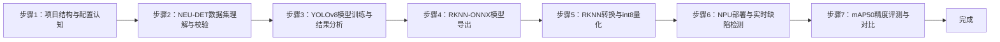
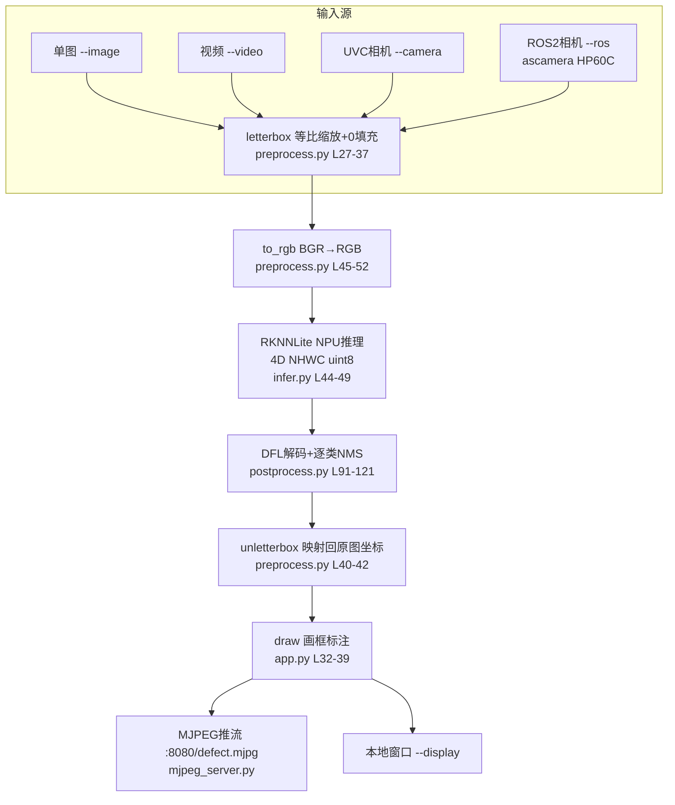

## 实验1：基于YOLOv8的工业表面缺陷检测实验（4h）

> ✅ **源码已核实** 本实验源码位于 `ros2_ws/src/xflz_eai_car1/vision/01_industrial_defect_detection/`（仓库内相对路径，根 = 课程生成项目根目录）。已随仓库交付完整训练产物（`train/weights/best.pt`、`best.onnx`，9 输出）与转换产物（`models/defect_yolov8n_int8.rknn`，int8 单核+剪枝，200 张 val 校准）。板端验证通过，实测约 **13 FPS**（NPU）。

### 1.1 关联知识点

本实验对应第 1 章"工业缺陷检测与 YOLOv8 认知"，覆盖以下 7 个知识点（ID 遵循知识图谱编号约定，来源于 course-spec.yaml 的 knowledge_points）：

- 1.1.1 YOLOv8模型架构 > 原理 > YOLOv8 采用 CSPDarknet 主干 + PAN-FPN 颈部 + 解耦检测头，引入 DFL（Distribution Focal Loss）边界框回归
- 1.1.2 工业缺陷数据集 > 概念 > NEU-DET 数据集包含 6 类表面缺陷（crazing/inclusion/patches/pitted_surface/rolled-in_scale/scratches），YOLO 归一化标签格式
- 1.2.1 模型训练与超参数 > 流程 > yolov8n + imgsz=640 + epochs=100 + batch=8 的训练配置与产物解读（mAP50=0.732）
- 1.2.2 ONNX模型转换 > 流程 > 使用 RKNN 优化版 fork 导出 format=rknn 的 ONNX（3×nl 个原始张量，DFL 留在 CPU 侧，共 9 个输出）
- 1.3.1 RKNN NPU部署 > 原理 > rknn-toolkit2 将 ONNX 转换为 rk3576 平台 int8 量化模型，RKNNLite 在 6TOPS NPU 上推理
- 1.3.2 实时缺陷检测 > 流程 > letterbox 预处理 → RGB 通道交换 → NPU 推理 → DFL 解码 + 逐类 NMS → unletterbox 画框标注
- 1.3.3 精度评测与质检 > 概念 > mAP50 指标（纯 numpy 实现）与 onnx/rknn 双后端精度对比

### 1.2 实验目标

1. 掌握 YOLOv8 目标检测模型的工业应用方法，理解模型架构、训练超参数与检测原理 — 原理理解
2. 完成工业产品的缺陷自动检测与定位，实现缺陷类别识别与可视化标注 — 独立完成
3. 理解工业质检场景下的数据集制作、模型训练、部署推理全流程，体验"PC 训练 → ONNX 导出 → RKNN 转换 → 板端 NPU 推理"的完整链路 — 迁移应用

### 1.3 实验环境

| 类别 | 配置 |
|------|------|
| 硬件 | 具身智能实验箱 B2（XFLZ_EAI_B2_PRO，RK3576 SoC，6TOPS NPU，含 HP60C 深度相机） |
| OS | Ubuntu 22.04 + ROS2 Humble（板载 ros2_venv 虚拟环境，rknnlite 2.3.2 / onnxruntime 1.23.2） |
| 核心库 | OpenCV、NumPy、PyYAML、rknnlite（板端推理）、rknn-toolkit2（转换）、onnxruntime、mjpeg_streamer、rclpy + cv_bridge |
| 训练框架 | ultralytics 8.3.229（RKNN 优化 fork，numpy<2.0，PC 侧） |
| 主入口 | `src/app.py`（推理 CLI：单图 / 视频 / UVC 相机 / ROS2 相机）<br>`src/convert_rknn.py`（ONNX → RKNN 转换）<br>`src/eval_map.py`（mAP50 精度评测）<br>`scripts/train.sh` / `scripts/export_onnx.sh`（PC 训练与导出） |

### 1.4 实验难度

- 难度: ⭐⭐⭐ 综合性
- 重点: YOLOv8 工业缺陷检测全流程（数据集 → 训练 → 导出 → 转换 → 部署推理 → 精度评测）
- 难点: RKNN int8 量化精度控制（校准集、RGB/BGR 约定、letterbox 填充值一致性）与 NPU 部署的输入格式约束（4D NHWC、RGB、无归一化）

### 1.5 实验现象

**快速验证流程**（帮助学习者快速看到实验效果，全程在板载 B2 平台执行）：

1. 进入项目根目录：`cd ros2_ws/src/xflz_eai_car1/vision/01_industrial_defect_detection`
2. （可选）跑通单元测试：`pytest -v`（42 用例全绿，数据集用例在无 NEU-DET 的机器上自动跳过）
3. 单图推理（仓库自带 4 张缺陷测试图 `images/1.jpg~4.jpg`）：`python src/app.py --model models/defect_yolov8n_int8.rknn --image images/1.jpg --save out.jpg`
   - 终端打印每帧 FPS 与每个缺陷框的类别、置信度、坐标
4. 查看标注结果：`out.jpg` 中缺陷区域被红色框标出，框上方打印类别名（如 `scratches 0.87`）
5. 视频推理：`python src/app.py --model models/defect_yolov8n_int8.rknn --video test.mp4 --save out.mp4`
6. 相机实时（标准流程）：先起相机驱动，再运行 `--ros` 模式（详见步骤 6）
7. 浏览器查看 MJPEG 实时流：`http://<板IP>:8080/defect.mjpg`，移动工件观察缺陷框实时跟随

**预期效果描述**：
- **单图/视频**：6 类缺陷（裂纹 crazing、夹杂 inclusion、斑块 patches、麻点 pitted_surface、氧化铁皮 rolled-in_scale、划痕 scratches）均能以红框 + 类别 + 置信度标注，小目标缺陷（如麻点、划痕）也能稳定检出
- **相机实时**：检测框在视频流中逐帧更新，终端每 30 帧打印一次平均帧率，板端实测约 **13 FPS**（yolov8n/640，NPU 单核+剪枝模型）
- **精度表现**：随仓库交付的训练产物在 val 集达到 P=0.657 / R=0.706 / **mAP50=0.732**；RKNN int8 模型相对 ONNX 掉点 ≤3%
- **完整链路**：一份 `best.pt` 权重依次经历 PyTorch 训练、ONNX 导出、RKNN int8 量化转换，最终在 6TOPS NPU 上以 13 FPS 实时运行，验证"训练部署一体"的工业落地范式

### 1.6 实验步骤

#### 整体流程图



---

#### 步骤1：项目结构与配置体系认知（阶段一：能运行，20min）

> 📌 本步骤对应源码：`config/defect_config.yaml`、`src/config.py`

**知识点讲解**：

**配置驱动设计（1.1.2 延伸）**
- **原理**：工业质检项目通常要求"配置与代码分离"，把数据集路径、训练超参、推理阈值、RKNN 转换参数全部收敛到一个 YAML 文件，保证实验可复现。本项目通过 `src/config.py` 的 `load_config()` 实现**契约式校验**：`REQUIRED` 字典（L14-35）声明了 dataset/train/infer/rknn/eval 五个区块必须存在的键与其类型，缺键或类型错误直接抛出 `ConfigError`（L38-39），避免"配置写错导致推理静默失败"这类隐蔽问题；未知键则忽略（向前兼容）。`resolve_path()`（L67-73）负责把配置中的相对路径解析为绝对路径。推理侧两个关键阈值——`score_thr=0.25`（置信度过滤）与 `iou_thr=0.45`（NMS 交并比阈值）——都在配置中集中管理（`config/defect_config.yaml` L22-26），调参无需改代码。
- **源码对应**：`config/defect_config.yaml` L1-47（dataset L4-8 / train L10-20 / infer L22-26 / rknn L37-42 / eval L44-46）；`src/config.py` L14-35（REQUIRED）、L42-64（load_config）、L67-73（resolve_path）

**操作步骤**：

1. 查看项目目录结构，确认六大模块分工：
   ```bash
   cd ros2_ws/src/xflz_eai_car1/vision/01_industrial_defect_detection
   ls src/    # app / config / convert_rknn / dataset / eval_map / infer / metrics / mjpeg_server / postprocess / preprocess / ros2_source
   ```
2. 阅读配置文件，逐区块理解含义：
   ```bash
   cat config/defect_config.yaml
   # 重点：infer.score_thr=0.25、infer.iou_thr=0.45、rknn.target_platform=rk3576、server.port=8080
   ```
3. 用 Python 验证配置加载与校验逻辑：
   ```bash
   python -c "from config import load_config; cfg = load_config('config/defect_config.yaml'); print(cfg['infer'])"
   # 预期输出：{'imgsz': 640, 'score_thr': 0.25, 'iou_thr': 0.45, 'pad_color': [0, 0, 0]}
   ```
4. 验证缺键报错（观察 ConfigError 契约）：
   ```bash
   python -c "from config import load_config; load_config('config/defect_config.yaml')"  # 正常
   # 尝试删掉 yaml 中 infer 区块再运行，观察 ConfigError 提示缺失键
   ```

**易错点**：
- ⚠️ 配置路径写相对路径时，`resolve_path` 基于**配置文件所在目录**解析（`config.py` L67-73），不是当前工作目录——跨目录运行务必注意

---

#### 步骤2：工业缺陷数据集理解与校验（阶段一：能运行，30min）

> 📌 本步骤对应源码：`src/dataset.py`

**知识点讲解**：

**NEU-DET 数据集与 YOLO 标签格式（1.1.2）**
- **原理**：NEU-DET（Northeastern University 表面缺陷数据集）是工业质检领域的标准公开数据集，包含热轧带钢表面 6 类缺陷（crazing 裂纹 / inclusion 夹杂 / patches 斑块 / pitted_surface 麻点 / rolled-in_scale 氧化铁皮 / scratches 划痕），共 1800 张 200×200 灰度图，已由社区转换为 YOLO 格式（`NEU-DET.v1i.yolov8`）。YOLO 标签为每行 `class_id cx cy w h` 的归一化格式（值域 0-1，相对图像宽高），与 COCO 的像素坐标格式不同。`src/dataset.py` 的 `validate_dataset()`（L19-85）负责**校验数据集结构**：确认 images/labels 目录存在、图像与标签一一对应、标签行数/坐标合法，输出统计（类别分布、样本数），为训练和评测提供数据完整性保障。`class_names()`（读 data.yaml）从 `names:` 字段提取 6 类名称供推理标注使用。
- **源码对应**：`src/dataset.py` L19-85（validate_dataset：目录检查 L24-38 / 标签合法性 L40-66 / 统计输出 L68-85）、class_names 读取 data.yaml

**操作步骤**：

1. 若本机已有 NEU-DET 数据集，配置 `config/defect_config.yaml` 中 `dataset.root` 指向其路径
2. 运行数据集校验：
   ```bash
   python -c "from dataset import validate_dataset; import yaml, pathlib; \
   cfg = yaml.safe_load(open('config/defect_config.yaml')); \
   validate_dataset(pathlib.Path(cfg['dataset']['root']))"
   # 预期：打印类别统计（6 类缺陷各约 300 张）与标签合法性结果
   ```
3. 查看 2-3 张标注图，理解 YOLO 归一化标签与像素坐标的换算关系（用 OpenCV 画框验证）
4. 思考：为什么工业缺陷数据集比通用目标检测数据集更难标注？（缺陷尺度小、类间相似、标注一致性要求高）

**易错点**：
- ⚠️ 板上无 NEU-DET 数据集属正常现象——`app.py` L60-65 已内置 6 类名兜底，板上推理无需数据集
- ⚠️ 标签坐标必须归一化（0-1），若混入像素坐标，训练会直接崩或 mAP 极低

---

#### 步骤3：YOLOv8 模型训练与结果分析（阶段二：能理解，40min）

> 📌 本步骤对应源码：`scripts/train.sh`、`train/args.yaml`

**知识点讲解**：

**YOLOv8 架构与训练流程（1.1.1、1.2.1）**
- **原理**：YOLOv8 是 anchor-free 的实时目标检测器，主干 CSPDarknet 提取多尺度特征，PAN-FPN 颈部融合，**解耦检测头**分别输出分类与回归分支。回归分支采用 **DFL（Distribution Focal Loss）**：不直接回归偏移，而是预测 16 个 bin 的概率分布，加权求和得到连续偏移，对小目标更友好（`postprocess.dfl_decode` 对应实现）。训练配置收敛在 `train/args.yaml`：yolov8n、imgsz=640、epochs=100、batch=8、optimizer=auto、seed=0。训练产物 `train/weights/best.pt`（+ last.pt）与 `best.onnx`（RKNN 优化 fork 导出，9 输出）随仓库交付，**无需重训即可进入部署链路**；`scripts/train.sh`（L1-25）封装了 PC 侧训练入口。
- **源码对应**：`scripts/train.sh` L1-25；`train/args.yaml` L1-106（超参数全量）；训练指标见 `train/results.csv`、曲线图 `train/*.png`

**操作步骤**：

1. 查看训练产物目录，理解"一份权重，三种格式"：
   ```bash
   ls -la train/weights/    # best.pt (PyTorch) + best.onnx (RKNN-ONNX, 9输出)
   ```
2. 解读训练指标（`train/results.csv` 末尾几行）：
   ```bash
   tail -5 train/results.csv    # epoch/box_loss/cls_loss/dfl_loss/metrics/precision/recall/mAP50
   # 参考：epoch 100 → P=0.657 / R=0.706 / mAP50=0.732 / mAP50-95=0.409
   ```
3. 查看混淆矩阵与 PR 曲线（`train/confusion_matrix.png`、`train/PR_curve.png`），分析哪两类缺陷最易混淆（通常 crazing 与 scratches 相似）
4. （可选，PC 且需重训时）运行 `bash scripts/train.sh`，比较训练曲线
5. 思考：为什么选择 imgsz=640 而不是 800？板端 NPU 算力固定（6TOPS），imgsz 越大单帧耗时越高——这是**精度-速度权衡**的典型例子

**易错点**：
- ⚠️ 训练框架必须是 RKNN 优化 fork（ultralytics 8.3.229 + numpy<2.0），官方版导出的 ONNX 不是 9 输出，无法直接转 rknn
- ⚠️ 训练精度目标只是参考，mAP 达标 ≠ 板端可用——int8 量化会引入精度损失，需在步骤 7 验证掉点

---

#### 步骤4：RKNN-ONNX 模型导出（阶段二：能理解，30min）

> 📌 本步骤对应源码：`scripts/export_onnx.sh`

**知识点讲解**：

**RKNN 优化版 ONNX 导出（1.2.2）**
- **原理**：官方 ultralytics 导出的 ONNX 把 DFL 解码也导出到计算图中（大量 Slice/Concat 算子），RKNN 转换器对这类动态索引支持差、易报错或低效。RKNN 优化 fork 提供了 `format='rknn'` 导出模式：**DFL 解码留在 CPU 侧**（Python 后处理实现），模型只输出 3×nl 个原始张量——每层 3 个：box `(1,64,h,w)`（DFL 原始分布）、cls `(1,nc,h,w)`（已 sigmoid）、cls_sum `(1,1,h,w)`（可忽略分支）。yolov8n 有 3 个检测层（80/40/20），故共 9 个输出。`export_onnx.sh`（L1-21）封装导出命令并校验输出数量。
- **源码对应**：`scripts/export_onnx.sh` L1-21（导出 + 校验 L16-20）

**操作步骤**：

1. 查看导出脚本内容，理解关键参数：
   ```bash
   cat scripts/export_onnx.sh
   # 核心：yolo export model=train/weights/best.pt format=onnx opset=12 imgsz=640
   #       format=rknn（RKNN 优化 fork 专用）
   ```
2. 验证已交付的 ONNX 输出结构（无需重导）：
   ```bash
   python -c "
   import onnxruntime as ort
   sess = ort.InferenceSession('train/weights/best.onnx')
   print('输入:', [i.name for i in sess.get_inputs()])
   print('输出数:', len(sess.get_outputs()))
   for o in sess.get_outputs(): print(' ', o.name, o.shape)"
   # 预期输出数 = 9（3 层 × 3 张量）
   ```
3. 若需重导（PC 且 fork 环境就绪）：`bash scripts/export_onnx.sh train/weights/best.pt`

**易错点**：
- ⚠️ 输出不是 9 个 → 用了官方 ultralytics 或未指定 `format=rknn`（`export_onnx.sh` L16）
- ⚠️ opset 过高（>12）可能导致 RKNN 转换器不支持某些算子，保持 opset=12

---

#### 步骤5：RKNN 转换与 int8 量化（阶段二：能理解，40min）

> 📌 本步骤对应源码：`src/convert_rknn.py`

**知识点讲解**：

**RKNN int8 量化原理（1.3.1）**
- **原理**：RKNN 转换器（rknn-toolkit2）把 ONNX 图转换为 RK3576 平台的 NPU 指令集模型，核心是 **int8 量化**：权重和激活从 float32 缩放到 int8（w8a8），通过**校准集**统计激活分布确定每个张量的 scale/zero_point。量化配置要点：`quant_img_RGB2BGR=False`（L65）——因为导出模型的输入约定是 RGB；`target_platform='rk3576'`（L38-42）；校准集 200 张 val 图（`--calib-count 200`）。部署侧用 `RKNNLite`（`infer.py` L29-52）在 NPU 上推理，`init_runtime` 必须显式传 `core_mask=0`（NPU_CORE_AUTO，L36），None 在 2.3.2 会报 `core mode not supported`。模型推理输入必须是 **4D NHWC uint8**（静态 shape）且**不做 /255 归一化**——量化模型内部已含 scale。
- **源码对应**：`src/convert_rknn.py` L25-109（参数解析 L25-40 / config 加载与 RGB2BGR 设置 L41-65 / 转换+量化 L66-91 / 输出保存 L92-109）

**操作步骤**：

1. 查看转换脚本参数：
   ```bash
   python src/convert_rknn.py --help
   # --onnx --output --calib-dir --calib-count --imgsz --no-quantize
   ```
2. 重新转换（板上 ros2_venv 或 PC rknn 环境，需要 NEU-DET val 图作校准集）：
   ```bash
   python src/convert_rknn.py --onnx train/weights/best.onnx \
     --output models/defect_yolov8n_int8.rknn \
     --calib-dir <NEU-DET>/valid/images --calib-count 200
   # 预期：打印量化信息与每层统计，最终生成 .rknn 文件
   ```
3. 对比已交付的 `models/defect_yolov8n_int8.rknn` 文件大小与 ONNX 差异（int8 通常更小）
4. 思考：量化掉点的根源是什么？（权重/激活低比特表示 → 信息损失；校准集代表性不足 → 分布估计偏差）

**易错点**：
- ⚠️ 校准图必须 jpg/png/bmp 且绝对路径、无中文（`convert_rknn.py` L22）；`--imgsz` 与训练一致（640）
- ⚠️ `rgb2bgr` 必须 False（L65）：模型输入约定 RGB，转换侧与推理侧（`to_rgb`）必须一致
- ⚠️ 掉点 >3% 时：增大 `--calib-count`、校准图用 val 集、必要时 `--no-quantize` 定位

---

#### 步骤6：NPU 部署与实时缺陷检测（阶段三：能改造，45min）

> 📌 本步骤对应源码：`src/app.py`、`src/infer.py`、`src/preprocess.py`、`src/postprocess.py`、`src/mjpeg_server.py`、`src/ros2_source.py`

**知识点讲解**：

**实时缺陷检测推理流水线（1.3.2）**
- **原理**：板端推理是一条精心对齐的流水线（`Detector.detect`，`src/infer.py` L108-139）：(1) **letterbox 预处理**（`src/preprocess.py` L27-37）——按 `scale=min(size/h, size/w)` 等比缩放并用 0 值填充到 640×640，保持宽高比不变、避免目标变形；(2) **BGR→RGB 通道交换**（L45-52 `to_rgb`）——量化配置 `rgb2bgr=False` 决定了 NPU 输入必须是 RGB；(3) **NPU 推理**（`src/infer.py` L44-49）——`RKNNLite.inference` 输入必须是 **4D NHWC uint8**（静态 shape 模型不接受 3D），且**不做 /255 归一化**（量化模型内部已含 scale）；(4) **CPU 侧解码**（`src/postprocess.py`）——`dfl_decode`（L34-42）对 16 bin 做 softmax 加权求和还原边框偏移，`box_process`（L45-56）加 grid 中心与 stride 还原 xyxy，`decode_rknn`（L91-121）按 `score_thr=0.25` 过滤后 `classwise_nms`（L59-88）逐类做非极大值抑制（同类别重叠框只留最高分）；(5) **unletterbox**（`src/preprocess.py` L40-42）把检测框映射回原始图像坐标，再由 `app.py` 的 `draw()`（L32-39）画红框与类别标签。后端抽象（`Backend` Protocol，`infer.py` L23-26）让 RKNN/ONNX/Fake 三种后端可注入切换。
- **源码对应**：`src/preprocess.py` L27-37（letterbox）、L40-42（unletterbox）、L45-52（to_rgb）；`src/infer.py` L23-26（Backend 协议）、L29-52（RKNNBackend：load L38-42 / predict L44-49）、L108-139（Detector：detect L118-130）；`src/postprocess.py` L34-42（dfl_decode）、L45-56（box_process）、L59-88（classwise_nms）、L91-121（decode_rknn）；`src/app.py` L24-29（_make_backend）、L32-39（draw）、L71-75（run_frame）、L94-146（视频/相机/ROS 模式）；`src/mjpeg_server.py` L19-72（MjpegServer）；`src/ros2_source.py` L20-116（Ros2Camera：DEFAULT_TOPIC L29 / open L50-69 / _on_image L71-80 / read L82-92 / release L98-116）

**推理数据流图**：



**操作步骤**：

1. 单图推理（最简验证）：
   ```bash
   cd ros2_ws/src/xflz_eai_car1/vision/01_industrial_defect_detection
   python src/app.py --model models/defect_yolov8n_int8.rknn --image images/1.jpg --save out.jpg
   # 预期：终端打印 fps=xx.x 与每个缺陷框 类别 置信度 (x1,y1,x2,y2)；out.jpg 为红框标注图
   ```
2. 视频推理：
   ```bash
   python src/app.py --model models/defect_yolov8n_int8.rknn --video test.mp4 --save out.mp4
   # 预期：每 30 帧打印一次 avg_fps，最终输出标注视频
   ```
3. 相机实时（板上标准流程，HP60C 走 ROS2 话题）：
   ```bash
   # 终端 1：启动相机驱动（ROS_DOMAIN_ID 必须与驱动一致，本板 =2）
   source /opt/ros/humble/setup.bash && source ~/ros2_ws/install/setup.bash
   export ROS_DOMAIN_ID=2
   ros2 launch ascamera hp60c.launch.py

   # 终端 2：运行缺陷检测（同一 ROS_DOMAIN_ID）
   source /opt/ros/humble/setup.bash && source ~/ros2_ws/install/setup.bash
   export ROS_DOMAIN_ID=2
   python src/app.py --model models/defect_yolov8n_int8.rknn --ros
   # 预期：终端打印 frame N avg_fps=xx.x，板端实测约 13 FPS
   ```
4. 浏览器查看实时检测流：
   - 同一局域网内访问 `http://<板IP>:8080/defect.mjpg`
   - 移动带缺陷的工件，观察红框与类别标签实时跟随
5. 验证后端可切换（精度对比前置）：
   ```bash
   python src/app.py --model train/weights/best.onnx --image images/1.jpg --save out_onnx.jpg
   # .onnx 自动走 ONNXBackend（CPU），与 .rknn（NPU）对比帧率差异
   ```
6. 动手改造练习（阶段三）：修改 `src/app.py` L38-39 中画框颜色/线宽，或把 `score_thr` 从配置改为命令行参数，重新运行观察效果

**易错点**：
- ⚠️ **推理报 `need 4dims input`** → **解决**：静态 shape 模型要求 4D 输入，`RKNNBackend.predict`（`infer.py` L47）已用 `np.newaxis` 补成 NHWC；手写推理代码时务必保持 4 维
- ⚠️ **检测结果框整体偏移/错位** → **解决**：检查 letterbox 填充值（必须 0，非 114）与 BGR/RGB 约定（`to_rgb` 必须调用）；两侧不一致是框偏移的头号原因
- ⚠️ **init_runtime 报 `core mode not supported`** → **解决**：`RKNNLite` 初始化必须显式传 `core_mask=0`（NPU_CORE_AUTO，`infer.py` L36），None 值在 2.3.2 上会报错
- ⚠️ **MJPEG 浏览器 404** → **解决**：端口被其他 demo 占用，`mjpeg_server.py` L47-57 启动时已预检端口并明确报错；先关闭占用 8080 的进程
- ⚠️ **--ros 模式取不到帧** → **解决**：确认相机驱动已启动、`ROS_DOMAIN_ID` 与驱动一致（本板 =2）、话题为 `/ascamera_hp60c/camera_publisher/rgb0/image`（`ros2_source.py` L29，勿 remap）

---

#### 步骤7：mAP50 精度评测与 onnx/rknn 对比（阶段三：能改造，35min）

> 📌 本步骤对应源码：`src/eval_map.py`、`src/metrics.py`

**知识点讲解**：

**mAP50 指标原理（1.3.3）**
- **原理**：mAP（mean Average Precision）是目标检测的行业标准指标。其计算分四层：(1) **IoU**（`src/metrics.py` L28-39 `iou_matrix`）——预测框与真值框的交并比，向量化实现逐对计算；(2) **TP/FP 匹配**（L54-73 `_match_flags`）——预测框按置信度降序，与同类别 GT 计算 IoU，`IoU≥0.5` 且该 GT 未被匹配过则为 TP，否则 FP（一张 GT 只匹配一次）；(3) **PR 曲线与 AP**（L42-51 `_ap_from_pr`）——按置信度阈值从高到低扫描，计算 precision/recall 序列，用 all-point 插值求曲线下面积，即单个类别的 AP50；(4) **mAP50**（L76-112 `map50`）——各类 AP50 的平均，遵循 COCO/ultralytics 约定**无 GT 的类别不参与均值**，保证与官方 `yolo val` 可比。`eval_map.py`（L29-91）把评测组织为"遍历 val 集 → Detector 推理 → 解析 YOLO 标签为 GT → map50 计算"，`--backend` 参数支持 rknn/onnx 双后端，从而量化 int8 量化相对浮点模型的精度损失（本项目要求掉点 ≤3%）。
- **源码对应**：`src/metrics.py` L28-39（iou_matrix）、L42-51（_ap_from_pr）、L54-73（_match_flags）、L76-112（map50）；`src/eval_map.py` L29-46（参数与 Detector 构建）、L48-79（评测循环与 GT 解析）、L81-91（结果输出）

**操作步骤**：

1. 运行 RKNN 后端评测（板上，需要 NEU-DET 数据）：
   ```bash
   python src/eval_map.py --backend rknn \
     --model models/defect_yolov8n_int8.rknn \
     --data /home/iflytek/Src/AIoT_B2/NEU-DET.v1i.yolov8
   # 预期输出：per-class AP50 表格 + mAP50（如 0.71x）
   ```
2. 运行 ONNX 后端评测，与 RKNN 对比：
   ```bash
   python src/eval_map.py --backend onnx \
     --model train/weights/best.onnx \
     --data /home/iflytek/Src/AIoT_B2/NEU-DET.v1i.yolov8
   # 预期：onnx mAP50 略高于 rknn；掉点 = onnx - rknn ≤ 3%
   ```
3. 记录两类缺陷的 AP 差异，思考原因（如 crazing 与 scratches 类间相似，AP 通常偏低）
4. 填写性能基线表（实验报告必填）：

   | 指标 | 期望值 | 实测值 |
   |------|-------|-------|
   | onnx mAP50 | ≈0.73 |  |
   | rknn(int8) mAP50 | 掉点 ≤3% |  |
   | 单图推理 FPS（NPU） | ≥15（实测约 13） |  |
   | MJPEG 流地址 | :8080/defect.mjpg 可访问 |  |

**易错点**：
- ⚠️ mAP 数值与 `yolo val` 不可比 → 保持"无 GT 类不参与均值"约定（`metrics.py` L109-111）；GT 与 pred 统一原始图像坐标（`eval_map.py` L74-75）
- ⚠️ 评测耗时长 → 可先用 `--limit`（若支持）抽子集快速验证流程，再全量跑

---

### 1.7 常见问题

| 问题 | 原因 | 解决方法 |
|------|------|---------|
| 检测框整体偏移/错位 | letterbox 填充值或 BGR/RGB 约定与转换不一致 | 部署侧保持 pad=0（`preprocess.py` L8-9）与 `to_rgb()`（L45-52）；转换侧 `quant_img_RGB2BGR=False`（`convert_rknn.py` L65） |
| NPU 推理报 `need 4dims input` | 静态 shape 模型要求 4D NHWC 输入 | 按 `infer.py` L47 加 `np.newaxis` 补维 |
| init_runtime 报 `core mode not supported` | core_mask 传 None | 显式传 `core_mask=0`（NPU_CORE_AUTO，`infer.py` L36） |
| RKNN 转换掉点 >3% | 校准集不足或预处理不一致 | 增大 `--calib-count`（`convert_rknn.py` L99）、校准图用 val 集且预处理与推理一致；必要时 `--no-quantize` 定位 |
| 导出 ONNX 输出不是 9 个 | 用了官方 ultralytics 或未指定 format=rknn | 使用 RKNN 优化 fork + `format='rknn'`（`export_onnx.sh` L16），校验命令见 L20 |
| MJPEG 浏览器 404 | 8080 端口被其他 demo 占用 | 关闭占用进程；启动时预检报错见 `mjpeg_server.py` L47-57 |
| `--ros` 取不到帧 | 驱动未启动或 ROS_DOMAIN_ID 不一致 | 先 `ros2 launch ascamera hp60c.launch.py`；export ROS_DOMAIN_ID=2；话题勿 remap（`ros2_source.py` L29） |
| 退出程序时报 C++ abort / core dumped | `Ros2Camera.release()` 先 destroy_node 再 rclpy.shutdown()，顺序反了 | 严格先 `rclpy.shutdown()` 后 `destroy_node`（`ros2_source.py` L98-116），release 已内置正确顺序 |
| 量化校准报错或无效果 | 校准图路径含中文字符/格式不支持，或 imgsz 与模型不一致 | 校准图用 jpg/png/bmp 与绝对路径（`convert_rknn.py` L22）；`--imgsz` 与训练一致 |
| 板上无训练集时推理报错 | `class_names` 读 data.yaml 失败抛 FileNotFoundError | 属正常现象，`app.py` L60-65 已内置 NEU-DET 6 类名兜底，板上推理无需数据集 |
| mAP 数值与 `yolo val` 不可比 | 无 GT 的类参与了均值，或 GT 与预测坐标空间不一致 | 保持"无 GT 类不参与均值"约定（`metrics.py` L109-111）；GT 与 pred 统一原始图像坐标（`eval_map.py` L74-75） |

### 1.8 扩展实验

**扩展方向 1：缺陷精度提升与消融对比（进阶）**
- 训练侧换更大模型 `yolov8s` 或提高 `imgsz=800`，对比 mAP50 提升与板端 FPS 下降的权衡（NPU 算力 6TOPS 固定，模型越大单帧耗时越高）
- 增加校准图片数（`--calib-count 500`）或改用 fp16 转换，观察 int8 量化掉点变化
- 用 `src/eval_map.py` 的 `--backend` 参数建立 torch / onnx / rknn 三方精度对比表，分析量化误差主要来自哪类缺陷

**扩展方向 2：质检联动与缺陷统计报告（进阶）**
- 在 `src/app.py` 主循环（L123-138）中按类别累加缺陷计数，周期性输出缺陷统计（如"scratches: 12 处"），生成质检报表，对应工业场景的"缺陷统计与质检报告生成"
- 将 `Detector.detect()` 返回的 `Detection` 列表转换为 ROS2 `vision_msgs/Detection2DArray` 话题发布，供机械臂分拣或报警灯联动（需在 `ros2_source.py` 旁新增 publisher 模块）
- 把 MJPEG 推流（`mjpeg_server.py`）与缺陷统计叠加显示在画面上，形成完整的人机交互质检界面

### 1.9 实验报告要求

**评分标准**：配置与数据集理解 10 分 + 训练产物分析 15 分 + ONNX/RKNN 转换 25 分 + NPU 实时推理与 MJPEG 演示 30 分 + mAP50 评测 10 分 + 实验报告 10 分 = 100 分。

**报告必含内容**：
1. 推理流水线框图（letterbox → RGB → NPU → DFL 解码/NMS → unletterbox），标注每步对应源码文件与行号
2. 单图检测结果图（标注前/后对比）与 3 个检测框的类别、置信度、坐标数据
3. 板端实测 FPS（单图/视频/相机三种模式）与性能基线表（1.6 步骤 7 表格）
4. onnx vs rknn 的 mAP50 对比表，分析量化掉点原因
5. 回答思考题：为什么部署推理用 pad=0 而训练用 114？为什么 NPU 输入必须是 RGB 且不做归一化？如果 score_thr 从 0.25 调到 0.5，检测结果会如何变化？
6. 实验心得与问题记录（遇到的问题、排查过程、解决结果）

---

## 更新日志

| 版本 | 日期 | 变更 |
|------|------|------|
| v1.0 | 2026-08-10 | 初版生成（基于源码实测：app.py/infer.py/preprocess.py/postprocess.py/convert_rknn.py 等，源码路径 ros2_ws/src/xflz_eai_car1/vision/01_industrial_defect_detection，板端验证 13 FPS，训练产物 mAP50=0.732） |
