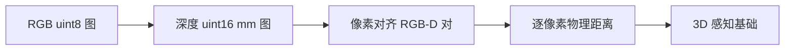
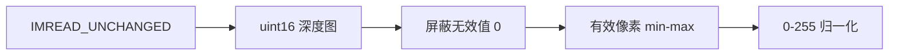
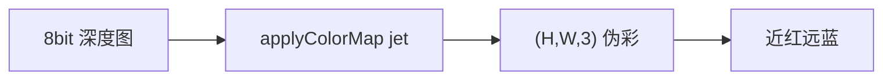
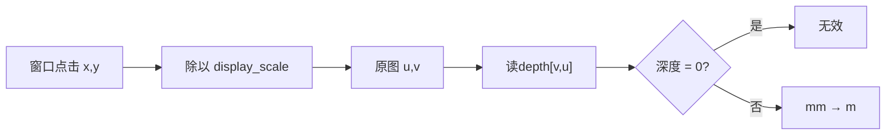
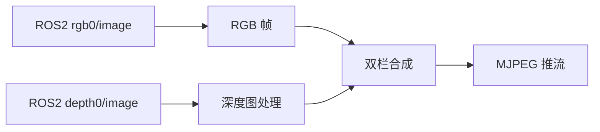

## 实验10：基于深度信息的3D物体检测实验（4h）

> ✅ **源码已核实** 本实验源码位于 `ros2_ws/src/xflz_eai_car1/vision/08_depth_3d_detection/`。⚠️ **内容说明**：按 `depth_viewer_guide.md` 移植规格实现——**深度相机双栏显示（左 RGB | 右 Depth 伪彩）+ 点击读深度（mm/m + 相机坐标反投影）**，规格明确「无检测」（visual_grasp 最小子集）。vendor 参考课用 MediaPipe Objectron（mediapipe 无 aarch64 wheel，弃用）。单测 24/24 全绿，板端验证通过（深度合成）。

### 1.1 关联知识点

- 1.1.1 深度相机原理 > 原理 > HP60C 深度相机（RGB 镜头 + 深度传感器）输出 uint16 深度图（单位 mm），0 表示无效像素；区别于普通 RGB 相机的 2D 信息，深度提供"距离"维度
- 1.2.1 深度图处理 > 流程 > uint16 PNG 加载（mm）→ 有效像素 min-max 归一化 → jet 伪彩映射（`applyColorMap`），灰度近远可视化
- 1.2.2 点击读深度 > 流程 > 窗口坐标 (u,v) 除以 display_scale 还原原图坐标 → 读 depth[v,u]（mm）→ ×0.001 转米
- 1.3.1 相机坐标反投影 > 公式 > x=(u-cx)·z/fx, y=(v-cy)·z/fy（相机内参 fx/fy/cx/cy 来自 ascam.yaml 标定），把像素+深度映射为 3D 坐标
- 1.3.2 实时深度可视化 > 流程 > 板上 ROS2 话题取流（严禁 remap）→ 双栏合成（RGB|Depth）→ MJPEG 推流 + 窗口点击交互

### 1.2 实验目标

1. 掌握深度相机的成像原理与深度图数据格式（uint16 mm、无效值语义）— 原理理解
2. 实现深度图加载、伪彩可视化与点击读深度功能 — 独立完成
3. 理解相机内参反投影原理，实现像素坐标 → 3D 相机坐标的换算 — 迁移应用

### 1.3 实验环境

| 类别 | 配置 |
|------|------|
| 硬件 | 具身智能实验箱 B2（XFLZ_EAI_B2_PRO，RK3576 SoC，6TOPS NPU，含 HP60C 深度相机） |
| OS | Ubuntu 22.04 + ROS2 Humble（板载 ros2_venv） |
| 核心库 | OpenCV、NumPy（纯 CPU，无需 NPU） |
| 数据源 | 文件模式（uint16 PNG）+ ROS 模式（ascamera 话题，板载 rclpy） |
| 主入口 | `src/app.py`（--display 窗口点击 / MJPEG 推流 / --ros 板上模式） |

### 1.4 实验难度

- 难度: ⭐⭐ 设计性
- 重点: 深度图可视化 + 点击读深度 + 内参反投影
- 难点: 相机内参理解与反投影公式；无效像素处理（0 值）；窗口坐标缩放还原

### 1.5 实验现象

**快速验证流程**：

1. 进入项目目录：`cd ~/ros2_ws/src/xflz_eai_car1/vision/08_depth_3d_detection`

2. 单元测试：`pytest tests/ -v`（24 用例全绿）

3. 文件模式（需 config 填 rgb_path/depth_path，depth 为 uint16 PNG）：

4. 点击深度图任一点 → 终端 `Click (u, v): z = XXXX mm (X.XXX m)`；有内参时附加 `xyz=(x, y, z) m`

5. 板上 ROS 模式：先起相机驱动，再 `python src/app.py --config config/depth3d_config.yaml --ros`
   - MJPEG：`http://<板IP>:8080/depth.mjpg`
   
   ```bash
   # 进入实验00
   cd ~/ros2_ws/src/xflz_eai_car1/vision/08_depth_3d_detection
   
   # 可选
   /home/iflytek/ros2_venv/bin/python -m pytest -v
   
   # 相机实时，修改config配置detect.classes为0（人）
   ros2 launch ascamera hp60c.launch.py        										# 终端 1
   python src/app.py --config config/depth3d_config.yaml --display                     # 终端 2
   ```

**执行现象**：

1. 单元测试 `pytest tests/ -v` 输出 24 个用例全部 passed（约 10-20 秒完成），覆盖 depth.py / view.py / app.py / config.py 四个模块
2. 文件模式窗口打开后，左侧显示 RGB 彩色图像（正常拍照色彩），右侧显示深度伪彩图（jet 色带：近处物体偏红色/暖色调，远处背景偏蓝色/冷色调），顶部黄色状态栏文字 "Click depth image to read depth" 清晰可见
3. 点击近处物体（如桌面物体）→ 终端输出类似 `Click (320, 240): z = 523 mm (0.523 m) xyz=(0.012, -0.005, 0.523) m`；点击远处背景 → z 值显著增大（如 1500 mm 以上）；点击无效区域（无深度处）→ 输出 `invalid`
4. 板上 ROS 模式启动后，MJPEG 推流画面实时刷新，移动相机或物体时深度数值连续变化，左 RGB 右 Depth 双栏同步更新

**预期效果描述**：
- 双栏图：左 RGB、右 Depth 伪彩（jet，近红远蓝或按映射），状态栏文字可见
- 点击物体 vs 背景数值差异明显（物体近、背景远）；无效区（0）提示 invalid
- 有内参时输出相机坐标 `xyz=(x, y, z) m`——为 3D 定位/抓取打基础
- 板上：`ros2 topic hz .../rgb0/image` ≈ 25Hz；深度单位 mm（数值勿 ×1000 误解）

```bash
Click (269, 324): z = 309 mm (0.309 m)  xyz=(-0.039, 0.046, 0.309) m
```


### 1.6 实验步骤

#### 整体流程图


---

#### 步骤1：深度相机原理认知（阶段一：能运行，20min）

> 📌 本步骤对应源码：`config/depth3d_config.yaml`

**知识点讲解**：

**深度相机与深度图格式（1.1.1）**
- **原理**：HP60C 深度相机由 RGB 镜头 + 深度传感器（结构光/ToF 类）构成，深度传感器输出**逐像素距离图**。深度图格式约定：**uint16 存储，单位毫米（mm）**，0 值表示该像素无效（未测到/太近/太远）。为什么用 uint16？——深度范围可达 0-65535mm（65 米），uint8 只有 0-255mm 不够用。深度图与 RGB 图经标定对齐（同一视角），是后续 3D 感知（点云、抓取定位）的基础数据。
- **源码对应**：`config/depth3d_config.yaml`（depth.scale=0.001 mm→m / invalid=0 / display_scale / camera 内参）

**知识储备补充**：

- **深度传感器工作原理**：HP60C 采用主动红外深度传感技术（结构光或 ToF），发射红外散斑或调制光，经物体反射后由红外接收器采集。深度传感器通过三角测量或飞行时间（ToF）计算每个像素到相机的物理距离，输出与 RGB 图像分辨率一致的逐像素深度矩阵。结构光方案在近距（0.2-1.5m）精度较高但受环境光干扰大；ToF 方案抗环境光强但近距离精度略低。HP60C 两种技术融合，适用于室内机器人场景。


- **深度图数据结构**：深度图本质是一个二维矩阵，每个元素存储该像素位置的物理距离。OpenCV 中深度图通常以单通道 `uint16` 格式存储在 PNG 文件中，0 值约定为"无效像素"（无反射信号/超出量程/遮挡）。实际深度值范围 1mm-65535mm，uint16 的 16bit 位宽恰好覆盖机器人常用的 0.1-6m 测距范围。
- **RGB-D 对齐意义**：深度图与 RGB 图像在空间上逐像素对齐（同一视角、同一时刻采集），意味着 RGB 图像的每个像素 $(u,v)$ 都对应一个深度值 $d(u,v)$，形成 **RGB-D 数据对**。这是后续 3D 感知（点云生成、物体 6DoF 位姿估计、机械臂抓取定位）的基础——没有深度，2D 图像无法直接提供物体在三维空间中的位置信息。

- **参考资源**：HP60C 深度相机技术规格书（厂商文档）；Intel RealSense 深度相机原理（同类技术对比）；OpenCV `cv2.IMREAD_UNCHANGED` 官方文档。

**配置参数速查表**（`config/depth3d_config.yaml`，按区块分列）：

| 区块 | 参数 | 类型 | 默认/示例 | 说明 |
|------|------|------|-----------|------|
| `depth` | `scale` | float | `0.001` | uint16 mm→米（÷1000） |
| `depth` | `invalid_value` | int | `0` | 无效深度值（0=无效，平台事实） |
| `depth` | `colormap` | str | `jet` | 深度伪彩（jet/gray） |
| `depth` | `display_scale` | float | `0.666` | 显示缩放（点击坐标 ÷scale 还原 640×480） |
| `cam3d` | `fx`/`fy` | float | `608.39958`/`611.20714` | 相机内参（HP60C 标定，ascam.yaml 来源） |
| `cam3d` | `cx`/`cy` | float | `328.30096`/`226.46483` | 主点坐标 |
| `cam3d` | `width`/`height` | int | `640`/`480` | 分辨率 |
| `source` | `mode` | str | `ros` | image（文件对）/ros（板上 rclpy 订阅；板上标准） |
| `source` | `rgb_path` | str | `""` | image 模式 RGB 图路径（BGR png/jpg） |
| `source` | `depth_path` | str | `""` | image 模式深度图路径（uint16 png） |
| `display` | `show`/`window_name` | bool/str | `false`/`RGB | Depth` | 本地窗口 |
| `server` | `port` | int | `8080` | MJPEG 端口 |
| `server` | `stream_name` | str | `depth.mjpg` | MJPEG 流名 |

> **说明**：`depth.scale`/`invalid_value` 是深度读数关键（uint16 mm + 0 无效）；`cam3d` 内参仅点击反投影用（HP60C 标定值，勿随意改）；`source.mode=ros` 为板上标准（image 需提供 rgb+depth 文件对）。

**操作步骤**：

1. 查看 `config/depth3d_config.yaml`，理解 depth.scale（0.001 = mm→m）、invalid（0）、display_scale（显示缩放）、camera（fx/fy/cx/cy 内参）
2. 查看内参来源（`ascam.yaml`，HP60C RGB 标定）
3. 思考：深度为 0 的像素代表什么？为什么不能当真实距离 0mm？

**流程图（深度数据链路）**：



**易错点**：

- ⚠️ 深度单位 mm：数值勿 ×1000 误解（z_mm → z_m 用 ×0.001，不是 ×1000）

---

#### 步骤2：深度图加载与归一化（阶段一：能运行，25min）

> 📌 本步骤对应源码：`src/depth.py` load_depth / normalize_depth

**知识点讲解**：

**uint16 加载与归一化（1.2.1）**

- **原理**：`load_depth()`（L22-27）用 `cv2.imread(path, IMREAD_UNCHANGED)` **保留 16bit** 读取（不带 UNCHANGED 会被截断成 8bit，深度全毁），返回 mm 数组。`normalize_depth()`（L30-41）把有效像素 min-max 线性拉伸到 0-255：先屏蔽无效值（`depth != invalid`），对有效像素求 min/max 后线性映射；单值深度（hi==lo）直接置 255 全亮。归一化是伪彩可视化的前置——深度范围大（0.3m-10m），直接 8bit 显示会糊成一片。
- **源码对应**：`src/depth.py` L22-27（load_depth）、L30-41（normalize_depth：有效掩膜 L33 / min-max 映射 L35-40）

**知识储备补充**：

- **IMREAD_UNCHANGED 机制**：OpenCV 的 `cv2.imread()` 默认行为是将图像转换为 `uint8`（8bit），无论原文件是 16bit 还是 32bit。`IMREAD_UNCHANGED` 标志禁止这种截断转换，保留原始数据类型。对于深度图（uint16 PNG），截断意味着所有 >255mm 的深度值被 mod 256 截断——例如 500mm 变成 244mm，完全失去物理意义。这是深度图处理中最常见的初学者陷阱。
- **min-max 归一化原理**：将深度值从原始范围 $[d_{\min}, d_{\max}]$ 线性映射到 $[0, 255]$：

  $$
  d_{\text{norm}}(u,v) = \frac{d(u,v) - d_{\min}}{d_{\max} - d_{\min}} \times 255
  $$

  其中 $d_{\min}, d_{\max}$ 仅在有效像素（$d \neq 0$）中统计。屏蔽无效值（0）避免将"无深度"误判为"最近"——若不屏蔽，0 值会使 $d_{\min}=0$，有效深度的对比度大幅压缩（例如 1m-5m 的物体被映射到 51-255，细节丢失）。
- **单值深度处理**：当所有有效像素深度值相同（$d_{\max} = d_{\min}$），归一化公式分母为 0，直接置 255 全亮（`normalize_depth` L38-39）。这在近距离平面物体（如桌面）拍摄时常见——整个物体处于同一深度，伪彩图呈现均匀颜色。
- **参考资源**：OpenCV `cv2.imread` 官方文档（IMREAD_UNCHANGED 说明）；NumPy `ndarray.astype` 类型转换文档。

**操作步骤**：

1. 验证深度图读取与归一化（16bit 保留；无真实深度图时用合成数组演示）：
   ```bash
   # 执行目录：~/ros2_ws/src/xflz_eai_car1/vision/08_depth_3d_detection
   cd ~/ros2_ws/src/xflz_eai_car1/vision/08_depth_3d_detection
   
   PYTHONPATH=./src python -c "
   import numpy as np
   from depth import load_depth, normalize_depth
   d = np.zeros((20, 20), np.uint16); d[5:15, 5:15] = 500   # 合成：中央 500mm 物体
   print('dtype:', d.dtype, '范围:', d.min(), '-', d.max())
   print('无效像素占比:', float((d == 0).mean()))            # 0 = 无效
   norm = normalize_depth(d)
   print('归一化后 0-255:', norm.min(), '-', norm.max(), '(无效区=0)')"
   # 真图：d = load_depth('depth.png')   # uint16 PNG，IMREAD_UNCHANGED 保留 16bit
   # 预期：dtype uint16；范围 0-500；无效占比 0.75；归一化中央 255、无效区 0
   ```

   ```bash
   dtype: uint16 范围: 0 - 500
   无效像素占比: 0.75
   归一化后 0-255: 0 - 255 (无效区=0)
   ```

2. 用普通 imread（不带 UNCHANGED）对照读取，观察深度数据是否被截断破坏

3. 打印无效像素占比：`float((d==0).mean())`

**流程图（加载与归一化）**：


**易错点**：
- ⚠️ 不带 IMREAD_UNCHANGED → 16bit 截断成 8bit，深度数据毁坏
- ⚠️ 归一化必须屏蔽无效值，否则 0 值拉低 min 使有效深度对比度受损

---

#### 步骤3：伪彩可视化（阶段二：能理解，20min）

> 📌 本步骤对应源码：`src/depth.py` pseudocolor

**知识点讲解**：

**伪彩映射原理（1.2.1）**
- **原理**：人眼对灰度梯度不敏感，深度图用**伪彩**（colormap）增强可读性。`pseudocolor()`（L44-48）：`cv2.applyColorMap(depth_norm, COLORMAP_JET)` 把 8bit 灰度映射为 jet 彩色（低值蓝→高值红，或按映射表）；`gray` 模式退化为三通道灰阶。jet 的优势：相邻深度差异用色相区分，肉眼可快速判断远近层次。双栏右侧即此伪彩图。
- **源码对应**：`src/depth.py` L44-48（pseudocolor：gray L46-47 / jet L48）

**知识储备补充**：

- **伪彩映射原理**：伪彩（pseudocolor）是一种将单通道灰度图像映射为三通道彩色图像的技术，目的是增强人眼对数值差异的感知能力。人眼视网膜约有 100 万个视杆细胞（感知亮度）但有 600 万个视锥细胞（感知颜色），对色相差异的分辨力远高于灰度差异。对于深度图，伪彩将连续的深度值映射为从蓝（远）到红（近）的连续色带，使操作者一眼即可区分远近层次。
- **COLORMAP_JET 色带**：OpenCV 的 `COLORMAP_JET` 是最常用的深度伪彩方案，色带从低值到高值依次为：深蓝 → 浅蓝 → 青 → 绿 → 黄 → 橙 → 红。低值（0）对应深蓝（近处/最近），高值（255）对应红色（远处/最远）。注意：归一化后的 0 值像素（无效区）也被映射为深蓝，这与"近处深蓝"的语义存在冲突——实际应用中需区分"有效深蓝（近处）"与"无效深蓝（无深度）"。
- **gray 模式退化**：`gray` 模式将 8bit 灰度直接复制为三通道（`COLOR_GRAY2BGR`），等效于显示原始灰度图。适用于对比伪彩与灰度的可读性差异——灰度模式下近处（高值，亮灰）与远处（低值，暗灰）的对比度远低于伪彩模式。

- **参考资源**：OpenCV `cv2.applyColorMap` 官方文档（COLORMAP_JET 色带说明）；matplotlib `imshow` colormap 选项（伪彩方案对比）。

**操作步骤**：

1. 生成伪彩图并保存（无真实深度图时用合成数组演示）：
   ```bash
   # 执行目录：~/ros2_ws/src/xflz_eai_car1/vision/08_depth_3d_detection
   cd ~/ros2_ws/src/xflz_eai_car1/vision/08_depth_3d_detection
   
   PYTHONPATH=./src python -c "
   import numpy as np, cv2
   from depth import load_depth, normalize_depth, pseudocolor
   d = np.zeros((20, 20), np.uint16); d[5:15, 5:15] = 500
   norm = normalize_depth(d)
   jet = pseudocolor(norm, 'jet')
   print('jet 形状:', jet.shape, jet.dtype)      # (20,20,3) uint8 BGR 伪彩
   cv2.imwrite('depth_jet.png', jet)           # 真图：d = load_depth('depth.png')
   print('伪彩图已保存 depth_jet.png')"
   # 预期：jet (20,20,3) uint8；gray 模式输出三通道灰阶
   ```
2. 对比 jet / gray 两种模式的可读性差异
3. 思考：为什么深度可视化用伪彩而非灰度？工业应用（如避障调试）中哪种更直观？

**流程图（伪彩映射）**：


**易错点**：
- ⚠️ applyColorMap 要求 8bit 输入——必须先 normalize_depth 再伪彩

---

#### 步骤4：点击读深度（阶段二：能理解，25min）

> 📌 本步骤对应源码：`src/depth.py` read_depth、`src/app.py` 点击事件

**知识点讲解**：

**窗口坐标还原（1.2.2）**
- **原理**：`read_depth()`（L51-66）实现点击读深度：先做**边界检查**（u/v 越界返回无效，L55-56），再读 `depth[v,u]`（L57），0 值返回无效（L58-59），有效则 `z_m = z_mm * 0.001` 转米（L60）。**关键细节**：窗口显示有缩放（display_scale），点击坐标 (u,v) 必须**除以 display_scale** 还原为原图坐标再读深度——否则读错像素（README 验证要点明确要求）。`ClickResult`（L15-19）承载 z_mm/z_m/xyz 三态结果。
- **源码对应**：`src/depth.py` L51-66（read_depth：边界检查 L55-56 / 读深度 L57 / 无效值 L58-59 / 米转换 L60）；`src/app.py`（鼠标回调：坐标 ÷ display_scale）

**知识储备补充**：

- **坐标缩放还原原理**：显示窗口将原始图像（640×480）按 `display_scale=0.666` 缩放后显示（实际显示约 426×320 像素）。用户点击的是显示窗口坐标，而深度数组索引需要原始图像坐标。坐标转换公式：

  $$
  u_{\text{原图}} = \frac{x_{\text{窗口}}}{\text{display\_scale}}, \quad v_{\text{原图}} = \frac{y_{\text{窗口}}}{\text{display\_scale}}
  $$

  `view.py` 的 `click_to_pixel()`（L30-35）处理双栏视图的特殊逻辑：当点击位置在右栏（深度栏）时，需先减去左栏宽度（`left_w = img_w × scale`）再除以 scale。`screen_to_pixel()`（L24-27）执行通用的 ÷scale 还原。
- **ClickResult 三态**：`ClickResult`（L15-19）是深度读取的结构化结果——`z_mm`（整数毫米）、`z_m`（浮点米）、`xyz`（相机坐标系 3D 坐标或 None）。当 `cam` 参数为 None 时（未配置内参），`xyz` 为 None；配置内参后附加反投影坐标。这种"可选增强"设计使同一函数适配有无内参两种场景。
- **边界检查防御**：`read_depth()` 先检查 `0 <= u < w and 0 <= v < h`（L55-56），越界直接返回 `ClickResult(0, 0.0, None)`。这是防御性编程——防止用户点击窗口边缘（缩放后边界可能对不齐）导致数组越界崩溃。

- **参考资源**：NumPy 数组索引文档（`array[v, u]` 行列顺序说明）；OpenCV 鼠标回调 `cv2.setMouseCallback` 官方文档。

**操作步骤**：

1. 文件模式窗口点击（板上：x86 无 mjpeg_streamer，`app.py` 的 `require()` 会提示安装并退出）：
   ```bash
   # 进入实验目录
   cd ~/ros2_ws/src/xflz_eai_car1/vision/08_depth_3d_detection
   
   ros2 launch ascamera hp60c.launch.py        										# 终端 1
   python src/app.py --config config/depth3d_config.yaml --display                     # 终端 2
   # 点击深度图任一点，终端输出 Click (u,v): z = XXXX mm (X.XXX m)
   ```
2. 分别点击近处物体与远处背景，对比深度数值差异（物体近、背景远）
3. 点击无效区域（无深度处），观察 invalid 提示
4. 验证坐标还原（板上窗口）：窗口缩放后点击同一物理点，确认读出深度一致（÷ display_scale 生效）


**流程图（点击读深度）**：


**易错点**：
- ⚠️ 点击坐标不除 display_scale → 读错像素（缩放窗口时尤其明显）

---

#### 步骤5：相机内参反投影（阶段三：能改造，30min）

> 📌 本步骤对应源码：`src/depth.py` read_depth 反投影段

**知识点讲解**：

**针孔模型与反投影公式（1.3.1）**
- **原理**：相机把 3D 点投影到 2D 像素遵循**针孔模型**：`u = fx·x/z + cx`，`v = fy·y/z + cy`（fx/fy 焦距像素、cx/cy 光心偏移，来自标定）。**反投影**（2D+深度 → 3D）即逆运算：`x = (u-cx)·z/fx`，`y = (v-cy)·z/fy`（L63-64），z 为深度（米）。这一公式把"像素 + 距离"换算为**相机坐标系下的 3D 坐标**——是机械臂抓取定位、点云生成、避障的核心数学。内参默认取 `ascam.yaml`（HP60C RGB 标定），驱动配置加密，深度内参以实测微调。
- **源码对应**：`src/depth.py` L62-65（反投影：x L63 / y L64 / xyz 元组 L65）；`config/depth3d_config.yaml` camera 内参

**知识储备补充**：

- **针孔相机模型（Pinhole Camera Model）**：针孔模型是最基本的相机几何模型，假设光线通过一个无穷小的针孔投影到成像平面。3D 空间点 $(x, y, z)$（相机坐标系，z 为光轴方向即深度）投影到 2D 像素 $(u, v)$ 的正向公式：
$$
  u = f_x \cdot \frac{x}{z} + c_x, \quad v = f_y \cdot \frac{y}{z} + c_y
  $$
  
其中 $f_x, f_y$ 为焦距（单位：像素），$c_x, c_y$ 为主点（光轴与成像平面交点的像素坐标）。这四个参数 $(f_x, f_y, c_x, c_y)$ 统称为**相机内参**（intrinsic parameters），由相机标定（calibration）获得。HP60C 的标定结果存储在 `ascam.yaml` 中。


- **反投影公式推导**：由正向投影公式反解 $(x, y)$：
  $$
  x = (u - c_x) \cdot \frac{z}{f_x}, \quad y = (v - c_y) \cdot \frac{z}{f_y}
  $$

  其中 $z$ 为该像素的深度值（单位：米）。代码实现（`src/depth.py` L63-64）：`x = (u - cam["cx"]) * z_m / cam["fx"]`。反投影要求 $z$ 为米（与 $f_x$ 的像素/米标度一致），这也是为什么深度值需先从 mm 转换为 m（$\times 0.001$）。得到的 $(x, y, z)$ 是**相机坐标系**下的 3D 坐标——原点在相机光心，z 轴沿光轴指向场景。

- **内参标定与误差传递**：相机内参通过棋盘格标定（张正友标定法）获得，标定精度直接影响反投影的 3D 坐标质量。内参误差（焦距偏差、主点偏移）会随深度 $z$ 线性放大到 3D 坐标：$x$ 的误差 $\Delta x = \Delta c_x \cdot z / f_x + (u - c_x) \cdot \Delta z / f_x$。对于远距离目标（$z$ 大），内参偏差的影响更显著。HP60C 的 RGB 内参来自 `ascam.yaml` 标定，深度内参需以实测微调（`config/depth3d_config.yaml` 的 `cam3d` 区块）。

- **参考资源**：张正友相机标定法论文（Z. Zhang, *A Flexible New Technique for Camera Calibration*, 2000）；OpenCV `cv2.calibrateCamera` 官方文档；Intel RealSense 内参说明（同类深度相机参考）。

**操作步骤**：

1. 配置内参后点击读深度，观察附加输出（板上窗口：x86 无 mjpeg_streamer，`app.py` 的 `require()` 会直接退出）：
   ```bash
   # 进入实验目录
   cd ~/ros2_ws/src/xflz_eai_car1/vision/08_depth_3d_detection
   
   ros2 launch ascamera hp60c.launch.py        										# 终端 1
   python src/app.py --config config/depth3d_config.yaml --display                     # 终端 2
   # 点击深度图任一点，终端预期：Click (u, v): z = XXXX mm (X.XXX m) xyz=(x, y, z) m
   ```
2. 验证反投影合理性：同一物体不同像素点击，z 相近但 x/y 随像素位置变化（近大远小）
3. 手工验证公式：给定 u,v,z 手算 x,y，与程序输出对比
4. 思考：fx/fy/cx/cy 的物理意义？为什么标定误差会放大到 3D 坐标？

**流程图（内参反投影）**：


**易错点**：
- ⚠️ 反投影要求 z 为**米**（公式中 z 单位须与 fx 的像素/米标度一致，L63-64 用 z_m）
- ⚠️ 内参不准 → 3D 坐标系统性偏移（深度内参以实测微调）

---

#### 步骤6：实时双栏可视化（阶段三：能改造，30min）

> 📌 本步骤对应源码：`src/app.py`、`src/ros2_source.py`（或 ROS 模式取流）

**知识点讲解**：

**实时深度链路（1.3.2）**
- **原理**：板上 ROS 模式：ascamera 驱动发布 RGB（`.../rgb0/image`）与深度（`.../depth0/image`）话题，`app.py` 订阅（**严禁 remap**——话题名与驱动约定一致）→ 深度图经 load/normalize/pseudocolor 处理 → 与 RGB 合成双栏 → MJPEG 推流（`http://<板IP>:8080/depth.mjpg`）。`view.py` 负责双栏合成 + 状态栏 + 点击坐标还原/标注。已知坑：首帧黑帧（`rgb.mean() < 5` 跳过，已内置）；深度 0 = 无效。
- **源码对应**：`src/app.py`（main：文件/ROS 模式 / 双栏合成 / MJPEG / 鼠标回调）；`src/view.py`（双栏合成 + 状态栏）；`src/depth.py`（处理管线）

**知识储备补充**：

- **ROS2 话题订阅与帧缓存**：`ros2_source.py` 的 `Ros2Camera` 类封装了 ROS2 话题订阅逻辑——`open()` 惰性导入 `rclpy`，创建节点订阅 `/ascamera_hp60c/camera_publisher/rgb0/image`（`sensor_msgs/Image`，BGR8 编码），回调 `_on_image()` 将 `cv_bridge` 转换后的 BGR 帧存入 `_frame` 缓冲区。`read()` 方法阻塞等待首帧或超时（默认 5s），返回 `(True, frame)` 或 `(False, None)`。这种"VideoCapture 兼容接口"设计使文件模式与 ROS 模式的主循环代码完全一致——切换模式只需替换数据源。
- **双栏合成逻辑**：`view.py` 的 `compose_rgbd()`（L11-22）将 RGB 与伪彩深度图水平拼接：左栏 RGB、右栏深度伪彩，均按 `display_scale` 缩放（L15-17），顶部叠加黄色状态栏文字（L19-20）。`np.hstack()` 执行水平拼接，输出形状为 `(H', 2W', 3)`。
- **MJPEG 推流**：`mjpeg_server.py` 启动 HTTP 服务器监听 `:8080`，`set_frame()` 方法将最新合成帧编码为 JPEG 并通过 multipart 流推送给浏览器客户端。客户端通过 `http://<板IP>:8080/depth.mjpg` 访问实时画面，无需安装任何客户端软件。
- **参考资源**：ROS2 `sensor_msgs/Image` 消息定义；cv_bridge 官方文档（ROS Image ↔ OpenCV 转换）；MJPEG streaming HTTP 协议说明。

**操作步骤**：

1. 板上 ROS 模式：
   ```bash
   # 执行目录：~/ros2_ws/src/xflz_eai_car1/vision/08_depth_3d_detection
   cd ~/ros2_ws/src/xflz_eai_car1/vision/08_depth_3d_detection
   # 终端 1：起相机驱动（HP60C，话题名不可 remap）
   source ~/ros2_ws/install/setup.bash
   ros2 launch car1_peripherals depth_camera.launch.py
   # 终端 2：运行深度查看器
   source ~/ros2_ws/install/setup.bash
   python src/app.py --config config/depth3d_config.yaml --ros --display
   # MJPEG: http://<板IP>:8080/depth.mjpg
   ```
2. 验证话题频率：`ros2 topic hz .../rgb0/image`（≈ 25Hz）
3. 实时点击读深度：对准物体移动，观察深度数值连续变化
4. 动手改造：在双栏图中叠加"中心点深度"实时显示（十字光标 + 深度数值），实现简易测距仪


**流程图（实时双栏可视化）**：


**易错点**：
- ⚠️ 话题严禁 remap——与驱动约定不一致取不到帧
- ⚠️ 首帧黑帧（rgb.mean()<5）已内置跳过；深度 0 = 无效勿当 0mm

---

### 1.7 常见问题

| 问题 | 原因 | 解决方法 |
|------|------|---------|
| 深度数值偏大 1000 倍 | mm 与 m 单位误解 | mm→m 用 ×0.001（`depth.scale`），勿 ×1000 |
| 深度图全黑/花屏 | 读取时未保留 16bit | `cv2.imread(path, IMREAD_UNCHANGED)` |
| 点击读出深度与画面不符 | 窗口缩放未还原坐标 | 点击坐标 ÷ display_scale 再读 |
| 无效区读出 0 | 该像素无深度（正常） | 识别 0 为 invalid（L58-59），勿当 0mm |
| 3D 坐标偏移 | 内参不准 | 深度内参以实测微调（config camera） |
| 首帧黑帧 | 相机首帧未就绪 | 已内置 `rgb.mean()<5` 跳过 |
| ROS 取不到帧 | 话题 remap 或驱动未起 | 严禁 remap；确认驱动话题与 config 一致 |
| --ros 帧率低 | 话题频率不足 | `ros2 topic hz` 验证 ≈25Hz |

### 1.8 扩展实验

**扩展方向 1：简易测距与越界报警（进阶）**
- 在双栏图中叠加中心点深度实时显示；设定安全距离阈值（如 <0.5m 报警），实现避障原型

**扩展方向 2：点云生成（进阶）**
- 遍历有效深度像素批量反投影为 3D 点，用 Open3D 或 matplotlib 生成稀疏点云可视化，体验"深度图 → 点云"的完整 3D 感知链路

### 1.9 实验报告要求

**评分标准**：深度相机原理 15 分 + 深度图处理 20 分 + 伪彩可视化 15 分 + 点击读深度 20 分 + 反投影 20 分 + 报告 10 分 = 100 分。

**报告必含内容**：
1. 深度图格式说明（uint16/mm/0 无效）与加载对比（UNCHANGED vs 默认）
2. 归一化前后深度直方图或对比图
3. 双栏可视化截图（左 RGB | 右 Depth 伪彩）
4. 点击读深度记录表（≥5 个点：物体/背景/无效区）
5. 反投影验证：手算 vs 程序输出对比
6. 回答思考题：为什么深度用 uint16？反投影公式的物理意义？标定误差如何影响 3D 坐标？
7. 实验心得与问题记录

---

## 更新日志

| 版本 | 日期 | 变更 |
|------|------|------|
| v1.0 | 2026-08-10 | 初版生成（源码路径 ros2_ws/src/xflz_eai_car1/vision/08_depth_3d_detection，24 用例全绿，uint16 深度加载 + jet 伪彩 + 点击读深度 + 内参反投影 + 双栏 MJPEG，板端验证通过） |
| v2.0 | 2026-08-19 | 知识点增强：6 个「知识储备补充」小节（深度传感器原理与 RGB-D 对齐、IMREAD_UNCHANGED 与 min-max 归一化原理、伪彩映射原理与 JET 色带、坐标缩放还原与 ClickResult、针孔模型反投影公式推导与内参标定误差传递、ROS2 话题订阅与双栏合成）；4 个公式块（min-max 归一化、针孔正向投影、反投影公式、深度归一化）；Mermaid 流程图；执行现象段；行号基于源码核实 |
| v2.1 | 2026-08-21 | 步骤 1 新增「配置参数速查表」：config/depth3d_config.yaml 全参数（depth/cam3d/source/display/server）；标注 depth.scale=0.001（mm→m）、invalid_value=0、cam3d 内参（HP60C 标定，ascam.yaml 来源，勿随意改）。表值经 config 实测核对 |
