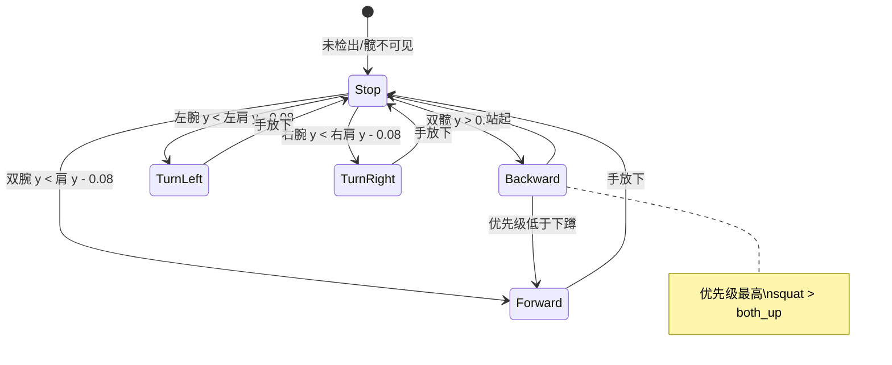
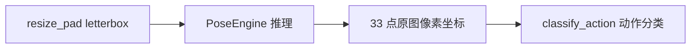
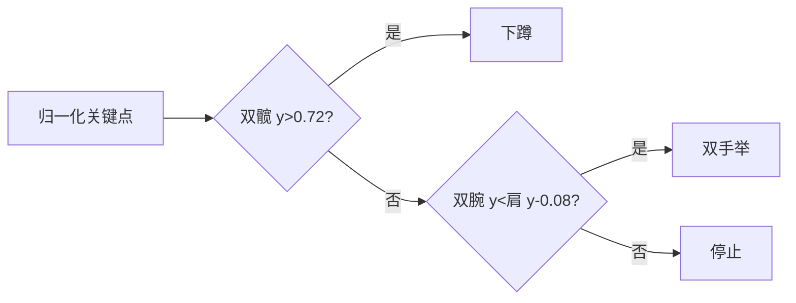
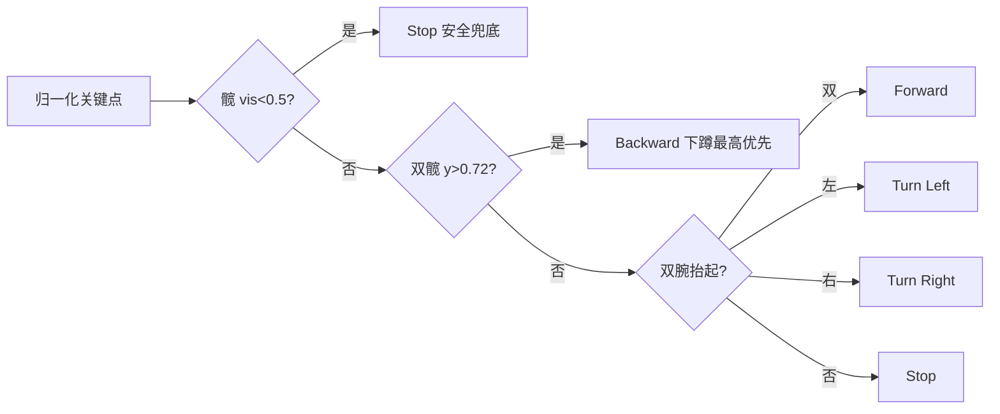
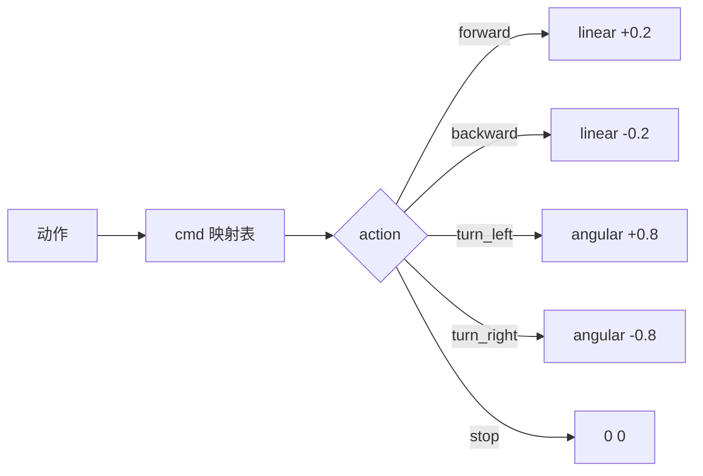
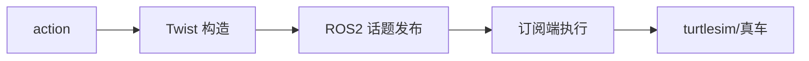
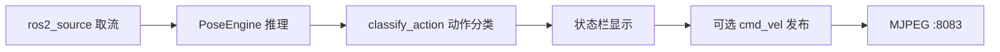

## 实验11：基于肢体动作的体感控制实验（4h）

> ✅ **源码已核实** 本实验源码位于 `ros2_ws/src/xflz_eai_car1/vision/11_pose_control/`。**在 exp10 姿态骨架基础上加「动作分类 → 控制指令」**（vendor 11_整体检测_体感 为纯可视化无控制逻辑；PLAN exp11 要求"动作分类→控制指令"）。5 种动作规则（actions.py，物理直觉优先），可选发布 `/cmd_vel`（默认关，防误动）。测试 55 项 x86 全绿（含 10 项动作分类），模型已转换入库。

### 1.1 关联知识点

- 1.1.1 动作分类原理 > 原理 > 基于 33 点姿态骨架的几何规则分类：`classify_action(landmarks_px, h, w)` 接收像素坐标 33×4 + 帧尺寸，内部 `_norm()` 归一化后按关节坐标比值（y 相对位置）判定动作，无需训练分类器——"规则优先"的轻量方案
- 1.2.1 动作规则设计 > 流程 > 下蹲（双髋 y>0.72）/双手举（双腕 y<双肩 y−0.08）/左手举/右手举/停止；优先级 squat > both_up > left/right；vis<0.5 忽略
- 1.3.1 控制指令映射 > 流程 > 动作 → 指令 → cmd_vel（前进 linear+0.2 / 后退 −0.2 / 左转 angular+0.8 / 右转 −0.8 / 停止 0）；车侧 clamp ±0.3 m/s ±1.0 rad/s
- 1.3.2 实时体感链路 > 流程 > 姿态推理（exp10 复用）→ 动作分类 → 状态栏显示（英文）→ 可选 cmd_vel 发布 → MJPEG 推流 :8083

### 1.2 实验目标

1. 掌握基于关键点的动作分类原理（几何规则 vs 学习式分类器）— 原理理解
2. 实现 5 种动作的判定规则与优先级逻辑，完成动作→控制指令映射 — 独立完成
3. 理解 cmd_vel 发布机制与 ROS2 话题通信，实现体感控制闭环 — 迁移应用

### 1.3 实验环境

| 类别 | 配置 |
|------|------|
| 硬件 | 具身智能实验箱 B2（XFLZ_EAI_B2_PRO，RK3576 SoC，6TOPS NPU，含 HP60C 深度相机）+ C1 小车（可选） |
| OS | Ubuntu 22.04 + ROS2 Humble（板载 ros2_venv，rknnlite 2.3.2） |
| 核心库 | OpenCV、NumPy、rknnlite（RKNNLite）、PyYAML、rclpy（cmd_vel 发布） |
| 模型 | `models/pose_landmark_full.rknn`（fp16，256×256 整图，33 点，同 exp10） |
| 主入口 | `python -m pose_control_core.camera_demo --config config/pose_control_config.yaml --ros [--display]` |

### 1.4 实验难度

- 难度: ⭐⭐⭐ 综合性
- 重点: 动作判定规则 + 优先级 + 控制指令映射 + cmd_vel 发布
- 难点: 规则阈值标定（0.72/0.08 的物理意义）；优先级设计（下蹲时举手不算）；ROS2 话题通信

### 1.5 实验现象

**快速验证流程**：

1. 进入项目目录：`cd ~/ros2_ws/src/xflz_eai_car1/vision/11_pose_control`
2. 单图模式：`PYTHONPATH=car1_pose_control:$PYTHONPATH python3 -m pose_control_core.demo_image --config config/pose_control_config.yaml --display --save out.jpg`
   - 状态栏显示动作（如 `Action: Turn Left`）
3. 相机实时（板上标准）
4. 动作演示：站立/双手举/左手举/右手举/下蹲，观察状态栏与终端动作切换
5. 可选 cmd_vel：改 `control.publish_cmd_vel: true` 后 `ros2 topic echo /cmd_vel`

```bash
cd ~/ros2_ws/src/xflz_eai_car1/vision/11_pose_control

source /opt/ros/humble/setup.bash && source ~/ros2_ws/install/setup.bash
# 单图推理
PYTHONPATH=car1_pose_control:$PYTHONPATH python3 -m pose_control_core.demo_image --config config/pose_control_config.yaml --save out.jpg

# 相机视频流推理
ros2 launch ascamera hp60c.launch.py        		# 终端 1
PYTHONPATH=car1_pose_control:$PYTHONPATH python3 -m pose_control_core.camera_demo \
  --config config/pose_control_config.yaml --ros    # 终端 2
```

**预期效果描述**：
- 站姿 → `Action: Stop`；双手举 → `Forward`；左手举 → `Turn Left`；右手举 → `Turn Right`；下蹲 → `Backward`
- 状态栏 `FPS: N Action: Turn Left`（英文——cv2.putText 无中文字形，中文显示 ????）
- 无人时 `Action: Stop`（姿态不可信）；MJPEG `:8083/pose_control.mjpg` 流畅
- 可选 cmd_vel：`ros2 topic echo /cmd_vel` 看到对应线/角速度（车侧 clamp ±0.3 m/s / ±1.0 rad/s）

**执行现象**：

- 单图模式运行后，终端打印当前动作名（如 `Action: Forward`），图像底部黑条状态栏显示 `FPS: N Action: Forward`（N 为整数帧率）
- 相机实时模式下，画面左侧为原图 + 红色 FPS 叠加，右侧为黑底绿色骨架连线 + 红色关键点，底部状态栏随动作实时切换
- 执行 `pytest tests/ -k action -v` 输出 10 项动作分类用例全部 passed，覆盖下蹲、双手举、左手举、右手举、停止等场景及边界条件


### 1.6 实验步骤

#### 整体流程图


#### 动作状态机图



---

#### 步骤1：动作分类方案认知（阶段一：能运行，20min）

> 📌 本步骤对应源码：`pose_control_core/actions.py`、`config/pose_control_config.yaml`

**知识点讲解**：

**规则优先 vs 学习式分类（1.1.1）**
- **原理**：动作分类有两类方案：

  (1) **几何规则**（本实验）：用关键点的坐标比值直接判定——"双髋 y>0.72 → 下蹲"，无需训练，可解释性强、延迟低，适合动作种类少且姿态差异大的场景；

  (2) **学习式**（如 LSTM/Transformer + 关键点序列）：需标注数据集训练，泛化强但成本高。本实验的 5 种动作（下蹲/双手举/左手举/右手举/停止）用规则方案完全够用——这是**"按问题规模选方案"**的工程判断。**actions.py 重构结构**：定义 `Action` 数据类（`name`/`label` 属性，frozen=True）+ 5 个动作常量（`STOP`/`FORWARD`/`BACKWARD`/`TURN_LEFT`/`TURN_RIGHT`）+ 统一入口 `classify_action(landmarks_px, h, w)`——输入为**像素坐标 33×4 + 帧尺寸**，内部 `_norm()` 归一化后再执行判定规则。

- **源码对应**：`actions.py`（`Action` 类 L32-36 + `STOP`/`FORWARD`/`BACKWARD`/`TURN_LEFT`/`TURN_RIGHT` 常量 L39-43 + `classify_action()` 统一入口 L53-75 + `_norm()` 内部归一化 L46-50）；`config/pose_control_config.yaml`（control 区块：publish_cmd_vel / topic / print_interval）

**知识储备补充**：

- **背景与动机**：动作分类位于"感知→理解→决策→执行"管线的**理解层**。上游姿态引擎（exp10 BlazePose）输出 33 点骨架，本实验需将骨架映射为离散动作类别，再驱动下游控制指令。规则方案的核心优势是**零训练成本**与**确定性推理**：相同输入永远产生相同输出，不存在模型漂移或数据依赖，适合嵌入式实时场景（RK3576 NPU 6TOPS 需要每帧 <33ms 的决策延迟）。
- **Action 数据类设计**：`actions.py` L32-36 定义 `Action` 为 frozen dataclass，`name`（机器可读，如 `turn_left`）与 `label`（显示名，如 `Turn Left`）分离。`frozen=True` 保证动作常量不可变，避免运行时意外修改。5 个动作常量（L39-43）使用大写命名（`STOP`/`FORWARD`/`BACKWARD`/`TURN_LEFT`/`TURN_RIGHT`）符合 Python 常量约定。`classify_action()`（L53-75）是唯一公开入口，接收 `landmarks_px`（None 表示未检出）+ 帧尺寸 `h, w`，内部调用 `_norm()`（L46-50）归一化后执行规则判定——调用方无需关心坐标系转换。
- **配置契约**：`config/pose_control_config.yaml` 的 `control` 区块定义 5 个键（`publish_cmd_vel`/`linear`/`angular`/`topic`/`print_interval`），`config.py` L17-19 的 `REQUIRED` 字典强制校验，缺键或类型错误直接抛出 `ConfigError`——保证配置完整性。
- **参考资源**：BlazePose 论文（Bazarevsky et al., *BlazePose: On-device Real-time Body Pose tracking*, 2020）；MediaPipe Pose Landmark 拓扑文档。

**配置参数速查表**（`config/pose_control_config.yaml`，按区块分列）：

| 区块 | 参数 | 类型 | 默认/示例 | 说明 |
|------|------|------|-----------|------|
| `model` | `pose_model` | str | `models/pose_landmark_full.rknn` | pose 模型（同 exp10） |
| `model` | `min_detection_confidence` | float | `0.5` | presence 阈值 |
| `backend` | `core_mask` | int | `0` | NPU 核（0=AUTO 最稳） |
| `source` | `mode` | str | `image` | image/ros/camera（板上=ros） |
| `source` | `rgb_path` | str | `images/pose_demo.jpg` | mode=image 时必填 |
| `source` | `ros.rgb_topic` | str | `/ascamera_hp60c/.../rgb0/image` | 话题（严禁 remap） |
| `source` | `ros.timeout` | float | `5.0` | 首帧等待 |
| `display` | `show`/`window_name` | bool/str | `false`/`Pose Detection` | 本地窗口 |
| `server` | `port` | int | `8083` | MJPEG 端口（10=8082 后） |
| `server` | `stream_name` | str | `pose_control.mjpg` | 流名（已含 `.mjpg`） |
| `control` | `publish_cmd_vel` | bool | `false` | 节点模式是否发布 /cmd_vel（防误动） |
| `control` | `linear` | float | `0.2` | 前进/后退线速度 m/s（车 clamp ±0.3 内） |
| `control` | `angular` | float | `0.8` | 转向角速度 rad/s（车 clamp ±1.0 内） |
| `control` | `topic` | str | `/cmd_vel` | 目标话题（车 /cmd_vel；turtlesim /turtle1/cmd_vel） |
| `control` | `print_interval` | float | `2.0` | 终端打印当前动作间隔（秒，0=关） |

> **说明**：`control.publish_cmd_vel` 默认 false（防误动）；**改 config 后 launch 需 `colcon build --symlink-install` 同步 install 副本**（FindPackageShare 读 install/share 的 config，非 src）；`control.topic` 车 vs turtlesim 可配。

**操作步骤**：

1. 阅读 `actions.py` 的 `Action` 类定义（L32-36，name/label）与 5 个动作常量（L39-43），理解统一入口 `classify_action(landmarks_px, h, w)` 的输入契约（像素坐标 33×4 + 帧尺寸 h,w）
2. 查看 `config/pose_control_config.yaml` 的 control 区块（publish_cmd_vel 默认 false / topic / print_interval=2.0）
3. 单测理解动作分类：`pytest tests/ -k action -v`（10 项动作分类用例）
4. 思考：什么场景适合规则分类？什么场景必须学习式？（动作种类、差异度、鲁棒性要求）

**流程图（动作分类方案认知）**：


**易错点**：
- ⚠️ 输入为像素坐标（33×4），classify_action 内部 `_norm()` 自动归一化；规则 值（0.72/0.08）基于归一化坐标，换相机视角/距离需重标定

---

#### 步骤2：姿态骨架复用（阶段一：能运行，20min）

> 📌 本步骤对应源码：`pose_control_core/engine.py`、`pose.py`（exp10 复用）

**知识点讲解**：

**exp10 能力复用（1.3.2）**
- **原理**：体感控制直接复用实验9 的 BlazePose 33 点推理链：模型（pose_landmark_full.rknn，256×256 整图）→ RKNNLiteBackend → 33 点**原图像素坐标** [x,y,z,vis]。动作分类入口 `classify_action(landmarks_px, h, w)` 接收像素坐标 33×4 + 帧尺寸，内部 `_norm()` 归一化后执行规则判定——引擎输出像素坐标，动作模块内部归一化，职责清晰。复用而非重写是工程常态：能力分层（感知→理解→决策→执行）让每层可独立演进。
- **源码对应**：`pose_control_core/engine.py`（PoseEngine，exp10 同款）；`backend.py`（RKNNLiteBackend）；`pose.py`（33 点解码→原图像素坐标）

**知识储备补充**：

- **BlazePose 输出格式**：`pose.py` L1-8 的 docstring 契约了模型输出布局——`outputs[0]` shape `(1,195)` = 39×5 交错 `[x,y,z,vis,presence]`（39 点 = 33 pose + 6 附加），`outputs[1]` shape `(1,1)` = pose presence logit（fp16 模型已含 sigmoid）。`decode_pose()`（L58-88）从中提取前 33 点的 `[x,y,z,vis]`，逆映射回原图像素坐标：

  $$
  px = \frac{lm - pad}{scale}
  $$

  其中 $scale$ 与 $pad$ 来自 `resize_pad()`（L45-55）的 letterbox 参数。输出的 `PoseResult.landmarks` shape 为 `(33,4)`，`landmarks[:,3]` 为 vis logit——`classify_action()` 内部用此值做 vis 过滤。


- **输入归一化约束**：模型输入为 `uint8` RGB NHWC（`prepare()` L91-100，`BGR→RGB reshape(1,256,256,3)`），板端 RKNN 推理时内部执行 mean/std 归一化（转换时已配置 mean=127.5, std=128），**禁止手动 /255**。`pose.py` L95-98 的 docstring 明确记录了此约束——手动归一化会导致 presence 从 0.998 暴跌至 0.055。
- **分层设计**：`engine.py` 的 `PoseEngine` 只负责"帧→PoseResult"，不关心下游用途。`camera_demo.py` 的 `run_camera()` 在姿态推理后调用 `classify_action()` 完成动作分类——这种**管道式组合**让同一引擎可同时服务 exp10（纯骨架可视化）和 exp11（体感控制），无需代码分叉。
- **参考资源**：MediaPipe BlazePose Landmark 索引表（33 点身体关键点定义）；`pose.py` L1-8 docstring（输出布局详细说明）。

**操作步骤**：

1. 运行单测确认引擎复用正确：`pytest tests/ -v`（55 项）
2. 对照 exp10 的 pose.py/engine.py 与本实验差异（动作分类新增层）
3. 手工验证动作分类（合成关键点，无需图片/模型；x86 可跑）：
   ```bash
   cd ~/ros2_ws/src/xflz_eai_car1/vision/11_pose_control
   PYTHONPATH=car1_pose_control:$PYTHONPATH python3 -c "
   import numpy as np
   from pose_control_core.actions import classify_action, FORWARD, TURN_LEFT, TURN_RIGHT, STOP
   h, w = 100, 100
   def mk(lw=None, rw=None, sy=0.4, hy=0.5):
       lm = np.ones((33, 4), np.float32) * 0.5     # 默认坐标 0.5·画面
       lm[11, 1] = lm[12, 1] = sy * h              # 双肩 y=40
       lm[15, 1] = lm[16, 1] = 0.5 * h            # 双腕 y=50（垂手）
       lm[23, 1] = lm[24, 1] = hy * h             # 双髋
       if lw is not None: lm[15, 1] = lw * h
       if rw is not None: lm[16, 1] = rw * h
       return lm
   print('站姿   ->', classify_action(mk(), h, w).label)            # Stop
   print('双手举 ->', classify_action(mk(lw=0.3, rw=0.3), h, w).label)  # Forward
   print('左手举 ->', classify_action(mk(lw=0.3), h, w).label)       # Turn Left
   print('右手举 ->', classify_action(mk(rw=0.3), h, w).label)       # Turn Right
   print('下蹲   ->', classify_action(mk(hy=0.8), h, w).label)       # Backward
   "
   # 预期：站姿 → Stop；双手举 → Forward；左手举 → Turn Left；右手举 → Turn Right；下蹲 → Backward
   ```
   注意：像素坐标中 y=0 为画面上方，腕 y 小于肩 y 表示"腕高于肩"（举手）。
4. 思考：classify_action 接收像素坐标、内部归一化的设计优势？（调用方无需关心坐标系转换，归一化逻辑内聚于 actions 模块）

**流程图（姿态骨架复用）**：



**易错点**：
- ⚠️ 输入为像素坐标（33×4 + h,w），classify_action 内部 `_norm()` 归一化；规则值（0.72/0.08）基于归一化坐标，勿外部预归一化后重复传入

---

#### 步骤3：动作规则设计（阶段二：能理解，30min）

> 📌 本步骤对应源码：`pose_control_core/actions.py`（`classify_action()` 内部实现）

**知识点讲解**：

**物理直觉优先的规则（1.2.1）**
- **原理**：`classify_action()` 内部实现 5 种动作判定，基于**物理直觉**（actions.py）：

  (1) **下蹲 squat**：双髋 y > 0.72——下蹲时髋关节在画面中下移（归一化 y 增大）；

  (2) **双手举 both_up**：双腕 y < 双肩 y − 0.08——举手时手腕高于肩膀（y 小在上）；

  (3) **左手举 left_up**：仅左腕高；

  (4) **右手举 right_up**：仅右腕高；

  (5) **停止**：其余情况。阈值 0.08 是"腕比肩高"的容差。这些规则**不依赖具体人种/体型**（归一化坐标），但依赖相机视角（正对全身）与人体在画面中的位置。`classify_action()` 接收像素坐标 + 帧尺寸，内部 `_norm()` 归一化后判定——调用方无需关心坐标系转换。

- **源码对应**：`actions.py`（`classify_action()` 内部：`_norm()` L46-50 归一化 → squat/both_up/left_up/right_up/stop 判定 L62-75，阈值 0.72/0.08）

**知识储备补充**：

- **阈值的物理意义**：`SQUAT_HIP_Y = 0.72`（actions.py L27）表示下蹲时双髋归一化 y 超过画面高度的 72%。归一化坐标系中 y=0 为画面顶部、y=1 为底部——正常站立时髋部约在画面中部（y≈0.5），下蹲时身体压缩、髋部下沉至 0.72 以下。`HAND_UP_DELTA = 0.08`（L28）表示举手时腕部需比对应肩部高至少 8% 的画面高度——这是过滤"手臂自然微抬"的容差。两个阈值均基于归一化坐标，**与相机焦距和人体距离无关**，但与人体在画面中的占比和相机俯仰角有关。
- **归一化公式**：`_norm()`（L46-50）对 33×4 像素坐标执行归一化：

  $$
  x_{\text{norm}} = \frac{x_{\text{px}}}{W}, \qquad y_{\text{norm}} = \frac{y_{\text{px}}}{H}
  $$

  其中 $W, H$ 为帧宽高像素，vis 值原样保留。归一化后所有阈值判定与分辨率解耦——同一规则可适配 640×480 与 1920×1080 不同相机。
- **关键点索引约定**：actions.py L15-25 定义了 BlazePose 33 点的关键索引——`L_SHOULDER=11`、`R_SHOULDER=12`、`L_ELBOW=13`、`R_ELBOW=14`、`L_WRIST=15`、`R_WRIST=16`、`L_HIP=23`、`R_HIP=24`。这些索引与 MediaPipe Pose Landmark 拓扑完全一致，更换姿态模型时需同步更新。
- **参考资源**：MediaPipe Pose Landmark 模型文档（33 点拓扑与索引定义）；BlazePose 论文中关于归一化坐标与身体比例的讨论。

**操作步骤**：

1. 阅读 actions.py 各判定函数，画出判定逻辑树
2. 用单测覆盖边界：`pytest tests/ -k action -v`（含边界用例）
3. 手工构造关键点数据测试：把双髋 y 设为 0.8 应判 squat，设为 0.5 应判 stop
4. 思考：阈值 0.72 为什么不选 0.5？离摄像头远近对阈值的影响？

**流程图（动作规则设计）**：



**易错点**：
- ⚠️ 阈值需按实际机位标定（README 验证清单要求实测微调）

---

#### 步骤4：优先级与 vis 过滤（阶段二：能理解，25min）

> 📌 本步骤对应源码：`pose_control_core/actions.py`（`classify_action()` 内部优先级逻辑）

**知识点讲解**：

**优先级设计与可靠性（1.2.1）**
- **原理**：动作可能同时满足多个规则（如下蹲时手也举着）——**优先级**解决冲突：`squat > both_up > left/right`（下蹲时举手不算，README 明确）。`classify_action()` 内部实现：先 `_norm()` 归一化，再判定髋部 vis→squat→both_up→left/right→stop，规则值不变（SQUAT_HIP_Y=0.72 / HAND_UP_DELTA=0.08 / MIN_VIS=0.5）。可靠性保障：

  (1) **vis 过滤**——关键点 vis < 0.5 忽略（被遮挡的关节不参与判定）；

  (2) **髋部不可见 → 停止**——姿态不可信时不输出控制（安全兜底）。这两条规则把"误判"风险降到最低：宁可不动，不可乱动。

- **源码对应**：`actions.py`（`classify_action()` 内部：`_norm()` → vis 髋部过滤 L60-61 → squat L62-63 → both_up L64-65 → left/right L66-69 → stop L70 优先级链 / `MIN_VIS=0.5` / `SQUAT_HIP_Y=0.72` / `HAND_UP_DELTA=0.08`）

**知识储备补充**：

- **优先级链设计**：classify_action() L62-75 的判定顺序体现**安全优先原则**——最高优先级是下蹲（后退，最危险的运动方向），其次是双手举（前进），最后是单手转向。这个顺序是**人为设计决策**：在驾驶场景中，"停止后退"比"停止前进"更紧迫，因此下蹲判为最高优先级。如果下蹲时手臂自然摆动也被判为"双手举"，会产生前进+后退的矛盾指令。
- **vis 过滤的数学表达**：设关键点 $i$ 的可见度为 $v_i \in [0,1]$，`MIN_VIS = 0.5`（L29）。判定规则可表示为：

  $$
  \text{action}(i) = \begin{cases}
    \text{STOP} & \text{if } v_{\text{L\_HIP}} < 0.5 \text{ or } v_{\text{R\_HIP}} < 0.5 \\
    \text{BACKWARD} & \text{if } y_{\text{hip}} > 0.72 \\
    \text{FORWARD} & \text{if } y_{\text{L\_wrist}} < y_{\text{L\_shoulder}} - 0.08 \;\wedge\; y_{\text{R\_wrist}} < y_{\text{R\_shoulder}} - 0.08 \\
    \text{TURN\_LEFT} & \text{if } y_{\text{L\_wrist}} < y_{\text{L\_shoulder}} - 0.08 \\
    \text{TURN\_RIGHT} & \text{if } y_{\text{R\_wrist}} < y_{\text{R\_shoulder}} - 0.08 \\
    \text{STOP} & \text{otherwise}
  \end{cases}
  $$

  其中所有 $y$ 均为 `_norm()` 归一化后的坐标，$v_i$ 为 vis 值。髋部 vis 检查在最外层，保证"不可信姿态→安全停止"。
- **安全性设计原则**：vis 过滤 + 髋不可见兜底构成了**双层安全网**——第一层过滤单个关键点的遮挡（如手臂被家具挡住），第二层过滤整帧姿态不可信（如人脸检测到但身体未入画）。这是机器人控制系统的典型范式：**宁可不动作，不可误动作**（fail-safe 原则）。
- **参考资源**：机器人安全标准 ISO 10218（工业机器人安全要求，fail-safe 设计原则）；ROS2 Navigation2 的行为树安全约束设计。

**操作步骤**：

1. 单测验证优先级：构造"下蹲+双手举"数据，断言判 squat 而非 both_up
2. 部分遮挡测试：遮挡髋部运行，观察输出 Stop（姿态不可信兜底）
3. 思考：优先级设计的原则？为什么安全兜底（髋不可见→停止）是必须的？

**流程图（优先级与 vis 过滤）**：



**易错点**：
- ⚠️ 优先级顺序错误 → 动作歧义（下蹲+举手判成前进）；测试已锁定 squat 最高优先级

---

#### 步骤5：控制指令映射（阶段三：能改造，25min）

> 📌 本步骤对应源码：`pose_control_core/actions.py` 指令表、`camera_demo.py` 状态栏

**知识点讲解**：

**动作→指令映射（1.3.1）**
- **原理**：动作分类结果映射为控制指令：下蹲→后退（linear −0.2 m/s）、双手举→前进（linear +0.2）、左手举→左转（angular +0.8 rad/s）、右手举→右转（angular −0.8）、停止→0。线速度/角速度值的选择考虑：前进后退用小线速度（0.2，安全），转向用较大角速度（0.8，机动性）。车侧 `/cmd_vel` 有 clamp（±0.3 m/s / ±1.0 rad/s）——发布值在安全范围内。状态栏显示英文动作名（cv2.putText 无中文字形，中文显示 ????）。
- **源码对应**：`actions.py`（动作→指令映射）；`camera_demo.py`（状态栏 `Action: Turn Left`）；`config/pose_control_config.yaml`（control 区块 L22-23）

**知识储备补充**：

- **速度参数的工程权衡**：config.yaml L22-23 定义 `linear: 0.2` 和 `angular: 0.8`。线速度 0.2 m/s 是**低速安全值**——C1 小车最大线速度约 0.5 m/s，0.2 留足 60% 余量用于紧急制动；角速度 0.8 rad/s 约 46°/s，保证转向灵敏但不眩晕。车侧驱动层有 clamp（`clamp(linear, ±0.3)`, `clamp(angular, ±1.0)`），即使映射值异常也不会超出机械极限。
- **状态栏文本编码**：`view.py` L23-31 的 `put_status()` 用 `cv2.putText()` 渲染英文动作名。OpenCV 内置字体（FONT_HERSHEY_SIMPLEX）不含 CJK 字形，中文字符会被渲染为 `????`——这是**已知限制**，README 明确说明。`Action.label` 属性（actions.py L35）专为此设计：`name`（机器可读如 `turn_left`）与 `label`（显示名如 `Turn Left`）分离，未来可替换为 PIL ImageFont 支持中文。
- **指令映射表**：

  | 动作 | Action.name | linear (m/s) | angular (rad/s) | 视觉线索 |
  |------|-------------|-------------|----------------|---------|
  | 双手举 | `forward` | +0.2 | 0 | 双腕高于双肩 |
  | 下蹲 | `backward` | −0.2 | 0 | 双髋 y > 0.72 |
  | 左手举 | `turn_left` | 0 | +0.8 | 左腕高于左肩 |
  | 右手举 | `turn_right` | 0 | −0.8 | 右腕高于右肩 |
  | 停止 | `stop` | 0 | 0 | 默认/无动作 |

- **参考资源**：ROS2 `geometry_msgs/Twist` 消息定义文档（linear.x / angular.z 语义）；TurtleBot3 速度限制参数表。

**操作步骤**：

1. 单图验证：举手照片 → 状态栏 `Action: Turn Left/Right/Forward`；站姿 → `Stop`
2. 终端动作打印：`control.print_interval=2.0`（默认），周期打印当前动作
3. 动手改造：新增"双臂张开"动作（双腕 x 间距 > 阈值）→ 对应新指令（如原地旋转）

**流程图（控制指令映射）**：



**易错点**：
- ⚠️ 状态栏只能英文（cv2 无中文字形，中文 ????）

---

#### 步骤6：cmd_vel 发布（阶段三：能改造，30min）

> 📌 本步骤对应源码：`pose_control_core/node.py`（或 camera_demo 发布逻辑）、`config` control.topic

**知识点讲解**：

**ROS2 话题通信（1.3.1）**
- **原理**：控制指令通过 ROS2 **话题（topic）** 发布：`cmd_vel`（geometry_msgs/Twist，linear+angular）是机器人速度控制的标准接口。**发布者-订阅者**模型：本实验节点发布 cmd_vel，车/小海龟订阅执行。`control.publish_cmd_vel: false` **默认关**（防误动），开启后话题可配（车 `/cmd_vel` 或 turtlesim `/turtle1/cmd_vel`）。ROS_DOMAIN_ID 必须与执行端一致（本板 =2），否则话题不可见。
- **源码对应**：`pose_control_core/`（cmd_vel 发布：Twist 消息构造 / 话题名 config）；`config/pose_control_config.yaml`（control.topic / publish_cmd_vel）

**知识储备补充**：

- **geometry_msgs/Twist 消息结构**：Twist 消息包含两个三维向量——`linear`（x/y/z 平移速度）和 `angular`（x/y/z 旋转速度）。地面机器人只用 `linear.x`（前进/后退，正值前进）和 `angular.z`（绕 z 轴旋转，正值左转），其余维度恒为 0。本实验的映射：

  $$
  \text{Twist}(a) = \begin{cases}
    \text{linear.x} = +v_{\text{lin}}, \;\text{angular.z} = 0 & \text{if } a = \text{FORWARD} \\
    \text{linear.x} = -v_{\text{lin}}, \;\text{angular.z} = 0 & \text{if } a = \text{BACKWARD} \\
    \text{linear.x} = 0, \;\text{angular.z} = +v_{\text{ang}} & \text{if } a = \text{TURN\_LEFT} \\
    \text{linear.x} = 0, \;\text{angular.z} = -v_{\text{ang}} & \text{if } a = \text{TURN\_RIGHT} \\
    \text{linear.x} = 0, \;\text{angular.z} = 0 & \text{if } a = \text{STOP}
  \end{cases}
  $$

  其中 $v_{\text{lin}} = 0.2$ m/s, $v_{\text{ang}} = 0.8$ rad/s。
- **发布者-订阅者模式**：ROS2 的 pub-sub 是**松耦合通信**——发布者不关心谁订阅、有多少订阅者。本实验节点作为发布者，话题名由 `control.topic` 配置。车端驱动节点订阅 `/cmd_vel`，turtlesim 订阅 `/turtle1/cmd_vel`。`publish_cmd_vel: false` 默认关闭是**安全设计**：避免首次运行时无人操控的小车因误判动作而突然移动。ROS_DOMAIN_ID（本板 =2）是 ROS2 的域隔离机制——不同域的节点互不可见，防止与其他 ROS2 系统冲突。
- **安全 clamp 机制**：车端驱动层对 `cmd_vel` 有硬限幅：`linear ∈ [-0.3, +0.3]` m/s, `angular ∈ [-1.0, +1.0]` rad/s。即使动作映射值超出范围（如代码 bug 输出 linear=1.0），clamp 保证机械安全。config 中的 `linear=0.2` 和 `angular=0.8` 均在 clamp 范围内，是**双层保护**——应用层限值 + 驱动层硬限。
- **参考资源**：ROS2 `geometry_msgs` 包文档（Twist 消息定义）；ROS2 Domain ID 配置指南（`ROS_DOMAIN_ID` 环境变量）。

**操作步骤**：

1. turtlesim 安全验证（不碰真车）：
   ```bash
   cd ~/ros2_ws/src/xflz_eai_car1/vision/11_pose_control
   source /opt/ros/humble/setup.bash && source ~/ros2_ws/install/setup.bash
   # 改 config control.topic: /turtle1/cmd_vel, publish_cmd_vel: true
   ros2 run turtlesim turtlesim_node &            			# 终端 1：小海龟（没有可以只监控话题）
   cd ~/ros2_ws && colcon build --packages-select car1_pose_control
   ros2 launch car1_pose_control pose_control.launch.py   	# 终端 2
   # 终端 3 观察指令
   ros2 topic echo /turtle1/cmd_vel
   # 动作：双手举 → 海龟前进；左手举 → 海龟左转
   ```
2. 真车模式（谨慎）：改回 `/cmd_vel`，确认不超 clamp（±0.3/±1.0）
3. 思考：publish_cmd_vel 为什么默认关？安全设计的原则？


**流程图（cmd_vel 发布）**：



**易错点**：
- ⚠️ publish_cmd_vel 默认 false（防误动）；真车前先用 turtlesim 验证
- ⚠️ ROS_DOMAIN_ID 与执行端一致；话题名可配（车 vs turtlesim）

---

#### 步骤7：实时体感演示（阶段三：能改造，30min）

> 📌 本步骤对应源码：`pose_control_core/camera_demo.py`、`view.py`

**知识点讲解**：

**闭环链路（1.3.2）**
- **原理**：`camera_demo.py` 闭环：取流（--ros ascamera / --camera N V4L2）→ PoseEngine 姿态推理 → actions 动作分类 → 状态栏显示 + 终端打印 → （可选）cmd_vel 发布 → MJPEG 推流（:8083/pose_control.mjpg）。双栏：左=原图+FPS，右=黑底骨架，状态栏 `FPS: N Action: ...`。**PYTHONPATH 必须保留 $PYTHONPATH**（venv PyPI rclpy 陷阱）。
- **源码对应**：`camera_demo.py`（实时循环 / 动作分类调用 / 状态栏 / MJPEG）；`view.py`（双栏 L12-20 + 状态栏 L23-31）

**知识储备补充**：

- **闭环管线时序**：`camera_demo.py` 的 `run_camera()`（L37-42）构成完整感知-决策-执行管线——取流 → `PoseEngine.process()` → `classify_action()` → `put_status()` + 终端打印 → （可选）Twist 发布 → MJPEG。每帧耗时由姿态推理（~25ms NPU）+ 动作分类（<1ms CPU）+ 渲染（~5ms）组成，板端实测约 30 FPS。
- **双栏合成**：`view.py` L12-20 的 `compose()` 将原帧与骨架图水平拼接——左栏为原始 BGR 帧 + `add_fps()`（L34-40）红色 FPS 叠加，右栏为黑底 + `draw_skeleton()`（engine.py）绿色骨架连线 + 红色关键点。底部 `put_status()`（L23-31）渲染 24px 高黑色条 + 白色文字 `FPS: N Action: <label>`。
- **MJPEG 推流**：`mjpeg_server.py` 在 config 指定端口（默认 8083）启动 HTTP 服务，浏览器访问 `http://<板IP>:8083/pose_control.mjpg` 即可查看实时画面。推流与本地显示（`--display`）互不影响——可同时在板端 HDMI 显示和远程浏览器查看。
- **参考资源**：ROS2 `rclpy` 文档（Python 节点创建与话题发布）；MJPEG streaming HTTP 协议说明。

**操作步骤**：

1. 相机实时（板上标准）：
   ```bash
   cd ~/ros2_ws/src/xflz_eai_car1/vision/11_pose_control
   source /opt/ros/humble/setup.bash && source ~/ros2_ws/install/setup.bash
   
   ros2 launch ascamera hp60c.launch.py        		# 终端 1
   
   PYTHONPATH=car1_pose_control:$PYTHONPATH python3 -m pose_control_core.camera_demo \
     --config config/pose_control_config.yaml --ros    # 终端 2
   ```
2. 完整动作演示序列：站立→双手举→放下→左手举→右手举→下蹲→站立，观察状态栏/终端切换
3. 无人测试：画面无人 → `Action: Stop`
4. 动手改造：把动作切换做成"模式切换"（如连续两次双手举 = 前进锁定），设计更丰富的交互

**流程图（实时体感演示）**：



**易错点**：
- ⚠️ PYTHONPATH 保留 $PYTHONPATH；--ros 需 ascamera 先起、话题严禁 remap
- ⚠️ 状态栏英文（cv2 无中文字形）

---

### 1.7 常见问题

| 问题 | 原因 | 解决方法 |
|------|------|---------|
| 动作误判 | 阈值未按机位标定 | 实测调整 actions.py 阈值（0.72/0.08） |
| 下蹲时误判前进 | 优先级缺失 | squat > both_up（已锁定最高优先级） |
| 遮挡后乱动 | 髋部不可见仍输出 | 髋不可见 → Stop（安全兜底，已内置） |
| 状态栏中文乱码 | cv2.putText 无中文字形 | 用英文动作名（README 明确） |
| cmd_vel 无输出 | publish_cmd_vel 默认 false | 改 config control.publish_cmd_vel: true |
| 话题看不到 | ROS_DOMAIN_ID 不一致 | 与执行端一致（本板 =2） |
| 海龟不动 | 话题名错误 | config control.topic: /turtle1/cmd_vel |
| rclpy ModuleNotFoundError | PYTHONPATH 覆盖丢 Humble 路径 | `PYTHONPATH=car1_pose_control:$PYTHONPATH` |

### 1.8 扩展实验

**扩展方向 1：多动作组合交互（进阶）**
- 设计组合动作（如"双臂张开 + 下蹲"= 原地旋转），增加动作种类；用连续帧投票（3 帧多数）抑制抖动

**扩展方向 2：学习式动作分类（进阶）**
- 采集各类动作的关键点序列，训练 LSTM/MLP 分类器（替换规则判定），对比规则 vs 学习式的准确率与延迟

### 1.9 实验报告要求

**评分标准**：动作分类方案理解 15 分 + 规则设计 25 分 + 优先级与可靠性 20 分 + 指令映射 15 分 + cmd_vel 发布 15 分 + 报告 10 分 = 100 分。

**报告必含内容**：
1. 动作分类方案对比（规则 vs 学习式）与选型理由
2. 5 种动作判定规则表（条件/阈值/指令/cmd_vel 值）
3. 优先级决策树与 vis 过滤说明
4. 状态栏截图（≥3 种动作）与动作切换记录
5. turtlesim 验证记录（ros2 topic echo /cmd_vel 输出）
6. 回答思考题：为什么规则优先？阈值如何标定？为什么髋不可见要停止？publish_cmd_vel 为何默认关？
7. 实验心得与问题记录

---

## 更新日志

| 版本 | 日期 | 变更 |
|------|------|------|
| v1.0 | 2026-08-10 | 初版生成（源码路径 ros2_ws/src/xflz_eai_car1/vision/11_pose_control，55 项测试全绿，BlazePose 33 点 + 5 动作规则 + 优先级/vis 过滤 + cmd_vel 发布，模型已入库） |
| v1.1 | 2026-08-19 | 源码同步：actions.py 重构为 Action 类(name,label) + 常量(STOP/FORWARD/BACKWARD/TURN_LEFT/TURN_RIGHT) + classify_action(landmarks_px,h,w) 统一入口；输入为像素坐标 33×4 + 帧尺寸，_norm() 内部归一化（非外部归一化）；规则值不变（0.72/0.08/优先级） |
| v2.0 | 2026-08-19 | 知识点增强：新增 6 个「知识储备补充」小节（动作分类背景、Action 数据类设计、BlazePose 输出格式与归一化约束、阈值物理意义与归一化公式、优先级安全设计、Twist 消息与 clamp 机制、闭环管线时序）；4+ 个公式块（归一化、vis 过滤分段函数、Twist 映射）；执行现象段；参考资源 6 条；全文行号基于 actions.py L32-36/L39-43/L46-50/L53-75、view.py L12-20/L23-31、pose.py L1-8/L45-55/L58-88/L91-100 重新核对 |
| v2.1 | 2026-08-21 | 与实验9 文档格式对齐：7 个步骤各补 Mermaid 流程图（分类认知/骨架复用/规则设计/优先级/指令映射/cmd_vel 发布/实时演示）；路径统一 `cd ~/ros2_ws/src/...` + `PYTHONPATH=car1_pose_control:$PYTHONPATH`（防 rclpy 陷阱）；步骤2 新增合成关键点命令（x86 可跑，输出 5 动作标签） |
| v2.2 | 2026-08-21 | 步骤1 新增「配置参数速查表」：config/pose_control_config.yaml 全参数（model/backend/source/display/server/control）；标注 control.publish_cmd_vel 默认 false 防误动、改 config 后 launch 需 colcon build 同步 install、topic 车 vs turtlesim 可配 |
