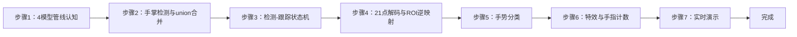
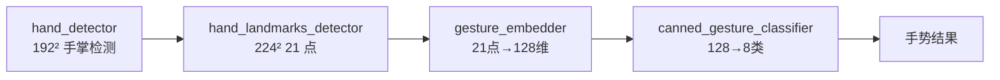
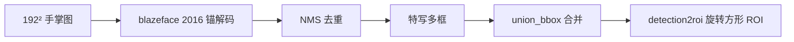
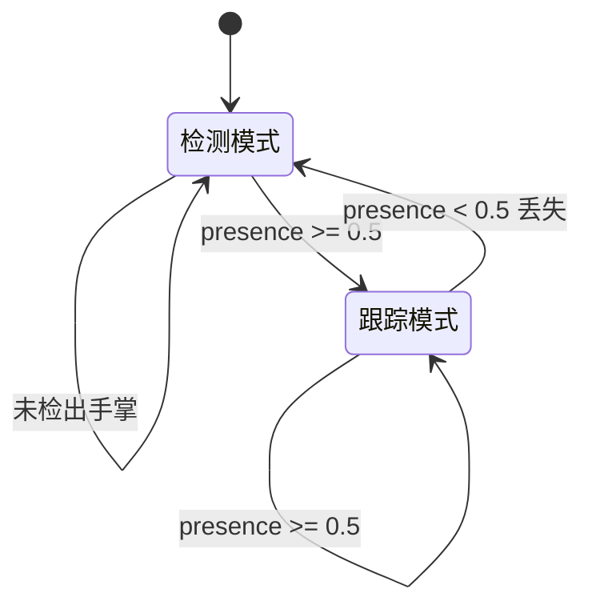
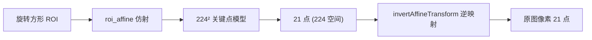
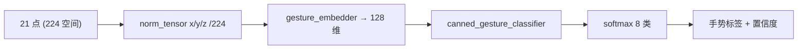
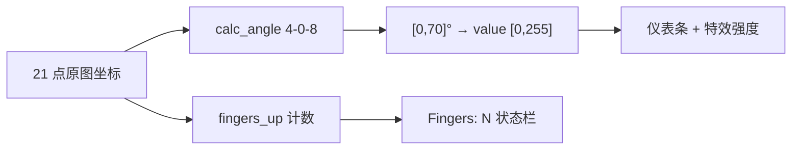
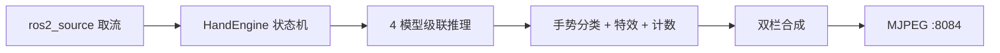

## 实验12：基于手指动作的控制实验（4h）

> ✅ **源码已核实** 本实验源码位于 `ros2_ws/src/xflz_eai_car1/vision/12_hand_control/`。**手势识别完整管线**：手掌检测 → 21 点关键点 → 特征嵌入 → 8 类手势分类（mediapipe gesture_recognizer.task 解包 4 模型转 rknn），叠加拇指-食指夹角特效 + 手指计数。双栏（左=特效帧+FPS 红字，右=黑底手骨架 + 手势名 + 仪表），'f' 键切特效。测试 58 项 x86 全绿，板端验证通过（张开手掌→Open_Palm、比耶→Victory）。

### 1.1 关联知识点

- 1.1.0 BlazePose 几何复用 > 模块 > `pose.py`（预留模块，当前未被引擎引用）：BlazePose 几何复用模块，含 `POSE_CONNECTIONS` 35 边拓扑、`resize_pad` letterbox、`decode_pose` 输出解码（INPUT_SIZE=256，33×4 [x,y,z,vis] 逆映射）、`prepare` BGR→RGB float32 [-1,1] NHWC。与实验11 的 pose.py 同源，供后续扩展使用
- 1.1.1 手势识别管线 > 流程 > 四模型级联：① hand_detector（192×192 手掌检测）② hand_landmarks_detector（224×224，21 点+presence+handedness）③ gesture_embedder（21 点→128 维）④ canned_gesture_classifier（128 维→8 类）
- 1.2.1 手掌检测与ROI > 原理 > blazeface 2016 锚解码 + NMS + union 合并（特写大图 palm 分裂多框）；detection2roi 官方旋转方形 ROI；roi_affine 仿射/逆映射
- 1.3.1 检测-跟踪状态机 > 流程 > 上帧 presence≥0.5 跳过 palm（ROI 由上帧 21 点生成），丢失回退全图——省一次检测推理提升帧率
- 1.3.2 手势分类与交互 > 流程 > embedder norm_tensor（21 点 x/y/z 全部 /224）→ softmax 8 类（None/Closed_Fist/Open_Palm/Pointing_Up/Thumb_Down/Thumb_Up/Victory/ILoveYou）；拇指-食指夹角（余弦定理）→ 5 种特效
- 1.3.3 手指计数 > 流程 > fingersUp（vendor 11 语义）：拇指双角 150° + 四指 tip.y<pip.y → 状态栏 Fingers: N

### 1.2 实验目标

1. 掌握多模型级联的手势识别管线（检测→关键点→嵌入→分类）与输入契约差异 — 原理理解
2. 实现 8 类手势分类、手指计数与拇指-食指夹角控制特效 — 独立完成
3. 理解检测-跟踪状态机的加速原理与 ROI 仿射映射，掌握多模型 NPU 推理编排 — 迁移应用

### 1.3 实验环境

| 类别 | 配置 |
|------|------|
| 硬件 | 具身智能实验箱 B2（XFLZ_EAI_B2_PRO，RK3576 SoC，6TOPS NPU，含 HP60C 深度相机） |
| OS | Ubuntu 22.04 + ROS2 Humble（板载 ros2_venv，rknnlite 2.3.2） |
| 核心库 | OpenCV、NumPy、rknnlite（RKNNLite）、PyYAML |
| 模型 | 4 个 rknn：`hand_detector`（192²）+ `hand_landmarks_detector`（224²）+ `gesture_embedder`（norm_tensor 单输入）+ `canned_gesture_classifier`（float，无 mean/std），均 fp16 |
| 主入口 | `python -m hand_control_core.camera_demo --config config/hand_control_config.yaml --ros [--display]` |

### 1.4 实验难度

- 难度: ⭐⭐ 设计性
- 重点: 4 模型级联编排 + 检测-跟踪状态机 + 手势分类 + 特效/计数交互
- 难点: 各模型输入契约差异（①② float32 [0,1]；③ norm_tensor /224；④ float 无 mean/std）；ROI 仿射与逆映射；union 合并

### 1.5 实验现象

**快速验证流程**：

1. 进入项目目录：`cd ~/ros2_ws/src/xflz_eai_car1/vision/12_hand_control`
2. 单图模式：`PYTHONPATH=car1_hand_control:$PYTHONPATH python3 -m hand_control_core.demo_image --config config/hand_control_config.yaml --display --save out.jpg`
   - 右栏 21 点骨架 + 手势名（如 Open_Palm/Victory），状态栏 Hands/Fingers
3. 相机实时（板上标准）
4. 特效切换：按 'f' 键循环 5 种特效（color/thresh/blur/hue/enhance）
5. 仪表测试：拇指食指张开/捏合，观察仪表条升降（value 0~255）

```bash
cd ~/ros2_ws/src/xflz_eai_car1/vision/12_hand_control

source /opt/ros/humble/setup.bash && source ~/ros2_ws/install/setup.bash
# 单图推理，修改config中的图片路径可以检测不同照片
PYTHONPATH=car1_hand_control:$PYTHONPATH python3 -m hand_control_core.demo_image --config config/hand_control_config.yaml --save out.jpg

# 相机视频流推理
ros2 launch ascamera hp60c.launch.py        		# 终端 1
PYTHONPATH=car1_hand_control:$PYTHONPATH python3 -m hand_control_core.camera_demo \
  --config config/hand_control_config.yaml --ros    # 终端 2
```

**预期效果描述**：

- 手伸向镜头 → 骨架实时跟随 + 手势分类稳定（张开手掌→Open_Palm、比耶→Victory）
- 拇指食指张开/捏合 → 仪表条升降 + 特效强度变化
- 状态栏 `FPS Hands Fingers [特效]`；MJPEG `:8084/hand.mjpg` 流畅；无手不崩

**执行现象**：

运行单图模式时，终端无额外打印，当前目录生成 `out.jpg`：右栏黑底画布上绘制红色 21 点骨架（红点 + 绿连线），点上方标注关节编号，右上角显示手势名（如 `Open_Palm 0.98`），底部状态栏白字 `FPS: 0 Hands: 1 Fingers: 5 [color] Open_Palm`。运行实时模式后，终端持续输出帧率，双栏窗口左栏叠加红色 FPS 数字（如 `FPS : 18`），右栏骨架实时跟随手部运动；当手从画面外移入，骨架约 0.2-0.5 秒内稳定出现；手掌远离画面时骨架平滑消失，窗口不崩溃。按 'f' 键切换特效，左栏画面随即变化（如 thresh 模式变黑白高对比）；捏合拇指食指，右下角竖条仪表从底部升至顶部，特效强度同步变化。MJPEG 流 `:8084/hand.mjpg` 画面与窗口同步。


### 1.6 实验步骤

#### 整体流程图



---

#### 步骤1：4 模型管线认知（阶段一：能运行，20min）

> 📌 本步骤对应源码：`hand_control_core/convert_mediapipe.py`、`models/`

**知识点讲解**：

**四模型级联架构（1.1.1）**
- **原理**：mediapipe gesture_recognizer.task 解包为 4 个模型，分工明确：

  (1) **hand_detector**（192×192）检测手掌位置（blazeface 2016 锚）；

  (2) **hand_landmarks_detector**（224×224）输出 21 点关键点 + presence + handedness + world；

  (3) **gesture_embedder** 把 21 点编码为 128 维特征（norm_tensor 单输入，x/y/z 全部 /224）；

  (4) **canned_gesture_classifier** 把 128 维分类为 8 类手势。**输入契约各异**：①② mean 0/std 1 **float32 [0,1] 输入**（板端实测 uint8 直喂→输出爆炸）；③ norm_tensor（归一化输入）；④ float 无 mean/std。转换脚本 `convert_mediapipe.py` 逐模型处理并 `--check` 契约自检。

- **源码对应**：`convert_mediapipe.py`（.task 解包 4 模型 / 各模型契约配置 / --check）；`models/`（4 个 rknn 产物）

**知识储备补充**：

- **背景与动机**：mediapipe gesture_recognizer.task 是 Google 官方的手势识别模型包，内部打包了 4 个独立子模型。直接在服务器端（CPU/GPU）运行可一站推理，但在 RK3576 NPU 上部署时，必须拆解为 4 个独立的 rknn 模型分别加载到 NPU——这正是 `convert_mediapipe.py` 的核心任务。4 模型拆分后，每个模型可独立优化、单独替换（如新增手势只需重训分类器，embedder 复用），是"解耦架构"的工程实践。
- **输入契约差异成因**：4 个模型在训练/转换时的预处理约定不同——hand_detector 与 hand_landmarks_detector 来自 mediapipe 图像管线，训练时输入经过 `/255` 归一化（float32 [0,1]，mean=0, std=1），因此 rknn 转换时无需额外 mean/std；gesture_embedder 接收的是已解码的 21 点坐标（非图像），设计为 norm_tensor 形式（x/y/z 同除以 224 像素单位）；canned_gesture_classifier 接收 128 维 embedding，纯数值无量纲，无需归一化。板端实测（2026-08-07）表明：hand_detector 用 uint8 直接喂入会导致 cls 输出 -1044（数值爆炸），必须 float32/255。
- **EXPECTED 契约表解读**：`convert_mediapipe.py` L18-53 的 `EXPECTED` 字典以 `input_name` + `min_outputs` + `mean_std` 三维度声明每个模型的契约——`--check` 读取 rknn 二进制头部 JSON 与 EXPECTED 比对，不匹配即报错。这是"转换产物自检"的防御机制，确保 4 个模型的输入输出语义与 engine.py 的调用代码一致。
- **参考资源**：mediapipe 官方文档 [Gesture Recognizer Overview](https://ai.google.dev/edge/mediapipe/solutions/vision/gesture_recognizer)；mediapipe-rknn 项目 README（模型转换参考）；RKNN Toolkit2 User Guide（rknn 头部 JSON 格式说明）。

**配置参数速查表**（`config/hand_control_config.yaml`，按区块分列）：

| 区块 | 参数 | 类型 | 默认/示例 | 说明 |
|------|------|------|-----------|------|
| `model` | `detector_model` | str | `models/hand_detector.rknn` | 手掌检测 192²（float32 RGB [0,1]） |
| `model` | `landmark_model` | str | `models/hand_landmarks_detector.rknn` | 21 点关键点 224²（float32 RGB [0,1]） |
| `model` | `embedder_model` | str | `models/gesture_embedder.rknn` | 21点→128 维（norm_tensor，x/y/z 全 /224） |
| `model` | `classifier_model` | str | `models/canned_gesture_classifier.rknn` | 128 维→8 类（float，无 mean/std） |
| `model` | `max_hands` | int | `2` | 最多跟踪手数（1..2） |
| `model` | `min_detection_confidence` | float | `0.5` | 手掌检测分数阈值 |
| `model` | `min_tracking_confidence` | float | `0.5` | 21 点 presence 阈值 |
| `backend` | `core_mask` | int | `0` | NPU 核（0=AUTO 最稳） |
| `backend` | `verbose` | bool | `false` | 调试输出 |
| `source` | `mode` | str | `image` | image/ros/camera（板上=ros） |
| `source` | `rgb_path` | str | `images/hand_demo.jpg` | mode=image 时必填 |
| `source` | `ros.rgb_topic` | str | `/ascamera_hp60c/.../rgb0/image` | 话题（严禁 remap） |
| `source` | `ros.timeout` | float | `5.0` | 首帧等待 |
| `display` | `show`/`window_name` | bool/str | `false`/`Hand Control` | `'f'` 切特效 |
| `server` | `port` | int | `8084` | MJPEG 端口（09..11 后） |
| `server` | `stream_name` | str | `hand.mjpg` | 流名（已含 `.mjpg`） |

> **说明**：4 模型输入契约各异——①② 需 float32 [0,1]（uint8 直喂输出爆炸，板端实测）；③ norm_tensor x/y/z 全 /224（z 不归一化 embedding 被 z 主导全判 None）；④ 纯数值无 mean/std。`stream_name` 已含 `.mjpg` 勿再追加。

**操作步骤**：

1. 查看 models/ 目录 4 个 rknn 模型，对照 README 输入契约表
2. 契约自检：`PYTHONPATH=car1_hand_control:$PYTHONPATH python3 -m hand_control_core.convert_mediapipe --check`
3. 思考：为什么 4 个模型不合成 1 个？（各模型任务独立、可单独优化替换；分类器可热更新新增手势）

**流程图（4 模型管线认知）**：



**易错点**：
- ⚠️ ①② 输入 float32 [0,1]（uint8 直喂 → 输出爆炸，板端实测）；③④ 契约不同，勿混用

---

#### 步骤2：手掌检测与 union 合并（阶段一：能运行，25min）

> 📌 本步骤对应源码：`hand_control_core/hand.py` palm 解码 / union_bbox

**知识点讲解**：

**palm 检测与特写合并（1.2.1）**
- **原理**：hand_detector 用 **blazeface 2016 锚**（2016 个锚点覆盖多尺度）检测手掌，锚解码 + NMS 得到候选框。**特写大图陷阱**：手离镜头很近时，手掌被检测成多个分裂小框——`union_bbox()` 把 IoU 重叠的候选框**合并为一个大框**（取并集），避免"一只手掌多个框"。检测框经 `detection2roi`（官方算法）转为**旋转方形 ROI**（手是任意角度的，方形 ROI 让关键点模型看到规范化的手）。
- **源码对应**：`hand.py`（palm 解码：blazeface 2016 锚 / NMS；union_bbox 合并；detection2roi 旋转方形 ROI）

**知识储备补充**：

- **BlazePalm 2016 锚机制**：`palm_anchors()`（`hand.py` L85-95）按 spec `[(8,2),(16,2),(16,2),(16,2)]` 生成锚点——stride 8 的特征图上每格 2 个锚，stride 16 的特征图上每格 2 个锚，共 4 层 × 2 = 2016 个锚。每个锚编码为 `[cx, cy, w, h]`（归一化坐标），覆盖多尺度手掌（从手指尖到整只手臂）。`decode_palm()`（L98-129）对每个锚解码回归偏移（dx, dy, dw, dh + 7 个关键点偏移），再经 `_nms()`（L130-148，IoU 阈值 0.3）去重，最终输出 `[x1, y1, x2, y2, 7 keypoints, score]` 检测列表。

- **union_bbox 合并算法**：`union_bbox()`（L170-187）接收 N 个检测框，取全部框的 `min(x1), min(y1), max(x2), max(y2)` 作为合并后的单一 ROI。这不需要 IoU 匹配——当手特写占画面 80%+ 时，多框必然重叠，直接取并集即可得到覆盖完整手掌的大框。特写场景下，dets[0] 可能是手指碎片框而非完整手掌，union 比取 dets[0] 更鲁棒。
- **detection2roi 旋转方形**：`detection_box2roi()`（L211-232）将合并后的矩形 bbox 转为旋转方形 ROI——取 bbox 中心 (cx, cy)、对角线长度 × `dscale=2.6` 作为正方形边长、默认旋转角 `θ=π/2`（竖直手）。旋转方形让关键点模型看到"标准化姿态"的手——无论真实手是水平还是倾斜，ROI 内的手都是正立的，关键点解码精度更高。`detection2roi()`（L189-209）是另一个入口，从 21 点（而非 bbox）生成旋转方形 ROI，用于跟踪模式。
- **参考资源**：BlazePalm 论文（Vishnevskiy et al., *Deep Hough Forests for Detecting 2D Hand Posenes in Images*，2016）；mediapipe hand tracking 技术博客；OpenCV `cv2.warpAffine` 文档。

**操作步骤**：

1. 单测理解锚解码/合并：`pytest tests/ -k palm -v`
2. 特写测试：手贴近镜头运行，观察是否多框合并为单框
3. 思考：为什么手部检测要旋转方形 ROI 而非直接裁剪？特写时为什么分裂多框？

**流程图（手掌检测与 union 合并）**：



**易错点**：
- ⚠️ 特写不合并 → 同一只手多套关键点/手势（union_bbox 已处理）

---

#### 步骤3：检测-跟踪状态机（阶段二：能理解，30min）

> 📌 本步骤对应源码：`hand_control_core/engine.py` HandEngine

**知识点讲解**：

**官方检测-跟踪状态机（1.3.1）**
- **原理**：每帧都跑 palm 检测（192²）代价高。mediapipe 官方用**检测-跟踪状态机**加速：**上帧 presence ≥ 0.5 时跳过 palm 检测**，直接从上帧 21 点生成 ROI（手移动小，预测 ROI 足够准）→ 只跑关键点模型；**丢失（presence < 0.5）回退全图 palm 检测**重新定位。效果：稳态帧省一次检测推理，帧率显著提升；手快速移动/出入画时自动回退检测，鲁棒性不降。这是"用跟踪省检测"的经典工程模式（与实验7 DeepSORT 的思想同源）。
- **源码对应**：`engine.py`（HandEngine 状态机：presence 过滤 / ROI 预测 / 丢失回退）

**知识储备补充**：

- **状态机核心逻辑**：`HandEngine.process()`（`engine.py` L170-250）的模式选择逻辑在 L179-182：

  ```python
  tracking = (self._last_landmarks is not None
              and self._last_presence >= self.min_tracking_confidence)
  ```

  当上帧存在手（`_last_landmarks is not None`）且 presence ≥ `min_tracking_confidence`（默认 0.5）时，进入跟踪模式；否则进入检测模式。跟踪模式调用 `_track_roi()`（L132-168），检测模式调用 `_detect_roi()`（L107-130）。两种模式都输出 224² ROI 图像，之后共享 landmark 模型推理。
- **跟踪模式 ROI 生成**：`_track_roi()`（L132-168）从上帧 21 点取腕(0)+中指根(9) 两个关键点，经 `detection2roi` alignment 模式（dscale=2.6, dy=-0.5）计算旋转方形 ROI 中心/边长/角度，再经 `roi_affine` 生成 224² 仿射裁剪。当手特写（scale 超出帧短边）时，回退为矩形 bbox × 1.5 扩展（L158-168），避免旋转 ROI 超出画面导致 landmark 振荡。
- **检测模式 ROI 生成**：`_detect_roi()`（L107-130）走全图 palm → decode → NMS → union_bbox → letterbox resize_pad 224²，不经旋转 ROI。检测模式产出的 box 用于 `decode_hand()` 还原 21 点到原图像素坐标（L223-228）。
- **丢失判定**：跟踪态下 landmark 模型输出 presence < 0.5 时（L191-195），清除 `_last_landmarks` 和 `_last_presence`，下帧自动回退检测模式。这保证了手快速出入画时的鲁棒性。
- **参考资源**：mediapipe 官方 Hand Landmark Tracking 文档；DeepSORT 论文（Wojke et al., 2017）——检测-跟踪状态机的思想同源。



**操作步骤**：

1. 运行单测理解状态机分支：`pytest tests/ -k engine -v`
2. 手慢速移动（跟踪态）vs 快速甩动（回退检测态），对比帧率波动
3. 思考：presence 阈值 0.5 的作用？跟踪态 ROI 预测不准的后果与回退机制？

**易错点**：
- ⚠️ presence<0.5 必须回退全图检测，否则跟踪态漂移累积

---

#### 步骤4：21 点解码与 ROI 逆映射（阶段二：能理解，30min）

> 📌 本步骤对应源码：`hand_control_core/hand.py` roi_affine / 21 点解码

**知识点讲解**：

**仿射映射与坐标还原（1.2.1）**
- **原理**：关键点模型在**旋转方形 ROI** 坐标系内输出 21 点，要还原到原图需**逆映射**：`roi_affine` 构造 ROI→原图的仿射变换（含旋转/缩放/平移），`roi_affine` 逆变换把 21 点映射回原图像素坐标。21 点布局（HAND_CONNECTIONS 21 边拓扑）：腕 0 点 + 拇指 1-4 + 食指 5-8 + 中指 9-12 + 无名指 13-16 + 小指 17-20。每个点 [x,y,z]（z 为相对深度）。`detection2roi` 与 `roi_affine` 配对保证"检测→ROI→关键点→逆映射"闭环。
- **源码对应**：`hand.py`（HAND_CONNECTIONS 21 边 / roi_affine / 逆映射 / 21 点解码）

**知识储备补充**：

- **仿射变换矩阵构造**：`roi_affine()`（`hand.py` L234-250）使用 mediapipe 官方的 LandmarkBase::extract_roi 算法——取单位方形三个顶点 `(-1,-1), (-1,1), (1,-1)`，乘以 `scale/2`，绕 (xc,yc) 旋转 theta 角，映射到目标 224² 的 `(0,0), (0,H-1), (W-1,0)` 三点。`cv2.getAffineTransform` 从三对点求解 2×3 仿射矩阵 M（ROI→224²），`cv2.invertAffineTransform` 求逆矩阵 M_inv（224²→原图）。这是一个**旋转变换 + 缩放 + 平移**的组合，保证任意角度的手都被规范到 224² 正立图像。


- **逆映射还原 21 点**：`unproject_landmarks()`（L259-272）将模型输出的 224 空间 21 点经 M_inv 逆映射回原图像素：

  $$
  \begin{bmatrix} x_{orig} \\ y_{orig} \end{bmatrix} = \mathbf{M}_{inv} \cdot \begin{bmatrix} x_{224} \\ y_{224} \\ 1 \end{bmatrix}
  $$

  z 通道不参与仿射（直通传递），保持相对深度。检测模式下（`_detect_roi`），landmark 输出还在 ROI 空间，需额外加 (x1, y1) 偏移（L225-227）回到原图像素。
- **21 点拓扑**：`HAND_CONNECTIONS`（`hand.py` L21-25）定义 21 个关键点之间的 21 条连线（腕0→拇指1→...→小指20），绘制时按此拓扑连绿线。每个关键点有 3 个分量 (x, y, z)——x/y 是原图像素坐标，z 是相对于手平面的深度（近似值，无绝对尺度）。
- **参考资源**：mediapipe 官方 LandmarkBase::extract_roi 源码注释；OpenCV `cv2.getAffineTransform` / `cv2.invertAffineTransform` 文档。

**操作步骤**：

1. 单图输出右栏骨架，验证 21 点贴合手指
2. 单测理解仿射逆映射：`pytest tests/ -k roi -v`
3. 打印某点原图坐标 vs ROI 坐标，手工验证逆映射
4. 思考：旋转 ROI 比水平裁剪的优势？（任意角度的手都能规范到标准姿态）

**流程图（21 点解码与 ROI 逆映射）**：



**易错点**：
- ⚠️ 逆映射必须用同一仿射矩阵（engine 已配对），否则骨架错位

---

#### 步骤5：手势分类（阶段二：能理解，25min）

> 📌 本步骤对应源码：`hand_control_core/engine.py` embedder / classifier 调用

**知识点讲解**：

**嵌入 + 分类两段式（1.3.2）**
- **原理**：手势分类不直接用 21 点（维度低、对姿态敏感），而是两段式：**gesture_embedder** 把 21 点（norm_tensor：x/y/z 全部 /224 归一化）编码为 **128 维特征**（捕捉手指相对几何），**canned_gesture_classifier** 把 128 维 softmax 分类为 **8 类**：None / Closed_Fist（握拳）/ Open_Palm（张开）/ Pointing_Up（食指上指）/ Thumb_Down / Thumb_Up / Victory（比耶）/ ILoveYou（我爱你）。嵌入层的价值：固定分类器可换（新增手势只重训分类器，embedder 复用）。
- **源码对应**：`engine.py`（embedder 调用：norm_tensor 构造 / classifier softmax）；8 类标签（canned 分类器内置）

**知识储备补充**：

- **norm_tensor 构造**：`prepare_embedder_inputs()`（`gesture.py` L32-46）将 224 空间的 21 点 (21,3) 除以 `input_size=224`，得到 (1,21,3) float32。板端差分实测（2026-08-07）表明：z 不归一化时 embedding norm 飙升至 10.5（正常 3.3），classifier logits 饱和为 [1,0,0,...] 全判 None；z/224 后 embedding norm 恢复 3.3，logits 分化正确。这是因为 21 点中 z 量级约 ±10（像素单位），比 x/y（0-224）小一个数量级但不归一化时绝对值仍然主导 L2 范数。

  $$
  \mathbf{n} = \frac{\mathbf{l}}{224}, \quad \mathbf{l} \in \mathbb{R}^{21 \times 3}
  $$

  其中 $\mathbf{l}$ 为原始 21 点坐标（224 空间像素），$\mathbf{n}$ 为归一化后的 norm_tensor。x/y/z 统一除以同一常数 224，保持三通道量级一致。
- **Softmax 分类**：`decode_gesture()`（`gesture.py` L49-61）将 classifier 输出的 (1,8) logits 做 softmax：

  $$
  p_i = \frac{e^{z_i - z_{max}}}{\sum_{j=0}^{7} e^{z_j - z_{max}}}, \quad z_{max} = \max(z)
  $$

  取 argmax 得手势标签和置信度。减去 $z_{max}$ 是数值稳定技巧（防止 exp 溢出）。
- **嵌入层的工程价值**：embedder 输出的 128 维特征空间是"手势的几何指纹"——同一手势（如 Victory）无论手在画面哪个位置、哪个角度，embedding 向量在 128 维空间中的位置应相近。这使得新增手势只需采集样本计算新 128 维 centroid，或在分类器端加一行权重，无需重训 embedder。
- **参考资源**：mediapipe Gesture Embedder 技术博客；ArcFace 嵌入学习论文（Deng et al., 2019）——人脸/手势嵌入的通用范式；numpy softmax 数值稳定性文档。

**操作步骤**：

1. 单图验证：张开手掌照片 → Open_Palm；比耶照片 → Victory
2. 8 类手势逐一测试（握拳/张开/食指/拇指上下/比耶/我爱你），记录识别稳定性
3. 动手改造：打印 8 类 softmax 分数分布，观察易混淆手势（如 Victory vs ILoveYou）

```bash
cd ~/ros2_ws/src/xflz_eai_car1/vision/12_hand_control

source /opt/ros/humble/setup.bash && source ~/ros2_ws/install/setup.bash
# 单图推理，修改config中的图片路径可以检测不同照片
PYTHONPATH=car1_hand_control:$PYTHONPATH python3 -m hand_control_core.demo_image --config config/hand_control_config.yaml --save out.jpg

# 相机视频流推理
ros2 launch ascamera hp60c.launch.py        		# 终端 1
PYTHONPATH=car1_hand_control:$PYTHONPATH python3 -m hand_control_core.camera_demo \
  --config config/hand_control_config.yaml --ros    # 终端 2
```


**流程图（手势分类）**：



**易错点**：
- ⚠️ embedder 输入 norm_tensor 必须 /224（x/y/z 同缩放），错用其他归一化 → 特征错乱

---

#### 步骤6：特效与手指计数（阶段三：能改造，30min）

> 📌 本步骤对应源码：`hand_control_core/effects.py`、`fingers.py`

**知识点讲解**：

**夹角控制与手指计数（1.3.2、1.3.3）**
- **原理**：**拇指-食指夹角控制**：用余弦定理计算点 4-0-8 的夹角（`angle(4,0,8)`），映射到 [0,70]° → value [0,255] → 驱动 5 种特效强度（color/thresh/blur/hue/enhance，effects.py），'f' 键循环切换——"捏合越小夹角越小 → 特效越强"的直觉交互。**手指计数**（fingersUp，vendor 11 语义）：拇指用双角（150° 阈值）判定，四指用 `tip.y < pip.y`（指尖高于近端指关节）判定 → 状态栏 `Fingers: N`。两者都基于 21 点几何，零额外模型。
- **源码对应**：`fingers.py`（夹角映射 / fingersUp 计数）；`effects.py`（5 种特效）；`camera_demo.py`（'f' 切换 + 仪表绘制）

**知识储备补充**：

- **余弦定理夹角计算**：`calc_angle()`（`fingers.py` L24-34）对顶点 b 处的夹角：

  $$
  \theta = \arccos\left(\frac{\vec{v_1} \cdot \vec{v_2}}{|\vec{v_1}| \cdot |\vec{v_2}|}\right) \times \frac{180}{\pi}
  $$

  其中 $\vec{v_1} = \mathbf{a} - \mathbf{b}$，$\vec{v_2} = \mathbf{c} - \mathbf{b}$。当向量模接近零（1e-6 阈值）时返回 0° 防除零；cos 值裁剪到 [-1,1] 防 arccos 数值误差。`thumb_index_value()`（L55-58）将角度线性映射到 [0,255]：

  $$
  v = \text{round}\left(\frac{\theta - 0}{70 - 0} \times 255\right), \quad \theta \in [0, 70]°
  $$

  当 θ > 70° 时 clamp 到 255，θ < 0° 时 clamp 到 0。
- **手指计数 vendor 语义**：`fingers_up()`（L37-47）对 5 根手指分别判定：
  - 拇指：双角 `calc_angle(4,3,2) > 150°` 且 `calc_angle(3,2,1) > 150°`（两段直线度表示拇指伸直）
  - 食指~小指：`tip.y < pip.y`（指尖 y 坐标小于近端指关节 y 坐标，即指尖在上方——垂直手型假定）
  - 向量布尔求和 → 0~5 手指
- **5 种特效实现**：`apply_effect()`（`effects.py` L17-41）根据 effect 名称选择 OpenCV 操作：
  - `thresh`：灰度二值化，阈值 = value（L19-21）
  - `blur`：高斯模糊，核大小 21×21，sigma = value/255×11 奇数化（L23-26）
  - `hue`：HSV 色相偏移 value 度（L27-30）
  - `enhance`：LAB 空间 CLAHE 对比度增强，clipLimit = max(1, value/40)（L31-38）
  - `color`：原图副本（L40）
- **参考资源**：余弦定理数学定义；OpenCV `cv2.GaussianBlur` / `cv2.createCLAHE` / `cv2.threshold` 文档；mediapipe Hand Landmark 手指弯曲度检测博客。

**操作步骤**：

1. 单图验证手指计数：伸 2 根手指 → 状态栏 Fingers: 2
2. 手工验证手指计数与夹角（合成关键点，无需图片/模型；x86 可跑）：
   ```bash
   cd ~/ros2_ws/src/xflz_eai_car1/vision/12_hand_control
   
   PYTHONPATH=car1_hand_control:$PYTHONPATH python3 -c "
   import numpy as np
   from hand_control_core.fingers import count_fingers, thumb_index_value, thumb_index_angle
   def open_hand():                        # 拇指张开 + 四指竖直 → 伸 5 指、夹角大
       m = np.zeros((21,3), np.float32)
       m[0]=(55,90,0)
       m[1]=(80,112,0); m[2]=(104,100,0); m[3]=(126,86,0); m[4]=(148,70,0)  # 拇指右张
       for k in range(4):
           x=46+k*22
           m[5+4*k]=(x,84,0); m[6+4*k]=(x,54,0); m[7+4*k]=(x,30,0); m[8+4*k]=(x,12,0)
       return m
   def fist():               # 拇指收弯 + 四指曲 → 伸 0 指、夹角小
       m = np.zeros((21,3), np.float32)
       m[0]=(64,110,0)
       m[1]=(60,96,0); m[2]=(55,60,0); m[3]=(75,30,0); m[4]=(95,20,0)
       for k in range(4):
           x=66+k*12
           m[5+4*k]=(x,64,0); m[6+4*k]=(x,30,0); m[7+4*k]=(x,64,0); m[8+4*k]=(x,90,0)
       return m
   o, f = open_hand(), fist()
   print('张开 手指:', count_fingers(o), '夹角:', round(thumb_index_angle(o),1), 'value:', thumb_index_value(o))
   print('握拳 手指:', count_fingers(f), '夹角:', round(thumb_index_angle(f),1), 'value:', thumb_index_value(f))
   "
   # 预期：张开 → 手指 5 / 夹角 ~84° / value 255；握拳 → 手指 0 / 夹角 ~13° / value ~48
   ```
   像素坐标中 tip.y < pip.y 表示"指尖在近端指关节上方"= 伸直；拇指用双角 150° 判伸直。
3. 仪表测试：拇指食指张开→捏合，观察仪表条 0→255 升降与特效强度变化
4. 'f' 键循环切换 5 种特效，观察画面效果差异
5. 动手改造：把夹角映射改为"音量/亮度"调节，或新增第 6 种特效

```bash
cd ~/ros2_ws/src/xflz_eai_car1/vision/12_hand_control

source /opt/ros/humble/setup.bash && source ~/ros2_ws/install/setup.bash

# 相机视频流推理，需要带上--display才能按f进行模式切换
ros2 launch ascamera hp60c.launch.py        					# 终端 1
PYTHONPATH=car1_hand_control:$PYTHONPATH python3 -m hand_control_core.camera_demo \
  --config config/hand_control_config.yaml --ros --display   	# 终端 2
```

**流程图（特效与手指计数）**：



**易错点**：
- ⚠️ 拇指计数用双角（150°），四指用 tip.y<pip.y——阈值按实际手型微调
- ⚠️ 特效切换是 'f' 键（需窗口焦点；MJPEG 流同步推特效帧）

---

#### 步骤7：实时演示（阶段三：能改造，30min）

> 📌 本步骤对应源码：`hand_control_core/camera_demo.py`、`view.py`

**知识点讲解**：

**端到端闭环（1.3.2）**
- **原理**：`camera_demo.py` 实时循环：取流（--ros ascamera / --camera N V4L2 回退）→ HandEngine（状态机 + 4 模型编排）→ 手势分类 + 特效 + 手指计数 → 双栏（左=特效帧+FPS，右=黑底骨架+手势名+仪表）→ 状态栏 → MJPEG（:8084/hand.mjpg）→ q 退出。**PYTHONPATH 必须保留 $PYTHONPATH**（venv PyPI rclpy 陷阱）。
- **源码对应**：`camera_demo.py`（实时循环 / 'f' 特效 / 仪表 / MJPEG）；`view.py`（双栏 + 状态栏）；`hand_control_node.py`（ROS 节点可选）

**知识储备补充**：

- **实时循环架构**：`run_camera()`（`camera_demo.py` L31-44）的核心循环为：`cap.read()` 读帧 → `engine.process()` 手部检测+分类 → `thumb_index_value()` 仪表值 → `apply_effect()` 特效 → `compose()` 双栏合成 → `put_status()` 状态栏 → `cv2.imshow()` + MjpegServer 推流。每帧包含完整的 4 模型推理链（检测/跟踪 → landmark → embedder → classifier），其中检测/跟踪根据状态机选择性跳过。
- **双栏合成**：`view.py` 的 `compose()`（L9-16）将左栏（特效帧+红字FPS）与右栏（黑底骨架+手势名+仪表）水平拼接，高度取较大者，较短栏底部填黑。`add_fps()`（L39-43）在左栏左上角叠加红色 `FPS : N` 文字。`put_status()`（L24-37）在底部 24px 黑条上写白字状态栏 `FPS: N Hands: M Fingers: K [effect] gesture`。
- **MJPEG 推流**：`MjpegServer`（`mjpeg_server.py`）在 `:8084` 端口推流 `hand.mjpg`，浏览器访问 `http://<板IP>:8084/hand.mjpg` 可远程查看实时画面。推流与窗口显示并行，同一帧同时编码发送。
- **参考资源**：OpenCV `cv2.imshow` / `cv2.waitKey` 文档；MJPEG 协议 RFC 2435；mjpeg_streamer 项目 README。

**操作步骤**：

1. 相机实时（板上标准）：
   ```bash
   cd ~/ros2_ws/src/xflz_eai_car1/vision/12_hand_control
   source /opt/ros/humble/setup.bash && source ~/ros2_ws/install/setup.bash
   
   ros2 launch ascamera hp60c.launch.py        				 # 终端 1
   PYTHONPATH=car1_hand_control:$PYTHONPATH python3 -m hand_control_core.camera_demo \
     --config config/hand_control_config.yaml --ros --display   # 终端 2
   ```
2. 完整交互演示：手势切换（Open_Palm/Victory）+ 'f' 特效切换 + 捏合仪表
3. 无手测试：画面无手 → 不崩，状态栏 Hands: 0
4. 动手改造：把 8 类手势映射为不同指令（如 Victory → 前进），与实验11 的 cmd_vel 联动，实现"手势遥控"

**流程图（实时演示）**：



**易错点**：
- ⚠️ PYTHONPATH 保留 $PYTHONPATH；--ros 需 ascamera 先起、话题严禁 remap
- ⚠️ UVC 回退需 V4L2+YUYV（NOVATEK 相机 MJPG 损坏）

---

### 1.7 常见问题

| 问题 | 原因 | 解决方法 |
|------|------|---------|
| 检测不到手/手势错 | ①② 输入契约错误（uint8 直喂） | ①② 用 float32 [0,1]（板端实测；convert.py 一键切换） |
| 一只手掌多框 | 特写 palm 分裂 | union_bbox 合并（已内置） |
| 骨架错位 | ROI 逆映射未配对 | 确认 roi_affine 逆变换与 detection2roi 同参数 |
| 跟踪态漂移 | presence<0.5 未回退检测 | 状态机已回退全图（engine.py） |
| 手势易混淆 | embedder 输入归一化错误 | norm_tensor 必须 x/y/z 全部 /224 |
| 特效不切换 | 'f' 键无窗口焦点 | 点击窗口后再按 'f'；MJPEG 流同步推特效帧 |
| 手指计数不准 | 拇指双角/四指阈值不当 | fingers.py 阈值按实际手型微调 |
| rclpy ModuleNotFoundError | PYTHONPATH 覆盖丢 Humble 路径 | `PYTHONPATH=car1_hand_control:$PYTHONPATH` |

### 1.8 扩展实验

**扩展方向 1：手势遥控小车（进阶）**
- 把 8 类手势映射为控制指令（Open_Palm=前进、Closed_Fist=停止、Thumb_Up=加速、Thumb_Down=后退），通过 cmd_vel 发布（复用实验11 的发布模式），实现"隔空遥控"

**扩展方向 2：自定义手势（进阶）**
- 采集新手势的 21 点序列，重训 canned_gesture_classifier（或改用 KNN/余弦相似度对比 128 维特征），扩展手势集

### 1.9 实验报告要求

**评分标准**：4 模型管线理解 15 分 + 手掌检测与合并 15 分 + 状态机 20 分 + 21 点解码 15 分 + 手势分类 15 分 + 特效/计数 10 分 + 报告 10 分 = 100 分。

**报告必含内容**：
1. 4 模型级联架构图（各模型输入输出契约表）
2. 手掌检测结果图（含特写 union 合并前后对比）
3. 检测-跟踪状态机流程图（presence 分支）
4. 8 类手势测试记录表（识别率/易混淆项）
5. 拇指-食指夹角仪表与特效联动记录
6. 回答思考题：为什么 4 模型不用 1 个？为什么 float32 [0,1] 输入？状态机如何加速？嵌入层的作用？
7. 实验心得与问题记录

---

## 更新日志

| 版本 | 日期 | 变更 |
|------|------|------|
| v1.0 | 2026-08-10 | 初版生成（源码路径 ros2_ws/src/xflz_eai_car1/vision/12_hand_control，58 项测试全绿，palm+21点+embedder+8类 4 模型管线 + 检测-跟踪状态机 + 特效/手指计数，板端验证通过） |
| v1.1 | 2026-08-19 | 源码同步：补充 pose.py 预留模块说明（BlazePose 几何复用：POSE_CONNECTIONS/resize_pad/decode_pose/prepare，INPUT_SIZE=256，当前未被引擎引用，属预留） |
| v2.0 | 2026-08-19 | 知识点增强：4 步骤追加「知识储备补充」（4 模型拆分动机与契约差异 / blazeface 2016 锚与 union_bbox 算法 / 状态机核心逻辑 _track_roi/_detect_roi / 逆映射矩阵公式 / norm_tensor z 归一化实测 / softmax 数值稳定 / 余弦定理夹角映射 / 5 种特效实现 / 双栏合成架构）；执行现象段追加板端实际输出描述；新增 Mermaid 检测-跟踪状态机图；公式块 4 处（仿射逆映射、norm_tensor、softmax、夹角映射）；参考资源 8 条；行号核对源码 |
| v2.1 | 2026-08-21 | 与实验9/11 文档格式对齐：7 步骤各补 Mermaid 流程图；路径统一 `cd ~/...` + `PYTHONPATH=car1_hand_control:$PYTHONPATH`；步骤6 新增合成手指命令；1.5 快速验证与图1 截图指引修订 |
| v2.2 | 2026-08-21 | 步骤1 新增「配置参数速查表」：config/hand_control_config.yaml 全参数（model 4 模型/backend/source/display/server）；标注 4 模型输入契约差异（①② float32[0,1]、③ norm /224、④ float 无 mean/std）、stream_name 已含 .mjpg |
