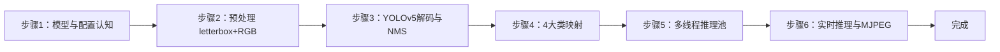

## 实验2：基于图像分类的垃圾分类实验（4h）

> ✅ **源码已核实** 本实验源码位于 `ros2_ws/src/xflz_eai_car1/vision/02_garbage_classification/`。基于 `rubbish_2_7.rknn`（20 类垃圾分类模型，YOLOv5 式检测头：3 尺度 × 75 通道 = 3 anchors × (4+1+20)），改造 `rknn-python-Multithreading` 火焰检测例程为**多线程 RKNN 推理 + 逐目标分类 + 4 大类映射 + MJPEG 实时流**。单测 62/62 全绿（WSL rknn23 实测）。

### 1.1 关联知识点

- 1.1.1 图像分类原理 > 原理 > 垃圾分类采用 YOLOv5 式检测头（3 尺度 × 75 通道 = 3 anchors × (4+1+20)）同时输出类别与位置，区别于纯分类网络的整图单标签输出
- 1.2.1 数据集搭建 > 概念 > 20 细类标签（bailuobo…zhuankuai，`config/labels.txt` 行号=类别 ID）与 4 大类映射（1=recyclable 2=kitchen_waste 3=hazardous_waste 4=other_waste，`config/category_map.txt`）
- 1.3.1 多线程推理 > 流程 > RKNNPool 多线程推理池：NPU 核轮转 + 任务队列，最大化 6TOPS NPU 利用率
- 1.3.2 模型部署 > 原理 > 模型输入 `[1,3,640,640]` float32，mean/std 0/255，**rgb2bgr=False（须喂 RGB）**；输出 3 尺度 `[1,75,80,80]/[1,75,40,40]/[1,75,20,20]`
- 1.3.3 实时分类与分拣联动 > 流程 > letterbox 640(pad 0) + BGR→RGB → YOLOv5 解码（anchors/obj/逐类 NMS）→ 4 大类映射 → 原图坐标输出 → MJPEG 推流

### 1.2 实验目标

1. 掌握图像分类数据集搭建与 YOLOv5 式检测头模型部署方法 — 原理理解
2. 实现基于视觉的垃圾分类（20 细类 + 4 大类映射）与 MJPEG 实时可视化 — 独立完成
3. 理解多线程推理池如何提升 NPU 利用率，为机械臂分拣联动打基础 — 迁移应用

### 1.3 实验环境

| 类别 | 配置 |
|------|------|
| 硬件 | 具身智能实验箱 B2（XFLZ_EAI_B2_PRO，RK3576 SoC，6TOPS NPU，含 HP60C 深度相机） |
| OS | Ubuntu 22.04 + ROS2 Humble（板载 ros2_venv，rknnlite 2.3.2） |
| 核心库 | OpenCV、NumPy、rknnlite、PyYAML（标准库 MJPEG，替代外部 mjpeg_streamer） |
| 模型 | `rubbish_2_7.rknn`（20 类垃圾分类，YOLOv5 检测头，640×640 输入） |
| 主入口 | `src/app.py`（单图/视频/相机/ROS 模式 + MJPEG + FPS） |

### 1.4 实验难度

- 难度: ⭐⭐ 设计性
- 重点: YOLOv5 检测头解码（anchors + obj + 逐类 NMS）与 4 大类业务映射
- 难点: 多线程推理池设计（核轮转 + 队列）与 RGB/float 输入约定

### 1.5 实验现象

**快速验证流程**：

1. 进入项目目录：`cd ros2_ws/src/xflz_eai_car1/vision/02_garbage_classification`
2. 单元测试：`pytest tests/ -v`（62 用例全绿，从不加载真模型）
3. 单图检测：`python src/app.py --image x.jpg --save out.jpg`
   - 终端打印每个目标的「大类 细类 score」与坐标
4. 视频检测 + MJPEG：`python src/app.py --video test.mp4`
   - 浏览器访问 `http://<板IP>:8080/garbage_cam.mjpg` 查看标注流
5. 相机实时（板上标准）：先起 ascamera 驱动，再 `python src/app.py --ros`

**预期效果描述**：
- 单图：水瓶 → `recyclable shuiping 0.xx`，鸡蛋 → `kitchen_waste 鸡蛋...`，电池 → `hazardous_waste dianchi 0.xx`
- 实时：检测框逐帧跟随，avg_fps ≥ 15（验收门），MJPEG 流可见「大类 细类 score」标注
- 多线程：`--tpes 6` 时 NPU 多核轮转，帧率显著高于单线程

### 1.6 实验步骤

#### 整体流程图



---

#### 步骤1：模型与配置认知（阶段一：能运行，20min）

> 📌 本步骤对应源码：`config/garbage_config.yaml`、`config/labels.txt`、`src/config.py`

**知识点讲解**：

**模型元数据与业务映射（1.1.1、1.2.1）**
- **原理**：`rubbish_2_7.rknn` 是 20 类垃圾分类检测模型，检测头为 **YOLOv5 式**：每个尺度输出 `[1, 75, h, w]`，75 = 3 anchors × (4 坐标 + 1 目标置信度 + 20 类)。模型事实（元数据核实）：输入 `[1,3,640,640]` float32，mean/std 0/255，**rgb2bgr=False（必须喂 RGB）**；anchors 为 YOLOv5 默认 9 组（`config/anchors.txt`）。业务层把 20 细类映射为 4 大类：1=recyclable（可回收）2=kitchen_waste（厨余）3=hazardous_waste（有害）4=other_waste（其他），映射关系在 `config/category_map.txt`（英文名）。`src/config.py` 负责加载 labels/category_map/anchors，**路径相对配置文件解析**——模型换位置时只需改 `model.path`。
- **源码对应**：`config/garbage_config.yaml`（model.path / infer.sigmoid / pool.tpes）；`config/labels.txt`（20 细类，行号=类别 ID）；`config/category_map.txt`（4 大类）；`config/anchors.txt`（YOLOv5 默认 anchors）

**操作步骤**：

1. 查看标签与映射文件，理解"细类 → 大类"的两级业务：
   ```bash
   cat config/labels.txt          # 20 细类（拼音命名：shuiping 水瓶、dianchi 电池…）
   cat config/category_map.txt    # 每行: 细类ID 大类ID 大类英文名
   ```
2. 阅读 `config/garbage_config.yaml`，重点关注 `infer.sigmoid`（obj 分支是否已 sigmoid）与 `pool.tpes`（线程数）
3. 用 Python 验证配置加载：
   ```bash
   python -c "from config import load_labels, load_category_map, load_anchors; \
   print(len(load_labels('config/labels.txt')), '细类'); \
   print(len(load_category_map('config/category_map.txt')), '大类映射')"
   ```

**易错点**：
- ⚠️ 若框偏移 → 调整 `config/anchors.txt`（核对导出配置）；若分数异常 → 切换 `infer.sigmoid: false`

---

#### 步骤2：预处理 letterbox + RGB（阶段一：能运行，20min）

> 📌 本步骤对应源码：`src/preprocess.py`

**知识点讲解**：

**输入对齐（1.3.2）**
- **原理**：模型输入为 640×640 RGB float，而摄像头/图片是任意尺寸 BGR uint8。`prepare_input()` 完成三步对齐：(1) **letterbox 等比缩放 + pad 0 填充**到 640×640（pad 必须 0，与模型 zoo 对齐，避免填充色干扰检测）；(2) **BGR→RGB 通道交换**（模型 rgb2bgr=False 约定）；(3) **归一化约定**：模型要求 mean/std 0/255，即输入直接是 0-255 的 uint8 转 float，不做额外 /255（量化模型内部处理）。输出经 `unletterbox()` 把检测框映射回原始图像坐标。
- **源码对应**：`src/preprocess.py`（prepare_input / unletterbox）

**操作步骤**：

1. 用测试图验证预处理输出形状：
   ```bash
   python -c "
   import cv2, numpy as np
   from preprocess import prepare_input
   img = cv2.imread('x.jpg')
   rgb, meta = prepare_input(img, 640)
   print('输入形状:', rgb.shape, 'dtype:', rgb.dtype)   # 预期 (640,640,3) uint8 RGB
   print('scale:', meta.scale, 'pad:', (meta.pad_x, meta.pad_y))"
   ```
2. 理解 letterbox 的 scale 计算（`min(640/h, 640/w)`），思考为什么 pad 必须是 0

**易错点**：
- ⚠️ RGB 与 BGR 混用是"检测框对但分类错"的头号原因——务必先 `to_rgb` 再喂模型

---

#### 步骤3：YOLOv5 解码与逐类 NMS（阶段二：能理解，30min）

> 📌 本步骤对应源码：`src/postprocess.py`

**知识点讲解**：

**YOLOv5 检测头解码（1.1.1）**
- **原理**：YOLOv5 检测头输出为 anchor-based：每尺度 `[1,75,h,w]`，reshape 为 `[3, 25, h, w]`（3 anchors × 25 = 4 坐标 + 1 obj + 20 类）。解码步骤：(1) 对每个 anchor 位置，用**预设 anchors** 将归一化偏移还原为 cx/cy/w/h（`decode_rknn_outputs`）；(2) 目标置信度与类别分数结合（或直接取类最大分）；(3) 按 `score_thr` 过滤；(4) **逐类 NMS**——同类别重叠框只保留最高分，跨类别不抑制。输出 `Detection` 列表（原图坐标，经 unletterbox），再由 `map_categories()` 完成 20 细类 → 4 大类映射。
- **源码对应**：`src/postprocess.py`（Detection / decode_rknn_outputs / map_categories / NMS）

**操作步骤**：

1. 阅读 `postprocess.py` 的解码主函数，理解 anchors 如何参与坐标还原
2. 单元测试理解解码契约：
   ```bash
   pytest tests/test_postprocess.py -v
   # 预期：decode/NMS/map_categories 用例全绿
   ```
3. 思考：为什么逐类 NMS 而非全局 NMS？（不同类目标可以重叠，如"瓶中水"场景）

**易错点**：
- ⚠️ anchors 与模型导出配置不一致 → 框整体偏移，调整 `config/anchors.txt`

---

#### 步骤4：4 大类业务映射（阶段二：能理解，15min）

> 📌 本步骤对应源码：`src/postprocess.py` map_categories、`config/category_map.txt`

**知识点讲解**：

**细类到大类的业务抽象（1.2.1）**
- **原理**：20 细类过于细粒度（如 yaogao 牙膏、yaopian 药片），面向分拣业务需要 4 大类。`map_categories()` 依据 `category_map.txt` 把每个检测的 `class_id` 映射为 `(大类ID, 大类英文名)`，同时保留细类名用于标注显示。这种"模型输出细类、业务消费大类"的两级设计，使模型更换（如新增细类）不破坏下游分拣逻辑。
- **源码对应**：`src/postprocess.py` map_categories；`src/app.py` L31-33（标注格式 `大类 细类 score`）

**操作步骤**：

1. 查看 category_map.txt，找出 recyclable 包含哪些细类（shuiping 水瓶、yilaguan 易拉罐…）
2. 运行单测验证映射正确性：`pytest tests/test_postprocess.py -k category -v`

**易错点**：
- ⚠️ category_map 行序必须与 labels.txt 行号严格对应，错一行全错

---

#### 步骤5：多线程推理池 RKNNPool（阶段三：能改造，30min）

> 📌 本步骤对应源码：`src/rknnpool.py`

**知识点讲解**：

**多线程推理池原理（1.3.1）**
- **原理**：RK3576 NPU 支持多核（core_mask），单线程推理时 NPU 有核空闲。RKNNPool 用**生产者-消费者模型**：主线程读取帧放入任务队列，`--tpes N` 个工作线程从队列取帧，各自持有 RKNNLite 实例并**轮转绑定不同 NPU 核**（core_mask 0/1/2/3）并行推理，结果按序返回。这比单线程串行推理能显著提升 FPS（多核并行 + 取帧与推理重叠）。`rknn_backend_factory()` 为每个线程创建后端实例，`Detector` 注入后端完成检测。
- **源码对应**：`src/rknnpool.py`（RKNNPool：入队 Lxx / 工作线程 Lxx / 结果回收 Lxx）；`src/detector.py` L133-135（make_rknn_backend）

**操作步骤**：

1. 单线程 vs 多线程对比（验证池的价值）：
   ```bash
   python src/app.py --video test.mp4 --tpes 1
   python src/app.py --video test.mp4 --tpes 6
   # 对比 avg_fps：tpes 6 应明显更高
   ```
2. 阅读 rknnpool.py 的队列实现，理解线程安全（queue.Queue / 锁）
3. 思考：线程数不是越多越好？——NPU 核数与内存限制决定最优 tpes（本板实测 6 左右）

**易错点**：
- ⚠️ 每个线程必须独立 RKNNLite 实例（NPU 上下文非线程共享），复用同一实例会崩溃
- ⚠️ tpes 超过 NPU 核数不提升反而增加内存压力

---

#### 步骤6：实时推理与 MJPEG 推流（阶段三：能改造，35min）

> 📌 本步骤对应源码：`src/app.py`、`src/mjpeg_server.py`、`src/ros2_source.py`

**知识点讲解**：

**端到端实时链路（1.3.3）**
- **原理**：`app.py` 组织完整链路：输入源（单图/视频/`--camera N` UVC/`--ros` ROS2 话题）→ 帧交给 `make_process_fn` 构造的 pool 处理函数 → 每个工作线程内 `Detector.detect()`（prepare_input → NPU 推理 → 解码 → 4 大类映射 → unletterbox）→ 画框标注（`大类 细类 score`）→ MJPEG 推流。`mjpeg_server.py` 用**标准库**实现 MJPEG（multipart/x-mixed-replace），替代外部 mjpeg_streamer，零额外依赖。板上相机标准路径是 HP60C 深度相机经 ascamera 话题取流（`ros2_source.py` Ros2Camera，DEFAULT_TOPIC `/ascamera_hp60c/camera_publisher/rgb0/image`），OpenCV 直连读不了（未编 libv4l）。
- **源码对应**：`src/app.py` L24-35（make_process_fn 标注逻辑）、L38-150（main：参数 L39-60 / 单图 Lxx / 视频相机 Lxx）；`src/mjpeg_server.py`（MjpegServer）；`src/ros2_source.py`（Ros2Camera：DEFAULT_TOPIC / open / read / release）

**操作步骤**：

1. 单图检测（最简验证）：
   ```bash
   cd ros2_ws/src/xflz_eai_car1/vision/02_garbage_classification
   python src/app.py --image x.jpg --save out.jpg
   # 预期：终端打印 大类 细类 score (x1,y1,x2,y2)
   ```
2. 视频 + MJPEG：
   ```bash
   python src/app.py --video test.mp4 --tpes 6 --port 8080
   # 浏览器访问 http://<板IP>:8080/garbage_cam.mjpg
   ```
3. 相机实时（板上标准）：
   ```bash
   source /opt/ros/humble/setup.bash && source ~/ros2_ws/install/setup.bash
   export ROS_DOMAIN_ID=2
   ros2 launch ascamera hp60c.launch.py        # 终端 1
   python src/app.py --ros                      # 终端 2，同一 ROS_DOMAIN_ID
   # 预期：avg_fps ≥ 15，MJPEG 可见实时标注
   ```
4. 动手改造：修改 `src/app.py` L30-33 标注逻辑，把大类换成中文名（如 `可回收 水瓶 0.87`），重新运行

**易错点**：
- ⚠️ `--ros` 取不到帧 → ascamera 驱动先起、ROS_DOMAIN_ID 一致、话题勿 remap
- ⚠️ MJPEG 404 → 8080 被占，`--port` 换端口或关占用进程

---

### 1.7 常见问题

| 问题 | 原因 | 解决方法 |
|------|------|---------|
| 检测框整体偏移 | anchors 与导出配置不一致 | 调整 `config/anchors.txt`（核对导出配置） |
| 分数异常（全 0 或全 1） | obj 分支已/未 sigmoid 与配置不符 | 切换 `infer.sigmoid: false/true` |
| 分类全错但框对 | RGB/BGR 约定错误 | 确认 `prepare_input` 先 BGR→RGB（模型 rgb2bgr=False） |
| 多线程崩溃 | 线程共享同一 RKNNLite 实例 | 每线程独立实例（RKNNPool 已实现） |
| MJPEG 404 | 8080 端口占用 | `--port` 换端口或关闭占用进程 |
| --ros 取不到帧 | 驱动未启动/ROS_DOMAIN_ID 不一致 | ascamera 先起；export ROS_DOMAIN_ID=2；话题勿 remap |
| 板上模型加载失败 | model.path 未改为板载路径 | 修改 `config/garbage_config.yaml` 的 `model.path` |

### 1.8 扩展实验

**扩展方向 1：机械臂分拣联动（进阶）**
- 在 `app.py` 处理函数中，把 4 大类结果转换为分拣指令（如 recyclable → 机械臂抓取到 1 号仓），通过串口或 ROS2 话题发布（参考实验 05 的 cmd_vel 模式）

**扩展方向 2：识别置信度优化（进阶）**
- 在标注中加入细类置信度直方图；对不同大类设置不同 score_thr（有害垃圾从严），观察误检率变化
- 把 `--tpes` 做成运行时动态调节，绘制"线程数 vs FPS"曲线，找出最优配置

### 1.9 实验报告要求

**评分标准**：模型元数据理解 15 分 + 预处理 15 分 + YOLOv5 解码 25 分 + 4 大类映射 15 分 + 实时演示 20 分 + 报告 10 分 = 100 分。

**报告必含内容**：
1. 模型输入输出规格表（形状/类型/通道顺序/anchors），标注对应的 config 文件
2. 解码流程图（anchors → cx/cy/w/h → NMS → 大类映射），标注源码行号
3. 单图检测结果图（≥3 个不同大类目标）与「大类 细类 score」数据
4. tpes=1 vs tpes=6 的 FPS 对比数据与结论
5. 回答思考题：为什么模型要求 RGB 而 OpenCV 默认 BGR？为什么逐类 NMS 允许跨类重叠？多线程池为什么比单线程快？
6. 实验心得与问题记录

---

## 更新日志

| 版本 | 日期 | 变更 |
|------|------|------|
| v1.0 | 2026-08-10 | 初版生成（源码路径 ros2_ws/src/xflz_eai_car1/vision/02_garbage_classification，62 用例全绿，YOLOv5 检测头 20 细类 + 4 大类映射 + RKNNPool 多线程） |
