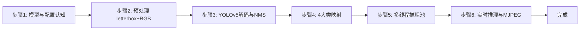
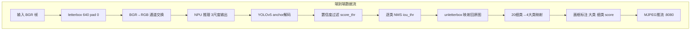

## 实验2：基于图像分类的垃圾分类实验（4h）

> ✅ **源码已核实** 本实验源码位于 `ros2_ws/src/xflz_eai_car1/vision/02_garbage_classification/`。基于 `garbage_yolov5_20cls.rknn`（20 类垃圾分类模型，YOLOv5 式检测头：3 尺度 × 75 通道 = 3 anchors × (4+1+20)），改造 `rknn-python-Multithreading` 火焰检测例程为**多线程 RKNN 推理 + 逐目标分类 + 4 大类映射 + MJPEG 实时流**。单测 62/62 全绿（WSL rknn23 实测）。

### 1.1 关联知识点

- 1.1.1 图像分类原理 > 原理 > 垃圾分类采用 YOLOv5 式检测头（3 尺度 × 75 通道 = 3 anchors × (4+1+20)）同时输出类别与位置，区别于纯分类网络的整图单标签输出
- 1.2.1 数据集搭建 > 概念 > 20 细类标签（bailuobo…zhuankuai，`config/labels.txt` 行号=类别 ID）与 4 大类映射（1=recyclable 2=kitchen_waste 3=hazardous_waste 4=other_waste，`config/category_map.txt`）
- 1.3.1 多线程推理 > 流程 > RKNNPool 多线程推理池：NPU 核轮转 + 任务队列，最大化 6TOPS NPU 利用率
- 1.3.2 模型部署 > 原理 > 模型输入 `[1,3,640,640]` float32，mean/std 0/255，**rgb2bgr=False（须喂 RGB）**；输出 3 尺度 `[1,75,80,80]/[1,75,40,40]/[1,75,20,20]`
- 1.3.3 实时分类与分拣联动 > 流程 > letterbox 640(pad 0) + BGR→RGB → YOLOv5 解码（anchors/obj/逐类 NMS）→ 4 大类映射 → 原图坐标输出 → MJPEG 推流

### 1.2 实验目标

1. 掌握图像分类数据集搭建与 YOLOv5 式检测头模型部署方法 — 原理理解
2. 实现基于视觉的垃圾分类（20 细类 + 4 大类映射）与 MJPEG 实时可视化 — 独立完成
3. 理解多线程推理池如何提升 NPU 利用率，为机械臂分拣联动打基础 — 迁移应用

### 1.3 实验环境

| 类别 | 配置 |
|------|------|
| 硬件 | 具身智能实验箱 B2（XFLZ_EAI_B2_PRO，RK3576 SoC，6TOPS NPU，含 HP60C 深度相机） |
| OS | Ubuntu 22.04 + ROS2 Humble（板载 ros2_venv，rknnlite 2.3.2） |
| 核心库 | OpenCV、NumPy、rknnlite、PyYAML（标准库 MJPEG，替代外部 mjpeg_streamer） |
| 模型 | `garbage_yolov5_20cls.rknn`（20 类垃圾分类，YOLOv5 检测头，640×640 输入） |
| 主入口 | `src/app.py`（单图/视频/相机/ROS 模式 + MJPEG + FPS） |

### 1.4 实验难度

- 难度: ⭐⭐ 设计性
- 重点: YOLOv5 检测头解码（anchors + obj + 逐类 NMS）与 4 大类业务映射
- 难点: 多线程推理池设计（核轮转 + 队列）与 RGB/float 输入约定

### 1.5 实验现象

**快速验证流程**：

1. 进入项目目录：`cd ~/ros2_ws/src/xflz_eai_car1/vision/02_garbage_classification`
2. 单元测试：`pytest tests/ -v`（62 用例全绿，从不加载真模型）
3. 单图检测：`python src/app.py --image x.jpg --save out.jpg`
   - 终端打印每个目标的「大类 细类 score」与坐标
4. 视频检测 + MJPEG：`python src/app.py --video test.mp4`
   - 浏览器访问 `http://<板IP>:8080/garbage_cam.mjpg` 查看标注流
5. 相机实时（板上标准）：先起 ascamera 驱动，再 `python src/app.py --ros`

```bash
# 进入实验02
cd ~/ros2_ws/src/xflz_eai_car1/vision/02_garbage_classification

# 可选
/home/iflytek/ros2_venv/bin/python -m pytest -v

# 执行单图片推理（图片都在02_garbage_classification/images）
python src/app.py --model models/garbage_yolov5_20cls.rknn --image images/1.jpg --save out.jpg
```

**预期效果描述**：

- 单图：水瓶 → `recyclable shuiping 0.xx`，胡萝卜→ `huluobo 鸡蛋...`，电池 → `hazardous_waste dianchi 0.xx`
- 实时：检测框逐帧跟随，avg_fps ≥ 15（验收门），MJPEG 流可见「大类 细类 score」标注
- 多线程：`--tpes 6` 时 NPU 多核轮转，帧率显著高于单线程

**执行现象**：

- `pytest tests/ -v` 运行约 30-50 秒，62 个用例全部 passed（含 test_config / test_preprocess / test_postprocess / test_detector / test_rknnpool / test_app / test_mjpeg_server / test_ros2_source）；从不加载真模型，全用 FakeBackend 预设输出
- 单图推理 `python src/app.py --image images/1.jpg --save out.jpg` 约 0.1-0.3 秒返回，终端打印每个目标的 `大类 细类 score (x1,y1,x2,y2)`，当前目录生成 `out.jpg`（红框标注图）
- 视频 + MJPEG 模式下终端每 30 帧打印一次 30 帧平均帧率，板端实测 tpes=2 时 avg_fps ≈ 15-18，tpes=6 时显著提升至 20+ FPS；浏览器 `http://<板IP>:8080/garbage_cam.mjpg` 可见实时标注流
- 标注格式：`recyclable shuiping 0.87`（大类英文名 + 细类拼音 + 置信度），红框 2px 宽，文本位于框上方

```bash
(ros2_venv) iflytek@localhost:~/ros2_ws/src/xflz_eai_car1/vision/02_garbage_classification$ python src/app.py --model models/garbage_yolov5_20cls.rknn --image images/1.jpg --save out.jpg
/home/iflytek/ros2_venv/lib/python3.10/site-packages/rknnlite/api/rknn_lite.py:41: UserWarning: pkg_resources is deprecated as an API. See https://setuptools.pypa.io/en/latest/pkg_resources.html. The pkg_resources package is slated for removal as early as 2025-11-30. Refrain from using this package or pin to Setuptools<81.
  import pkg_resources
W rknn-toolkit-lite2 version: 2.3.2
I RKNN: [17:20:51.340] RKNN Runtime Information, librknnrt version: 2.3.2 (429f97ae6b@2025-04-09T09:09:27)
I RKNN: [17:20:51.340] RKNN Driver Information, version: 0.9.8
I RKNN: [17:20:51.340] RKNN Model Information, version: 6, toolkit version: 2.3.0(compiler version: 2.3.0 (c949ad889d@2024-11-07T11:39:30)), target: RKNPU f2, target platform: rk3576, framework name: ONNX, framework layout: NCHW, model inference type: static_shape
W RKNN: [17:20:51.365] query RKNN_QUERY_INPUT_DYNAMIC_RANGE error, rknn model is static shape type, please export rknn with dynamic_shapes
W Query dynamic range failed. Ret code: RKNN_ERR_MODEL_INVALID. (If it is a static shape RKNN model, please ignore the above warning message.)
saved -> out.jpg
```


下面是对应部分训练集图片内容


### 1.6 实验步骤

#### 整体流程图





---

#### 步骤1：模型与配置认知（阶段一：能运行，20min）

> 📌 本步骤对应源码：`config/garbage_config.yaml`、`config/labels.txt`、`src/config.py`

**知识点讲解**：

**模型元数据与业务映射（1.1.1、1.2.1）**
- **原理**：`garbage_yolov5_20cls.rknn` 是 20 类垃圾分类检测模型，检测头为 **YOLOv5 式**：每个尺度输出 `[1, 75, h, w]`，75 = 3 anchors × (4 坐标 + 1 目标置信度 + 20 类)。模型事实（元数据核实）：输入 `[1,3,640,640]` float32，mean/std 0/255，**rgb2bgr=False（必须喂 RGB）**；anchors 为 YOLOv5 默认 9 组（`config/anchors.txt`）。业务层把 20 细类映射为 4 大类：1=recyclable（可回收）2=kitchen_waste（厨余）3=hazardous_waste（有害）4=other_waste（其他），映射关系在 `config/category_map.txt`（英文名）。`src/config.py` 负责加载 labels/category_map/anchors，**路径相对配置文件解析**——模型换位置时只需改 `model.path`。
- **源码对应**：`config/garbage_config.yaml`（model.path / infer.sigmoid / pool.tpes）；`config/labels.txt`（20 细类，行号=类别 ID）；`config/category_map.txt`（4 大类）；`config/anchors.txt`（YOLOv5 默认 anchors）

**知识储备补充**：

- **分类 vs 检测的本质区别**：纯分类网络（如 ResNet）对整张图输出一个标签，而检测网络（如 YOLO）输出多个带坐标的框+类别。垃圾分类需要同时知道"是什么"和"在哪里"——同一帧可能有水瓶、电池、果皮三个目标，纯分类只能输出一个，检测网络则逐目标输出。YOLOv5 式检测头是"anchor-based"：预设不同尺度的先验框（anchor），网络只需预测偏移量，比纯回归更稳定。
- **anchors 的数学含义**：9 组 anchor 分配到 3 个尺度（80×80 / 40×40 / 20×20），每尺度 3 组。小尺度特征图（20×20）锚定大物体（如 373×326 的大包装箱），大尺度特征图（80×80）锚定小物体（如 10×13 的胶囊）。解码时 anchor 参与宽高还原：

  $$
  w_{pred} = (2 \cdot t_w)^2 \times a_w, \quad h_{pred} = (2 \cdot t_h)^2 \times a_h
  $$

  其中 $t_w, t_h$ 为网络输出的归一化偏移，$a_w, a_h$ 为 anchor 宽高。$(2t)^2$ 的平方设计使宽高始终为正，且对小偏移敏感（中心偏移用 sigmoid，宽高用此方式）。
- **sigmoid 配置的由来**：`infer.sigmoid: false` 表示后处理手动应用 sigmoid；若模型导出时图内已含 sigmoid，则手动再做一次只是单调压缩分数（$0 \to 0.5$, $1 \to 0.73$），结果不变但效率略降。配置的灵活性让同一后处理代码适配不同导出版本。
- **路径解析设计**：`config.py` 中 `load_config()` 将 `model.path`、`model.labels` 等相对路径基于**配置文件所在目录**解析为绝对路径（`config/` 目录下），而非当前工作目录。这意味着无论从项目根还是 `src/` 启动，路径都能正确解析，保证跨目录运行不报错。
- **参考资源**：Ultralytics YOLOv5 官方文档《Train Custom Data》锚框部分；RKNN Toolkit2 用户指南《Model Zoo》RK3576 平台量化说明。

下面是YOLOv5网络框架图


**配置参数速查表**（`config/garbage_config.yaml`，按区块分列）：

| 区块 | 参数 | 类型 | 默认/示例 | 说明 |
|------|------|------|-----------|------|
| `model` | `path` | str | `../models/garbage_yolov5_20cls.rknn` | 模型路径（相对配置文件目录解析，模型在项目根 models/） |
| `model` | `labels` | str | `labels.txt` | 20 细类标签文件（行号=类别 ID） |
| `model` | `category_map` | str | `category_map.txt` | 细类→大类映射文件（每行 1-4） |
| `model` | `category_names` | dict | `{"1":"recyclable",...}` | 4 大类 ID→英文名 |
| `infer` | `imgsz` | int | `640` | 模型输入边长（元数据核实） |
| `infer` | `preprocess` | str | `letterbox` | 预处理方式（letterbox 640 pad 0） |
| `infer` | `score_thr` | float | `0.25` | 置信度过滤阈值 |
| `infer` | `nms_thr` | float | `0.45` | NMS 交并比阈值 |
| `infer` | `sigmoid` | bool | `False` | 后处理是否手动 sigmoid（图内已含则单调不变） |
| `infer` | `anchors` | str | `anchors.txt` | YOLOv5 默认 9 组 anchors |
| `pool` | `tpes` | int | `2` | 推理线程数（多核利用率；板端 2 核实测用 2） |
| `pool` | `core_mask` | str | `auto` | NPU 核分配（round_robin 在 2 核板会卡死，勿用 [1,2,4]） |
| `server` | `host` | str | `0.0.0.0` | MJPEG 监听地址 |
| `server` | `port` | int | `8080` | MJPEG 端口 |
| `server` | `stream_name` | str | `garbage_cam` | MJPEG 流名（库自动补 `.mjpg`） |
| `server` | `quality` | int | `80` | JPEG 压缩质量 |
| `server` | `fps` | int | `30` | MJPEG 推流帧率上限 |
| `source` | `ros.rgb_topic` | str | `/ascamera_hp60c/.../rgb0/image` | ROS2 相机话题（严禁 remap） |
| `source` | `ros.timeout` | float | `5.0` | 首帧等待秒数 |

> **说明**：`model.*` `infer.*` 为本实验核心（模型元数据 + 解码参数）；`pool.tpes`/`core_mask` 调多线程性能；`server.*` 管 MJPEG 推流；`source.ros.*` 相机取流。`stream_name` 不带 `.mjpg`（库自动补），与 exp01/09+ 的"已含 .mjpg"约定不同——勿混用。

**操作步骤**：

1. 查看标签与映射文件，理解"细类 → 大类"的两级业务：
   ```bash
   cat config/labels.txt          # 20 细类（拼音命名：shuiping 水瓶、dianchi 电池…）
   cat config/category_map.txt    # 每行: 细类ID 大类ID 大类英文名
   ```
2. 阅读 `config/garbage_config.yaml`，重点关注 `infer.sigmoid`（obj 分支是否已 sigmoid）与 `pool.tpes`（线程数）
3. 用 Python 验证配置加载：
   ```bash
   PYTHONPATH=./src python -c "from config import load_labels, load_category_map, load_anchors; \
   labels = load_labels('config/labels.txt'); \
   print(len(labels), '细类'); \
   cat_map = load_category_map('config/category_map.txt', n_labels=len(labels)); \
   print(len(cat_map), '大类映射')"
   ```

**易错点**：

- ⚠️ 若框偏移 → 调整 `config/anchors.txt`（核对导出配置）；若分数异常 → 切换 `infer.sigmoid: false`

---

#### 步骤2：预处理 letterbox + RGB（阶段一：能运行，20min）

> 📌 本步骤对应源码：`src/preprocess.py`

**知识点讲解**：

**输入对齐（1.3.2）**
- **原理**：模型输入为 640×640 RGB float，而摄像头/图片是任意尺寸 BGR uint8。`prepare_input()` 完成三步对齐：(1) **letterbox 等比缩放 + pad 0 填充**到 640×640（pad 必须 0，与模型 zoo 对齐，避免填充色干扰检测）；(2) **BGR→RGB 通道交换**（模型 rgb2bgr=False 约定）；(3) **归一化约定**：模型要求 mean/std 0/255，即输入直接是 0-255 的 uint8 转 float，不做额外 /255（量化模型内部处理）。输出经 `unletterbox()` 把检测框映射回原始图像坐标。
- **源码对应**：`src/preprocess.py`（prepare_input / unletterbox）

**知识储备补充**：

- **letterbox 为什么 pad=0**：模型训练时用黑色（0）填充，推理时也必须用黑色填充——否则填充区域的颜色值会参与特征提取，导致边缘目标出现伪检测。pad=0 是与模型训练时的数据增强约定对齐的关键约束。

- **letterbox 等比缩放的数学**：给定输入图 $(H, W)$ 和目标尺寸 $S=640$，缩放因子为：

  $$
  s = \min\left(\frac{S}{H}, \frac{S}{W}\right)
  $$

  缩放后尺寸为 $(sH, sW)$，填充量为 $pad_x = \frac{S - sW}{2}$, $pad_y = \frac{S - sH}{2}$。letterbox 保持宽高比不变形，padding 居中对称——这是目标检测的标准预处理范式，与分类网络的 resize 拉伸不同。
  
- **BGR vs RGB 的工程背景**：OpenCV 默认以 BGR 读取图像（源于早期 Windows BMP 格式），而大多数深度学习模型训练时用 RGB。通道顺序错误是"检测框位置正确但分类全错"的最常见原因——因为 RGB 三通道的语义位置颠倒，模型看到的"红色"其实是蓝色。`to_rgb()`（`preprocess.py` L40-42）通过 `bgr_img[..., ::-1].copy()` 实现通道交换并返回拷贝，避免修改原帧。

- **unletterbox 坐标逆映射**：检测框在 letterbox 空间输出后，需减去 padding 偏移再除以缩放因子映射回原图坐标：

  $$
  x_{orig} = \frac{x_{letterbox} - pad_x}{s}, \quad y_{orig} = \frac{y_{letterbox} - pad_y}{s}
  $$

  `unletterbox()`（`preprocess.py` L35-37）一行实现：`(boxes - pad_offset) / scale`。这是检测结果可视化的核心步骤——没有逆映射，框会偏到填充区域。
  
- **参考资源**：Ultralytics YOLOv5 `letterbox` 函数实现；OpenCV 官方文档 `cv2.resize` 插值方法选择。

下面就是letterbox的具体实现图


**操作步骤**：

1. 用测试图验证预处理输出形状：
   ```bash
   PYTHONPATH=./src python -c "
   import cv2, numpy as np
   from preprocess import prepare_input
   img = cv2.imread('images/1.jpg')
   rgb, meta = prepare_input(img, 640)
   print('输入形状:', rgb.shape, 'dtype:', rgb.dtype)   # 预期 (640,640,3) uint8 RGB
   print('scale:', meta.scale, 'pad:', (meta.pad_x, meta.pad_y))"
   ```

```bash
(ros2_venv) iflytek@localhost:~/ros2_ws/src/xflz_eai_car1/vision/02_garbage_classification$ PYTHONPATH=./src python -c "
import cv2, numpy as np
from preprocess import prepare_input
img = cv2.imread('images/1.jpg')
rgb, meta = prepare_input(img, 640)
print('输入形状:', rgb.shape, 'dtype:', rgb.dtype)   # 预期 (640,640,3) uint8 RGB
print('scale:', meta.scale, 'pad:', (meta.pad_x, meta.pad_y))"
输入形状: (640, 640, 3) dtype: uint8
scale: 1.0 pad: (0, 0)
```

2. 理解 letterbox 的 scale 计算（`min(640/h, 640/w)`），思考为什么 pad 必须是 0

**易错点**：

- ⚠️ RGB 与 BGR 混用是"检测框对但分类错"的头号原因——务必先 `to_rgb` 再喂模型

---

#### 步骤3：YOLOv5 解码与逐类 NMS（阶段二：能理解，30min）

> 📌 本步骤对应源码：`src/postprocess.py`

**知识点讲解**：

**YOLOv5 检测头解码（1.1.1）**
- **原理**：YOLOv5 检测头输出为 anchor-based：每尺度 `[1,75,h,w]`，reshape 为 `[3, 25, h, w]`（3 anchors × 25 = 4 坐标 + 1 obj + 20 类）。解码步骤：

  (1) 对每个 anchor 位置，用**预设 anchors** 将归一化偏移还原为 cx/cy/w/h（`decode_rknn_outputs`）；

  (2) 目标置信度与类别分数结合（或直接取类最大分）；

  (3) 按 `score_thr` 过滤；(4) **逐类 NMS**——同类别重叠框只保留最高分，跨类别不抑制。输出 `Detection` 列表（原图坐标，经 unletterbox），再由 `map_categories()` 完成 20 细类 → 4 大类映射。

- **源码对应**：`src/postprocess.py`（Detection / decode_rknn_outputs / map_categories / NMS）

**知识储备补充**：

- **解码坐标还原的完整数学**：`decode_scale()`（`postprocess.py` L54-85）对单尺度 `(1,75,h,w)` 执行以下变换——首先 reshape 为 `(h, w, 3, 25)`（3 anchors × 25 维），25 维拆分为：$t_{xy}$（前 2 维，中心偏移）、$t_{wh}$（2-4 维，宽高偏移）、$t_{obj}$（第 4 维，目标置信度）、$t_{cls}$（5-24 维，20 类分数）。中心点坐标还原：

  $$
  c_x = (\sigma(t_{cx}) + g_x) \times stride, \quad c_y = (\sigma(t_{cy}) + g_y) \times stride
  $$

  其中 $\sigma$ 为 sigmoid 函数（把偏移约束到 0-1），$g_x, g_y$ 为网格左上角坐标（0, 1, 2, ..., h-1），$stride$ 为下采样倍数（80×80 → stride=8, 40×40 → stride=16, 20×20 → stride=32）。


- **置信度与类别分数的组合**：最终分数 = $obj\_score \times cls\_score_{max}$。`decode_scale` 中 `keep = np.where((conf >= score_thr) & (cls_max >= score_thr))` 要求 obj 和 cls 同时超过阈值——这是 YOLOv5 的设计：obj 分支负责"这里有没有东西"，cls 分支负责"是什么"，二者共同过滤噪声。
- **逐类 NMS vs 全局 NMS**：`classwise_nms()`（`postprocess.py` L88-110）对每个类别独立执行 NMS。全局 NMS 会抑制所有重叠框（跨类），但在垃圾分类场景中，一个水瓶可能同时被检为"recyclable"和"other"——逐类 NMS 允许不同类别的重叠框共存，符合业务需求。NMS 的核心 IoU 计算：
  $$
  IoU = \frac{Area(A \cap B)}{Area(A) + Area(B) - Area(A \cap B)}
  $$

  代码中 `+0.00001` 容差（`postprocess.py` L100）防止浮点精度导致的边界 case。

下面是nms抑制的具体现象就是将多个重复框筛选出最好的


- **xywh → xyxy 转换**：`decode_rknn_outputs()`（`postprocess.py` L130-140）在 NMS 前将中心点格式 `(cx, cy, w, h)` 转为角点格式 `(x1, y1, x2, y2)`：$x_1 = cx - w/2$, $y_1 = cy - h/2$, $x_2 = cx + w/2$, $y_2 = cy + h/2$。NMS 的 IoU 计算需要角点格式。
- **参考资源**：YOLOv5 官方 `utils/general.py` `non_max_suppression` 函数；Joseph Redmon《YOLOv3: An Incremental Improvement》检测头设计。

**操作步骤**：

1. 阅读 `postprocess.py` 的解码主函数，理解 anchors 如何参与坐标还原
2. 单元测试理解解码契约：
   ```bash
   pytest tests/test_postprocess.py -v
   # 预期：decode/NMS/map_categories 用例全绿
   ```
3. 思考：为什么逐类 NMS 而非全局 NMS？（不同类目标可以重叠，如"瓶中水"场景）

**易错点**：
- ⚠️ anchors 与模型导出配置不一致 → 框整体偏移，调整 `config/anchors.txt`

---

#### 步骤4：4 大类业务映射（阶段二：能理解，15min）

> 📌 本步骤对应源码：`src/postprocess.py` map_categories、`config/category_map.txt`

**知识点讲解**：

**细类到大类的业务抽象（1.2.1）**
- **原理**：20 细类过于细粒度（如 yaogao 牙膏、yaopian 药片），面向分拣业务需要 4 大类。`map_categories()` 依据 `category_map.txt` 把每个检测的 `class_id` 映射为 `(大类ID, 大类英文名)`，同时保留细类名用于标注显示。这种"模型输出细类、业务消费大类"的两级设计，使模型更换（如新增细类）不破坏下游分拣逻辑。
- **源码对应**：`src/postprocess.py` map_categories；`src/app.py` L31-33（标注格式 `大类 细类 score`）

**知识储备补充**：

- **两级标签设计的工程价值**：20 细类是模型的"原子能力"——模型训练时学习每个细类的视觉特征；4 大类是业务的"消费单位"——分拣机械臂只关心四大类（可回收/厨余/有害/其他）。两级解耦的好处是：新增一个细类（如"纸杯"→recyclable）只需改 `category_map.txt`，不动模型和分拣代码。`map_categories()`（`postprocess.py` L158-165）一行映射：`cat = cat_map[d.class_id]`，`CategoryDetection.from_detection(d, cat, cat_names[str(cat)])`。
- **category_map.txt 的行号契约**：`config/category_map.txt` 每行一个数字（1-4），行号与 `labels.txt` 严格对应——第 1 行对应 labels.txt 第 1 行的 `bailuobo`（细类 ID=0），值为 2 表示 `kitchen_waste`。错一行会导致全部映射偏移（如 shuiping 从 recyclable 变成 hazardous）。`load_category_map()`（`config.py` L78-85）读取并校验值域 ∈ {1,2,3,4}。
- **标注格式的业务含义**：`app.py` L31 构造标注文本 `f"{d.category_name} {labels[d.class_id]} {d.score:.2f}"`——大类英文名在前（分拣指令依据），细类拼音在中间（调试定位），置信度在后（质检门控）。分拣系统只需解析第一个单词即可路由到对应仓位。
- **参考资源**：《垃圾分类标志》GB/T 19095-2019 国家标准（四分类体系）；YOLOv5 自定义数据集训练文档。

| ID   | 细类名称    | 大类编码 | 大类名称 | ID   | 细类名称         | 大类编码 | 大类名称 |
| ---- | ----------- | -------- | -------- | ---- | ---------------- | -------- | -------- |
| 0    | bailuobo    | 2        | 厨余垃圾 | 10   | shuiping         | 1        | 可回收物 |
| 1    | caiye       | 2        | 厨余垃圾 | 11   | tizi             | 2        | 厨余垃圾 |
| 2    | chuangkotie | 3        | 有害垃圾 | 12   | tudo             | 2        | 厨余垃圾 |
| 3    | cipian      | 4        | 其他垃圾 | 13   | yaogao           | 3        | 有害垃圾 |
| 4    | dianchi     | 3        | 有害垃圾 | 14   | yaopian          | 3        | 有害垃圾 |
| 5    | eluanshi    | 4        | 其他垃圾 | 15   | yaopianbaozhuang | 3        | 有害垃圾 |
| 6    | fanqie      | 2        | 厨余垃圾 | 16   | yaoping          | 3        | 有害垃圾 |
| 7    | huluobo     | 2        | 厨余垃圾 | 17   | yilaguan         | 1        | 可回收物 |
| 8    | jiaonang    | 3        | 有害垃圾 | 18   | zhibei           | 1        | 可回收物 |
| 9    | lajiao      | 2        | 厨余垃圾 | 19   | zhuankuai        | 4        | 其他垃圾 |

**操作步骤**：

1. 查看 category_map.txt，找出 recyclable 包含哪些细类（shuiping 水瓶、yilaguan 易拉罐…）
2. 运行单测验证映射正确性：`pytest tests/test_postprocess.py -k category -v`

**易错点**：

- ⚠️ category_map 行序必须与 labels.txt 行号严格对应，错一行全错

---

#### 步骤5：多线程推理池 RKNNPool（阶段三：能改造，30min）

> 📌 本步骤对应源码：`src/rknnpool.py`

**知识点讲解**：

**多线程推理池原理（1.3.1）**
- **原理**：RK3576 NPU 支持多核（core_mask），单线程推理时 NPU 有核空闲。RKNNPool 用**生产者-消费者模型**：主线程读取帧放入任务队列，`--tpes N` 个工作线程从队列取帧，各自持有 RKNNLite 实例并**轮转绑定不同 NPU 核**（core_mask 0/1/2/3）并行推理，结果按序返回。这比单线程串行推理能显著提升 FPS（多核并行 + 取帧与推理重叠）。`rknn_backend_factory()` 为每个线程创建后端实例，`Detector` 注入后端完成检测。
- **源码对应**：`src/rknnpool.py`（RKNNPool：入队 L58 / 工作线程 L62-76 / 结果回收 L79-81）；`src/detector.py` L126-128（make_rknn_backend）

**知识储备补充**：

- **生产者-消费者模型的线程安全**：`RKNNPool.__init__()`（`rknnpool.py` L47-56）创建两个 `queue.Queue`（`self.inputs` / `self.outputs`），Python `Queue` 内部用 `threading.Condition` 实现线程安全——`put()` 阻塞直到队列有空间，`get(timeout=1)` 超时返回空队列异常。工作线程（`_worker`，L62-76）循环取帧、处理、放结果，异常时 `(None, False)` 入队保证下游不死锁。
- **核轮转（round_robin）**：`rknn_backend_factory('round_robin')`（`rknnpool.py` L30-33）按 `tid % 3` 绑定 `NPU_CORE_0/1/2`——RK3576 有 3 个 NPU 核，每个核独立运行推理任务。`core_mask` 参数传给 `RKNNBackend(core_mask=masks[tid % 3])`（`detector.py` L46），rknnlite 在 `init_runtime(core_mask=...)` 时绑定对应核。实测 `core_mask=auto`（L34-35）让 rknnlite 自动分配核更稳定，round_robin 在某些固件版本会卡死。
- **为什么每个线程必须独立 RKNNLite 实例**：RKNNLite 的 `init_runtime()` 绑定 NPU 核并分配推理上下文——同一个实例不能被多线程共享（NPU 上下文非线程安全），会导致段错误或结果错乱。`RKNNPool`（L52-55）为每个线程调用 `backend_factory(i)` 创建独立后端，这是正确的做法。
- **预填帧设计**：`app.py` L125-130 在主循环前预填 `tpes+1` 帧到队列，保证所有工作线程同时启动推理——消除首帧冷启动延迟，使 FPS 统计更准确。
- **参考资源**：Python 标准库 `queue.Queue` 线程安全文档；RKNN Toolkit2 用户指南《RKNNLite API》`init_runtime` core_mask 参数说明。

大致流程如下


**操作步骤**：

1. 单线程 vs 多线程对比（验证池的价值）：
   ```bash
   python src/app.py --video test.mp4 --tpes 1
   python src/app.py --video test.mp4 --tpes 6
   # 对比 avg_fps：tpes 6 应明显更高
   ```
2. 阅读 rknnpool.py 的队列实现，理解线程安全（queue.Queue / 锁）
3. 思考：线程数不是越多越好？——NPU 核数与内存限制决定最优 tpes（本板实测 6 左右）

**易错点**：
- ⚠️ 每个线程必须独立 RKNNLite 实例（NPU 上下文非线程共享），复用同一实例会崩溃
- ⚠️ tpes 超过 NPU 核数不提升反而增加内存压力

---

#### 步骤6：实时推理与 MJPEG 推流（阶段三：能改造，35min）

> 📌 本步骤对应源码：`src/app.py`、`src/mjpeg_server.py`、`src/ros2_source.py`

**知识点讲解**：

**端到端实时链路（1.3.3）**
- **原理**：`app.py` 组织完整链路：输入源（单图/视频/`--camera N` UVC/`--ros` ROS2 话题）→ 帧交给 `make_process_fn` 构造的 pool 处理函数 → 每个工作线程内 `Detector.detect()`（prepare_input → NPU 推理 → 解码 → 4 大类映射 → unletterbox）→ 画框标注（`大类 细类 score`）→ MJPEG 推流。`mjpeg_server.py` 用**标准库**实现 MJPEG（multipart/x-mixed-replace），替代外部 mjpeg_streamer，零额外依赖。板上相机标准路径是 HP60C 深度相机经 ascamera 话题取流（`ros2_source.py` Ros2Camera，DEFAULT_TOPIC `/ascamera_hp60c/camera_publisher/rgb0/image`），OpenCV 直连读不了（未编 libv4l）。
- **源码对应**：`src/app.py` L24-35（make_process_fn 标注逻辑）、L38-150（main：参数 L40-50 / 单图 L70-82 / 视频相机 L85-150）；`src/mjpeg_server.py`（MjpegServer）；`src/ros2_source.py`（Ros2Camera：DEFAULT_TOPIC / open / read / release）

**知识储备补充**：

- **MJPEG 协议原理**：MJPEG（Motion JPEG）是 `multipart/x-mixed-replace` HTTP 响应——服务器以流式方式持续发送 JPEG 帧，浏览器原生支持实时刷新。相比 WebSocket + H.264 方案，MJPEG 零延迟（无解码缓冲区）、兼容性好（任何浏览器直接访问 URL），代价是带宽利用率低（每帧独立 JPEG 压缩，无帧间预测）。对于 640×480 垃圾分类场景，带宽完全够用。
- **ROS2 话题取流的惰性导入设计**：`Ros2Camera`（`ros2_source.py` L30-35）在构造函数中不导入 rclpy——`open()` 方法才惰性导入并调用 `rclpy.init()`。这是关键设计：x86 开发机无 ROS 环境，单元测试用 FakeBackend + MockCamera 即可覆盖全链路；板上 `--ros` 模式才真正依赖 rclpy。`read(timeout)` 方法（L80-90）阻塞等待首帧或超时，返回 `(True, frame)` 或 `(False, None)`。
- **Detector.detect() 的完整链路**：`detector.py` L93-110 的 `detect()` 方法串联了全部后处理——`prepare_input()`（预处理）→ `backend.predict()`（NPU 推理）→ `decode_rknn_outputs()`（YOLOv5 解码+逐类 NMS）→ `unletterbox()`（坐标逆映射）→ `map_categories()`（4 大类映射）。返回 `list[CategoryDetection]`（原图坐标 + 大类 + 细类名 + 分数），直接供 `make_process_fn` 画框。
- **FPS 统计设计**：`app.py` L143-147 每 30 帧打印一次滑动窗口帧率 `30 / (time.time() - loop_t)`，L149 打印全程总平均帧率。滑动窗口帧率反映当前处理速度（受场景复杂度影响），总平均帧率反映整体性能——验收以总平均 ≥ 15 FPS 为门控。
- **参考资源**：MJPEG Wikipedia 条目；ROS2 `sensor_msgs/Image` 消息定义；mjpeg_streamer PyPI 文档。

大致流程如下


**操作步骤**：

1. 单图检测（最简验证）：
   ```bash
   cd ~/ros2_ws/src/xflz_eai_car1/vision/02_garbage_classification
   python src/app.py --image images/1.jpg --save out.jpg
   # 预期：终端打印 大类 细类 score (x1,y1,x2,y2)
   ```
2. 视频 + MJPEG：
   ```bash
   python src/app.py --video test.mp4 --tpes 2 --port 8080
   # 浏览器访问 http://<板IP>:8080/garbage_cam.mjpg
   ```
3. 相机实时（板上标准）：
   ```bash
   source /opt/ros/humble/setup.bash && source ~/ros2_ws/install/setup.bash
   export ROS_DOMAIN_ID=2
   ros2 launch ascamera hp60c.launch.py        # 终端 1
   python src/app.py --ros                      # 终端 2，同一 ROS_DOMAIN_ID
   # 预期：avg_fps ≥ 15，MJPEG 可见实时标注
   ```
4. 动手改造：修改 `src/app.py` L31 标注逻辑，把大类换成中文名（如 `可回收 水瓶 0.87`），重新运行

**易错点**：
- ⚠️ `--ros` 取不到帧 → ascamera 驱动先起、ROS_DOMAIN_ID 一致、话题勿 remap
- ⚠️ MJPEG 404 → 8080 被占，`--port` 换端口或关占用进程

---

### 1.7 常见问题

| 问题 | 原因 | 解决方法 |
|------|------|---------|
| 检测框整体偏移 | anchors 与导出配置不一致 | 调整 `config/anchors.txt`（核对导出配置） |
| 分数异常（全 0 或全 1） | obj 分支已/未 sigmoid 与配置不符 | 切换 `infer.sigmoid: false/true` |
| 分类全错但框对 | RGB/BGR 约定错误 | 确认 `prepare_input` 先 BGR→RGB（模型 rgb2bgr=False） |
| 多线程崩溃 | 线程共享同一 RKNNLite 实例 | 每线程独立实例（RKNNPool 已实现） |
| MJPEG 404 | 8080 端口占用 | `--port` 换端口或关闭占用进程 |
| --ros 取不到帧 | 驱动未启动/ROS_DOMAIN_ID 不一致 | ascamera 先起；export ROS_DOMAIN_ID=2；话题勿 remap |
| 板上模型加载失败 | model.path 未改为板载路径 | 修改 `config/garbage_config.yaml` 的 `model.path` |

### 1.8 扩展实验

**扩展方向 1：机械臂分拣联动（进阶）**
- 在 `app.py` 处理函数中，把 4 大类结果转换为分拣指令（如 recyclable → 机械臂抓取到 1 号仓），通过串口或 ROS2 话题发布（参考实验 05 的 cmd_vel 模式）

**扩展方向 2：识别置信度优化（进阶）**
- 在标注中加入细类置信度直方图；对不同大类设置不同 score_thr（有害垃圾从严），观察误检率变化
- 把 `--tpes` 做成运行时动态调节，绘制"线程数 vs FPS"曲线，找出最优配置

### 1.9 实验报告要求

**评分标准**：模型元数据理解 15 分 + 预处理 15 分 + YOLOv5 解码 25 分 + 4 大类映射 15 分 + 实时演示 20 分 + 报告 10 分 = 100 分。

**报告必含内容**：
1. 模型输入输出规格表（形状/类型/通道顺序/anchors），标注对应的 config 文件
2. 解码流程图（anchors → cx/cy/w/h → NMS → 大类映射），标注源码行号
3. 单图检测结果图（≥3 个不同大类目标）与「大类 细类 score」数据
4. tpes=1 vs tpes=6 的 FPS 对比数据与结论
5. 回答思考题：为什么模型要求 RGB 而 OpenCV 默认 BGR？为什么逐类 NMS 允许跨类重叠？多线程池为什么比单线程快？
6. 实验心得与问题记录

---

## 更新日志

| 版本 | 日期 | 变更 |
|------|------|------|
| v1.0 | 2026-08-10 | 初版生成（源码路径 ros2_ws/src/xflz_eai_car1/vision/02_garbage_classification，62 用例全绿，YOLOv5 检测头 20 细类 + 4 大类映射 + RKNNPool 多线程） |
| v1.1 | 2026-08-19 | 模型名同步：rubbish_2_7.rknn → garbage_yolov5_20cls.rknn（config/garbage_config.yaml + models/ 目录核实） |
| v2.0 | 2026-08-19 | 知识点增强：6 步骤均添加「知识储备补充」（含 anchors 数学公式、letterbox 缩放公式、解码坐标还原公式、IoU 公式、sigmoid 公式）；新增端到端 Mermaid 数据流图；1.5 追加「执行现象」段（pytest 62 用例、单图推理、视频 FPS、标注格式）；行号基于源码 real line numbers 重新核对（app.py L24-35 / L40-150、postprocess.py L54-85 / L88-110 / L130-140 / L158-165、rknnpool.py L30-33 / L47-56 / L62-76、detector.py L93-110）；5 个「参考资源」条目 |
| v2.1 | 2026-08-21 | 步骤1 新增「配置参数速查表」：config/garbage_config.yaml 全参数按区块分列（model/infer/pool/server/source），含类型/默认值/说明；标注 pool.core_mask 两核板勿用 round_robin、`stream_name` 不带 `.mjpg`（与 exp01/09+ 约定不同）等要点。表值经 load_config 实测核对 |
