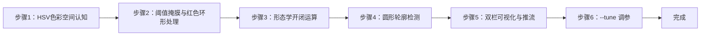

## 实验3：基于HSV色彩空间的颜色识别实验（4h）

> ✅ **源码已核实** 本实验源码位于 `ros2_ws/src/xflz_eai_car1/vision/03_lab_color_recognition/`。⚠️ **注意**：课程目录名 "lab" 指实验编号，本实验实际使用 **HSV 色彩空间**（非 Lab 色彩空间）。对应课程内容：BGR→HSV 阈值掩膜 → 形态学开/闭 → 圆形轮廓标识 → 颜色名标注；可视化对齐车端 `visual_grasp` 双栏（左 RGB 栏 | 右 HSV Mask 栏）推流。单测 24/24 全绿，板端验证通过（约 50 FPS）。

### 1.1 关联知识点

- 1.1.1 HSV色彩空间 > 原理 > HSV（色相/饱和度/明度）将颜色信息与光照强度解耦，比 RGB 更适合阈值分割；OpenCV 约定 H∈0-179、S/V∈0-255
- 1.1.2 色彩阈值掩膜 > 流程 > `cv2.inRange` 生成二值掩膜；红色在 0/180 交界需 h2 第二段（环形色相处理）
- 1.2.1 形态学运算 > 概念 > 开运算（先腐蚀后膨胀）去孤立噪点，闭运算（先膨胀后腐蚀）填小孔洞；核须奇数
- 1.2.2 轮廓检测 > 流程 > `cv2.findContours` → 最小外接圆 `minEnclosingCircle`，按 min_area/min_radius/max_radius 过滤后取最大
- 1.3.1 实时颜色识别 > 流程 > 摄像头取流 → HSV 转换 → 阈值掩膜 → 形态学 → 圆形轮廓 → 颜色名标注 → 双栏 MJPEG 推流
- 1.3.2 阈值调参 > 流程 > `--tune` 模式提供 H/S/V 6 滑块实时调参，Ctrl+C 退出并打印当前阈值，直接写入 config

### 1.2 实验目标

1. 掌握 HSV 色彩空间与 RGB 的转换原理，理解阈值分割的适用范围与局限 — 原理理解
2. 实现摄像头实时采集、多色目标检测（红/蓝/绿）与颜色名标注 — 独立完成
3. 掌握形态学运算与轮廓分析在目标提取中的作用，学会用 --tune 调参应对光照变化 — 迁移应用

### 1.3 实验环境

| 类别 | 配置 |
|------|------|
| 硬件 | 具身智能实验箱 B2（XFLZ_EAI_B2_PRO，RK3576 SoC，6TOPS NPU，含 HP60C 深度相机） |
| OS | Ubuntu 22.04 + ROS2 Humble（板载 ros2_venv） |
| 核心库 | OpenCV、NumPy、PyYAML（纯 CPU 视觉管线，无需 NPU） |
| 主入口 | `src/app.py`（图像/视频/相机 CLI + MJPEG 双栏流 + `--tune` 调参） |

### 1.4 实验难度

- 难度: ⭐ 验证性
- 重点: HSV 阈值掩膜 + 形态学开/闭 + 圆形轮廓标识 + 颜色名标注
- 难点: 红色跨 0/180 边界的 h2 环形处理；光照变化下的阈值鲁棒性

### 1.5 实验现象

**快速验证流程**：

1. 进入项目目录：`cd ros2_ws/src/xflz_eai_car1/vision/03_lab_color_recognition`
2. 单元测试：`pytest tests/ -v`（24 用例全绿）
3. 单图检测：`python src/app.py --image x.jpg --save out.jpg`
   - 输出双栏图：左 RGB 栏（绿轮廓+黄框+红质心十字+颜色名）| 右 HSV Mask 栏（白匹配区）
4. 相机实时（板上标准）：先起 ascamera 驱动，再 `python src/app.py --ros`
   - MJPEG：`http://<板IP>:8080/lab_color.mjpg`（同双栏）
5. 调参：`python src/app.py --tune 红色 --ros`，6 滑块实时调 H/S/V

**预期效果描述**：
- 红/蓝/绿三种目标均能检出：圆形轮廓 + 窗口左下角颜色名正确
- 右栏 Mask 图实时显示匹配区域（白色），与左栏轮廓对应
- 板端实测约 50 FPS（纯 CPU 管线，无需 NPU）
- 光照变化导致误检/漏检时，`--tune` 可实时修正阈值

### 1.6 实验步骤

#### 整体流程图



---

#### 步骤1：HSV 色彩空间认知（阶段一：能运行，20min）

> 📌 本步骤对应源码：`src/preprocess.py` bgr_to_hsv

**知识点讲解**：

**HSV 与 RGB 的差异（1.1.1）**
- **原理**：RGB 将颜色编码为三通道强度，受光照影响大（同一红色在明/暗处 R/G/B 值差异巨大）。HSV 把颜色拆为色相 H（0-179°，决定"是什么颜色"）、饱和度 S（0-255，颜色纯净度）、明度 V（0-255，亮度），**颜色信息与光照强度解耦**——阈值分割时只需限定 H 范围 + 适当放宽 S/V，即可在光照变化下稳定识别。`bgr_to_hsv()`（L36-38）一行 `cv2.cvtColor(BGR2HSV)` 完成转换。注意 OpenCV 的 H 范围是 0-179（非 0-360），这是与教科书最常混淆的点。
- **源码对应**：`src/preprocess.py` L36-38（bgr_to_hsv）

**操作步骤**：

1. 单像素验证 RGB→HSV 转换：
   ```bash
   python -c "
   import cv2, numpy as np
   red = np.uint8([[[0, 0, 255]]])          # BGR 纯红
   hsv = cv2.cvtColor(red, cv2.COLOR_BGR2HSV)
   print('纯红 HSV:', hsv[0][0])             # 预期 H≈0, S≈255, V≈255"
   ```
2. 用一张彩色图可视化 HSV 三通道（H/S/V 分别显示），理解各通道语义
3. 思考：为什么纯红 H=0 而非 360？OpenCV 把 H 压缩到 0-179 的原因？

**易错点**：
- ⚠️ H 范围 0-179（OpenCV）≠ 0-360（教科书），阈值写错直接全黑

---

#### 步骤2：阈值掩膜与红色环形处理（阶段一：能运行，25min）

> 📌 本步骤对应源码：`src/preprocess.py` range_mask、`src/config.py` ColorSpec

**知识点讲解**：

**inRange 阈值掩膜（1.1.2）**
- **原理**：`cv2.inRange(hsv, lower, upper)` 对每个像素判断是否落在阈值区间，生成二值掩膜（匹配=255，不匹配=0），是颜色分割的核心。**红色特殊**：红色在 H 环形色相中位于 0 附近，跨越 0/180 边界（H≈0 和 H≈179 都是红），单一区间 `[0,10]` 会漏掉 H≈179 的偏紫红。`ColorSpec` 支持 `h2` 第二段（如 `h=[0,10], h2=[170,179]`），`range_mask()`（L41-50）把两段掩膜**按位或**合并，解决红色环形问题——车端 visual_grasp 同款方案。阈值配置集中管理：`config/lab_config.yaml` 中每种颜色一组 HSV 范围 + 形态学核 + 轮廓过滤参数。
- **源码对应**：`src/preprocess.py` L41-50（range_mask，h2 并入 L42-49）；`src/config.py` ColorSpec（h/s/v/h2/过滤参数）

**操作步骤**：

1. 查看 `config/lab_config.yaml` 中红/蓝/绿三色的 HSV 阈值，找出红色的 h2 第二段
2. 用测试图验证单色掩膜效果：
   ```bash
   python -c "
   import cv2
   from preprocess import bgr_to_hsv, range_mask
   from config import load_config
   cfg = load_config('config/lab_config.yaml')
   colors = cfg['colors']
   img = cv2.imread('x.jpg')
   hsv = bgr_to_hsv(img)
   for c in colors:
       mask = range_mask(hsv, c)
       print(c.name, '匹配像素:', int(mask.sum()/255))"
   ```
3. 尝试删除红色 h2 第二段，观察偏红目标是否漏检

**易错点**：
- ⚠️ 红色不用 h2 会漏检偏紫红目标——红色必须双段处理

---

#### 步骤3：形态学开/闭运算（阶段二：能理解，25min）

> 📌 本步骤对应源码：`src/preprocess.py` morph_open / morph_close

**知识点讲解**：

**形态学运算原理（1.2.1）**
- **原理**：二值掩膜常含噪点（误检像素）与孔洞（目标内部漏检）。**开运算** = 先腐蚀后膨胀：腐蚀先"吃掉"孤立小噪点，膨胀再恢复目标尺寸，结果**去噪点**；**闭运算** = 先膨胀后腐蚀：膨胀先"填平"目标内部小孔洞，腐蚀恢复尺寸，结果**填孔洞**。核用 `cv2.MORPH_ELLIPSE` 椭圆核（对圆形目标最友好），核尺寸须为奇数（`open_kernel=5` 去噪点、`close_kernel=9` 填孔洞，L53-62）。形态学处理显著提升后续轮廓检测的稳定性——噪点不除会干扰"最大圆"判定，孔洞不填会低估目标面积。
- **源码对应**：`src/preprocess.py` L53-56（morph_open）、L59-62（morph_close）

**操作步骤**：

1. 对比形态学处理前后的掩膜：
   ```bash
   python -c "
   import cv2, numpy as np
   from preprocess import bgr_to_hsv, range_mask, morph_open, morph_close
   from config import load_config
   cfg = load_config('config/lab_config.yaml')
   hsv = bgr_to_hsv(cv2.imread('x.jpg'))
   raw = range_mask(hsv, cfg['colors'][0])
   opened = morph_open(raw); closed = morph_close(opened)
   print('原始像素:', int(raw.sum()/255), '→ 开运算后:', int(opened.sum()/255), '→ 闭运算后:', int(closed.sum()/255))"
   ```
2. 修改 config 中的 kernel 尺寸（改为偶数），观察报错或行为异常——理解"核须奇数"约束
3. 思考：开运算先腐蚀后膨胀，为什么能去噪点而不是扩大空洞？

**易错点**：
- ⚠️ 核尺寸必须奇数（偶数核 OpenCV 报错或行为未定义）
- ⚠️ 核过大过小都影响效果：过大吞掉小目标，过小去不掉噪点

---

#### 步骤4：圆形轮廓检测（阶段二：能理解，25min）

> 📌 本步骤对应源码：`src/preprocess.py` largest_circle

**知识点讲解**：

**轮廓分析提取目标（1.2.2）**
- **原理**：形态学处理后的掩膜包含目标区域，`cv2.findContours` 提取所有连通域轮廓，对每个轮廓 `cv2.minEnclosingCircle` 求最小外接圆（圆心+半径）。`largest_circle()`（L65-79）按 `min_area`（面积过滤噪点）、`min_radius/max_radius`（限目标尺寸范围）过滤后**取面积最大的圆**作为该颜色的目标。`detect_colors()`（L93-106）对每种颜色执行完整管线：掩膜 → 开/闭 → 最大圆，输出携带该色掩膜的 `ColorDetect`（供双栏绘制）。这是"阈值分割 + 形态学 + 几何分析"的经典目标提取链路。
- **源码对应**：`src/preprocess.py` L65-79（largest_circle）、L93-106（detect_colors）

**操作步骤**：

1. 运行单测验证轮廓逻辑：`pytest tests/test_preprocess.py -v`
2. 修改 config 的 min_area/min_radius，观察小噪点目标是否被过滤、大目标是否被误滤
3. 思考：为什么用"最小外接圆"而非"外接矩形"？对本实验的圆形目标哪个更稳？

**易错点**：
- ⚠️ min_area 过小 → 噪点被当目标；过大 → 小目标漏检——需按实际画面调
- ⚠️ 掩膜残留小连通域时最大圆判定会错——形态学开运算必须前置

---

#### 步骤5：双栏可视化与 MJPEG 推流（阶段三：能改造，30min）

> 📌 本步骤对应源码：`src/app.py`、`src/preprocess.py` draw_detection / mask_view

**知识点讲解**：

**visual_grasp 风格双栏显示（1.3.1）**
- **原理**：车端 `visual_grasp` 采用**双栏布局**：左栏 RGB 原图上叠加检测结果（`draw_detection`，L109-124：绿轮廓 + 黄外接框 + 红质心十字 + 颜色名），右栏 HSV Mask 图（`mask_view`，L127-135：白=匹配区域 + 绿质心十字 + 青圆）。双栏并排让学习者**同时看到"原图结论"与"处理依据"**——掩膜栏直观展示阈值分割效果，是调参与排查误检的利器。`app.py` 组织取流（--image/--video/--camera/--ros）→ detect_colors → 双栏合成 → MJPEG 推流（`http://<板IP>:8080/lab_color.mjpg`）。
- **源码对应**：`src/preprocess.py` L109-124（draw_detection）、L127-135（mask_view）；`src/app.py`（main：取流 / 双栏合成 / 推流）

**操作步骤**：

1. 单图双栏输出：
   ```bash
   cd ros2_ws/src/xflz_eai_car1/vision/03_lab_color_recognition
   python src/app.py --image x.jpg --save out.jpg
   # out.jpg 为双栏：左原图标注 | 右 HSV Mask
   ```
2. 相机实时（板上标准）：
   ```bash
   source /opt/ros/humble/setup.bash && source ~/ros2_ws/install/setup.bash
   export ROS_DOMAIN_ID=2
   ros2 launch ascamera hp60c.launch.py        # 终端 1
   python src/app.py --ros                      # 终端 2
   # MJPEG: http://<板IP>:8080/lab_color.mjpg（双栏实时）
   ```
3. 动手改造：修改 `draw_detection` 的绘制样式（如改颜色名位置、加 FPS 显示），重新运行

**易错点**：
- ⚠️ --ros 取不到帧 → ascamera 先起、ROS_DOMAIN_ID 一致、话题勿 remap
- ⚠️ 双栏显示依赖显示器；无显示器时用 MJPEG 流查看

---

#### 步骤6：--tune 实时调参（阶段三：能改造，25min）

> 📌 本步骤对应源码：`src/app.py` --tune 模式、`src/preprocess.py` auto_hsv_range

**知识点讲解**：

**调参模式与自动化（1.3.2）**
- **原理**：光照变化是颜色分割的最大敌人。`--tune` 模式提供 6 个滑块（H_low/H_high/S_low/S_high/V_low/V_high）实时调整目标颜色的 HSV 阈值，画面即时反馈——看到掩膜栏变化即可判断阈值是否合适，Ctrl+C 退出时打印当前阈值。`auto_hsv_range()`（L138-166）更进一步：**从首帧自动估计目标色 HSV 范围**——在种子色域（先验 H 范围）内统计像素 min/max + 余量 margin，输出可直接写入 config 的阈值，减少手工调参工作量。
- **源码对应**：`src/app.py`（--tune 参数与滑块回调）；`src/preprocess.py` L138-166（auto_hsv_range）

**操作步骤**：

1. 启动调参模式（板上走 --ros，PC 走 --camera/--video）：
   ```bash
   python src/app.py --tune 红色 --ros
   # 滑块窗口 lab_tune：6 滑块实时调 H/S/V
   # 双栏窗口 lab_view 实时预览；Ctrl+C 退出并打印当前阈值
   ```
2. 把打印的阈值写入 `config/lab_config.yaml` 对应颜色，验证"调参结果落盘"
3. 试用手动光照变化（遮挡/移动光源），观察误检与漏检，练习快速调参
4. 进阶：调用 `auto_hsv_range` 自动估计阈值，与手动调参结果对比

**易错点**：
- ⚠️ 调参环境（光照）与实际运行环境必须一致，否则调好的阈值现场失效
- ⚠️ tune 模式需显示器；板上用 MJPEG 流辅助观察

---

### 1.7 常见问题

| 问题 | 原因 | 解决方法 |
|------|------|---------|
| 红色目标漏检 | 未配置 h2 第二段（红色跨 0/180） | config 中加 h2（如 h=[0,10], h2=[170,179]） |
| 噪点被当目标 | min_area 过小 / 未做开运算 | 增大 min_area；确认 morph_open 前置 |
| 目标孔洞导致面积偏小 | 未做闭运算 | 增大 close_kernel（须奇数） |
| 光照变化后误检/漏检 | 阈值不适应新光照 | 用 --tune 实时调参或 auto_hsv_range 自动估计 |
| 核尺寸报错 | kernel 为偶数 | 改为奇数（open_kernel=5, close_kernel=9） |
| 双栏显示异常 | --ros 取流失败或显示器缺失 | ascamera 先起、ROS_DOMAIN_ID 一致；无显示器用 MJPEG |

### 1.8 扩展实验

**扩展方向 1：多目标多色计数（进阶）**
- 修改 `detect_colors` 支持每种颜色检出多个目标（返回全部满足过滤的圆而非仅最大），实现"红球 3 个、蓝球 2 个"的计数功能

**扩展方向 2：自适应阈值（进阶）**
- 用 `auto_hsv_range` 做首帧自动标定 + 周期性重标定，实现光照自适应；或引入直方图峰谷分析自动确定阈值

### 1.9 实验报告要求

**评分标准**：HSV 原理理解 15 分 + 阈值掩膜与 h2 环形处理 20 分 + 形态学 20 分 + 轮廓检测 15 分 + 实时演示 20 分 + 报告 10 分 = 100 分。

**报告必含内容**：
1. HSV 与 RGB 对比说明（含纯红 HSV 值验证截图）
2. 三色阈值表（含红色 h2 双段）与掩膜效果图
3. 形态学开/闭前后掩膜对比图，标注噪点/孔洞变化
4. 双栏检测结果图（左 RGB | 右 Mask）与颜色名标注
5. 回答思考题：为什么红色需要 h2 双段？开运算为什么能去噪点？光照变化下如何调参？
6. 实验心得与问题记录

---

## 更新日志

| 版本 | 日期 | 变更 |
|------|------|------|
| v1.0 | 2026-08-10 | 初版生成（源码路径 ros2_ws/src/xflz_eai_car1/vision/03_lab_color_recognition，24 用例全绿，板端 50 FPS，HSV 双段红色处理 + 形态学 + 圆形轮廓 + 双栏推流） |
