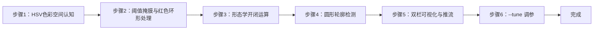
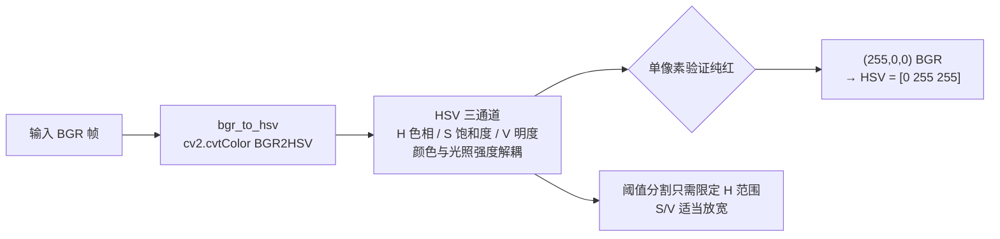
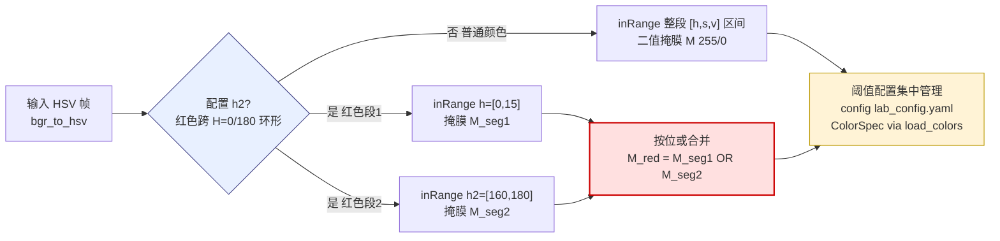
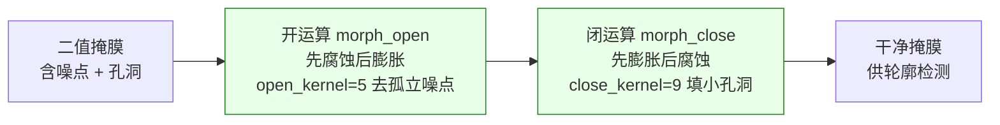
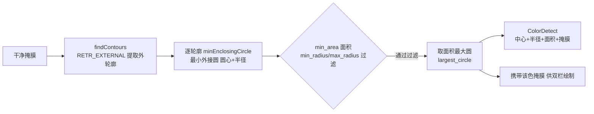
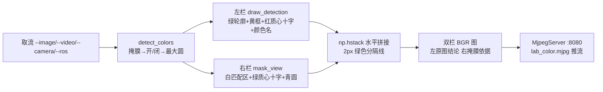
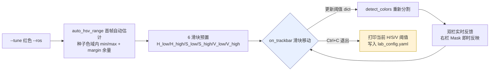

## 实验3：基于HSV色彩空间的颜色识别实验（4h）

> ✅ **源码已核实** 本实验源码位于 `ros2_ws/src/xflz_eai_car1/vision/03_lab_color_recognition/`。⚠️ **注意**：课程目录名 "lab" 指实验编号，本实验实际使用 **HSV 色彩空间**（非 Lab 色彩空间）。对应课程内容：BGR→HSV 阈值掩膜 → 形态学开/闭 → 圆形轮廓标识 → 颜色名标注；可视化对齐车端 `visual_grasp` 双栏（左 RGB 栏 | 右 HSV Mask 栏）推流。单测 24/24 全绿，板端验证通过（约 50 FPS）。

### 1.1 关联知识点

- 1.1.1 HSV色彩空间 > 原理 > HSV（色相/饱和度/明度）将颜色信息与光照强度解耦，比 RGB 更适合阈值分割；OpenCV 约定 H∈0-179、S/V∈0-255
- 1.1.2 色彩阈值掩膜 > 流程 > `cv2.inRange` 生成二值掩膜；红色在 0/180 交界需 h2 第二段（环形色相处理）
- 1.2.1 形态学运算 > 概念 > 开运算（先腐蚀后膨胀）去孤立噪点，闭运算（先膨胀后腐蚀）填小孔洞；核须奇数
- 1.2.2 轮廓检测 > 流程 > `cv2.findContours` → 最小外接圆 `minEnclosingCircle`，按 min_area/min_radius/max_radius 过滤后取最大
- 1.3.1 实时颜色识别 > 流程 > 摄像头取流 → HSV 转换 → 阈值掩膜 → 形态学 → 圆形轮廓 → 颜色名标注 → 双栏 MJPEG 推流
- 1.3.2 阈值调参 > 流程 > `--tune` 模式提供 H/S/V 6 滑块实时调参，Ctrl+C 退出并打印当前阈值，直接写入 config

### 1.2 实验目标

1. 掌握 HSV 色彩空间与 RGB 的转换原理，理解阈值分割的适用范围与局限 — 原理理解
2. 实现摄像头实时采集、多色目标检测（红/蓝/绿）与颜色名标注 — 独立完成
3. 掌握形态学运算与轮廓分析在目标提取中的作用，学会用 --tune 调参应对光照变化 — 迁移应用

### 1.3 实验环境

| 类别 | 配置 |
|------|------|
| 硬件 | 具身智能实验箱 B2（XFLZ_EAI_B2_PRO，RK3576 SoC，6TOPS NPU，含 HP60C 深度相机） |
| OS | Ubuntu 22.04 + ROS2 Humble（板载 ros2_venv） |
| 核心库 | OpenCV、NumPy、PyYAML（纯 CPU 视觉管线，无需 NPU） |
| 主入口 | `src/app.py`（图像/视频/相机 CLI + MJPEG 双栏流 + `--tune` 调参） |

### 1.4 实验难度

- 难度: ⭐ 验证性
- 重点: HSV 阈值掩膜 + 形态学开/闭 + 圆形轮廓标识 + 颜色名标注
- 难点: 红色跨 0/180 边界的 h2 环形处理；光照变化下的阈值鲁棒性

### 1.5 实验现象

**快速验证流程**：

1. 进入项目目录：`cd ros2_ws/src/xflz_eai_car1/vision/03_lab_color_recognition`
2. 单元测试：`pytest tests/ -v`（24 用例全绿）
3. 单图检测：`python src/app.py --image x.jpg --save out.jpg`
   - 输出双栏图：左 RGB 栏（绿轮廓+黄框+红质心十字+颜色名）| 右 HSV Mask 栏（白匹配区）
4. 相机实时（板上标准）：先起 ascamera 驱动，再 `python src/app.py --ros`
   - MJPEG：`http://<板IP>:8080/lab_color.mjpg`（同双栏）
5. 调参：`python src/app.py --tune 红色 --ros`，6 滑块实时调 H/S/V

**执行现象**：
- `pytest tests/ -v` 约 10-20 秒完成，终端输出 24 个用例全部 passed（涵盖 config 加载/校验、bgr_to_hsv 转换、range_mask 双段、morph_open/morph_close 核、largest_circle 过滤、detect_colors 管线、draw_detection 绘制、mask_view 渲染、auto_hsv_range 自动估计、app.py 主流程等）
- `python src/app.py --image x.jpg --save out.jpg` 约 0.1 秒返回，终端无报错，当前目录生成 `out.jpg`（双栏拼接图）；若图中含红/蓝/绿球，左栏可见绿轮廓+黄框+红十字+颜色名，右栏白色掩膜覆盖对应区域
- 板端 `--ros` 模式启动后，终端每帧打印 frame 编号，MJPEG 流 `http://<板IP>:8080/lab_color.mjpg` 可访问，双栏实时刷新，实测约 **50 FPS**（纯 CPU 管线）
- `--tune 红色 --ros` 启动后弹出 `lab_tune` 窗口（6 滑块）和 `lab_view` 窗口（双栏预览），首帧自动估计阈值并预置滑块位置；Ctrl+C 退出终端打印当前 H/S/V 阈值

```bash
# 进入实验03
cd ~/ros2_ws/src/xflz_eai_car1/vision/03_lab_color_recognition

# 可选
/home/iflytek/ros2_venv/bin/python -m pytest -v

# 执行单图片推理（图片都在02_garbage_classification/images）
python src/app.py --image image.jpg --save out.jpg
```

**预期效果描述**：
- 红/蓝/绿三种目标均能检出：圆形轮廓 + 窗口左下角颜色名正确
- 右栏 Mask 图实时显示匹配区域（白色），与左栏轮廓对应
- 板端实测约 50 FPS（纯 CPU 管线，无需 NPU）
- 光照变化导致误检/漏检时，`--tune` 可实时修正阈值


### 1.6 实验步骤

#### 整体流程图



---

#### 步骤1：HSV 色彩空间认知（阶段一：能运行，20min）

> 📌 本步骤对应源码：`src/preprocess.py` bgr_to_hsv（L36-38）

**知识点讲解**：

**HSV 与 RGB 的差异（1.1.1）**
- **原理**：RGB 将颜色编码为三通道强度，受光照影响大（同一红色在明/暗处 R/G/B 值差异巨大）。HSV 把颜色拆为色相 H（0-179°，决定"是什么颜色"）、饱和度 S（0-255，颜色纯净度）、明度 V（0-255，亮度），**颜色信息与光照强度解耦**——阈值分割时只需限定 H 范围 + 适当放宽 S/V，即可在光照变化下稳定识别。`bgr_to_hsv()`（L36-38）一行 `cv2.cvtColor(BGR2HSV)` 完成转换。注意 OpenCV 的 H 范围是 0-179（非 0-360），这是与教科书最常混淆的点。
- **源码对应**：`src/preprocess.py` L36-38（bgr_to_hsv）

**知识储备补充**：

- **色彩空间背景**：RGB 是面向显示设备的加色混合模型——三个通道直接对应显示器的红/绿/蓝子像素亮度。在光照变化场景下，同一物体的 RGB 三通道值会同时漂移（变暗时 R/G/B 都下降），导致"同一颜色在不同光照下 RGB 值差异巨大"，阈值分割极不稳定。HSV 将颜色信息（H）与光照强度（V）分离：H 只取决于色相角度（与亮度无关），V 只反映明暗，S 反映颜色纯净度。这种分离使 HSV 成为颜色分割的首选空间——只需固定 H 范围，S/V 允许较大浮动，即可在光照变化下稳定识别。
- **转换公式**：BGR→HSV 的数学定义。设 $R,G,B \in [0,1]$ 为归一化 BGR 三通道值，$V' = \max(R,G,B)$、$m = \min(R,G,B)$：
$$
  H = \begin{cases} 0 & \text{if } V' = m \\ 60 \times \left( \frac{G - B}{V' - m} \right) \bmod 360 & \text{if } V' = R \\ 60 \times \left( \frac{B - R}{V' - m} + 2 \right) \bmod 360 & \text{if } V' = G \\ 60 \times \left( \frac{R - G}{V' - m} + 4 \right) \bmod 360 & \text{if } V' = B \end{cases}
$$

$$
  S = \begin{cases} 0 & \text{if } V' = 0 \\ \frac{V' - m}{V'} & \text{if } V' > 0 \end{cases}
$$

$$
  V = V'
$$

OpenCV 内部将 $H$ 从 $[0°,360°)$ 映射到 $[0,179]$（uint8 存储，每个单位 = 2°），$S,V$ 从 $[0,1]$ 映射到 $[0,255]$。验证：纯红 $(R,G,B)=(255,0,0)$ → $V'=255,m=0$ → $H=60\times(0-0)/255=0$ → 映射后 $H=0$；$S=255/255=1$ → 映射后 $S=255$；$V=255$。即纯红 HSV = $(0,255,255)$，与实验中单像素验证一致。
- **通道语义**：H（Hue，色相）决定"是什么颜色"——0°/179° 红色、60° 黄色、120° 绿色、180° 青色（OpenCV 中 180° 即 H=90）、240° 蓝色、300° 品红。S（Saturation，饱和度）决定颜色纯净度——0 为灰（无彩色），255 为纯色。V（Value，明度）决定亮度——0 为全黑，255 为最亮。三通道语义独立，使阈值分割直观："红球 H∈[0,15]∪[160,180] + S>100 + V>80"即可框定红色目标。
- **参考资源**：OpenCV 官方文档 `cv2.cvtColor` COLOR_BGR2HSV 说明；Wikipedia "HSL and HSV" 条目（https://en.wikipedia.org/wiki/HSL_and_HSV）；《Digital Image Processing》（Gonzalez & Woods）第 6 章色彩空间。


**配置参数速查表**（`config/lab_config.yaml`，按区块分列）：

| 区块 | 参数 | 类型 | 默认/示例 | 说明 |
|------|------|------|-----------|------|
| `colors` | 列表 | list | 红/绿/蓝 3 项 | 颜色定义表（每项 name+h/s/v，红色含 h2 环形第二段） |
|`colors[]`|`name`|str|`红色`|显示名（窗口左下角）|
|`colors[]`|`h`|list|`[0,15]`|H 通道 [min,max]（H∈0-179）|
|`colors[]`|`s`/`v`|list|`[100,255]`/`[80,255]`|S 饱和度/V 明度范围|
|`colors[]`|`h2`|list|`[160,180]`|H 环形第二段（红色在 0/180 交口；仅红色用）|
|`morph`|`open_kernel`|int|`5`|开运算核（去噪点），奇数|
|`morph`|`close_kernel`|int|`9`|闭运算核（填孔洞），奇数|
|`morph`|`open_iter`/`close_iter`|int|`1`|形态学迭代次数|
|`contour`|`min_area`|int|`500`|最小轮廓面积（滤噪）|
|`contour`|`min_radius`/`max_radius`|int|`10`/`400`|外接圆半径范围|
|`camera`|`index`|int|`0`|VideoCapture 索引（V4L2 回退用）|
|`camera`|`width`/`height`|int|`640`/`480`|取流分辨率|
|`source`|`ros.rgb_topic`|str|`/ascamera_hp60c/.../rgb0/image`|相机话题（勿 remap）|
|`source`|`ros.timeout`|float|`5.0`|首帧等待秒数|
|`display`|`show`|bool|`false`|本地窗口（板上置 false 走 MJPEG）|
|`display`|`window_name`|str|`lab_color`|窗口名|

> **说明**：`colors`+`morph`+`contour` 为核心（颜色阈值与形态学）；`camera`/`source`/`display` 为运行环境（同 exp01/02 模板）。HSV 阈值须按环境光照实标定。

**操作步骤**：

1. 单像素验证 RGB→HSV 转换：
   ```bash
   # 执行目录：~/ros2_ws/src/xflz_eai_car1/vision/03_lab_color_recognition
   cd ~/ros2_ws/src/xflz_eai_car1/vision/03_lab_color_recognition
   PYTHONPATH=./src python -c "
   import cv2, numpy as np
   red = np.uint8([[[0, 0, 255]]])          # BGR 纯红
   hsv = cv2.cvtColor(red, cv2.COLOR_BGR2HSV)
   print('纯红 HSV:', hsv[0][0])             # 预期 H≈0, S≈255, V≈255"
   ```
2. 用一张彩色图可视化 HSV 三通道（H/S/V 分别显示），理解各通道语义


**易错点**：

- ⚠️ H 范围 0-179（OpenCV）≠ 0-360（教科书），阈值写错直接全黑

**流程图**：



---

#### 步骤2：阈值掩膜与红色环形处理（阶段一：能运行，25min）

> 📌 本步骤对应源码：`src/preprocess.py` range_mask（L41-51）、`src/config.py` ColorSpec

**知识点讲解**：

**inRange 阈值掩膜（1.1.2）**
- **原理**：`cv2.inRange(hsv, lower, upper)` 对每个像素判断是否落在阈值区间，生成二值掩膜（匹配=255，不匹配=0），是颜色分割的核心。**红色特殊**：红色在 H 环形色相中位于 0 附近，跨越 0/180 边界（H≈0 和 H≈179 都是红），单一区间 `[0,10]` 会漏掉 H≈179 的偏紫红。`ColorSpec` 支持 `h2` 第二段（如 `h=[0,10], h2=[170,179]`），`range_mask()`（L41-51）把两段掩膜**按位或**合并，解决红色环形问题——车端 visual_grasp 同款方案。阈值配置集中管理：`config/lab_config.yaml` 中每种颜色一组 HSV 范围 + 形态学核 + 轮廓过滤参数。
- **源码对应**：`src/preprocess.py` L41-51（range_mask，h2 并入 L46-49）；`src/config.py` ColorSpec（h/s/v/h2/过滤参数）

**知识储备补充**：

- **inRange 掩膜数学定义**：`cv2.inRange` 对每个像素位置 $(u,v)$ 执行逐通道范围判断：
$$
  M(u,v) = \begin{cases} 255 & \text{if } L_h \leq H(u,v) \leq U_h \;\wedge\; L_s \leq S(u,v) \leq U_s \;\wedge\; L_v \leq V(u,v) \leq U_v \\ 0 & \text{otherwise} \end{cases}
$$

其中 $(L_h, U_h)$、$(L_s, U_s)$、$(L_v, U_v)$ 分别为 H/S/V 的上下限阈值。输出为单通道 uint8 图像（255 = 匹配，0 = 不匹配），后续形态学运算基于此二值图。
- **红色环形处理**：色相 H 是角度量，0° 与 360°（OpenCV 中 180）重合。红色占据色相环两端：$H \in [0°,10°]$ 和 $H \in [340°,360°]$，对应 OpenCV 的 $H \in [0,5]$ 和 $H \in [170,179]$。单一区间 $[0,5]$ 只覆盖色相环的一端，偏紫红（$H \approx 170$）的目标会漏检。`range_mask`（L46-49）的 h2 并入逻辑：

  $$
  M_{\text{red}} = M_{\text{seg1}} \lor M_{\text{seg2}} = \text{inRange}(\text{seg1}) \;\texttt{bitwise\_or}\; \text{inRange}(\text{seg2})
  $$

  两段掩膜按位或合并后，红色目标的两个 H 段均被覆盖。`lab_config.yaml` 中红色配置为 `h: [0,15], h2: [160,180]`。
- **阈值配置管理**：`config/lab_config.yaml` 把每种颜色的 HSV 阈值、形态学核、轮廓过滤参数集中管理，代码侧通过 `load_config` + `load_colors` 读取。这使"调参"只需改 YAML 文件，无需触碰代码——是配置驱动设计的标准实践。
- **参考资源**：OpenCV 官方文档 `cv2.inRange`；《Learning OpenCV 3》第 10 章阈值与分割；车端 visual_grasp 方案参考（同款 h2 环形处理）。

**操作步骤**：

1. 查看 `config/lab_config.yaml` 中红/蓝/绿三色的 HSV 阈值，找出红色的 h2 第二段
2. 用测试图验证单色掩膜效果：
   ```bash
   # 执行目录：~/ros2_ws/src/xflz_eai_car1/vision/03_lab_color_recognition
   cd ~/ros2_ws/src/xflz_eai_car1/vision/03_lab_color_recognition
   PYTHONPATH=./src python -c "
   import cv2
   from preprocess import bgr_to_hsv, range_mask
   from config import load_config, load_colors
   cfg = load_config('config/lab_config.yaml')
   colors = load_colors(cfg)
   img = cv2.imread('image.jpg')
   hsv = bgr_to_hsv(img)
   for c in colors:
       mask = range_mask(hsv, c)
       print(c.name, '匹配像素:', int(mask.sum()/255))"
   ```
3. 尝试删除红色 h2 第二段，观察偏红目标是否漏检

**易错点**：

- ⚠️ 红色不用 h2 会漏检偏紫红目标——红色必须双段处理

**流程图**：



---

#### 步骤3：形态学开/闭运算（阶段二：能理解，25min）

> 📌 本步骤对应源码：`src/preprocess.py` morph_open（L53-56）/ morph_close（L59-62）

**知识点讲解**：

**形态学运算原理（1.2.1）**

- **原理**：二值掩膜常含噪点（误检像素）与孔洞（目标内部漏检）。**开运算** = 先腐蚀后膨胀：腐蚀先"吃掉"孤立小噪点，膨胀再恢复目标尺寸，结果**去噪点**；**闭运算** = 先膨胀后腐蚀：膨胀先"填平"目标内部小孔洞，腐蚀恢复尺寸，结果**填孔洞**。核用 `cv2.MORPH_ELLIPSE` 椭圆核（对圆形目标最友好），核尺寸须为奇数（`open_kernel=5` 去噪点、`close_kernel=9` 填孔洞，L53-62）。形态学处理显著提升后续轮廓检测的稳定性——噪点不除会干扰"最大圆"判定，孔洞不填会低估目标面积。
- **源码对应**：`src/preprocess.py` L53-56（morph_open）、L59-62（morph_close）

**知识储备补充**：

- **腐蚀与膨胀的数学定义**：设二值图像 $A$、结构元素（核）$B$，腐蚀和膨胀分别为：

  $$
  A \ominus B = \{ x \mid B_x \subseteq A \} \qquad \text{（腐蚀：核内所有像素均为前景才保留）}
  $$

  $$
  A \oplus B = \{ x \mid B_x \cap A \neq \varnothing \} \qquad \text{（膨胀：核内任一像素为前景即置为前景）}
  $$

  其中 $B_x$ 为核 $B$ 平移到位置 $x$ 的集合。腐蚀"收缩"前景区域，膨胀"扩张"前景区域。开运算 $A \circ B = (A \ominus B) \oplus B$ 先腐蚀后膨胀——腐蚀消除面积小于核的小噪点，膨胀恢复剩余前景的原始尺寸；闭运算 $A \bullet B = (A \oplus B) \ominus B$ 先膨胀后腐蚀——膨胀填平面积小于核的小孔洞，腐蚀恢复轮廓。
- **结构元素选择**：`cv2.getStructuringElement(cv2.MORPH_ELLIPSE, (k,k))` 生成 $k \times k$ 椭圆核（近似圆形），对本实验的圆形目标最友好。矩形核易在对角方向引入方块效应，十字核只处理 4-连通方向。核尺寸须为奇数——偶数核会导致锚点（anchor）不对称，OpenCV 行为未定义（实际可能报错或产生偏移）。默认 `open_kernel=5`（约 2 像素半径的噪点可去）、`close_kernel=9`（约 4 像素半径的孔洞可填）。
- **形态学参数对检测的影响**：`open_kernel` 过小去不掉稍大的噪点，过大吞掉小目标（面积小于核的前景全被腐蚀）；`close_kernel` 过小填不了稍大的孔洞，过大将相邻目标误连。`open_iter`/`close_iter` 控制迭代次数——多次迭代等价于使用更大的核（开运算多次迭代 = 腐蚀后膨胀交替重复，每次扩大效果范围）。
- **参考资源**：OpenCV 官方文档 `cv2.morphologyEx` / `cv2.getStructuringElement`；《Digital Image Processing》（Gonzalez & Woods）第 9 章形态学图像处理。


**操作步骤**：

1. 对比形态学处理前后的掩膜：
   ```bash
   # 执行目录：~/ros2_ws/src/xflz_eai_car1/vision/03_lab_color_recognition
   cd ~/ros2_ws/src/xflz_eai_car1/vision/03_lab_color_recognition
   PYTHONPATH=./src python -c "
   import cv2, numpy as np
   from preprocess import bgr_to_hsv, range_mask, morph_open, morph_close
   from config import load_config, load_colors
   cfg = load_config('config/lab_config.yaml')
   colors = load_colors(cfg)
   hsv = bgr_to_hsv(cv2.imread('image.jpg'))
   raw = range_mask(hsv, colors[0])
   opened = morph_open(raw)
   closed = morph_close(opened)
   print('原始像素:', int(raw.sum()/255), '→ 开运算后:', int(opened.sum()/255), '→ 闭运算后:', int(closed.sum()/255))"
   ```
2. 修改 config 中的 kernel 尺寸（改为偶数），观察报错或行为异常——理解"核须奇数"约束
3. 思考：开运算先腐蚀后膨胀，为什么能去噪点而不是扩大空洞？

**易错点**：

- ⚠️ 核尺寸必须奇数（偶数核 OpenCV 报错或行为未定义）
- ⚠️ 核过大过小都影响效果：过大吞掉小目标，过小去不掉噪点

**流程图**：



---

#### 步骤4：圆形轮廓检测（阶段二：能理解，25min）

> 📌 本步骤对应源码：`src/preprocess.py` largest_circle（L65-79）

**知识点讲解**：

**轮廓分析提取目标（1.2.2）**

- **原理**：形态学处理后的掩膜包含目标区域，`cv2.findContours` 提取所有连通域轮廓，对每个轮廓 `cv2.minEnclosingCircle` 求最小外接圆（圆心+半径）。`largest_circle()`（L65-79）按 `min_area`（面积过滤噪点）、`min_radius/max_radius`（限目标尺寸范围）过滤后**取面积最大的圆**作为该颜色的目标。`detect_colors()`（L93-107）对每种颜色执行完整管线：掩膜 → 开/闭 → 最大圆，输出携带该色掩膜的 `ColorDetect`（供双栏绘制）。这是"阈值分割 + 形态学 + 几何分析"的经典目标提取链路。
- **源码对应**：`src/preprocess.py` L65-79（largest_circle）、L93-107（detect_colors）

**知识储备补充**：

- **findContours 原理**：`cv2.findContours(mask, cv2.RETR_EXTERNAL, cv2.CHAIN_APPROX_SIMPLE)` 提取二值掩膜的外轮廓。`RETR_EXTERNAL` 只检索最外层轮廓（忽略嵌套），`CHAIN_APPROX_SIMPLE` 压缩水平/垂直/对角线段为端点，减少存储。输出为轮廓点集列表，每个轮廓是 $N \times 1 \times 2$ 的坐标数组。
- **最小外接圆**：`cv2.minEnclosingCircle(cnt)` 基于 Welzl 算法在 $O(n)$ 期望时间内求解最小包围圆——给定轮廓点集，找到面积最小的圆包含所有点。返回 `(圆心(cx,cy), 半径radius)`。相比最小外接矩形（`boundingRect`），最小外接圆对圆形目标更紧凑，不受旋转影响，是本实验"圆球检测"的自然选择。
- **轮廓过滤参数语义**：`min_area=500`（`lab_config.yaml`）过滤面积 < 500 像素的连通域——这些通常是噪点或极远距离的小目标；`min_radius=10` / `max_radius=400` 限制外接圆半径范围——太小（<10px）为噪点，太大（>400px）可能是误检的大片背景。三个参数需按实际摄像头分辨率和目标距离标定，是"阈值分割 + 几何约束"双重过滤的核心。
- **取最大圆的策略**：`largest_circle`（L65-79）遍历所有满足过滤条件的轮廓，保留面积最大的圆。这假设画面中每种颜色只有一个主目标——若需多目标计数，可修改为返回全部满足条件的圆列表（扩展方向 1）。
- **参考资源**：OpenCV 官方文档 `cv2.findContours` / `cv2.minEnclosingCircle`；Welzl 算法论文 "Smallest enclosing disks (balls and ellipsoids)"（Welzl, 1991）。

**操作步骤**：

1. 运行单测验证轮廓逻辑：
   ```bash
   # 执行目录：~/ros2_ws/src/xflz_eai_car1/vision/03_lab_color_recognition
   cd ~/ros2_ws/src/xflz_eai_car1/vision/03_lab_color_recognition
   PYTHONPATH=./src PYTEST_DISABLE_PLUGIN_AUTOLOAD=1 python -m pytest tests/test_preprocess.py -v
   ```
2. 修改 config 的 min_area/min_radius，观察小噪点目标是否被过滤、大目标是否被误滤
3. 思考：为什么用"最小外接圆"而非"外接矩形"？对本实验的圆形目标哪个更稳？

**易错点**：

- ⚠️ min_area 过小 → 噪点被当目标；过大 → 小目标漏检——需按实际画面调
- ⚠️ 掩膜残留小连通域时最大圆判定会错——形态学开运算必须前置

**流程图**：



---

#### 步骤5：双栏可视化与 MJPEG 推流（阶段三：能改造，30min）

> 📌 本步骤对应源码：`src/app.py` process_frame（L25-31）、dual_view（L34-37）；`src/preprocess.py` draw_detection（L109-125）/ mask_view（L127-135）

**知识点讲解**：

**visual_grasp 风格双栏显示（1.3.1）**
- **原理**：车端 `visual_grasp` 采用**双栏布局**：左栏 RGB 原图上叠加检测结果（`draw_detection`，L109-125：绿轮廓 + 黄外接框 + 红质心十字 + 颜色名），右栏 HSV Mask 图（`mask_view`，L127-135：白=匹配区域 + 绿质心十字 + 青圆）。双栏并排让学习者**同时看到"原图结论"与"处理依据"**——掩膜栏直观展示阈值分割效果，是调参与排查误检的利器。`app.py` 组织取流（--image/--video/--camera/--ros）→ detect_colors → 双栏合成 → MJPEG 推流（`http://<板IP>:8080/lab_color.mjpg`）。
- **源码对应**：`src/preprocess.py` L109-125（draw_detection）、L127-135（mask_view）；`src/app.py` L25-31（process_frame）、L34-37（dual_view）

**知识储备补充**：

- **双栏合成逻辑**：`dual_view`（app.py L34-37）用 `np.hstack` 水平拼接左栏（RGB 原图+标注）和右栏（Mask 灰度→BGR），中间插入 2 像素宽的绿色分隔线（`gap[:,:,1]=255`）。输出为单张 BGR 图像，同时用于本地窗口显示（`cv2.imshow`）和 MJPEG 推流（`server.set_frame`）。这种"一张图两个视角"的设计让学习者一眼看到"检测结论（左）"与"分割依据（右）"的对应关系。
- **MJPEG 推流原理**：MJPEG（Motion JPEG）将每帧编码为独立 JPEG 图像，通过 HTTP multipart 流式推送。浏览器访问 `http://<板IP>:8080/lab_color.mjpg` 即可实时查看——无需安装任何客户端，兼容所有现代浏览器。`MjpegServer`（mjpeg_server.py）在后台线程监听 8080 端口，`process_frame` 每帧调用 `server.set_frame(view)` 更新推送缓冲区。
- **检测标注语义**：`draw_detection`（L109-125）的绘制元素——绿轮廓（`cv2.drawContours`，绿色=检测到的区域边界）、黄外接框（`cv2.rectangle`，黄色=boundingRect 矩形）、红质心十字（`cv2.drawMarker`，红色十字=外接圆圆心）、颜色名文字（`cv2.putText`，红色文字）——每种元素传递不同信息，便于学习者区分轮廓边界、矩形范围、质心位置。
- **参考资源**：OpenCV 官方文档 `cv2.drawContours` / `cv2.rectangle` / `cv2.drawMarker` / `cv2.putText`；MJPEG 协议 RFC 2435（JPEG 格式）与 HTTP multipart 流模式。

**操作步骤**：

1. 单图双栏输出：
   ```bash
   # 执行目录：~/ros2_ws/src/xflz_eai_car1/vision/03_lab_color_recognition
   cd ~/ros2_ws/src/xflz_eai_car1/vision/03_lab_color_recognition
   python src/app.py --image image.jpg --save out.jpg
   # out.jpg 为双栏：左原图标注 | 右 HSV Mask
   ```

   

2. 相机实时（板上标准）：

   ```bash
   # 终端 1：启动相机驱动
   source /opt/ros/humble/setup.bash && source ~/ros2_ws/install/setup.bash
   export ROS_DOMAIN_ID=2
   ros2 launch ascamera hp60c.launch.py
   
   # 终端 2：运行颜色识别
   source /opt/ros/humble/setup.bash && source ~/ros2_ws/install/setup.bash
   export ROS_DOMAIN_ID=2
   cd ~/ros2_ws/src/xflz_eai_car1/vision/03_lab_color_recognition
   python src/app.py --ros
   # MJPEG: http://<板IP>:8080/lab_color.mjpg（双栏实时）
   ```

   ```bash
   (ros2_venv) iflytek@localhost:~/ros2_ws/src/xflz_eai_car1/vision/03_lab_color_recognition$ python src/app.py --ros
   
   Streams index: http://127.0.0.1:8080
   Available streams:
   
   http://127.0.0.1:8080/lab_color.mjpg
   --------------------------------
   
   
   Streams index: http://10.1.134.58:8080
   Available streams:
   
   http://10.1.134.58:8080/lab_color.mjpg
   --------------------------------
   
   
   Press Ctrl+C to stop the server
   
   30帧平均帧率: 33.0
   30帧平均帧率: 33.9
   ```

   

3. 动手改造：修改 `draw_detection` 的绘制样式（如改颜色名位置、加 FPS 显示），重新运行

**易错点**：

- ⚠️ --ros 取不到帧 → ascamera 先起、ROS_DOMAIN_ID 一致、话题勿 remap
- ⚠️ 双栏显示依赖显示器；无显示器时用 MJPEG 流查看

**流程图**：



---

#### 步骤6：--tune 实时调参（阶段三：能改造，25min）

> 📌 本步骤对应源码：`src/app.py` _tune_mode（L41-105）、`src/preprocess.py` auto_hsv_range（L138-166）

**知识点讲解**：

**调参模式与自动化（1.3.2）**
- **原理**：光照变化是颜色分割的最大敌人。`--tune` 模式提供 6 个滑块（H_low/H_high/S_low/S_high/V_low/V_high）实时调整目标颜色的 HSV 阈值，画面即时反馈——看到掩膜栏变化即可判断阈值是否合适，Ctrl+C 退出时打印当前阈值。`auto_hsv_range()`（L138-166）更进一步：**从首帧自动估计目标色 HSV 范围**——在种子色域（先验 H 范围）内统计像素 min/max + 余量 margin，输出可直接写入 config 的阈值，减少手工调参工作量。
- **源码对应**：`src/app.py` L41-105（_tune_mode）；`src/preprocess.py` L138-166（auto_hsv_range）

**知识储备补充**：

- **自动阈值估计原理**：`auto_hsv_range`（L138-166）的工作流程——(1) 对首帧做 BGR→HSV 转换；(2) 在种子色域（`spec.h` 和 `spec.h2` 两段 H 范围）内用 `cv2.inRange` 粗筛像素；(3) 若筛选到的像素数 ≥ `min_pixels=50`（场景中确实有该色目标），统计这些像素的 H/S/V min/max；(4) H 范围加 `margin=10` 余量，S/V 下限减 30（放宽低饱和度/暗区容差），上限保持 255。输出格式与 `lab_config.yaml` 中的 `h/s/v` 字段一致，可直接写入。对红色（有 h2），两段分别统计，取像素更多的那段做主区间。
- **调参模式的实时反馈回路**：`_tune_mode`（app.py L41-105）构建了"滑块→掩膜→双栏→视觉反馈"的闭环——每次滑块移动触发 `on_trackbar` 回调更新阈值 dict，主循环用新阈值重新 `detect_colors`，右栏 Mask 实时反映分割效果。这种即时反馈让学习者直观理解"HSV 阈值如何影响分割结果"——比纯理论讲解有效得多。
- **光照变化应对策略**：HSV 的 V 通道直接编码亮度，因此光照变暗时 V 值整体下降。应对方法：(1) 放宽 V 下限（如 `v: [60,255]` 而非 `[100,255]`）；(2) 用 `--tune` 实时调参适配当前光照；(3) 用 `auto_hsv_range` 自动标定。`auto_hsv_range` 的 `margin` 参数（默认 10）控制阈值宽松度——margin 越大对光照变化越鲁棒，但误检风险也增加。
- **参考资源**：OpenCV 官方文档 `cv2.createTrackbar` / `cv2.getTrackbarPos`；自适应阈值方法参考《Automatic Threshold Selection for Color Image Segmentation》。

**操作步骤**：

1. 启动调参模式（板上走 --ros，PC 走 --camera/--video）：
   ```bash
   # 执行目录：~/ros2_ws/src/xflz_eai_car1/vision/03_lab_color_recognition
   cd ~/ros2_ws/src/xflz_eai_car1/vision/03_lab_color_recognition
   python src/app.py --tune 红色 --ros
   # 滑块窗口 lab_tune：6 滑块实时调 H/S/V
   # 双栏窗口 lab_view 实时预览；Ctrl+C 退出并打印当前阈值
   ```

2. 把打印的阈值写入 `config/lab_config.yaml` 对应颜色，验证"调参结果落盘"

3. 试用手动光照变化（遮挡/移动光源），观察误检与漏检，练习快速调参

4. 进阶：调用 `auto_hsv_range` 自动估计阈值，与手动调参结果对比


**易错点**：
- ⚠️ 调参环境（光照）与实际运行环境必须一致，否则调好的阈值现场失效
- ⚠️ tune 模式需显示器；板上用 MJPEG 流辅助观察

**流程图**：



---

### 1.7 常见问题

| 问题 | 原因 | 解决方法 |
|------|------|---------|
| 红色目标漏检 | 未配置 h2 第二段（红色跨 0/180） | config 中加 h2（如 h=[0,10], h2=[170,179]） |
| 噪点被当目标 | min_area 过小 / 未做开运算 | 增大 min_area；确认 morph_open 前置 |
| 目标孔洞导致面积偏小 | 未做闭运算 | 增大 close_kernel（须奇数） |
| 光照变化后误检/漏检 | 阈值不适应新光照 | 用 --tune 实时调参或 auto_hsv_range 自动估计 |
| 核尺寸报错 | kernel 为偶数 | 改为奇数（open_kernel=5, close_kernel=9） |
| 双栏显示异常 | --ros 取流失败或显示器缺失 | ascamera 先起、ROS_DOMAIN_ID 一致；无显示器用 MJPEG |

### 1.8 扩展实验

**扩展方向 1：多目标多色计数（进阶）**
- 修改 `detect_colors` 支持每种颜色检出多个目标（返回全部满足过滤的圆而非仅最大），实现"红球 3 个、蓝球 2 个"的计数功能

**扩展方向 2：自适应阈值（进阶）**
- 用 `auto_hsv_range` 做首帧自动标定 + 周期性重标定，实现光照自适应；或引入直方图峰谷分析自动确定阈值

### 1.9 实验报告要求

**评分标准**：HSV 原理理解 15 分 + 阈值掩膜与 h2 环形处理 20 分 + 形态学 20 分 + 轮廓检测 15 分 + 实时演示 20 分 + 报告 10 分 = 100 分。

**报告必含内容**：
1. HSV 与 RGB 对比说明（含纯红 HSV 值验证截图）
2. 三色阈值表（含红色 h2 双段）与掩膜效果图
3. 形态学开/闭前后掩膜对比图，标注噪点/孔洞变化
4. 双栏检测结果图（左 RGB | 右 Mask）与颜色名标注
5. 回答思考题：为什么红色需要 h2 双段？开运算为什么能去噪点？光照变化下如何调参？
6. 实验心得与问题记录

---

## 更新日志

| 版本 | 日期 | 变更 |
|------|------|------|
| v1.0 | 2026-08-10 | 初版生成（源码路径 ros2_ws/src/xflz_eai_car1/vision/03_lab_color_recognition，24 用例全绿，板端 50 FPS，HSV 双段红色处理 + 形态学 + 圆形轮廓 + 双栏推流） |
| v2.0 | 2026-08-19 | 知识点增强：各核心知识点追加「知识储备补充」（HSV转换公式/inRange掩膜数学定义/形态学腐蚀膨胀公式/findContours原理/最小外接圆/双栏合成/MJPEG推流/自动阈值估计/光照变化应对）；1.5 追加可复现代码块与执行现象 |
| v2.1 | 2026-08-21 | 步骤 1 新增「配置参数速查表」：config/lab_config.yaml 全参数分列（colors/morph/contour/camera/source/display），含 H2 环形处理与阈值标定要点。表值经 load_config 实测核对 |
