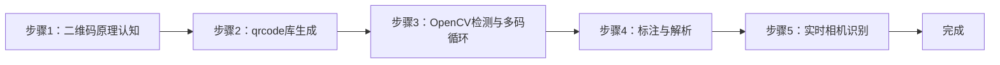
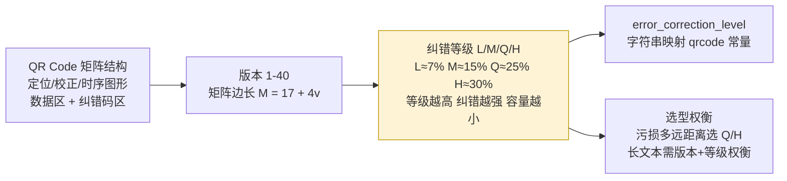
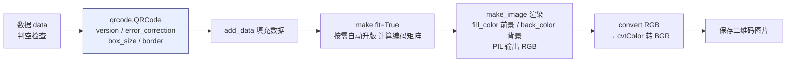
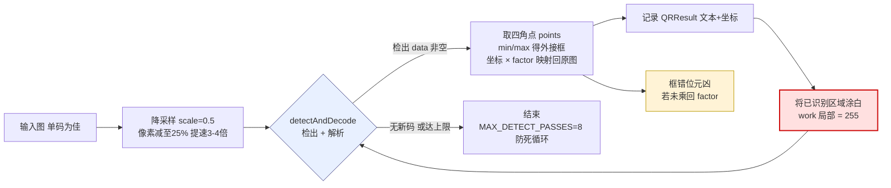
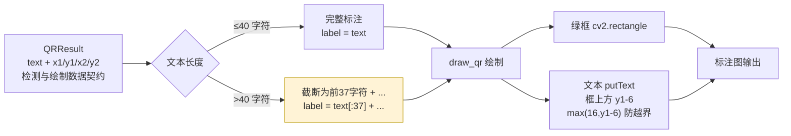
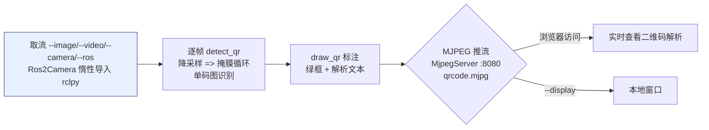

## 实验4：二维码生成与识别检测实验（4h）

> ✅ **源码已核实** 本实验源码位于 `ros2_ws/src/xflz_eai_car1/vision/04_qrcode/`。生成用 `qrcode` 库（纯 Python），检测用 **OpenCV 内置 `QRCodeDetector`**（零新增、无需模型权重，替代参考的 pyzbar——后者需系统库 libzbar0）。唯一新增依赖：`qrcode 7.4.2 + pypng`（板上需 `pip install -i https://pypi.tuna.tsinghua.edu.cn/simple qrcode`）。单测 19/19 全绿。

### 1.1 关联知识点

- 1.1.1 二维码编码原理 > 原理 > 二维码（QR Code）通过矩阵码元编码数据，含功能图形（定位/校正/时序）与数据区；支持版本 1-40、4 级纠错（L/M/Q/H）
- 1.2.1 QRCode 库生成 > 流程 > `qrcode.QRCode(version, error_correction, box_size, border)` + `add_data` + `make_image`，生成图片保存
- 1.3.1 OpenCV 实时检测 > 流程 > `cv2.QRCodeDetector.detectAndDecode` 返回数据与四角点坐标；单码图可掩掉已识别区域循环检测，但**整图多码会触发单目标检测器定位串扰而失败**（需逐码分图）
- 1.3.2 实时识别与解析 > 流程 > 摄像头取流 → 逐帧 detectAndDecode → 框选识别区域 + 打印解析文本 → MJPEG 推流

### 1.2 实验目标

1. 掌握二维码的编码生成原理（版本/纠错/尺寸参数语义）— 原理理解
2. 使用 OpenCV 内置检测器实现摄像头实时检测并解析二维码内容 — 独立完成
3. 理解"生成-检测-解析"闭环在物联网/工业场景的应用（设备标识、信息传递）— 迁移应用

### 1.3 实验环境

| 类别 | 配置 |
|------|------|
| 硬件 | 具身智能实验箱 B2（XFLZ_EAI_B2_PRO，RK3576 SoC，6TOPS NPU，含 HP60C 深度相机） |
| OS | Ubuntu 22.04 + ROS2 Humble（板载 ros2_venv） |
| 核心库 | OpenCV（内置 QRCodeDetector）、qrcode 7.4.2 + pypng（需安装）、NumPy |
| 模型 | 无需模型权重（QRCodeDetector 为 OpenCV 内置算法） |
| 主入口 | `src/app.py`（--generate 生成 / --detect 检测，支持图像/视频/相机/ROS 模式） |

### 1.4 实验难度

- 难度: ⭐ 验证性
- 重点: 二维码生成参数语义 + OpenCV 实时检测解析
- 难点: 理解 `QRCodeDetector` 单目标检测局限（整图多码定位串扰失败，需逐码分图）；低分辨率/远距离二维码的识别率

### 1.5 实验现象

**快速验证流程**：

1. 进入项目目录：`cd ros2_ws/src/xflz_eai_car1/vision/04_qrcode`
2. 安装依赖（板上）：`pip install -i https://pypi.tuna.tsinghua.edu.cn/simple qrcode`
3. 单元测试：`pytest tests/ -v`（19 用例全绿）
4. 生成二维码：`python src/app.py --generate "https://example.com" --save my_qr.png`
   - 手机/电脑扫码可打开对应内容
5. 识别：`python src/app.py --detect --image my_qr.png`
   - 终端打印解析文本，输出框选标注图
6. 相机实时（板上标准）：先起 ascamera 驱动，再 `python src/app.py --detect --ros`
   - MJPEG：`http://<板IP>:8080/qrcode.mjpg`，手机屏幕/打印码实时识别

```bash
# 进入实验04
cd ~/ros2_ws/src/xflz_eai_car1/vision/04_qrcode

# 可选
/home/iflytek/ros2_venv/bin/python -m pytest -v

# 生成二维码
python src/app.py --generate "https://example.com" --save my_qr.png

# 识别刚刚生成的二维码
python src/app.py --detect --image my_qr.png
```

**预期效果描述**：

- 生成：指定数据、版本、纠错等级、尺寸的二维码图片正确保存
- 识别：图像中二维码被绿框框选，框上方打印解析文本（≤40 字符截断）
- 多码说明：`cv2.QRCodeDetector` 为单目标检测器，**整图含多码时第一轮定位即失败**（详见步骤3 限说明）；多码需逐码分图检测
- 实时：摄像头对准手机屏幕/打印的二维码即时解析，MJPEG 流实时更新

**执行现象**：
- 单元测试：`pytest tests/ -v` 运行约 3-5 秒，输出 19 个用例全部 passed，覆盖 generate（版本/纠错/空数据）、detect（单码 roundtrip / 噪声空 / 降采样坐标映射）、draw（截断标注）、config（schema 校验/色域检查）四组（注意：单测的 detect 均为**单码**用例——与整图多码不可行的实测一致）
- 生成命令：`python src/app.py --generate "https://example.com" --save my_qr.png` 立即返回，终端输出 `已保存: my_qr.png`，文件大小约 3-4 KB（版本 1 + 纠错 M + box_size 5）
- 识别命令：`python src/app.py --detect --image my_qr.png --save out.png` 立即返回，终端打印 `[QR] https://example.com`，`out.png` 中二维码区域被绿框框选、框上方显示完整文本
- 多码说明：`detect_qr` 的掩膜循环**依赖检测器先定位到单码**。同一张图内含多个二维码时，OpenCV `QRCodeDetector` 定位阶段会把不同码的 finder pattern 交叉误配成伪码，第一轮 `detectAndDecode` 即返回空串（`data=''`），循环不触发——**整图并行识别多码实测不可行**（x86 4.8.1 与板端 ROS OpenCV 一致）。多码场景应逐码分图检测（见步骤3）
- 实时流：板上启动后 MJPEG 流地址 `http://<板IP>:8080/qrcode.mjpg` 可在浏览器打开，对准手机屏幕上的二维码时文本即时刷新，延迟 < 0.5 秒

```bash
(ros2_venv) iflytek@localhost:~/ros2_ws/src/xflz_eai_car1/vision/04_qrcode$ python src/app.py --generate "https://example.com" --save my_qr.png
QR 已保存: /home/iflytek/ros2_ws/src/xflz_eai_car1/vision/04_qrcode/my_qr.png
(ros2_venv) iflytek@localhost:~/ros2_ws/src/xflz_eai_car1/vision/04_qrcode$ python src/app.py --detect --image my_qr.png
[QR] https://example.com
```


### 1.6 实验步骤

#### 整体流程图



---

#### 步骤1：二维码原理认知（阶段一：能运行，20min）

> 📌 本步骤对应源码：`src/config.py` error_correction_level

**知识点讲解**：

**QR Code 结构与纠错原理（1.1.1）**
- **原理**：QR Code（Quick Response Code）是矩阵式二维条码，结构含：**定位图形**（三个角的回字方块，用于检测与旋转校正）、**校正图形**（版本≥2 时的小方块，用于畸变校正）、**时序图形**（定位图形间黑白交替线）、数据区与纠错码区。**版本**（1-40）决定尺寸与容量，版本越高容量越大；**纠错等级**（L≈7%/M≈15%/Q≈25%/H≈30% 恢复能力）决定污损/遮挡容忍度——等级越高纠错越强但数据容量越小。`error_correction_level()` 把配置中的 L/M/Q/H 字符串映射为 qrcode 库常量。
- **源码对应**：`src/config.py` error_correction_level；`config/qr_config.yaml`（generate.version / error_correction / box_size / border）

**知识储备补充**：

- **QR Code 矩阵结构**：QR Code 是由方形模块（module）组成的二维矩阵。每个模块为 1 bit（黑=1，白=0）。矩阵尺寸由版本号决定——版本 $v$ 的矩阵边长 $M$ 满足：
  $$
  M = 17 + 4v
  $$
  
  例如版本 1 为 21×21 模块，版本 10 为 57×57，版本 40 为 177×177。功能图形（定位、校正、时序）固定占位，剩余面积容纳数据与纠错码。
  
- **Reed-Solomon 纠错原理**：QR Code 使用 Reed-Solomon（RS）纠错码，属于多项式纠错码。编码过程：将数据视为 GF(256) 域上的多项式 $d(x)$，生成 $t$ 个校验符号——$t$ 由纠错等级决定（L: $t \approx 7\% \cdot n$，M: 15%，Q: 25%，H: 30%，$n$ 为总符号数）。解码时可纠正 $\lfloor t/2 \rfloor$ 个符号错误或 $t$ 个擦除（位置已知的错误）。本项目配置纠错等级为 M（`config/qr_config.yaml` L4），可恢复约 15% 的码元污损——工业场景（污损多、距离远）应选 Q 或 H 等级。

- **版本与容量关系**：每个版本的每个纠错等级有固定数据容量（字节）。版本 1-L 约 17 字节，版本 10-M 约 395 字节，版本 40-H 约 1852 字节。`qrcode.QRCode(version=1, ...)` 设定版本 1，若数据超出该版本容量，`make(fit=True)` 会自动升版至足够大的版本。这也是本项目配置注释"勿用 H——板端实测 cv2.QRCodeDetector 解不了 H+中文 UTF-8"的原因：H 等级纠错码占比最高（约 30%），留给数据的空间最小，中文 UTF-8 编码体积大，版本 1+H 无法容纳。

- **参考资源**：ISO/IEC 18004:2015 标准（QR Code 符号规范）；`qrcode` 库官方文档 `https://pypi.org/project/qrcode/`；Thonky QR Code 教程 `https://www.thonky.com/qr-code-tutorial/`


**配置参数速查表**（`config/qrcode_config.yaml`，按区块分列）：

| 区块 | 参数 | 类型 | 默认/示例 | 说明 |
|------|------|------|-----------|------|
| `generate` | `version` | int | `1` | 二维码版本 1-40（fit=True 自动扩版） |
| `generate` | `error_correction` | str | `M` | 纠错级 L/M/Q/H；**勿用 H**（板载 cv2 解不了 H+中文） |
| `generate` | `box_size` | int | `5` | 每格像素数 |
| `generate` | `border` | int | `4` | 边框格数 |
| `generate` | `fill_color`/`back_color` | list | `[0,0,0]`/`[255,255,255]` | 前后景色 RGB |
| `detect` | `scale` | float | `0.5` | 检测前缩放（大图提速） |
| `camera` | `index` | int | `0` | VideoCapture 索引 |
| `camera` | `width`/`height` | int | `640`/`480` | 取流分辨率 |
| `display` | `show` | bool | `false` | 本地窗口（板上置 false） |
| `display` | `window_name` | str | `qrcode` | 窗口名 |
| `source` | `ros.rgb_topic` | str | `/ascara_hp60c/.../rgb0/image` | 相机话题（勿 remap） |
| `source` | `ros.timeout` | float | `5.0` | 首帧等待秒数 |
> **说明**：`generate`/`detect` 为本实验核心；`error_correction H` 为已知板端陷阱。`camera`/`source`/`display` 运行环境。

**操作步骤**：

1. 查看 `config/qr_config.yaml` 生成参数，理解 version/error_correction/box_size/border 语义
2. 阅读 `src/config.py` error_correction_level 实现
3. 思考：工业场景（污损多、距离远）应选什么纠错等级？为什么？

**易错点**：
- ⚠️ 纠错等级与容量互斥：等级越高单码容量越小，长文本需版本+等级权衡

**流程图**：



---

#### 步骤2：qrcode 库生成二维码（阶段一：能运行，25min）

> 📌 本步骤对应源码：`src/qr.py` generate_qr

**知识点讲解**：

**生成流程（1.2.1）**
- **原理**：`generate_qr()`（L30-45）完整演示生成四步：(1) 构造 `qrcode.QRCode(version, error_correction, box_size, border)`——version 指定固定版本（1-40），`make(fit=True)` 时若数据超出该版本会自动升版；(2) `add_data(data)` 填充用户数据；(3) `make(fit=True)` 计算编码矩阵；(4) `make_image(fill_color, back_color)` 渲染为 PIL 图像，`.convert("RGB")` 后经 OpenCV 转 BGR 输出。`box_size` 控制每模块像素数（清晰度），`border` 控制四周留白（标准为 4 模块）。空数据直接抛 `ValueError`（L32-33）。
- **源码对应**：`src/qr.py` L30-45（generate_qr：参数 L35-40 / add_data L41 / make L42 / 渲染转 BGR L43-45）

**知识储备补充**：

- **生成参数语义详解**：`qrcode.QRCode` 的四个构造参数各有明确语义——`version`（int 1-40 或 None）：固定版本号，None 时由 `make(fit=True)` 自动选择最小版本；`error_correction`：纠错等级常量（`ERROR_CORRECT_L/M/Q/H`），`config.py` L28-33 的 `EC_LEVELS` 字典完成字符串→常量映射；`box_size`（int）：每个模块渲染为多少像素的正方形，值越大生成图越大越清晰但文件越大；`border`（int）：四周静区（quiet zone）模块数，ISO 标准要求最少 4 模块，低于此值可能被扫描器忽略。

- **`fit=True` 自动升版机制**：当指定版本的数据容量不足以容纳输入数据时，`make(fit=True)` 会自动选择能容纳该数据的最小版本。这意味着 `generate_qr` 中 `version=1`（`config/qr_config.yaml` L3）配合 `fit=True` 是"从版本 1 开始，按需升版"——短 URL（如 `https://example.com`）保持版本 1，较长文本可能升至版本 2-5。

- **色域转换**：`qrcode` 库基于 PIL/Pillow 渲染，输出为 RGB 格式（`qr.py` L43：`.convert("RGB")`）。OpenCV 内部使用 BGR 格式，因此必须经 `cv2.cvtColor(..., cv2.COLOR_RGB2BGR)` 转换（L45），否则颜色通道错位导致前景/背景反转。

- **参考资源**：Pillow 文档 `Image.convert`；OpenCV 色彩空间转换 `cv2.cvtColor`；`qrcode` 源码 `qrcode.image.pil` 模块

**操作步骤**：

1. 生成并保存二维码：
   ```bash
   # 执行目录：~/ros2_ws/src/xflz_eai_car1/vision/04_qrcode
   cd ~/ros2_ws/src/xflz_eai_car1/vision/04_qrcode
   
   # 生成二维码内容为 "https://example.com"
   python src/app.py --generate "https://example.com" --save my_qr.png
   # my_qr.png 生成成功
   ```
2. 验证扫码：手机/电脑摄像头扫 my_qr.png，可打开 example.com
3. 中文字符测试：
   ```bash
   python src/app.py --generate "你好，具身智能" --save cn_qr.png
   ```
4. 对比不同纠错等级/版本的二维码密度差异（改 config 后重新生成，观察码图复杂度）

**易错点**：

- ⚠️ 数据为空 → ValueError（L32-33），先判空
- ⚠️ 生成图片色域：qrcode 库输出 RGB，OpenCV 显示需转 BGR（L45）

**流程图**：



---

#### 步骤3：OpenCV 检测与多码循环（阶段二：能理解，30min）

> 📌 本步骤对应源码：`src/qr.py` detect_qr

**知识点讲解**：

**QRCodeDetector 与掩膜循环（1.3.1）**
- **原理**：`cv2.QRCodeDetector.detectAndDecode(img)` 返回 `(data, points, straight_qrcode)`——data 为解析文本（失败时空串），points 为二维码四角点坐标。单次调用只检出一个码，`detect_qr()`（L48-79）在 `MAX_DETECT_PASSES=8` 上限内反复调用，每次检出后**把已识别区域涂白**（L74-78，`work[y1:y2,x1:x2]=255`）再继续找下一个，直到无新码或达到上限（防死循环）。此外支持 `scale=0.5` 降采样加速（L53-55）：大图先缩一半再检测，坐标用 `factor=1/scale` 映射回原图。points 四角点取 min/max 得到外接框（L66-71）。

> ⚠️ **单目标检测器局限（x86 + 板端实测一致）**：`QRCodeDetector` 是**单目标**检测器。同一张图内含**多个**二维码时，定位阶段（找 3 个 finder pattern 并匹配）会把**来自不同码的 finder 交叉组合**成伪码，透视矫正后解码失败返回空串——第一轮 `detectAndDecode` 就得不到任何码，掩膜循环无从触发。因此掩膜循环**只在检测器能先定位并解出第一个码时才有意义**（如单码图、或码间有足够间距使检测器不串扰）。整图并行识别多码实测**不可行**（`multi_qr.png` 3 码一行 → `detect_qr` 返回空表）；多码请逐码分图检测。
- **源码对应**：`src/qr.py` L48-79（detect_qr：降采样 L52-55 / 循环检测 L59-78 / 掩膜 L74-78）

**知识储备补充**：

- **降采样加速原理**：`detect_qr` 在检测前将输入图像按 `scale`（默认 0.5）缩放（L52-55），处理的是缩小后的图像。QRCodeDetector 的检测复杂度与像素数近似线性相关，半分辨率图像像素数降至 25%，检测速度提升约 3-4 倍。检测后坐标需乘以 $factor = 1/scale$ 映射回原图坐标（L66-67），否则标注框会错位——这是多码循环中最常见的 bug。

- **掩膜循环机制**：`detectAndDecode` 单次调用只返回第一个检测到的码——**前提是它先定位到了那一个码**。掩膜方式是将已识别区域涂为白色（`work[y1:y2,x1:x2]=255`，L78），白色背景对该区域等同于"无码"，随后下一次调用可在图中其余位置找下一个。`MAX_DETECT_PASSES=8`（L21）是硬上限，防止某些异常图像（如噪声模式反复被误检为码）导致死循环。**注意**：该循环无法克服上面的单目标定位局限——若第一轮 `detectAndDecode` 因多码串扰返回空，循环一次都不会进入。因此"多码检测"的可靠做法是逐码分图（每图一个码），而非依赖整图的掩膜循环。

- **四角点→外接框**：`detectAndDecode` 返回的 `points` 形状为 `(1, 4, 2)`——4 个顶点的 $(x, y)$ 坐标（可能因透视畸变不是矩形）。代码取所有 $x$ 的 min/max 和所有 $y$ 的 min/max 得到轴对齐外接框（L66-71），这是最简化的框提取方式，适用于检测标注但不精确匹配透视形状。

- **参考资源**：OpenCV `QRCodeDetector` 文档 `https://docs.opencv.org/4.x/d5/d54/classcv_1_1QRCodeDetector.html`；QR Code ISO/IEC 18004 检测算法章节

**操作步骤**：

1. 生成多个单码图（每张一个码）：
   ```bash
   python src/app.py --generate "https://example.com" --save q1.png
   python src/app.py --generate "你好，具身智能"     --save q2.png
   python src/app.py --generate "grasp:apple"       --save q3.png
   ```

   

2. 逐码检测（**不要拼成一张图**——整图多码会触发检测器定位串扰失败，见上）：

   ```bash
   # 执行目录：~/ros2_ws/src/xflz_eai_car1/vision/04_qrcode
   cd ~/ros2_ws/src/xflz_eai_car1/vision/04_qrcode
   
   python src/app.py --detect --image q1.png --save out1.png
   python src/app.py --detect --image q2.png --save out2.png
   python src/app.py --detect --image q3.png --save out3.png
   # 预期：每个码各自检出，框选 + 文本标注
   ```

   

3. 单测理解循环逻辑：`pytest tests/test_qr.py -v`

4. 思考：MAX_DETECT_PASSES=8 的作用？为什么同一张图放多个码会检出失败？

**易错点**：
- ⚠️ 不掩掉已识别区域会死循环检出同一码——掩膜是必须步骤（L74-78）
- ⚠️ 降采样后坐标必须乘回 factor（L66-67），否则框错位
- ⚠️ **整图含多码会检出失败**（OpenCV 单目标检测器定位串扰，第一轮即空）——多码请逐码分图检测
- ⚠️ 显示乱码“？？？？？”是因为Opencv渲染的中文字体不存在

**流程图**（注：此掩膜循环**仅适用于检测器能先定位到单码的图**——整图多码时第一轮即失败，见上）：



---

#### 步骤4：标注与解析文本（阶段二：能理解，20min）

> 📌 本步骤对应源码：`src/qr.py` draw_qr

**知识点讲解**：

**结果可视化（1.3.2）**
- **原理**：`draw_qr()`（L82-90）在检测结果上绘制：绿框（L86）+ 解析文本（L87-89）。文本超 40 字符截断为 37 字符 + "..."（L87），避免超长 URL 撑爆画面；文本绘制在框上方（y1-6，最小 16 防止越界）。`QRResult` 数据类（L21-27）承载 text + 四角坐标，是检测与绘制间的数据契约。
- **源码对应**：`src/qr.py` L82-90（draw_qr：画框 L86 / 文本截断 L87 / putText L88-89）

**知识储备补充**：

- **文本截断策略**：`draw_qr` 将超过 40 字符的解析文本截断为前 37 字符加 "..."（L87），防止长 URL（如含 token 的 IoT 设备注册链接）超出图像边界。截断阈值 40 是经验值——`FONT_HERSHEY_SIMPLEX` 0.6 缩放下，40 个字符约 240 像素宽，适配 640 宽度画面且留出框宽余量。`putText` 的 $y$ 坐标取 `max(16, y1-6)`（L88），确保框紧贴图像顶部时文本不越界。

- **QRResult 数据契约**：`QRResult`（L24-29）是 `dataclass(frozen=True)`，包含 `text`（str）和 `x1/y1/x2/y2`（int）四个坐标。`detect_qr` 产出 `list[QRResult]`，`draw_qr` 消费它——解耦了检测与绘制逻辑。这种"中间数据类"模式在 CV pipeline 中很常见，便于单元测试（可构造 `QRResult` 测试 `draw_qr`）和扩展（新增字段如置信度、旋转角度不影响现有调用者）。

- **参考资源**：OpenCV `cv2.putText` 文档；Python `dataclasses` 模块

**操作步骤**：

1. 检测 + 标注：
   ```bash
   # 执行目录：ros2_ws/src/xflz_eai_car1/vision/04_qrcode
   cd ros2_ws/src/xflz_eai_car1/vision/04_qrcode
   
   python src/app.py --detect --image my_qr.png --save out.png
   # out.png：绿框 + 文本标注
   ```
2. 生成超长文本二维码（>40 字符），观察截断显示效果
3. 动手改造：把标注文本改为显示在框下方，或改框色


**易错点**：
- ⚠️ 文本超长溢出画面 → 40 字符截断（L87）已处理

**流程图**：



---

#### 步骤5：实时相机识别与 MJPEG 推流（阶段三：能改造，35min）

> 📌 本步骤对应源码：`src/app.py`、`src/ros2_source.py`

**知识点讲解**：

**实时识别链路（1.3.2）**
- **原理**：`app.py` 的 `--detect` 模式组织实时链路：取流（--image/--video/--camera/--ros）→ 逐帧 `detect_qr` → `draw_qr` 标注 → 本地窗口（--display）或 MJPEG 推流（`http://<板IP>:8080/qrcode.mjpg`）。板上相机标准路径是 HP60C 深度相机经 ascamera 话题取流（`ros2_source.py` Ros2Camera，话题 `/ascamera_hp60c/camera_publisher/rgb0/image`），OpenCV 直连读不了（未编 libv4l）。识别速度取决于图像分辨率与码大小——降采样参数在检测前生效。
- **源码对应**：`src/app.py`（main：--detect 分支 / 取流 / 推流）；`src/ros2_source.py`（Ros2Camera：DEFAULT_TOPIC / open / read / release）

**知识储备补充**：

- **MJPEG 推流原理**：`MjpegServer`（`mjpeg_server.py`）在端口 8080 启动 HTTP 服务，提供 `/qrcode.mjpg` 流地址。MJPEG（Motion JPEG）将每帧 JPEG 图像以 multipart 流式传输——浏览器打开流地址即可实时查看，无需额外播放器。相比 RTSP/WebRTC，MJPEG 实现简单（纯 HTTP）、延迟极低（帧级），适合嵌入式设备调试。代价是带宽较高（未做帧间压缩），但局域网场景足够。

- **ROS2 话题取流适配**：`Ros2Camera`（`ros2_source.py`）封装了 rclpy 惰性导入——构造时不依赖 ROS 环境，`open()` 时才导入 rclpy + cv_bridge 并建节点订阅。这是关键设计：x86 PC 无 ROS 环境时可跑单元测试（mock 回调逻辑），板上 `open()` 后自动切换为真实 ROS2 话题订阅。默认话题 `/ascamera_hp60c/camera_publisher/rgb0/image`（`ros2_source.py` L17）必须与 ascamera 驱动输出一致，`ROS_DOMAIN_ID` 也须匹配（本板 =2）。

- **实时性能瓶颈**：检测延迟 = 降采样耗时 + `detectAndDecode` 耗时 + 标注耗时。对于 640×480 输入（scale=0.5 → 320×240），QRCodeDetector 单帧检测约 5-15 ms（取决于码复杂度与数量），总帧率可达 30-60 FPS。瓶颈通常在取流端（ROS2 回调延迟）或网络带宽（MJPEG 编码），而非检测算法本身。

- **参考资源**：ROS2 `sensor_msgs/Image` 消息类型；`cv_bridge` 官方文档；MJPEG over HTTP RFC（草案）


**操作步骤**：

1. 相机实时（板上标准）：
   ```bash
   # 执行目录：~/ros2_ws/src/xflz_eai_car1/vision/04_qrcode
   cd ~/ros2_ws/src/xflz_eai_car1/vision/04_qrcode
   source /opt/ros/humble/setup.bash && source ~/ros2_ws/install/setup.bash
   export ROS_DOMAIN_ID=2
   ros2 launch ascamera hp60c.launch.py        # 终端 1
   python src/app.py --detect --ros             # 终端 2
   # MJPEG: http://<板IP>:8080/qrcode.mjpg
   ```
2. 用手机屏幕显示二维码对准相机，观察实时识别（文本即时更新）
3. 打印二维码贴在工件/卡片上，测试不同距离/角度的识别率
4. 动手改造：在识别到特定内容（如含 "grasp"）时打印触发消息，为分拣联动打基础

```bash
(ros2_venv) iflytek@localhost:~/ros2_ws/src/xflz_eai_car1/vision/04_qrcode$ python src/app.py --detect --ros

Streams index: http://127.0.0.1:8080
Available streams:

http://127.0.0.1:8080/qrcode.mjpg
--------------------------------


Streams index: http://10.1.134.58:8080
Available streams:

http://10.1.134.58:8080/qrcode.mjpg
--------------------------------


Press Ctrl+C to stop the server

30帧平均帧率: 31.1
[QR] https://example.com
[QR] https://example.com
[QR] https://example.com
```


**易错点**：

- ⚠️ --ros 取不到帧 → ascamera 先起、ROS_DOMAIN_ID 一致、话题勿 remap
- ⚠️ 远距离/小码识别率低 → 靠近或提高分辨率；反光表面可调整角度

**流程图**：



---

### 1.7 常见问题

| 问题 | 原因 | 解决方法 |
|------|------|---------|
| 生成时报错 data must not be empty | 传入空字符串 | 先判空再生成（`qr.py` L32-33） |
| 检测不到码 | 码太小/太远/反光/畸变；**整图含多码触发定位串扰** | 靠近、提高分辨率、调整角度；整图多码需逐码分图检测 |
| 多码只检出 1 个或 0 个 | 未掩膜已识别区域；或整图多码第一轮定位即失败 | 单码图用掩膜循环（L74-78）；整图多码请逐码分图，勿拼图 |
| 框错位 | 降采样后未乘回 factor | 确认 `factor=1/scale` 映射（L66-67） |
| 解析文本乱码 | 编码/中文字符问题 | 生成与解析编码一致；中文建议 UTF-8 |
| 板上 import qrcode 失败 | 未安装依赖 | `pip install -i https://pypi.tuna.tsinghua.edu.cn/simple qrcode` |

### 1.8 扩展实验

**扩展方向 1：二维码分拣联动（进阶）**
- 识别到特定内容（如 `grasp:<物体名>`）时发布 ROS2 话题或串口指令，联动机械臂抓取（参考实验 05 的 cmd_vel 模式与实验 02 的大类映射）

**扩展方向 2：畸变二维码鲁棒识别（进阶）**
- 引入透视校正：用 detectAndDecode 的 points 四角点做 `cv2.getPerspectiveTransform` 矫正后再解码，测试倾斜/曲面上的二维码识别率提升

**扩展方向 3：整图多码识别（进阶）**
- `QRCodeDetector` 单目标局限下，实现整图多码可用：(a) 按连通域将大图切块后逐块 `detect_qr`；(b) 换用 OpenCV 的 `WeChatQRCodeDetector`（基于 CNN，原生支持同图多码，需模型文件 `detect.prototxt` + `detect.caffemodel`）。实测两者都能突破单目标限制

### 1.9 实验报告要求

**评分标准**：二维码原理理解 15 分 + 生成实现 20 分 + 检测与多码循环 25 分 + 实时识别演示 30 分 + 报告 10 分 = 100 分。

**报告必含内容**：
1. QR Code 结构说明（定位/校正/时序/数据区）与纠错等级对比
2. 生成的二维码图片（≥2 个：URL + 中文）与参数表
3. 检测结果图（≥2 个不同内容的单码各 1 张）与解析文本
4. 实时识别演示数据（距离/角度/识别率记录）
5. 回答思考题：为什么掩膜循环依赖检测器先定位到单码？整图多码为何失败？纠错等级如何影响容量与鲁棒性？工业场景如何选参数？
6. 实验心得与问题记录

---

## 更新日志

| 版本 | 日期 | 变更 |
|------|------|------|
| v1.0 | 2026-08-10 | 初版生成（源码路径 ros2_ws/src/xflz_eai_car1/vision/04_qrcode，19 用例全绿，qrcode 生成 + OpenCV QRCodeDetector 多码循环检测 + MJPEG 实时推流） |
| v2.0 | 2026-08-19 | 知识点增强：补充 QR Code 矩阵结构（$M=17+4v$）、Reed-Solomon 纠错原理、版本-容量关系、降采样加速、掩膜循环机制、四角点→外接框、色域转换、MJPEG 推流、ROS2 惰性导入等知识储备；新增执行现象段；添加参考资源（ISO 18004 / OpenCV 文档 / qrcode 库文档）；行号源码核实 |
| v2.1 | 2026-08-21 | 步骤 1 新增「配置参数速查表」：config/qrcode_config.yaml 全参数（generate/detect/camera/display/source）。标注 error_correction H 的板端实测陷阱。表值经 config 实测核对 |
