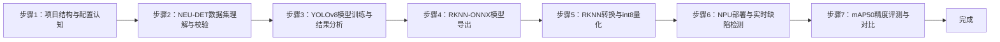
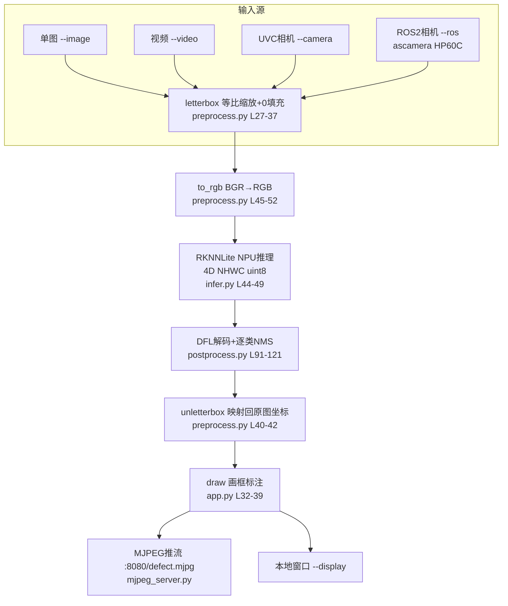

## 实验4：基于YOLOv8的工业表面缺陷检测实验（4h）

> ✅ **源码已核实** 本实验源码位于 `ros2_ws/src/xflz_eai_car1/vision/01_industrial_defect_detection/`（仓库内相对路径，根 = 课程生成项目根目录）。已随仓库交付完整训练产物（`train/weights/best.pt`、`best.onnx`，9 输出）与转换产物（`models/defect_yolov8n_int8.rknn`，int8 单核+剪枝，200 张 val 校准）。板端验证通过，实测约 **13 FPS**（NPU）。

### 1.1 关联知识点

本实验对应第 1 章"工业缺陷检测与 YOLOv8 认知"，覆盖以下 7 个知识点（ID 遵循知识图谱编号约定，来源于 course-spec.yaml 的 knowledge_points）：

- 1.1.1 YOLOv8模型架构 > 原理 > YOLOv8 采用 CSPDarknet 主干 + PAN-FPN 颈部 + 解耦检测头，引入 DFL（Distribution Focal Loss）边界框回归
- 1.1.2 工业缺陷数据集 > 概念 > NEU-DET 数据集包含 6 类表面缺陷（crazing/inclusion/patches/pitted_surface/rolled-in_scale/scratches），YOLO 归一化标签格式
- 1.2.1 模型训练与超参数 > 流程 > yolov8n + imgsz=640 + epochs=100 + batch=8 的训练配置与产物解读（mAP50=0.732）
- 1.2.2 ONNX模型转换 > 流程 > 使用 RKNN 优化版 fork 导出 format=rknn 的 ONNX（3×nl 个原始张量，DFL 留在 CPU 侧，共 9 个输出）
- 1.3.1 RKNN NPU部署 > 原理 > rknn-toolkit2 将 ONNX 转换为 rk3576 平台 int8 量化模型，RKNNLite 在 6TOPS NPU 上推理
- 1.3.2 实时缺陷检测 > 流程 > letterbox 预处理 → RGB 通道交换 → NPU 推理 → DFL 解码 + 逐类 NMS → unletterbox 画框标注
- 1.3.3 精度评测与质检 > 概念 > mAP50 指标（纯 numpy 实现）与 onnx/rknn 双后端精度对比

### 1.2 实验目标

1. 掌握 YOLOv8 目标检测模型的工业应用方法，理解模型架构、训练超参数与检测原理 — 原理理解
2. 完成工业产品的缺陷自动检测与定位，实现缺陷类别识别与可视化标注 — 独立完成
3. 理解工业质检场景下的数据集制作、模型训练、部署推理全流程，体验"PC 训练 → ONNX 导出 → RKNN 转换 → 板端 NPU 推理"的完整链路 — 迁移应用

### 1.3 实验环境

| 类别 | 配置 |
|------|------|
| 硬件 | 具身智能实验箱 B2（XFLZ_EAI_B2_PRO，RK3576 SoC，6TOPS NPU，含 HP60C 深度相机） |
| OS | Ubuntu 22.04 + ROS2 Humble（板载 ros2_venv 虚拟环境，rknnlite 2.3.2 / onnxruntime 1.23.2） |
| 核心库 | OpenCV、NumPy、PyYAML、rknnlite（板端推理）、rknn-toolkit2（转换）、onnxruntime、mjpeg_streamer、rclpy + cv_bridge |
| 训练框架 | ultralytics 8.3.229（RKNN 优化 fork，numpy<2.0，PC 侧） |
| 主入口 | `src/app.py`（推理 CLI：单图 / 视频 / UVC 相机 / ROS2 相机）<br>`src/convert_rknn.py`（ONNX → RKNN 转换）<br>`src/eval_map.py`（mAP50 精度评测）<br>`scripts/train.sh` / `scripts/export_onnx.sh`（PC 训练与导出） |

### 1.4 实验难度

- 难度: ⭐⭐⭐ 综合性
- 重点: YOLOv8 工业缺陷检测全流程（数据集 → 训练 → 导出 → 转换 → 部署推理 → 精度评测）
- 难点: RKNN int8 量化精度控制（校准集、RGB/BGR 约定、letterbox 填充值一致性）与 NPU 部署的输入格式约束（4D NHWC、RGB、无归一化）

### 1.5 实验现象

**快速验证流程**（帮助学习者快速看到实验效果，全程在板载 B2 平台执行）：

1. 进入项目根目录：`cd ~/ros2_ws/src/xflz_eai_car1/vision/01_industrial_defect_detection`
2. （可选）跑通单元测试：`pytest -v`（42 用例全绿，数据集用例在无 NEU-DET 的机器上自动跳过）
3. 单图推理（仓库自带 4 张缺陷测试图 `images/1.jpg~4.jpg`）：`python src/app.py --model models/defect_yolov8n_int8.rknn --image images/1.jpg --save out.jpg`
   - 终端打印每帧 FPS 与每个缺陷框的类别、置信度、坐标
4. 查看标注结果：`out.jpg` 中缺陷区域被红色框标出，框上方打印类别名（如 `scratches 0.87`）
5. 视频推理：`python src/app.py --model models/defect_yolov8n_int8.rknn --video test.mp4 --save out.mp4`
6. 相机实时（标准流程）：先起相机驱动，再运行 `--ros` 模式（详见步骤 6）
7. 浏览器查看 MJPEG 实时流：`http://<板IP>:8080/defect.mjpg`，移动工件观察缺陷框实时跟随

```bash
# 进入实验4
cd ~/ros2_ws/src/xflz_eai_car1/vision/01_industrial_defect_detection

# 可选
/home/iflytek/ros2_venv/bin/python -m pytest -v

# 执行单图片推理（图片都在01_industrial_defect_detection/images）
python src/app.py --model models/defect_yolov8n_int8.rknn --image images/1.jpg --save out.jpg
```

**执行现象**：`pytest -v` 运行约 40-60 秒，输出 42 个用例全部 passed；单图推理命令在约 0.1-0.3 秒内返回，终端打印类似 `fps=xx.x` 与每个缺陷框的 `类别 置信度 (x1,y1,x2,y2)`，同时在当前目录生成 `out.jpg`（红框标注图）。板端实测 NPU 推理约 **13 FPS**。

**预期效果描述**：

- **单图/视频**：6 类缺陷（裂纹 crazing、夹杂 inclusion、斑块 patches、麻点 pitted_surface、氧化铁皮 rolled-in_scale、划痕 scratches）均能以红框 + 类别 + 置信度标注，小目标缺陷（如麻点、划痕）也能稳定检出
- **相机实时**：检测框在视频流中逐帧更新，终端每 30 帧打印一次平均帧率，板端实测约 **13 FPS**（yolov8n/640，NPU 单核+剪枝模型）
- **精度表现**：随仓库交付的训练产物在 val 集达到 P=0.657 / R=0.706 / **mAP50=0.732**；RKNN int8 模型相对 ONNX 掉点 ≤3%
- **完整链路**：一份 `best.pt` 权重依次经历 PyTorch 训练、ONNX 导出、RKNN int8 量化转换，最终在 6TOPS NPU 上以 13 FPS 实时运行，验证"训练部署一体"的工业落地范式

```bash
(ros2_venv) iflytek@localhost:~/ros2_ws/src/xflz_eai_car1/vision/01_industrial_defect_detection$ python src/app.py --model models/defect_yolov8n_int8.rknn --image images/1.jpg --save out.jpg
note: NEU-DET data.yaml 不在本机，使用内置 6 类名
/home/iflytek/ros2_venv/lib/python3.10/site-packages/rknnlite/api/rknn_lite.py:41: UserWarning: pkg_resources is deprecated as an API. See https://setuptools.pypa.io/en/latest/pkg_resources.html. The pkg_resources package is slated for removal as early as 2025-11-30. Refrain from using this package or pin to Setuptools<81.
  import pkg_resources
W rknn-toolkit-lite2 version: 2.3.2
I RKNN: [16:45:27.301] RKNN Runtime Information, librknnrt version: 2.3.2 (429f97ae6b@2025-04-09T09:09:27)
I RKNN: [16:45:27.301] RKNN Driver Information, version: 0.9.8
I RKNN: [16:45:27.302] RKNN Model Information, version: 6, toolkit version: 2.3.0(compiler version: 2.3.0 (c949ad889d@2024-11-07T11:39:30)), target: RKNPU f2, target platform: rk3576, framework name: ONNX, framework layout: NCHW, model inference type: static_shape
W RKNN: [16:45:27.327] query RKNN_QUERY_INPUT_DYNAMIC_RANGE error, rknn model is static shape type, please export rknn with dynamic_shapes
W Query dynamic range failed. Ret code: RKNN_ERR_MODEL_INVALID. (If it is a static shape RKNN model, please ignore the above warning message.)
fps=10.0
  inclusion 0.826 (181,0,279,302)
  inclusion 0.763 (96,430,214,641)
saved -> out.jpg
```


### 1.6 实验步骤

#### 整体流程图



---

#### 步骤1：项目结构与配置体系认知（阶段一：能运行，20min）

> 📌 本步骤对应源码：`config/defect_config.yaml`、`src/config.py`

**知识点讲解**：

**配置驱动设计（1.1.2 延伸）**

- **原理**：工业质检项目通常要求"配置与代码分离"，把数据集路径、训练超参、推理阈值、RKNN 转换参数全部收敛到一个 YAML 文件，保证实验可复现。本项目通过 `src/config.py` 的 `load_config()` 实现**契约式校验**：`REQUIRED` 字典（L14-35）声明了 dataset/train/infer/rknn/eval 五个区块必须存在的键与其类型，缺键或类型错误直接抛出 `ConfigError`（L38-39），避免"配置写错导致推理静默失败"这类隐蔽问题；未知键则忽略（向前兼容）。`resolve_path()`（L67-73）负责把配置中的相对路径解析为绝对路径。推理侧两个关键阈值——`score_thr=0.25`（置信度过滤）与 `iou_thr=0.45`（NMS 交并比阈值）——都在配置中集中管理（`config/defect_config.yaml` L22-26），调参无需改代码。
- **源码对应**：`config/defect_config.yaml` L1-47（dataset L4-8 / train L10-20 / infer L22-26 / rknn L37-42 / eval L44-46）；`src/config.py` L14-35（REQUIRED）、L42-64（load_config）、L67-73（resolve_path）

**知识储备补充**：

- **背景与动机**：YAML 配置驱动是工业算法工程的标准实践——训练、评测、部署三阶段共享同一份配置，避免"训练用 A 参数、部署却写死 B 参数"导致的漂移。"契约式校验"（schema validation）把错误前置到加载阶段，而不是让错误配置在推理时静默产生错误结果。
- **阈值语义**：`score_thr=0.25` 是置信度过滤阈值——低于它的检测框直接丢弃，值越大检测越保守（漏检增多、误检减少）；`iou_thr=0.45` 是 NMS 的交并比阈值——两个同类框 IoU 超过它则保留高分者。二者共同决定"输出的框数量与质量"，是目标检测的两个核心后处理超参。
- **相对路径解析**：`resolve_path`（L67-73）基于**配置文件所在目录**解析相对路径，而非当前工作目录。这是关键设计：无论从哪个目录启动，配置里的 `dataset.root` 都能稳定解析到同一位置，保证实验跨目录可复现。
- **参考资源**：PyYAML 官方文档 `yaml.safe_load`；JSON Schema 思想（配置契约校验的通用范式）。

**配置参数速查表**（`config/defect_config.yaml`，按区块分列）：

| 区块 | 参数 | 类型 | 默认/示例 | 说明 |
|------|------|------|-----------|------|
| `dataset` | `root` | str | `/home/.../NEU-DET.v1i.yolov8` | 训练数据集根目录（PC 端；板上推理/评测不需要） |
| `dataset` | `data_yaml` | str | `data.yaml` | 数据集标注文件（含类别名） |
| `dataset` | `splits` | list | `[train, valid, test]` | 参与校验的分割子集 |
| `train` | `fork` | str | `/home/.../ultralytics_yolov8-main` | RKNN 优化版 ultralytics fork 路径 |
| `train` | `model` | str | `yolov8n.pt` | 预训练权重 |
| `train` | `imgsz` | int | `640` | 训练输入边长（精度-速度权衡） |
| `train` | `epochs` | int | `100` | 训练轮数 |
| `train` | `batch` | int | `8` | 批大小（GTX1060 建议 ≤8） |
| `train` | `device` | int/str | `0` | 训练设备（无 CUDA 改 `cpu`） |
| `train` | `project`/`name` | str | `runs/.../yolov8n_img640_e100` | 训练产物输出目录 |
| `infer` | `imgsz` | int | `640` | 推理输入边长（须与训练一致） |
| `infer` | `score_thr` | float | `0.25` | 置信度过滤阈值（越大越保守） |
| `infer` | `iou_thr` | float | `0.45` | NMS 交并比阈值 |
| `infer` | `pad_color` | list | `[0,0,0]` | letterbox 填充色（与 rknn_model_zoo 一致，勿改 114） |
| `source` | `ros.rgb_topic` | str | `/ascamera_hp60c/.../rgb0/image` | ROS2 相机话题（严禁 remap） |
| `source` | `ros.timeout` | float | `5.0` | 首帧等待秒数 |
| `server` | `port` | int | `8080` | MJPEG 推流端口 |
| `server` | `stream_name` | str | `defect.mjpg` | MJPEG 流名（已含 `.mjpg` 勿再追加） |
| `rknn` | `target_platform` | str | `rk3576` | 转换目标平台 |
| `rknn` | `quantize` | bool | `true` | 是否 int8 量化（转换脚本用） |
| `rknn` | `calib_count` | int | `200` | int8 校准图片数（val 抽取） |
| `rknn` | `onnx_model` | str | `train/weights/best.onnx` | 待转换 ONNX 路径 |
| `rknn` | `rknn_model` | str | `models/defect_yolov8n_int8.rknn` | 转换产物 .rknn 路径 |
| `eval` | `split` | str | `valid` | mAP50 评测用分割集 |
| `eval` | `iou_thr` | float | `0.5` | mAP50 的 IoU 判定阈值 |

> **说明**：`infer.imgsz` 须与训练 `train.imgsz` 一致（输入尺寸绑定）；`train.device` 无 GPU 改 `cpu`；`train.*` `rknn.*` 为 PC 侧（训练/转换），板端只用 `infer`/`source`/`server`。`source`/`server`/`train.run_dir` 不在 `REQUIRED` 校验内（未知键忽略，向前兼容）——改错不报错，注意自行核对。

**操作步骤**：

1. 查看项目目录结构，确认六大模块分工：
   ```bash
   cd ~/ros2_ws/src/xflz_eai_car1/vision/01_industrial_defect_detection
   ls src/    # app / config / convert_rknn / dataset / eval_map / infer / metrics / mjpeg_server / postprocess / preprocess / ros2_source
   ```

2. 阅读配置文件，逐区块理解含义：
   ```bash
   cat config/defect_config.yaml
   # 重点：infer.score_thr=0.25、infer.iou_thr=0.45、rknn.target_platform=rk3576、server.port=8080
   ```

3. 用 Python 验证配置加载与校验逻辑：

   ```bash
   PYTHONPATH=./src python -c "from config import load_config; cfg = load_config('config/defect_config.yaml'); print(cfg['infer'])"
   # 预期输出：{'imgsz': 640, 'score_thr': 0.25, 'iou_thr': 0.45, 'pad_color': [0, 0, 0]}
   ```

4. 验证缺键报错（观察 ConfigError 契约）：
   ```bash
   PYTHONPATH=./src python -c "from config import load_config; load_config('config/defect_config.yaml')" # 正常
   # 尝试删掉 yaml 中 infer 区块再运行，观察 ConfigError 提示缺失键
   ```

**易错点**：
- ⚠️ 配置路径写相对路径时，`resolve_path` 基于**配置文件所在目录**解析（`config.py` L67-73），不是当前工作目录——跨目录运行务必注意

---

#### 步骤2：工业缺陷数据集理解与校验（阶段一：能运行，30min）

> 📌 本步骤对应源码：`src/dataset.py`
>
> 需要自行准备相关数据集

**知识点讲解**：

**NEU-DET 数据集与 YOLO 标签格式（1.1.2）**

- **原理**：NEU-DET（Northeastern University 表面缺陷数据集）是工业质检领域的标准公开数据集，包含热轧带钢表面 6 类缺陷（crazing 裂纹 / inclusion 夹杂 / patches 斑块 / pitted_surface 麻点 / rolled-in_scale 氧化铁皮 / scratches 划痕），共 1800 张 200×200 灰度图，已由社区转换为 YOLO 格式（`NEU-DET.v1i.yolov8`）。YOLO 标签为每行 `class_id cx cy w h` 的归一化格式（值域 0-1，相对图像宽高），与 COCO 的像素坐标格式不同。`src/dataset.py` 的 `validate_dataset()`（L19-85）负责**校验数据集结构**：确认 images/labels 目录存在、图像与标签一一对应、标签行数/坐标合法，输出统计（类别分布、样本数），为训练和评测提供数据完整性保障。`class_names()`（读 data.yaml）从 `names:` 字段提取 6 类名称供推理标注使用。
- **源码对应**：`src/dataset.py` L19-85（validate_dataset：目录检查 L24-38 / 标签合法性 L40-66 / 统计输出 L68-85）、class_names 读取 data.yaml

**知识储备补充**：

- **背景与动机**：NEU-DET 由东北大学宋克臣团队于 2017 年发布，是热轧带钢表面缺陷检测的基准数据集。工业表面缺陷（尤其小尺度、低对比度缺陷）与通用目标检测数据集有本质差异：缺陷面积小（常不足图像 5%）、类间外观相似（crazing 与 scratches 均为细线纹理）、标注一致性要求极高——这使它成为检验检测模型"小目标 + 弱纹理"能力的标准测试床。

- **YOLO 归一化标签格式**：每行 `class_id cx cy w h`，其中 $c_x, c_y, w, h$ 均为归一化值：

  $$
  c_x = \frac{x_{center}}{W}, \quad c_y = \frac{y_{center}}{H}, \quad w = \frac{bw}{W}, \quad h = \frac{bh}{H}
  $$

  其中 $W,H$ 为图像宽高，$(x_{center}, y_{center})$ 为框中心像素坐标，$bw,bh$ 为框宽高像素。归一化后标签与图像分辨率解耦——同一标注可适配任意 `imgsz` 训练。这与 COCO 的 `[x,y,w,h]` 像素坐标格式不同，混用是标注常见错误。

- **关键参数**：归一化坐标值域必须 ∈ [0,1]；越界或混入像素坐标会导致训练崩溃或 mAP 极低——`validate_dataset`（L40-66）正是校验这一点。

- **参考资源**：

  NEU-DET 论文（K. Song et al., *Surface defect detection method using saliency linear perceptual hashing technology*）；

  Roboflow `NEU-DET.v1i.yolov8` 数据集页。

**操作步骤**：

1. 若本机已有 NEU-DET 数据集，配置 `config/defect_config.yaml` 中 `dataset.root` 指向其路径
2. 运行数据集校验：
   ```bash
   PYTHONPATH=./src python -c "from dataset import validate_split, class_names; import pathlib; \
   root = pathlib.Path('/home/iflytek/tmp/AIoT_B2/NEU-DET.v1i.yolov8'); \
   print('classes:', class_names(root / 'data.yaml')); \
   print('--- train ---'); print(validate_split(root, 'train')); \
   print('--- val ---'); print(validate_split(root, 'val'))"
   # 预期：打印类别统计（6 类缺陷各约 300 张）与标签合法性结果
   ```
3. 查看 2-3 张标注图，理解 YOLO 归一化标签与像素坐标的换算关系（用 OpenCV 画框验证）
4. 思考：为什么工业缺陷数据集比通用目标检测数据集更难标注？（缺陷尺度小、类间相似、标注一致性要求高）

下面是相关训练的标注照片，可以在 ~/ros2_ws/src/xflz_eai_car1/vision/01_industrial_defect_detection/train 中进行查看


**易错点**：
- ⚠️ 板上无 NEU-DET 数据集属正常现象——`app.py` L60-65 已内置 6 类名兜底，板上推理无需数据集
- ⚠️ 标签坐标必须归一化（0-1），若混入像素坐标，训练会直接崩或 mAP 极低

---

#### 步骤3：YOLOv8 模型训练与结果分析（阶段二：能理解，40min）

> 📌 本步骤对应源码：`scripts/train.sh`、`train/args.yaml`

**知识点讲解**：

**YOLOv8 架构与训练流程（1.1.1、1.2.1）**

- **原理**：YOLOv8 是 anchor-free 的实时目标检测器，主干 CSPDarknet 提取多尺度特征，PAN-FPN 颈部融合，**解耦检测头**分别输出分类与回归分支。回归分支采用 **DFL（Distribution Focal Loss）**：不直接回归偏移，而是预测 16 个 bin 的概率分布，加权求和得到连续偏移，对小目标更友好（`postprocess.dfl_decode` 对应实现）。训练配置收敛在 `train/args.yaml`：yolov8n、imgsz=640、epochs=100、batch=8、optimizer=auto、seed=0。训练产物 `train/weights/best.pt`（+ last.pt）与 `best.onnx`（RKNN 优化 fork 导出，9 输出）随仓库交付，**无需重训即可进入部署链路**；`scripts/train.sh`（L1-25）封装了 PC 侧训练入口。
- **源码对应**：`scripts/train.sh` L1-25；`train/args.yaml` L1-106（超参数全量）；训练指标见 `train/results.csv`、曲线图 `train/*.png`

**知识储备补充**：

- **YOLOv8 架构拆解**：YOLOv8（2023，Ultralytics）相对 YOLOv5 的关键演进可归纳为四点

  (1) **anchor-free**：去掉预置 anchor，直接回归中心点与宽高（中心点落在哪个 grid 哪个负责），减少超参；

  (2) **C2f 模块**：替换 C3，借鉴 ELAN 结构引入更多梯度流分支，在相近计算量下提升表征；

  (3) **解耦头（Decoupled Head）**：分类与回归分支分离，各自用不同尺度结构，缓解分类/回归任务冲突；

  (4) **DFL 回归**。主干 CSPDarknet 提取 80/40/20 三个尺度的特征图（对应小/中/大目标），PAN-FPN 自顶向下 + 自底向上融合多尺度。

- **DFL 原理**：DFL 不直接回归框偏移 $t$，而是用 16 个 bin 的概率分布表示其近似：

  $$
  t = \sum_{i=0}^{15} p_i \cdot i, \qquad p = \text{softmax}(z)
  $$

  其中 $z \in \mathbb{R}^{16}$ 是网络对 16 个 bin 的原始 logits，$p_i$ 为第 $i$ 个 bin 的 softmax 概率，$t$ 为加权和得到的连续偏移。相比单值回归，DFL 能刻画边界的不确定性，对小目标与边界模糊目标（如细纹理缺陷）更友好。解码时 `dfl_decode`（postprocess L34-42）执行 softmax 后加权求和。

- **精度-速度权衡**：imgsz=640 是速度与精度的折中。NPU 算力固定 6TOPS，特征图边长平方增长（640²→800² 计算量增约 56%），单帧耗时随之上升。640 能覆盖绝大多数缺陷尺度且保持实时，是工业部署的常用默认。

- **参考资源**：

  YOLOv8 论文（Jocher et al., Ultralytics YOLOv8）；

  Ultralytics 官方文档《YOLOv8 Architecture Overview》；

  DFL 原论文《Generalized Focal Loss》（Li et al., 2020）。

相关YOLOv8网络架构图


**操作步骤**：

1. 查看训练产物目录，理解"一份权重，三种格式"：
   ```bash
   ls -la train/weights/    # best.pt (PyTorch) + best.onnx (RKNN-ONNX, 9输出)
   ```

2. 解读训练指标（`train/results.csv` 末尾几行）：
   ```bash
   tail -5 train/results.csv    # epoch/box_loss/cls_loss/dfl_loss/metrics/precision/recall/mAP50
   # 参考：epoch 100 → P=0.657 / R=0.706 / mAP50=0.732 / mAP50-95=0.409
   ```

3. 查看混淆矩阵与 PR 曲线（`train/confusion_matrix.png`、`train/PR_curve.png`），分析哪两类缺陷最易混淆（通常 crazing 与 scratches 相似）

   

   

4. （可选，PC 且需重训时）运行 `bash scripts/train.sh`，比较训练曲线

5. 思考：为什么选择 imgsz=640 而不是 800？板端 NPU 算力固定（6TOPS），imgsz 越大单帧耗时越高——这是**精度-速度权衡**的典型例子

**易错点**：

- ⚠️ 训练框架必须是 RKNN 优化 fork（ultralytics 8.3.229 + numpy<2.0），官方版导出的 ONNX 不是 9 输出，无法直接转 rknn
- ⚠️ 训练精度目标只是参考，mAP 达标 ≠ 板端可用——int8 量化会引入精度损失，需在步骤 7 验证掉点

---

#### 步骤4：RKNN-ONNX 模型导出（阶段二：能理解，30min）

> 📌 本步骤对应源码：`scripts/export_onnx.sh`

**知识点讲解**：

**RKNN 优化版 ONNX 导出（1.2.2）**

- **原理**：官方 ultralytics 导出的 ONNX 把 DFL 解码也导出到计算图中（大量 Slice/Concat 算子），RKNN 转换器对这类动态索引支持差、易报错或低效。RKNN 优化 fork 提供了 `format='rknn'` 导出模式：**DFL 解码留在 CPU 侧**（Python 后处理实现），模型只输出 3×nl 个原始张量——每层 3 个：box `(1,64,h,w)`（DFL 原始分布）、cls `(1,nc,h,w)`（已 sigmoid）、cls_sum `(1,1,h,w)`（可忽略分支）。yolov8n 有 3 个检测层（80/40/20），故共 9 个输出。`export_onnx.sh`（L1-21）封装导出命令并校验输出数量。
- **源码对应**：`scripts/export_onnx.sh` L1-21（导出 + 校验 L16-20）

**知识储备补充**：

- **背景与动机**：RKNN 转换器对 ONNX 算子的支持不是全集的——大量动态 Shape 算子（Slice/Concat 组合的动态索引、Reshape 依赖运行时值）在量化图优化阶段易失败或生成低效指令。RKNN 优化 fork 将"纯推理主干"与"DFL 后处理"分离：把后处理留在 CPU（Python），模型只保留稳定、可静态分析的算子，显著提高 RKNN 转换成功率与 NPU 效率。
- **输出张量结构拆解**：每检测层输出 3 个张量——box `(1,64,h,w)` 是 DFL 的 16 bin × 4 坐标原始分布（回归分支），cls `(1,nc,h,w)` 是已 sigmoid 的类别分数（`nc`=6 类），cls_sum `(1,1,h,w)` 是类别分数和的可忽略分支。3 层 × 3 = 9 个输出：

  $$
  \text{outputs} = \bigcup_{l \in \{80,40,20\}} \{ \underbrace{\text{box}^{(l)}}_{1\times64\times h_l \times w_l},\; \underbrace{\text{cls}^{(l)}}_{1\times nc \times h_l \times w_l},\; \underbrace{\text{cls\_sum}^{(l)}}_{1\times 1\times h_l \times w_l} \}
  $$

  其中 $h_l = w_l = \text{imgsz}/l$（imgsz=640 → 8/16/32 下采样 → 80/40/20 特征图），`nc=6` 为缺陷类别数。
- **参考资源**：RKNN 官方文档《RKNN Toolkit2 User Guide》ONNX 算子支持表；Ultralytics `yolo export` 文档。

**操作步骤**：

1. 查看导出脚本内容，理解关键参数：
   ```bash
   cat scripts/export_onnx.sh
   # 核心：yolo export model=train/weights/best.pt format=onnx opset=12 imgsz=640
   #       format=rknn（RKNN 优化 fork 专用）
   ```

2. 验证已交付的 ONNX 输出结构（无需重导）：
   ```bash
   python -c "
   import onnxruntime as ort
   sess = ort.InferenceSession('train/weights/best.onnx')
   print('输入:', [i.name for i in sess.get_inputs()])
   print('输出数:', len(sess.get_outputs()))
   for o in sess.get_outputs(): print(' ', o.name, o.shape)"
   # 预期输出数 = 9（3 层 × 3 张量）
   ```

   ```bash
   输入: ['images']
   输出数: 9
     317 [1, 64, 80, 80]
     325 [1, 6, 80, 80]
     331 [1, 1, 80, 80]
     338 [1, 64, 40, 40]
     346 [1, 6, 40, 40]
     352 [1, 1, 40, 40]
     359 [1, 64, 20, 20]
     367 [1, 6, 20, 20]
     373 [1, 1, 20, 20]
   ```

   若需重导（PC 且 fork 环境就绪）：`bash scripts/export_onnx.sh train/weights/best.pt`

**易错点**：

- ⚠️ 输出不是 9 个 → 用了官方 ultralytics 或未指定 `format=rknn`（`export_onnx.sh` L16）
- ⚠️ opset 过高（>12）可能导致 RKNN 转换器不支持某些算子，保持 opset=12

---

#### 步骤5：RKNN 转换与 int8 量化（阶段二：能理解，40min）

> 📌 本步骤对应源码：`src/convert_rknn.py`

**知识点讲解**：

**RKNN int8 量化原理（1.3.1）**

- **原理**：RKNN 转换器（rknn-toolkit2）把 ONNX 图转换为 RK3576 平台的 NPU 指令集模型，核心是 **int8 量化**：权重和激活从 float32 缩放到 int8（w8a8），通过**校准集**统计激活分布确定每个张量的 scale/zero_point。量化配置要点：`quant_img_RGB2BGR=False`（L65）——因为导出模型的输入约定是 RGB；`target_platform='rk3576'`（L38-42）；校准集 200 张 val 图（`--calib-count 200`）。部署侧用 `RKNNLite`（`infer.py` L29-52）在 NPU 上推理，`init_runtime` 必须显式传 `core_mask=0`（NPU_CORE_AUTO，L36），None 在 2.3.2 会报 `core mode not supported`。模型推理输入必须是 **4D NHWC uint8**（静态 shape）且**不做 /255 归一化**——量化模型内部已含 scale。
- **源码对应**：`src/convert_rknn.py` L25-109（参数解析 L25-40 / config 加载与 RGB2BGR 设置 L41-65 / 转换+量化 L66-91 / 输出保存 L92-109）

**知识储备补充**：

- **int8 量化原理**：量化把浮点张量映射到 int8 整数域。权重 $w$ 与激活 $x$ 的仿射量化：

  $$
  w_q = \text{round}\left( \frac{w}{s_w} \right), \qquad x_q = \text{round}\left( \frac{x}{s_x} \right)
  $$

  其中 $s_w, s_x$ 分别为权重与激活的量化步长（scale），由校准集统计激活数值分布确定。反量化近似：$\hat{w} \approx s_w \cdot w_q$。相比 fp32，int8 用 4 倍压缩的位宽换取 NPU 上更快的定点运算（w8a8 即权重/激活均 8bit）。代价是舍入误差引入的精度损失（本项目要求掉点 ≤3%）。
- **校准集的作用**：scale 的确定依赖激活的真实分布。校准集（`--calib-count 200` 张 val 图）应代表部署时的真实数据分布——若校准图与推理数据分布偏差大，量化的 scale 估计失准，掉点加剧。这也是"校准图用 val 集而非 train 集"的原因。
- **RGB2BGR 约定（关键）**：`quant_img_RGB2BGR=False`（L65）表示转换器**不**做通道交换——因为导出模型输入约定是 RGB，推理侧 `to_rgb()`（preprocess L45-52）已经把 BGR 帧换成 RGB 再喂 NPU。若转换侧与推理侧的约定不一致，检测框会整体偏移或错乱。这是本项目最易踩的坑之一。
- **输入格式约束**：NPU 静态 shape 模型要求 4D NHWC uint8 输入，且**不做 /255 归一化**——量化模型内部已把 0-255 的 uint8 输入视为激活并含 scale，归一化会破坏输入分布。
- **参考资源**：RKNN Toolkit2 官方文档《Quantization》；Google《Quantizing Deep Convolutional Networks for Efficient Inference》（Jacob et al., 2017）。

**操作步骤**：

1. 查看转换脚本参数：
   ```bash
   python src/convert_rknn.py --help
   # --onnx --output --calib-dir --calib-count --imgsz --no-quantize
   ```

2. 重新转换（板上 ros2_venv 或 PC rknn 环境，需要 NEU-DET val 图作校准集）：
   ```bash
   python src/convert_rknn.py --onnx train/weights/best.onnx \
     --output models/defect_yolov8n_int8.rknn \
     --calib-dir <NEU-DET>/valid/images --calib-count 200
   # 预期：打印量化信息与每层统计，最终生成 .rknn 文件
   ```

3. 对比已交付的 `models/defect_yolov8n_int8.rknn` 文件大小与 ONNX 差异（int8 通常更小）

4. 思考：量化掉点的根源是什么？（权重/激活低比特表示 → 信息损失；校准集代表性不足 → 分布估计偏差）

```python
# src/convert_rknn.py 部分代码块解释
if rknn.config(
            mean_values=[[0, 0, 0]], std_values=[[255, 255, 255]],
            target_platform=target,
            quant_img_RGB2BGR=False,        # 输入已为 RGB（导出时固化），不再转色域
            quantized_dtype="w8a8",         # toolkit2 默认 int8 量化
            quantized_algorithm="normal",   # 默认
            quantized_method="channel",     # 2.3.0 默认即 channel（逐通道量化）
            optimization_level=3,           # 默认
            single_core_mode=True,          # 单核模型：省内存（用户指定 2026-08-05）
            model_pruning=True,             # 无损剪枝：省内存（用户指定 2026-08-05）
        ) != 0:
```

| 参数                  | 值                | 说明                                                         |
| --------------------- | ----------------- | ------------------------------------------------------------ |
| `mean_values`         | `[[0,0,0]]`       | 输入图像每个通道的**均值**。配合 `std_values` 完成归一化：‑。本模型约定外部输入像素范围 `0‑255`，不需要做减均值，故 mean 设置为 0。 |
| `std_values`          | `[[255,255,255]]` | 输入图像每个通道的**标准差**。本模型归一化公式：xnorm=xpixel/255，该归一化由 RKNN 运行时内部完成，Python 侧不需要手动执行 `/255`。 |
| `target_platform`     | `target`          | 指定目标 RK 芯片平台，例如 `"rk3576"`。用于让工具针对该芯片算子库做编译适配、算子择优。 |
| `quant_img_RGB2BGR`   | `False`           | **色域转换开关**。`False`= 关闭内部 RGB→BGR 转换。前提：预处理阶段已经把 OpenCV 默认 BGR 图像转为 RGB 再喂入模型；不要让 RKNN runtime 再做一次通道翻转，否则颜色错乱，出现 “框准、分类全错”。 |
| `quantized_dtype`     | `"w8a8"`          | 量化数据类型：**权重 int8，激活值 int8（w8a8）**，即全 int8 量化。是 RK3576 最常用的量化模式，兼顾推理速度与模型体积；相比 fp16 大幅降低 NPU 内存占用。 |
| `quantized_algorithm` | `"normal"`        | 量化算法，`normal`为标准 KL 散度量化算法，使用校准集统计激活值分布，生成量化参数；适合目标检测任务。 |
| `quantized_method`    | `"channel"`       | **逐通道量化**。权重按每个卷积通道独立计算量化零点 / 缩放因子，精度更高；RKNN Toolkit2.3.0 版本后默认就是`channel`，优于旧版`tensor`（整个张量共用一套量化参数）。 |
| `optimization_level`  | `3`               | 算子优化等级，范围 0‑3；3 代表开启全部编译器图优化：算子融合、常量折叠、算子替换为芯片硬件实现，最大化 NPU 推理性能。 |
| `single_core_mode`    | `True`            | **单核模式**。编译出来的 RKNN 模型仅使用 1 颗 NPU 核心运行。✅优点：模型运行内存占用降低，适合内存紧张场景；⚠️缺点：不能利用多核并行，单帧推理延迟会变大，需要上层多线程推理池（RKNNPool）做多实例并发来拉高整体 FPS。 |
| `model_pruning`       | `True`            | **无损模型剪枝**。RKNN 编译器做图级无损剪枝：移除无用常量、废弃分支、零权重通道，在不损失精度前提下减少模型大小与运行内存开销。 |

**易错点**：

- ⚠️ 校准图必须 jpg/png/bmp 且绝对路径、无中文（`convert_rknn.py` L22）；`--imgsz` 与训练一致（640）
- ⚠️ `rgb2bgr` 必须 False（L65）：模型输入约定 RGB，转换侧与推理侧（`to_rgb`）必须一致
- ⚠️ 掉点 >3% 时：增大 `--calib-count`、校准图用 val 集、必要时 `--no-quantize` 定位

---

#### 步骤6：NPU 部署与实时缺陷检测（阶段三：能改造，45min）

> 📌 本步骤对应源码：`src/app.py`、`src/infer.py`、`src/preprocess.py`、`src/postprocess.py`、`src/mjpeg_server.py`、`src/ros2_source.py`

**知识点讲解**：

**实时缺陷检测推理流水线（1.3.2）**
- **原理**：板端推理是一条精心对齐的流水线（`Detector.detect`，`src/infer.py` L108-139）：

  (1) **letterbox 预处理**（`src/preprocess.py` L27-37）——按 `scale=min(size/h, size/w)` 等比缩放并用 0 值填充到 640×640，保持宽高比不变、避免目标变形；

  (2) **BGR→RGB 通道交换**（L45-52 `to_rgb`）——量化配置 `rgb2bgr=False` 决定了 NPU 输入必须是 RGB；

  (3) **NPU 推理**（`src/infer.py` L44-49）——`RKNNLite.inference` 输入必须是 **4D NHWC uint8**（静态 shape 模型不接受 3D），且**不做 /255 归一化**（量化模型内部已含 scale）；

  (4) **CPU 侧解码**（`src/postprocess.py`）——`dfl_decode`（L34-42）对 16 bin 做 softmax 加权求和还原边框偏移，`box_process`（L45-56）加 grid 中心与 stride 还原 xyxy，`decode_rknn`（L91-121）按 `score_thr=0.25` 过滤后 `classwise_nms`（L59-88）逐类做非极大值抑制（同类别重叠框只留最高分）；

  (5) **unletterbox**（`src/preprocess.py` L40-42）把检测框映射回原始图像坐标，再由 `app.py` 的 `draw()`（L32-39）画红框与类别标签。后端抽象（`Backend` Protocol，`infer.py` L23-26）使同一套推理逻辑可在 RKNN（NPU）/ONNX（CPU）间切换，支撑精度对比。

- **源码对应**：`src/preprocess.py` L27-37（letterbox）、L40-42（unletterbox）、L45-52（to_rgb）；`src/infer.py` L23-26（Backend 协议）、L29-52（RKNNBackend：load L38-42 / predict L44-49）、L108-139（Detector：detect L118-130）；`src/postprocess.py` L34-42（dfl_decode）、L45-56（box_process）、L59-88（classwise_nms）、L91-121（decode_rknn）；`src/app.py` L24-29（_make_backend）、L32-39（draw）、L71-75（run_frame）、L94-146（视频/相机/ROS 模式）；`src/mjpeg_server.py` L19-72（MjpegServer）；`src/ros2_source.py` L20-116（Ros2Camera：DEFAULT_TOPIC L29 / open L50-69 / _on_image L71-80 / read L82-92 / release L98-116）

**知识储备补充**：

- **letterbox 数学定义**：等比缩放因子为两轴缩放的最小值，保证不裁切内容：

  $$
  scale = \min\left( \frac{size}{h}, \frac{size}{w} \right), \qquad
  pad_x = \left\lfloor \frac{size - w \cdot scale}{2} \right\rfloor, \qquad
  pad_y = \left\lfloor \frac{size - h \cdot scale}{2} \right\rfloor
  $$

  其中 $(w,h)$ 为原图宽高，$size=640$ 为目标边长。缩放后图像 `(h·scale, w·scale)` 居中放入 `(640,640)` 画布，两侧填充 `pad_color`。部署推理必须用 **pad=0**（非训练用的 114）——填充值参与卷积计算，若与训练/量化不一致，边缘特征分布偏移导致框错位。`unletterbox` 反向映射：`(box - [pad_x, pad_y, pad_x, pad_y]) / scale`。
- **DFL 解码公式**：对每个位置，4 个坐标各对应 16 bin 分布，softmax 后加权：

  $$
  \hat{t}_c = \sum_{i=0}^{15} i \cdot \text{softmax}(z_c)_i, \quad c \in \{l, t, r, b\}
  $$

  其中 $z_c \in \mathbb{R}^{16}$ 是坐标 $c$ 的 16 bin logits。再经 `box_process` 加 grid 中心与 stride 还原到特征图尺度：$x_{center} = (g_x + 0.5 - \hat{t}_l) \cdot stride$（含 anchor-free 的分布偏移），最后乘 stride 得像素坐标。
- **逐类 NMS**：NMS（Non-Maximum Suppression）抑制同类重叠框——按置信度降序扫描，保留当前最高分框，抑制与之 IoU ≥ `iou_thr` 的同类别框。逐类（classwise）做 NMS 是因为不同类别的框允许重叠（如缺陷框内再套一个）。IoU 定义：

  $$
  \text{IoU}(A,B) = \frac{|A \cap B|}{|A \cup B|} = \frac{\text{inter}}{\text{area}_A + \text{area}_B - \text{inter}}
  $$

- **参考资源**：rknn_model_zoo `yolov8.py`（本实现逐行对齐的官方参考）；Ultralytics《YOLOv8 Inference》；OpenCV `cv2.resize` 文档。

**推理数据流图**：



**操作步骤**：

1. 单图推理（最简验证）：
   ```bash
   cd ~/ros2_ws/src/xflz_eai_car1/vision/01_industrial_defect_detection
   python src/app.py --model models/defect_yolov8n_int8.rknn --image images/1.jpg --save out.jpg
   # 预期：终端打印 fps=xx.x 与每个缺陷框 类别 置信度 (x1,y1,x2,y2)；out.jpg 为红框标注图
   ```

2. 视频推理：

   需要准视频，本实验未提供

   ```bash
   python src/app.py --model models/defect_yolov8n_int8.rknn --video test.mp4 --save out.mp4
   # 预期：每 30 帧打印一次 avg_fps，最终输出标注视频
   ```

3. 相机实时（板上标准流程，HP60C 走 ROS2 话题）：

   ```bash
   # 终端 1：启动相机驱动（ROS_DOMAIN_ID 必须与驱动一致，本板 =2）
   source /opt/ros/humble/setup.bash && source ~/ros2_ws/install/setup.bash
   export ROS_DOMAIN_ID=2
   ros2 launch ascamera hp60c.launch.py

   # 终端 2：运行缺陷检测（同一 ROS_DOMAIN_ID）
   source /opt/ros/humble/setup.bash && source ~/ros2_ws/install/setup.bash
   export ROS_DOMAIN_ID=2
   python src/app.py --model models/defect_yolov8n_int8.rknn --ros
   # 预期：终端打印 frame N avg_fps=xx.x，板端实测约 13 FPS
   ```

4. 浏览器查看实时检测流：

   - 同一局域网内访问 `http://<板IP>:8080/defect.mjpg`
   - 移动带缺陷的工件，观察红框与类别标签实时跟随

5. 验证后端可切换（精度对比前置）：
   ```bash
   python src/app.py --model train/weights/best.onnx --image images/1.jpg --save out_onnx.jpg
   # .onnx 自动走 ONNXBackend（CPU），与 .rknn（NPU）对比帧率差异
   ```

6. 动手改造练习（阶段三）：修改 `src/app.py` L38-39 中画框颜色/线宽，或把 `score_thr` 从配置改为命令行参数，重新运行观察效果

**易错点**：

- ⚠️ **视频流推理报过程乱框** → **解决**：因为模型是特定场景特定识别，调用摄像头看正常环境会出现较多错误检测是正常现象

- ⚠️ **推理报 `need 4dims input`** → **解决**：静态 shape 模型要求 4D 输入，`RKNNBackend.predict`（`infer.py` L47）已用 `np.newaxis` 补成 NHWC；手写推理代码时务必保持 4 维
- ⚠️ **检测结果框整体偏移/错位** → **解决**：检查 letterbox 填充值（必须 0，非 114）与 BGR/RGB 约定（`to_rgb` 必须调用）；两侧不一致是框偏移的头号原因
- ⚠️ **init_runtime 报 `core mode not supported`** → **解决**：`RKNNLite` 初始化必须显式传 `core_mask=0`（NPU_CORE_AUTO，`infer.py` L36），None 值在 2.3.2 上会报错
- ⚠️ **MJPEG 浏览器 404** → **解决**：端口被其他 demo 占用，`mjpeg_server.py` L47-57 启动时已预检端口并明确报错；先关闭占用 8080 的进程
- ⚠️ **--ros 模式取不到帧** → **解决**：确认相机驱动已启动、`ROS_DOMAIN_ID` 与驱动一致（本板 =2）、话题为 `/ascamera_hp60c/camera_publisher/rgb0/image`（`ros2_source.py` L29，勿 remap）

---

#### 步骤7：mAP50 精度评测与 onnx/rknn 对比（阶段三：能改造，35min）

> 📌 本步骤对应源码：`src/eval_map.py`、`src/metrics.py`

**知识点讲解**：

**mAP50 指标原理（1.3.3）**
- **原理**：mAP（mean Average Precision）是目标检测的行业标准指标。其计算分四层：(1) **IoU**（`src/metrics.py` L28-39 `iou_matrix`）——预测框与真值框的交并比，向量化实现逐对计算；(2) **TP/FP 匹配**（L54-73 `_match_flags`）——预测框按置信度降序，与同类别 GT 计算 IoU，`IoU≥0.5` 且该 GT 未被匹配过则为 TP，否则 FP（一张 GT 只匹配一次）；(3) **PR 曲线与 AP**（L42-51 `_ap_from_pr`）——按置信度阈值从高到低扫描，计算 precision/recall 序列，用 all-point 插值求曲线下面积，即单个类别的 AP50；(4) **mAP50**（L76-112 `map50`）——各类 AP50 的平均，遵循 COCO/ultralytics 约定**无 GT 的类别不参与均值**，保证与官方 `yolo val` 可比。`eval_map.py`（L29-91）把评测组织为"遍历 val 集 → Detector 推理 → 解析 YOLO 标签为 GT → map50 计算"，`--backend` 参数支持 rknn/onnx 双后端，从而量化 int8 量化相对浮点模型的精度损失（本项目要求掉点 ≤3%）。
- **源码对应**：`src/metrics.py` L28-39（iou_matrix）、L42-51（_ap_from_pr）、L54-73（_match_flags）、L76-112（map50）；`src/eval_map.py` L29-46（参数与 Detector 构建）、L48-79（评测循环与 GT 解析）、L81-91（结果输出）

**知识储备补充**：

- **PR 曲线与 AP 数学定义**：对每个类别，按置信度阈值 $\tau$ 从高到低扫描，得到 precision/recall 序列：

  $$
  \text{Precision}(\tau) = \frac{TP(\tau)}{TP(\tau) + FP(\tau)}, \qquad
  \text{Recall}(\tau) = \frac{TP(\tau)}{TP(\tau) + FN(\tau)}
  $$

  AP 是 PR 曲线下的面积。本实现用 **all-point 插值**（非 COCO 的 101 点插值）：

  $$
  \text{AP} = \sum_{k} (R_{k+1} - R_k) \cdot P_{k+1}
  $$

  其中 $P_k, R_k$ 为按 recall 升序的第 $k$ 个插值点（recall 间隔上的最高 precision）。mAP50 即所有类别 AP50 的均值，`IoU_thr=0.5` 表示"预测框与 GT 的 IoU ≥ 0.5 即算命中"。
- **TP/FP 匹配的贪心约束**：一张 GT 只匹配一次（`_match_flags`），防止多个预测框同时命中同一 GT 都算 TP——这保证了指标不被冗余预测虚高，是目标检测评测的通用约定。
- **关键参数**：`iou_thr=0.5`（即 AP50）；"无 GT 的类不参与均值"（`metrics.py` L109-111）——若某类在测试集中无样本，其 AP 无定义，纳入均值会拉低 mAP 且与 `yolo val` 不可比。
- **参考资源**：COCO 数据集评测官方定义（cocodataset.org）；Ultralytics《Metrics》文档；《The PASCAL Visual Object Classes Challenge》（Everingham et al., 2010）。

**操作步骤**：

1. 运行 RKNN 后端评测（板上，需要 NEU-DET 数据）：
   ```bash
   python src/eval_map.py --backend rknn \
     --model models/defect_yolov8n_int8.rknn \
     --data /home/iflytek/Src/AIoT_B2/NEU-DET.v1i.yolov8
   # 预期输出：per-class AP50 表格 + mAP50（如 0.71x）
   ```
2. 运行 ONNX 后端评测，与 RKNN 对比：
   ```bash
   python src/eval_map.py --backend onnx \
     --model train/weights/best.onnx \
     --data /home/iflytek/Src/AIoT_B2/NEU-DET.v1i.yolov8
   # 预期：onnx mAP50 略高于 rknn；掉点 = onnx - rknn ≤ 3%
   ```
3. 记录两类缺陷的 AP 差异，思考原因（如 crazing 与 scratches 类间相似，AP 通常偏低）
4. 填写性能基线表（实验报告必填）：

   | 指标 | 期望值 | 实测值 |
   |------|-------|-------|
   | onnx mAP50 | ≈0.73 |  |
   | rknn(int8) mAP50 | 掉点 ≤3% |  |
   | 单图推理 FPS（NPU） | ≥15（实测约 13） |  |
   | MJPEG 流地址 | :8080/defect.mjpg 可访问 |  |

**易错点**：
- ⚠️ mAP 数值与 `yolo val` 不可比 → 保持"无 GT 类不参与均值"约定（`metrics.py` L109-111）；GT 与 pred 统一原始图像坐标（`eval_map.py` L74-75）
- ⚠️ 评测耗时长 → 可先用 `--limit`（若支持）抽子集快速验证流程，再全量跑

---

### 1.7 常见问题

| 问题 | 原因 | 解决方法 |
|------|------|---------|
| 检测框整体偏移/错位 | letterbox 填充值或 BGR/RGB 约定与转换不一致 | 部署侧保持 pad=0（`preprocess.py` L8-9）与 `to_rgb()`（L45-52）；转换侧 `quant_img_RGB2BGR=False`（`convert_rknn.py` L65） |
| NPU 推理报 `need 4dims input` | 静态 shape 模型要求 4D NHWC 输入 | 按 `infer.py` L47 加 `np.newaxis` 补维 |
| init_runtime 报 `core mode not supported` | core_mask 传 None | 显式传 `core_mask=0`（NPU_CORE_AUTO，`infer.py` L36） |
| RKNN 转换掉点 >3% | 校准集不足或预处理不一致 | 增大 `--calib-count`（`convert_rknn.py` L99）、校准图用 val 集且预处理与推理一致；必要时 `--no-quantize` 定位 |
| 导出 ONNX 输出不是 9 个 | 用了官方 ultralytics 或未指定 format=rknn | 使用 RKNN 优化 fork + `format='rknn'`（`export_onnx.sh` L16），校验命令见 L20 |
| MJPEG 浏览器 404 | 8080 端口被其他 demo 占用 | 关闭占用进程；启动时预检报错见 `mjpeg_server.py` L47-57 |
| `--ros` 取不到帧 | 驱动未启动或 ROS_DOMAIN_ID 不一致 | 先 `ros2 launch ascamera hp60c.launch.py`；export ROS_DOMAIN_ID=2；话题勿 remap（`ros2_source.py` L29） |
| 退出程序时报 C++ abort / core dumped | `Ros2Camera.release()` 先 destroy_node 再 rclpy.shutdown()，顺序反了 | 严格先 `rclpy.shutdown()` 后 `destroy_node`（`ros2_source.py` L98-116），release 已内置正确顺序 |
| 量化校准报错或无效果 | 校准图路径含中文字符/格式不支持，或 imgsz 与模型不一致 | 校准图用 jpg/png/bmp 与绝对路径（`convert_rknn.py` L22）；`--imgsz` 与训练一致 |
| 板上无训练集时推理报错 | `class_names` 读 data.yaml 失败抛 FileNotFoundError | 属正常现象，`app.py` L60-65 已内置 NEU-DET 6 类名兜底，板上推理无需数据集 |
| mAP 数值与 `yolo val` 不可比 | 无 GT 的类参与了均值，或 GT 与预测坐标空间不一致 | 保持"无 GT 类不参与均值"约定（`metrics.py` L109-111）；GT 与 pred 统一原始图像坐标（`eval_map.py` L74-75） |

### 1.8 扩展实验

**扩展方向 1：缺陷精度提升与消融对比（进阶）**
- 训练侧换更大模型 `yolov8s` 或提高 `imgsz=800`，对比 mAP50 提升与板端 FPS 下降的权衡（NPU 算力 6TOPS 固定，模型越大单帧耗时越高）
- 增加校准图片数（`--calib-count 500`）或改用 fp16 转换，观察 int8 量化掉点变化
- 用 `src/eval_map.py` 的 `--backend` 参数建立 torch / onnx / rknn 三方精度对比表，分析量化误差主要来自哪类缺陷

**扩展方向 2：质检联动与缺陷统计报告（进阶）**
- 在 `src/app.py` 主循环（L123-138）中按类别累加缺陷计数，周期性输出缺陷统计（如"scratches: 12 处"），生成质检报表，对应工业场景的"缺陷统计与质检报告生成"
- 将 `Detector.detect()` 返回的 `Detection` 列表转换为 ROS2 `vision_msgs/Detection2DArray` 话题发布，供机械臂分拣或报警灯联动（需在 `ros2_source.py` 旁新增 publisher 模块）
- 把 MJPEG 推流（`mjpeg_server.py`）与缺陷统计叠加显示在画面上，形成完整的人机交互质检界面

### 1.9 实验报告要求

**评分标准**：配置与数据集理解 10 分 + 训练产物分析 15 分 + ONNX/RKNN 转换 25 分 + NPU 实时推理与 MJPEG 演示 30 分 + mAP50 评测 10 分 + 实验报告 10 分 = 100 分。

**报告必含内容**：
1. 推理流水线框图（letterbox → RGB → NPU → DFL 解码/NMS → unletterbox），标注每步对应源码文件与行号
2. 单图检测结果图（标注前/后对比）与 3 个检测框的类别、置信度、坐标数据
3. 板端实测 FPS（单图/视频/相机三种模式）与性能基线表（1.6 步骤 7 表格）
4. onnx vs rknn 的 mAP50 对比表，分析量化掉点原因
5. 回答思考题：为什么部署推理用 pad=0 而训练用 114？为什么 NPU 输入必须是 RGB 且不做归一化？如果 score_thr 从 0.25 调到 0.5，检测结果会如何变化？
6. 实验心得与问题记录（遇到的问题、排查过程、解决结果）

---

## 更新日志

| 版本 | 日期 | 变更 |
|------|------|------|
| v1.0 | 2026-08-10 | 初版生成（基于源码实测：app.py/infer.py/preprocess.py/postprocess.py/convert_rknn.py 等，源码路径 ros2_ws/src/xflz_eai_car1/vision/01_industrial_defect_detection，板端验证 13 FPS，训练产物 mAP50=0.732） |
| v2.0 | 2026-08-19 | 知识点增强：各核心知识点追加「知识储备补充」（YOLOv8架构/DFL/letterbox/NMS/int8量化/mAP50 公式与参考资源）；1.5 追加可复现代码块与执行现象 |
| v2.1 | 2026-08-21 | 步骤1 新增「配置参数速查表」：config/defect_config.yaml 全参数按区块分列（dataset/train/infer/source/server/rknn/eval），含类型/示例/说明；标注 PC 侧（train/rknn）与板端（infer/source/server）用途区分、`source`/`server`/`train.run_dir` 不在 REQUIRED 契约、infer.imgsz 须与 train.imgsz 一致等要点。表值经 load_config 实测核对 |
