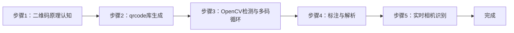

## 实验4：二维码生成与识别检测实验（4h）

> ✅ **源码已核实** 本实验源码位于 `ros2_ws/src/xflz_eai_car1/vision/04_qrcode/`。生成用 `qrcode` 库（纯 Python），检测用 **OpenCV 内置 `QRCodeDetector`**（零新增、无需模型权重，替代参考的 pyzbar——后者需系统库 libzbar0）。唯一新增依赖：`qrcode 7.4.2 + pypng`（板上需 `pip install -i https://pypi.tuna.tsinghua.edu.cn/simple qrcode`）。单测 19/19 全绿。

### 1.1 关联知识点

- 1.1.1 二维码编码原理 > 原理 > 二维码（QR Code）通过矩阵码元编码数据，含功能图形（定位/校正/时序）与数据区；支持版本 1-40、4 级纠错（L/M/Q/H）
- 1.2.1 QRCode 库生成 > 流程 > `qrcode.QRCode(version, error_correction, box_size, border)` + `add_data` + `make_image`，生成图片保存
- 1.3.1 OpenCV 实时检测 > 流程 > `cv2.QRCodeDetector.detectAndDecode` 返回数据与四角点坐标，多目标需掩掉已识别区域循环检测
- 1.3.2 实时识别与解析 > 流程 > 摄像头取流 → 逐帧 detectAndDecode → 框选识别区域 + 打印解析文本 → MJPEG 推流

### 1.2 实验目标

1. 掌握二维码的编码生成原理（版本/纠错/尺寸参数语义）— 原理理解
2. 使用 OpenCV 内置检测器实现摄像头实时检测并解析二维码内容 — 独立完成
3. 理解"生成-检测-解析"闭环在物联网/工业场景的应用（设备标识、信息传递）— 迁移应用

### 1.3 实验环境

| 类别 | 配置 |
|------|------|
| 硬件 | 具身智能实验箱 B2（XFLZ_EAI_B2_PRO，RK3576 SoC，6TOPS NPU，含 HP60C 深度相机） |
| OS | Ubuntu 22.04 + ROS2 Humble（板载 ros2_venv） |
| 核心库 | OpenCV（内置 QRCodeDetector）、qrcode 7.4.2 + pypng（需安装）、NumPy |
| 模型 | 无需模型权重（QRCodeDetector 为 OpenCV 内置算法） |
| 主入口 | `src/app.py`（--generate 生成 / --detect 检测，支持图像/视频/相机/ROS 模式） |

### 1.4 实验难度

- 难度: ⭐ 验证性
- 重点: 二维码生成参数语义 + OpenCV 实时检测解析
- 难点: 多二维码场景的循环检测（掩掉已识别区域防死循环）；低分辨率/远距离二维码的识别率

### 1.5 实验现象

**快速验证流程**：

1. 进入项目目录：`cd ros2_ws/src/xflz_eai_car1/vision/04_qrcode`
2. 安装依赖（板上）：`pip install -i https://pypi.tuna.tsinghua.edu.cn/simple qrcode`
3. 单元测试：`pytest tests/ -v`（19 用例全绿）
4. 生成二维码：`python src/app.py --generate "https://example.com" --save my_qr.png`
   - 手机/电脑扫码可打开对应内容
5. 识别：`python src/app.py --detect --image my_qr.png`
   - 终端打印解析文本，输出框选标注图
6. 相机实时（板上标准）：先起 ascamera 驱动，再 `python src/app.py --detect --ros`
   - MJPEG：`http://<板IP>:8080/qrcode.mjpg`，手机屏幕/打印码实时识别

**预期效果描述**：
- 生成：指定数据、版本、纠错等级、尺寸的二维码图片正确保存
- 识别：图像中二维码被绿框框选，框上方打印解析文本（≤40 字符截断）
- 多码场景：一张图多个二维码逐一检出（掩膜循环）
- 实时：摄像头对准手机屏幕/打印的二维码即时解析，MJPEG 流实时更新

### 1.6 实验步骤

#### 整体流程图



---

#### 步骤1：二维码原理认知（阶段一：能运行，20min）

> 📌 本步骤对应源码：`src/config.py` error_correction_level

**知识点讲解**：

**QR Code 结构与纠错原理（1.1.1）**
- **原理**：QR Code（Quick Response Code）是矩阵式二维条码，结构含：**定位图形**（三个角的回字方块，用于检测与旋转校正）、**校正图形**（版本≥2 时的小方块，用于畸变校正）、**时序图形**（定位图形间黑白交替线）、数据区与纠错码区。**版本**（1-40）决定尺寸与容量，版本越高容量越大；**纠错等级**（L≈7%/M≈15%/Q≈25%/H≈30% 恢复能力）决定污损/遮挡容忍度——等级越高纠错越强但数据容量越小。`error_correction_level()` 把配置中的 L/M/Q/H 字符串映射为 qrcode 库常量。
- **源码对应**：`src/config.py` error_correction_level；`config/qr_config.yaml`（generate.version / error_correction / box_size / border）

**操作步骤**：

1. 查看 `config/qr_config.yaml` 生成参数，理解 version/error_correction/box_size/border 语义
2. 阅读 `src/config.py` error_correction_level 实现
3. 思考：工业场景（污损多、距离远）应选什么纠错等级？为什么？

**易错点**：
- ⚠️ 纠错等级与容量互斥：等级越高单码容量越小，长文本需版本+等级权衡

---

#### 步骤2：qrcode 库生成二维码（阶段一：能运行，25min）

> 📌 本步骤对应源码：`src/qr.py` generate_qr

**知识点讲解**：

**生成流程（1.2.1）**
- **原理**：`generate_qr()`（L30-45）完整演示生成四步：(1) 构造 `qrcode.QRCode(version, error_correction, box_size, border)`——version 指定固定版本（1-40），`make(fit=True)` 时若数据超出该版本会自动升版；(2) `add_data(data)` 填充用户数据；(3) `make(fit=True)` 计算编码矩阵；(4) `make_image(fill_color, back_color)` 渲染为 PIL 图像，`.convert("RGB")` 后经 OpenCV 转 BGR 输出。`box_size` 控制每模块像素数（清晰度），`border` 控制四周留白（标准为 4 模块）。空数据直接抛 `ValueError`（L32-33）。
- **源码对应**：`src/qr.py` L30-45（generate_qr：参数 L35-40 / add_data L41 / make L42 / 渲染转 BGR L43-45）

**操作步骤**：

1. 生成并保存二维码：
   ```bash
   cd ros2_ws/src/xflz_eai_car1/vision/04_qrcode
   python src/app.py --generate "https://example.com" --save my_qr.png
   # my_qr.png 生成成功
   ```
2. 验证扫码：手机/电脑摄像头扫 my_qr.png，可打开 example.com
3. 中文字符测试：
   ```bash
   python src/app.py --generate "你好，具身智能" --save cn_qr.png
   ```
4. 对比不同纠错等级/版本的二维码密度差异（改 config 后重新生成，观察码图复杂度）

**易错点**：
- ⚠️ 数据为空 → ValueError（L32-33），先判空
- ⚠️ 生成图片色域：qrcode 库输出 RGB，OpenCV 显示需转 BGR（L45）

---

#### 步骤3：OpenCV 检测与多码循环（阶段二：能理解，30min）

> 📌 本步骤对应源码：`src/qr.py` detect_qr

**知识点讲解**：

**QRCodeDetector 与多码循环（1.3.1）**
- **原理**：`cv2.QRCodeDetector.detectAndDecode(img)` 返回 `(data, points, straight_qrcode)`——data 为解析文本（失败时空串），points 为二维码四角点坐标。单次调用只检出一个码，**多码场景需循环**：`detect_qr()`（L48-79）在 `MAX_DETECT_PASSES=8` 上限内反复调用，每次检出后**把已识别区域涂白**（L74-78，`work[y1:y2,x1:x2]=255`）再继续找下一个，直到无新码或达到上限（防死循环）。此外支持 `scale=0.5` 降采样加速（L53-55）：大图先缩一半再检测，坐标用 `factor=1/scale` 映射回原图。points 四角点取 min/max 得到外接框（L66-71）。
- **源码对应**：`src/qr.py` L48-79（detect_qr：降采样 L52-55 / 循环检测 L59-78 / 掩膜 L74-78）

**操作步骤**：

1. 生成多码测试图（把 3 个不同二维码拼到一张图）
2. 检测多码：
   ```bash
   python src/app.py --detect --image multi_qr.png --save out.png
   # 预期：3 个码全部检出，各自框选 + 文本标注
   ```
3. 单测理解循环逻辑：`pytest tests/test_qr.py -v`
4. 思考：MAX_DETECT_PASSES=8 的作用？如果一张图有 10 个码会发生什么？

**易错点**：
- ⚠️ 不掩掉已识别区域会死循环检出同一码——掩膜是必须步骤（L74-78）
- ⚠️ 降采样后坐标必须乘回 factor（L66-67），否则框错位

---

#### 步骤4：标注与解析文本（阶段二：能理解，20min）

> 📌 本步骤对应源码：`src/qr.py` draw_qr

**知识点讲解**：

**结果可视化（1.3.2）**
- **原理**：`draw_qr()`（L82-90）在检测结果上绘制：绿框（L86）+ 解析文本（L87-89）。文本超 40 字符截断为 37 字符 + "..."（L87），避免超长 URL 撑爆画面；文本绘制在框上方（y1-6，最小 16 防止越界）。`QRResult` 数据类（L21-27）承载 text + 四角坐标，是检测与绘制间的数据契约。
- **源码对应**：`src/qr.py` L82-90（draw_qr：画框 L86 / 文本截断 L87 / putText L88-89）

**操作步骤**：

1. 检测 + 标注：
   ```bash
   python src/app.py --detect --image my_qr.png --save out.png
   # out.png：绿框 + 文本标注
   ```
2. 生成超长文本二维码（>40 字符），观察截断显示效果
3. 动手改造：把标注文本改为显示在框下方，或改框色

**易错点**：
- ⚠️ 文本超长溢出画面 → 40 字符截断（L87）已处理

---

#### 步骤5：实时相机识别与 MJPEG 推流（阶段三：能改造，35min）

> 📌 本步骤对应源码：`src/app.py`、`src/ros2_source.py`

**知识点讲解**：

**实时识别链路（1.3.2）**
- **原理**：`app.py` 的 `--detect` 模式组织实时链路：取流（--image/--video/--camera/--ros）→ 逐帧 `detect_qr` → `draw_qr` 标注 → 本地窗口（--display）或 MJPEG 推流（`http://<板IP>:8080/qrcode.mjpg`）。板上相机标准路径是 HP60C 深度相机经 ascamera 话题取流（`ros2_source.py` Ros2Camera，话题 `/ascamera_hp60c/camera_publisher/rgb0/image`），OpenCV 直连读不了（未编 libv4l）。识别速度取决于图像分辨率与码大小——降采样参数在检测前生效。
- **源码对应**：`src/app.py`（main：--detect 分支 / 取流 / 推流）；`src/ros2_source.py`（Ros2Camera：DEFAULT_TOPIC / open / read / release）

**操作步骤**：

1. 相机实时（板上标准）：
   ```bash
   cd ros2_ws/src/xflz_eai_car1/vision/04_qrcode
   source /opt/ros/humble/setup.bash && source ~/ros2_ws/install/setup.bash
   export ROS_DOMAIN_ID=2
   ros2 launch ascamera hp60c.launch.py        # 终端 1
   python src/app.py --detect --ros             # 终端 2
   # MJPEG: http://<板IP>:8080/qrcode.mjpg
   ```
2. 用手机屏幕显示二维码对准相机，观察实时识别（文本即时更新）
3. 打印二维码贴在工件/卡片上，测试不同距离/角度的识别率
4. 动手改造：在识别到特定内容（如含 "grasp"）时打印触发消息，为分拣联动打基础

**易错点**：
- ⚠️ --ros 取不到帧 → ascamera 先起、ROS_DOMAIN_ID 一致、话题勿 remap
- ⚠️ 远距离/小码识别率低 → 靠近或提高分辨率；反光表面可调整角度

---

### 1.7 常见问题

| 问题 | 原因 | 解决方法 |
|------|------|---------|
| 生成时报错 data must not be empty | 传入空字符串 | 先判空再生成（`qr.py` L32-33） |
| 检测不到码 | 码太小/太远/反光/畸变 | 靠近、提高分辨率、调整角度；多码用掩膜循环 |
| 多码只检出 1 个 | 未掩膜已识别区域 | detect_qr 已内置掩膜（L74-78）；检查是否达 MAX_DETECT_PASSES |
| 框错位 | 降采样后未乘回 factor | 确认 `factor=1/scale` 映射（L66-67） |
| 解析文本乱码 | 编码/中文字符问题 | 生成与解析编码一致；中文建议 UTF-8 |
| 板上 import qrcode 失败 | 未安装依赖 | `pip install -i https://pypi.tuna.tsinghua.edu.cn/simple qrcode` |

### 1.8 扩展实验

**扩展方向 1：二维码分拣联动（进阶）**
- 识别到特定内容（如 `grasp:<物体名>`）时发布 ROS2 话题或串口指令，联动机械臂抓取（参考实验 05 的 cmd_vel 模式与实验 02 的大类映射）

**扩展方向 2：畸变二维码鲁棒识别（进阶）**
- 引入透视校正：用 detectAndDecode 的 points 四角点做 `cv2.getPerspectiveTransform` 矫正后再解码，测试倾斜/曲面上的二维码识别率提升

### 1.9 实验报告要求

**评分标准**：二维码原理理解 15 分 + 生成实现 20 分 + 检测与多码循环 25 分 + 实时识别演示 30 分 + 报告 10 分 = 100 分。

**报告必含内容**：
1. QR Code 结构说明（定位/校正/时序/数据区）与纠错等级对比
2. 生成的二维码图片（≥2 个：URL + 中文）与参数表
3. 检测结果图（单码 + 多码各 1）与解析文本
4. 实时识别演示数据（距离/角度/识别率记录）
5. 回答思考题：为什么多码检测要掩膜循环？纠错等级如何影响容量与鲁棒性？工业场景如何选参数？
6. 实验心得与问题记录

---

## 更新日志

| 版本 | 日期 | 变更 |
|------|------|------|
| v1.0 | 2026-08-10 | 初版生成（源码路径 ros2_ws/src/xflz_eai_car1/vision/04_qrcode，19 用例全绿，qrcode 生成 + OpenCV QRCodeDetector 多码循环检测 + MJPEG 实时推流） |
