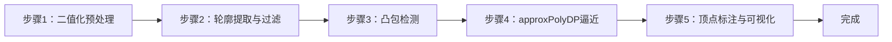
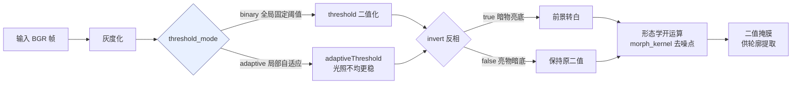
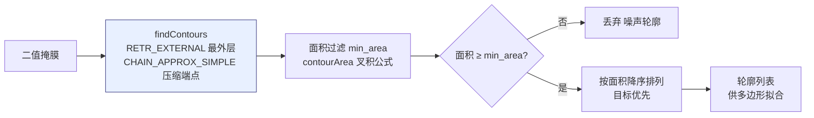
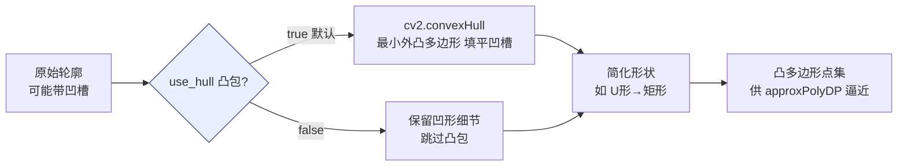
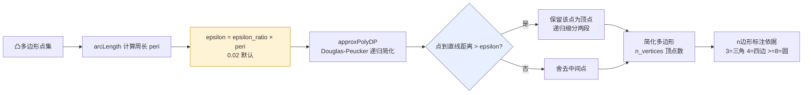
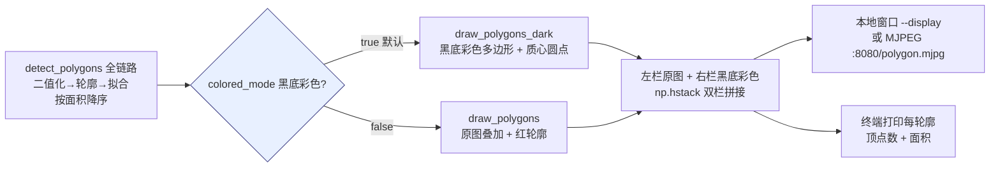

## 实验5：基于OpenCV的多边形轮廓拟合实验（4h）

> ✅ **源码已核实** 本实验源码位于 `ros2_ws/src/xflz_eai_car1/vision/05_line_following/`。⚠️ **内容说明**：课程名义为「自主巡线」，实际内容 = 亚博课程「OpenCV应用——多边形轮廓」：不规则轮廓 → 拟合规则几何形状（凸包/多边形）并标注顶点数。纯 OpenCV 方案（用户指示：不参考 car1_app/line_following.py）。单测 21/21 全绿，板端验证通过。

### 1.1 关联知识点

- 1.1.1 图像二值化 > 流程 > 灰度 → 阈值（binary/adaptive）→ 反相 → 形态学开运算；`invert` 区分暗物亮底/亮物暗底
- 1.2.1 轮廓提取 > 概念 > `cv2.findContours(RETR_EXTERNAL, CHAIN_APPROX_SIMPLE)` 提取外部轮廓，按面积过滤（min_area=2000）
- 1.2.2 凸包检测 > 原理 > `cv2.convexHull` 求点集最小凸包：填平凹槽，得到包围目标的最简外凸多边形
- 1.3.1 多边形逼近 > 流程 > `cv2.approxPolyDP` 用 Douglas-Peucker 算法按 epsilon 简化多边形顶点数
- 1.3.2 顶点标注 > 流程 > 检测结果按面积降序，绘制凸包多边形 + 黄点顶点标记 + 「n边形」标签

### 1.2 实验目标

1. 掌握二值化、轮廓提取、凸包检测与多边形逼近的原理与方法 — 原理理解
2. 实现不规则物体轮廓的规则几何拟合（凸包/多边形）与顶点数标注 — 独立完成
3. 理解多边形拟合在机器人视觉中的应用（形状识别、抓取定位、导航避障）— 迁移应用

### 1.3 实验环境

| 类别 | 配置 |
|------|------|
| 硬件 | 具身智能实验箱 B2（XFLZ_EAI_B2_PRO，RK3576 SoC，6TOPS NPU，含 HP60C 深度相机） |
| OS | Ubuntu 22.04 + ROS2 Humble（板载 ros2_venv） |
| 核心库 | OpenCV、NumPy（纯 CPU 视觉管线，无需 NPU） |
| 主入口 | `src/app.py`（图像/视频/相机 CLI + MJPEG 流 + 每帧打印顶点数/面积） |

### 1.4 实验难度

- 难度: ⭐⭐ 设计性
- 重点: 凸包检测 + approxPolyDP 多边形逼近 + 「n边形」标注
- 难点: epsilon 参数对拟合精细度的影响；复杂背景下的二值化稳定性

### 1.5 实验现象

**快速验证流程**：

1. 进入项目目录：`cd ~/ros2_ws/src/xflz_eai_car1/vision/05_line_following`
2. 单元测试：`pytest tests/ -v`（21 用例全绿）
3. 单图检测：`python src/app.py --image x.jpg --save out.jpg`
   - 输出：凸包多边形轮廓 + 黄点顶点 + 「n边形」标签；终端打印每轮廓顶点数/面积
4. 相机实时（板上标准）：先起 ascamera 驱动，再 `python src/app.py --ros`
   - MJPEG：`http://<板IP>:8080/polygon.mjpg`
5. 黑底彩色模式：`python src/app.py --image x.jpg --save out_dark.jpg`（由 `config/line_config.yaml` 的 `display.colored_mode` 控制：`true`=黑底彩色轮廓+质心，`false`=原图叠加；默认 `true`，单图命令即输出黑底双栏图）

```bash
# 进入实验05
cd ~/ros2_ws/src/xflz_eai_car1/vision/05_line_following

# 可选
/home/iflytek/ros2_venv/bin/python -m pytest -v

# 运行程序 修改display.colored_mode中的配置再重新运行一次
python src/app.py --image image.png --save out.jpg

# 相机实时 需要结合实际config配置修改才能达到好的效果
ros2 launch ascamera hp60c.launch.py        # 终端 1
python src/app.py --detect --ros             # 终端 2
```

**执行现象**：

- `pytest tests/ -v` 运行约 10-20 秒，输出 21 个用例全部 passed，覆盖 to_binary、find_contours、fit_polygon、detect_polygons、draw_polygons_dark 等函数的单元测试与集成测试
- 黑底彩色模式（`display.colored_mode: true` 默认生效）：`out_dark.jpg` 显示纯黑背景上彩色多边形轮廓线 + 质心实心圆点，与其它实验的黑底风格一致

**预期效果描述**：
- 纸盒/水瓶/卡片等物体轮廓正确拟合成多边形，标注「四边形」「八边形」等正确
- 调参影响：epsilon 越小顶点越多（拟合更精细）；use_hull=true 填平凹槽

display.colored_mode: true


display.colored_mode: false


实时视频检测


### 1.6 实验步骤

#### 整体流程图



---

#### 步骤1：二值化预处理（阶段一：能运行，20min）

> 📌 本步骤对应源码：`src/pipeline.py` to_binary

**知识点讲解**：

**二值化策略（1.1.1）**

- **原理**：`to_binary()`（L25-38）把 BGR 图转为二值掩膜：灰度化 → 阈值分割 → 反相 → 形态学开运算。(1) 阈值方式可选 `binary`（全局固定阈值）或 `adaptive`（局部自适应——光照不均时更稳）；(2) `invert` 参数区分**暗物亮底**（true，默认：黑色物体在白底上，反相后物体为白）与**亮物暗底**（false）；(3) 形态学开运算去噪点。二值化质量直接决定后续轮廓提取的成败——阈值选错，背景噪声全变成"轮廓"。
- **源码对应**：`src/pipeline.py` L25-38（to_binary：灰度 L26-28 / 阈值 L29-34 / 反相 L35 / 开运算 L37-38）

**知识储备补充**：

- **背景与动机**：二值化是几乎所有传统计算机视觉管线的起点——将 256 级灰度图压缩为 0/1 二值掩膜，使后续轮廓提取只需处理连通域边界，计算复杂度从 O(W×H) 降至 O(N)（N=轮廓点数）。实验 05 与实验 03（HSV 颜色识别）的区别在于：实验 03 用 `cv2.inRange` 在 HSV 空间做颜色掩膜，而实验 05 用灰度阈值做通用二值化——前者针对特定颜色目标，后者适用于任意前景/背景分离场景。
- **HSV 掩膜公式**：实验 03 中 `cv2.inRange(hsv, lower, upper)` 生成的二值掩膜可表示为：

  $$
  \text{mask}(x,y) = \begin{cases} 255 & \text{if } H_l \le H(x,y) \le H_u \land S_l \le S(x,y) \le S_u \land V_l \le V(x,y) \le V_u \\ 0 & \text{otherwise} \end{cases}
  $$

  其中 $H, S, V$ 分别为色调、饱和度、明度通道，$H_l, H_u$ 等为上下界。实验 05 的灰度阈值掩膜是其退化形式——仅约束单一亮度通道 $V$（灰度等价于 $V$）。
- **形态学开运算语义**：开运算 = 先腐蚀后膨胀（`cv2.MORPH_OPEN`），其几何含义是"去掉比核小的亮区域"。椭圆核（`MORPH_ELLIPSE`）比矩形核更自然地保留圆形轮廓，是轮廓检测的推荐选择。核大小 `morph_kernel` 必须为奇数——偶数核会导致锚点偏移，腐蚀/膨胀不对称。
- **参考资源**：OpenCV 官方文档 `cv2.threshold`、`cv2.adaptiveThreshold`；冈萨雷斯《数字图像处理》第 3 章（形态学处理）。

**配置参数速查表**（`config/line_config.yaml`，按区块分列）：

|块行|参数|类型|默认/示例|说明|
|---|---|---|---|---|
|`preprocess`|`threshold_mode`|str|`adaptive`|binary/adaptive 阈值模式|
|`preprocess`|`threshold_value`|int|`50`|阈值（adaptive 为基值）|
|`preprocess`|`invert`|bool|`false`|**亮物暗底 false；暗物亮底改 true**（板上实测）|
|`preprocess`|`morph_kernel`|int|`3`|形态学核（去噪，奇数；过大侵蚀小轮廓）|
|`contour`|`min_area`|int|`100`|最小轮廓面积（滤噪）|
|`polygon`|`approx_epsilon`|float|`0.02`|approxPolyDP 精度（×弧长）|
|`polygon`|`use_hull`|bool|`true`|先凸包再近似|
|`camera`|`index`/`width`/`height`|int|`0`/`640`/`480`|相机源配置|
|`source`|`ros.rgb_topic`|str|`/ascara_hp60c/.../rgb0/image`|相机话题（勿 remap）|
|`source`|`ros.timeout`|float|`5.0`|首帧等待秒数|
|`display`|`show`|bool|`false`|本地窗口|
|`display`|`window_name`|str|`polygon_contour`|窗口名|
|`display`|`colored_mode`|bool|`true`|true=黑底彩色轮廓+质心；false=原图红轮廓|
> **说明**：`preprocess.invert` 与 `polygon.use_hull` 为不同视觉场景关键开关；`colored_mode` 决定画布风格。

**操作步骤**：

1. 查看 `config/line_config.yaml` 的 threshold 配置（invert / threshold_mode / morphology kernel）
2. 用单图验证二值化效果：
   ```bash
   cd ~/ros2_ws/src/xflz_eai_car1/vision/05_line_following
   
   PYTHONPATH=./src python -c "
   import cv2
   from pipeline import to_binary
   from config import load_config
   cfg = load_config('config/line_config.yaml')
   img = cv2.imread('image.png')
   mask = to_binary(img, cfg)
   cv2.imwrite('mask_debug.jpg', mask)
   print(f'白像素占比: {mask.mean()/255:.3f}')
   "
   ```
3. 切换 invert / threshold_mode，观察掩膜变化

```bash
白像素占比: 0.673
```


**易错点**：

- ⚠️ invert 设反 → 背景变前景，轮廓全错（暗物亮底=true 默认）
- ⚠️ 光照不均用 adaptive；强反光需先预处理

**流程图**：



---

#### 步骤2：轮廓提取与面积过滤（阶段一：能运行，20min）

> 📌 本步骤对应源码：`src/pipeline.py` find_contours

**知识点讲解**：

**轮廓提取（1.2.1）**
- **原理**：`cv2.findContours(mask, RETR_EXTERNAL, CHAIN_APPROX_SIMPLE)` 提取二值掩膜的连通域边界。`RETR_EXTERNAL` 只取**最外层轮廓**（跳过内孔），`CHAIN_APPROX_SIMPLE` 压缩轮廓点（只保留端点，减少存储）。`find_contours()`（L41-44）随后按 `min_area=2000` 过滤小噪点轮廓，**按面积降序**返回——面积是区分"目标"与"噪声"的第一道闸门。
- **源码对应**：`src/pipeline.py` L41-44（find_contours：findContours L43 / 面积过滤 L44）

**知识储备补充**：

- **轮廓检索模式**：`RETR_EXTERNAL`（实验所用）只返回最外层轮廓，忽略内孔（如甜甜圈的中间洞）。若需同时检测内外轮廓，可换 `RETR_TREE`（保留层级树）或 `RETR_CCOMP`（两级结构）。实验 05 只关心物体外边界，`RETR_EXTERNAL` 足够且效率最高。
- **CHAIN_APPROX_SIMPLE 压缩**：该模式对水平/垂直/对角线段只保留端点——一条水平边 100 个连续点被压缩为 2 个端点，轮廓存储量降低 90%+。后续 `approxPolyDP` 只需处理端点，计算更高效。对比 `CHAIN_APPROX_NONE`（保留所有点）在大轮廓下无信息增益但占内存。
- **面积过滤语义**：`min_area` 是面积阈值（像素²），而非轮廓点数。面积 = 轮廓围成区域的像素计数（`cv2.contourArea` 用叉积公式）。实验 05 默认 `min_area=100`（`line_config.yaml`），而实验 01 的 2000 是因为工业缺陷框本身较大。`min_area` 需按实际目标尺度标定——设太小会混入噪点轮廓，设太大会丢失小目标。
- **参考资源**：OpenCV 官方文档 `cv2.findContours`（检索模式与近似方法对比）；Suzuki et al., *Topological structural analysis of digitized binary images by border following*（1985，findContours 算法原型）。

**操作步骤**：

1. 打印检测到的轮廓数量与面积：
   ```bash
   cd ~/ros2_ws/src/xflz_eai_car1/vision/05_line_following
   
   PYTHONPATH=./src python -c "
   import cv2
   from pipeline import to_binary, find_contours
   from config import load_config
   cfg = load_config('config/line_config.yaml')
   mask = to_binary(cv2.imread('image.png'), cfg)
   conts = find_contours(mask, cfg['contour']['min_area'])
   for i, c in enumerate(conts):
       print(f'轮廓{i}: 面积={cv2.contourArea(c):.0f} 点数={len(c)}')"
   ```
2. 调整 min_area，观察小噪点是否被过滤

```bash
轮廓0: 面积=136 点数=28
轮廓1: 面积=134 点数=42
轮廓2: 面积=193 点数=28
轮廓3: 面积=339 点数=19
轮廓4: 面积=417 点数=39
轮廓5: 面积=2438 点数=309
......后续省略
```

**易错点**：
- ⚠️ min_area 过小 → 噪声轮廓混入；过大 → 小目标丢失

**流程图**：



---

#### 步骤3：凸包检测（阶段二：能理解，25min）

> 📌 本步骤对应源码：`src/pipeline.py` fit_polygon

**知识点讲解**：

**凸包原理（1.2.2）**
- **原理**：凸包（convex hull）是包围点集的最小凸多边形——所有点都在其内部或边界上。对不规则轮廓（如带凹槽的纸盒、缺角卡片），`cv2.convexHull(contour)` 返回**填平凹槽**的外凸边界。这在形状识别中有特殊价值：判断轮廓是否凸（`cv2.isContourConvex` 可辅助分类），以及把不规则目标规整为可匹配的凸形状。`use_hull=true`（默认）启用凸包——vendor 语义；`false` 保留凹形细节。
- **源码对应**：`src/pipeline.py` fit_polygon（convexHull 调用，use_hull 分支）

**知识储备补充**：

- **凸包数学定义**：给定点集 $P = \{p_1, p_2, \ldots, p_n\} \subset \mathbb{R}^2$，其凸包 $\text{conv}(P)$ 定义为包含 $P$ 的最小凸集：

  $$
  \text{conv}(P) = \left\{ \sum_{i=1}^{n} \lambda_i p_i \;\middle|\; \lambda_i \ge 0,\; \sum_{i=1}^{n} \lambda_i = 1 \right\}
  $$

  即所有点的凸组合（convex combination）构成的集合。几何上，凸包等价于"用橡皮筋围住所有点后自然收紧形成的多边形"。`cv2.convexHull` 返回的顶点按逆时针排列，保证后续 `arcLength` 和 `approxPolyDP` 的正确性。
- **凸包 vs 原轮廓的信息损失**：凸包把凹槽"填平"——L 形物体被包成矩形，U 形物体被包成矩形或梯形。这意味着凸包丢失了凹形结构信息（如 U 形的"缺口"）。`use_hull=true` 是本项目 vendor 的默认语义（先凸包再逼近），适合"忽略凹槽、只关注整体外轮廓"的场景；若需保留凹形细节（如识别字母 "C"），应设 `use_hull=false`。
- **参考资源**：OpenCV 官方文档 `cv2.convexHull`；Preparata & Shamos, *Computational Geometry: An Introduction*（凸包算法经典教材，Graham scan / Chan's algorithm）。

**操作步骤**：

1. 用带凹槽的物体（如 U 形纸片）测试：
   ```bash
   cd ~/ros2_ws/src/xflz_eai_car1/vision/05_line_following
   
   # 图片需自带然后修改图片路径
   PYTHONPATH=./src python -c "
   import cv2
   from pipeline import to_binary, find_contours, fit_polygon
   from config import load_config
   cfg = load_config('config/line_config.yaml')
   mask = to_binary(cv2.imread('u_shape.jpg'), cfg)
   c = find_contours(mask, cfg['contour']['min_area'])[0]
   hull = fit_polygon(c, 0.02, use_hull=True)
   raw = fit_polygon(c, 0.02, use_hull=False)
   print('凸包顶点数:', len(hull), '| 原轮廓简化顶点数:', len(raw))"
   ```
2. 对比 use_hull=true/false 的拟合差异（凹槽被填平 vs 保留）
3. 思考：凸包在哪些场景有用？哪些场景反而有害？

**易错点**：
- ⚠️ use_hull 语义与 vendor 对齐（true=填平凹槽）；需要凹形细节时设 false

**流程图**：



---

#### 步骤4：approxPolyDP 多边形逼近（阶段二：能理解，30min）

> 📌 本步骤对应源码：`src/pipeline.py` fit_polygon

**知识点讲解**：

**Douglas-Peucker 算法（1.3.1）**
- **原理**：`cv2.approxPolyDP(shape, epsilon_ratio * peri, True)` 用 **Douglas-Peucker 算法**简化多边形：从首尾两点连直线，找离直线最远的点，若距离 > epsilon 则递归细分，否则舍去中间点。`epsilon = epsilon_ratio × 周长` 使简化与尺寸无关——epsilon_ratio 越大简化越狠（顶点越少），越小越精细（顶点越多）。典型值 0.02：四边形→4 顶点、五边形→5 顶点、圆→8~16 顶点。拟合结果是「n边形」标注的依据——`n_vertices = len(approx)`。
- **源码对应**：`src/pipeline.py` fit_polygon（approxPolyDP，epsilon_ratio 参数）

**知识储备补充**：

- **Douglas-Peucker 算法递归原理**：该算法（1973）的核心是自顶向下的递归细分——给定多边形的首尾两点 $p_s, p_e$，遍历所有中间点找到距离线段 $\overline{p_s p_e}$ 最远的点 $p_{\max}$：

  $$
  d(p_{\max}, \overline{p_s p_e}) = \max_{p_i} \frac{|(p_e - p_s) \times (p_s - p_i)|}{\|p_e - p_s\|}
  $$

  其中 $\times$ 为二维叉积（绝对值除以底边长即点到直线距离）。若 $d(p_{\max}) > \varepsilon$（epsilon = epsilon_ratio × 周长），则 $p_{\max}$ 保留为顶点，递归处理 $[p_s, p_{\max}]$ 和 $[p_{\max}, p_e]$ 两段；否则中间点全部丢弃。时间复杂度 $O(n \log n)$（平均），最坏 $O(n^2)$。
- **epsilon 语义**：`epsilon = epsilon_ratio × 周长`（`fit_polygon` L55-56 中 `epsilon_ratio * peri`）。这意味着 epsilon 随轮廓尺寸等比缩放——同一 ratio 下，大物体和小物体的简化程度一致，调参不需按物体尺寸手动调整。典型 ratio 范围：0.005（精细，保留细节）→ 0.02（默认，适中）→ 0.05（粗糙，只留大特征）→ 0.1（极粗糙，圆→三角形）。
- **圆的多边形逼近**：圆没有角点，Douglas-Peucker 会保留等间距的"伪角点"来近似弧线。epsilon_ratio=0.02 时圆通常被拟合为 8~16 边形——这正是实验中"≥8 近似圆"分类阈值的来源。顶点数随 ratio 变化的趋势：ratio 越小顶点越多（逼近圆弧），越大顶点越少（圆→三角形→直线）。
- **参考资源**：Douglas & Peucker, *Algorithms for the reduction of the number of points required to represent a digitized line or its caricature*（1973，原始论文）；OpenCV 官方文档 `cv2.approxPolyDP`。

**操作步骤**：

1. 对同一物体用不同 epsilon_ratio 测试：
   ```bash
   cd ~/ros2_ws/src/xflz_eai_car1/vision/05_line_following
   
   # 图片需自带然后修改图片路径
   PYTHONPATH=./src python -c "
   import cv2
   from pipeline import to_binary, find_contours, fit_polygon
   from config import load_config
   cfg = load_config('config/line_config.yaml')
   mask = to_binary(cv2.imread('card.jpg'), cfg)
   c = find_contours(mask, cfg['contour']['min_area'])[0]
   for eps in [0.005, 0.02, 0.05, 0.1]:
       p = fit_polygon(c, eps)
       print(f'epsilon_ratio={eps}: {len(p)}边形')"
   ```
2. 观察 epsilon 从 0.005→0.1 的顶点数变化（4→4→4→3 或类似），理解"简化粒度"语义
3. 用圆形物体测试，观察高 epsilon 下圆被拟合为多少边形

**易错点**：
- ⚠️ epsilon 过小 → 顶点冗余（噪声点被保留）；过大 → 形状失真（圆变三角形）
- ⚠️ epsilon 与周长挂钩（比例式），改图尺寸不需重调

**流程图**：



---

#### 步骤5：顶点标注与可视化（阶段三：能改造，25min）

> 📌 本步骤对应源码：`src/pipeline.py` draw_polygons / draw_polygons_dark

**知识点讲解**：

**可视化与数据输出（1.3.2）**
- **原理**：`detect_polygons()`（L61-73）编排全链路（二值化 → 轮廓 → 拟合），按面积降序返回 `PolygonResult(vertices, area, n_vertices)`。`draw_polygons()`（L76-87）在图上绘制凸包多边形 + 黄色顶点标记 + 「n边形」标签；`draw_polygons_dark()`（L90-119）提供黑底彩色多边形 + 质心圆点的 vendor 风格效果。顶点数 `n_vertices` 是形状分类的关键特征（3=三角形、4=四边形、≥8 近似圆）。
- **源码对应**：`src/pipeline.py` L61-73（detect_polygons）、L76-87（draw_polygons）、L90-119（draw_polygons_dark）

**知识储备补充**：

- **质心计算与 Moments**：`draw_polygons_dark` 中 `cv2.moments(r.vertices)` 计算多边形的图像矩。零阶矩 $m_{00}$ = 面积，一阶矩 $m_{10}, m_{01}$ 用于求质心：

  $$
  c_x = \frac{m_{10}}{m_{00}}, \quad c_y = \frac{m_{01}}{m_{00}}
  $$

  质心是形状的"重心"——在巡线应用中，质心 x 坐标相对画面中心的偏移量可直接映射为转向指令（左/中/右），这是实验 08（自主巡线）的核心思路。
- **双栏可视化设计**：`app.py` L30-36 的 `process_frame` 在 `colored_mode=true` 时将原图与黑底彩色轮廓水平拼接（`np.hstack`），形成双栏视图——左栏为原始 RGB，右栏为纯黑背景上的彩色多边形轮廓 + 质心圆点。这种设计便于对比：左栏确认检测目标正确，右栏观察拟合质量。MJPEG 推流地址为 `:8080/polygon.mjpg`，浏览器可实时查看。
- **形状分类阈值**：顶点数 $n$ 的分类规则：$n=3$ 三角形，$n=4$ 四边形，$n=5$ 五边形，$n \ge 8$ 近似圆。该阈值并非绝对——epsilon_ratio 不同，同一物体的 $n$ 可能变化。实测标定是必要的：用标准形状（三角板、方块、圆盘）跑一遍，记录各 ratio 下的 $n$ 分布，确定稳定分类区间。
- **参考资源**：OpenCV 官方文档 `cv2.moments`、`cv2.polylines`；MJPEG Streamer 项目（多实验共用的推流方案）。

**操作步骤**：

1. 单图检测：
   ```bash
   cd ~/ros2_ws/src/xflz_eai_car1/vision/05_line_following
   
   python src/app.py --image image.png --save out.jpg
   ```
2. 相机实时（板上标准）：
   ```bash
   source /opt/ros/humble/setup.bash && source ~/ros2_ws/install/setup.bash
   export ROS_DOMAIN_ID=2
   
   ros2 launch ascamera hp60c.launch.py        # 终端 1
   python src/app.py --ros                      # 终端 2
   # MJPEG: http://<板IP>:8080/polygon.mjpg，移动物体观察顶点数实时变化
   ```
3. 动手改造：按顶点数分类显示颜色（三角形红/四边形绿/圆形蓝），实现简单形状分类器

**易错点**：
- ⚠️ --ros 取不到帧 → ascamera 先起、ROS_DOMAIN_ID 一致、话题勿 remap
- ⚠️ 形状分类阈值：圆 vs 多边形靠顶点数，需实测标定

**流程图**：



---

### 1.7 常见问题

| 问题 | 原因 | 解决方法 |
|------|------|---------|
| 轮廓全错 | invert 设反（暗物亮底 vs 亮物暗底） | 检查 `threshold.invert`（默认 true=暗物亮底） |
| 噪声轮廓混入 | min_area 过小 / 二值化噪点多 | 增大 min_area；开运算去噪（morphology） |
| 顶点数异常（过多） | epsilon_ratio 过小 | 增大 approx_epsilon（0.02 → 0.05） |
| 形状失真（圆变三角） | epsilon_ratio 过大 | 减小 approx_epsilon |
| 凹槽物体拟合异常 | use_hull 语义不匹配 | true=凸包填平凹槽；false=保留凹形细节 |
| 光照变化后检测不稳 | binary 阈值不适应 | 换 `threshold_mode: adaptive` |
| --ros 取不到帧 | 驱动未启动/ROS_DOMAIN_ID 不一致 | ascamera 先起；export ROS_DOMAIN_ID=2；话题勿 remap |

### 1.8 扩展实验

**扩展方向 1：形状分类器（进阶）**
- 用 `n_vertices` 分类：三角形（3）、四边形（4）、五边形（5）、圆（≥8），不同形状不同颜色标注，实现基础几何形状识别

**扩展方向 2：自主巡线（进阶）**
- 用多边形质心 x 坐标相对画面中心的偏移量生成转向指令（左/中/右），通过 ROS2 cmd_vel 发布控制小车沿色块路径行驶（参考实验 11 的 cmd_vel 模式）

### 1.9 实验报告要求

**评分标准**：二值化理解 15 分 + 轮廓提取 15 分 + 凸包原理 20 分 + approxPolyDP 25 分 + 实时演示 15 分 + 报告 10 分 = 100 分。

**报告必含内容**：
1. 二值化流程图与参数说明（invert/threshold_mode 对比图）
2. 轮廓提取结果图（含 min_area 过滤前后对比）
3. 凸包 vs 原轮廓对比图（凹槽被填平的效果）
4. epsilon_ratio 参数实验表（0.005~0.1 的顶点数变化）
5. 3 种不同形状物体的「n边形」标注结果图
6. 回答思考题：凸包与多边形的区别？epsilon 如何影响拟合？如何用顶点数分类形状？
7. 实验心得与问题记录

---

## 更新日志

| 版本 | 日期 | 变更 |
|------|------|------|
| v1.0 | 2026-08-10 | 初版生成（源码路径 ros2_ws/src/xflz_eai_car1/vision/05_line_following，21 用例全绿，二值化+轮廓+凸包+approxPolyDP+顶点标注，板端验证通过） |
| v2.0 | 2026-08-19 | 知识点增强：补充 5 个知识储备小节（HSV掩膜公式/形态学开运算语义/轮廓检索模式/凸包数学定义/Douglas-Peucker递归原理/质心Moments/形状分类阈值），追加执行现象段，新增 3 个公式块（HSV掩膜/凸包凸组合/D-P叉积距离），补充 6 个参考资源条目，源码行号复核对齐 |
| v2.1 | 2026-08-21 | 步骤 1 新增「配置参数速查表」：config/line_config.yaml 全参数（preprocess/contour/polygon/camera/source/display）。标注 invert/use_hull/colored_mode。表值实测一致 |
