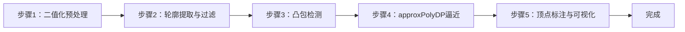

## 实验5：基于OpenCV的多边形轮廓拟合实验（4h）

> ✅ **源码已核实** 本实验源码位于 `ros2_ws/src/xflz_eai_car1/vision/05_line_following/`。⚠️ **内容说明**：课程名义为「自主巡线」，实际内容 = 亚博课程「OpenCV应用——多边形轮廓」：不规则轮廓 → 拟合规则几何形状（凸包/多边形）并标注顶点数。纯 OpenCV 方案（用户指示：不参考 car1_app/line_following.py）。单测 21/21 全绿，板端验证通过。

### 1.1 关联知识点

- 1.1.1 图像二值化 > 流程 > 灰度 → 阈值（binary/adaptive）→ 反相 → 形态学开运算；`invert` 区分暗物亮底/亮物暗底
- 1.2.1 轮廓提取 > 概念 > `cv2.findContours(RETR_EXTERNAL, CHAIN_APPROX_SIMPLE)` 提取外部轮廓，按面积过滤（min_area=2000）
- 1.2.2 凸包检测 > 原理 > `cv2.convexHull` 求点集最小凸包：填平凹槽，得到包围目标的最简外凸多边形
- 1.3.1 多边形逼近 > 流程 > `cv2.approxPolyDP` 用 Douglas-Peucker 算法按 epsilon 简化多边形顶点数
- 1.3.2 顶点标注 > 流程 > 检测结果按面积降序，绘制凸包多边形 + 黄点顶点标记 + 「n边形」标签

### 1.2 实验目标

1. 掌握二值化、轮廓提取、凸包检测与多边形逼近的原理与方法 — 原理理解
2. 实现不规则物体轮廓的规则几何拟合（凸包/多边形）与顶点数标注 — 独立完成
3. 理解多边形拟合在机器人视觉中的应用（形状识别、抓取定位、导航避障）— 迁移应用

### 1.3 实验环境

| 类别 | 配置 |
|------|------|
| 硬件 | 具身智能实验箱 B2（XFLZ_EAI_B2_PRO，RK3576 SoC，6TOPS NPU，含 HP60C 深度相机） |
| OS | Ubuntu 22.04 + ROS2 Humble（板载 ros2_venv） |
| 核心库 | OpenCV、NumPy（纯 CPU 视觉管线，无需 NPU） |
| 主入口 | `src/app.py`（图像/视频/相机 CLI + MJPEG 流 + 每帧打印顶点数/面积） |

### 1.4 实验难度

- 难度: ⭐⭐ 设计性
- 重点: 凸包检测 + approxPolyDP 多边形逼近 + 「n边形」标注
- 难点: epsilon 参数对拟合精细度的影响；复杂背景下的二值化稳定性

### 1.5 实验现象

**快速验证流程**：

1. 进入项目目录：`cd ros2_ws/src/xflz_eai_car1/vision/05_line_following`
2. 单元测试：`pytest tests/ -v`（21 用例全绿）
3. 单图检测：`python src/app.py --image x.jpg --save out.jpg`
   - 输出：凸包多边形轮廓 + 黄点顶点 + 「n边形」标签；终端打印每轮廓顶点数/面积
4. 相机实时（板上标准）：先起 ascamera 驱动，再 `python src/app.py --ros`
   - MJPEG：`http://<板IP>:8080/polygon.mjpg`
5. 黑底彩色模式：`python src/app.py --image x.jpg --save out_dark.jpg --dark`

**预期效果描述**：
- 纸盒/水瓶/卡片等物体轮廓正确拟合成多边形，标注「四边形」「八边形」等正确
- 多边形随物体移动实时更新（顶点数/面积逐帧打印）
- 调参影响：epsilon 越小顶点越多（拟合更精细）；use_hull=true 填平凹槽

### 1.6 实验步骤

#### 整体流程图



---

#### 步骤1：二值化预处理（阶段一：能运行，20min）

> 📌 本步骤对应源码：`src/pipeline.py` to_binary

**知识点讲解**：

**二值化策略（1.1.1）**
- **原理**：`to_binary()`（L25-38）把 BGR 图转为二值掩膜：灰度化 → 阈值分割 → 反相 → 形态学开运算。(1) 阈值方式可选 `binary`（全局固定阈值）或 `adaptive`（局部自适应——光照不均时更稳）；(2) `invert` 参数区分**暗物亮底**（true，默认：黑色物体在白底上，反相后物体为白）与**亮物暗底**（false）；(3) 形态学开运算去噪点。二值化质量直接决定后续轮廓提取的成败——阈值选错，背景噪声全变成"轮廓"。
- **源码对应**：`src/pipeline.py` L25-38（to_binary：灰度 L26-28 / 阈值 L29-34 / 反相 L35 / 开运算 L37-38）

**操作步骤**：

1. 查看 `config/polygon_config.yaml` 的 threshold 配置（invert / threshold_mode / morphology kernel）
2. 用单图验证二值化效果：
   ```bash
   python -c "
   import cv2
   from pipeline import to_binary
   from config import load_config
   cfg = load_config('config/polygon_config.yaml')
   mask = to_binary(cv2.imread('x.jpg'), cfg['threshold'])
   cv2.imwrite('mask.jpg', mask)
   print('二值化完成，白像素占比:', round(float(mask.mean()/255), 3))"
   ```
3. 切换 invert / threshold_mode，观察掩膜变化

**易错点**：
- ⚠️ invert 设反 → 背景变前景，轮廓全错（暗物亮底=true 默认）
- ⚠️ 光照不均用 adaptive；强反光需先预处理

---

#### 步骤2：轮廓提取与面积过滤（阶段一：能运行，20min）

> 📌 本步骤对应源码：`src/pipeline.py` find_contours

**知识点讲解**：

**轮廓提取（1.2.1）**
- **原理**：`cv2.findContours(mask, RETR_EXTERNAL, CHAIN_APPROX_SIMPLE)` 提取二值掩膜的连通域边界。`RETR_EXTERNAL` 只取**最外层轮廓**（跳过内孔），`CHAIN_APPROX_SIMPLE` 压缩轮廓点（只保留端点，减少存储）。`find_contours()`（L41-44）随后按 `min_area=2000` 过滤小噪点轮廓，**按面积降序**返回——面积是区分"目标"与"噪声"的第一道闸门。
- **源码对应**：`src/pipeline.py` L41-44（find_contours：findContours L43 / 面积过滤 L44）

**操作步骤**：

1. 打印检测到的轮廓数量与面积：
   ```bash
   python -c "
   import cv2
   from pipeline import to_binary, find_contours
   from config import load_config
   cfg = load_config('config/polygon_config.yaml')
   mask = to_binary(cv2.imread('x.jpg'), cfg['threshold'])
   conts = find_contours(mask, cfg['contour']['min_area'])
   for i, c in enumerate(conts):
       print(f'轮廓{i}: 面积={cv2.contourArea(c):.0f} 点数={len(c)}')"
   ```
2. 调整 min_area，观察小噪点是否被过滤

**易错点**：
- ⚠️ min_area 过小 → 噪声轮廓混入；过大 → 小目标丢失

---

#### 步骤3：凸包检测（阶段二：能理解，25min）

> 📌 本步骤对应源码：`src/pipeline.py` fit_polygon

**知识点讲解**：

**凸包原理（1.2.2）**
- **原理**：凸包（convex hull）是包围点集的最小凸多边形——所有点都在其内部或边界上。对不规则轮廓（如带凹槽的纸盒、缺角卡片），`cv2.convexHull(contour)` 返回**填平凹槽**的外凸边界。这在形状识别中有特殊价值：判断轮廓是否凸（`cv2.isContourConvex` 可辅助分类），以及把不规则目标规整为可匹配的凸形状。`use_hull=true`（默认）启用凸包——vendor 语义；`false` 保留凹形细节。
- **源码对应**：`src/pipeline.py` fit_polygon（convexHull 调用，use_hull 分支）

**操作步骤**：

1. 用带凹槽的物体（如 U 形纸片）测试：
   ```bash
   python -c "
   import cv2
   from pipeline import to_binary, find_contours, fit_polygon
   from config import load_config
   cfg = load_config('config/polygon_config.yaml')
   mask = to_binary(cv2.imread('u_shape.jpg'), cfg['threshold'])
   c = find_contours(mask, 2000)[0]
   hull = fit_polygon(c, 0.02, use_hull=True)
   raw = fit_polygon(c, 0.02, use_hull=False)
   print('凸包顶点数:', len(hull), '| 原轮廓简化顶点数:', len(raw))"
   ```
2. 对比 use_hull=true/false 的拟合差异（凹槽被填平 vs 保留）
3. 思考：凸包在哪些场景有用？哪些场景反而有害？

**易错点**：
- ⚠️ use_hull 语义与 vendor 对齐（true=填平凹槽）；需要凹形细节时设 false

---

#### 步骤4：approxPolyDP 多边形逼近（阶段二：能理解，30min）

> 📌 本步骤对应源码：`src/pipeline.py` fit_polygon

**知识点讲解**：

**Douglas-Peucker 算法（1.3.1）**
- **原理**：`cv2.approxPolyDP(shape, epsilon_ratio * peri, True)` 用 **Douglas-Peucker 算法**简化多边形：从首尾两点连直线，找离直线最远的点，若距离 > epsilon 则递归细分，否则舍去中间点。`epsilon = epsilon_ratio × 周长` 使简化与尺寸无关——epsilon_ratio 越大简化越狠（顶点越少），越小越精细（顶点越多）。典型值 0.02：四边形→4 顶点、五边形→5 顶点、圆→8~16 顶点。拟合结果是「n边形」标注的依据——`n_vertices = len(approx)`。
- **源码对应**：`src/pipeline.py` fit_polygon（approxPolyDP，epsilon_ratio 参数）

**操作步骤**：

1. 对同一物体用不同 epsilon_ratio 测试：
   ```bash
   python -c "
   import cv2
   from pipeline import to_binary, find_contours, fit_polygon
   from config import load_config
   cfg = load_config('config/polygon_config.yaml')
   mask = to_binary(cv2.imread('card.jpg'), cfg['threshold'])
   c = find_contours(mask, 2000)[0]
   for eps in [0.005, 0.02, 0.05, 0.1]:
       p = fit_polygon(c, eps)
       print(f'epsilon_ratio={eps}: {len(p)}边形')"
   ```
2. 观察 epsilon 从 0.005→0.1 的顶点数变化（4→4→4→3 或类似），理解"简化粒度"语义
3. 用圆形物体测试，观察高 epsilon 下圆被拟合为多少边形

**易错点**：
- ⚠️ epsilon 过小 → 顶点冗余（噪声点被保留）；过大 → 形状失真（圆变三角形）
- ⚠️ epsilon 与周长挂钩（比例式），改图尺寸不需重调

---

#### 步骤5：顶点标注与可视化（阶段三：能改造，25min）

> 📌 本步骤对应源码：`src/pipeline.py` draw_polygons / draw_polygons_dark

**知识点讲解**：

**可视化与数据输出（1.3.2）**
- **原理**：`detect_polygons()`（L61-73）编排全链路（二值化 → 轮廓 → 拟合），按面积降序返回 `PolygonResult(vertices, area, n_vertices)`。`draw_polygons()`（L76-87）在图上绘制凸包多边形 + 黄色顶点标记 + 「n边形」标签；`draw_polygons_dark()`（L90-119）提供黑底彩色多边形 + 质心圆点的 vendor 风格效果。顶点数 `n_vertices` 是形状分类的关键特征（3=三角形、4=四边形、≥8 近似圆）。
- **源码对应**：`src/pipeline.py` L61-73（detect_polygons）、L76-87（draw_polygons）、L90-119（draw_polygons_dark）

**操作步骤**：

1. 单图检测：
   ```bash
   cd ros2_ws/src/xflz_eai_car1/vision/05_line_following
   python src/app.py --image card.jpg --save out.jpg
   # out.jpg：凸包 + 黄点 + 「4边形」标签
   ```
2. 相机实时（板上标准）：
   ```bash
   source /opt/ros/humble/setup.bash && source ~/ros2_ws/install/setup.bash
   export ROS_DOMAIN_ID=2
   ros2 launch ascamera hp60c.launch.py        # 终端 1
   python src/app.py --ros                      # 终端 2
   # MJPEG: http://<板IP>:8080/polygon.mjpg，移动物体观察顶点数实时变化
   ```
3. 动手改造：按顶点数分类显示颜色（三角形红/四边形绿/圆形蓝），实现简单形状分类器

**易错点**：
- ⚠️ --ros 取不到帧 → ascamera 先起、ROS_DOMAIN_ID 一致、话题勿 remap
- ⚠️ 形状分类阈值：圆 vs 多边形靠顶点数，需实测标定

---

### 1.7 常见问题

| 问题 | 原因 | 解决方法 |
|------|------|---------|
| 轮廓全错 | invert 设反（暗物亮底 vs 亮物暗底） | 检查 `threshold.invert`（默认 true=暗物亮底） |
| 噪声轮廓混入 | min_area 过小 / 二值化噪点多 | 增大 min_area；开运算去噪（morphology） |
| 顶点数异常（过多） | epsilon_ratio 过小 | 增大 approx_epsilon（0.02 → 0.05） |
| 形状失真（圆变三角） | epsilon_ratio 过大 | 减小 approx_epsilon |
| 凹槽物体拟合异常 | use_hull 语义不匹配 | true=凸包填平凹槽；false=保留凹形细节 |
| 光照变化后检测不稳 | binary 阈值不适应 | 换 `threshold_mode: adaptive` |
| --ros 取不到帧 | 驱动未启动/ROS_DOMAIN_ID 不一致 | ascamera 先起；export ROS_DOMAIN_ID=2；话题勿 remap |

### 1.8 扩展实验

**扩展方向 1：形状分类器（进阶）**
- 用 `n_vertices` 分类：三角形（3）、四边形（4）、五边形（5）、圆（≥8），不同形状不同颜色标注，实现基础几何形状识别

**扩展方向 2：自主巡线（进阶）**
- 用多边形质心 x 坐标相对画面中心的偏移量生成转向指令（左/中/右），通过 ROS2 cmd_vel 发布控制小车沿色块路径行驶（参考实验 11 的 cmd_vel 模式）

### 1.9 实验报告要求

**评分标准**：二值化理解 15 分 + 轮廓提取 15 分 + 凸包原理 20 分 + approxPolyDP 25 分 + 实时演示 15 分 + 报告 10 分 = 100 分。

**报告必含内容**：
1. 二值化流程图与参数说明（invert/threshold_mode 对比图）
2. 轮廓提取结果图（含 min_area 过滤前后对比）
3. 凸包 vs 原轮廓对比图（凹槽被填平的效果）
4. epsilon_ratio 参数实验表（0.005~0.1 的顶点数变化）
5. 3 种不同形状物体的「n边形」标注结果图
6. 回答思考题：凸包与多边形的区别？epsilon 如何影响拟合？如何用顶点数分类形状？
7. 实验心得与问题记录

---

## 更新日志

| 版本 | 日期 | 变更 |
|------|------|------|
| v1.0 | 2026-08-10 | 初版生成（源码路径 ros2_ws/src/xflz_eai_car1/vision/05_line_following，21 用例全绿，二值化+轮廓+凸包+approxPolyDP+顶点标注，板端验证通过） |
