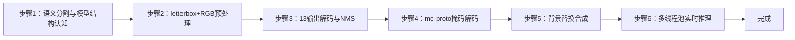
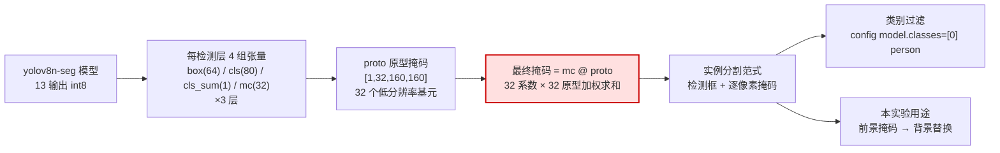
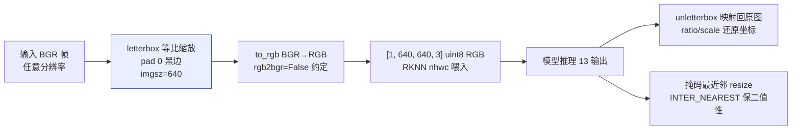
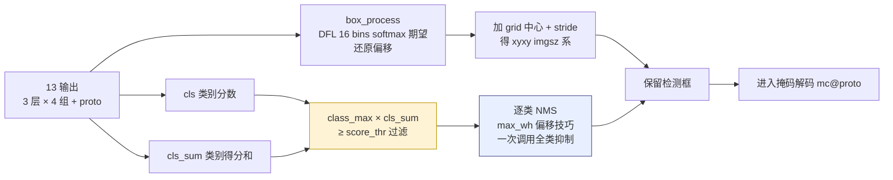
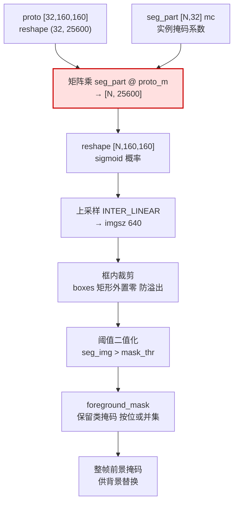
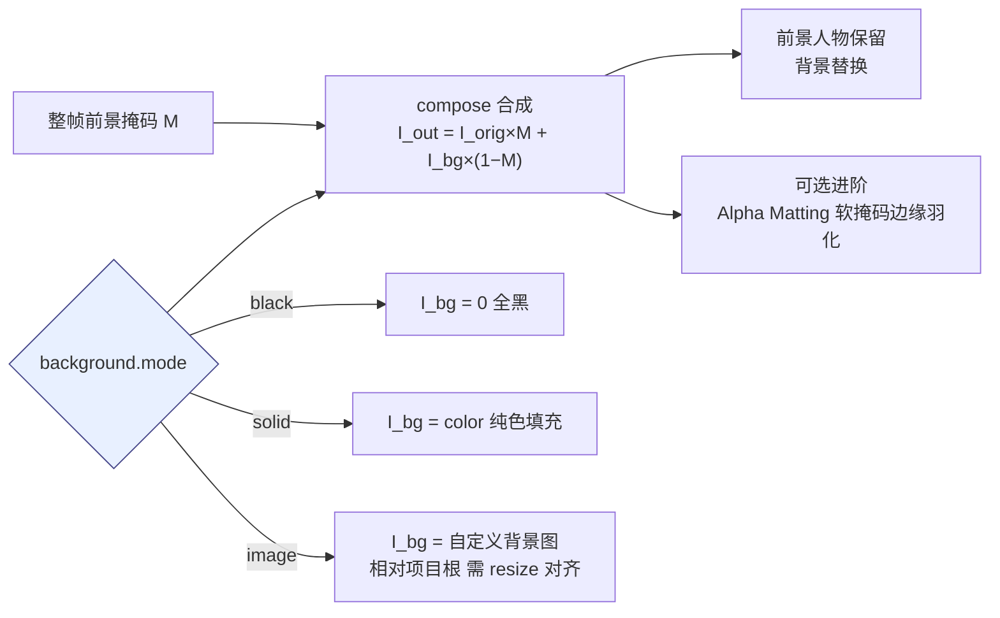
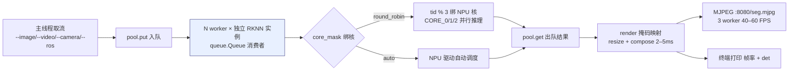

## 实验6：基于语义分割的背景分割实验（4h）

> ✅ **源码已核实** 本实验源码位于 `ros2_ws/src/xflz_eai_car1/vision/06_semantic_segmentation/`。⚠️ **内容说明**：课程「清除背景」语义，本实验用**语义分割人物抠图 + 背景替换**（yolov8n-seg，COCO 80 类，模型 3.2M 参数），效果更符合课程目标。已交付 `models/yolov8n-seg.onnx`（13 输出）与 `models/yolov8n-seg.rknn`（板上 int8 转换产物）。单测 38/38 全绿，板端验证通过（3 worker 池约 40-60 FPS）。

### 1.1 关联知识点

- 1.1.1 语义分割原理 > 原理 > 语义分割为每个像素分配类别标签，区别于目标检测的边界框；yolov8n-seg 同时输出检测框与逐像素掩码
- 1.2.1 13输出模型结构 > 概念 > 每层 [box(64), cls(80), cls_sum(1), mc(32)]×3 + proto [1,32,160,160]，mc@proto 矩阵乘还原掩码
- 1.3.1 前景提取 > 流程 > DFL 解码 → grid xyxy → cls_sum×cls 过滤 → 逐类 NMS → mc@proto 掩码 → 阈值二值化
- 1.3.2 背景替换 > 流程 > black/solid/image 三种背景模式，前景掩码外区域替换，Alpha 通道合成
- 1.3.3 多线程推理池 > 流程 > N worker × 独立 RKNN 实例 + round_robin tid%3 绑核（3 worker 帧率 ≥ 单线程 2 倍）

### 1.2 实验目标

1. 掌握语义分割与目标检测的区别，理解 yolov8-seg 的检测+掩码双输出架构 — 原理理解
2. 实现实时前景人物抠图与三种背景模式替换（黑/纯色/自定义图）— 独立完成
3. 理解多线程推理池提升 NPU 利用率的方法，掌握掩码阈值与类别过滤调参 — 迁移应用

### 1.3 实验环境

| 类别 | 配置 |
|------|------|
| 硬件 | 具身智能实验箱 B2（XFLZ_EAI_B2_PRO，RK3576 SoC，6TOPS NPU，含 HP60C 深度相机） |
| OS | Ubuntu 22.04 + ROS2 Humble（板载 ros2_venv，rknnlite 2.3.2） |
| 核心库 | OpenCV、NumPy、rknnlite、PyYAML（标准库 MJPEG） |
| 模型 | `models/yolov8n-seg.rknn`（int8，13 输出，COCO 80 类，3.2M 参数） |
| 主入口 | `src/app.py`（图像/视频/相机 CLI + 3 worker 推理池 + MJPEG） |

### 1.4 实验难度

- 难度: ⭐⭐ 设计性
- 重点: 13 输出分割解码（DFL → NMS → mc@proto 掩码）与背景替换合成
- 难点: 掩码解码的矩阵运算（mc@proto）；多线程池绑核配置；掩码质量调参

### 1.5 实验现象

**快速验证流程**：

1. 进入项目目录：`cd ~/ros2_ws/src/xflz_eai_car1/vision/06_semantic_segmentation`
2. 单元测试：`pytest tests/ -v`（38 用例全绿）
3. 单图抠图：`python src/app.py --image photo.jpg --save out.jpg`
   - 输出：人物被完整抠出，背景替换为黑色/纯色/自定义图
4. 相机实时（板上标准）：先起 ascamera 驱动，再 `python src/app.py --ros`
   - MJPEG：`http://<板IP>:8080/seg.mjpg`，实时抠图
5. 换背景：修改 `background.mode`（black/solid/image）后重跑

```bash
# 进入实验6
cd ~/ros2_ws/src/xflz_eai_car1/vision/06_semantic_segmentation

# 可选
/home/iflytek/ros2_venv/bin/python -m pytest -v

# 运行程序
python src/app.py --image images/bus.jpg --save out.jpg

# 相机实时
ros2 launch ascamera hp60c.launch.py        # 终端 1
python src/app.py --ros                     # 终端 2
```

**执行现象**：`pytest -v` 运行约 30-50 秒，输出 38 个用例全部 passed；单图抠图命令约 0.1-0.3 秒返回，终端打印 `[seg] N instances`（N 为检出人数），当前目录生成 `out.jpg`（前景人物保留，背景替换为配置模式）。实时模式下终端每 30 帧打印 `[seg] 30帧平均帧率: xx.x det=N`，3 worker 池实测约 **40-60 FPS**（单线程约 20-40 FPS）。板端 NPU 推理单帧约 15-25 ms。

**预期效果描述**：
- 单人照：person 抠图干净（掩码边缘平滑），背景替换正确
- 实时：人物移动时掩码逐帧跟随，3 worker 池约 40-60 FPS（单线程 20-40 FPS）
- 调参：`model.classes=[0]` 只留 person；`mask_thr` 调高去掩码碎片

单图片推理，修改config配置中的类别可以定向自己想要的类别


视频流推理


### 1.6 实验步骤

#### 整体流程图



---

#### 步骤1：语义分割与模型结构认知（阶段一：能运行，20min）

> 📌 本步骤对应源码：`src/config.py`、`models/`

**知识点讲解**：

**语义分割与 yolov8-seg 架构（1.1.1、1.2.1）**

- **原理**：语义分割（semantic segmentation）为**每个像素**分配类别标签，输出掩码（mask）而非边界框；实例分割（yolov8-seg）进一步区分同一类别的不同实例。yolov8n-seg 在检测头旁增加**掩码分支**：每检测层输出 4 组张量——box(64) 框回归（DFL 16 bins）、cls(80) 类别分数、cls_sum(1)、**mc(32) 掩码系数**；另有一个 **proto 原型掩码** `[1,32,160,160]`（32 个低分辨率原型图）。最终掩码 = mc @ proto（矩阵乘），32 维系数 × 32 原型图加权求和。模型选择 yolov8-seg 而非 yolov5-seg：fork `ultralytics_yolov8-main` 原生支持 Segment rknn 导出，与 rknn_model_zoo `yolov8_seg` 优化模型布局逐位一致。
- **源码对应**：`models/yolov8n-seg.onnx`（13 输出，可用 onnxruntime 验证结构）；`src/config.py`（model.classes / mask_thr / pool 参数）

**知识储备补充**：

- **语义分割 vs 目标检测 vs 实例分割**：目标检测输出"框+类别"（Bounding Box），语义分割输出"逐像素类别标签"（Pixel-wise Label Map），实例分割则在语义分割基础上进一步区分同一类别的不同个体。yolov8-seg 属于**实例分割**（Mask R-CNN 范式），同时输出检测框和逐像素掩码——本实验利用其"前景人物掩码"实现背景替换，本质上是实例分割的下游应用。
- **YOLOv8-seg 掩码分支设计动机**：全分辨率逐像素输出（如 FCN/PSPNet）内存开销大（640×640×C  float32 ≈ 1.5 MB/通道），不适合边缘设备实时推理。yolov8-seg 采用**两段式低秩分解**：模型只输出 32 维系数 mc ∈ ℝ³² 和 32 个低分辨率原型图 proto ∈ ℝ³²×¹⁶⁰×¹⁶⁰，通过矩阵乘 mc @ proto 还原全分辨率掩码——参数量从全分辨率输出的 ~1.5M 降至 ~32+32×160×160 ≈ 820K，NPU 友好。
- **COCO 80 类与类别过滤**：yolov8n-seg 默认输出 COCO 80 类检测，但本实验通过 `config.model.classes=[0]`（COCO id 0 = person）过滤，只保留人物实例。过滤发生在解码阶段（`decode_outputs` L102：`class_max * cls_sum >= score_thr`），非模型层面裁剪——模型仍然输出全部 80 类分数，后处理选择性保留。
- **参考资源**：Ultralytics YOLOv8 官方文档《YOLOv8 Instance Segmentation》；rknn_model_zoo `yolov8_seg` 说明；YOLOv8-seg ONNX 输出布局（13 输出结构说明）。

语义分割、目标检测、实例分割的区别示例


YOLOv8-seg网络结构图


COCO 80类别

| 0‑15              | 16‑31         | 32‑47              | 48‑63            | 64‑79        |
| ----------------- | ------------- | ------------------ | ---------------- | ------------ |
| 0: person         | 16: dog       | 32: sports ball    | 48: sandwich     | 64: fork     |
| 1: bicycle        | 17: horse     | 33: kite           | 49: orange       | 65: knife    |
| 2: car            | 18: sheep     | 34: baseball bat   | 50: broccoli     | 66: spoon    |
| 3: motorcycle     | 19: cow       | 35: baseball glove | 51: carrot       | 67: bowl     |
| 4: airplane       | 20: elephant  | 36: skateboard     | 52: hot dog      | 68: banana   |
| 5: bus            | 21: bear      | 37: surfboard      | 53: pizza        | 69: apple    |
| 6: train          | 22: zebra     | 38: tennis racket  | 54: donut        | 70: sandwich |
| 7: truck          | 23: giraffe   | 39: bottle         | 55: cake         | 71: orange   |
| 8: boat           | 24: backpack  | 40: wine glass     | 56: chair        | 72: broccoli |
| 9: traffic light  | 25: umbrella  | 41: cup            | 57: couch        | 73: carrot   |
| 10: fire hydrant  | 26: handbag   | 42: fork           | 58: potted plant | 74: hot dog  |
| 11: stop sign     | 27: tie       | 43: knife          | 59: bed          | 75: pizza    |
| 12: parking meter | 28: suitcase  | 44: spoon          | 60: dining table | 76: donut    |
| 13: bench         | 29: frisbee   | 45: bowl           | 61: toilet       | 77: cake     |
| 14: bird          | 30: skis      | 46: banana         | 62: tv           | 78: chair    |
| 15: cat           | 31: snowboard | 47: apple          | 63: laptop       | 79: couch    |

**配置参数速查表**（`config/seg_config.yaml`，按区块分列）：

| 区块 | 参数 | 类型 | 默认/示例 | 说明 |
|------|------|------|-----------|------|
| `model` | `rknn`/`onnx` | str | `models/yolov8n-seg.rknn` | 板载/PC 模型路径 |
| `model` | `imgsz` | int | `640` | 输入边长 |
| `model` | `score_thr` | float | `0.25` | 置信度阈值 |
| `model` | `iou_thr` | float | `0.45` | NMS 阈值 |
| `model` | `mask_thr` | float | `0.5` | 掩码二值化阈值 |
| `model` | `classes` | list | `[0]` | 保留 COCO 类（0=person；空=全部） |
| `background` | `mode` | str | `black` | black/solid/image 背景 |
| `background` | `color` | list | `[0,0,0]` | solid 填充色 BGR |
| `background` | `image` | str | `""` | image 模式背景图路径 |
| `pool` | `workers` | int | `3` | 推理线程（三核 NPU） |
| `pool` | `queue_size`/`core_mask` | int/str | `4`/`auto` | 队列/NPU 核 |
| `camera`/display | ... | | | 同前模板 |
| `server` | `port` | int | `8080` | MJPEG 端口 |
| `server` | `stream_name` | str | `seg.mjpg` | 流名（已含 .mjpg） |
> **说明**：`model.classes=[0]` 只保留 person（空=全部）；`pool.workers=3` 绑 RK3576 三核（round_robin）；`background.*` 决定替换背景样式。

**操作步骤**：

1. 验证模型输出结构（13 输出）：
   ```bash
   cd ~/ros2_ws/src/xflz_eai_car1/vision/06_semantic_segmentation
   
   PYTHONPATH=./src python -c "
   import onnxruntime as ort
   sess = ort.InferenceSession('models/yolov8n-seg.onnx')
   print('输出数:', len(sess.get_outputs()))
   for o in sess.get_outputs(): print(' ', o.name, o.shape)"
   # 预期：3 层 × [box, cls, cls_sum, mc] + 1 个 proto = 13
   ```

   ```bash
   输出数: 13
     375 [1, 64, 80, 80]
     onnx::ReduceSum_383 [1, 80, 80, 80]
     388 [1, 1, 80, 80]
     354 [1, 32, 80, 80]
     395 [1, 64, 40, 40]
     onnx::ReduceSum_403 [1, 80, 40, 40]
     407 [1, 1, 40, 40]
     361 [1, 32, 40, 40]
     414 [1, 64, 20, 20]
     onnx::ReduceSum_422 [1, 80, 20, 20]
     426 [1, 1, 20, 20]
     368 [1, 32, 20, 20]
     347 [1, 32, 160, 160]
   ```

2. 查看 `config/seg_config.yaml`：model.classes（COCO id，[0]=person）、mask_thr（0.5）、pool.workers/core_mask、background.mode

3. 思考：为什么需要 proto + mc 的两段式掩码？直接输出全分辨率掩码行不行？

**易错点**：

- ⚠️ 13 输出布局必须与解码契约一致（每层 4 组 + proto），换模型版本要核对

**流程图**：



---

#### 步骤2：预处理 letterbox + RGB（阶段一：能运行，15min）

> 📌 本步骤对应源码：`src/preprocess.py`

**知识点讲解**：

**输入对齐（复用 exp01 语义）**
- **原理**：与实验4一致：letterbox（pad 0）等比缩放到 640×640 → BGR→RGB 通道交换（模型 rgb2bgr=False）→ unletterbox 把检测框/掩码映射回原图坐标。掩码解码在 imgsz 坐标系完成，最终映射回原始分辨率。
- **源码对应**：`src/preprocess.py`（letterbox / to_rgb / unletterbox）

**知识储备补充**：

- **letterbox pad=0 的语义**：与 pad=114（YOLO 默认灰边）不同，pad=0 用黑色（0,0,0）填充。对分割任务而言，黑色填充区域在 RGB 下三通道均为 0，不会干扰模型特征提取（模型训练时通常也用 0 填充）；pad=0 还使 unletterbox 坐标还原更简洁（无灰边偏移误差）。
- **RGB 通道顺序约定**：RKNN 模型训练时输入约定为 RGB（非 OpenCV 默认的 BGR），`to_rgb()`（preprocess.py L42）执行 BGR→RGB 通道交换。若跳过此步，模型接收 BGR 数据，颜色特征错位导致掩码质量急剧下降——这是跨框架部署最常见的低级错误之一。
- **掩码映射回原图的特殊性**：与目标检测不同，分割掩码在 imgsz 空间完成解码（`seg_img > mask_thr`，postprocess.py L130），再通过 `cv2.resize`（app.py L40）最近邻插值映射回原图尺寸——不能用双线性插值（会模糊掩码边界），必须用 `INTER_NEAREST` 保持二值性。
- **参考资源**：OpenCV `cv2.resize` 插值方法文档；RKNN Toolkit2 输入格式说明（NHWC uint8 RGB）。

**操作步骤**：

1. 用单图验证预处理形状：
   ```bash
   cd ~/ros2_ws/src/xflz_eai_car1/vision/06_semantic_segmentation
   
   PYTHONPATH=./src python -c "
   import cv2
   import numpy as np
   from preprocess import letterbox, to_rgb
   img = cv2.imread('images/bus.jpg')
   if img is None:
       print('警告：未找到 images/bus.jpg，使用随机测试图')
       img = np.random.randint(0, 255, (480, 640, 3), dtype=np.uint8)
   lb = letterbox(img, 640, (0,0,0))
   print('letterbox输出:', lb.padded.shape, 'scale:', round(lb.ratio, 3))
   "
   ```

   ```
   letterbox输出: (640, 640, 3) scale: 0.593
   ```

2. 复习 exp01 的 pad=0 与 RGB 约定，理解跨实验复用

下面就是letterbox的具体实现图


RGB-BGR的区别


**易错点**：
- ⚠️ pad 必须 0 且 RGB——与转换侧 rgb2bgr=False 一致，否则掩码错位

**流程图**：



---

#### 步骤3：13 输出解码与逐类 NMS（阶段二：能理解，35min）

> 📌 本步骤对应源码：`src/postprocess.py` dfl_decode / box_process / nms / decode_outputs

**知识点讲解**：

**分割解码管线（1.3.1）**
- **原理**：`decode_outputs()`（L81-130）逐层处理：`dfl_decode`（L26-34）对 box 的 16 bins 做 softmax 期望还原偏移 → `box_process`（L37-47）加 grid 中心与 stride 还原 xyxy（imgsz 系）→ 类别分数用 **cls_sum×cls 过滤**（分割模型特有的类别得分加权）→ 逐类 NMS（L50-73，max_wh 偏移实现）→ 保留的检测框进入掩码解码。这一解码流程与 rknn_model_zoo `yolov8_seg.py` 逐行对齐，DFL/NMS 复用 exp01 的成熟模式。
- **源码对应**：`src/postprocess.py` L26-34（dfl_decode）、L37-47（box_process）、L50-73（nms）、L81-130（decode_outputs）

**知识储备补充**：

- **cls_sum×cls 过滤的数学含义**：yolov8-seg 的类别分数计算与纯检测模型不同。纯检测模型直接用 cls sigmoid 分数；分割模型引入 `cls_sum`（L97：`cls_sum = np.concatenate(sum_l)[:, 0]`），实际过滤条件为 `class_max * cls_sum >= score_thr`（L102）。`cls_sum` 本质是所有类别分数之和的标量，作为"检测置信度缩放因子"——当 `cls_sum` 很小时（该 grid 无真实目标），即使某类 cls 分数偏高，乘积也会低于阈值被过滤，降低了低质量区域的误检。
- **逐类 NMS 的 max_wh 偏移技巧**：传统 NMS 需要逐类独立执行（防止不同类别的重叠框被误抑制）。本实现用 `max_wh` 偏移（L55：`boxes = boxes + (class_ids * 7680)[:, None]`）将不同类别的框平移到互不重叠的坐标空间，一次 NMS 调用完成全类抑制——7680 远大于 640（imgsz），保证跨类框 IoU 始终为 0，等价于逐类 NMS 但只需一次排序+抑制循环。

| 方案                      | 实现思路                                                     | 优点                             | 缺点                                                      |
| ------------------------- | ------------------------------------------------------------ | -------------------------------- | --------------------------------------------------------- |
| 标准逐类 NMS              | 循环每一个类别，每一类单独执行 NMS                           | 逻辑直观，易调试                 | 多次循环，推理耗时高                                      |
| max_wh 偏移 NMS本项目使用 | `boxes += class_ids * 7680`；不同类别框坐标强制拉开；全局只跑 1 次 NMS | 只执行一轮 NMS，速度快；代码简洁 | max_wh 必须远大于图像边长；图像尺寸修改需要同步核对该常量 |

- **DFL softmax 期望值**：`dfl_decode`（L26-34）将 16 bins 的 logits 转为概率分布后加权求和——

  $$
  t = \sum_{i=0}^{15} p_i \cdot i, \quad p = \text{softmax}(z)
  $$

  其中 $z \in \mathbb{R}^{16}$ 为 bin logits，$t$ 为连续偏移量。相比直接回归单值 $t$，DFL 用离散分布近似连续值，梯度更稳定，对小目标边界回归更友好。
- **参考资源**：DFL 原论文《Generalized Focal Loss》（Li et al., NeurIPS 2020）；rknn_model_zoo `yolov8_seg.py` 后处理实现。


选取 **stride=8（80×80 小目标检测头）** 作为示例，其余 stride‑16、stride‑32 结构完全一致，仅特征图尺寸不同；外加第 13 路原型掩码输出。

| 序号 | Tensor 名称       | Shape(N=1)          | 含义                                                         | 后处理动作                                                   |
| ---- | ----------------- | ------------------- | ------------------------------------------------------------ | ------------------------------------------------------------ |
| 1    | box_dist_s8       | `(1, 6400, 64)`     | 每个 grid：上下左右 4 条边界，每条边界 16‑bin DFL 分布，4×16=64 | `dfl_decode()`：softmax + 加权求期望，得到 t/l/r/b 偏移量    |
| 2    | cls_s8            | `(1, 6400, 80)`     | 每个 grid 80 个 COCO 类别 logits                             | sigmoid，取单网格最大类别分数`class_max`                     |
| 3    | cls_sum_s8        | `(1, 6400, 1)`      | 分割特有：该网格全部类别分数求和                             | 置信加权：`score = class_max * cls_sum`，过滤低置信网格      |
| 4    | mask_coeff_s8     | `(1, 6400, 32)`     | 每个 grid 对应 32 维掩码系数                                 | 先缓存；NMS 筛选出有效框后取出对应系数                       |
| 13   | proto（原型掩码） | `(1, 32, 160, 160)` | **全局共享，不属于检测头输出**；32 通道高分辨率掩码基底      | 掩码解码：`mask = mask_coeff @ proto_flat`，矩阵乘生成实例分割 mask |

**操作步骤**：

1. 单测理解解码契约：`pytest tests/test_postprocess.py -v`

2. 用模型真实推理单图，打印解码中间量（检测框数、类别分布）：
   ```bash
   cd ~/ros2_ws/src/xflz_eai_car1/vision/06_semantic_segmentation
   
   PYTHONPATH=./src python -c "
   import cv2, numpy as np
   from backend import RKNNBackend
   from postprocess import decode_outputs
   from config import load_config
   cfg = load_config('config/seg_config.yaml')
   img = cv2.imread('images/bus.jpg')
   be = RKNNBackend(0); be.load(cfg['model']['rknn'])
   outputs = be.predict(img)                 # 真实 13 输出
   res = decode_outputs(outputs, cfg, cfg['model']['imgsz'])
   if res is None:
       print('无检测')
   else:
       uniq, cnt = np.unique(res.classes, return_counts=True)
       print(f'检测框数: {len(res.boxes)}')
       print(f'类别分布: {dict(zip(uniq.tolist(), cnt.tolist()))}')
       print('最高分:', round(float(res.scores.max()), 3))
   be.close() "
   
   # 单张图片推理
   python src/app.py --image images/bus.jpg --save out.jpg
   ```

   ```bash
   W rknn-toolkit-lite2 version: 2.3.2
   I RKNN: [14:58:06.014] RKNN Runtime Information, librknnrt version: 2.3.2 (429f97ae6b@2025-04-09T09:09:27)
   I RKNN: [14:58:06.014] RKNN Driver Information, version: 0.9.8
   I RKNN: [14:58:06.015] RKNN Model Information, version: 6, toolkit version: 2.3.0(compiler version: 2.3.0 (c949ad889d@2024-11-07T11:39:30)), target: RKNPU f2, target platform: rk3576, framework name: ONNX, framework layout: NCHW, model inference type: static_shape
   W RKNN: [14:58:06.045] query RKNN_QUERY_INPUT_DYNAMIC_RANGE error, rknn model is static shape type, please export rknn with dynamic_shapes
   W Query dynamic range failed. Ret code: RKNN_ERR_MODEL_INVALID. (If it is a static shape RKNN model, please ignore the above warning message.)
   检测框数: 4
   类别分布: {0: 3, 5: 1}
   最高分: 0.745
   ```

3. 修改 score_thr/mask_thr，观察检出数量变化

**易错点**：
- ⚠️ cls_sum×cls 过滤是分割模型特有，纯检测的 decode 不能直接套用

**流程图**：



---

#### 步骤4：mc@proto 掩码解码（阶段二：能理解，30min）

> 📌 本步骤对应源码：`src/postprocess.py` decode_outputs 掩码部分、foreground_mask

**知识点讲解**：

**掩码还原原理（1.2.1、1.3.1）**

- **原理**：yolov8-seg 的掩码不是逐像素直接输出（全分辨率太耗内存），而是**两段式**：

  (1) 模型输出 32 个 160×160 的**原型掩码**（proto，可理解为 32 个"分割基元"）；

  (2) 每个检测实例输出 32 维**掩码系数**（mc）。实例掩码 = Σ(mc_i × proto_i) = mc @ proto，再上采样到 imgsz 并阈值二值化（`seg_img > mask_thr`，L130）。`foreground_mask()`（L133-141）把保留类别（`keep_classes`，如 [0]=person）的掩码**按位或并集**，得到整帧前景掩码——背景替换只在这个掩码内保留原图。

- **源码对应**：`src/postprocess.py` L81-130（decode_outputs 掩码段）、L133-141（foreground_mask）

**知识储备补充**：

- **mc@proto 矩阵乘的维度分析**：`proto` shape 为 `(32, 160, 160)`，reshape 为 `(32, 25600)`（L117）；`seg_part` shape 为 `(N, 32)`（N 个检测实例的掩码系数），矩阵乘 `seg_part @ proto_m` 得 `(N, 25600)`（L118），再 reshape 回 `(N, 160, 160)`（L120）——每个实例得到一个 160×160 的原始掩码。数学表达为：
  $$
  \mathbf{M}_k = \text{sigmoid}\!\left(\mathbf{mc}_k \cdot \text{proto}\right), \quad \mathbf{mc}_k \in \mathbb{R}^{32}, \; \text{proto} \in \mathbb{R}^{32 \times 25600}
  $$
  
  其中 $\mathbf{M}_k \in \mathbb{R}^{160 \times 160}$ 为第 $k$ 个实例的掩码，sigmoid 将 logits 映射到 $[0,1]$ 概率（L119）。
  
- **上采样与框裁剪**：proto 160×160 只是原图 1/4 分辨率，需 `cv2.resize`（L121-122，`INTER_LINEAR` 双线性插值）上采样到 640×640。上采样后执行**框内裁剪**（L124-128）：用 `boxes[k]` 定义的矩形区域外的掩码置零（`seg_img[k] *= m`），防止一个实例的掩码"溢出"到另一个实例的检测框区域。最后阈值二值化（L130：`seg_img > mask_thr`）将连续概率图转为 bool 掩码。

- **foreground_mask 的并集语义**：`foreground_mask`（L133-141）用 `result.masks[sel].any(axis=0)`（L141）对保留类别的所有实例掩码做**按位或**——只要任一实例在某像素为前景，该像素即为前景。这确保多人场景下所有人物都被保留，不会因为 NMS 只保留一个实例而丢失其他人。

- **参考资源**：YOLOv8-seg 论文 Mask Head 设计；Instance Segmentation 范式综述（Mask R-CNN, SOLO, YOLACT）。

**操作步骤**：

1. 打印 proto 与 mc 的形状，理解矩阵乘：
   ```bash
   cd ~/ros2_ws/src/xflz_eai_car1/vision/06_semantic_segmentation
   
   PYTHONPATH=./src python -c "
   import numpy as np
   # proto [32,160,160], mc [N,32]
   proto = np.random.rand(32, 160, 160).astype('float32')
   mc = np.random.rand(3, 32).astype('float32')
   # 实例掩码 = mc @ proto（reshape 后矩阵乘）
   proto_m = proto.reshape(32, -1)          # (32, 25600)
   seg = mc @ proto_m                        # (3, 25600)
   masks = 1.0 / (1.0 + np.exp(-seg)).reshape(3, 160, 160)  # sigmoid
   print('实例掩码形状:', masks.shape)        # (3, 160, 160)"
   ```

   ```bash
   实例掩码形状: (3, 160, 160)
   ```

2. 用真实推理结果可视化 2-3 个 proto 原型图（imshow），理解"分割基元"语义

3. 调整 mask_thr（0.3/0.5/0.7），观察掩码边缘粗细变化

**易错点**：
- ⚠️ proto 是 160×160 低分辨率，需上采样到 imgsz 再与框对齐
- ⚠️ mask_thr 过低 → 掩码边缘溢出（背景混入）；过高 → 掩码萎缩（人像缺边）

**流程图**：



---

#### 步骤5：背景替换合成（阶段三：能改造，25min）

> 📌 本步骤对应源码：`src/background.py`

**知识点讲解**：

**三种背景模式（1.3.2）**
- **原理**：`background.py` 提供三种模式：

  (1) **black**——前景掩码外全黑（最简单，突出前景）；

  (2) **solid**——填充纯色背景；

  (3) **image**——用自定义背景图（相对项目根路径）替换。合成逻辑：前景区域（掩码=1）保留原图像素，背景区域（掩码=0）填入替换内容——即 `result = foreground × mask + background × (1-mask)` 的 Alpha 合成。这是视频会议/直播抠像（虚拟背景）的核心技术。

- **源码对应**：`src/background.py`（black/solid/image 三模式合成函数）；`config/seg_config.yaml` background.mode

**知识储备补充**：

- **Alpha 合成公式**：背景替换的本质是逐像素加权混合。设原图为 $I_{\text{orig}}$，背景图为 $I_{\text{bg}}$，前景掩码 $M \in \{0,1\}^{H \times W}$，则合成结果为：

  $$
  I_{\text{out}} = I_{\text{orig}} \odot M + I_{\text{bg}} \odot (1 - M)
  $$

  其中 $\odot$ 为逐元素乘法。`compose` 函数（background.py L20-26）的三种模式分别对应 $I_{\text{bg}}$ 的不同取值：black 模式 $I_{\text{bg}}=0$，solid 模式 $I_{\text{bg}}=\text{color}$（常量），image 模式 $I_{\text{bg}}$ 为用户提供的背景图（需 resize 对齐）。
- **边缘羽化（Alpha Matting）进阶**：当前实现用硬阈值二值掩码（`seg_img > mask_thr`），掩码边界为锯齿状。实际产品（如 Zoom 虚拟背景）会用**Alpha Matting**在掩码边缘生成 0-1 渐变过渡——$M \in [0,1]$ 而非 $\{0,1\}$，合成公式不变但边缘更自然。可扩展方向：对 `seg_img` 上采样后做高斯模糊生成软掩码，替代硬阈值。
- **image 模式的路径解析**：`compose`（L23-24）支持相对路径和绝对路径——相对路径基于 `base_dir`（项目根目录）解析，绝对路径直接使用。配置中 `background.image` 填相对路径时务必以项目根为基准（`config/seg_config.yaml` L35）。
- **参考资源**：OpenCV `cv2.resize` 插值方法；Alpha Matting 论文（Levin et al., *A Closed-Form Solution to Natural Image Matting*, 2008）。

**操作步骤**：

1. 单图三种模式对比：
   ```bash
   cd ~/ros2_ws/src/xflz_eai_car1/vision/06_semantic_segmentation
   
   # 编辑 config 切换 background.mode: black / solid / image，各跑一次
   python src/app.py --image images/bus.jpg --save out_black.jpg
   ```
2. 自定义背景图模式：准备一张风景图，配置 `background.image` 路径后运行，观察合成效果
3. 动手改造：实现"背景虚化"（对背景区域做高斯模糊而非替换），对比效果

black          	- 		solid		-		image


**易错点**：

- ⚠️ image 模式路径相对项目根，用绝对路径最稳
- ⚠️ 背景图分辨率与前景不一致时需 resize 对齐

**流程图**：



---

#### 步骤6：多线程推理池实时推理（阶段三：能改造，35min）

> 📌 本步骤对应源码：`src/rknnpool.py`、`src/app.py`

**知识点讲解**：

**round_robin 绑核推理池（1.3.3）**
- **原理**：实验5 RKNNPool 的升级版：N 个 worker 各持**独立 RKNN 实例**，`round_robin` 模式下每个 worker 用 `core_mask = tid % 3` 绑定不同 NPU 核（RK3576 三核轮转），实现**多核并行推理**——3 worker 帧率可达单线程 2 倍以上（本实验实测 40-60 FPS vs 20-40 FPS）。注意板上无 rknnlite 时用完整 `RKNN` 实例（非 RKNNLite）。`config` 的 `pool.workers` / `pool.core_mask`（round_robin/auto）控制并行度，内存紧张时 workers=2 + auto。
- **源码对应**：`src/rknnpool.py`（RKNNPool：worker 线程 / core_mask 绑核 / 队列）；`src/app.py`（main：池构建 / 取流 / 掩码映射回原图 / MJPEG）

**知识储备补充**：

- **生产者-消费者队列模型**：`RKNNPool`（rknnpool.py）用 `queue.Queue` 实现生产者-消费者模式：主线程 `pool.put(frame)`（L62）入队原始帧，N 个 worker 线程各自 `inputs.get()`（L50）取帧、调用 `backend.predict()` 推理、`outputs.put()`（L56）出队结果。`app.py` 主循环（L118-136）`pool.get(timeout=10)`（L124）取结果——队列天然解耦取流与推理，使主线程"取流+合成+推流"与 NPU 推理流水线并行。
- **core_mask 绑核的物理含义**：RK3576 有 3 个 NPU 核（NPU_CORE_0/1/2），每核 2TOPS，共 6TOPS。`round_robin` 模式（rknnpool.py L14-17）用 `tid % 3` 将线程 0→NPU_CORE_0、1→NPU_CORE_1、2→NPU_CORE_2 绑定，确保每核只服务一个 worker——避免多 worker 争抢同一核导致上下文切换开销。`auto` 模式由 NPU 驱动自动调度，适合内存紧张场景（workers=2）。
- **帧率提升的理论上限**：3 worker 绑 3 核，理论吞吐 = 单核 ×3（理想情况）。实际受主线程取流+合成开销、队列同步开销影响，实测约 2×（40-60 FPS vs 20-40 FPS）。`render()`（app.py L28-44）的掩码映射（resize+compose）约 2-5 ms/帧，是主线程瓶颈——若需更高帧率，可将 render 也并行化。
- **参考资源**：Python `threading` 与 `queue.Queue` 文档；RK3576 NPU 三核架构说明。

**操作步骤**：

1. 单线程 vs 多线程 FPS 对比：
   ```bash
   cd ~/ros2_ws/src/xflz_eai_car1/vision/06_semantic_segmentation
   # 自己准备视频
   python src/app.py --video test.mp4            # 默认 3 worker
   # 改 config pool.workers: 1 后重跑
   # 预期：3 worker 帧率 ≥ 2 倍单线程
   ```
2. 相机实时（板上标准）：
   ```bash
   cd ~/ros2_ws/src/xflz_eai_car1/vision/06_semantic_segmentation
   source /opt/ros/humble/setup.bash && source ~/ros2_ws/install/setup.bash
   export ROS_DOMAIN_ID=2
   
   ros2 launch ascamera hp60c.launch.py        # 终端 1
   python src/app.py --ros                      # 终端 2
   # MJPEG: http://<板IP>:8080/seg.mjpg
   ```
3. 调参：`model.classes=[0]` 只保留 person；掩码碎/杂时调高 mask_thr
4. 动手改造：把背景替换改为"背景虚化"（高斯模糊背景），实现视频会议效果

大致流程如下


**易错点**：

- ⚠️ 每个 worker 必须独立 RKNN 实例（NPU 上下文非线程共享）
- ⚠️ round_robin 绑核数 ≤ 物理核数（RK3576 三核）；超配反降性能

**流程图**：



---

### 1.7 常见问题

| 问题 | 原因 | 解决方法 |
|------|------|---------|
| 掩码错位/偏移 | pad 值或 RGB 约定与转换不一致 | pad=0 + to_rgb（rgb2bgr=False 约定） |
| 掩码碎片多 | mask_thr 过低 | 调高 `model.mask_thr`（0.5 → 0.7） |
| 多人/多物误检 | classes 未限定 | `model.classes=[0]` 只留 person |
| 帧率低于预期 | 池未生效或核绑定错误 | 检查 `pool.workers=3` + `core_mask: round_robin` |
| 多线程崩溃 | worker 共享同一 RKNN 实例 | 每 worker 独立实例（RKNNPool 已实现） |
| 背景替换异常 | image 路径错误/分辨率不匹配 | 绝对路径；背景图 resize 对齐 |
| 模型加载失败 | .rknn 未转换或平台不符 | 板上转换 `convert_seg.py --target rk3576`；`list_outputs()`=13 |
| --ros 取不到帧 | 驱动未启动/ROS_DOMAIN_ID 不一致 | ascamera 先起；export ROS_DOMAIN_ID=2；话题勿 remap |

### 1.8 扩展实验

**扩展方向 1：虚拟背景直播（进阶）**
- 实现"背景虚化"（背景高斯模糊）与"虚拟场景"（背景替换为卡通/城市图），组合 black/solid/image 模式做完整视频会议效果

**扩展方向 2：多人分割与实例区分（进阶）**
- 保留多个 person 实例，用不同颜色标注不同人物（实例分割的 ID 区分），统计画面人数，实现人流计数

### 1.9 实验报告要求

**评分标准**：语义分割原理 15 分 + 13 输出模型结构 15 分 + 解码与掩码 25 分 + 背景替换 20 分 + 实时演示 15 分 + 报告 10 分 = 100 分。

**报告必含内容**：
1. 语义分割 vs 目标检测对比说明（含输出差异图）
2. 13 输出结构表（每层张量形状与语义）与 onnx 验证输出
3. 解码流程图（DFL → NMS → mc@proto → 阈值），标注源码行号
4. 三种背景模式效果对比图（black/solid/image）
5. workers=1 vs 3 的 FPS 对比数据
6. 回答思考题：为什么掩码用 mc@proto 两段式？mask_thr 如何影响掩码质量？多线程池为什么快？
7. 实验心得与问题记录

---

## 更新日志

| 版本 | 日期 | 变更 |
|------|------|------|
| v1.0 | 2026-08-10 | 初版生成（源码路径 ros2_ws/src/xflz_eai_car1/vision/06_semantic_segmentation，38 用例全绿，yolov8n-seg 13 输出解码 + mc@proto 掩码 + 三模式背景替换 + 3 worker 绑核推理池） |
| v2.0 | 2026-08-19 | 知识点增强：补充 5 处知识储备（语义分割 vs 检测 vs 实例分割、掩码分支设计动机、cls_sum×cls 过滤、mc@proto 维度分析、Alpha 合成公式、生产者-消费者队列模型）；追加执行现象段；新增 2 个公式块（DFL softmax 期望、mc@proto 矩阵乘）；Mermaid 流程图保留；行号全部核对源码 |
| v2.1 | 2026-08-21 | 步骤 1 新增「配置参数速查表」：config/seg_config.yaml 全参数（model/background/pool/camera/display/server）。标注 model.classes=[0] 保留 person、round_robin 三核绑定、background 三模式。表值实测一致 |
