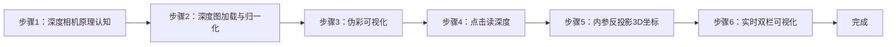

## 实验8：基于深度信息的3D物体检测实验（4h）

> ✅ **源码已核实** 本实验源码位于 `ros2_ws/src/xflz_eai_car1/vision/08_depth_3d_detection/`。⚠️ **内容说明**：按 `depth_viewer_guide.md` 移植规格实现——**深度相机双栏显示（左 RGB | 右 Depth 伪彩）+ 点击读深度（mm/m + 相机坐标反投影）**，规格明确「无检测」（visual_grasp 最小子集）。vendor 参考课用 MediaPipe Objectron（mediapipe 无 aarch64 wheel，弃用）。单测 24/24 全绿，板端验证通过（深度合成）。

### 1.1 关联知识点

- 1.1.1 深度相机原理 > 原理 > HP60C 深度相机（RGB 镜头 + 深度传感器）输出 uint16 深度图（单位 mm），0 表示无效像素；区别于普通 RGB 相机的 2D 信息，深度提供"距离"维度
- 1.2.1 深度图处理 > 流程 > uint16 PNG 加载（mm）→ 有效像素 min-max 归一化 → jet 伪彩映射（`applyColorMap`），灰度近远可视化
- 1.2.2 点击读深度 > 流程 > 窗口坐标 (u,v) 除以 display_scale 还原原图坐标 → 读 depth[v,u]（mm）→ ×0.001 转米
- 1.3.1 相机坐标反投影 > 公式 > x=(u-cx)·z/fx, y=(v-cy)·z/fy（相机内参 fx/fy/cx/cy 来自 ascam.yaml 标定），把像素+深度映射为 3D 坐标
- 1.3.2 实时深度可视化 > 流程 > 板上 ROS2 话题取流（严禁 remap）→ 双栏合成（RGB|Depth）→ MJPEG 推流 + 窗口点击交互

### 1.2 实验目标

1. 掌握深度相机的成像原理与深度图数据格式（uint16 mm、无效值语义）— 原理理解
2. 实现深度图加载、伪彩可视化与点击读深度功能 — 独立完成
3. 理解相机内参反投影原理，实现像素坐标 → 3D 相机坐标的换算 — 迁移应用

### 1.3 实验环境

| 类别 | 配置 |
|------|------|
| 硬件 | 具身智能实验箱 B2（XFLZ_EAI_B2_PRO，RK3576 SoC，6TOPS NPU，含 HP60C 深度相机） |
| OS | Ubuntu 22.04 + ROS2 Humble（板载 ros2_venv） |
| 核心库 | OpenCV、NumPy（纯 CPU，无需 NPU） |
| 数据源 | 文件模式（uint16 PNG）+ ROS 模式（ascamera 话题，板载 rclpy） |
| 主入口 | `src/app.py`（--display 窗口点击 / MJPEG 推流 / --ros 板上模式） |

### 1.4 实验难度

- 难度: ⭐⭐ 设计性
- 重点: 深度图可视化 + 点击读深度 + 内参反投影
- 难点: 相机内参理解与反投影公式；无效像素处理（0 值）；窗口坐标缩放还原

### 1.5 实验现象

**快速验证流程**：

1. 进入项目目录：`cd ros2_ws/src/xflz_eai_car1/vision/08_depth_3d_detection`
2. 单元测试：`pytest tests/ -v`（24 用例全绿）
3. 文件模式（需 config 填 rgb_path/depth_path，depth 为 uint16 PNG）：
   ```bash
   python src/app.py --config config/depth3d_config.yaml --display
   # 双栏窗口：左 RGB | 右 Depth 伪彩（jet），状态栏文字可见
   ```
4. 点击深度图任一点 → 终端 `Click (u, v): z = XXXX mm (X.XXX m)`；有内参时附加 `xyz=(x, y, z) m`
5. 板上 ROS 模式：先起相机驱动，再 `python src/app.py --config config/depth3d_config.yaml --ros`
   - MJPEG：`http://<板IP>:8080/depth.mjpg`

**预期效果描述**：
- 双栏图：左 RGB、右 Depth 伪彩（jet，近红远蓝或按映射），状态栏文字可见
- 点击物体 vs 背景数值差异明显（物体近、背景远）；无效区（0）提示 invalid
- 有内参时输出相机坐标 `xyz=(x, y, z) m`——为 3D 定位/抓取打基础
- 板上：`ros2 topic hz .../rgb0/image` ≈ 25Hz；深度单位 mm（数值勿 ×1000 误解）

### 1.6 实验步骤

#### 整体流程图



---

#### 步骤1：深度相机原理认知（阶段一：能运行，20min）

> 📌 本步骤对应源码：`config/depth3d_config.yaml`

**知识点讲解**：

**深度相机与深度图格式（1.1.1）**
- **原理**：HP60C 深度相机由 RGB 镜头 + 深度传感器（结构光/ToF 类）构成，深度传感器输出**逐像素距离图**。深度图格式约定：**uint16 存储，单位毫米（mm）**，0 值表示该像素无效（未测到/太近/太远）。为什么用 uint16？——深度范围可达 0-65535mm（65 米），uint8 只有 0-255mm 不够用。深度图与 RGB 图经标定对齐（同一视角），是后续 3D 感知（点云、抓取定位）的基础数据。
- **源码对应**：`config/depth3d_config.yaml`（depth.scale=0.001 mm→m / invalid=0 / display_scale / camera 内参）

**操作步骤**：

1. 查看 `config/depth3d_config.yaml`，理解 depth.scale（0.001 = mm→m）、invalid（0）、display_scale（显示缩放）、camera（fx/fy/cx/cy 内参）
2. 查看内参来源（`ascam.yaml`，HP60C RGB 标定）
3. 思考：深度为 0 的像素代表什么？为什么不能当真实距离 0mm？

**易错点**：
- ⚠️ 深度单位 mm：数值勿 ×1000 误解（z_mm → z_m 用 ×0.001，不是 ×1000）

---

#### 步骤2：深度图加载与归一化（阶段一：能运行，25min）

> 📌 本步骤对应源码：`src/depth.py` load_depth / normalize_depth

**知识点讲解**：

**uint16 加载与归一化（1.2.1）**
- **原理**：`load_depth()`（L22-27）用 `cv2.imread(path, IMREAD_UNCHANGED)` **保留 16bit** 读取（不带 UNCHANGED 会被截断成 8bit，深度全毁），返回 mm 数组。`normalize_depth()`（L30-41）把有效像素 min-max 线性拉伸到 0-255：先屏蔽无效值（`depth != invalid`），对有效像素求 min/max 后线性映射；单值深度（hi==lo）直接置 255 全亮。归一化是伪彩可视化的前置——深度范围大（0.3m-10m），直接 8bit 显示会糊成一片。
- **源码对应**：`src/depth.py` L22-27（load_depth）、L30-41（normalize_depth：有效掩膜 L33 / min-max 映射 L35-40）

**操作步骤**：

1. 验证深度图读取（16bit 保留）：
   ```bash
   python -c "
   import cv2
   from depth import load_depth
   d = load_depth('depth.png')   # 你的 uint16 深度图
   print('形状:', d.shape, 'dtype:', d.dtype, '范围:', d.min(), '-', d.max())"
   ```
2. 用普通 imread（不带 UNCHANGED）对照读取，观察深度数据是否被截断破坏
3. 打印无效像素占比：`float((d==0).mean())`

**易错点**：
- ⚠️ 不带 IMREAD_UNCHANGED → 16bit 截断成 8bit，深度数据毁坏
- ⚠️ 归一化必须屏蔽无效值，否则 0 值拉低 min 使有效深度对比度受损

---

#### 步骤3：伪彩可视化（阶段二：能理解，20min）

> 📌 本步骤对应源码：`src/depth.py` pseudocolor

**知识点讲解**：

**伪彩映射原理（1.2.1）**
- **原理**：人眼对灰度梯度不敏感，深度图用**伪彩**（colormap）增强可读性。`pseudocolor()`（L44-48）：`cv2.applyColorMap(depth_norm, COLORMAP_JET)` 把 8bit 灰度映射为 jet 彩色（低值蓝→高值红，或按映射表）；`gray` 模式退化为三通道灰阶。jet 的优势：相邻深度差异用色相区分，肉眼可快速判断远近层次。双栏右侧即此伪彩图。
- **源码对应**：`src/depth.py` L44-48（pseudocolor：gray L46-47 / jet L48）

**操作步骤**：

1. 生成伪彩图并保存：
   ```bash
   python -c "
   import cv2
   from depth import load_depth, normalize_depth, pseudocolor
   d = load_depth('depth.png')
   norm = normalize_depth(d)
   jet = pseudocolor(norm, 'jet')
   cv2.imwrite('depth_jet.png', jet)
   print('伪彩图已保存 depth_jet.png')"
   ```
2. 对比 jet / gray 两种模式的可读性差异
3. 思考：为什么深度可视化用伪彩而非灰度？工业应用（如避障调试）中哪种更直观？

**易错点**：
- ⚠️ applyColorMap 要求 8bit 输入——必须先 normalize_depth 再伪彩

---

#### 步骤4：点击读深度（阶段二：能理解，25min）

> 📌 本步骤对应源码：`src/depth.py` read_depth、`src/app.py` 点击事件

**知识点讲解**：

**窗口坐标还原（1.2.2）**
- **原理**：`read_depth()`（L51-66）实现点击读深度：先做**边界检查**（u/v 越界返回无效，L55-56），再读 `depth[v,u]`（L57），0 值返回无效（L58-59），有效则 `z_m = z_mm * 0.001` 转米（L60）。**关键细节**：窗口显示有缩放（display_scale），点击坐标 (u,v) 必须**除以 display_scale** 还原为原图坐标再读深度——否则读错像素（README 验证要点明确要求）。`ClickResult`（L15-19）承载 z_mm/z_m/xyz 三态结果。
- **源码对应**：`src/depth.py` L51-66（read_depth：边界检查 L55-56 / 读深度 L57 / 无效值 L58-59 / 米转换 L60）；`src/app.py`（鼠标回调：坐标 ÷ display_scale）

**操作步骤**：

1. 文件模式窗口点击：
   ```bash
   python src/app.py --config config/depth3d_config.yaml --display
   # 点击深度图任一点，终端输出 Click (u,v): z = XXXX mm (X.XXX m)
   ```
2. 分别点击近处物体与远处背景，对比深度数值差异（物体近、背景远）
3. 点击无效区域（无深度处），观察 invalid 提示
4. 验证坐标还原：窗口缩放后点击同一物理点，确认读出深度一致（÷ display_scale 生效）

**易错点**：
- ⚠️ 点击坐标不除 display_scale → 读错像素（缩放窗口时尤其明显）

---

#### 步骤5：相机内参反投影（阶段三：能改造，30min）

> 📌 本步骤对应源码：`src/depth.py` read_depth 反投影段

**知识点讲解**：

**针孔模型与反投影公式（1.3.1）**
- **原理**：相机把 3D 点投影到 2D 像素遵循**针孔模型**：`u = fx·x/z + cx`，`v = fy·y/z + cy`（fx/fy 焦距像素、cx/cy 光心偏移，来自标定）。**反投影**（2D+深度 → 3D）即逆运算：`x = (u-cx)·z/fx`，`y = (v-cy)·z/fy`（L63-64），z 为深度（米）。这一公式把"像素 + 距离"换算为**相机坐标系下的 3D 坐标**——是机械臂抓取定位、点云生成、避障的核心数学。内参默认取 `ascam.yaml`（HP60C RGB 标定），驱动配置加密，深度内参以实测微调。
- **源码对应**：`src/depth.py` L62-65（反投影：x L63 / y L64 / xyz 元组 L65）；`config/depth3d_config.yaml` camera 内参

**操作步骤**：

1. 配置内参后点击读深度，观察附加输出：
   ```bash
   python src/app.py --config config/depth3d_config.yaml --display
   # 预期：Click (u, v): z = XXXX mm (X.XXX m) xyz=(x, y, z) m
   ```
2. 验证反投影合理性：同一物体不同像素点击，z 相近但 x/y 随像素位置变化（近大远小）
3. 手工验证公式：给定 u,v,z 手算 x,y，与程序输出对比
4. 思考：fx/fy/cx/cy 的物理意义？为什么标定误差会放大到 3D 坐标？

**易错点**：
- ⚠️ 反投影要求 z 为**米**（公式中 z 单位须与 fx 的像素/米标度一致，L63-64 用 z_m）
- ⚠️ 内参不准 → 3D 坐标系统性偏移（深度内参以实测微调）

---

#### 步骤6：实时双栏可视化（阶段三：能改造，30min）

> 📌 本步骤对应源码：`src/app.py`、`src/ros2_source.py`（或 ROS 模式取流）

**知识点讲解**：

**实时深度链路（1.3.2）**
- **原理**：板上 ROS 模式：ascamera 驱动发布 RGB（`.../rgb0/image`）与深度（`.../depth0/image`）话题，`app.py` 订阅（**严禁 remap**——话题名与驱动约定一致）→ 深度图经 load/normalize/pseudocolor 处理 → 与 RGB 合成双栏 → MJPEG 推流（`http://<板IP>:8080/depth.mjpg`）。`view.py` 负责双栏合成 + 状态栏 + 点击坐标还原/标注。已知坑：首帧黑帧（`rgb.mean() < 5` 跳过，已内置）；深度 0 = 无效。
- **源码对应**：`src/app.py`（main：文件/ROS 模式 / 双栏合成 / MJPEG / 鼠标回调）；`src/view.py`（双栏合成 + 状态栏）；`src/depth.py`（处理管线）

**操作步骤**：

1. 板上 ROS 模式：
   ```bash
   cd ros2_ws/src/xflz_eai_car1/vision/08_depth_3d_detection
   # 终端 1：起相机驱动（HP60C，话题名不可 remap）
   ros2 launch xflz_eai_car1/examples/camera/HP60C/... （或 car1_peripherals depth_camera.launch.py）
   # 终端 2：运行深度查看器
   python src/app.py --config config/depth3d_config.yaml --ros
   # MJPEG: http://<板IP>:8080/depth.mjpg
   ```
2. 验证话题频率：`ros2 topic hz .../rgb0/image`（≈ 25Hz）
3. 实时点击读深度：对准物体移动，观察深度数值连续变化
4. 动手改造：在双栏图中叠加"中心点深度"实时显示（十字光标 + 深度数值），实现简易测距仪

**易错点**：
- ⚠️ 话题严禁 remap——与驱动约定不一致取不到帧
- ⚠️ 首帧黑帧（rgb.mean()<5）已内置跳过；深度 0 = 无效勿当 0mm

---

### 1.7 常见问题

| 问题 | 原因 | 解决方法 |
|------|------|---------|
| 深度数值偏大 1000 倍 | mm 与 m 单位误解 | mm→m 用 ×0.001（`depth.scale`），勿 ×1000 |
| 深度图全黑/花屏 | 读取时未保留 16bit | `cv2.imread(path, IMREAD_UNCHANGED)` |
| 点击读出深度与画面不符 | 窗口缩放未还原坐标 | 点击坐标 ÷ display_scale 再读 |
| 无效区读出 0 | 该像素无深度（正常） | 识别 0 为 invalid（L58-59），勿当 0mm |
| 3D 坐标偏移 | 内参不准 | 深度内参以实测微调（config camera） |
| 首帧黑帧 | 相机首帧未就绪 | 已内置 `rgb.mean()<5` 跳过 |
| ROS 取不到帧 | 话题 remap 或驱动未起 | 严禁 remap；确认驱动话题与 config 一致 |
| --ros 帧率低 | 话题频率不足 | `ros2 topic hz` 验证 ≈25Hz |

### 1.8 扩展实验

**扩展方向 1：简易测距与越界报警（进阶）**
- 在双栏图中叠加中心点深度实时显示；设定安全距离阈值（如 <0.5m 报警），实现避障原型

**扩展方向 2：点云生成（进阶）**
- 遍历有效深度像素批量反投影为 3D 点，用 Open3D 或 matplotlib 生成稀疏点云可视化，体验"深度图 → 点云"的完整 3D 感知链路

### 1.9 实验报告要求

**评分标准**：深度相机原理 15 分 + 深度图处理 20 分 + 伪彩可视化 15 分 + 点击读深度 20 分 + 反投影 20 分 + 报告 10 分 = 100 分。

**报告必含内容**：
1. 深度图格式说明（uint16/mm/0 无效）与加载对比（UNCHANGED vs 默认）
2. 归一化前后深度直方图或对比图
3. 双栏可视化截图（左 RGB | 右 Depth 伪彩）
4. 点击读深度记录表（≥5 个点：物体/背景/无效区）
5. 反投影验证：手算 vs 程序输出对比
6. 回答思考题：为什么深度用 uint16？反投影公式的物理意义？标定误差如何影响 3D 坐标？
7. 实验心得与问题记录

---

## 更新日志

| 版本 | 日期 | 变更 |
|------|------|------|
| v1.0 | 2026-08-10 | 初版生成（源码路径 ros2_ws/src/xflz_eai_car1/vision/08_depth_3d_detection，24 用例全绿，uint16 深度加载 + jet 伪彩 + 点击读深度 + 内参反投影 + 双栏 MJPEG，板端验证通过） |
