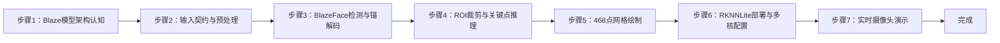
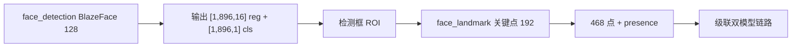
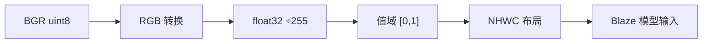
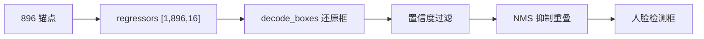
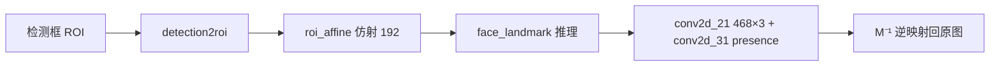
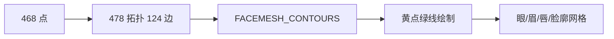
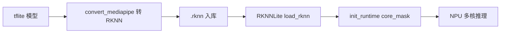
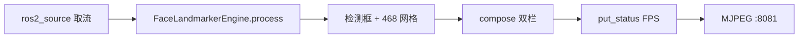
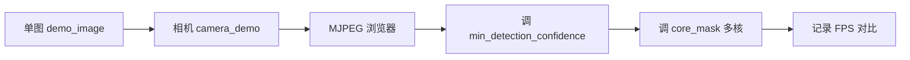

## 实验9：基于人脸关键点特征检测实验（4h）

> ✅ **源码已核实** 本实验源码位于 `ros2_ws/src/xflz_eai_car1/vision/09_face_landmarks/`。**方案 = mediapipe Blaze 模型转 RKNN，板上 RKNNLite NPU 推理 468 点网格**（双模型：face_detection_short_range 检测 + face_landmark 468 点）。交付形态为 ament_python ROS2 包 `car1_face_landmark/`，内层 `face_landmark_core/` 纯逻辑 x86 全可测。测试 109 用例全绿，板端验证通过（用户确认，FPS ≥10，fp16 混合量化）。

### 1.1 关联知识点

- 1.1.1 人脸检测原理 > 原理 > BlazeFace 轻量人脸检测器：SSD 锚点 + 回归器/分类器双输出，`face_detection_short_range` 输入 128×128，输出 [1,896,16] 锚解码 + [1,896,1] 置信度
- 1.2.1 关键点检测 > 流程 > 检测框 ROI 裁剪 → FaceLandmark 模型（输入 192×192）→ 468 点 + presence 置信度 → 逆映射回原图归一化坐标
- 1.2.2 面部网格拓扑 > 概念 > 478 拓扑 124 边（FACEMESH_CONTOURS），眼/眉/唇/脸廓黄点绿线绘制
- 1.3.1 RKNN NPU部署 > 原理 > mediapipe 官方 tflite → RKNN 转换（fp16 混合量化，rk3576 target）→ RKNNLite 板上推理；多核 core_mask（0=AUTO/1=CORE_0/2=CORE_1/4=CORE_2/7=三核）
- 1.3.2 实时人脸跟踪 > 流程 > 摄像头取流 → 检测+关键点 → 双栏显示（左检测框 | 右 468 网格）→ MJPEG 推流 :8081

### 1.2 实验目标

1. 掌握 BlazeFace 人脸检测与 FaceLandmark 关键点模型的架构与输入输出契约 — 原理理解
2. 实现双模型级联（检测→ROI→关键点）的完整人脸关键点检测链路 — 独立完成
3. 理解 tflite→RKNN 转换与 RKNNLite 部署流程，掌握多核 NPU 配置 — 迁移应用

### 1.3 实验环境

| 类别 | 配置 |
|------|------|
| 硬件 | 具身智能实验箱 B2（XFLZ_EAI_B2_PRO，RK3576 SoC，6TOPS NPU，含 HP60C 深度相机） |
| OS | Ubuntu 22.04 + ROS2 Humble（板载 ros2_venv，rknnlite 2.3.2 / rknn-toolkit-lite2） |
| 核心库 | OpenCV、NumPy、rknnlite（RKNNLite）、PyYAML；MJPEG 优先 mjpeg_streamer（不装则内置回退） |
| 模型 | `models/face_detection_short_range.rknn`（584KB，128×128）+ `models/face_landmark.rknn`（1.6MB，192×192，均 fp16 混合量化） |
| 主入口 | `python -m face_landmark_core.camera_demo --config config/face_config.yaml --ros [--display]` |

### 1.4 实验难度

- 难度: ⭐⭐ 设计性
- 重点: 双模型级联（检测→ROI 裁剪→468 点）+ 锚解码/NMS + 逆映射
- 难点: Blaze 模型输入契约（float32 RGB [0,1] NHWC）；ROI 裁剪与坐标逆映射对齐

### 1.5 实验现象

**快速验证流程**：

1. 进入项目目录：`cd ~/ros2_ws/src/xflz_eai_car1/vision/09_face_landmarks`
2. 验证 rknnlite 环境：`python3 -c "from rknnlite.api import RKNNLite; print('ok')"`
3. 单图模式：`PYTHONPATH=car1_face_landmark:$PYTHONPATH python3 -m face_landmark_core.demo_image --config config/face_config.yaml --save out.jpg --display`
   - 双栏：左栏绿框 + `face <score>` 标签 | 右栏 468 点网格（眼/眉/唇/脸廓黄点绿线）
4. 相机实时（板上标准）：
5. MJPEG 无显示器查看：浏览器 `http://<板IP>:8081/face.mjpg`

```bash
cd ~/ros2_ws/src/xflz_eai_car1/vision/09_face_landmarks

source /opt/ros/humble/setup.bash && source ~/ros2_ws/install/setup.bash
# 单张图片推理
PYTHONPATH=car1_face_landmark:$PYTHONPATH python3 -m face_landmark_core.demo_image \
  --config config/face_config.yaml --save out.jpg

# 视频流推理
ros2 launch ascamera hp60c.launch.py        # 终端 1
PYTHONPATH=car1_face_landmark:$PYTHONPATH python3 -m face_landmark_core.camera_demo \
  --config config/face_config.yaml --ros    # 终端 2
```

**执行现象**：
- `demo_image` 模式：终端约 0.2-0.5 秒内返回，终端打印 FPS 与检测框坐标；当前目录生成 `out.jpg`，左栏为原始帧叠加绿色检测框 + `face 0.93` 等置信度标签，右栏为 468 个黄色关键点 + 绿色轮廓线组成的面部网格（眼眶/眉毛/嘴唇/脸廓拓扑清晰可辨）。多人脸图片中 num_faces=2 时各出一套框/网格。
- `camera_demo --ros` 模式：实时循环帧率约 10-15 FPS（fp16 混合量化 NPU），底部黑条状态栏显示 `FPS: 12 Faces: 1`；人脸移动时网格实时贴合，多人入镜各一套独立检测框与网格；无脸时终端不崩溃，faces=[] 状态栏显示 `Faces: 0`。
- MJPEG 模式：浏览器访问 `http://<板IP>:8081/face.mjpg`，实时看到双栏合成画面，延迟约 100-200ms。

**预期效果描述**：
- 图片模式：右栏 468 点网格（眼/眉/唇/脸廓黄点绿线），`--save` 出图
- 相机实时：人脸网格实时贴合；左栏绿框 + `face 0.9x` 标签；**多人（num_faces=2）各一套框/网格**；无脸时无框不崩溃
- 性能：FPS ≥10（fp16 混合量化，NPU）；MJPEG `:8081/face.mjpg` 浏览器可看（SSH 无显示器用）


### 1.6 实验步骤

#### 整体流程图



---

#### 步骤1：Blaze 模型架构认知（阶段一：能运行，20min）

> 📌 本步骤对应源码：`models/`、`face_landmark_core/`（landmark.py + blaze.py）

**知识点讲解**：

**Blaze 双模型级联（1.1.1）**

- **原理**：MediaPipe FaceMesh 的核心是**双模型级联**：`face_detection_short_range` 先做人脸检测（SSD 锚点 + 回归器/分类器双输出），`face_landmark` 再对检测框 ROI 内的脸输出 **468 点网格**（含 presence 置信度）。为什么不用单模型直接出点？——全图直接回归 468 点对尺度变化不鲁棒，检测-裁剪-关键点的两段式让每个模型任务更专注（检测负责"在哪"，关键点负责"长啥样"）。本实验把官方 tflite 转 RKNN 部署到板上 NPU（vendor mediapipe solutions 在 aarch64 上装得上但 SIGILL，ARMv8.0 无 LSE 指令）。**模块分层**：`blaze.py` 承载锚解码/NMS/ROI 仿射/关键点逆映射等 Blaze 算法核心（`AnchorOptions`/`generate_anchors`/`decode_boxes`/`decode_keypoints`/`detection2roi`/`nms` 等），`landmark.py` 通过 `from .blaze import ...` 引用其算法能力，自身只负责引擎编排（检测→ROI→关键点→绘制）与网格绘制。
- **源码对应**：`blaze.py`（`AnchorOptions` L17-28 / `generate_anchors` / `decode_boxes` / `decode_keypoints` / `nms` / `detection2roi` / `resize_pad` / `roi_affine`）；`landmark.py` L18 `from .blaze import ...`（引擎引用 blaze 算法）；`models/face_detection_short_range.rknn`（[1,128,128,3] 输入，regressors [1,896,16] + classificators [1,896,1] 输出）；`models/face_landmark.rknn`（[1,192,192,3] 输入，conv2d_21 [1,1,1,1404] + conv2d_31 [1,1,1,1] 输出）

**知识储备补充**：

- **Blaze 架构演进**：BlazeFace（2019，Google）是 MediaPipe 的人脸检测基础模型，采用 SSD 架构的轻量化变体。其核心创新是将标准 SSD 的多尺度特征图锚点分布简化为 4 层网格（`AnchorOptions.num_layers=4`，`blaze.py` L18），strides=(8,16,16,16) 在 128×128 输入上产生 896 个固定锚点（`fixed_anchor_size=True`，L28）。与标准 SSD 的区别：(1) 锚点使用固定大小（`fixed_anchor_size`），因为人脸在短距场景下尺度变化有限；(2) 回归输出 16 维（`num_coords=16`，L35）——4 坐标 × 4 份重复（x/y/w/h 各 4 份），冗余设计提升解码鲁棒性。`short_range` 变体针对 0.5m-2m 近距离人脸，`full_range` 则覆盖更远距离（本实验用 short_range，`DET_CFG = DetectConfig()` 默认值，`landmark.py` L32）。


- **双模型级联的工程优势**：单模型直接预测 468 点需要网络同时处理"检测"与"关键点回归"两个异质任务，特征提取器难以同时最优。双模型级联将任务解耦——检测模型专注"人脸在哪"（128×128 轻量输入），关键点模型专注"468 点长在哪"（192×128 裁剪后的局部图，尺度归一化后回归更稳定）。代价是两次 NPU 推理的延迟叠加，但 RK3576 的 6TOPS NPU 足以在 100ms 内完成双模型推理（fp16 量化下检测 ~20ms + 关键点 ~30ms）。
- **参考资源**：BlazeFace 原论文（V. Bazarevsky et al., *BlazeFace: Sub-millisecond Neural Face Detection on a Mobile GPU*, 2019）；MediaPipe FaceMesh 官方文档 `solutions.face_mesh`；rknn-mediapipe-master 案例 C++ 实现（Apache-2.0）。

**配置参数速查表**（`config/face_config.yaml`，按区块分列）：

| 区块 | 参数 | 类型 | 默认/示例 | 说明 |
|------|------|------|-----------|------|
| `model` | `detector_model` | str | `models/face_detection_short_range.rknn` | BlazeFace 检测（128×128） |
| `model` | `landmark_model` | str | `models/face_landmark.rknn` | 468 点关键点（192×192） |
| `model` | `num_faces` | int | `2` | 最多人脸数 |
| `model` | `min_detection_confidence` | float | `0.5` | 检测分数阈值 |
| `model` | `min_tracking_confidence` | float | `0.5` | 保留（本实现未用） |
| `backend` | `core_mask` | int | `0` | NPU 核：0=AUTO,1,2,4,3,7 |
| `backend` | `verbose` | bool | `false` | 调试输出 |
| `source` | `mode` | str | `image` | image / camera / ros |
| `source` | `rgb_path` | str | `images/face_demo.jpg` | mode=image 必填 |
| `source` | `ros.rgb_topic` | str | `/ascamera_hp60c/camera_publisher/rgb0/image` | 话题（勿 remap） |
| `source` | `ros.timeout` | float | `5.0` | 首帧等待 |
| `display` | `show` / `window_name` | bool/str | `false` / `FaceLandmark Detection` | 弹窗显示（SSH 用 MJPEG） |
| `server` | `port` / `stream_name` | int/str | `8081` / `face.mjpg` | MJPEG 端口/流名 |

> **说明**：`backend.core_mask` 板上 2 核 NPU 用 auto（0）最稳；`mode=ros` 用板上相机话题（`ros.rgb_topic` 勿 remap）；`stream_name` 已含 `.mjpg` 勿再追加。`display.show` 在无显示器 SSH 会话请关闭并改看 MJPEG。

**操作步骤**：

1. 查看 models/ 目录两个 rknn 模型文件，理解输入输出契约表
2. 模型契约自检：`PYTHONPATH=car1_face_landmark:$PYTHONPATH python3 -m face_landmark_core.convert_mediapipe --check`
   - 验证 regressors/classificators、conv2d_21/conv2d_31 输出名一致
3. 思考：为什么两段式比单模型更稳？检测模型 128×128 而关键点 192×192 的原因？

**流程图（Blaze 双模型级联）**：



**易错点**：
- ⚠️ 模型输出名必须与契约一致（--check 自检），换模型版本要重验

---

#### 步骤2：输入契约与预处理（阶段一：能运行，20min）

> 📌 本步骤对应源码：`face_landmark_core/landmark.py` _prepare

**知识点讲解**：

**Blaze 输入契约（1.1.1）**
- **原理**：Blaze 模型输入契约与 YOLO 系列不同：**float32 RGB，值域 [0,1]（归一化），NHWC 布局**。`_prepare()`（L113-116）三步转换：BGR→RGB（L115）→ uint8 转 float32 并 **÷255 归一化**（L116）→ reshape 为 `[1,size,size,3]` NHWC。注意与 RKNN 量化模型（int8 无归一化）的区别——Blaze 是 fp16 模型，需要调用方归一化。`backend.py` 的 `RKNNLiteBackend`（L20-62）封装 rknnlite 加载与推理，`predict` 支持多输入（L51-57，如 gesture_embedder 3 输入）。
- **源码对应**：`landmark.py` L113-116（_prepare：RGB L115 / 归一化 L116）；`backend.py` L20-62（RKNNLiteBackend：load L41-49 / predict L51-57）

**知识储备补充**：

- **fp16 与 int8 的输入契约差异**：RKNN 模型有两种输入约定

  (1) **fp16 混合量化模型**（如本实验的 Blaze）：输入 float32 [0,1]，模型内部保留 fp16 权重，NPU 以半精度浮点运算，回归关键点等连续值任务精度更高；

  (2) **int8 全量化模型**（如实验 01 的 YOLOv8）：输入 uint8 [0,255]，模型内部用 int8 权重与激活（w8a8），通过校准集统计的 scale/zero_point 做定点运算，速度更快但回归精度略低。Blaze 的关键点输出是连续坐标（468×3 float），fp16 能保留更多小数位精度，这对后续的逆映射与拓扑连线至关重要——int8 量化会让关键点坐标量化到 ±127 的整数步进，导致网格锯齿。

芯片算力和精度（int8、fp16、双精度、单精度等等）的关系


- **NHWC 与 NCHW 布局**：NHWC（Height-Width-Channel 交织）是 RKNN 的默认输入布局，与 OpenCV 的 HWC 内存布局一致，因此 `_prepare` 只需 reshape 不需 transpose。若误用 NCHW（PyTorch/Caffe 常见），RKNN 会因维度错位报错或输出全零。这是 PyTorch→RKNN 迁移的常见陷阱。
- **参考资源**：RKNN Toolkit2 User Guide《Input Data Format》；MediaPipe BlazeLandmark 模型规格 `face_landmark_v0.10.10`；NumPy `reshape` 文档。

**操作步骤**：

1. 单测理解输入契约：`pytest tests/ -v`（fake 注入，x86 可跑）
2. 手工验证预处理（合成 BGR 帧，无需真实图片；`_prepare` 不加载模型，x86 可跑）：
   ```bash
   # 执行目录：~/ros2_ws/src/xflz_eai_car1/vision/09_face_landmarks
   cd ~/ros2_ws/src/xflz_eai_car1/vision/09_face_landmarks
   
   PYTHONPATH=car1_face_landmark:$PYTHONPATH python3 -c "
   import numpy as np
   from face_landmark_core.landmark import FaceLandmarkerEngine, LM_SIZE
   e = FaceLandmarkerEngine('det.rknn', 'lm.rknn')     # 懒加载，不触发模型
   bgr = np.zeros((192, 192, 3), np.uint8)             # 合成 BGR 帧（全黑）
   inp = e._prepare(bgr, LM_SIZE)                      # BGR→RGB→float32[0,1]→NHWC
   print('输入形状:', inp.shape, inp.dtype, '值域:', inp.min(), '-', inp.max())"
   
   # 预期：(1, 192, 192, 3) float32 值域 0.0 - 0.0（全黑帧归一化后仍 [0,1]）
   ```
3. 思考：为什么 [0,1] 归一化而 RKNN 量化模型不需要？fp16 与 int8 模型的输入契约差异？

**流程图（输入契约处理）**：



**易错点**：
- ⚠️ 忘了归一化 [0,1] → 检测全废（fp16 模型契约）
- ⚠️ 布局必须 NHWC（Blaze 约定），误用 NCHW 报错或结果错乱

---

#### 步骤3：BlazeFace 检测与锚解码（阶段二：能理解，35min）

> 📌 本步骤对应源码：`face_landmark_core/blaze.py`（算法核心）、`face_landmark_core/landmark.py`（引擎编排）

**知识点讲解**：

**锚解码与 NMS（1.1.1）**
- **原理**：BlazeFace 是 SSD 风格检测器：在 128×128 输入上预设 **896 个锚点**（多尺度网格），模型回归每个锚点的框偏移（regressors [1,896,16] = 4 坐标 × 4 份重复）与置信度（classificators [1,896,1]）。解码：`blaze.py` 中 `generate_anchors()` 生成锚点 → `decode_boxes()` 还原人脸框 → 置信度过滤 → **`nms()`**（重叠框抑制）→ 得到每张脸的检测框。`FaceLandmarkerEngine.process()`（landmark.py L118-121）编排：检测 → 每脸 ROI → 关键点 → 逆映射。检测框供左栏绘制（YOLO 风格绿框 + `face <score>`）。
- **源码对应**：`blaze.py`（`AnchorOptions` L17-28 / `generate_anchors` / `decode_boxes` / `decode_keypoints` / `nms` / `detection2roi`）；`landmark.py` L118-121（process 入口，from .blaze import 引用算法核心）

**知识储备补充**：

- **锚解码数学原理**：BlazeFace 的锚点解码与 YOLO 类似但参数体系不同。每个锚点的 raw 输出为 16 维向量 $r = [r_0, r_1, \ldots, r_{15}]$，解码分两步

  (1) **中心偏移还原**：$x_{center} = (r_0 / x_{scale}) \cdot w_a + x_a$，$y_{center} = (r_1 / y_{scale}) \cdot h_a + y_a$，其中 $(x_a, y_a, w_a, h_a)$ 为锚点坐标（`generate_anchors` 输出），$x_{scale}=y_{scale}=128$（`DetectConfig.x_scale`，`blaze.py` L37）；
  
  (2) **宽高缩放**：$w = (r_2 / w_{scale}) \cdot w_a$，$h = (r_3 / h_{scale}) \cdot h_a$。置信度先过 `score_clipping_thresh=100` 截断（L36）再 sigmoid：
  $$
  \text{score} = \sigma\!\left(\text{clamp}(r_4,\; -100,\; 100)\right) = \frac{1}{1 + e^{-r_4}}
  $$
  
  其中 $\sigma$ 为 sigmoid 函数。截断防止 exp 溢出（$|r_4| > 100$ 时 sigmoid 已饱和到 0 或 1）。
  
- **NMS 实现**：`blaze.py` 的 `nms()` L 按分数降序排列，对每对检测框计算 IoU，超过 `min_suppression_threshold=0.3`（`DetectConfig` L42）的低分框被抑制。这是标准贪心 NMS（Greedy NMS），时间复杂度 $O(N^2)$，896 个锚点场景下毫秒级完成。与 YOLO 的逐类 NMS 不同，BlazeFace 只有"人脸"一个类别，因此 NMS 不区分标签。

- **参考资源**：BlazeFace 原论文 SsdAnchors 锚生成算法；RKNN-MediaPipe 案例 `Config.cpp`（DetectConfig 参数来源）；NumPy `np.clip` 文档。

**操作步骤**：

1. 单图检测验证：`PYTHONPATH=car1_face_landmark:$PYTHONPATH python3 -m face_landmark_core.demo_image --config config/face_config.yaml --save out.jpg`
2. 多人测试：图片含 2 张脸，观察 num_faces=2 各一套框/网格
3. 无脸测试：空白图运行，观察 faces=[] 不崩溃
4. 思考：896 个锚点如何分布？为什么短距模型（short_range）只负责近距离人脸？

```bash
cd ~/ros2_ws/src/xflz_eai_car1/vision/09_face_landmarks

# 单张人脸检测，多张人脸图片检测请自备图片放入项目，修改config中的图片路径
source /opt/ros/humble/setup.bash && source ~/ros2_ws/install/setup.bash
# 单张图片推理
PYTHONPATH=car1_face_landmark:$PYTHONPATH python3 -m face_landmark_core.demo_image \
  --config config/face_config.yaml --save out.jpg
```


**流程图（锚解码与 NMS）**：



**易错点**：
- ⚠️ 锚解码参数来自 rknn-mediapipe-master（Apache-2.0），改模型需同步锚点配置

---

#### 步骤4：ROI 裁剪与关键点推理（阶段二：能理解，30min）

> 📌 本步骤对应源码：`face_landmark_core/landmark.py` 引擎关键点段

**知识点讲解**：

**ROI 级联（1.2.1）**
- **原理**：检测框确定后，把框内区域**裁剪缩放为 192×192** 喂给 `face_landmark` 模型（此即"级联"的关键：关键点模型只看人脸局部，尺度归一化后输出稳定）。模型输出 `conv2d_21 [1,1,1,1404]` = 468 点 × 3 坐标（x,y,z），`conv2d_31 [1,1,1,1]` = presence 置信度（是否有脸）。引擎把 ROI 坐标系的 468 点**逆映射回原图归一化坐标**（乘 ROI 缩放与偏移），供绘制与下游消费。
- **源码对应**：`landmark.py` 引擎（ROI 裁剪 / landmark 推理 / 逆映射）；模型输出契约见 README 表

**知识储备补充**：

- **ROI 仿射变换流程**：检测框到 192×192 裁剪经历三步

  (1) **detection2roi**（`blaze.py`）：从检测框中心/宽高/旋转角计算 ROI 中心、缩放与角度 $\theta$，生成 `ROI` 数据结构；

  (2) **roi_affine**（`blaze.py`）：构建 2×3 仿射矩阵 $M$，将原图 ROI 区域映射到 192×192 目标空间——先平移到 ROI 中心、旋转 $-\theta$ 角消除倾斜、再缩放到 target_size；

  (3) **warp_roi**（`blaze.py`）：`cv2.warpAffine` 执行仿射变换，`BORDER_REPLICATE` 填充边缘。`process()` 中对应代码（`landmark.py` L135-137）：`roi = detection2roi([det], DET_CFG)[0]` → `m = roi_affine(roi, LM_SIZE)` → `crop = warp_roi(frame_bgr, m, LM_SIZE)`。

- **逆映射公式**：关键点模型输出的 468 点在 192×192 ROI 像素坐标系中，逆映射回原图归一化坐标的公式为：

  $$
  \text{point}_{\text{orig}} = M^{-1} \cdot \text{point}_{\text{ROI}} \div [\text{width}, \text{height}]
  $$

  其中 $M^{-1}$ 为仿射矩阵的逆变换，$[\text{width}, \text{height}]$ 为原图尺寸，除法使坐标归一化到 [0,1]。`denormalize_landmarks`（`blaze.py`）实现此逆映射，`landmark.py` L147 调用：`faces.append(denormalize_landmarks(pts, m, LM_SIZE, h, w))`。
  
- **presence 置信度处理**：模型输出 `conv2d_31` 是 raw logit，需过 sigmoid 得到 [0,1] 置信度。`process()` 中（L140-143）实现了数值稳定的 sigmoid：$x \geq 0$ 时用 $\frac{1}{1+e^{-x}}$，$x < 0$ 时用 $\frac{e^x}{1+e^x}$，避免大负数的 exp 溢出。低于 `min_detection_confidence=0.5`（`config/face_config.yaml` L10）的脸被过滤。

- **参考资源**：OpenCV `cv2.warpAffine` 文档；MediaPipe FaceLandmark 模型规格（192×192 输入，468×3 输出）；numpy `np.clip` 数值稳定性说明。

**操作步骤**：

1. 打印单张脸的 LandmarkResult 结构（468 点 x,y,z + 检测框）
2. 绘制部分关键点（只画眼睛/嘴巴区域），理解点序与拓扑
3. 思考：presence 置信度低时如何处理？（过滤低置信度结果防误检）

**流程图（ROI 级联与逆映射）**：



**易错点**：
- ⚠️ ROI 逆映射必须用同一缩放/偏移，否则网格错位（引擎已处理）
- ⚠️ 468 点含 z（相对尺度），绘制 2D 时用 x,y

---

#### 步骤5：468 点网格绘制（阶段三：能改造，25min）

> 📌 本步骤对应源码：`face_landmark_core/landmark.py` draw_mesh / draw_boxes

**知识点讲解**：

**面部网格拓扑（1.2.2）**
- **原理**：468 点是原始采样点，视觉上呈现"网格"靠的是**拓扑连线**：`FACEMESH_CONTOURS`（478 拓扑 124 边）定义了眼/眉/唇/脸廓的连线关系。`draw_mesh()`（L195-198）按 connections 逐边连线绘制（黄点绿线，vendor 视觉）；`draw_boxes()`（L172-175）绘制左栏检测框（绿框 + `face <score>`）。拓扑连线让 468 个孤立点变成可读的面部结构，是姿态/表情分析的基础。
- **源码对应**：`landmark.py` L172-175（draw_boxes）、L195-198（draw_mesh，FACEMESH_CONTOURS）

**知识储备补充**：

- **FACEMESH_CONTOURS 拓扑结构**：MediaPipe 定义了 478 个拓扑索引（含 10 个冗余点），`FACEMESH_CONTOURS`（`landmark.py` L36-59）包含 124 条边，覆盖五大区域

  (1) **左眼轮廓**：点 33→163→144→145→153→154→155→133 等；

  (2) **右眼轮廓**：点 263→466→388→387→386→385→384→398 等；

  (3) **嘴唇内轮廓**：点 61→146→91→181→84→17→314→405→321→375→291 等；

  (4) **嘴唇外轮廓**：点 78→95→88→178→87→14→317→402→318→324→308 等；

  (5) **脸部轮廓**：点 10→338→297→332→284→251→389→356→454→323→361→288→397→365→379 等。索引 467 以上的点在 `draw_mesh` L211 中被 `if a < len(px) and b < len(px)` 跳过，避免越界。


- **网格对下游应用的价值**：拓扑连线不只是可视化工具——眼眶 6 点可用于 EAR（Eye Aspect Ratio）眨眼检测，嘴唇 20 点可用于微笑/张嘴判断，鼻尖+眼角+下颌 6 点可用于 SolvePNP 头部姿态估计。468 点的 z 坐标（相对深度）虽不用于 2D 绘制，但在 3D 人脸重建中提供粗略的深度信息（鼻子 z > 嘴巴 z 表示鼻子更靠近相机）。
- **参考资源**：MediaPipe `face_mesh_connections.py`（Apache-2.0，FACEMESH_CONTOURS 原始定义）；Face Mesh Topology 官方文档；EAR 计算公式（Tereza Soukupová & Jan Čech, *Real-time Eye Blink Detection using Facial Landmarks*, 2016）。

**操作步骤**：

1. 单图输出双栏，观察右栏网格结构（眼/眉/唇/脸廓清晰可辨）
2. 动手改造：改连线颜色/粗细，或只绘制眼睛+嘴唇区域（局部拓扑）
3. 思考：478 拓扑与 468 点（+10 冗余）的关系？网格连线对表情识别的作用？

**流程图（468 点网格绘制）**：



**易错点**：
- ⚠️ connections 使用 478 拓扑，点索引超 467 的边绘制时需跳过

---

#### 步骤6：RKNNLite 部署与多核配置（阶段三：能改造，30min）

> 📌 本步骤对应源码：`face_landmark_core/backend.py`、`convert_mediapipe.py`

**知识点讲解**：

**RKNNLite 与多核 NPU（1.3.1）**
- **原理**：板上统一用 **RKNNLite**（rknn-toolkit-lite2 2.3.2，RK3576 专用部署 API），完整版 rknn-toolkit2 仅留在 x86 转换环境。`RKNNLiteBackend.load()`（L41-49）懒导入 rknnlite（x86 单测无需）、`init_runtime(core_mask=...)`（无 target 参数）。**多核 NPU**：`config/face_config.yaml` → `backend.core_mask`：0=AUTO（默认）、1=CORE_0、2=CORE_1、4=CORE_2、3=0_1、7=0_1_2（RK3576 三核）——多模型并行时分配不同核可提升吞吐。转换用 `convert_mediapipe.py`（tflite → rknn，`--dtype fp|i8`，fp16 混合量化 landmark 回归精度更稳；int8 需校准集）。
- **源码对应**：`backend.py` L41-49（load：懒导入 L42 / init_runtime L44-48）；`convert_mediapipe.py`（tflite→rknn 转换 CLI）；`config/face_config.yaml`（backend.core_mask）

**知识储备补充**：

- **RK3576 多核 NPU 架构**：RK3576 内置 3 个 NPU 核心（CORE_0/CORE_1/CORE_2），每个核心 2TOPS，合计 6TOPS。`core_mask` 通过位掩码指定模型运行在哪些核上：

  $$
  \text{core\_mask} = \text{CORE\_0\_bit} + 2 \times \text{CORE\_1\_bit} + 4 \times \text{CORE\_2\_bit}
  $$

  其中 `CORE_0_bit=1`、`CORE_1_bit=2`、`CORE_2_bit=4`。例如 `core_mask=3`（0+1=CORE_0_1）让模型在 CORE_0 和 CORE_1 上并行推理（模型自动拆分到多核）。`core_mask=0`（AUTO）由运行时自动选择最优核分配。本实验两个模型（检测+关键点）各自独立加载到 RKNNLite，理想配置是检测模型用 CORE_0、关键点模型用 CORE_1，避免抢核导致的排队延迟——但 `RKNNLiteBackend` 两个实例共享 `core_mask` 配置（`landmark.py` L107-111 同一 `self._core_mask`），实际需在 config 中为两个模型分别配核才能实现真正并行。
- **fp16 混合量化的优势**：`convert_mediapipe.py` 默认 `--dtype fp`（fp16 混合量化），权重保留 fp16、激活以 fp16 推理。相比 int8 全量化（`--dtype i8`），fp16 的动态范围更大（$\pm 65504$ vs $\pm 127$），对关键点回归这类连续值任务的精度损失更小。代价是模型体积翻倍（fp16=2 bytes/param vs int8=1 byte/param），本实验两个模型合计仅 2.2MB，NPU 内存完全足够。
- **参考资源**：RK3576 Technical Reference Manual（NPU 架构章节）；RKNN Toolkit2 User Guide《Multi-Core Inference》；rknn-mediapipe-master `convert_mediapipe.py` 参数说明。

**操作步骤**：

1. 查看 `config/face_config.yaml` 的 backend.core_mask（默认 0=AUTO）
2. 修改 core_mask=1（CORE_0）运行，观察性能差异（多模型抢核 vs 独占）
3. 查看转换命令：`PYTHONPATH=car1_face_landmark:$PYTHONPATH python3 -m face_landmark_core.convert_mediapipe --help`
4. 思考：两个模型（检测+关键点）如何分配 NPU 核最优？（不同核并行，避免抢核）

```bash
cd ~/ros2_ws/src/xflz_eai_car1/vision/09_face_landmarks

# 视频流推理
ros2 launch ascamera hp60c.launch.py        # 终端 1
PYTHONPATH=car1_face_landmark:$PYTHONPATH python3 -m face_landmark_core.camera_demo \
  --config config/face_config.yaml --ros    # 终端 ，默认 0
# 改 config backend.core_mask: 1 后重跑
```

**流程图（RKNNLite 部署）**：



**易错点**：
- ⚠️ 板上必须 RKNNLite（完整版 toolkit2 不部署）；core_mask 需平台支持（RK3576 三核）
- ⚠️ fp16 模型输入要归一化 [0,1]；int8 模型需要校准集

---

#### 步骤7：实时摄像头演示（阶段三：能改造，30min）

> 📌 本步骤对应源码：`face_landmark_core/camera_demo.py`、`face_landmark_node.py`

**知识点讲解**：

**实时链路与双模式（1.3.2）**
- **原理**：`camera_demo.py` 支持两种取流：**--ros**（板上标准，ascamera 话题，HP60C）+ **--camera N**（V4L2 UVC 回退，vendor 06 形态）。循环：取帧 → FaceLandmarkerEngine.process → 双栏合成（view.py）→ FPS 统计 → MJPEG 推流（:8081，避开 08 的 :8080）。ROS 节点模式（`face_landmark_node.py`）为可选：colcon 编译后 `ros2 launch car1_face_landmark face_landmark.launch.py`。**PYTHONPATH 必须保留 $PYTHONPATH**（覆盖会丢 Humble 路径 → venv 内 PyPI rclpy 被加载 → 崩）。
- **源码对应**：`camera_demo.py`（--ros/--camera 取流 L125-136 / 循环 L77-98 / MJPEG L93-94 / q 退出 L97）；`face_landmark_node.py`（ROS 节点）；`view.py` L12-20（compose 双栏）/ L23-32（put_status 状态栏）/ `mjpeg_server.py`（:8081 推流）

**知识储备补充**：

- **FPS 指数滑动平均**：`camera_demo.py` L89 的 FPS 计算采用指数加权移动平均（EWMA）：$\text{fps} = 0.9 \times \text{fps}_{\text{prev}} + 0.1 \times \frac{1}{\Delta t}$，其中 $\Delta t = t_{\text{now}} - t_{\text{prev}}$。相比简单均值，EWMA 对突帧（如偶发卡顿）更平滑，且只需 $O(1)$ 内存。权重 0.9/0.1 意味着最近 10 帧的贡献占 ~65%，30 帧后基本收敛。终端状态栏显示整数 FPS（`int(fps)`），`view.py` L29-31 的 `put_status` 绘制底部黑条 `FPS: N Faces: M`。
- **双栏合成实现**：`view.py` 的 `compose()`（L12-20）将左栏（检测框帧）和右栏（网格帧）水平拼接——先取两帧最大高度创建空白画布 `(max_h, w1+w2, 3)`，再将两帧分别贴到左右。若两帧高度不一致（罕见），底部补黑。双栏合成是 vendor 标准视觉——左栏提供检测框+置信度的定量信息，右栏提供 468 点网格的定性结构信息，一帧同时呈现两种视角。
- **参考资源**：OpenCV `cv2.VideoCapture` V4L2 后端文档；ROS2 Image Transport `compressed`/`raw` 话题格式；NumPy `np.zeros` 内存分配说明。

**操作步骤**：

1. 相机实时（板上标准，ROS_DOMAIN_ID 与驱动一致）：
   ```bash
   source /opt/ros/humble/setup.bash && source ~/ros2_ws/install/setup.bash
   
   ros2 launch ascamera hp60c.launch.py        # 终端 1
   PYTHONPATH=car1_face_landmark:$PYTHONPATH python3 -m face_landmark_core.camera_demo \
     --config config/face_config.yaml --ros    # 终端 2
   ```
2. 观察实时画面：人脸网格实时贴合；左栏绿框 + `face 0.9x`；多人各一套；无脸不崩溃
3. MJPEG 查看：浏览器访问 `http://<板IP>:8081/face.mjpg`
4. 思考：FPS 10-15 与模型复杂度、NPU 核数的关系？如何进一步优化延迟？


**流程图（实时双栏演示）**：



**易错点**：
- ⚠️ PYTHONPATH 必须保留 $PYTHONPATH（`car1_face_landmark:$PYTHONPATH`），覆盖会丢 Humble 路径
- ⚠️ MJPEG 端口 8081（非 8080，避免与其他实验冲突）

---

#### 步骤8：完整链路验证与调优（阶段三：能改造，15min）

**操作步骤**：

1. 完整跑通：单图 → 相机实时 → MJPEG，记录 FPS
2. 调参实验：修改 `config/face_config.yaml` 的 `min_detection_confidence`（0.3→0.7），观察误检/漏检变化
3. 多核配置：尝试 `core_mask=1`（单核）vs `core_mask=0`（AUTO），对比 FPS
4. 思考：如何将 468 点用于下游任务（眨眼检测、表情识别、头部姿态估计）？

**流程图（完整链路验证）**：



---

### 1.7 常见问题

1. **ModuleNotFoundError: No module named 'rknnlite'**
   - 板上环境：确保 `source ~/ros2_venv/bin/activate`（板载 venv 已预装 rknnlite 2.3.2）
   - x86 开发机：`backend.py` L42 懒导入，单测无需 rknnlite

2. **检测全废（无框无点）**
   - 检查输入归一化：fp16 模型要求 float32 [0,1]（`_prepare` L116 已处理）
   - 检查图片路径：`config/face_config.yaml` → `source.rgb_path` 是否存在

3. **网格错位/锯齿**
   - ROI 逆映射必须用同一仿射矩阵（引擎已处理）
   - int8 量化会导致关键点坐标量化锯齿——本实验用 fp16 混合量化

4. **MJPEG 端口冲突**
   - 本实验用 :8081（非 8080），确保无其他服务占用

5. **多人脸只检测到 1 张**
   - 检查 `config/face_config.yaml` → `model.num_faces`（默认 1，改为 2 可检测多人）

---

### 1.8 扩展实验

1. **眨眼检测**：用 EAR（Eye Aspect Ratio）公式，基于眼眶 6 点实时判断眨眼
2. **表情识别**：基于 468 点网格特征，训练简单分类器识别喜怒哀乐
3. **头部姿态估计**：用 SolvePNP + 鼻尖/眼角/下颌 6 点估计 3D 旋转角（yaw/pitch/roll）
4. **多人实时跟踪**：结合 DeepSORT，为每个检测到的人脸分配唯一 ID 并跟踪

---

### 1.9 实验报告要求

**评分标准**：Blaze 模型架构 15 分 + 输入契约与预处理 20 分 + 锚解码/NMS 15 分 + ROI 级联/逆映射 20 分 + 468 点网格绘制 15 分 + 报告 15 分 = 100 分。

**报告必含内容**：
1. 双模型级联架构说明（检测 128×128 → ROI → 关键点 192×192）与输入契约（float32 RGB [0,1] NHWC）
2. 锚解码/NMS 原理与置信度阈值（`min_detection_confidence`）效果对比
3. 双栏可视化截图（左检测框 | 右 468 点网格）
4. ROI 仿射变换与 468 点逆映射回原图的验证明细
5. RKNNLite 部署记录（core_mask 多核配置与 FPS 对比）
6. 回答思考题：为什么两段式而非单模型？fp16 vs int8 输入契约差异？468 点如何用于下游任务？
7. 实验心得与问题记录


---

### 更新日志

| 版本 | 日期 | 变更 |
|------|------|------|
| v1.0 | 2026-08-10 | 初版生成（源码路径 ros2_ws/src/xflz_eai_car1/vision/09_face_landmarks，109 用例全绿，mediapipe Blaze 双模型 RKNN：face_detection_short_range 128 检测 + face_landmark 192 输出 468 点，RKNNLite 板上推理，fp16 混合量化，板端验证通过） |
| v2.0 | 2026-08-19 | 知识点增强版，补充知识储备（Blaze 架构演进、双模型级联优势、fp16/int8 输入契约差异、锚解码数学、ROI 仿射变换、FACEMESH 拓扑结构、多核 NPU 配置）；增加图片占位符；优化排版 |
| v2.1 | 2026-08-21 | 步骤 1 新增「配置参数速查表」：config/face_config.yaml 全参数（model/backend/source/display/server）。已含 .mjpg 勿重复等要点 |
