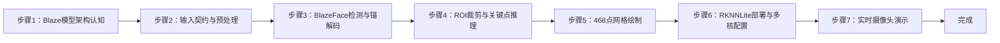

## 实验9：基于人脸关键点特征检测实验（4h）

> ✅ **源码已核实** 本实验源码位于 `ros2_ws/src/xflz_eai_car1/vision/09_face_landmarks/`。**方案 = mediapipe Blaze 模型转 RKNN，板上 RKNNLite NPU 推理 468 点网格**（双模型：face_detection_short_range 检测 + face_landmark 468 点）。交付形态为 ament_python ROS2 包 `car1_face_landmark/`，内层 `face_landmark_core/` 纯逻辑 x86 全可测。测试 101 用例全绿，板端验证通过（用户确认，FPS ≥10，fp16 混合量化）。

### 1.1 关联知识点

- 1.1.1 人脸检测原理 > 原理 > BlazeFace 轻量人脸检测器：SSD 锚点 + 回归器/分类器双输出，`face_detection_short_range` 输入 128×128，输出 [1,896,16] 锚解码 + [1,896,1] 置信度
- 1.2.1 关键点检测 > 流程 > 检测框 ROI 裁剪 → FaceLandmark 模型（输入 192×192）→ 468 点 + presence 置信度 → 逆映射回原图归一化坐标
- 1.2.2 面部网格拓扑 > 概念 > 478 拓扑 124 边（FACEMESH_CONTOURS），眼/眉/唇/脸廓黄点绿线绘制
- 1.3.1 RKNN NPU部署 > 原理 > mediapipe 官方 tflite → RKNN 转换（fp16 混合量化，rk3576 target）→ RKNNLite 板上推理；多核 core_mask（0=AUTO/1=CORE_0/2=CORE_1/4=CORE_2/7=三核）
- 1.3.2 实时人脸跟踪 > 流程 > 摄像头取流 → 检测+关键点 → 双栏显示（左检测框 | 右 468 网格）→ MJPEG 推流 :8081

### 1.2 实验目标

1. 掌握 BlazeFace 人脸检测与 FaceLandmark 关键点模型的架构与输入输出契约 — 原理理解
2. 实现双模型级联（检测→ROI→关键点）的完整人脸关键点检测链路 — 独立完成
3. 理解 tflite→RKNN 转换与 RKNNLite 部署流程，掌握多核 NPU 配置 — 迁移应用

### 1.3 实验环境

| 类别 | 配置 |
|------|------|
| 硬件 | 具身智能实验箱 B2（XFLZ_EAI_B2_PRO，RK3576 SoC，6TOPS NPU，含 HP60C 深度相机） |
| OS | Ubuntu 22.04 + ROS2 Humble（板载 ros2_venv，rknnlite 2.3.2 / rknn-toolkit-lite2） |
| 核心库 | OpenCV、NumPy、rknnlite（RKNNLite）、PyYAML；MJPEG 优先 mjpeg_streamer（不装则内置回退） |
| 模型 | `models/face_detection_short_range.rknn`（584KB，128×128）+ `models/face_landmark.rknn`（1.6MB，192×192，均 fp16 混合量化） |
| 主入口 | `python -m face_landmark_core.camera_demo --config config/face_config.yaml --ros [--display]` |

### 1.4 实验难度

- 难度: ⭐⭐ 设计性
- 重点: 双模型级联（检测→ROI 裁剪→468 点）+ 锚解码/NMS + 逆映射
- 难点: Blaze 模型输入契约（float32 RGB [0,1] NHWC）；ROI 裁剪与坐标逆映射对齐

### 1.5 实验现象

**快速验证流程**：

1. 进入项目目录：`cd ros2_ws/src/xflz_eai_car1/vision/09_face_landmarks`
2. 验证 rknnlite 环境：`python3 -c "from rknnlite.api import RKNNLite; print('ok')"`
3. 单图模式：`PYTHONPATH=car1_face_landmark:$PYTHONPATH python3 -m face_landmark_core.demo_image --config config/face_config.yaml --save out.jpg --display`
   - 双栏：左栏绿框 + `face <score>` 标签 | 右栏 468 点网格（眼/眉/唇/脸廓黄点绿线）
4. 相机实时（板上标准）：
   ```bash
   source /opt/ros/humble/setup.bash && source ~/ros2_ws/install/setup.bash
   ros2 launch ascamera hp60c.launch.py        # 终端 1
   PYTHONPATH=car1_face_landmark:$PYTHONPATH python3 -m face_landmark_core.camera_demo \
     --config config/face_config.yaml --ros --display   # 终端 2
   ```
5. MJPEG 无显示器查看：浏览器 `http://<板IP>:8081/face.mjpg`

**预期效果描述**：
- 图片模式：右栏 468 点网格（眼/眉/唇/脸廓黄点绿线），`--save` 出图
- 相机实时：人脸网格实时贴合；左栏绿框 + `face 0.9x` 标签；**多人（num_faces=2）各一套框/网格**；无脸时无框不崩溃
- 性能：FPS ≥10（fp16 混合量化，NPU）；MJPEG `:8081/face.mjpg` 浏览器可看（SSH 无显示器用）

### 1.6 实验步骤

#### 整体流程图



---

#### 步骤1：Blaze 模型架构认知（阶段一：能运行，20min）

> 📌 本步骤对应源码：`models/`、`src/`（face_landmark_core）

**知识点讲解**：

**Blaze 双模型级联（1.1.1）**
- **原理**：MediaPipe FaceMesh 的核心是**双模型级联**：`face_detection_short_range` 先做人脸检测（SSD 锚点 + 回归器/分类器双输出），`face_landmark` 再对检测框 ROI 内的脸输出 **468 点网格**（含 presence 置信度）。为什么不用单模型直接出点？——全图直接回归 468 点对尺度变化不鲁棒，检测-裁剪-关键点的两段式让每个模型任务更专注（检测负责"在哪"，关键点负责"长啥样"）。本实验把官方 tflite 转 RKNN 部署到板上 NPU（vendor mediapipe solutions 在 aarch64 上装得上但 SIGILL，ARMv8.0 无 LSE 指令）。
- **源码对应**：`models/face_detection_short_range.rknn`（[1,128,128,3] 输入，regressors [1,896,16] + classificators [1,896,1] 输出）；`models/face_landmark.rknn`（[1,192,192,3] 输入，conv2d_21 [1,1,1,1404] + conv2d_31 [1,1,1,1] 输出）

**操作步骤**：

1. 查看 models/ 目录两个 rknn 模型文件，理解输入输出契约表
2. 模型契约自检：`PYTHONPATH=car1_face_landmark python3 -m face_landmark_core.convert_mediapipe --check`
   - 验证 regressors/classificators、conv2d_21/conv2d_31 输出名一致
3. 思考：为什么两段式比单模型更稳？检测模型 128×128 而关键点 192×192 的原因？

**易错点**：
- ⚠️ 模型输出名必须与契约一致（--check 自检），换模型版本要重验

---

#### 步骤2：输入契约与预处理（阶段一：能运行，20min）

> 📌 本步骤对应源码：`face_landmark_core/landmark.py` _prepare

**知识点讲解**：

**Blaze 输入契约（1.1.1）**
- **原理**：Blaze 模型输入契约与 YOLO 系列不同：**float32 RGB，值域 [0,1]（归一化），NHWC 布局**。`_prepare()`（L113-116）三步转换：BGR→RGB（L115）→ uint8 转 float32 并 **÷255 归一化**（L116）→ reshape 为 `[1,size,size,3]` NHWC。注意与 RKNN 量化模型（int8 无归一化）的区别——Blaze 是 fp16 模型，需要调用方归一化。`backend.py` 的 `RKNNLiteBackend`（L20-62）封装 rknnlite 加载与推理，`predict` 支持多输入（L51-57，如 gesture_embedder 3 输入）。
- **源码对应**：`landmark.py` L113-116（_prepare：RGB L115 / 归一化 L116）；`backend.py` L20-62（RKNNLiteBackend：load L41-49 / predict L51-57）

**操作步骤**：

1. 单测理解输入契约：`pytest tests/ -v`（fake 注入，x86 可跑）
2. 手工验证预处理：
   ```bash
   python3 -c "
   import cv2, numpy as np
   from face_landmark_core.landmark import FaceLandmarkerEngine
   img = cv2.imread('x.jpg')
   # _prepare 是内部方法：BGR→RGB→float32[0,1]→NHWC
   rgb = cv2.cvtColor(img, cv2.COLOR_BGR2RGB).astype('float32')/255.0
   inp = rgb.reshape(1, 128, 128, 3)
   print('输入形状:', inp.shape, '值域:', inp.min(), '-', inp.max())"
   ```
3. 思考：为什么 [0,1] 归一化而 RKNN 量化模型不需要？fp16 与 int8 模型的输入契约差异？

**易错点**：
- ⚠️ 忘了归一化 [0,1] → 检测全废（fp16 模型契约）
- ⚠️ 布局必须 NHWC（Blaze 约定），误用 NCHW 报错或结果错乱

---

#### 步骤3：BlazeFace 检测与锚解码（阶段二：能理解，35min）

> 📌 本步骤对应源码：`face_landmark_core/landmark.py` process / engine

**知识点讲解**：

**锚解码与 NMS（1.1.1）**
- **原理**：BlazeFace 是 SSD 风格检测器：在 128×128 输入上预设 **896 个锚点**（多尺度网格），模型回归每个锚点的框偏移（regressors [1,896,16] = 4 坐标 × 4 份重复）与置信度（classificators [1,896,1]）。解码：锚点 + 偏移还原人脸框 → 置信度过滤 → **NMS**（重叠框抑制）→ 得到每张脸的检测框。`FaceLandmarkerEngine.process()`（L118-121）编排：检测 → 每脸 ROI → 关键点 → 逆映射。检测框供左栏绘制（YOLO 风格绿框 + `face <score>`）。
- **源码对应**：`landmark.py` L118-121（process 入口）、引擎内部（检测/解码/NMS/ROI/关键点/逆映射）

**操作步骤**：

1. 单图检测验证：`PYTHONPATH=car1_face_landmark:$PYTHONPATH python3 -m face_landmark_core.demo_image --config config/face_config.yaml --save out.jpg`
2. 多人测试：图片含 2 张脸，观察 num_faces=2 各一套框/网格
3. 无脸测试：空白图运行，观察 faces=[] 不崩溃
4. 思考：896 个锚点如何分布？为什么短距模型（short_range）只负责近距离人脸？

**易错点**：
- ⚠️ 锚解码参数来自 rknn-mediapipe-master（Apache-2.0），改模型需同步锚点配置

---

#### 步骤4：ROI 裁剪与关键点推理（阶段二：能理解，30min）

> 📌 本步骤对应源码：`face_landmark_core/landmark.py` 引擎关键点段

**知识点讲解**：

**ROI 级联（1.2.1）**
- **原理**：检测框确定后，把框内区域**裁剪缩放为 192×192** 喂给 `face_landmark` 模型（此即"级联"的关键：关键点模型只看人脸局部，尺度归一化后输出稳定）。模型输出 `conv2d_21 [1,1,1,1404]` = 468 点 × 3 坐标（x,y,z），`conv2d_31 [1,1,1,1]` = presence 置信度（是否有脸）。引擎把 ROI 坐标系的 468 点**逆映射回原图归一化坐标**（乘 ROI 缩放与偏移），供绘制与下游消费。
- **源码对应**：`landmark.py` 引擎（ROI 裁剪 / landmark 推理 / 逆映射）；模型输出契约见 README 表

**操作步骤**：

1. 打印单张脸的 LandmarkResult 结构（468 点 x,y,z + 检测框）
2. 绘制部分关键点（只画眼睛/嘴巴区域），理解点序与拓扑
3. 思考：presence 置信度低时如何处理？（过滤低置信度结果防误检）

**易错点**：
- ⚠️ ROI 逆映射必须用同一缩放/偏移，否则网格错位（引擎已处理）
- ⚠️ 468 点含 z（相对尺度），绘制 2D 时用 x,y

---

#### 步骤5：468 点网格绘制（阶段三：能改造，25min）

> 📌 本步骤对应源码：`face_landmark_core/landmark.py` draw_mesh / draw_boxes

**知识点讲解**：

**面部网格拓扑（1.2.2）**
- **原理**：468 点是原始采样点，视觉上呈现"网格"靠的是**拓扑连线**：`FACEMESH_CONTOURS`（478 拓扑 124 边）定义了眼/眉/唇/脸廓的连线关系。`draw_mesh()`（L195-198）按 connections 逐边连线绘制（黄点绿线，vendor 视觉）；`draw_boxes()`（L172-175）绘制左栏检测框（绿框 + `face <score>`）。拓扑连线让 468 个孤立点变成可读的面部结构，是姿态/表情分析的基础。
- **源码对应**：`landmark.py` L172-175（draw_boxes）、L195-198（draw_mesh，FACEMESH_CONTOURS）

**操作步骤**：

1. 单图输出双栏，观察右栏网格结构（眼/眉/唇/脸廓清晰可辨）
2. 动手改造：改连线颜色/粗细，或只绘制眼睛+嘴唇区域（局部拓扑）
3. 思考：478 拓扑与 468 点（+10 冗余）的关系？网格连线对表情识别的作用？

**易错点**：
- ⚠️ connections 使用 478 拓扑，点索引超 467 的边绘制时需跳过

---

#### 步骤6：RKNNLite 部署与多核配置（阶段三：能改造，30min）

> 📌 本步骤对应源码：`face_landmark_core/backend.py`、`convert_mediapipe.py`

**知识点讲解**：

**RKNNLite 与多核 NPU（1.3.1）**
- **原理**：板上统一用 **RKNNLite**（rknn-toolkit-lite2 2.3.2，RK3576 专用部署 API），完整版 rknn-toolkit2 仅留在 x86 转换环境。`RKNNLiteBackend.load()`（L41-49）懒导入 rknnlite（x86 单测无需）、`init_runtime(core_mask=...)`（无 target 参数）。**多核 NPU**：`config/face_config.yaml` → `backend.core_mask`：0=AUTO（默认）、1=CORE_0、2=CORE_1、4=CORE_2、3=0_1、7=0_1_2（RK3576 三核）——多模型并行时分配不同核可提升吞吐。转换用 `convert_mediapipe.py`（tflite → rknn，`--dtype fp|i8`，fp16 混合量化 landmark 回归精度更稳；int8 需校准集）。
- **源码对应**：`backend.py` L41-49（load：懒导入 L42 / init_runtime L44-48）；`convert_mediapipe.py`（tflite→rknn 转换 CLI）；`config/face_config.yaml`（backend.core_mask）

**操作步骤**：

1. 查看 `config/face_config.yaml` 的 backend.core_mask（默认 0=AUTO）
2. 修改 core_mask=1（CORE_0）运行，观察性能差异（多模型抢核 vs 独占）
3. 查看转换命令：`PYTHONPATH=car1_face_landmark python3 -m face_landmark_core.convert_mediapipe --help`
4. 思考：两个模型（检测+关键点）如何分配 NPU 核最优？（不同核并行，避免抢核）

**易错点**：
- ⚠️ 板上必须 RKNNLite（完整版 toolkit2 不部署）；core_mask 需平台支持（RK3576 三核）
- ⚠️ fp16 模型输入要归一化 [0,1]；int8 模型需要校准集

---

#### 步骤7：实时摄像头演示（阶段三：能改造，30min）

> 📌 本步骤对应源码：`face_landmark_core/camera_demo.py`、`face_landmark_node.py`

**知识点讲解**：

**实时链路与双模式（1.3.2）**
- **原理**：`camera_demo.py` 支持两种取流：**--ros**（板上标准，ascamera 话题，HP60C）+ **--camera N**（V4L2 UVC 回退，vendor 06 形态）。循环：取帧 → FaceLandmarkerEngine.process → 双栏合成（view.py）→ FPS 统计 → MJPEG 推流（:8081，避开 08 的 :8080）。ROS 节点模式（`face_landmark_node.py`）为可选：colcon 编译后 `ros2 launch car1_face_landmark face_landmark.launch.py`。**PYTHONPATH 必须保留 $PYTHONPATH**（覆盖会丢 Humble 路径 → venv 内 PyPI rclpy 被加载 → 崩）。
- **源码对应**：`camera_demo.py`（--ros/--camera 取流 / 循环 / MJPEG / q 退出）；`face_landmark_node.py`（ROS 节点）；`view.py` / `mjpeg_server.py`（双栏 + :8081 推流）

**操作步骤**：

1. 相机实时（板上标准，ROS_DOMAIN_ID 与驱动一致）：
   ```bash
   source /opt/ros/humble/setup.bash && source ~/ros2_ws/install/setup.bash
   ros2 launch ascamera hp60c.launch.py        # 终端 1
   PYTHONPATH=car1_face_landmark:$PYTHONPATH python3 -m face_landmark_core.camera_demo \
     --config config/face_config.yaml --ros --display   # 终端 2
   ```
2. 无显示器查看：去掉 --display，浏览器访问 `http://<板IP>:8081/face.mjpg`
3. 多人测试：两人入镜，观察 num_faces=2 各一套框/网格
4. 动手改造：在网格上叠加"眼睛睁开程度"（计算眼睑关键点距离）或头部姿态角，实现表情/姿态扩展

**易错点**：
- ⚠️ PYTHONPATH 必须保留 $PYTHONPATH（覆盖丢 Humble 路径 → rclpy 崩）
- ⚠️ --ros 需 ascamera 先起；话题严禁 remap；--camera N 回退需 V4L2+YUYV（MJPG 损坏会雪花）

---

### 1.7 常见问题

| 问题 | 原因 | 解决方法 |
|------|------|---------|
| 检测不到人脸 | 输入未归一化 [0,1] / 布局错误 | `_prepare` BGR→RGB→÷255→NHWC（L113-116） |
| 网格错位 | ROI 逆映射未对齐 | 引擎已处理；改模型需同步锚点配置 |
| SIGILL 崩溃 | 装了官方 mediapipe（ARMv8.1 LSE） | 弃用 mediapipe，用 RKNN Blaze（本实验方案） |
| rclpy 加载崩 | PYTHONPATH 覆盖丢 Humble 路径 | `PYTHONPATH=car1_face_landmark:$PYTHONPATH`（保留 $PYTHONPATH） |
| 帧率低 | core_mask 配置不当 / fp16 未生效 | 检查 backend.core_mask（0=AUTO）；确认 fp16 混合量化 |
| 多人只出一套网格 | num_faces 限制 | 检查引擎 num_faces 处理（默认多人各一套） |
| UVC 雪花 | 相机 MJPG 损坏（NOVATEK） | `--camera N` 用 V4L2+YUYV 回退 |
| MJPEG 404 | 端口占用 | 确认 :8081 空闲（避开 08 的 :8080） |

### 1.8 扩展实验

**扩展方向 1：表情与疲劳检测（进阶）**
- 用眼睑关键点计算 EAR（Eye Aspect Ratio），实现眨眼计数与疲劳预警；用嘴角关键点判断微笑

**扩展方向 2：头部姿态估计（进阶）**
- 用 468 点中面部稳定点（鼻尖/眼角/下颌）配合 3D 标准模型（SolvePNP）估计头部欧拉角，实现"转头跟随"交互

### 1.9 实验报告要求

**评分标准**：Blaze 架构理解 15 分 + 输入契约 15 分 + 检测与锚解码 20 分 + ROI 级联 20 分 + 网格绘制 10 分 + 实时演示 10 分 + 报告 10 分 = 100 分。

**报告必含内容**：
1. 双模型级联架构图（检测→ROI→关键点→逆映射），标注输入输出契约
2. 两模型输入输出规格表（形状/类型/归一化/输出名）与 --check 自检结果
3. 单图双栏结果图（左检测框 | 右 468 网格）
4. 多人/无脸场景的鲁棒性测试记录
5. core_mask 多核配置对帧率的影响数据
6. 回答思考题：为什么 [0,1] 归一化？为什么两段式级联？468 点 z 坐标的语义？
7. 实验心得与问题记录

---

## 更新日志

| 版本 | 日期 | 变更 |
|------|------|------|
| v1.0 | 2026-08-10 | 初版生成（源码路径 ros2_ws/src/xflz_eai_car1/vision/09_face_landmarks，101 用例全绿，RKNN Blaze 双模型 468 点网格 + RKNNLite NPU 推理 + 多核 core_mask，板端验证通过） |
